# MVC 源码解读版

> 目标：沿着一条 HTTP 请求真正经过的 MVC 主链，理解控制器发现、应用模型、ActionDescriptor、Endpoint、Invoker、过滤器与 ProblemDetails 如何协作。本文保留 `MVC.md` 中的全部核心源码，并在每段源码前后补充阅读焦点、机制图、运行时解释和最小例子。

## 阅读主线

不要把 MVC 看成“路由找到一个控制器然后反射调用方法”。源码中的真实过程分成两个时期：应用启动期先发现和编译元数据，请求期再消费这些缓存结果。

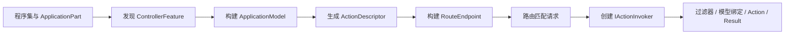

建议始终追问三个问题：当前对象属于启动期还是请求期？它保存的是事实、策略还是缓存结果？变化发生后，下游快照如何失效并重新构建？

## 深入阅读导航

| 阶段 | 入口类型 | 产物 | 最关键问题 |
|---|---|---|---|
| 组成部分 | `ApplicationPartManager` | 可枚举类型的 Part | MVC 去哪些程序集找候选类型？ |
| 控制器发现 | `ControllerFeatureProvider` | `ControllerFeature` | 什么类型算控制器？ |
| 应用建模 | `ApplicationModelFactory` | `ApplicationModel` | 特性与约定怎样改变控制器模型？ |
| 描述符 | `ControllerActionDescriptorProvider` | `ControllerActionDescriptor` | 路由和执行共享什么元数据？ |
| 端点构建 | `ControllerActionEndpointDataSource` | `RouteEndpoint` | 属性路由与传统路由怎样汇合？ |
| 请求入口 | `ControllerRequestDelegateFactory` | `IActionInvoker` | Endpoint 如何进入 MVC 管线？ |
| 外层执行 | `ResourceInvoker` | 过滤器状态机 | 短路、异常和异步怎样统一？ |
| Action 执行 | `ControllerActionInvoker` | `IActionResult` | 控制器、绑定、过滤器和方法怎样串联？ |
| API 错误 | API 行为过滤器 | `ProblemDetails` | 自动 400 与错误标准化在哪里发生？ |

## 核心类型索引

- **第 1 章**：`ApplicationPart`、`IApplicationPartTypeProvider`、`AssemblyPart`
- **第 2 章**：`IApplicationFeatureProvider<TFeature>`、`ControllerFeature`、`ControllerFeatureProvider`、`ApplicationPartManager`
- **第 3 章**：`ApplicationPartFactory`、`DefaultApplicationPartFactory`
- **第 4 章**：`ActionDescriptor`、`ControllerActionDescriptor`、`ActionDescriptorProviderContext`、`IActionDescriptorProvider`、`ControllerActionDescriptorProvider`
- **第 5 章**：`ApplicationModel`、`ControllerModel`、`ActionModel`、`SelectorModel`
- **第 6 章**：`IApplicationModelConvention`、`ApplicationModelProviderContext`、`IApplicationModelProvider`、`DefaultApplicationModelProvider`、`ApiBehaviorApplicationModelProvider`、`ApplicationModelFactory`
- **第 7 章**：`IActionDescriptorChangeProvider`、`ActionDescriptorChangeProvider`、`IActionDescriptorCollectionProvider`、`ActionDescriptorCollectionProvider`、`DefaultActionDescriptorCollectionProvider`
- **第 8 章**：`ControllerActionEndpointConventionBuilder`、`ActionEndpointDataSourceBase`、`ControllerActionEndpointDataSource`
- **第 9 章**：`ActionEndpointFactory`
- **第 10 章**：`ControllerEndpointRouteBuilderExtensions`、`ControllerActionEndpointDataSourceFactory`
- **第 11 章**：`ActionContext`、`ControllerContext`、`IRequestDelegateFactory`、`ControllerRequestDelegateFactory`、`IActionInvoker`
- **第 12 章**：`ResourceInvoker`
- **第 13 章**：`ControllerActionInvoker`
- **第 14 章**：`ProblemDetails`、`ProblemDetailsClientErrorFactory`、`DefaultProblemDetailsFactory`
- **第 15 章**：`IFilterMetadata`、`IOrderedFilter`、`IFilterFactory`、`TypeFilterAttribute`
- **第 16 章**：`ClientErrorResultFilterFactory`、`ClientErrorResultFilter`、`ModelStateInvalidFilterFactory`、`ModelStateInvalidFilter`

<a id="review-chapter-1"></a>

## 1. 应用组成部分：从程序集到可发现类型

### 本组解决什么问题

MVC 首先需要回答“去哪里找类型”。这一组把程序集包装成可扩展的 ApplicationPart，并把枚举类型的能力拆成独立接口。

### 关键类型关系图

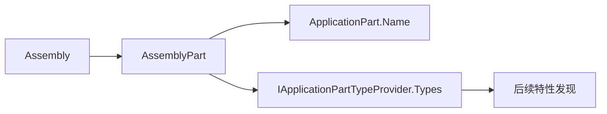

### 补充机制图

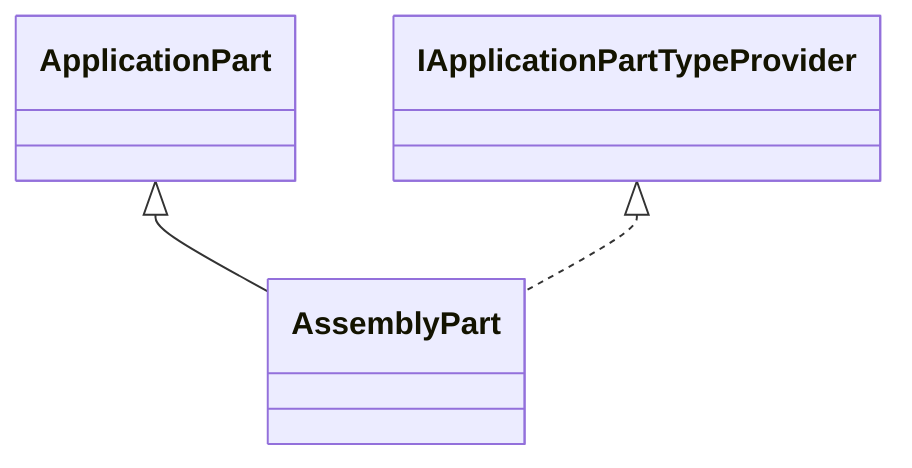

### 机制拆解

这里先建立“来源”和“能力”的分离：`ApplicationPart` 表示组成部分身份，`IApplicationPartTypeProvider` 表示它能提供类型。后续发现器只查询能力接口，因此自定义 Part 不必伪装成程序集。

### 核心源码解读

### ApplicationPart

**读这组源码时关注什么：** 程序集如何被抽象成 MVC 可消费的组成部分。

#### 整体结构

**这段代码回答什么问题：** 程序集如何被抽象成 MVC 可消费的组成部分。

```C#
// 应用程序组成部分
public abstract class ApplicationPart
{
    public abstract string Name { get; }
}
```

**源码解读：**
- 它只定义稳定的名称身份，不假设组成部分一定来自程序集。
- 具体内容能力由附加接口表达。

**读完要记住：**
- ApplicationPart 是扩展边界。
- 名称用于诊断和识别。

### IApplicationPartTypeProvider

**读这组源码时关注什么：** 类型枚举能力为什么独立于 ApplicationPart。

#### 整体结构

**这段代码回答什么问题：** 类型枚举能力为什么独立于 ApplicationPart。

```C#
// 应用程序组成部分类型提供器接口
public interface IApplicationPartTypeProvider
{
    // 返回类型集合
    IEnumerable<TypeInfo> Types { get; }
}
```

**源码解读：**
- 接口让控制器发现只依赖 Types，不依赖 Assembly。
- 非程序集来源也可以实现同一能力。

**读完要记住：**
- Part 与能力接口可以正交组合。
- 发现流程面向能力编程。

### AssemblyPart

**读这组源码时关注什么：** 普通程序集如何适配 ApplicationPart 与类型提供器。

#### 整体结构

**这段代码回答什么问题：** 普通程序集如何适配 ApplicationPart 与类型提供器。

```C#
// 表示应用程序组成部分中的程序集部分
public class AssemblyPart : ApplicationPart, IApplicationPartTypeProvider
{
    public AssemblyPart(Assembly assembly)
    {
        Assembly = assembly ?? throw new ArgumentNullException(nameof(assembly));
    }
 
    public Assembly Assembly { get; }
 
    public override string Name => Assembly.GetName().Name!;
 
    // 返回程序集中定义的所有类型
    public IEnumerable<TypeInfo> Types => Assembly.DefinedTypes;
}
```

**源码解读：**
- Assembly 是事实来源，Name 与 Types 都由它投影。
- DefinedTypes 保留 TypeInfo 供后续反射分析。

**读完要记住：**
- AssemblyPart 是默认程序集适配器。
- 它不负责判断哪些类型是控制器。

### 最小例子

把一个额外程序集加入 `ApplicationPartManager.ApplicationParts` 后，MVC 才有机会在其中发现控制器；仅仅让 CLR 加载程序集并不等价于加入 MVC 发现范围。

### 回顾要点

- ApplicationPart 是 MVC 的模块边界，不等同于 Assembly。
- AssemblyPart 只暴露类型，不负责判断控制器。

<a id="review-chapter-2"></a>

## 2. 控制器发现：Feature Provider 如何筛选候选类型

### 本组解决什么问题

有了类型来源后，MVC 需要以可替换规则识别控制器，并把发现结果收敛成 ControllerFeature。

### 关键类型关系图

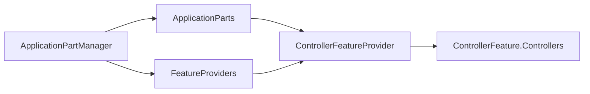

### 补充机制图

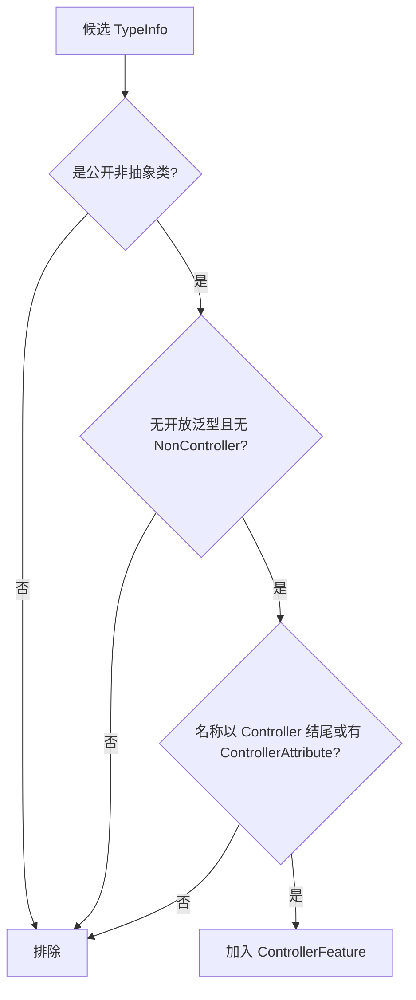

### 机制拆解

Feature Provider 模式把“遍历来源”和“识别特性”拆开。`ApplicationPartManager` 不理解控制器规则，只负责把 Parts 交给能处理 `ControllerFeature` 的 Provider。

### 核心源码解读

### IApplicationFeatureProvider<TFeature>

**读这组源码时关注什么：** 组成部分如何被转换成某类 MVC 特性。

#### 整体结构

**这段代码回答什么问题：** 组成部分如何被转换成某类 MVC 特性。

```C#
// 应用程序特性提供器接口
// 实现的 IApplicationFeatureProvider 属于空接口，作为标记接口使用
public interface IApplicationFeatureProvider<TFeature> : IApplicationFeatureProvider
{
    // 利用 ApplicationPart 集合配置 TFeature 特性
    void PopulateFeature(IEnumerable<ApplicationPart> parts, TFeature feature);
}
```

**源码解读：**
- 泛型参数决定提供器处理的特性种类。
- PopulateFeature 通过累加方式填充结果对象。

**读完要记住：**
- Part 是输入，Feature 是聚合结果。
- 多个提供器可以协作填充同一特性。

### ControllerFeature

**读这组源码时关注什么：** 控制器发现阶段最终收集什么。

#### 整体结构

**这段代码回答什么问题：** 控制器发现阶段最终收集什么。

```C#
// 控制器特性
public class ControllerFeature
{
    // 控制器类型集合
    // 用于收集应用程序内所有满足控制器要求的类型
    public IList<TypeInfo> Controllers { get; } = new List<TypeInfo>();
}
```

**源码解读：**
- 该对象只是控制器 TypeInfo 的可变集合。
- 筛选规则留给 ControllerFeatureProvider。

**读完要记住：**
- Feature 是阶段性产物。
- 它还不是 ControllerModel 或 ActionDescriptor。

### ControllerFeatureProvider

**读这组源码时关注什么：** 一个类型满足哪些条件才被视为控制器。

#### 整体结构

**这段代码回答什么问题：** 一个类型满足哪些条件才被视为控制器。

```C#
// 控制器特性提供器，实现 IApplicationFeatureProvider<ControllerFeature>
public class ControllerFeatureProvider : IApplicationFeatureProvider<ControllerFeature>
{
    // 表示控制器类型的名称后缀
    private const string ControllerTypeNameSuffix = "Controller";
 
    // 从 ApplicationPart 集合中筛选出实现 IApplicationPartTypeProvider 的 ApplicationPart
    // 然后遍历这些 ApplicationPart.Types 集合收集满足控制器要求的类型添加到 ControllerFeature.Controllers 集合中
    public void PopulateFeature(
        IEnumerable<ApplicationPart> parts,
        ControllerFeature feature)
    {
        foreach (var part in parts.OfType<IApplicationPartTypeProvider>())
        {
            foreach (var type in part.Types)
            {
                if (IsController(type) && !feature.Controllers.Contains(type))
                {
                    feature.Controllers.Add(type);
                }
            }
        }
    }
 
    // 满足控制器要求的类型必须同时达成以下条件：
    // 1. 是类
    // 2. 不是抽象类
    // 3. 是公开的
    // 4. 不是泛型类
    // 5. 类型上没有绑定 NonControllerAttribute 特性
    // 6. 类型上绑定 ControllerAttribute 特性或类型名称以 "Controller" 结尾（忽略大小写）
    protected virtual bool IsController(TypeInfo typeInfo)
    {
        if (!typeInfo.IsClass)
        {
            return false;
        }
 
        if (typeInfo.IsAbstract)
        {
            return false;
        }
 
        if (!typeInfo.IsPublic)
        {
            return false;
        }
 
        if (typeInfo.ContainsGenericParameters)
        {
            return false;
        }
 
        if (typeInfo.IsDefined(typeof(NonControllerAttribute)))
        {
            return false;
        }
 
        if (!typeInfo.Name.EndsWith(ControllerTypeNameSuffix, StringComparison.OrdinalIgnoreCase) &&
            !typeInfo.IsDefined(typeof(ControllerAttribute)))
        {
            return false;
        }
 
        return true;
    }
}
```

**源码解读：**
- PopulateFeature 遍历所有具有类型能力的 Part。
- IsController 集中处理类、可见性、泛型和特性规则。

**读完要记住：**
- Controller 后缀只是规则之一。
- NonControllerAttribute 可以显式排除。

### ApplicationPartManager

**读这组源码时关注什么：** MVC 如何管理程序集来源与特性提供器。

#### 整体结构

**这段代码回答什么问题：** MVC 如何管理程序集来源与特性提供器。

```C#
// 应用程序组成部分管理器
// 用于管理 MVC 中多个应用程序组成部分和应用程序特性提供器
public class ApplicationPartManager
{
    // 应用程序特性提供器集合
    public IList<IApplicationFeatureProvider> FeatureProviders { get; } =
        new List<IApplicationFeatureProvider>();

    // 应用程序组成部分集合
    public IList<ApplicationPart> ApplicationParts { get; } = new List<ApplicationPart>();

    // 填充应用程序的默认组成部分
    // 本质是利用 IWebHostEnvironment.ApplicationName 表示的应用程序名称作为入口程序集名称
    internal void PopulateDefaultParts(string entryAssemblyName)
    {
        // 得到入口程序集绑定的所有 ApplicationPartAttribute 特性中指定的程序集以及所有引用的程序集
        var assemblies = GetApplicationPartAssemblies(entryAssemblyName);
 
        // 避免重复添加相同程序集
        var seenAssemblies = new HashSet<Assembly>();
 
        foreach (var assembly in assemblies)
        {
            if (!seenAssemblies.Add(assembly))
            {
                continue;
            }

            // 通过程序集创建特定的 ApplicationPartFactory
            var partFactory = ApplicationPartFactory.GetApplicationPartFactory(assembly);
            // 如果是 DefaultApplicationPartFactory 则创建的是 AssemblyPart 集合
            foreach (var applicationPart in partFactory.GetApplicationParts(assembly))
            {
                ApplicationParts.Add(applicationPart);
            }
        }
    }

    // 得到入口程序集绑定的所有 ApplicationPartAttribute 特性中指定的程序集及其引用的程序集
    // 包含如下程序集：
    // 1. 入口程序集和其引用的程序集
    // 2. 特性指定的程序集以及这些程序集引用的程序集
    private static IEnumerable<Assembly> GetApplicationPartAssemblies(string entryAssemblyName)
    {
        var entryAssembly = Assembly.Load(new AssemblyName(entryAssemblyName));
 
        var assembliesFromAttributes = entryAssembly
            .GetCustomAttributes<ApplicationPartAttribute>()
            .Select(name => Assembly.Load(name.AssemblyName))
            .OrderBy(assembly => assembly.FullName, StringComparer.Ordinal)
            .SelectMany(GetAssemblyClosure);
 
        return GetAssemblyClosure(entryAssembly)
            .Concat(assembliesFromAttributes);
    }

    // 利用提供的 TFeature 泛型实参筛选对应的 IApplicationFeatureProvider<TFeature> 配置 TFeature 特性
    public void PopulateFeature<TFeature>(TFeature feature)
    {
        if (feature == null)
        {
            throw new ArgumentNullException(nameof(feature));
        }

        // 遍历所有 ApplicationPart 填充 TFeature 特性
        foreach (var provider in FeatureProviders.OfType<IApplicationFeatureProvider<TFeature>>())
        {
            provider.PopulateFeature(ApplicationParts, feature);
        }
    }
}
```

**源码解读：**
- ApplicationParts 保存输入，FeatureProviders 保存转换策略。
- PopulateFeature 按匹配的泛型能力执行提供器。

**读完要记住：**
- 它是发现阶段的协调者。
- 顺序与去重都会影响最终特性。

### 最小例子

一个公开类即使继承了 ControllerBase，只要绑定 `[NonController]` 仍会被排除；反过来，一个不以 Controller 结尾的公开类可通过 `[Controller]` 被发现。

### 回顾要点

- ControllerFeature 是发现结果，不是运行时控制器集合。
- 发现规则集中在 ControllerFeatureProvider.IsController。

<a id="review-chapter-3"></a>

## 3. Part 工厂：程序集如何自定义 MVC 暴露面

### 本组解决什么问题

程序集不一定只暴露一个 AssemblyPart。工厂层允许程序集声明自己的 Part 生产策略，同时保留简单可靠的默认路径。

### 关键类型关系图

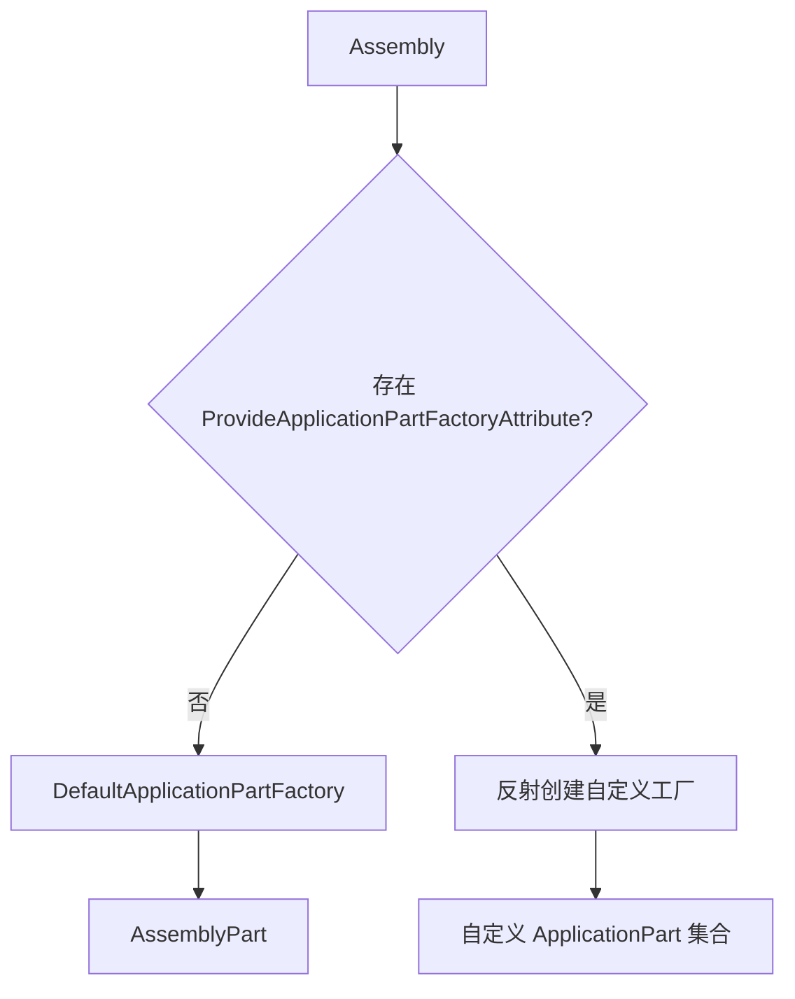

### 补充机制图

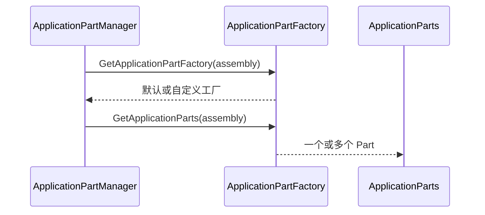

### 机制拆解

工厂选择发生在填充默认 Parts 时。特性只声明工厂类型，真正的实例化和类型校验由 `GetApplicationPartFactory` 完成，因此错误配置会在应用建模期暴露。

### 核心源码解读

### ApplicationPartFactory

**读这组源码时关注什么：** 程序集如何选择自定义 Part 工厂。

#### 整体结构

**这段代码回答什么问题：** 程序集如何选择自定义 Part 工厂。

```C#
// 表示 ApplicationPart 的抽象工厂
public abstract class ApplicationPartFactory
{
    // 子类重写该方法，实现根据给定的程序集得到 ApplicationPart 集合
    public abstract IEnumerable<ApplicationPart> GetApplicationParts(Assembly assembly);
 
    // 静态工具方法
    // 根据给定的程序集创建 ApplicationPartFactory
    public static ApplicationPartFactory GetApplicationPartFactory(Assembly assembly)
    {
        ArgumentNullException.ThrowIfNull(assembly);

        // 检查程序集是否绑定了 ProvideApplicationPartFactoryAttribute 特性
        var provideAttribute = assembly.GetCustomAttribute<ProvideApplicationPartFactoryAttribute>();
        // 如果没有则创建 DefaultApplicationPartFactory
        if (provideAttribute == null)
        {
            return DefaultApplicationPartFactory.Instance;
        }

        // 否则利用 ProvideApplicationPartFactoryAttribute.GetFactoryType 方法返回的类型反射得到对应的 ApplicationPartFactory
        var type = provideAttribute.GetFactoryType();
        if (!typeof(ApplicationPartFactory).IsAssignableFrom(type))
        {
            throw new InvalidOperationException(Resources.FormatApplicationPartFactory_InvalidFactoryType(
                type,
                nameof(ProvideApplicationPartFactoryAttribute),
                typeof(ApplicationPartFactory)));
        }
 
        return (ApplicationPartFactory)Activator.CreateInstance(type)!;
    }
}
```

**源码解读：**
- ProvideApplicationPartFactoryAttribute 是替换默认策略的入口。
- 工厂类型必须可赋给 ApplicationPartFactory。

**读完要记住：**
- 程序集可以控制自己的 MVC 暴露形式。
- 未配置时回退默认工厂。

### DefaultApplicationPartFactory

**读这组源码时关注什么：** 默认工厂如何把程序集变成 Part。

#### 整体结构

**这段代码回答什么问题：** 默认工厂如何把程序集变成 Part。

```C#
// 默认的 ApplicationPart 工厂
// 用于创建 AssemblyPart 封装对应的程序集
public class DefaultApplicationPartFactory : ApplicationPartFactory
{
    public static DefaultApplicationPartFactory Instance { get; } = new DefaultApplicationPartFactory();
    
    // 创建 AssemblyPart 封装对应的程序集并返回
    public static IEnumerable<ApplicationPart> GetDefaultApplicationParts(Assembly assembly)
    {
        ArgumentNullException.ThrowIfNull(assembly);
 
        yield return new AssemblyPart(assembly);
    }
 
    // 重写 GetApplicationParts 方法
    public override IEnumerable<ApplicationPart> GetApplicationParts(Assembly assembly)
    {
        return GetDefaultApplicationParts(assembly);
    }
}
```

**源码解读：**
- 默认实现只产生一个 AssemblyPart。
- 单例避免无状态工厂重复创建。

**读完要记住：**
- 默认路径没有额外扫描策略。
- 扩展需求应替换工厂而不是修改发现器。

### 最小例子

Razor 或其他扩展可以返回不同种类的 `ApplicationPart`，再配套自己的 Feature Provider；控制器发现仍只处理实现类型提供能力的 Part。

### 回顾要点

- 默认工厂一对一包装程序集。
- 自定义工厂改变 Part 形态，不改变 Feature Provider 协议。

<a id="review-chapter-4"></a>

## 4. Action 描述符：从发现结果到运行时元数据

### 本组解决什么问题

控制器类型不能直接交给路由和执行器。MVC 先创建可缓存、可扩展的 ActionDescriptor，并通过 Provider 管线汇总完整集合。

### 关键类型关系图

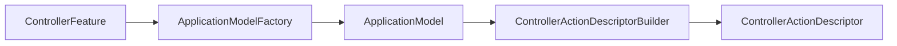

### 补充机制图

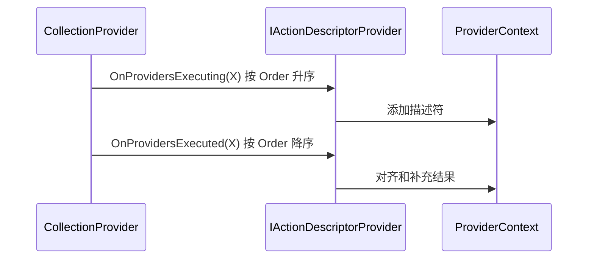

### 机制拆解

`ControllerActionDescriptorProvider` 是三阶段桥梁：它调用 Part 特性发现、应用模型创建和描述符构建。后处理统一 RouteValues 键集合，是为了让路由 RequiredValues 能区分“缺失键”和“键值为空”。

### 核心源码解读

### ActionDescriptor

**读这组源码时关注什么：** 路由和执行阶段共享的 Action 元数据有哪些。

#### 整体结构

**这段代码回答什么问题：** 路由和执行阶段共享的 Action 元数据有哪些。

```C#
// Action 方法描述符
// 注意：
// 每个 Action 方法基于特性路由可以对应多个 ActionDescriptor
public class ActionDescriptor
{
    public ActionDescriptor()
    {
        Id = Guid.NewGuid().ToString();
        Properties = new Dictionary<object, object?>();
        RouteValues = new Dictionary<string, string?>(StringComparer.OrdinalIgnoreCase);
    }
 
    public string Id { get; }
 
    // 路由值字典
    public IDictionary<string, string?> RouteValues { get; set; }
 
    // 特性路由信息
    public AttributeRouteInfo? AttributeRouteInfo { get; set; }
 
    // Action 约束集合
    public IList<IActionConstraintMetadata>? ActionConstraints { get; set; }
 
    // 终结点元数据集合
    public IList<object> EndpointMetadata { get; set; } = Array.Empty<ParameterDescriptor>();
 
    // 参数描述符集合
    public IList<ParameterDescriptor> Parameters { get; set; } = Array.Empty<ParameterDescriptor>();
 
    public IList<ParameterDescriptor> BoundProperties { get; set; } = Array.Empty<ParameterDescriptor>();
 
    // 过滤器描述符集合
    public IList<FilterDescriptor> FilterDescriptors { get; set; } = Array.Empty<FilterDescriptor>();
 
    // 显示名称
    public virtual string? DisplayName { get; set; }
 
    public IDictionary<object, object?> Properties { get; set; } = default!;
 
    internal IFilterMetadata[]? CachedReusableFilters { get; set; }
}
```

**源码解读：**
- RouteValues 与 AttributeRouteInfo 服务路由。
- Parameters、Filters、EndpointMetadata 服务执行与终结点构建。

**读完要记住：**
- Descriptor 是运行时元数据快照。
- 同一方法可能产生多个描述符。

### ControllerActionDescriptor

**读这组源码时关注什么：** 控制器 Action 需要补充哪些反射信息。

#### 整体结构

**这段代码回答什么问题：** 控制器 Action 需要补充哪些反射信息。

```C#
// 表示基于控制器的 Action 方法描述符
public class ControllerActionDescriptor : ActionDescriptor
{
    public string ControllerName { get; set; } = default!;
 
    public virtual string ActionName { get; set; } = default!;
 
    public MethodInfo MethodInfo { get; set; } = default!;
 
    public TypeInfo ControllerTypeInfo { get; set; } = default!;
 
    internal EndpointFilterDelegate? FilterDelegate { get; set; }

    internal ControllerActionInvokerCacheEntry? CacheEntry { get; set; }
 
    public override string? DisplayName
    {
        get
        {
            if (base.DisplayName == null && ControllerTypeInfo != null && MethodInfo != null)
            {
                base.DisplayName = string.Format(
                    CultureInfo.InvariantCulture,
                    "{0}.{1} ({2})",
                    TypeNameHelper.GetTypeDisplayName(ControllerTypeInfo),
                    MethodInfo.Name,
                    ControllerTypeInfo.Assembly.GetName().Name);
            }
 
            return base.DisplayName!;
        }
 
        set
        {
            ArgumentNullException.ThrowIfNull(value);
 
            base.DisplayName = value;
        }
    }
}
```

**源码解读：**
- ControllerName、ActionName 和 MethodInfo 锁定调用目标。
- CacheEntry 与 FilterDelegate 保存后续构建缓存。

**读完要记住：**
- 它把通用 Action 描述符具体化。
- DisplayName 延迟生成便于诊断。

### ActionDescriptorProviderContext

**读这组源码时关注什么：** 多个描述符提供器如何共享结果。

#### 整体结构

**这段代码回答什么问题：** 多个描述符提供器如何共享结果。

```C#
// 用于从多个 IActionDescriptorProvider 中收集 ActionDescriptor 时的上下文
public class ActionDescriptorProviderContext
{
    // 用于收集 ActionDescriptor 的集合
    public IList<ActionDescriptor> Results { get; } = new List<ActionDescriptor>();
}
```

**源码解读：**
- Results 是前处理与后处理共同操作的集合。
- 上下文避免提供器彼此直接依赖。

**读完要记住：**
- 提供器通过上下文协作。
- 后处理可以观察完整结果。

### IActionDescriptorProvider

**读这组源码时关注什么：** 描述符提供器为什么有前后两个阶段。

#### 整体结构

**这段代码回答什么问题：** 描述符提供器为什么有前后两个阶段。

```C#
// ActionDescriptor 提供器接口
// 注意：
// 当存在多个 IActionDescriptorProvider 时会按 Order 属性值升序依次执行 OnProvidersExecuting 方法和降序执行 OnProvidersExecuted 方法
public interface IActionDescriptorProvider
{
    // 用于决定执行顺序的属性，值越小优先级越高
    int Order { get; }

    // 前处理方法
    void OnProvidersExecuting(ActionDescriptorProviderContext context);

    // 后处理方法
    void OnProvidersExecuted(ActionDescriptorProviderContext context);
}
```

**源码解读：**
- Executing 按 Order 正序，Executed 反序。
- 结构类似洋葱，允许低优先级提供器补充后再回收处理。

**读完要记住：**
- Order 同时决定进入和退出顺序。
- 后处理适合全局归一化。

### ControllerActionDescriptorProvider

**读这组源码时关注什么：** 控制器类型如何最终变成 ControllerActionDescriptor。

#### 整体结构

**这段代码回答什么问题：** 控制器类型如何最终变成 ControllerActionDescriptor。

```C#
// 基于控制器的 ActionDescriptor 提供器
internal sealed class ControllerActionDescriptorProvider : IActionDescriptorProvider
{
    private readonly ApplicationPartManager _partManager;
    private readonly ApplicationModelFactory _applicationModelFactory;
 
    public ControllerActionDescriptorProvider(
        ApplicationPartManager partManager,
        ApplicationModelFactory applicationModelFactory)
    {
        ArgumentNullException.ThrowIfNull(partManager);
        ArgumentNullException.ThrowIfNull(applicationModelFactory);

        _partManager = partManager;
        _applicationModelFactory = applicationModelFactory;
    }
 
    // 保证比较高的优先级
    public int Order => -1000;
 
    // 前处理方法用于创建所有的 ControllerActionDescriptor 并添加到上下文的 Results 集合中
    public void OnProvidersExecuting(ActionDescriptorProviderContext context)
    {
        ArgumentNullException.ThrowIfNull(context);
 
        foreach (var descriptor in GetDescriptors())
        {
            context.Results.Add(descriptor);
        }
    }
 
    // 后处理方法将所有 ControllerActionDescriptor 的 RouteValues 属性表示的路由值字典对齐
    public void OnProvidersExecuted(ActionDescriptorProviderContext context)
    {
        // 遍历每个 ControllerActionDescriptor 收集路由值字典的键（忽略大小写去重）
        var keys = new HashSet<string>(StringComparer.OrdinalIgnoreCase);
        for (var i = 0; i < context.Results.Count; i++)
        {
            var action = context.Results[i];
            foreach (var key in action.RouteValues.Keys)
            {
                keys.Add(key);
            }
        }
 
        // 对齐每个 ControllerActionDescriptor 的路由值字典，如果对应的键不存在则添加一个 null 值
        // 目的是在后续创建 RouteEndpointBuilder 时为 RoutePattern 的 RequiredValues 属性赋值，用于路由系统使用 RouteEndpoint 做路径匹配或链接生成
        for (var i = 0; i < context.Results.Count; i++)
        {
            var action = context.Results[i];
            foreach (var key in keys)
            {
                if (!action.RouteValues.ContainsKey(key))
                {
                    action.RouteValues.Add(key, null);
                }
            }
        }
    }
 
    // 得到 ControllerActionDescriptor 集合
    internal IEnumerable<ControllerActionDescriptor> GetDescriptors()
    {
        // 得到所有控制器类型
        var controllerTypes = GetControllerTypes();
        // 利用 ApplicationModelFactory 解析所有控制器类型创建 ApplicationModel
        var application = _applicationModelFactory.CreateApplicationModel(controllerTypes);
        // 利用 ApplicationModel 构建 ControllerActionDescriptor 集合并返回
        // 最终 ControllerActionDescriptor 的数量取决于特性路由的几个关键概念（定义型、静默型以及是否属于 Http 方法限定）
        return ControllerActionDescriptorBuilder.Build(application);
    }
    
    // 得到所有控制器类型
    private IEnumerable<TypeInfo> GetControllerTypes()
    {
        var feature = new ControllerFeature();
        _partManager.PopulateFeature(feature);
 
        return feature.Controllers;
    }
}
```

**源码解读：**
- 先发现 ControllerFeature，再创建 ApplicationModel，最后 Build 描述符。
- Executed 阶段对齐 RouteValues 键集合。

**读完要记住：**
- 它串起发现、建模和描述符三个阶段。
- 路由值补 null 是匹配语义的一部分。

### 最小例子

一个 Action 上存在多个属性路由选择器时，最终可能出现多个 `ControllerActionDescriptor`；不要用“方法数量”等同于“描述符数量”。

### 回顾要点

- Descriptor 是路由与执行共享的稳定元数据。
- Provider 的 Executed 阶段适合处理全量结果。

<a id="review-chapter-5"></a>

## 5. 应用模型树：Controller、Action 与 Selector

### 本组解决什么问题

反射结果在生成描述符前需要一个可被约定修改的中间模型。ApplicationModel 树承担这一角色。

### 关键类型关系图

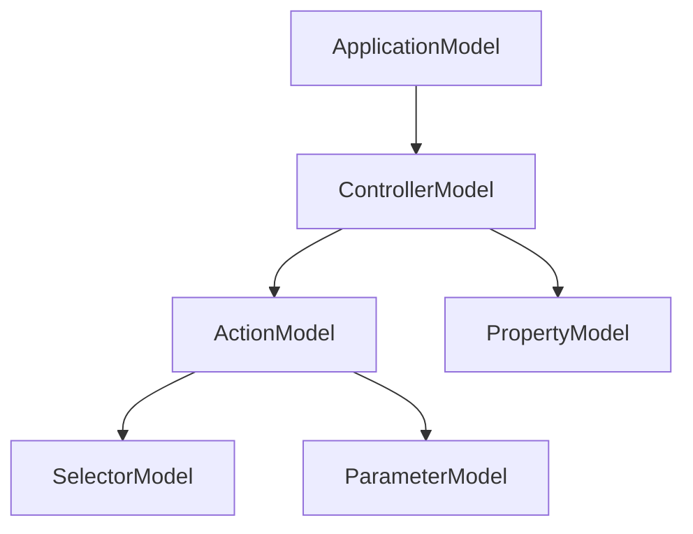

### 补充机制图

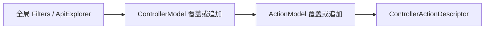

### 机制拆解

模型树既保存反射事实，也保存约定产生的决策。`SelectorModel` 特别关键，因为它把一个方法拆成一个或多个路由候选，并携带约束与 EndpointMetadata。

### 核心源码解读

### ApplicationModel

**读这组源码时关注什么：** 全局 MVC 模型保存哪些层级数据。

#### 整体结构

**这段代码回答什么问题：** 全局 MVC 模型保存哪些层级数据。

```C#
// 表示应用程序模型
public class ApplicationModel : IPropertyModel, IFilterModel, IApiExplorerModel
{
    public ApplicationModel()
    {
        ApiExplorer = new ApiExplorerModel();
        Controllers = new List<ControllerModel>();
        Filters = new List<IFilterMetadata>();
        Properties = new Dictionary<object, object?>();
    }
 
    // 全局 ApiExplorerModel
    // 作用于整个应用程序的所有 Action 方法，用于是否可以发现 API 以及分组
    // 可以通过 ControllerModel 或 ActionModel 的 ApiExplorer 属性覆盖
    public ApiExplorerModel ApiExplorer { get; set; }
 
    // 应用程序的 ControllerModel 集合
    // 表示应用程序内的所有控制器模型
    public IList<ControllerModel> Controllers { get; }
 
    // 全局 IFilterMetadata 集合
    // 作用于整个应用程序的所有 Action 方法，用于提供全局过滤器
    public IList<IFilterMetadata> Filters { get; }
 
    // 全局的共享字典
    // 作用于整个应用程序的所有 Action 方法
    public IDictionary<object, object?> Properties { get; }
}
```

**源码解读：**
- Controllers 构成模型树根，Filters 和 ApiExplorer 提供全局默认值。
- Properties 为约定和扩展保存附加状态。

**读完要记住：**
- 模型树是可修改的中间表示。
- 全局设置可被下层覆盖。

### ControllerModel

**读这组源码时关注什么：** 控制器层如何承接反射信息与约定。

#### 整体结构

**这段代码回答什么问题：** 控制器层如何承接反射信息与约定。

```C#
// 控制器模型
public class ControllerModel : ICommonModel, IFilterModel, IApiExplorerModel
{
    public ControllerModel(
        TypeInfo controllerType,
        IReadOnlyList<object> attributes)
    {
        ArgumentNullException.ThrowIfNull(controllerType);
        ArgumentNullException.ThrowIfNull(attributes);
 
        ControllerType = controllerType;
 
        Actions = new List<ActionModel>();
        ApiExplorer = new ApiExplorerModel();
        Attributes = new List<object>(attributes);
        ControllerProperties = new List<PropertyModel>();
        Filters = new List<IFilterMetadata>();
        Properties = new Dictionary<object, object?>();
        RouteValues = new Dictionary<string, string?>(StringComparer.OrdinalIgnoreCase);
        Selectors = new List<SelectorModel>();
    }
    
    // 控制器模型下的所有 ActionModel 模型
    public IList<ActionModel> Actions { get; }
 
    // 控制器的 ApiExplorerModel
    public ApiExplorerModel ApiExplorer { get; set; }
    
    // 当前控制器模型所属的 ApplicationModel
    public ApplicationModel? Application { get; set; }
 
    // 绑定在当前控制器类型上的所有特性
    public IReadOnlyList<object> Attributes { get; }
 
    MemberInfo ICommonModel.MemberInfo => ControllerType;
 
    string ICommonModel.Name => ControllerName;
 
    // 控制器名称
    public string ControllerName { get; set; } = default!;
    
    // 控制器的类型
    public TypeInfo ControllerType { get; }
 
    // 控制器的 PropertyModel 集合
    public IList<PropertyModel> ControllerProperties { get; }
 
    // 控制器的 IFilterMetadata 集合
    // 从当前绑定的特性集合中过滤出实现 IFilterMetadata 的特性
    public IList<IFilterMetadata> Filters { get; }
 
    // 控制器的路由值字典
    public IDictionary<string, string?> RouteValues { get; }
 
    // 控制器的共享字典
    public IDictionary<object, object?> Properties { get; }
 
    // 控制器的 SelectorModel 集合
    // 从当前绑定的特性集合中过滤出实现 IRouteTemplateProvider 的特性
    public IList<SelectorModel> Selectors { get; }
 
    public string DisplayName
    {
        get
        {
            var controllerType = TypeNameHelper.GetTypeDisplayName(ControllerType);
            var controllerAssembly = ControllerType.Assembly.GetName().Name;
            return $"{controllerType} ({controllerAssembly})";
        }
    }
}
```

**源码解读：**
- ControllerType 保存反射入口，Actions 与 Selectors 描述可执行面。
- Filters、RouteValues、Attributes 向 Action 层传播。

**读完要记住：**
- ControllerModel 不等于控制器实例。
- 它属于应用启动建模阶段。

### ActionModel

**读这组源码时关注什么：** 方法层如何表达 Action、参数与选择器。

#### 整体结构

**这段代码回答什么问题：** 方法层如何表达 Action、参数与选择器。

```C#
// 方法模型
public class ActionModel : ICommonModel, IFilterModel, IApiExplorerModel
{
    public ActionModel(
        MethodInfo actionMethod,
        IReadOnlyList<object> attributes)
    {
        ArgumentNullException.ThrowIfNull(actionMethod);
        ArgumentNullException.ThrowIfNull(attributes);
 
        ActionMethod = actionMethod;
 
        ApiExplorer = new ApiExplorerModel();
        Attributes = new List<object>(attributes);
        Filters = new List<IFilterMetadata>();
        Parameters = new List<ParameterModel>();
        RouteValues = new Dictionary<string, string?>(StringComparer.OrdinalIgnoreCase);
        Properties = new Dictionary<object, object?>();
        Selectors = new List<SelectorModel>();
    }

    // 方法的 MethodInfo
    public MethodInfo ActionMethod { get; }
 
    // 方法名称
    public string ActionName { get; set; } = default!;
 
    // 方法的 ApiExplorerModel
    public ApiExplorerModel ApiExplorer { get; set; }
 
    // 绑定在当前方法上的所有特性
    public IReadOnlyList<object> Attributes { get; }
    
    // 当前方法模型所属的 ControllerModel
    public ControllerModel Controller { get; set; } = default!;
 
    // 方法的 IFilterMetadata 集合
    // 从当前绑定的特性集合中过滤出实现 IFilterMetadata 的特性
    public IList<IFilterMetadata> Filters { get; }
 
    // 方法的 ParameterModel 集合
    public IList<ParameterModel> Parameters { get; }
 
    public IOutboundParameterTransformer? RouteParameterTransformer { get; set; }
 
    // 方法的路由值字典
    public IDictionary<string, string?> RouteValues { get; }
 
    // 方法的共享字典
    public IDictionary<object, object?> Properties { get; }
 
    MemberInfo ICommonModel.MemberInfo => ActionMethod;
 
    string ICommonModel.Name => ActionName;
 
    // 方法的 SelectorModel 集合
    // 从当前绑定的特性集合中过滤出实现 IRouteTemplateProvider 的特性
    public IList<SelectorModel> Selectors { get; }
 
    public string DisplayName
    {
        get
        {
            if (Controller == null)
            {
                return ActionMethod.Name;
            }
 
            var controllerType = TypeNameHelper.GetTypeDisplayName(Controller.ControllerType);
            var controllerAssembly = Controller?.ControllerType.Assembly.GetName().Name;
            return $"{controllerType}.{ActionMethod.Name} ({controllerAssembly})";
        }
    }
}
```

**源码解读：**
- ActionMethod 指向真实方法，Parameters 和 Selectors 描述绑定与路由。
- ActionName、RouteValues 可被约定修改。

**读完要记住：**
- ActionModel 是生成描述符前的可变模型。
- 一个 ActionModel 可产生多个选择器。

### SelectorModel

**读这组源码时关注什么：** 一个 Action 如何描述路由模板、约束和元数据。

#### 整体结构

**这段代码回答什么问题：** 一个 Action 如何描述路由模板、约束和元数据。

```C#
// 选择器模型
// 表示控制器或方法上绑定的实现了 IRouteTemplateProvider 的特性
public class SelectorModel
{
    public SelectorModel()
    {
        ActionConstraints = new List<IActionConstraintMetadata>();
        EndpointMetadata = new List<object>();
    }
 
    // 特性路由模型
    // 每个 SelectorModel 都会对应一个 IRouteTemplateProvider 特性
    public AttributeRouteModel? AttributeRouteModel { get; set; }
 
    // Action 约束元数据集合
    public IList<IActionConstraintMetadata> ActionConstraints { get; }
 
    // 终结点元数据集合
    public IList<object> EndpointMetadata { get; }
}
```

**源码解读：**
- AttributeRouteModel 保存模板，ActionConstraints 限制候选。
- EndpointMetadata 会复制到终结点。

**读完要记住：**
- Selector 是 Action 到 Endpoint 的分叉点。
- 无特性路由的选择器仍有意义。

### 最小例子

给所有 ControllerModel 添加一个过滤器会影响其所有 Action；若只修改某个 ActionModel，则不会污染兄弟 Action。

### 回顾要点

- ApplicationModel 是启动期可变中间表示。
- Selector 数量会影响最终描述符与端点数量。

<a id="review-chapter-6"></a>

## 6. 模型提供器与约定：反射信息如何被加工

### 本组解决什么问题

默认反射规则、ApiController 行为和用户约定需要按稳定顺序协作，最终得到完整的 ApplicationModel。

### 关键类型关系图

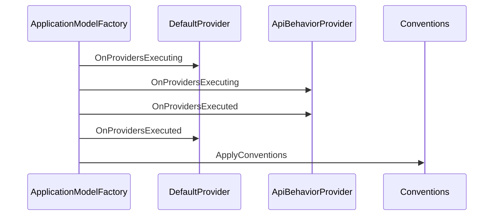

### 补充机制图

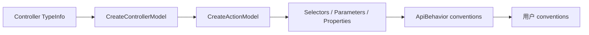

### 机制拆解

`DefaultApplicationModelProvider` 负责把特性与反射信息装入模型；`ApiBehaviorApplicationModelProvider` 再为 API 控制器注入绑定推断和自动错误处理。Factory 最后应用约定，形成清晰的基础事实、框架策略、用户改写顺序。

### 核心源码解读

### IApplicationModelConvention

**读这组源码时关注什么：** 应用模型如何开放全局改写入口。

#### 整体结构

**这段代码回答什么问题：** 应用模型如何开放全局改写入口。

```C#
// ApplicationModel 约定配置接口
public interface IApplicationModelConvention
{
    // 针对 ApplicationModel 的配置方法
    void Apply(ApplicationModel application);
}
```

**源码解读：**
- Apply 接收完整 ApplicationModel。
- 约定可以统一增加过滤器、路由或命名规则。

**读完要记住：**
- Convention 操作中间模型而非运行时请求。
- 全局改写应保持确定性。

### ApplicationModelProviderContext

**读这组源码时关注什么：** 模型提供器共享哪些输入输出。

#### 整体结构

**这段代码回答什么问题：** 模型提供器共享哪些输入输出。

```C#
// 用于从多个 IApplicationModelProvider 中收集 ApplicationModel 中的 ControllerModel、 ActionModel、SelectorModel、ParameterModel、PropertyModel 等模型时的上下文
public class ApplicationModelProviderContext
{
    public ApplicationModelProviderContext(IEnumerable<TypeInfo> controllerTypes)
    {
        ArgumentNullException.ThrowIfNull(controllerTypes);
 
        ControllerTypes = controllerTypes;
    }
 
    // 用于构建应用程序模型的控制器类型集合
    public IEnumerable<TypeInfo> ControllerTypes { get; }
 
    // 应用程序模型
    public ApplicationModel Result { get; } = new ApplicationModel();
}
```

**源码解读：**
- ControllerTypes 是不可变输入，Result 是逐步填充的模型。
- 上下文明确了建模阶段的边界。

**读完要记住：**
- 输入来自控制器发现。
- 输出会继续转成描述符。

### IApplicationModelProvider

**读这组源码时关注什么：** 应用模型构建为什么也采用双向提供器管线。

#### 整体结构

**这段代码回答什么问题：** 应用模型构建为什么也采用双向提供器管线。

```C#
// 应用模型提供器接口
// 注意：
// 当存在多个 IApplicationModelProvider 时会按 Order 属性值升序依次执行 OnProvidersExecuting 方法和降序执行 OnProvidersExecuted 方法
public interface IApplicationModelProvider
{
    // 用于决定执行顺序的属性，值越小优先级越高
    int Order { get; }
 
    // 前处理方法
    void OnProvidersExecuting(ApplicationModelProviderContext context);
 
    // 后处理方法
    void OnProvidersExecuted(ApplicationModelProviderContext context);
}
```

**源码解读：**
- Executing 创建或补充模型，Executed 在完整模型上收尾。
- Order 形成可扩展的洋葱顺序。

**读完要记住：**
- 默认提供器与 API 行为提供器可组合。
- 前后阶段职责应分开。

### DefaultApplicationModelProvider

**读这组源码时关注什么：** 反射信息如何展开为控制器、Action、参数与选择器模型。

#### 整体结构

**这段代码回答什么问题：** 反射信息如何展开为控制器、Action、参数与选择器模型。

```C#
// 默认的 ApplicationModel 提供器
// 用于创建 ApplicationModel 中的 ControllerModel、ActionModel、SelectorModel、ParameterModel、PropertyModel 等模型
internal class DefaultApplicationModelProvider : IApplicationModelProvider
{
    private readonly MvcOptions _mvcOptions;
    private readonly IModelMetadataProvider _modelMetadataProvider;

    public DefaultApplicationModelProvider(
        IOptions<MvcOptions> mvcOptionsAccessor,
        IModelMetadataProvider modelMetadataProvider)
    {
        _mvcOptions = mvcOptionsAccessor.Value;
        _modelMetadataProvider = modelMetadataProvider;
 
        _supportsAllRequests = _ => true;
        _supportsNonGetRequests = context => !HttpMethods.IsGet(context.HttpContext.Request.Method);
    }

    // 保证比较高的优先级
    public int Order => -1000;

    // 前处理方法
    // 为 ApplicationModel 创建 ControllerModel、ActionModel、SelectorModel、ParameterModel、PropertyModel 等模型
    public void OnProvidersExecuting(ApplicationModelProviderContext context)
    {
        ArgumentNullException.ThrowIfNull(context);

        // 从 MvcOptions.Filters 属性中将过滤器（实现 IFilterMetadata）转移到 ApplicationModel.Filters 集合中
        // 这些就是作用于整个应用程序中所有 Action 的全局过滤器
        // 注意：
        // MvcOptions.Filters 属性在添加过滤器类型时，实际使用 TypeFilterAttribute （实现 IFilterMetadata）这个特性封装实际的过滤器类型（同样实现 IFilterMetadata）
        // TypeFilterAttribute 实现了 IFilterFactory 接口，实际的过滤器就是通过实现的 CreateInstance 方法创建的，并且 IFilterFactory.CreateInstance 方法接受一个 IServiceProvider 类型的参数，可以在创建实际过滤器时提供依赖服务的解析
        foreach (var filter in _mvcOptions.Filters)
        {
            context.Result.Filters.Add(filter);
        }
 
        // 从控制器类型创建对应的 ControllerModel 并添加到 ApplicationModel.Controllers 集合中
        foreach (var controllerType in context.ControllerTypes)
        {
            var controllerModel = CreateControllerModel(controllerType);
            if (controllerModel == null)
            {
                continue;
            }
 
            context.Result.Controllers.Add(controllerModel);
            controllerModel.Application = context.Result;

            // 创建 PropertyModel 并添加到 ControllerModel.ControllerProperties 集合中
            foreach (var propertyHelper in PropertyHelper.GetProperties(controllerType.AsType()))
            {
                var propertyInfo = propertyHelper.Property;
                var propertyModel = CreatePropertyModel(propertyInfo);
                if (propertyModel != null)
                {
                    propertyModel.Controller = controllerModel;
                    controllerModel.ControllerProperties.Add(propertyModel);
                }
            }
 
            //  创建 ActionModel 并添加到 ControllerModel.Actions 集合中
            foreach (var methodInfo in controllerType.AsType().GetMethods())
            {
                var actionModel = CreateActionModel(controllerType, methodInfo);
                if (actionModel == null)
                {
                    continue;
                }
 
                actionModel.Controller = controllerModel;
                controllerModel.Actions.Add(actionModel);
 
                //  创建 ParameterModel 并添加到 ActionModel.Parameters 集合中
                foreach (var parameterInfo in actionModel.ActionMethod.GetParameters())
                {
                    var parameterModel = CreateParameterModel(parameterInfo);
                    if (parameterModel != null)
                    {
                        parameterModel.Action = actionModel;
                        actionModel.Parameters.Add(parameterModel);
                    }
                }
            }
        }
    }

    // 后处理方法
    public void OnProvidersExecuted(ApplicationModelProviderContext context)
    {
        // 不做任何处理
    }

    // 创建 ControllerModel
    internal static ControllerModel CreateControllerModel(TypeInfo typeInfo)
    {
        ArgumentNullException.ThrowIfNull(typeInfo);
 
        var currentTypeInfo = typeInfo;
        var objectTypeInfo = typeof(object).GetTypeInfo();
 
        IRouteTemplateProvider[] routeAttributes;
 
        do
        {
            // 得到控制器上绑定的实现了 IRouteTemplateProvider 的特性
            // 注意：
            // 这里不从基类继承特性
            routeAttributes = currentTypeInfo
                .GetCustomAttributes(inherit: false)
                .OfType<IRouteTemplateProvider>()
                .ToArray();

            // 存在则中断
            if (routeAttributes.Length > 0)
            {
                break;
            }

            // 如果没有找到则继续检查基类
            // 直到找到 object 类型为止
            currentTypeInfo = currentTypeInfo.BaseType!.GetTypeInfo();
        }
        while (currentTypeInfo != objectTypeInfo);

        // 得到控制器上绑定的所有的特性（包括基类上的）
        var attributes = typeInfo.GetCustomAttributes(inherit: true);
 
        var filteredAttributes = new List<object>();
        foreach (var attribute in attributes)
        {
            if (attribute is IRouteTemplateProvider)
            {
                // 排除实现了 IRouteTemplateProvider 的特性
            }
            else
            {
                // 只添加其他特性
                filteredAttributes.Add(attribute);
            }
        }
        
        // 合并特性，将收集的实现 IRouteTemplateProvider 的特性添加到集合末尾
        filteredAttributes.AddRange(routeAttributes);
 
        attributes = filteredAttributes.ToArray();

        // 利用控制器类型和特性集合创建 ControllerModel
        var controllerModel = new ControllerModel(typeInfo, attributes);

        // 根据 ControllerModel 中绑定的实现 IRouteTemplateProvider 的特性创建 SelectorModel，并添加到 ControllerModel.Selectors 集合中
        AddRange(controllerModel.Selectors, CreateSelectors(attributes));
    
        controllerModel.ControllerName =
            typeInfo.Name.EndsWith("Controller", StringComparison.OrdinalIgnoreCase) ?
                typeInfo.Name.Substring(0, typeInfo.Name.Length - "Controller".Length) :
                typeInfo.Name;
 
        // 根据 ControllerModel 中绑定的实现 IFilterMetadata 的特性创建 FilterModel，并添加到 ControllerModel.Filters 集合中
        AddRange(controllerModel.Filters, attributes.OfType<IFilterMetadata>());

        // 根据 ControllerModel 中绑定的实现 IRouteValueProvider 的特性填充路由值字典
        foreach (var routeValueProvider in attributes.OfType<IRouteValueProvider>())
        {
            controllerModel.RouteValues.Add(routeValueProvider.RouteKey, routeValueProvider.RouteValue);
        }

        // 根据 ControllerModel 中绑定的实现 IApiDescriptionVisibilityProvider 的特性配置控制器的可见性（针对控制器下所有方法）
        var apiVisibility = attributes.OfType<IApiDescriptionVisibilityProvider>().FirstOrDefault();
        if (apiVisibility != null)
        {
            controllerModel.ApiExplorer.IsVisible = !apiVisibility.IgnoreApi;
        }
 
        // 根据 ControllerModel 中绑定的实现 IApiDescriptionGroupNameProvider 的特性配置控制器的分组名称
        var apiGroupName = attributes.OfType<IApiDescriptionGroupNameProvider>().FirstOrDefault();
        if (apiGroupName != null)
        {
            controllerModel.ApiExplorer.GroupName = apiGroupName.GroupName;
        }
 
        // 如果控制器类型自身实现了 IAsyncActionFilter 或 IActionFilter，则创建 ControllerActionFilter 作为 IFileterMetadata 添加到 ControllerModel.Filters 集合中
        // ControllerActionFilter 作为过滤器时会在管线执行时，利用控制器调用过滤器方法
        if (typeof(IAsyncActionFilter).GetTypeInfo().IsAssignableFrom(typeInfo) ||
            typeof(IActionFilter).GetTypeInfo().IsAssignableFrom(typeInfo))
        {
            controllerModel.Filters.Add(new ControllerActionFilter());
        }
        // 如果控制器类型自身实现了 IAsyncResultFilter 或 IResultFilter，则创建 ControllerResultFilter 作为 IFileterMetadata 添加到 ControllerModel.Filters 集合中
        // ControllerResultFilter 作为过滤器时会在管线执行时，利用控制器调用过滤器方法
        if (typeof(IAsyncResultFilter).GetTypeInfo().IsAssignableFrom(typeInfo) ||
            typeof(IResultFilter).GetTypeInfo().IsAssignableFrom(typeInfo))
        {
            controllerModel.Filters.Add(new ControllerResultFilter());
        }
 
        return controllerModel;
    }

    // 创建 ActionModel
    internal ActionModel? CreateActionModel(
        TypeInfo typeInfo,
        MethodInfo methodInfo)
    {
        ArgumentNullException.ThrowIfNull(typeInfo);
        ArgumentNullException.ThrowIfNull(methodInfo);
 
        // 选定的方法需要同时满足的条件
        // 1. 不能是编译器生成的特殊方法名，比如属性的 get/set 方法
        // 2. 方法不能绑定 NonActionAttribute 特性
        // 3. 重写的方法不能是 object 类型中定义的 virtual 方法
        // 4. 不能是实现了 IDisposable 接口的 Dispose 方法
        // 5. 不能是静态方法
        // 6. 不能是抽象方法
        // 7. 不能是构造函数
        // 8. 不能是泛型方法
        if (!IsAction(typeInfo, methodInfo))
        {
            return null;
        }
 
        // 得到方法上绑定的所有特性（包括基类被重写方法继承的特性）
        var attributes = methodInfo.GetCustomAttributes(inherit: true);

        // 利用 MethodInfo 和特性集合创建 ActionModel
        var actionModel = new ActionModel(methodInfo, attributes);
 
        // 根据 Action 方法上绑定的实现 IFilterMetadata 的特性创建 FilterModel，并添加到 ActionModel.Filters 集合中
        AddRange(actionModel.Filters, attributes.OfType<IFilterMetadata>());
 
        var actionName = attributes.OfType<ActionNameAttribute>().FirstOrDefault();
        if (actionName?.Name != null)
        {
            actionModel.ActionName = actionName.Name;
        }
        else
        {
            actionModel.ActionName = CanonicalizeActionName(methodInfo.Name);
        }
 
        // 根据 ActionModel 中绑定的实现 IApiDescriptionVisibilityProvider 的特性配置方法的可见性
        var apiVisibility = attributes.OfType<IApiDescriptionVisibilityProvider>().FirstOrDefault();
        if (apiVisibility != null)
        {
            actionModel.ApiExplorer.IsVisible = !apiVisibility.IgnoreApi;
        }
 
        // 根据 ActionModel 中绑定的实现 IApiDescriptionGroupNameProvider 的特性配置方法的分组名称
        var apiGroupName = attributes.OfType<IApiDescriptionGroupNameProvider>().FirstOrDefault();
        if (apiGroupName != null)
        {
            actionModel.ApiExplorer.GroupName = apiGroupName.GroupName;
        }
 
        // 根据 ActionModel 中绑定的实现 IRouteValueProvider 的特性填充路由值字典
        foreach (var routeValueProvider in attributes.OfType<IRouteValueProvider>())
        {
            actionModel.RouteValues.Add(routeValueProvider.RouteKey, routeValueProvider.RouteValue);
        }
 
        var currentMethodInfo = methodInfo;
 
        IRouteTemplateProvider[] routeAttributes;
 
        // 从方法上收集实现了 IRouteTemplateProvider 的特性
        while (true)
        {
            // 注意：
            // 这里不从基类被重写方法继承特性
            routeAttributes = currentMethodInfo
                .GetCustomAttributes(inherit: false)
                .OfType<IRouteTemplateProvider>()
                .ToArray();

            // 存在则中断
            if (routeAttributes.Length > 0)
            {
                break;
            }

            // 继续检查基类中被重写的方法
            var nextMethodInfo = currentMethodInfo.GetBaseDefinition();
            if (currentMethodInfo == nextMethodInfo)
            {
                break;
            }

            currentMethodInfo = nextMethodInfo;
        }
 
        var applicableAttributes = new List<object>(routeAttributes.Length);
        foreach (var attribute in attributes)
        {
            if (attribute is IRouteTemplateProvider)
            {
                // 排除实现了 IRouteTemplateProvider 的特性
            }
            else
            {
                // 只添加其他特性
                applicableAttributes.Add(attribute);
            }
        }
 
        // 合并特性，将收集的实现 IRouteTemplateProvider 的特性添加到集合末尾
        applicableAttributes.AddRange(routeAttributes);
        // 根据 ActionModel 中绑定的实现 IRouteTemplateProvider 的特性创建 SelectorModel，并添加到 ActionModel.Selectors 集合中
        AddRange(actionModel.Selectors, CreateSelectors(applicableAttributes));

        // 添加返回值类型的元数据到 ActionModel.Selectors 集合中的每个 SelectorModel 中的 EndpointMetadata 集合中
        AddReturnTypeMetadata(actionModel.Selectors, methodInfo);
 
        return actionModel;
    }

    // 创建 ParameterModel
    internal ParameterModel CreateParameterModel(ParameterInfo parameterInfo)
    {
        ArgumentNullException.ThrowIfNull(parameterInfo);
 
        // 得到参数上绑定的所有特性（包括基类被重写方法参数继承的特性）
        var attributes = parameterInfo.GetCustomAttributes(inherit: true);
 
        // 遍历所有特性解析参数的绑定信息确定绑定源
        // BindingInfo 优先读取特性列表中的绑定信息，再从 ModelMetadata 获取绑定信息作为补充
        // ModelMetadata 通过实现 IModelMetadataProvider 的 DefaultModelMetadataProvider 创建 DefaultModelMetadata
        // DefaultModelMetadata 内部提供绑定信息依赖 BindingMetadata
        // BindingMetadata 通过实现 ICompositeMetadataDetailsProvider 的 DefaultCompositeMetadataDetailsProvider 调用 CreateBindingMetadata 方法创建
        // CreateBindingMetadata 方法会遍历所有注入的 IBindingMetadataProvider（实现 IMetadataDetailsProvider） 来创建 BindingMetadata
        // 所以可以通过自定义 IBindingMetadataProvider 来定制参数的绑定信息
        BindingInfo? bindingInfo;
        if (_modelMetadataProvider is ModelMetadataProvider modelMetadataProviderBase)
        {
            var modelMetadata = modelMetadataProviderBase.GetMetadataForParameter(parameterInfo);
            bindingInfo = BindingInfo.GetBindingInfo(attributes, modelMetadata);
        }
        else
        {
            bindingInfo = BindingInfo.GetBindingInfo(attributes);
        }

        // 利用 ParameterInfo、特性集合、绑定信息创建 ParameterModel
        var parameterModel = new ParameterModel(parameterInfo, attributes)
        {
            ParameterName = parameterInfo.Name!,
            BindingInfo = bindingInfo
        };
 
        return parameterModel;
    }

    // 创建 SelectorModel 集合
    // 具体创建多少个 SelectorModel 遵循以下规则：
    // 1. 特性路由需要是实现 IRouteTemplateProvider 的特性
    // 2. 特性路由分为定义型和静默型两种以及是否有 Http 方法限定（试下 IActionHttpMethodProvider）
    // 3. 定义型并且有 Http 方法限定的，每个特性创建一个 SelectorModel
    // 4. 静默型并且有 Http 方法限定的，首先合并所有特性
    // 5. 如果存在定义型并且没有 Http 方法限定的，则和合并后的特性一起创建一个 SelectorModel
    // 6. 否则使用方法名作为默认路由模板和合并后的特性一起创建一个 SelectorModel
    private static IList<SelectorModel> CreateSelectors(IList<object> attributes)
    {
        var routeProviders = new List<IRouteTemplateProvider>();
 
        var createSelectorForSilentRouteProviders = false;
        foreach (var attribute in attributes)
        {
            if (attribute is IRouteTemplateProvider routeTemplateProvider)
            {
                if (IsSilentRouteAttribute(routeTemplateProvider))
                {
                    createSelectorForSilentRouteProviders = true;
                }
                else
                {
                    routeProviders.Add(routeTemplateProvider);
                }
            }
        }
 
        foreach (var routeProvider in routeProviders)
        {
            if (!(routeProvider is IActionHttpMethodProvider))
            {
                createSelectorForSilentRouteProviders = false;
                break;
            }
        }
 
        var selectorModels = new List<SelectorModel>();
        if (routeProviders.Count == 0 && !createSelectorForSilentRouteProviders)
        {
            selectorModels.Add(CreateSelectorModel(route: null, attributes: attributes));
        }
        else
        {
            foreach (var routeProvider in routeProviders)
            {
                var filteredAttributes = new List<object>();
                foreach (var attribute in attributes)
                {
                    if (ReferenceEquals(attribute, routeProvider))
                    {
                        filteredAttributes.Add(attribute);
                    }
                    else if (InRouteProviders(routeProviders, attribute))
                    {
                    }
                    else if (
                        routeProvider is IActionHttpMethodProvider &&
                        attribute is IActionHttpMethodProvider)
                    {
                    }
                    else
                    {
                        filteredAttributes.Add(attribute);
                    }
                }
 
                selectorModels.Add(CreateSelectorModel(routeProvider, filteredAttributes));
            }
 
            if (createSelectorForSilentRouteProviders)
            {
                var filteredAttributes = new List<object>();
                foreach (var attribute in attributes)
                {
                    if (!InRouteProviders(routeProviders, attribute))
                    {
                        filteredAttributes.Add(attribute);
                    }
                }
 
                selectorModels.Add(CreateSelectorModel(route: null, attributes: filteredAttributes));
            }
        }
 
        return selectorModels;
    }

    // 创建 SelectorModel
    private static SelectorModel CreateSelectorModel(IRouteTemplateProvider? route, IList<object> attributes)
    {
        var selectorModel = new SelectorModel();
        if (route != null)
        {
            selectorModel.AttributeRouteModel = new AttributeRouteModel(route);
        }
 
        // 将特性集合中实现了 IActionConstraintMetadata 的特性添加到 SelectorModel.ActionConstraints 集合中
        AddRange(selectorModel.ActionConstraints, attributes.OfType<IActionConstraintMetadata>());
        // 将特性集合添加到 SelectorModel.EndpointMetadata 表示的终结点元数据集合中
        AddRange(selectorModel.EndpointMetadata, attributes);
 
        // 检查是否存在实现了 IActionHttpMethodProvider 的特性
        var httpMethods = attributes
            .OfType<IActionHttpMethodProvider>()
            .SelectMany(a => a.HttpMethods)
            .Distinct(StringComparer.OrdinalIgnoreCase)
            .ToArray();
 
        if (httpMethods.Length > 0)
        {
            // 添加 HttpMethodActionConstraint 到 SelectorModel.ActionConstraints 集合中
            selectorModel.ActionConstraints.Add(new HttpMethodActionConstraint(httpMethods));
            // 添加 HttpMethodMetadata 到 SelectorModel.EndpointMetadata 集合中
            selectorModel.EndpointMetadata.Add(new HttpMethodMetadata(httpMethods));
        }
 
        return selectorModel;
    }
}
```

**源码解读：**
- 它遍历控制器和公开方法并读取特性。
- 路由、绑定、过滤器、ApiExplorer 等元数据在这里汇入模型树。

**读完要记住：**
- 这是反射到 MVC 模型的核心转换器。
- 长代码应按 CreateControllerModel 与 CreateActionModel 分段阅读。

### ApiBehaviorApplicationModelProvider

**读这组源码时关注什么：** ApiController 约定如何注入 MVC 模型。

#### 整体结构

**这段代码回答什么问题：** ApiController 约定如何注入 MVC 模型。

```C#
// 基于 Api 行为的 ApplicationModel 提供器
// 针对绑定了 ApiControllerAttribute 特性的控制器
// 注意：
// 标记了 ApiControllerAttribute 特性的控制器的所有 Action 方法必须使用特性路由
// 即在类型或方法上绑定实现了 IRouteTemplateProvider 的特性
internal sealed class ApiBehaviorApplicationModelProvider : IApplicationModelProvider
{
    public ApiBehaviorApplicationModelProvider(
        IOptions<ApiBehaviorOptions> apiBehaviorOptions,
        IModelMetadataProvider modelMetadataProvider,
        IServiceProvider serviceProvider)
    {
        var options = apiBehaviorOptions.Value;
 
        ActionModelConventions = new List<IActionModelConvention>()
        {
            // 用于配置默认的 Action 可见
            // 注意：
            // 只有在控制器和方法都没有绑定 IApiDescriptionVisibilityProvider 特性的情况下生效
            new ApiVisibilityConvention(),
        };
 
        if (!options.SuppressMapClientErrors)
        {
            // 为每个 ActionModel 的 Action.Filters 集合添加 ClientErrorResultFilterFactory 并最终创建 ClientErrorResultFilter 结果过滤器来处理 4xx 状态码的友好响应
            ActionModelConventions.Add(new ClientErrorResultFilterConvention());
        }
 
        if (!options.SuppressModelStateInvalidFilter)
        {
            // 为每个 ActionModel 的 Action.Filters 集合添加 ModelStateInvalidFilterFactory 并最终创建 ModelStateInvalidFilter 动作过滤器来处理模型验证失败的情况
            ActionModelConventions.Add(new InvalidModelStateFilterConvention());
        }
 
        if (!options.SuppressConsumesConstraintForFormFileParameters)
        {
            // 为每个包含 IFormFile 或 IFormFileCollection 参数的 ActionModel 添加 ConsumesAttribute 资源过滤器，用来检查请求的 Content-Type 是否为 multipart/form-data 媒体类型，如果不是则返回 415 状态码
            ActionModelConventions.Add(new ConsumesConstraintForFormFileParameterConvention());
        }
 
        // 错误响应类型配置
        var defaultErrorType = options.SuppressMapClientErrors ? typeof(void) : typeof(ProblemDetails);
        var defaultErrorTypeAttribute = new ProducesErrorResponseTypeAttribute(defaultErrorType);
        ActionModelConventions.Add(new ApiConventionApplicationModelConvention(defaultErrorTypeAttribute));
 
        // 检查方法参数上的绑定源是否配置，如果没有则配置默认的模型绑定源
        if (!options.SuppressInferBindingSourcesForParameters)
        {
            var serviceProviderIsService = serviceProvider.GetService<IServiceProviderIsService>();
            var convention = options.DisableImplicitFromServicesParameters || serviceProviderIsService is null ?
                new InferParameterBindingInfoConvention(modelMetadataProvider) :
                new InferParameterBindingInfoConvention(modelMetadataProvider, serviceProviderIsService);
            ActionModelConventions.Add(convention);
        }
    }
 
    // +100 的目的是降低优先级，保证 ApiBehaviorApplicationModelProvider 在 DefaultApplicationModelProvider 之后执行
    // 因为需要等待 DefaultApplicationModelProvider 创建好所有模型之后才能使用预添加的 IActionModelConvention 对 ActionModel 进行配置
    public int Order => -1000 + 100;
 
    public List<IActionModelConvention> ActionModelConventions { get; }
 
    // 前处理方法
    public void OnProvidersExecuting(ApplicationModelProviderContext context)
    {
        // 遍历 ApplicationModel.Controllers 集合
        foreach (var controller in context.Result.Controllers)
        {
            // 跳过没有绑定 ApiControllerAttribute 特性的控制器
            // ApiBehaviorApplicationModelProvider 是提供给 WebApi 控制器的专属配置
            if (!IsApiController(controller))
            {
                continue;
            }
 
            foreach (var action in controller.Actions)
            {
                // 控制器或方法上必须确保配置了特性路由
                EnsureActionIsAttributeRouted(action);

                // 遍历 IActionModelConventions 集合配置 ActionModel
                foreach (var convention in ActionModelConventions)
                {
                    convention.Apply(action);
                }
            }
        }
    }

    // 后处理方法
    public void OnProvidersExecuted(ApplicationModelProviderContext context)
    {
        // 不做任何处理
    }
    
    // 确保控制器或方法上配置了特性路由
    private static void EnsureActionIsAttributeRouted(ActionModel actionModel)
    {
        if (!IsAttributeRouted(actionModel.Controller.Selectors) &&
            !IsAttributeRouted(actionModel.Selectors))
        {
            var message = Resources.FormatApiController_AttributeRouteRequired(
                 actionModel.DisplayName,
                nameof(ApiControllerAttribute));
            throw new InvalidOperationException(message);
        }
 
        static bool IsAttributeRouted(IList<SelectorModel> selectorModel)
        {
            for (var i = 0; i < selectorModel.Count; i++)
            {
                if (selectorModel[i].AttributeRouteModel != null)
                {
                    return true;
                }
            }
 
            return false;
        }
    }
    
    // 检查控制器类型上是否绑定实现了 IApiBehaviorMetadata 的特性
    // 比如 ApiControllerAttribute 就实现了 IApiBehaviorMetadata
    private static bool IsApiController(ControllerModel controller)
    {
        if (controller.Attributes.OfType<IApiBehaviorMetadata>().Any())
        {
            return true;
        }

        // 或者从类型定义所在的程序集上检查是否绑定了实现 IApiBehaviorMetadata 的特性
        var controllerAssembly = controller.ControllerType.Assembly;
        var assemblyAttributes = controllerAssembly.GetCustomAttributes();
        return assemblyAttributes.OfType<IApiBehaviorMetadata>().Any();
    }
}
```

**源码解读：**
- 它只处理具有 API 行为标记的控制器。
- 多个 ActionModelConvention 依次补充绑定推断和错误过滤器。

**读完要记住：**
- ApiController 主要是建模约定集合。
- 自动 400 来自这里注入的过滤器。

### ApplicationModelFactory

**读这组源码时关注什么：** 多个模型提供器与约定如何被统一调度。

#### 整体结构

**这段代码回答什么问题：** 多个模型提供器与约定如何被统一调度。

```C#
// ApplicationModel 工厂
internal sealed class ApplicationModelFactory
{
    private readonly IApplicationModelProvider[] _applicationModelProviders;
    private readonly IList<IApplicationModelConvention> _conventions;
 
    public ApplicationModelFactory(
        IEnumerable<IApplicationModelProvider> applicationModelProviders,
        IOptions<MvcOptions> options)
    {
        ArgumentNullException.ThrowIfNull(applicationModelProviders);
        ArgumentNullException.ThrowIfNull(options);
 
        // 对注入的 IApplicationModelProvider 集合升序排序
        _applicationModelProviders = applicationModelProviders.OrderBy(p => p.Order).ToArray();
        
        // 从 MvcOptions.Conventions 属性中得到 IApplicationModelConvention 集合
        _conventions = options.Value.Conventions;
    }

    // 应用 IApplicationModelProvider 集合配置 ApplicationModel
    public ApplicationModel CreateApplicationModel(IEnumerable<TypeInfo> controllerTypes)
    {
        ArgumentNullException.ThrowIfNull(controllerTypes);
 
        var context = new ApplicationModelProviderContext(controllerTypes);
 
        for (var i = 0; i < _applicationModelProviders.Length; i++)
        {
            _applicationModelProviders[i].OnProvidersExecuting(context);
        }

        for (var i = _applicationModelProviders.Length - 1; i >= 0; i--)
        {
            _applicationModelProviders[i].OnProvidersExecuted(context);
        }
 
        // 应用 IApplicationModelConvention 集合配置 ApplicationModel
        ApplicationModelConventions.ApplyConventions(context.Result, _conventions);
 
        return context.Result;
    }
}
```

**源码解读：**
- 提供器按 Order 进入并反向退出。
- 随后依次应用全局、控制器、Action、参数约定。

**读完要记住：**
- Factory 是模型构建总调度器。
- 约定在提供器完成后执行。

### 最小例子

自定义 `IApplicationModelConvention` 可以统一给所有 Action 添加过滤器或路由前缀，比在每个控制器上复制特性更稳定。

### 回顾要点

- Provider 建模型，Convention 改模型。
- ApiController 的许多行为在请求到来前已经写进模型。

<a id="review-chapter-7"></a>

## 7. 描述符快照：缓存、版本与变化通知

### 本组解决什么问题

ActionDescriptor 构建包含反射和约定执行，不能每次请求重做；同时动态变化时又必须可靠刷新。

### 关键类型关系图

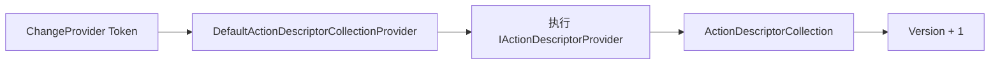

### 补充机制图

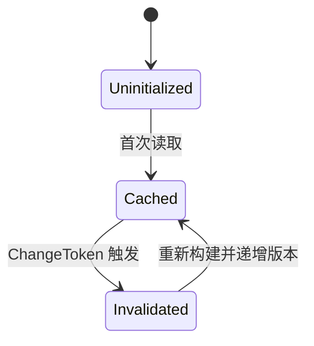

### 机制拆解

默认集合提供器把全量描述符包装成版本化快照。变化发生时，旧快照仍可被已有读者安全使用，新读者会看到重新构建的集合。`NotifyChanges` 的先替换后 Cancel 是持续订阅正确性的关键。

### 核心源码解读

### IActionDescriptorChangeProvider

**读这组源码时关注什么：** 外部如何通知 ActionDescriptor 已失效。

#### 整体结构

**这段代码回答什么问题：** 外部如何通知 ActionDescriptor 已失效。

```C#
// 与 IActionDescriptorProvider 配套的变动令牌提供器接口
// 用于在 IActionDescriptorCollectionProvider 保存的 ActionDescriptor 集合变化时发出通知
public interface IActionDescriptorChangeProvider
{
    // 返回变动令牌，用于注册回调，在发生变动时触发
    IChangeToken GetChangeToken();
}
```

**源码解读：**
- GetChangeToken 暴露一次性变化信号。
- 实现方决定何时触发。

**读完要记住：**
- 变化通知与描述符计算解耦。
- 消费者需要重新订阅新令牌。

### ActionDescriptorChangeProvider

**读这组源码时关注什么：** 框架内部如何主动触发描述符刷新。

#### 整体结构

**这段代码回答什么问题：** 框架内部如何主动触发描述符刷新。

```C#
// IActionDescriptorChangeProvider 的默认实现
public class ActionDescriptorChangeProvider : IActionDescriptorChangeProvider
{
    public ActionDescriptorChangeProvider(WellKnownChangeToken changeToken)
    {
        ChangeToken = changeToken;
    }
 
    public WellKnownChangeToken ChangeToken { get; }
 
    public IChangeToken GetChangeToken()
    {
        if (ChangeToken.TokenSource.IsCancellationRequested)
        {
            var changeTokenSource = new CancellationTokenSource();
            return new CancellationChangeToken(changeTokenSource.Token);
        }
 
        return new CancellationChangeToken(ChangeToken.TokenSource.Token);
    }
}
```

**源码解读：**
- 静态 TokenSource 保存当前信号源。
- NotifyChanges 先替换再取消旧源。

**读完要记住：**
- 先换后触发避免重入订阅旧令牌。
- 它是内部全局刷新入口。

### IActionDescriptorCollectionProvider

**读这组源码时关注什么：** 消费者如何读取带版本的描述符快照。

#### 整体结构

**这段代码回答什么问题：** 消费者如何读取带版本的描述符快照。

```C#
// IActionDescriptorProvider 集合提供器接口
public interface IActionDescriptorCollectionProvider
{
    // 聚合多个 IActionDescriptorProvider 提供的 ActionDescriptor 集合
    ActionDescriptorCollection ActionDescriptors { get; }
}
```

**源码解读：**
- ActionDescriptors 返回集合和版本。
- 接口隐藏缓存与刷新细节。

**读完要记住：**
- 读取的是一致快照。
- 版本用于识别重新构建。

### ActionDescriptorCollectionProvider

**读这组源码时关注什么：** 抽象基类提供什么公共读取表面。

#### 整体结构

**这段代码回答什么问题：** 抽象基类提供什么公共读取表面。

```C#
// IActionDescriptorCollectionProvider 的默认实现
public abstract class ActionDescriptorCollectionProvider : IActionDescriptorCollectionProvider
{
    // ActionDescriptor 集合
    public abstract ActionDescriptorCollection ActionDescriptors { get; }
 
    // 返回变动令牌，用于回调注册，在发生变动时触发
    public abstract IChangeToken GetChangeToken();
}
```

**源码解读：**
- 它只保留接口契约，具体缓存交给默认实现。
- 抽象层便于替换实现。

**读完要记住：**
- 公共 API 不暴露锁与 ChangeToken。
- 真正逻辑在 Default 实现。

### DefaultActionDescriptorCollectionProvider

**读这组源码时关注什么：** 描述符如何延迟构建、缓存并响应变化。

#### 整体结构

**这段代码回答什么问题：** 描述符如何延迟构建、缓存并响应变化。

```C#
// 继承 ActionDescriptorCollectionProvider
internal sealed partial class DefaultActionDescriptorCollectionProvider : ActionDescriptorCollectionProvider
{
    private readonly IActionDescriptorProvider[] _actionDescriptorProviders;
    private readonly IActionDescriptorChangeProvider[] _actionDescriptorChangeProviders;
    private readonly ILogger _logger;
 
    private readonly object _lock;
    private ActionDescriptorCollection? _collection;
    private IChangeToken? _changeToken;
    private CancellationTokenSource? _cancellationTokenSource;
    private int _version;
 
    public DefaultActionDescriptorCollectionProvider(
        IEnumerable<IActionDescriptorProvider> actionDescriptorProviders,
        IEnumerable<IActionDescriptorChangeProvider> actionDescriptorChangeProviders,
        ILogger<DefaultActionDescriptorCollectionProvider> logger)
    {
        // 对注入的 IActionDescriptorProvider 集合升序排序
        _actionDescriptorProviders = actionDescriptorProviders
            .OrderBy(p => p.Order)
            .ToArray();
 
        _actionDescriptorChangeProviders = actionDescriptorChangeProviders.ToArray();
 
        _lock = new object();
 
        _logger = logger;
 
        // 合并多个 IChangeToken 封装为 CompositeChangeToken 并注册回调 UpdateCollection 方法
        // 用于更新 ActionDescriptor 集合
        ChangeToken.OnChange(
            GetCompositeChangeToken,
            UpdateCollection);
    }
 
    // 合并多个 IActionDescriptorProvider 提供的 ActionDescriptor 集合
    public override ActionDescriptorCollection ActionDescriptors
    {
        get
        {
            // 初始化 ActionDescriptor 集合
            Initialize();
            Debug.Assert(_collection != null);
            Debug.Assert(_changeToken != null);
 
            return _collection;
        }
    }
 
    // 返回变动令牌，用于回调注册，在 ActionDescriptor 集合发生变动时触发
    public override IChangeToken GetChangeToken()
    {
        // 初始化 ActionDescriptor 集合
        Initialize();
        Debug.Assert(_collection != null);
        Debug.Assert(_changeToken != null);
 
        return _changeToken;
    }
 
    // 合并多个 IActionDescriptorChangeProvider 提供的 IChangeToken 封装为 CompositeChangeToken
    private IChangeToken GetCompositeChangeToken()
    {
        if (_actionDescriptorChangeProviders.Length == 1)
        {
            return _actionDescriptorChangeProviders[0].GetChangeToken();
        }
 
        var changeTokens = new IChangeToken[_actionDescriptorChangeProviders.Length];
        for (var i = 0; i < _actionDescriptorChangeProviders.Length; i++)
        {
            changeTokens[i] = _actionDescriptorChangeProviders[i].GetChangeToken();
        }
 
        return new CompositeChangeToken(changeTokens);
    }
 
    // 初始化 ActionDescriptor 集合
    private void Initialize()
    {
        // 需要保证线程同步，双重检查锁定
        // 初始化只会调用 UpdateCollection 方法一次，用于创建 ActionDescriptor 集合，其他时候都是通过触发变动令牌回调来更新集合
        if (_collection == null)
        {
            lock (_lock)
            {
                if (_collection == null)
                {
                    UpdateCollection();
                }
            }
        }
    }
    
    // 更新 ActionDescriptor 集合
    private void UpdateCollection()
    {
        lock (_lock)
        {
            // 创建上下文
            var context = new ActionDescriptorProviderContext();
 
            // 升序执行每个 IActionDescriptorProvider 的前处理方法
            for (var i = 0; i < _actionDescriptorProviders.Length; i++)
            {
                _actionDescriptorProviders[i].OnProvidersExecuting(context);
            }

            // 降序执行每个 IActionDescriptorProvider 的后处理方法
            for (var i = _actionDescriptorProviders.Length - 1; i >= 0; i--)
            {
                _actionDescriptorProviders[i].OnProvidersExecuted(context);
            }
 
            if (context.Results.Count == 0)
            {
                Log.NoActionDescriptors(_logger);
            }

            var oldCancellationTokenSource = _cancellationTokenSource;

            // 重新创建 ActionDescriptorCollection
            _collection = new ActionDescriptorCollection(
                new ReadOnlyCollection<ActionDescriptor>(context.Results),
                _version++);

            // 利用 CancellationTokenSource 创建一个新的 CancellationChangeToken
            _cancellationTokenSource = new CancellationTokenSource();
            _changeToken = new CancellationChangeToken(_cancellationTokenSource.Token);

            // 利用旧的 CancellationChangeToken 触发回调
            oldCancellationTokenSource?.Cancel();
        }
    }
 
    public static partial class Log
    {
        [LoggerMessage(
            EventId = 1,
            EventName = "NoActionDescriptors",
            Level = LogLevel.Information,
            Message = "No action descriptors found. This may indicate an incorrectly configured application or missing application parts. To learn more, visit https://aka.ms/aspnet/mvc/app-parts")]
        public static partial void NoActionDescriptors(ILogger logger);
    }
}
```

**源码解读：**
- 双重检查锁保证首次初始化与刷新安全。
- 每次变化重新执行所有 Provider 并递增版本。

**读完要记住：**
- 缓存的是全量不可变视图。
- 变更令牌负责使缓存失效。

### 最小例子

开发期动态加载控制器后触发 ChangeProvider，EndpointDataSource 会进一步感知新描述符版本并重建端点。

### 回顾要点

- 描述符缓存是全量快照，不是逐 Action 缓存。
- ChangeToken 通知变化，Version 标识结果代次。

<a id="review-chapter-8"></a>

## 8. 控制器 EndpointDataSource：描述符如何变成端点集合

### 本组解决什么问题

路由系统消费 Endpoint，而 MVC 产出 ActionDescriptor。DataSource 负责在两种模型之间建立可刷新映射。

### 关键类型关系图

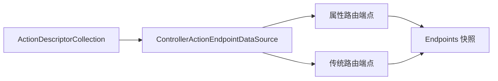

### 补充机制图

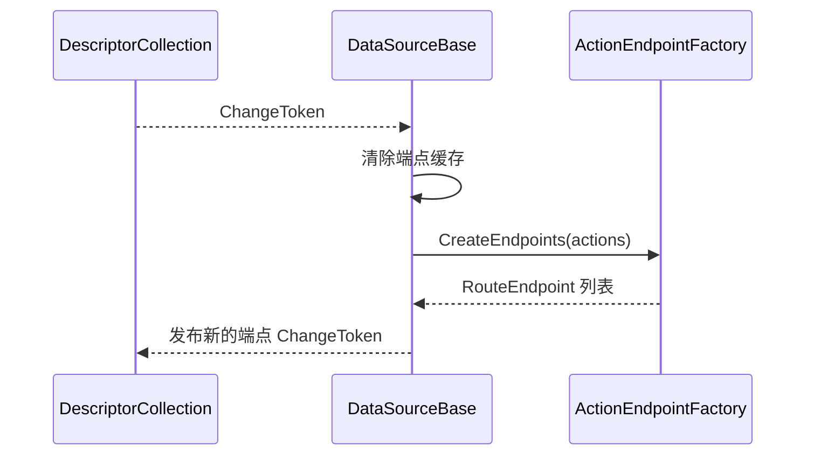

### 机制拆解

基类处理缓存、锁和变化传播，控制器子类只决定如何遍历属性路由与传统路由。约定收集在 ConventionBuilder 中，真正应用发生在端点创建时。

### 核心源码解读

### ControllerActionEndpointConventionBuilder

**读这组源码时关注什么：** 调用方添加的终结点约定保存在哪里。

#### 整体结构

**这段代码回答什么问题：** 调用方添加的终结点约定保存在哪里。

```C#
// 针对控制器 ActionDescriptor 构建终结点时的 RouteEndpointBuilder 约定配置类
// 是与 ControllerActionEndpointDataSource 配套的 IEndpointConventionBuilder 实现
public sealed class ControllerActionEndpointConventionBuilder : IEndpointConventionBuilder
{
    private readonly object _lock;
    private readonly List<Action<EndpointBuilder>> _conventions;
    private readonly List<Action<EndpointBuilder>> _finallyConventions;
 
    // 注意：
    // 两个配置集合都是来自于外部
    internal ControllerActionEndpointConventionBuilder(object @lock, List<Action<EndpointBuilder>> conventions, List<Action<EndpointBuilder>> finallyConventions)
    {
        _lock = @lock;
        _conventions = conventions;
        _finallyConventions = finallyConventions;
    }
 
    public void Add(Action<EndpointBuilder> convention)
    {
        ArgumentNullException.ThrowIfNull(convention);
 
        lock (_lock)
        {
            _conventions.Add(convention);
        }
    }
 
    public void Finally(Action<EndpointBuilder> finalConvention)
    {
        ArgumentNullException.ThrowIfNull(nameof(finalConvention));
 
        lock (_lock)
        {
            _finallyConventions.Add(finalConvention);
        };
    }
}
```

**源码解读：**
- Add 与 Finally 分别记录普通约定和最终约定。
- 约定实际由底层 DataSource 在建 Endpoint 时应用。

**读完要记住：**
- Builder 只收集配置。
- Finally 在普通约定之后执行。

### ActionEndpointDataSourceBase

**读这组源码时关注什么：** ActionDescriptor 变化如何驱动 EndpointDataSource 重建。

#### 整体结构

**这段代码回答什么问题：** ActionDescriptor 变化如何驱动 EndpointDataSource 重建。

```C#
// 针对 ActionDescriptor 的 EndpointDataSource 基类
internal abstract class ActionEndpointDataSourceBase : EndpointDataSource, IDisposable
{
    private readonly IActionDescriptorCollectionProvider _actions;
 
    protected readonly object Lock = new object();
 
    protected readonly List<Action<EndpointBuilder>> Conventions;
    protected readonly List<Action<EndpointBuilder>> FinallyConventions;
 
    private List<Endpoint>? _endpoints;
    private CancellationTokenSource? _cancellationTokenSource;
    private IChangeToken? _changeToken;
    private IDisposable? _disposable;
 
    public ActionEndpointDataSourceBase(IActionDescriptorCollectionProvider actions)
    {
        // 注入 IActionDescriptorCollectionProvider 服务
        // 默认的实现类型是 DefaultActionDescriptorCollectionProvider
        _actions = actions;
 
        // 注意：
        // 这两个配置集合就是提供给 ControllerActionEndpointConventionBuilder 的外部集合
        Conventions = new List<Action<EndpointBuilder>>();
        FinallyConventions = new List<Action<EndpointBuilder>>();
    }
 
    // 返回终结点集合
    public override IReadOnlyList<Endpoint> Endpoints
    {
        get
        {
            // 初始化终结点集合
            Initialize();
            Debug.Assert(_changeToken != null);
            Debug.Assert(_endpoints != null);
            return _endpoints;
        }
    }
 
    // 创建终结点集合
    // 不同的 ActionEndpointDataSource 实现类会有不同的实现方式
    // 比如 ControllerActionEndpointDataSource 会利用 ControllerActionDescriptor 创建终结点
    protected abstract List<Endpoint> CreateEndpoints(
        RoutePattern? groupPrefix,
        IReadOnlyList<ActionDescriptor> actions,
        IReadOnlyList<Action<EndpointBuilder>> conventions,
        IReadOnlyList<Action<EndpointBuilder>> groupConventions,
        IReadOnlyList<Action<EndpointBuilder>> finallyConventions,
        IReadOnlyList<Action<EndpointBuilder>> groupFinallyConventions);
    
    // 订阅 ActionDescriptorCollectionProvider 提供的变动令牌
    // 用以在 IActionDescriptorCollectionProvider 保存的 ActionDescriptor 集合变化时通知更新终结点集合
    protected void Subscribe()
    {
        if (_actions is ActionDescriptorCollectionProvider collectionProviderWithChangeToken)
        {
            _disposable = ChangeToken.OnChange(
                collectionProviderWithChangeToken.GetChangeToken,
                UpdateEndpoints);
        }
    }
 
    // 返回变动令牌，用于回调注册，在 Endpoint 集合发生变动时触发回调，通知重新获取 Endpoint 集合
    public override IChangeToken GetChangeToken()
    {
        // 初始化创建终结点集合
        Initialize();
        Debug.Assert(_changeToken != null);
        Debug.Assert(_endpoints != null);
        return _changeToken;
    }
 
    public void Dispose()
    {
        _disposable?.Dispose();
        _disposable = null;
    }
 
    private void Initialize()
    {
        // 需要保证线程同步，双重检查锁定
        // 初始化只会调用 UpdateEndpoints 方法一次，用于创建 Endpoint 集合，其他时候都是通过触发变动令牌回调来更新集合
        if (_endpoints == null)
        {
            lock (Lock)
            {
                if (_endpoints == null)
                {
                    UpdateEndpoints();
                }
            }
        }
    }
 
    // 更新 Endpoint 集合
    private void UpdateEndpoints()
    {
        lock (Lock)
        {
            // 利用 IActionDescriptorCollectionProvider 中的 ActionDescriptor 集合创建 Endpoint 集合
            var endpoints = CreateEndpoints(
                groupPrefix: null,
                _actions.ActionDescriptors.Items,
                conventions: Conventions,
                groupConventions: Array.Empty<Action<EndpointBuilder>>(),
                finallyConventions: FinallyConventions,
                groupFinallyConventions: Array.Empty<Action<EndpointBuilder>>());

            var oldCancellationTokenSource = _cancellationTokenSource;
 
            _endpoints = endpoints;

            // 利用 CancellationTokenSource 创建一个新的 CancellationChangeToken
            _cancellationTokenSource = new CancellationTokenSource();
            _changeToken = new CancellationChangeToken(_cancellationTokenSource.Token);

            // 利用旧的 CancellationChangeToken 触发回调
            oldCancellationTokenSource?.Cancel();
        }
    }
}
```

**源码解读：**
- 它缓存 Endpoints，并监听描述符变化令牌。
- CreateEndpoints 由子类实现具体构建。

**读完要记住：**
- Endpoint 集合是描述符快照的派生物。
- 变化会替换端点和通知令牌。

### ControllerActionEndpointDataSource

**读这组源码时关注什么：** 控制器描述符如何按属性路由和传统路由生成端点。

#### 整体结构

**这段代码回答什么问题：** 控制器描述符如何按属性路由和传统路由生成端点。

```C#
// 基于控制器的 ActionEndpointDataSource
// 是与 ControllerActionEndpointConventionBuilder 配套的 EndpointDataSource 子类
internal sealed class ControllerActionEndpointDataSource : ActionEndpointDataSourceBase
{
    private readonly ActionEndpointFactory _endpointFactory;
    private readonly OrderedEndpointsSequenceProvider _orderSequence;
    private readonly List<ConventionalRouteEntry> _routes;
 
    public ControllerActionEndpointDataSource(
        ControllerActionEndpointDataSourceIdProvider dataSourceIdProvider,
        IActionDescriptorCollectionProvider actions,
        ActionEndpointFactory endpointFactory,
        OrderedEndpointsSequenceProvider orderSequence)
        : base(actions)
    {
        _endpointFactory = endpointFactory;
 
        // 从 1 开始生成的自增 Id
        DataSourceId = dataSourceIdProvider.CreateId();
        _orderSequence = orderSequence;

        // 用来收集基于约定的路由
        _routes = new List<ConventionalRouteEntry>();
 
        // 创建默认 ControllerActionEndpointConventionBuilder
        DefaultBuilder = new ControllerActionEndpointConventionBuilder(Lock, Conventions, FinallyConventions);
 
        // 注册回调，监听 ActionDescriptor 集合的变动，用于更新 Endpoint 集合
        Subscribe();
    }
 
    public int DataSourceId { get; }
 
    public ControllerActionEndpointConventionBuilder DefaultBuilder { get; }

    public bool CreateInertEndpoints { get; set; }
 
    // 提供添加约定路由的入口方法，用于创建基于约定路由的 ConventionalRouteEntry
    public ControllerActionEndpointConventionBuilder AddRoute(
        string routeName,
        string pattern,
        RouteValueDictionary? defaults,
        IDictionary<string, object?>? constraints,
        RouteValueDictionary? dataTokens)
    {
        lock (Lock)
        {
            var conventions = new List<Action<EndpointBuilder>>();
            var finallyConventions = new List<Action<EndpointBuilder>>();
            // 添加的 ConventionalRouteEntry 从 0 开始编号
            _routes.Add(new ConventionalRouteEntry(routeName, pattern, defaults, constraints, dataTokens, _orderSequence.GetNext(), conventions, finallyConventions));
            // 返回一个新的 ControllerActionEndpointConventionBuilder
            return new ControllerActionEndpointConventionBuilder(Lock, conventions, finallyConventions);
        }
    }
    
    // 重写 CreateEndpoints 抽象方法
    // 利用 ControllerActionDescriptor 创建 Endpoint 集合
    // 每个 ControllerActionDescriptor 都会创建一个 Endpoint 
    protected override List<Endpoint> CreateEndpoints(
        RoutePattern? groupPrefix,
        IReadOnlyList<ActionDescriptor> actions,
        IReadOnlyList<Action<EndpointBuilder>> conventions,
        IReadOnlyList<Action<EndpointBuilder>> groupConventions,
        IReadOnlyList<Action<EndpointBuilder>> finallyConventions,
        IReadOnlyList<Action<EndpointBuilder>> groupFinallyConventions)
    {
        var endpoints = new List<Endpoint>();
        var keys = new HashSet<string>(StringComparer.OrdinalIgnoreCase);
 
        // 确保路由名称唯一
        var routeNames = new HashSet<string>(StringComparer.OrdinalIgnoreCase);
 
        // 遍历 ActionDescriptor 集合
        // 利用 ActionEndpointFactory 创建 Endpoint
        for (var i = 0; i < actions.Count; i++)
        {
            // 只处理 ControllerActionDescriptor 类型的 ActionDescriptor
            if (actions[i] is ControllerActionDescriptor action)
            {
                // 创建 Endpoint
                _endpointFactory.AddEndpoints(endpoints,
                                              routeNames,
                                              action,
                                              _routes,
                                              conventions: conventions,
                                              groupConventions: groupConventions,
                                              finallyConventions: finallyConventions,
                                              groupFinallyConventions: groupFinallyConventions,
                                              CreateInertEndpoints,
                                              groupPrefix: groupPrefix);

                // 如果存在基于约定的路由
                if (_routes.Count > 0)
                {
                    // 先从每个 ControllerActionDescriptor 的路由值字典中收集键
                    foreach (var kvp in action.RouteValues)
                    {
                        keys.Add(kvp.Key);
                    }
                }
            }
        }
 
        // 遍历基于约定的路由，创建出站 RoutePattern 用于构建 RouteEndpoint，提供生成链接使用
        for (var i = 0; i < _routes.Count; i++)
        {
            var route = _routes[i];
            _endpointFactory.AddConventionalLinkGenerationRoute(
                endpoints,
                routeNames,
                keys,
                route,
                groupConventions: groupConventions,
                conventions: conventions,
                finallyConventions: finallyConventions,
                groupFinallyConventions: groupFinallyConventions,
                groupPrefix: groupPrefix);
        }
 
        return endpoints;
    }
}
```

**源码解读：**
- 有 AttributeRouteInfo 的 Action 直接建属性路由端点。
- 其余 Action 按已登记的 ConventionalRouteEntry 展开。

**读完要记住：**
- 两类路由在同一 DataSource 汇合。
- 命名路由需要避免重复命名。

### 最小例子

`MapControllers()` 没有传统模板，因此只为带属性路由的 Action 建端点；`MapControllerRoute()` 追加的传统模板会用于无属性路由的 Action。

### 回顾要点

- DataSource 是描述符到端点的动态投影。
- 属性路由和传统路由共用同一 ActionEndpointFactory。

<a id="review-chapter-9"></a>

## 9. ActionEndpointFactory：路由模式与元数据合成

### 本组解决什么问题

创建 RouteEndpoint 不只是拼接模板，还要合并默认值、约束、RequiredValues、元数据和用户约定。

### 关键类型关系图

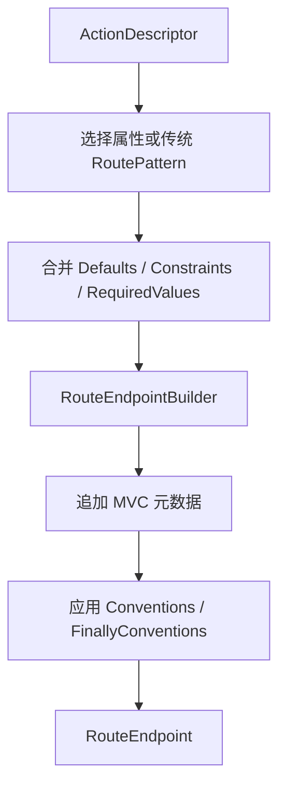

### 补充机制图

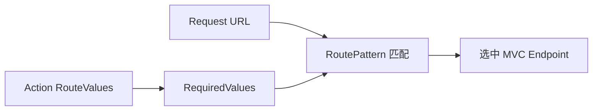

### 机制拆解

`ActionEndpointFactory` 是路由语义最密集的位置。RequiredValues 用于判断某个描述符是否适配传统路由模板；元数据写入顺序又决定后加入的元数据能否覆盖前面的默认值。

### 核心源码解读

### ActionEndpointFactory

**读这组源码时关注什么：** 一个 ActionDescriptor 如何变成 RouteEndpoint。

#### 整体结构

**这段代码回答什么问题：** 一个 ActionDescriptor 如何变成 RouteEndpoint。

```C#
// 基于 ActionDescriptor 的 Endpoint 工厂
internal sealed class ActionEndpointFactory
{
    private readonly RoutePatternTransformer _routePatternTransformer;
    private readonly RequestDelegate _requestDelegate;
    private readonly IRequestDelegateFactory[] _requestDelegateFactories;
    private readonly IServiceProvider _serviceProvider;
 
    public ActionEndpointFactory(RoutePatternTransformer routePatternTransformer,
                                IEnumerable<IRequestDelegateFactory> requestDelegateFactories,
                                IServiceProvider serviceProvider)
    {
        ArgumentNullException.ThrowIfNull(routePatternTransformer);
 
        _routePatternTransformer = routePatternTransformer;
        _requestDelegate = CreateRequestDelegate();
        // 注入多个 IRequestDelegateFactory 服务
        _requestDelegateFactories = requestDelegateFactories.ToArray();
        _serviceProvider = serviceProvider;
    }

    // 实际创建 Endpoint 的方法
    public void AddEndpoints(
        List<Endpoint> endpoints,
        HashSet<string> routeNames,
        ActionDescriptor action,
        IReadOnlyList<ConventionalRouteEntry> routes,
        IReadOnlyList<Action<EndpointBuilder>> conventions,
        IReadOnlyList<Action<EndpointBuilder>> groupConventions,
        IReadOnlyList<Action<EndpointBuilder>> finallyConventions,
        IReadOnlyList<Action<EndpointBuilder>> groupFinallyConventions,
        bool createInertEndpoints,
        RoutePattern? groupPrefix = null)
    {
        ArgumentNullException.ThrowIfNull(nameof(endpoints));
        ArgumentNullException.ThrowIfNull(nameof(routeNames));
        ArgumentNullException.ThrowIfNull(nameof(action));
        ArgumentNullException.ThrowIfNull(nameof(routes));
        ArgumentNullException.ThrowIfNull(nameof(conventions));
        ArgumentNullException.ThrowIfNull(nameof(groupConventions));
        ArgumentNullException.ThrowIfNull(nameof(finallyConventions));
        ArgumentNullException.ThrowIfNull(nameof(groupFinallyConventions));

        // 检查 ActionDescriptor 是否为约定路由
        if (action.AttributeRouteInfo?.Template == null)
        {
            // 遍历 ConventionalRouteEntry 集合
            foreach (var route in routes)
            {
                // 利用 ActionDescriptor 中的路由值字典匹配 RoutePattern
                // 如果匹配上则返回拷贝的 RoutePattern 并使用 ActionDescriptor 中的路由值字典填充 RoutePattern.RequiredValues 字典
                // 注意：
                // 匹配规则就是根据原始 RoutePattern 中的路由模式参数名查找 ActionDescriptor.RouteValues 字典中是否存在对应的键并存在值
                var updatedRoutePattern = _routePatternTransformer.SubstituteRequiredValues(route.Pattern, action.RouteValues);
                // 没有匹配上则跳过继续
                if (updatedRoutePattern == null)
                {
                    continue;
                }
 
                // 合并路由前缀
                updatedRoutePattern = RoutePatternFactory.Combine(groupPrefix, updatedRoutePattern);

                // 利用 ActionDescriptor 创建 RequestDelegate
                var requestDelegate = CreateRequestDelegate(action, route.DataTokens) ?? _requestDelegate;
 
                // 创建 RouteEndpointBuilder
                var builder = new RouteEndpointBuilder(requestDelegate, updatedRoutePattern, route.Order)
                {
                    DisplayName = action.DisplayName,
                    ApplicationServices = _serviceProvider,
                };
                // 配置 RouteEndpointBuilder
                AddActionDataToBuilder(
                    builder,
                    routeNames,
                    action,
                    route.RouteName,
                    route.DataTokens,
                    suppressLinkGeneration: true,
                    suppressPathMatching: false,
                    groupConventions: groupConventions,
                    conventions: conventions,
                    perRouteConventions: route.Conventions,
                    groupFinallyConventions: groupFinallyConventions,
                    finallyConventions: finallyConventions,
                    perRouteFinallyConventions: route.FinallyConventions);
                // 创建 RouteEndpoint 并添加到集合中
                endpoints.Add(builder.Build());
            }
        }
        else
        {
            // 利用 ActionDescriptor 创建 RequestDelegate
            var requestDelegate = CreateRequestDelegate(action) ?? _requestDelegate;
            // 利用 ActionDescriptor.AttributeRouteInfo 创建 RoutePattern
            var attributeRoutePattern = RoutePatternFactory.Parse(action.AttributeRouteInfo.Template);
 
            // 利用 ActionDescriptor 中的路由值字典填充 RoutePattern.RequiredValues 字典
            var (resolvedRoutePattern, resolvedRouteValues) = ResolveDefaultsAndRequiredValues(action, attributeRoutePattern);
 
            // 利用 ActionDescriptor 中的路由值字典匹配 RoutePattern
            // 如果匹配上则返回拷贝的 RoutePattern 并使用 ActionDescriptor 中的路由值字典填充 RoutePattern.RequiredValues 字典
            // 注意：
            // 匹配规则就是根据原始 RoutePattern 中的路由模式参数名查找 ActionDescriptor.RouteValues 字典中是否存在对应的键并存在值
            var updatedRoutePattern = _routePatternTransformer.SubstituteRequiredValues(resolvedRoutePattern, resolvedRouteValues);
            if (updatedRoutePattern == null)
            {
                var formattedRouteKeys = string.Join(", ", resolvedRouteValues.Keys.Select(k => $"'{k}'"));
                throw new InvalidOperationException(
                    $"Failed to update the route pattern '{resolvedRoutePattern.RawText}' with required route values. " +
                    $"This can occur when the route pattern contains parameters with reserved names such as: {formattedRouteKeys} " +
                    $"and also uses route constraints such as '{{action:int}}'. " +
                    "To fix this error, choose a different parameter name.");
            }
 
            // 合并路由前缀
            updatedRoutePattern = RoutePatternFactory.Combine(groupPrefix, updatedRoutePattern);
 
            // 创建 RouteEndpointBuilder
            var builder = new RouteEndpointBuilder(requestDelegate, updatedRoutePattern, action.AttributeRouteInfo.Order)
            {
                DisplayName = action.DisplayName,
                ApplicationServices = _serviceProvider,
            };
            // 配置 RouteEndpointBuilder
            AddActionDataToBuilder(
                builder,
                routeNames,
                action,
                action.AttributeRouteInfo.Name,
                dataTokens: null,
                action.AttributeRouteInfo.SuppressLinkGeneration,
                action.AttributeRouteInfo.SuppressPathMatching,
                groupConventions: groupConventions,
                conventions: conventions,
                perRouteConventions: Array.Empty<Action<EndpointBuilder>>(),
                groupFinallyConventions: groupFinallyConventions,
                finallyConventions: finallyConventions,
                perRouteFinallyConventions: Array.Empty<Action<EndpointBuilder>>());
            // 创建 Endpoint 并添加到集合中
            endpoints.Add(builder.Build());
        }
    }

    // 配置 RouteEndpointBuilder
    // 主要工作就是将 ActionDescriptor 中保存的各种特性转移到 RouteEndpointBuilder 的元数据集合中
    private static void AddActionDataToBuilder(
        EndpointBuilder builder,
        HashSet<string> routeNames,
        ActionDescriptor action,
        string? routeName,
        RouteValueDictionary? dataTokens,
        bool suppressLinkGeneration,
        bool suppressPathMatching,
        IReadOnlyList<Action<EndpointBuilder>> groupConventions,
        IReadOnlyList<Action<EndpointBuilder>> conventions,
        IReadOnlyList<Action<EndpointBuilder>> perRouteConventions,
        IReadOnlyList<Action<EndpointBuilder>> groupFinallyConventions,
        IReadOnlyList<Action<EndpointBuilder>> finallyConventions,
        IReadOnlyList<Action<EndpointBuilder>> perRouteFinallyConventions)
    {
        for (var i = 0; i < groupConventions.Count; i++)
        {
            groupConventions[i](builder);
        }
 
        var controllerActionDescriptor = action as ControllerActionDescriptor;

        // 如果时 ControllerActionDescriptor 则检查方法的参数类型和返回值类型是否实现了 IEndpointMetadataProvider 接口
        // 如果实现了则调用对应的静态方法 PopulateMetadata 将元数据添加到 EndpointBuilder 的元数据集合中
        if (controllerActionDescriptor?.MethodInfo is not null)
        {
            EndpointMetadataPopulator.PopulateMetadata(controllerActionDescriptor.MethodInfo, builder);
        }
 
        // 将 ActionDescriptor.EndpointMetadata 中的元数据全部转移到 EndpointBuilder 的元数据集合中
        if (action.EndpointMetadata != null)
        {
            foreach (var d in action.EndpointMetadata)
            {
                builder.Metadata.Add(d);
            }
        }
 
        // 将 ActionDescriptor 自身添加到 EndpointBuilder 的元数据集合中
        builder.Metadata.Add(action);

        // 将路由名称添加到 EndpointBuilder 的元数据集合中
        // 目的是作为终结点名称
        if (routeName != null &&
            !suppressLinkGeneration &&
            routeNames.Add(routeName) &&
            builder.Metadata.OfType<IEndpointNameMetadata>().LastOrDefault()?.EndpointName == null)
        {
            builder.Metadata.Add(new EndpointNameMetadata(routeName));
        }
 
        // 将路由数据令牌添加到 EndpointBuilder 的元数据集合中
        if (dataTokens != null)
        {
            builder.Metadata.Add(new DataTokensMetadata(dataTokens));
        }

        // 将路由名称添加到 EndpointBuilder 的元数据集合中
        builder.Metadata.Add(new RouteNameMetadata(routeName));
 
        // 将 ActionDescriptor.FilterDescriptors 中的 IFilterMetadata 过滤器添加到 EndpointBuilder 的元数据集合中
        if (action.FilterDescriptors != null && action.FilterDescriptors.Count > 0)
        {
            foreach (var filter in action.FilterDescriptors.OrderBy(f => f, FilterDescriptorOrderComparer.Comparer).Select(f => f.Filter))
            {
                builder.Metadata.Add(filter);
            }
        }
 
        // 遍历 ActionDescriptor.ActionConstraints 集合
        if (action.ActionConstraints != null && action.ActionConstraints.Count > 0)
        {
            foreach (var actionConstraint in action.ActionConstraints)
            {
                if (actionConstraint is HttpMethodActionConstraint httpMethodActionConstraint &&
                    !builder.Metadata.OfType<HttpMethodMetadata>().Any())
                {
                    // 如果存在 HttpMethodActionConstraint 则 EndpointBuilder 的元数据集合中必须存在 HttpMethodMetadata
                    // 目的是用于终结点匹配
                    builder.Metadata.Add(new HttpMethodMetadata(httpMethodActionConstraint.HttpMethods));
                }
                else if (actionConstraint is ConsumesAttribute consumesAttribute &&
                    !builder.Metadata.OfType<AcceptsMetadata>().Any())
                {
                    // 如果存在 ConsumesAttribute 则 EndpointBuilder 的元数据集合中必须存在 AcceptsMetadata
                    // 目的是用于终结点匹配
                    builder.Metadata.Add(new AcceptsMetadata(consumesAttribute.ContentTypes.ToArray()));
                }
                else if (!builder.Metadata.Contains(actionConstraint))
                {
                    // 其他类型的 IActionConstraintMetadata 元数据直接添加到 EndpointBuilder 的元数据集合中
                    builder.Metadata.Add(actionConstraint);
                }
            }
        }
 
        // 将 SuppressLinkGenerationMetadata 添加到 EndpointBuilder 元数据集合中
        // 注意：
        // 基于约定的入站路由创建的 RouteEndpoint 禁止用于生成链接
        if (suppressLinkGeneration)
        {
            builder.Metadata.Add(new SuppressLinkGenerationMetadata());
        }
 
        // 将 SuppressMatchingMetadata 添加到 EndpointBuilder 元数据集合中
        if (suppressPathMatching)
        {
            builder.Metadata.Add(new SuppressMatchingMetadata());
        }
 
        // 使用约定配置配置 EndpointBuilder
        for (var i = 0; i < conventions.Count; i++)
        {
            conventions[i](builder);
        }
 
        for (var i = 0; i < perRouteConventions.Count; i++)
        {
            perRouteConventions[i](builder);
        }
 
        if (builder.FilterFactories.Count > 0 && controllerActionDescriptor is not null)
        {
            var routeHandlerFilters = builder.FilterFactories;
 
            EndpointFilterDelegate del = static invocationContext =>
            {
                var controllerInvocationContext = (ControllerEndpointFilterInvocationContext)invocationContext;
                return controllerInvocationContext.ActionDescriptor.CacheEntry!.InnerActionMethodExecutor.Execute(controllerInvocationContext);
            };
 
            var context = new EndpointFilterFactoryContext
            {
                MethodInfo = controllerActionDescriptor.MethodInfo,
                ApplicationServices = builder.ApplicationServices,
            };
 
            var initialFilteredInvocation = del;
 
            for (var i = routeHandlerFilters.Count - 1; i >= 0; i--)
            {
                var filterFactory = routeHandlerFilters[i];
                del = filterFactory(context, del);
            }
 
            controllerActionDescriptor.FilterDelegate = ReferenceEquals(del, initialFilteredInvocation) ? null : del;
        }
 
        foreach (var perRouteFinallyConvention in perRouteFinallyConventions)
        {
            perRouteFinallyConvention(builder);
        }
 
        foreach (var finallyConvention in finallyConventions)
        {
            finallyConvention(builder);
        }
 
        foreach (var groupFinallyConvention in groupFinallyConventions)
        {
            groupFinallyConvention(builder);
        }
    }

    // 利用 ActionDescriptor 创建 RequestDelegate
    private RequestDelegate? CreateRequestDelegate(ActionDescriptor action, RouteValueDictionary? dataTokens = null)
    {
        // 遍历 IRequestDelegateFactory 集合
        foreach (var factory in _requestDelegateFactories)
        {
            // 每个 IRequestDelegateFactory 内部会根据 ActionDescriptor 的实际类型决定是否由自己创建对应的 RequestDelegate
            // 如果不是则返回 null，继续交由下一个 IRequestDelegateFactory 处理
            var requestDelegate = factory.CreateRequestDelegate(action, dataTokens);
            if (requestDelegate != null)
            {
                return requestDelegate;
            }
        }
 
        return null;
    }
}
```

**源码解读：**
- 它合并模板、默认值、约束、数据令牌与 RequiredValues。
- 元数据和约定按确定顺序写入 EndpointBuilder。

**读完要记住：**
- 路由模式构造是该类核心。
- RequestDelegate 最终会进入 MVC Invoker。

### 最小例子

传统模板 `{controller=Home}/{action=Index}/{id?}` 会结合 Action 的 controller/action RouteValues 形成 RequiredValues，既支持入站匹配，也支持链接生成。

### 回顾要点

- RoutePattern 合成同时服务匹配与链接生成。
- FinallyConvention 是端点构建的最后改写机会。

<a id="review-chapter-10"></a>

## 10. MapControllers 与 MapControllerRoute：注册入口

### 本组解决什么问题

应用代码看到的是 MapXxx 扩展方法，内部需要把路由配置落到统一的 ControllerActionEndpointDataSource。

### 关键类型关系图

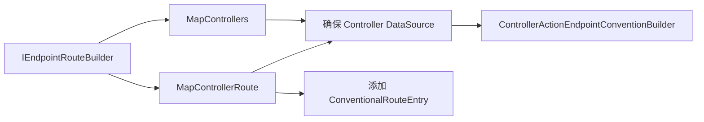

### 补充机制图

```mermaid
sequenceDiagram
    participant App as 应用启动代码
    participant Ext as RouteBuilderExtensions
    participant Fac as DataSourceFactory
    participant DS as ControllerActionEndpointDataSource
    App->>Ext: MapControllerRoute(...)
    Ext->>Fac: Create(...)
    Fac-->>Ext: DS
    Ext->>DS: AddRoute(name, pattern, defaults...)
    Ext-->>App: ConventionBuilder
```

### 机制拆解

扩展方法的主要职责是保证 DataSource 唯一存在并记录路由项。端点通常在路由系统读取 DataSources 时才批量构造，因此注册入口和端点实例化是两个时刻。

### 核心源码解读

### ControllerEndpointRouteBuilderExtensions

**读这组源码时关注什么：** MapControllers 与 MapControllerRoute 实际注册了什么。

#### 整体结构

**这段代码回答什么问题：** MapControllers 与 MapControllerRoute 实际注册了什么。

```C#
// 提供用来注册路由系统终结点的扩展方法
public static class ControllerEndpointRouteBuilderExtensions
{
    // 注册特性路由终结点
    public static ControllerActionEndpointConventionBuilder MapControllers(this IEndpointRouteBuilder endpoints)
    {
        ArgumentNullException.ThrowIfNull(endpoints);

        // 确保 IServiceCollection.AddControllers 扩展方法被调用
        EnsureControllerServices(endpoints);

        // 创建 ControllerActionEndpointDataSource
        return GetOrCreateDataSource(endpoints).DefaultBuilder;
    }

    // 注册约定路由终结点
    public static ControllerActionEndpointConventionBuilder MapControllerRoute(
        this IEndpointRouteBuilder endpoints,
        string name,
        string pattern,
        object? defaults = null,
        object? constraints = null,
        object? dataTokens = null)
    {
        ArgumentNullException.ThrowIfNull(endpoints);
 
        // 确保 IServiceCollection.AddControllers 扩展方法被调用
        EnsureControllerServices(endpoints);
 
        // 创建 ControllerActionEndpointDataSource
        var dataSource = GetOrCreateDataSource(endpoints);
        // 添加约定路由模板
        return dataSource.AddRoute(
            name,
            pattern,
            new RouteValueDictionary(defaults),
            new RouteValueDictionary(constraints),
            new RouteValueDictionary(dataTokens));
    }

    // 注册默认的约定路由系统终结点
    public static ControllerActionEndpointConventionBuilder MapDefaultControllerRoute(this IEndpointRouteBuilder endpoints)
    {
        ArgumentNullException.ThrowIfNull(endpoints);
 
        // 确保 IServiceCollection.AddControllers 扩展方法被调用
        EnsureControllerServices(endpoints);
 
        // 创建 ControllerActionEndpointDataSource
        var dataSource = GetOrCreateDataSource(endpoints);
        // 添加默认约定路由模板
        return dataSource.AddRoute(
            "default",
            "{controller=Home}/{action=Index}/{id?}",
            defaults: null,
            constraints: null,
            dataTokens: null);
    }

    // 确保 IServiceCollection.AddControllers 扩展方法被调用
    private static void EnsureControllerServices(IEndpointRouteBuilder endpoints)
    {
        var marker = endpoints.ServiceProvider.GetService<MvcMarkerService>();
        if (marker == null)
        {
            throw new InvalidOperationException(Resources.FormatUnableToFindServices(
                nameof(IServiceCollection),
                "AddControllers",
                "ConfigureServices(...)"));
        }
    }
 
    // 创建 ControllerActionEndpointDataSource
    private static ControllerActionEndpointDataSource GetOrCreateDataSource(IEndpointRouteBuilder endpoints)
    {
        var dataSource = endpoints.DataSources.OfType<ControllerActionEndpointDataSource>().FirstOrDefault();
        if (dataSource == null)
        {
            // 得到 OrderedEndpointsSequenceProviderCache 服务，用于给创建的约定路由终结点编号
            var orderProvider = endpoints.ServiceProvider.GetRequiredService<OrderedEndpointsSequenceProviderCache>();
            // 得到 ControllerActionEndpointDataSourceFactory 服务
            var factory = endpoints.ServiceProvider.GetRequiredService<ControllerActionEndpointDataSourceFactory>();
            // 利用 ControllerActionEndpointDataSourceFactory 创建 ControllerActionEndpointDataSource
            dataSource = factory.Create(orderProvider.GetOrCreateOrderedEndpointsSequenceProvider(endpoints));
            // 将 ControllerActionEndpointDataSource 添加到 IEndpointRouteBuilder.DataSources 集合中
            endpoints.DataSources.Add(dataSource);
        }
 
        return dataSource;
    }
}
```

**源码解读：**
- 扩展方法先确保控制器 DataSource 存在。
- 特性路由只暴露 DataSource，传统路由还追加 RouteEntry。

**读完要记住：**
- Map 调用发生在终结点构建阶段。
- 它不会立即创建所有 Controller 实例。

### ControllerActionEndpointDataSourceFactory

**读这组源码时关注什么：** 路由扩展如何获得统一的控制器 DataSource。

#### 整体结构

**这段代码回答什么问题：** 路由扩展如何获得统一的控制器 DataSource。

```C#
// ControllerActionEndpointDataSource 工厂
internal sealed class ControllerActionEndpointDataSourceFactory
{
    // 用于给 ControllerActionEndpointDataSource 创建自增 Id
    private readonly ControllerActionEndpointDataSourceIdProvider _dataSourceIdProvider;
    private readonly IActionDescriptorCollectionProvider _actions;
    private readonly ActionEndpointFactory _factory;
 
    public ControllerActionEndpointDataSourceFactory(
        ControllerActionEndpointDataSourceIdProvider dataSourceIdProvider,
        IActionDescriptorCollectionProvider actions,
        ActionEndpointFactory factory)
    {
        // 注入 IActionDescriptorCollectionProvider 和 ActionEndpointFactory
        _dataSourceIdProvider = dataSourceIdProvider;
        _actions = actions;
        _factory = factory;
    }
    
    // 创建 ControllerActionEndpointDataSource
    public ControllerActionEndpointDataSource Create(OrderedEndpointsSequenceProvider orderProvider)
    {
        return new ControllerActionEndpointDataSource(_dataSourceIdProvider, _actions, _factory, orderProvider);
    }
}
```

**源码解读：**
- 工厂注入描述符集合、EndpointFactory 和请求委托工厂。
- Create 封装依赖并返回 DataSource。

**读完要记住：**
- 工厂隔离 DI 解析与对象构造。
- 每个路由构建器复用对应数据源。

### 最小例子

连续调用两次 `MapControllerRoute` 会向同一个控制器 DataSource 追加两个传统路由项，而不是创建两套独立 MVC 执行管线。

### 回顾要点

- MapXxx 记录路由意图，不创建控制器实例。
- ConventionBuilder 允许注册后继续修改将来的端点。

<a id="review-chapter-11"></a>

## 11. 从 Endpoint 到 IActionInvoker：请求执行入口

### 本组解决什么问题

端点匹配成功后，MVC 需要把 HttpContext、路由数据和描述符组装成请求上下文，并创建执行器。

### 关键类型关系图

```mermaid
flowchart LR
    A["RouteEndpoint.RequestDelegate"] --> B["ControllerRequestDelegateFactory 生成的委托"]
    B --> C["ControllerContext"]
    C --> D["ControllerActionInvokerCache.GetCachedResult"]
    D --> E["new ControllerActionInvoker"]
    E --> F["InvokeAsync：进入 MVC 管线"]
```

### 补充机制图

```mermaid
sequenceDiagram
    participant R as Routing
    participant D as RequestDelegate
    participant F as ControllerActionInvokerCache
    participant I as ControllerActionInvoker
    R->>D: HttpContext
    D->>D: 创建 RouteData 与 ControllerContext
    D->>F: GetCachedResult(controllerContext)
    F-->>D: cacheEntry, filters
    D->>I: new ControllerActionInvoker(...)
    D->>I: InvokeAsync()
```

### 机制拆解

上面两张图对应本章所附的直接创建路径：`ControllerRequestDelegateFactory` 生成请求委托，委托在每次请求中创建 `ControllerContext`，读取执行缓存和过滤器，然后直接 `new ControllerActionInvoker(...)` 并调用 `InvokeAsync()`。这条路径没有调用 `IActionInvokerFactory.CreateInvoker`，也不是缓存并复用整个 Invoker 实例。

### 直接创建与通用回退不是同一条路径

| 路径 | 选择条件 | 请求期执行入口 |
| --- | --- | --- |
| 本章的控制器直接创建路径 | `EnableActionInvokers` 为 false，且描述符是 `ControllerActionDescriptor` | `ControllerContext` → 执行缓存与过滤器 → `new ControllerActionInvoker` → `InvokeAsync` |
| 通用回退路径 | 当前工厂返回 null 后继续尝试其他 `IRequestDelegateFactory`；全部返回 null 才使用 `ActionEndpointFactory._requestDelegate` | `ActionContext` → `IActionInvokerFactory.CreateInvoker` → `IActionInvoker.InvokeAsync` |

本章源码中的提前返回条件是 `_enableActionInvokers || actionDescriptor is not ControllerActionDescriptor`。通用委托的无参 `CreateRequestDelegate()` 方法在原笔记中未展开；回退路径补充依据为 [ASP.NET Core v8.0.0 的 ActionEndpointFactory.cs](https://github.com/dotnet/aspnetcore/blob/v8.0.0/src/Mvc/Mvc.Core/src/Routing/ActionEndpointFactory.cs)。两条路径都通过 Invoker 进入 MVC 管线，但创建执行器的方式不同。

### 核心源码解读

### ActionContext

**读这组源码时关注什么：** 一次 MVC 请求执行需要哪些基础上下文。

#### 整体结构

**这段代码回答什么问题：** 一次 MVC 请求执行需要哪些基础上下文。

```C#
// Action 上下文
// 本质是对 HttpContxt、ActionDescriptor、RouteData、ModelStateDictionary 四元组的封装
public class ActionContext
{
    public ActionContext()
    {
        ModelState = new ModelStateDictionary();
    }
 
    public ActionContext(ActionContext actionContext)
        : this(
            actionContext.HttpContext,
            actionContext.RouteData,
            actionContext.ActionDescriptor,
            actionContext.ModelState)
    {
    }
 
    public ActionContext(
        HttpContext httpContext,
        RouteData routeData,
        ActionDescriptor actionDescriptor)
        : this(httpContext, routeData, actionDescriptor, new ModelStateDictionary())
    {
    }
 
    public ActionContext(
        HttpContext httpContext,
        RouteData routeData,
        ActionDescriptor actionDescriptor,
        ModelStateDictionary modelState)
    {
        ArgumentNullException.ThrowIfNull(httpContext);
        ArgumentNullException.ThrowIfNull(routeData);
        ArgumentNullException.ThrowIfNull(actionDescriptor);
        ArgumentNullException.ThrowIfNull(modelState);
 
        HttpContext = httpContext;
        RouteData = routeData;
        ActionDescriptor = actionDescriptor;
        ModelState = modelState;
    }
 
    public ActionDescriptor ActionDescriptor { get; set; } = default!;
 
    public HttpContext HttpContext { get; set; } = default!;
 
    public ModelStateDictionary ModelState { get; } = default!;
 
    public RouteData RouteData { get; set; } = default!;
}
```

**源码解读：**
- HttpContext、RouteData、ActionDescriptor 和 ModelState 被绑定在一起。
- 它也是过滤器上下文的基础。

**读完要记住：**
- ActionContext 是请求级对象。
- 描述符把启动期元数据带入请求期。

### ControllerContext

**读这组源码时关注什么：** 控制器执行还需要补充哪些绑定设施。

#### 整体结构

**这段代码回答什么问题：** 控制器执行还需要补充哪些绑定设施。

```C#
// 基于控制器的 Action 上下文
public class ControllerContext : ActionContext
{
    private IList<IValueProviderFactory>? _valueProviderFactories;
 
    public ControllerContext()
    {
    }
 
    public ControllerContext(ActionContext context)
        : base(context)
    {
        // 保存的 ActionDescriptor 实际类型必须是 ControllerActionDescriptor
        if (context.ActionDescriptor is not ControllerActionDescriptor)
        {
            throw new ArgumentException(Resources.FormatActionDescriptorMustBeBasedOnControllerAction(
                typeof(ControllerActionDescriptor)),
                nameof(context));
        }
    }
 
    internal ControllerContext(
        HttpContext httpContext,
        RouteData routeData,
        ControllerActionDescriptor actionDescriptor)
        : base(httpContext, routeData, actionDescriptor)
    {
    }
    
    public new ControllerActionDescriptor ActionDescriptor
    {
        get { return (ControllerActionDescriptor)base.ActionDescriptor; }
        set { base.ActionDescriptor = value; }
    }
 
    public virtual IList<IValueProviderFactory> ValueProviderFactories
    {
        get
        {
            if (_valueProviderFactories == null)
            {
                _valueProviderFactories = new List<IValueProviderFactory>();
            }
 
            return _valueProviderFactories;
        }
        set
        {
            ArgumentNullException.ThrowIfNull(value);
 
            _valueProviderFactories = value;
        }
    }
 
    private string DebuggerToString() => ActionDescriptor?.DisplayName ?? $"{{{GetType().FullName}}}";
}
```

**源码解读：**
- ValueProviderFactories、ModelState 最大错误数等来自 MvcOptions。
- 它包裹通用 ActionContext。

**读完要记住：**
- ControllerContext 服务控制器激活与模型绑定。
- 构造时复制而不是重建路由上下文。

### IRequestDelegateFactory

**读这组源码时关注什么：** Endpoint 如何获得可执行 RequestDelegate。

#### 整体结构

**这段代码回答什么问题：** Endpoint 如何获得可执行 RequestDelegate。

```C#
// RequestDelegate 工厂接口
internal interface IRequestDelegateFactory
{
    // 利用 ActionDescriptor 创建 RequestDelegate
    // 支持提供额外的路由值字典
    RequestDelegate? CreateRequestDelegate(ActionDescriptor actionDescriptor, RouteValueDictionary? dataTokens);
}
```

**源码解读：**
- `CreateRequestDelegate` 接收 `ActionDescriptor` 与可选的 `RouteValueDictionary? dataTokens`，不是 `RoutePattern`。
- 返回 null 表示当前工厂不提供委托，调用者继续尝试其他工厂；全部未提供时才使用通用执行路径。

**读完要记住：**
- 该工厂连接路由与 MVC。
- `dataTokens` 用于携带额外路由数据；实际请求路由值来自 `HttpContext.Request.RouteValues`。

### ControllerRequestDelegateFactory

**读这组源码时关注什么：** 控制器终结点如何创建真正的请求委托。

#### 整体结构

**这段代码回答什么问题：** 控制器终结点如何创建真正的请求委托。

```C#
// 基于 ControllerActionDescriptor 的 IRequestDelegateFactory 实现
internal sealed class ControllerRequestDelegateFactory : IRequestDelegateFactory
{
    private readonly ControllerActionInvokerCache _controllerActionInvokerCache;
    private readonly IReadOnlyList<IValueProviderFactory> _valueProviderFactories;
    private readonly int _maxModelValidationErrors;
    private readonly int? _maxValidationDepth;
    private readonly int _maxModelBindingRecursionDepth;
    private readonly ILogger _logger;
    private readonly DiagnosticListener _diagnosticListener;
    private readonly IActionResultTypeMapper _mapper;
    private readonly IActionContextAccessor _actionContextAccessor;
    private readonly bool _enableActionInvokers;
 
    public ControllerRequestDelegateFactory(
        ControllerActionInvokerCache controllerActionInvokerCache,
        IOptions<MvcOptions> optionsAccessor,
        ILoggerFactory loggerFactory,
        DiagnosticListener diagnosticListener,
        IActionResultTypeMapper mapper)
        : this(controllerActionInvokerCache, optionsAccessor, loggerFactory, diagnosticListener, mapper, null)
    {
    }
 
    public ControllerRequestDelegateFactory(
        ControllerActionInvokerCache controllerActionInvokerCache,
        IOptions<MvcOptions> optionsAccessor,
        ILoggerFactory loggerFactory,
        DiagnosticListener diagnosticListener,
        IActionResultTypeMapper mapper,
        IActionContextAccessor? actionContextAccessor)
    {
        _controllerActionInvokerCache = controllerActionInvokerCache;
        _valueProviderFactories = optionsAccessor.Value.ValueProviderFactories.ToArray();
        _maxModelValidationErrors = optionsAccessor.Value.MaxModelValidationErrors;
        _maxValidationDepth = optionsAccessor.Value.MaxValidationDepth;
        _maxModelBindingRecursionDepth = optionsAccessor.Value.MaxModelBindingRecursionDepth;
        _enableActionInvokers = optionsAccessor.Value.EnableActionInvokers;
        _logger = loggerFactory.CreateLogger<ControllerActionInvoker>();
        _diagnosticListener = diagnosticListener;
        _mapper = mapper;
        _actionContextAccessor = actionContextAccessor ?? ActionContextAccessor.Null;
    }
    
    // 利用 ControllerActionDescriptor 创建 RequestDelegate
    public RequestDelegate? CreateRequestDelegate(ActionDescriptor actionDescriptor, RouteValueDictionary? dataTokens)
    {
        // 只处理 ControllerActionDescriptor 类型的 ActionDescriptor
        if (_enableActionInvokers || actionDescriptor is not ControllerActionDescriptor controller)
        {
            return null;
        }

        return context =>
        {
            RouteData routeData;

            // 针对约定路由创建 RequestDelegate 时支持提供额外的路由值字典
            // 每次请求时会将这个额外的路由值字典和实际路由值字典合并
            if (dataTokens is null or { Count: 0 })
            {
                routeData = new RouteData(context.Request.RouteValues);
            }
            else
            {
                routeData = new RouteData();
                routeData.PushState(router: null, context.Request.RouteValues, dataTokens);
            }

            // 每个 HttpContext 都会创建一个 ControllerContext
            var controllerContext = new ControllerContext(context, routeData, controller)
            {
                ValueProviderFactories = new CopyOnWriteList<IValueProviderFactory>(_valueProviderFactories)
            };
 
            controllerContext.ModelState.MaxAllowedErrors = _maxModelValidationErrors;
            controllerContext.ModelState.MaxValidationDepth = _maxValidationDepth;
            controllerContext.ModelState.MaxStateDepth = _maxModelBindingRecursionDepth;
 
            // 缓存执行管线所需的数据
            // 从 ActionDescriptor.FilterDescriptors 得到的 IFilterMetadata 过滤器集合会先进行升序排序，没有实现 IOrderedFilter 的 IFilterMetadata 过滤器则默认为 0 的顺序
            // 实现了 IFilterFactory 的 IFilterMetadata 过滤器会根据 IFilterFactory.IsReusable 属性值决定是否缓存复用，这种过滤器会在每次请求执行管线前通过反射创建过滤器实例，并利用 HttpContext.RquestServices 属性表示的范围容器提供过滤器所需的依赖服务
            // 注意：
            // 绑定在控制器或方法上的以特性形式提供的过滤器一定会缓存复用
            // 因为特性会在运行时被反序列化为具体实例，这时候这个实例是唯一的
            var (cacheEntry, filters) = _controllerActionInvokerCache.GetCachedResult(controllerContext);

            // 创建 ControllerActionInvoker
            var invoker = new ControllerActionInvoker(
                _logger,
                _diagnosticListener,
                _actionContextAccessor,
                _mapper,
                controllerContext,
                cacheEntry,
                filters);

            // 开始执行管线
            return invoker.InvokeAsync();
        };
    }
}
```

**源码解读：**
- 每次请求创建 `ControllerContext`，从 `ControllerActionInvokerCache` 取得 `cacheEntry` 和 `filters`，再直接创建 `ControllerActionInvoker`。
- 委托调用 InvokeAsync 进入 MVC 过滤器管线。

**读完要记住：**
- Endpoint 不直接反射调用方法。
- 此处的请求执行入口是新建的 `ControllerActionInvoker.InvokeAsync()`；不要与通用回退路径的 `IActionInvokerFactory` 混淆。

### IActionInvoker

**读这组源码时关注什么：** MVC 执行器对外只需要什么能力。

#### 整体结构

**这段代码回答什么问题：** MVC 执行器对外只需要什么能力。

```C#
// Action 方法执行器接口
public interface IActionInvoker
{
    // 管线入口方法
    Task InvokeAsync();
}
```

**源码解读：**
- 接口仅暴露 InvokeAsync。
- 复杂管线被封装在实现内部。

**读完要记住：**
- 调用方只等待一个 Task。
- 具体状态机属于 ResourceInvoker 子类。

### 最小例子

端点元数据在启动期确定，`ControllerContext` 则在每次请求创建；两者生命周期不同，不应把请求状态缓存到 ActionDescriptor。

### 回顾要点

- ActionContext 是描述符进入请求期的载体。
- IActionInvoker 是 Endpoint 与 MVC 执行状态机之间的最小协议。

<a id="review-chapter-12"></a>

## 12. ResourceInvoker：MVC 外层过滤器状态机

### 本组解决什么问题

授权、资源、异常、结果过滤器既支持同步也支持异步，还允许短路。ResourceInvoker 用显式状态机统一这些路径。

### 关键类型关系图

```mermaid
flowchart LR
    A["Authorization"] --> B["Resource"]
    B --> C["Exception"]
    C --> D["Action 内层管线"]
    D --> E["Result"]
    E --> F["IActionResult.ExecuteResultAsync"]
```

### 补充机制图

```mermaid
stateDiagram-v2
    [*] --> Authorization
    Authorization --> Resource
    Resource --> Exception
    Exception --> InnerInvoker
    InnerInvoker --> Result
    Result --> Completed
    Authorization --> Result: 短路
    Resource --> Result: 短路
    Exception --> Result: 异常已处理
```

### 机制拆解

`Next` 方法用 State、Scope、state 和 isCompleted 四个变量保存续执行位置。同步完成时通过 `goto` 留在当前栈上，遇到未完成 Task 才进入 Awaited 路径，这是高频请求下的重要性能设计。

### 核心源码解读

### ResourceInvoker

**读这组源码时关注什么：** MVC 外层过滤器与结果执行如何组成状态机。

#### 整体结构

**这段代码回答什么问题：** MVC 外层过滤器与结果执行如何组成状态机。

```C#
// Action 方法执行器基类
internal abstract partial class ResourceInvoker
{
    protected readonly DiagnosticListener _diagnosticListener;
    protected readonly ILogger _logger;
    protected readonly IActionContextAccessor _actionContextAccessor;
    protected readonly IActionResultTypeMapper _mapper;
    protected readonly ActionContext _actionContext;
    protected readonly IFilterMetadata[] _filters;
    protected readonly IList<IValueProviderFactory> _valueProviderFactories;
 
    private AuthorizationFilterContextSealed? _authorizationContext;
    private ResourceExecutingContextSealed? _resourceExecutingContext;
    private ResourceExecutedContextSealed? _resourceExecutedContext;
    private ExceptionContextSealed? _exceptionContext;
    private ResultExecutingContextSealed? _resultExecutingContext;
    private ResultExecutedContextSealed? _resultExecutedContext;
 
    protected FilterCursor _cursor;
    protected IActionResult? _result;
    protected object? _instance;
 
    public ResourceInvoker(
        DiagnosticListener diagnosticListener,
        ILogger logger,
        IActionContextAccessor actionContextAccessor,
        IActionResultTypeMapper mapper,
        ActionContext actionContext,
        IFilterMetadata[] filters,
        IList<IValueProviderFactory> valueProviderFactories)
    {
        _diagnosticListener = diagnosticListener ?? throw new ArgumentNullException(nameof(diagnosticListener));
        _logger = logger ?? throw new ArgumentNullException(nameof(logger));
        _actionContextAccessor = actionContextAccessor ?? throw new ArgumentNullException(nameof(actionContextAccessor));
        _mapper = mapper ?? throw new ArgumentNullException(nameof(mapper));
        _actionContext = actionContext ?? throw new ArgumentNullException(nameof(actionContext));
 
        _filters = filters ?? throw new ArgumentNullException(nameof(filters));
        _valueProviderFactories = valueProviderFactories ?? throw new ArgumentNullException(nameof(valueProviderFactories));
        _cursor = new FilterCursor(filters);
    }

    // 完整管线
    // 管线流入方向：授权过滤器 -> 资源过滤器（流入）-> （异常过滤器捕获范围开始）参数绑定 -> 动作过滤器（流入）-> 动作方法开始 
    // 管线流出方向：动作方法结束 -> 动作过滤器（流出）-> 异常过滤器（异常过滤器捕获范围结束） -> 结果过滤器（流入）-> 结果执行 -> 结果过滤器（流出）-> 资源过滤器（流出）

    // 不同过滤器短路管线

    // 授权过滤器短路管线
    // 同步：设置 AuthorizationFilterContext.Result 属性
    // 异步：设置 AuthorizationFilterContext.Result 属性
    // 管线流入方向：授权过滤器
    // 管线流出方向：IAlwaysRunResultFilter 过滤器（流入）-> 结果执行 -> IAlwaysRunResultFilter 过滤器（流出）

    // 资源过滤器短路管线
    // 同步：设置 ResourceExecutingContext.Result 属性
    // 异步：设置 ResourceExecutingContext.Result 属性，并跳过 ResourceExecutionDelegate 的执行，否则会抛出异常
    // 管线流入方向：授权过滤器 -> 已执行的资源过滤器（流入）
    // 管线流出方向：IAlwaysRunResultFilter 过滤器（流入）-> 结果执行 -> IAlwaysRunResultFilter 过滤器（流出）-> 已执行的资源过滤器（流出）

    // 动作过滤器短路管线
    // 同步：设置 ActionExecutingContext.Result 属性
    // 异步：设置 ActionExecutingContext.Result 属性，并跳过 ActionExecutionDelegate 的执行，否则会抛出异常
    // 管线流入方向：授权过滤器 -> 资源过滤器（流入）-> 参数绑定 -> 已执行的动作过滤器（流入）
    // 管线流出方向：已执行的动作过滤器（流出）-> 异常过滤器 -> 结果过滤器（流入）-> 结果执行 -> 结果过滤器（流出）-> 资源过滤器（流出）

    // 异常过滤器短路管线
    // 同步：通过设置 ExceptionContext.Exception 属性为 null 或 ExceptionContext.IsHandled 属性为 true
    // 异步：通过设置 ExceptionContext.Exception 属性为 null 或 ExceptionContext.IsHandled 属性为 true
    // 实际上异常过滤器不存在短路管线，因为压栈的 Scope.Exception 管线范围内的异常过滤器会逐一检查跳过执行
    // 管线流入方向：授权过滤器 -> 资源过滤器（流入）-> 参数绑定 -> 动作过滤器（流入）-> 动作方法开始
    // 管线流出方向：动作方法结束 -> 动作过滤器（流出）-> 异常过滤器 -> 结果过滤器（流入）-> 结果执行 -> 结果过滤器（流出）-> 资源过滤器（流出）

    // 结果过滤器短路管线
    // 同步：设置 ResultExecutingContext.Cancel 属性为 true
    // 异步：设置 ResultExecutingContext.Cancel 属性为 true，并跳过 ResultExecutionDelegate 的执行
    // 管线流入方向：授权过滤器 -> 资源过滤器（流入）-> 参数绑定 -> 动作过滤器（流入）-> 动作方法开始 
    // 管线流出方向：动作方法结束 -> 动作过滤器（流出）-> 异常过滤器 -> 已执行的结果过滤器（流入）-> 已执行的结果过滤器（流出）-> 资源过滤器（流出）

    // 管线入口方法
    public virtual Task InvokeAsync()
    {
        if (_diagnosticListener.IsEnabled() || _logger.IsEnabled(LogLevel.Information))
        {
            return Logged(this);
        }
 
        _actionContextAccessor.ActionContext = _actionContext;
        var scope = _logger.ActionScope(_actionContext.ActionDescriptor);
 
        Task task;
        try
        {
            // 执行过滤器管线
            task = InvokeFilterPipelineAsync();
        }
        catch (Exception exception)
        {
            return Awaited(this, Task.FromException(exception), scope);
        }

        // 如果过滤器管线没有同步完成
        if (!task.IsCompletedSuccessfully)
        {
            // InvokeAsync 方法出栈，异步执行过滤器管线并返回一个用于等待的 Task
            return Awaited(this, task, scope);
        }
 
        return ReleaseResourcesCore(scope).AsTask();

        // 异步执行过滤器管线
        static async Task Awaited(ResourceInvoker invoker, Task task, IDisposable? scope)
        {
            try
            {
                await task;
            }
            finally
            {
                await invoker.ReleaseResourcesCore(scope);
            }
        }
    }

    // 执行过滤器管线
    // 压栈 Scope.Invoker 管线范围
    // 这是最外层的管线范围
    private Task InvokeFilterPipelineAsync()
    {
        // 设置管线范围内的下一个管线执行状态
        var next = State.InvokeBegin;

        // 创建 Scope.Invoker 管线范围
        var scope = Scope.Invoker;

        // 用于保存管线范围内的当前执行过滤器
        var state = (object?)null;

        var isCompleted = false;
        try
        {
            while (!isCompleted)
            {
                // 执行管线范围内的下一个管线执行状态
                var lastTask = Next(ref next, ref scope, ref state, ref isCompleted);
                // 没有同步完成
                if (!lastTask.IsCompletedSuccessfully)
                {
                    // 异步执行管线范围的下一个管线执行状态并返回一个用于等待的 Task
                    return Awaited(this, lastTask, next, scope, state, isCompleted);
                }
            }
 
            return Task.CompletedTask;
        }
        catch (Exception ex)
        {
            return Task.FromException(ex);
        }

        static async Task Awaited(ResourceInvoker invoker, Task lastTask, State next, Scope scope, object? state, bool isCompleted)
        {
            await lastTask;

            // 循环执行管线范围内的下一个管线执行状态
            while (!isCompleted)
            {
                await invoker.Next(ref next, ref scope, ref state, ref isCompleted);
            }
        }
    }

    // 执行管线范围内的下一个管线执行状态
    private Task Next(ref State next, ref Scope scope, ref object? state, ref bool isCompleted)
    {
        switch (next)
        {
            case State.InvokeBegin:
                {
                    // 初始状态
                    // 跳转到管线范围内的 State.AuthorizationBegin 管线执行状态
                    goto case State.AuthorizationBegin;
                }
 
            case State.AuthorizationBegin:
                {
                    // 重置过滤器游标
                    _cursor.Reset();
                    // 跳转到管线范围内的 State.AuthorizationNext 管线执行状态
                    goto case State.AuthorizationNext;
                }
 
            case State.AuthorizationNext:
                {
                    // 得到授权过滤器集合并将游标移动到下一个过滤器
                    var current = _cursor.GetNextFilter<IAuthorizationFilter, IAsyncAuthorizationFilter>();
                    // 确定是否是实现了 IAsyncAuthorizationFilter 的授权过滤器
                    if (current.FilterAsync != null)
                    {
                        if (_authorizationContext == null)
                        {
                            _authorizationContext = new AuthorizationFilterContextSealed(_actionContext, _filters);
                        }
                        
                        // 设置当前执行的过滤器
                        state = current.FilterAsync;
                        // 跳转到管线范围内的 State.AuthorizationAsyncBegin 管线执行状态
                        goto case State.AuthorizationAsyncBegin;
                    }
                    else if (current.Filter != null)
                    {
                        if (_authorizationContext == null)
                        {
                            _authorizationContext = new AuthorizationFilterContextSealed(_actionContext, _filters);
                        }
 
                        // 设置当前执行的过滤器
                        state = current.Filter;
                        // 跳转到管线范围内的 State.AuthorizationSync 管线执行状态
                        goto case State.AuthorizationSync;
                    }
                    else
                    {
                        // 如果不存在授权过滤器
                        // 跳转到管线范围内的 State.AuthorizationEnd 管线执行状态
                        // 表示过滤器管线结束
                        goto case State.AuthorizationEnd;
                    }
                }
 
            case State.AuthorizationAsyncBegin:
                {
                    Debug.Assert(state != null);
                    Debug.Assert(_authorizationContext != null);
 
                    var filter = (IAsyncAuthorizationFilter)state;
                    var authorizationContext = _authorizationContext;
 
                    _diagnosticListener.BeforeOnAuthorizationAsync(authorizationContext, filter);
                    _logger.BeforeExecutingMethodOnFilter(
                        FilterTypeConstants.AuthorizationFilter,
                        nameof(IAsyncAuthorizationFilter.OnAuthorizationAsync),
                        filter);

                    // 执行 IAsyncAuthorizationFilter.OnAuthorizationAsync 方法
                    var task = filter.OnAuthorizationAsync(authorizationContext);
                    // 没有同步完成
                    if (!task.IsCompletedSuccessfully)
                    {
                        // 设置管线范围内的下一个管线执行状态为 State.AuthorizationAsyncEnd
                        next = State.AuthorizationAsyncEnd;
                        return task;
                    }

                    // 同步完成
                    // 设置管线范围内的下一个管线执行状态为 State.AuthorizationAsyncEnd
                    goto case State.AuthorizationAsyncEnd;
                }
 
            case State.AuthorizationAsyncEnd:
                {
                    Debug.Assert(state != null);
                    Debug.Assert(_authorizationContext != null);
 
                    var filter = (IAsyncAuthorizationFilter)state;
                    var authorizationContext = _authorizationContext;
 
                    _diagnosticListener.AfterOnAuthorizationAsync(authorizationContext, filter);
                    _logger.AfterExecutingMethodOnFilter(
                        FilterTypeConstants.AuthorizationFilter,
                        nameof(IAsyncAuthorizationFilter.OnAuthorizationAsync),
                        filter);

                    // 如果 AuthorizationFilterContext.Result 属性不为 null
                    // 跳转到管线范围内的 State.AuthorizationShortCircuit 管线执行状态，短路管线
                    if (authorizationContext.Result != null)
                    {
                        goto case State.AuthorizationShortCircuit;
                    }

                    // 跳转到管线范围内的 State.AuthorizationNext 管线执行状态
                    // 继续执行下一个授权过滤器
                    goto case State.AuthorizationNext;
                }
 
            case State.AuthorizationSync:
                {
                    Debug.Assert(state != null);
                    Debug.Assert(_authorizationContext != null);
 
                    var filter = (IAuthorizationFilter)state;
                    var authorizationContext = _authorizationContext;
 
                    _diagnosticListener.BeforeOnAuthorization(authorizationContext, filter);
                    _logger.BeforeExecutingMethodOnFilter(
                        FilterTypeConstants.AuthorizationFilter,
                        nameof(IAuthorizationFilter.OnAuthorization),
                        filter);

                    // 执行 IAuthorizationFilter.OnAuthorization 方法
                    filter.OnAuthorization(authorizationContext);

                    _diagnosticListener.AfterOnAuthorization(authorizationContext, filter);
                    _logger.AfterExecutingMethodOnFilter(
                        FilterTypeConstants.AuthorizationFilter,
                        nameof(IAuthorizationFilter.OnAuthorization),
                        filter);

                    // 如果 AuthorizationFilterContext.Result 属性不为 null
                    // 跳转到管线范围内的 State.AuthorizationShortCircuit 管线执行状态，短路管线
                    if (authorizationContext.Result != null)
                    {
                        goto case State.AuthorizationShortCircuit;
                    }

                    // 跳转到管线范围内的 State.AuthorizationNext 管线执行状态
                    // 继续执行下一个授权过滤器
                    goto case State.AuthorizationNext;
                }
 
            case State.AuthorizationShortCircuit:
                {
                    Debug.Assert(state != null);
                    Debug.Assert(_authorizationContext != null);
                    Debug.Assert(_authorizationContext.Result != null);
                    Log.AuthorizationFailure(_logger, (IFilterMetadata)state);

                    // 设置当前管线范围结束标志
                    isCompleted = true;
                    // 提取授权过滤器设置的结果
                    _result = _authorizationContext.Result;
                    // 执行过滤器短路管线
                    // 本质是执行 IAlwaysRunResultFilter 结果过滤器管线
                    return InvokeAlwaysRunResultFilters();
                }
 
            case State.AuthorizationEnd:
                {
                    // 授权过滤器管线正常完成
                    // 跳转到 State.ResourceBegin
                    // 准备进入资源过滤器管线
                    goto case State.ResourceBegin;
                }
 
            case State.ResourceBegin:
                {
                    // 重置过滤器游标
                    _cursor.Reset();
                    // 跳转到 State.ResourceNext
                    // 开始资源过滤器管线
                    goto case State.ResourceNext;
                }
 
            case State.ResourceNext:
                {
                    // 得到资源过滤器集合并将游标移动到下一个过滤器
                    var current = _cursor.GetNextFilter<IResourceFilter, IAsyncResourceFilter>();
                    // 优先作为 IAsyncResourceFilter 资源过滤器
                    if (current.FilterAsync != null)
                    {
                        if (_resourceExecutingContext == null)
                        {
                            _resourceExecutingContext = new ResourceExecutingContextSealed(
                                _actionContext,
                                _filters,
                                _valueProviderFactories);
                        }
 
                        state = current.FilterAsync;
                        // 跳转到 State.ResourceAsyncBegin
                        // 以异步方式执行资源过滤器
                        goto case State.ResourceAsyncBegin;
                    }
                    else if (current.Filter != null)
                    {
                        if (_resourceExecutingContext == null)
                        {
                            _resourceExecutingContext = new ResourceExecutingContextSealed(
                                _actionContext,
                                _filters,
                                _valueProviderFactories);
                        }
 
                        state = current.Filter;
                        // 跳转到 State.ResourceSyncBegin
                        // 以同步方式执行资源过滤器
                        goto case State.ResourceSyncBegin;
                    }
                    else
                    {
                        // 跳转到 State.ResourceInside
                        goto case State.ResourceInside;
                    }
                }
 
            case State.ResourceAsyncBegin:
                {
                    Debug.Assert(state != null);
                    Debug.Assert(_resourceExecutingContext != null);
 
                    var filter = (IAsyncResourceFilter)state;
                    var resourceExecutingContext = _resourceExecutingContext;
 
                    _diagnosticListener.BeforeOnResourceExecution(resourceExecutingContext, filter);
                    _logger.BeforeExecutingMethodOnFilter(
                        FilterTypeConstants.ResourceFilter,
                        nameof(IAsyncResourceFilter.OnResourceExecutionAsync),
                        filter);
 
                    // 执行 IAsyncResourceFilter.OnResourceExecutionAsync 方法
                    // 将 InvokeNextResourceFilterAwaitedAsync 方法包装为 ResourceExecutionDelegate 委托传入，可以使用异步方式执行后续资源过滤器管线
                    var task = filter.OnResourceExecutionAsync(resourceExecutingContext, InvokeNextResourceFilterAwaitedAsync);
                    // 没有同步完成
                    if (!task.IsCompletedSuccessfully)
                    {
                        // 设置管线范围内的下一个管线执行状态为 State.ResourceAsyncEnd
                        next = State.ResourceAsyncEnd;
                        // 返回 Task 用于等待管线范围完成
                        return task;
                    }
 
                    // 跳转到 State.ResourceAsyncEnd
                    goto case State.ResourceAsyncEnd;
                }
 
            case State.ResourceAsyncEnd:
                {
                    Debug.Assert(state != null);
                    Debug.Assert(_resourceExecutingContext != null);
 
                    var filter = (IAsyncResourceFilter)state;
                    try
                    {
                        // 如果没有设置全局 ResourceExecutedContext，表明在某个 IAsyncResourceFilter 过滤器内跳过了 ResourceExecutionDelegate 的执行
                        // 因为只要正常通过资源过滤器流入管线就会创建 ResourceExecutedContext
                        if (_resourceExecutedContext == null)
                        {
                            _resourceExecutedContext = new ResourceExecutedContextSealed(_resourceExecutingContext, _filters)
                            {
                                // 标识管线是被取消的
                                Canceled = true,
                                Result = _resourceExecutingContext.Result,
                            };
 
                            // 如果 ResourceExecutingContext.Result 属性不为 null
                            // 跳转到 State.ResourceShortCircuit，短路管线
                            if (_resourceExecutingContext.Result != null)
                            {
                                goto case State.ResourceShortCircuit;
                            }
                        }
                    }
                    finally
                    {
                        _diagnosticListener.AfterOnResourceExecution(_resourceExecutedContext, filter);
                        _logger.AfterExecutingMethodOnFilter(
                            FilterTypeConstants.ResourceFilter,
                            nameof(IAsyncResourceFilter.OnResourceExecutionAsync),
                            filter);
                    }
                    
                    // 跳转到 State.ResourceEnd
                    goto case State.ResourceEnd;
                }
 
            case State.ResourceSyncBegin:
                {
                    Debug.Assert(state != null);
                    Debug.Assert(_resourceExecutingContext != null);
 
                    var filter = (IResourceFilter)state;
                    var resourceExecutingContext = _resourceExecutingContext;
 
                    _diagnosticListener.BeforeOnResourceExecuting(resourceExecutingContext, filter);
                    _logger.BeforeExecutingMethodOnFilter(
                        FilterTypeConstants.ResourceFilter,
                        nameof(IResourceFilter.OnResourceExecuting),
                        filter);
 
                    // 执行 IResourceFilter.OnResourceExecuting 方法
                    filter.OnResourceExecuting(resourceExecutingContext);
 
                    _diagnosticListener.AfterOnResourceExecuting(resourceExecutingContext, filter);
                    _logger.AfterExecutingMethodOnFilter(
                        FilterTypeConstants.ResourceFilter,
                        nameof(IResourceFilter.OnResourceExecuting),
                        filter);

                    // 如果 ResourceExecutingContext.Result 属性不为 null
                    // 跳转到 State.ResourceShortCircuit，短路管线
                    if (resourceExecutingContext.Result != null)
                    {
                        _resourceExecutedContext = new ResourceExecutedContextSealed(resourceExecutingContext, _filters)
                        {
                            Canceled = true,
                            Result = _resourceExecutingContext.Result,
                        };
 
                        // 跳转到 State.ResourceShortCircuit
                        goto case State.ResourceShortCircuit;
                    }

                    // 执行后续资源过滤器管线
                    var task = InvokeNextResourceFilter();
                    // 没有同步完成
                    if (!task.IsCompletedSuccessfully)
                    {
                        // 设置管线范围内的下一个管线执行状态为 State.ResourceSyncEnd
                        next = State.ResourceSyncEnd;
                        // 返回 Task 用于等待管线范围完成
                        return task;
                    }
                    
                    // 跳转到 State.ResourceSyncEnd
                    goto case State.ResourceSyncEnd;
                }
 
            case State.ResourceSyncEnd:
                {
                    Debug.Assert(state != null);
                    Debug.Assert(_resourceExecutingContext != null);
                    Debug.Assert(_resourceExecutedContext != null);
 
                    var filter = (IResourceFilter)state;
                    var resourceExecutedContext = _resourceExecutedContext;
 
                    _diagnosticListener.BeforeOnResourceExecuted(resourceExecutedContext, filter);
                    _logger.BeforeExecutingMethodOnFilter(
                        FilterTypeConstants.ResourceFilter,
                        nameof(IResourceFilter.OnResourceExecuted),
                        filter);
 
                    // 执行 IResourceFilter.OnResourceExecuted 方法
                    filter.OnResourceExecuted(resourceExecutedContext);
 
                    _diagnosticListener.AfterOnResourceExecuted(resourceExecutedContext, filter);
                    _logger.AfterExecutingMethodOnFilter(
                        FilterTypeConstants.ResourceFilter,
                        nameof(IResourceFilter.OnResourceExecuted),
                        filter);
 
                    // 跳转到 State.ResourceEnd
                    goto case State.ResourceEnd;
                }
 
            case State.ResourceShortCircuit:
                {
                    Debug.Assert(state != null);
                    Debug.Assert(_resourceExecutingContext != null);
                    Debug.Assert(_resourceExecutedContext != null);
                    Log.ResourceFilterShortCircuited(_logger, (IFilterMetadata)state);
 
                    // 提取资源过滤器设置的结果
                    _result = _resourceExecutingContext.Result;
                    // 执行过滤器短路管线
                    // 本质是执行 IAlwaysRunResultFilter 结果过滤器管线
                    var task = InvokeAlwaysRunResultFilters();
                    // 没有同步完成
                    if (!task.IsCompletedSuccessfully)
                    {
                        // 设置管线范围内的下一个管线执行状态为 State.ResourceEnd
                        next = State.ResourceEnd;
                        // 返回 Task 用于等待管线范围完成
                        return task;
                    }

                    // 跳转到 State.ResourceEnd
                    goto case State.ResourceEnd;
                }
 
            case State.ResourceInside:
                {
                    // 资源过滤器流入管线正常完成
                    // 准备进入异常过滤器管线
                    // 跳转到 State.ExceptionBegin
                    goto case State.ExceptionBegin;
                }
 
            case State.ExceptionBegin:
                {
                    // 重置过滤器游标
                    _cursor.Reset();
                    // 跳转到 State.ExceptionNext
                    // 开始异常过滤器管线
                    goto case State.ExceptionNext;
                }
 
            case State.ExceptionNext:
                {
                    // 得到异常过滤器集合并将游标移动到下一个过滤器
                    var current = _cursor.GetNextFilter<IExceptionFilter, IAsyncExceptionFilter>();
                    // 优先作为 IAsyncExceptionFilter 异常过滤器
                    if (current.FilterAsync != null)
                    {
                        state = current.FilterAsync;
                        // 跳转到 State.ExceptionAsyncBegin
                        goto case State.ExceptionAsyncBegin;
                    }
                    else if (current.Filter != null)
                    {
                        state = current.Filter;
                        // 跳转到 State.ExceptionSyncBegin
                        goto case State.ExceptionSyncBegin;
                    }
                    else if (scope == Scope.Exception)
                    {
                        // 跳转到 State.ExceptionInside
                        // 进入这里表明存在异常过滤器，并且已经进入异常过滤器管线范围
                        // 注意：
                        // 异常过滤器在管线的流入方向上不工作，只是构建 try...catch 块，用来捕获异常
                        // 异常捕获范围：
                        // 1. 参数绑定
                        // 2. 动作过滤器流入管线
                        // 3. 动作方法执行
                        // 4. 动作过滤器流出管线
                        // 不包括授权过滤器、资源过滤器、结果过滤器以及 IActionResult 执行
                        goto case State.ExceptionInside;
                    }
                    else
                    {
                        // 进入这里表明不存在异常过滤器
                        Debug.Assert(scope == Scope.Invoker || scope == Scope.Resource);
                        // 跳转到 State.ActionBegin
                        // 准备进入动作过滤器管线
                        goto case State.ActionBegin;
                    }
                }
 
            case State.ExceptionAsyncBegin:
                {
                    // 执行后续异常过滤器管线范围
                    var task = InvokeNextExceptionFilterAsync();
                    if (!task.IsCompletedSuccessfully)
                    {
                        // 设置管线范围内的下一个管线执行状态为 State.ExceptionAsyncResume
                        next = State.ExceptionAsyncResume;
                        // 返回 Task 用于等待管线范围完成
                        return task;
                    }

                    // 跳转到 State.ExceptionAsyncResume
                    // 在管线流出方向上准备进入异常过滤器管线
                    goto case State.ExceptionAsyncResume;
                }
 
            case State.ExceptionAsyncResume:
                {
                    Debug.Assert(state != null);
 
                    var filter = (IAsyncExceptionFilter)state;
                    var exceptionContext = _exceptionContext;

                    // 如果没有发生异常或标记已处理则跳过当前异常过滤器执行
                    if (exceptionContext?.Exception != null && !exceptionContext.ExceptionHandled)
                    {
                        _diagnosticListener.BeforeOnExceptionAsync(exceptionContext, filter);
                        _logger.BeforeExecutingMethodOnFilter(
                            FilterTypeConstants.ExceptionFilter,
                            nameof(IAsyncExceptionFilter.OnExceptionAsync),
                            filter);
 
                        // 执行 IAsyncExceptionFilter.OnExceptionAsync 方法
                        var task = filter.OnExceptionAsync(exceptionContext);
                        // 没有同步完成
                        if (!task.IsCompletedSuccessfully)
                        {
                            // 设置管线范围内的下一个管线执行状态为 State.ExceptionAsyncEnd
                            next = State.ExceptionAsyncEnd;
                            // 返回 Task 用于等待管线范围完成
                            return task;
                        }
 
                        // 跳转到 State.ExceptionAsyncEnd
                        goto case State.ExceptionAsyncEnd;
                    }

                    // 跳转到 State.ExceptionEnd
                    goto case State.ExceptionEnd;
                }
 
            case State.ExceptionAsyncEnd:
                {
                    Debug.Assert(state != null);
                    Debug.Assert(_exceptionContext != null);
 
                    var filter = (IAsyncExceptionFilter)state;
                    var exceptionContext = _exceptionContext;
 
                    _diagnosticListener.AfterOnExceptionAsync(exceptionContext, filter);
                    _logger.AfterExecutingMethodOnFilter(
                        FilterTypeConstants.ExceptionFilter,
                        nameof(IAsyncExceptionFilter.OnExceptionAsync),
                        filter);
 
                    if (exceptionContext.Exception == null || exceptionContext.ExceptionHandled)
                    {
                        _logger.ExceptionFilterShortCircuited(filter);
                    }
 
                    // 跳转到 State.ExceptionEnd
                    goto case State.ExceptionEnd;
                }
 
            case State.ExceptionSyncBegin:
                {
                    // 执行后续异常过滤器管线范围
                    var task = InvokeNextExceptionFilterAsync();
                    // 没有同步完成
                    if (!task.IsCompletedSuccessfully)
                    {
                        // 设置管线范围内的下一个管线执行状态为 State.ExceptionSyncEnd
                        next = State.ExceptionSyncEnd;
                        // 返回 Task 用于等待管线范围完成
                        return task;
                    }

                    // 跳转到 State.ExceptionSyncEnd
                    goto case State.ExceptionSyncEnd;
                }
 
            case State.ExceptionSyncEnd:
                {
                    Debug.Assert(state != null);
 
                    var filter = (IExceptionFilter)state;
                    var exceptionContext = _exceptionContext;
 
                    // 如果没有发生异常或标记已处理则跳过当前异常过滤器执行
                    if (exceptionContext?.Exception != null && !exceptionContext.ExceptionHandled)
                    {
                        _diagnosticListener.BeforeOnException(exceptionContext, filter);
                        _logger.BeforeExecutingMethodOnFilter(
                            FilterTypeConstants.ExceptionFilter,
                            nameof(IExceptionFilter.OnException),
                            filter);

                        // 执行 IExceptionFilter.OnException 方法
                        filter.OnException(exceptionContext);
 
                        _diagnosticListener.AfterOnException(exceptionContext, filter);
                        _logger.AfterExecutingMethodOnFilter(
                            FilterTypeConstants.ExceptionFilter,
                            nameof(IExceptionFilter.OnException),
                            filter);
 
                        if (exceptionContext.Exception == null || exceptionContext.ExceptionHandled)
                        {
                            _logger.ExceptionFilterShortCircuited(filter);
                        }
                    }

                    // 跳转到 State.ExceptionEnd
                    goto case State.ExceptionEnd;
                }
 
            case State.ExceptionInside:
                {
                    // 跳转到 State.ActionBegin
                    goto case State.ActionBegin;
                }
 
            case State.ExceptionHandled:
                {
                    Debug.Assert(state != null);
                    Debug.Assert(_exceptionContext != null);
 
                    if (_exceptionContext.Result == null)
                    {
                        _exceptionContext.Result = new EmptyResult();
                    }
 
                    _result = _exceptionContext.Result;
                    
                    // 执行结果过滤器管线范围
                    // 本质是执行 IAlwaysRunResultFilter 结果过滤器管线
                    var task = InvokeAlwaysRunResultFilters();
                    // 没有同步完成
                    if (!task.IsCompletedSuccessfully)
                    {
                        // 设置当前管道范围下一个管线执行状态为 State.ResourceInsideEnd
                        next = State.ResourceInsideEnd;
                        // 返回 Task 用于等待管线范围完成
                        return task;
                    }

                    // 跳转到 State.ResourceInsideEnd
                    goto case State.ResourceInsideEnd;
                }
 
            case State.ExceptionEnd:
                {
                    var exceptionContext = _exceptionContext;
                    
                    // 如果当前处于 Scope.Exception 管线范围
                    if (scope == Scope.Exception)
                    {
                        // 设置当前管线范围结束标志
                        isCompleted = true;
                        return Task.CompletedTask;
                    }

                    // 如果 State.Exception 管线范围完成后存在异常
                    if (exceptionContext != null)
                    {
                        // 判断异常是否已被处理
                        // 满足以下条件之一
                        // 1. 标记已处理状态
                        // 2. 原始异常已被清空
                        // 3. ExceptionContext.Result 属性不为 null
                        if (exceptionContext.Result != null ||
                            exceptionContext.Exception == null ||
                            exceptionContext.ExceptionHandled)
                        {
                            // 跳转到 State.ExceptionHandled，短路管线
                            goto case State.ExceptionHandled;
                        }

                        // 重新抛出异常
                        Rethrow(exceptionContext);
                        Debug.Fail("unreachable");
                    }

                    // 执行结果过滤器管线范围
                    var task = InvokeResultFilters();
                    // 没有同步完成
                    if (!task.IsCompletedSuccessfully)
                    {
                        // 设置当前管道范围下一个管线执行状态为 State.ResourceInsideEnd
                        next = State.ResourceInsideEnd;
                        // 返回管线范围完成情况的 Task
                        return task;
                    }
                    // 跳转到 State.ResourceInsideEnd
                    goto case State.ResourceInsideEnd;
                }
 
            case State.ActionBegin:
                {
                    // 执行动作过滤器管线范围
                    var task = InvokeInnerFilterAsync();
                    // 没有同步完成
                    if (!task.IsCompletedSuccessfully)
                    {
                        // 设置当前管道范围下一个管线执行状态为 State.ActionEnd
                        next = State.ActionEnd;
                        // 返回 Task 用于等待管线范围完成
                        return task;
                    }

                    // 跳转到 State.ActionEnd
                    goto case State.ActionEnd;
                }
 
            case State.ActionEnd:
                {
                    // 如果当前处于 Scope.Exception 管线范围
                    // 表明存在异常过滤器管线，并且没有发生任何异常
                    if (scope == Scope.Exception)
                    {
                        // 设置当前管线范围结束标志
                        isCompleted = true;
                        return Task.CompletedTask;
                    }
 
                    Debug.Assert(scope == Scope.Invoker || scope == Scope.Resource);
                    // 执行结果过滤器管线范围
                    var task = InvokeResultFilters();
                    // 没有同步完成
                    if (!task.IsCompletedSuccessfully)
                    {
                        // 设置当前管道范围下一个管线执行状态为 State.ResourceInsideEnd
                        next = State.ResourceInsideEnd;
                        // 返回 Task 用于等待管线范围完成
                        return task;
                    }
                    // 跳转到 State.ResourceInsideEnd
                    goto case State.ResourceInsideEnd;
                }
 
            case State.ResourceInsideEnd:
                {
                    // 如果当前处于 Scope.Resource 管线范围
                    if (scope == Scope.Resource)
                    {
                        // 创建 ResourceExecutedContext
                        _resourceExecutedContext = new ResourceExecutedContextSealed(_actionContext, _filters)
                        {
                            Result = _result,
                        };
 
                        // 跳转到 State.ResourceEnd
                        goto case State.ResourceEnd;
                    }

                    // 跳转到 State.InvokeEnd
                    goto case State.InvokeEnd;
                }
 
            case State.ResourceEnd:
                {
                    // 如果当前处于 Scope.Resource 管线范围
                    if (scope == Scope.Resource)
                    {
                        // 设置当前管线范围结束标志
                        isCompleted = true;
                        return Task.CompletedTask;
                    }
 
                    Debug.Assert(scope == Scope.Invoker);
                    Rethrow(_resourceExecutedContext!);

                    // 跳转到 State.InvokeEnd
                    goto case State.InvokeEnd;
                }
 
            case State.InvokeEnd:
                {
                    // 结束管线范围
                    isCompleted = true;
                    return Task.CompletedTask;
                }
 
            default:
                throw new InvalidOperationException();
        }
    }

    // 后续资源过滤器管线入口方法
    private Task<ResourceExecutedContext> InvokeNextResourceFilterAwaitedAsync()
    {
        Debug.Assert(_resourceExecutingContext != null);
 
        // 如果在 IAsyncResourceFilter 过滤器内想通过设置 ResourceExecutingContext.Result 属性来短路管线，就应该配合跳过 ResourceExecutionDelegate 的执行
        // 否则会抛出异常
        if (_resourceExecutingContext.Result != null)
        {
            return Throw();
        }

        // 执行后续资源过滤器管线范围
        var task = InvokeNextResourceFilter();
        // 没有同步完成
        if (!task.IsCompletedSuccessfully)
        {
            // 切换为异步等待模式
            // 返回管线范围完成情况的 Task<ResourceExecutedContext>
            return Awaited(this, task);
        }
 
        Debug.Assert(_resourceExecutedContext != null);
        // 同步完成直接返回 Task<ResourceExecutedContext>
        return Task.FromResult<ResourceExecutedContext>(_resourceExecutedContext);
 
        static async Task<ResourceExecutedContext> Awaited(ResourceInvoker invoker, Task task)
        {
            await task;
 
            Debug.Assert(invoker._resourceExecutedContext != null);
            return invoker._resourceExecutedContext;
        }
#pragma warning disable CS1998
        static async Task<ResourceExecutedContext> Throw()
        {
            var message = Resources.FormatAsyncResourceFilter_InvalidShortCircuit(
                typeof(IAsyncResourceFilter).Name,
                nameof(ResourceExecutingContext.Result),
                typeof(ResourceExecutingContext).Name,
                typeof(ResourceExecutionDelegate).Name);
            throw new InvalidOperationException(message);
        }
#pragma warning restore CS1998
    }

    // 资源过滤器管线执行方法
    private Task InvokeNextResourceFilter()
    {
        try
        {
            // 创建 Scope.Resource 管线范围
            var scope = Scope.Resource;
            // 设置管线范围下一个管线执行状态为 State.ResourceNext
            var next = State.ResourceNext;
            // 用于保存管线范围内的当前执行过滤器
            var state = (object?)null;
            var isCompleted = false;
 
            while (!isCompleted)
            {
                // 执行管线的下一个状态
                var lastTask = Next(ref next, ref scope, ref state, ref isCompleted);

                // 没有同步完成
                if (!lastTask.IsCompletedSuccessfully)
                {
                    // 切换为异步等待模式
                    // 返回 Task 用于等待管线范围完成
                    return Awaited(this, lastTask, next, scope, state, isCompleted);
                }
            }
        }
        catch (Exception exception)
        {
            _resourceExecutedContext = new ResourceExecutedContextSealed(_resourceExecutingContext!, _filters)
            {
                ExceptionDispatchInfo = ExceptionDispatchInfo.Capture(exception),
            };
        }
 
        Debug.Assert(_resourceExecutedContext != null);
        return Task.CompletedTask;
 
        static async Task Awaited(ResourceInvoker invoker, Task lastTask, State next, Scope scope, object? state, bool isCompleted)
        {
            try
            {
                await lastTask;
 
                while (!isCompleted)
                {
                    await invoker.Next(ref next, ref scope, ref state, ref isCompleted);
                }
            }
            catch (Exception exception)
            {
                invoker._resourceExecutedContext = new ResourceExecutedContextSealed(invoker._resourceExecutingContext!, invoker._filters)
                {
                    ExceptionDispatchInfo = ExceptionDispatchInfo.Capture(exception),
                };
            }
 
            Debug.Assert(invoker._resourceExecutedContext != null);
        }
    }

    // 后续异常过滤器管线执行方法
    private Task InvokeNextExceptionFilterAsync()
    {
        try
        {
            // 设置管线范围下一个管线执行状态为 State.ExceptionNext
            var next = State.ExceptionNext;
            // 用于保存管线范围内的当前执行过滤器
            var state = (object?)null;
            // 创建 Scope.Exception 管线范围
            var scope = Scope.Exception;
            var isCompleted = false;
            
            while (!isCompleted)
            {
                // 执行管线的下一个状态
                var lastTask = Next(ref next, ref scope, ref state, ref isCompleted);
                // 没有同步完成
                if (!lastTask.IsCompletedSuccessfully)
                {
                    // 切换为异步等待模式
                    // 返回 Task 用于等待管线范围完成
                    return Awaited(this, lastTask, next, scope, state, isCompleted);
                }
            }
 
            return Task.CompletedTask;
        }
        catch (Exception ex)
        {
            return Task.FromException(ex);
        }
 
        static async Task Awaited(ResourceInvoker invoker, Task lastTask, State next, Scope scope, object? state, bool isCompleted)
        {
            try
            {
                await lastTask;
 
                while (!isCompleted)
                {
                    await invoker.Next(ref next, ref scope, ref state, ref isCompleted);
                }
            }
            catch (Exception exception)
            {
                // 在 Scope.Exception 管线范围内捕获异常，并将异常保存到 ExceptionContext 对象中
                invoker._exceptionContext = new ExceptionContextSealed(invoker._actionContext, invoker._filters)
                {
                    ExceptionDispatchInfo = ExceptionDispatchInfo.Capture(exception),
                };
            }
        }
    }

    // 执行 IAlwaysRunResultFilter 结果过滤器管线方法
    private Task InvokeAlwaysRunResultFilters()
    {
        try
        {
            // 设置管线范围下一个管线执行状态为 State.ResultBegin
            var next = State.ResultBegin;
            // 创建 Scope.Invoker 管线范围
            var scope = Scope.Invoker;
            // 用于保存管线范围内的当前执行过滤器
            var state = (object?)null;
            var isCompleted = false;
 
            while (!isCompleted)
            {
                // 执行管线的下一个状态
                var lastTask = ResultNext<IAlwaysRunResultFilter, IAsyncAlwaysRunResultFilter>(ref next, ref scope, ref state, ref isCompleted);
                // 没有同步完成
                if (!lastTask.IsCompletedSuccessfully)
                {
                    // 切换为异步等待模式
                    // 返回 Task 用于等待管线范围完成
                    return Awaited(this, lastTask, next, scope, state, isCompleted);
                }
            }
 
            return Task.CompletedTask;
        }
        catch (Exception ex)
        {
            return Task.FromException(ex);
        }
 
        static async Task Awaited(ResourceInvoker invoker, Task lastTask, State next, Scope scope, object? state, bool isCompleted)
        {
            await lastTask;
 
            while (!isCompleted)
            {
                await invoker.ResultNext<IAlwaysRunResultFilter, IAsyncAlwaysRunResultFilter>(ref next, ref scope, ref state, ref isCompleted);
            }
        }
    }

    // 执行所有结果过滤器管线方法
    // 实现方式与 InvokeAlwaysRunResultFilters 方法类似
    private Task InvokeResultFilters()
    {
        try
        {
            var next = State.ResultBegin;
            var scope = Scope.Invoker;
            var state = (object?)null;
            var isCompleted = false;
 
            while (!isCompleted)
            {
                var lastTask = ResultNext<IResultFilter, IAsyncResultFilter>(ref next, ref scope, ref state, ref isCompleted);
                if (!lastTask.IsCompletedSuccessfully)
                {
                    return Awaited(this, lastTask, next, scope, state, isCompleted);
                }
            }
 
            return Task.CompletedTask;
        }
        catch (Exception ex)
        {
            return Task.FromException(ex);
        }
 
        static async Task Awaited(ResourceInvoker invoker, Task lastTask, State next, Scope scope, object? state, bool isCompleted)
        {
            await lastTask;
 
            while (!isCompleted)
            {
                await invoker.ResultNext<IResultFilter, IAsyncResultFilter>(ref next, ref scope, ref state, ref isCompleted);
            }
        }
    }

    // 执行结果过滤器管线范围内的下一个管线执行状态
    private Task ResultNext<TFilter, TFilterAsync>(ref State next, ref Scope scope, ref object? state, ref bool isCompleted)
        where TFilter : class, IResultFilter
        where TFilterAsync : class, IAsyncResultFilter
    {
        var resultFilterKind = typeof(TFilter) == typeof(IAlwaysRunResultFilter) ?
            FilterTypeConstants.AlwaysRunResultFilter :
            FilterTypeConstants.ResultFilter;
 
        switch (next)
        {
            case State.ResultBegin:
                {
                    // 重置过滤器游标
                    _cursor.Reset();
                    // 跳转到 State.ResultNext
                    // 开始结果过滤器管线
                    goto case State.ResultNext;
                }
 
            case State.ResultNext:
                {
                    // 得到结果过滤器集合并将游标移动到下一个过滤器
                    var current = _cursor.GetNextFilter<TFilter, TFilterAsync>();
                    if (current.FilterAsync != null)
                    {
                        if (_resultExecutingContext == null)
                        {
                            // 创建 ResultExecutingContext 并封装全局 IActionResult 执行结果
                            _resultExecutingContext = new ResultExecutingContextSealed(_actionContext, _filters, _result!, _instance!);
                        }
 
                        state = current.FilterAsync;
                        // 跳转到 State.ResultAsyncBegin
                        goto case State.ResultAsyncBegin;
                    }
                    else if (current.Filter != null)
                    {
                        if (_resultExecutingContext == null)
                        {
                            _resultExecutingContext = new ResultExecutingContextSealed(_actionContext, _filters, _result!, _instance!);
                        }
 
                        state = current.Filter;
                        // 跳转到 State.ResultSyncBegin
                        goto case State.ResultSyncBegin;
                    }
                    else
                    {
                        // 结果过滤器流入管线完成
                        // 跳转到 State.ResultInside
                        goto case State.ResultInside;
                    }
                }
 
            case State.ResultAsyncBegin:
                {
                    Debug.Assert(state != null);
                    Debug.Assert(_resultExecutingContext != null);
 
                    var filter = (TFilterAsync)state;
                    var resultExecutingContext = _resultExecutingContext;
 
                    _diagnosticListener.BeforeOnResultExecution(resultExecutingContext, filter);
                    _logger.BeforeExecutingMethodOnFilter(
                        resultFilterKind,
                        nameof(IAsyncResultFilter.OnResultExecutionAsync),
                        filter);

                    // 执行 IAsyncResultFilter.OnResultExecutionAsync 方法
                    // 将 InvokeNextResultFilterAwaitedAsync 方法包装为 ResultExecutionDelegate 委托传入，可以使用异步方式执行后续结果过滤器管线
                    var task = filter.OnResultExecutionAsync(resultExecutingContext, InvokeNextResultFilterAwaitedAsync<TFilter, TFilterAsync>);
                    // 没有同步完成
                    if (!task.IsCompletedSuccessfully)
                    {
                        // 设置管线范围内的下一个管线执行状态为 State.ResultAsyncEnd
                        next = State.ResultAsyncEnd;
                        // 返回 Task 用于等待管线范围完成
                        return task;
                    }

                    // 跳转到 State.ResultAsyncEnd
                    goto case State.ResultAsyncEnd;
                }
 
            case State.ResultAsyncEnd:
                {
                    Debug.Assert(state != null);
                    Debug.Assert(_resultExecutingContext != null);
 
                    var filter = (TFilterAsync)state;
                    var resultExecutingContext = _resultExecutingContext;
                    var resultExecutedContext = _resultExecutedContext;
 
                    // 如果在结果过滤器流入管线中被取消或进入结果过滤器流出管线之前没有正常完成
                    if (resultExecutedContext == null || resultExecutingContext.Cancel)
                    {
                        _logger.ResultFilterShortCircuited(filter);
                        _resultExecutedContext = new ResultExecutedContextSealed(
                            _actionContext,
                            _filters,
                            resultExecutingContext.Result,
                            _instance!)
                        {
                            // 标记结果过滤器管线已被取消
                            Canceled = true,
                        };
                    }
 
                    _diagnosticListener.AfterOnResultExecution(_resultExecutedContext!, filter);
                    _logger.AfterExecutingMethodOnFilter(
                        resultFilterKind,
                        nameof(IAsyncResultFilter.OnResultExecutionAsync),
                        filter);

                    // 跳转到 State.ResultEnd
                    goto case State.ResultEnd;
                }
 
            case State.ResultSyncBegin:
                {
                    Debug.Assert(state != null);
                    Debug.Assert(_resultExecutingContext != null);
 
                    var filter = (TFilter)state;
                    var resultExecutingContext = _resultExecutingContext;
 
                    _diagnosticListener.BeforeOnResultExecuting(resultExecutingContext, filter);
                    _logger.BeforeExecutingMethodOnFilter(
                        resultFilterKind,
                        nameof(IResultFilter.OnResultExecuting),
                        filter);

                    // 执行 IResultFilter.OnResultExecuting 方法
                    filter.OnResultExecuting(resultExecutingContext);
 
                    _diagnosticListener.AfterOnResultExecuting(resultExecutingContext, filter);
                    _logger.AfterExecutingMethodOnFilter(
                        resultFilterKind,
                        nameof(IResultFilter.OnResultExecuting),
                        filter);

                    // 如果在结果过滤器流入管线中被取消
                    if (_resultExecutingContext.Cancel)
                    {
                        _logger.ResultFilterShortCircuited(filter);
                        
                        // 标记结果过滤器管线已被取消
                        _resultExecutedContext = new ResultExecutedContextSealed(
                            resultExecutingContext,
                            _filters,
                            resultExecutingContext.Result,
                            _instance!)
                        {
                            Canceled = true,
                        };
 
                        goto case State.ResultEnd;
                    }
 
                    // 执行后续结果过滤器管线范围
                    var task = InvokeNextResultFilterAsync<TFilter, TFilterAsync>();
                    // 没有同步完成
                    if (!task.IsCompletedSuccessfully)
                    {
                        // 设置管线范围内的下一个管线执行状态为 State.ResultSyncEnd
                        next = State.ResultSyncEnd;
                        // 返回 Task 用于等待管线范围完成
                        return task;
                    }

                    // 跳转到 State.ResultSyncEnd
                    goto case State.ResultSyncEnd;
                }
 
            case State.ResultSyncEnd:
                {
                    Debug.Assert(state != null);
                    Debug.Assert(_resultExecutingContext != null);
                    Debug.Assert(_resultExecutedContext != null);
 
                    var filter = (TFilter)state;
                    var resultExecutedContext = _resultExecutedContext;
 
                    _diagnosticListener.BeforeOnResultExecuted(resultExecutedContext, filter);
                    _logger.BeforeExecutingMethodOnFilter(
                        resultFilterKind,
                        nameof(IResultFilter.OnResultExecuted),
                        filter);

                    // 执行 IResultFilter.OnResultExecuted 方法
                    filter.OnResultExecuted(resultExecutedContext);
 
                    _diagnosticListener.AfterOnResultExecuted(resultExecutedContext, filter);
                    _logger.AfterExecutingMethodOnFilter(
                        resultFilterKind,
                        nameof(IResultFilter.OnResultExecuted),
                        filter);

                    // 跳转到 State.ResultEnd
                    goto case State.ResultEnd;
                }
 
            case State.ResultInside:
                {
                    // 尝试从 ResultExecutingContext 中得到 IActionResult 执行结果
                    if (_resultExecutingContext != null)
                    {
                        _result = _resultExecutingContext.Result;
                    }

                    // 如果全局 IActionResult 不存在，则创建一个 EmptyResult
                    if (_result == null)
                    {
                        _result = new EmptyResult();
                    }
 
                    // 执行 IActionResult
                    var task = InvokeResultAsync(_result);
                    // 没有同步完成
                    if (!task.IsCompletedSuccessfully)
                    {
                        // 设置管线范围内的下一个管线执行状态为 State.ResultEnd
                        next = State.ResultEnd;
                        // 返回 Task 用于等待管线范围完成
                        return task;
                    }
 
                    goto case State.ResultEnd;
                }
 
            case State.ResultEnd:
                {
                    var result = _result;
                    // 设置当前管线范围结束标志
                    isCompleted = true;
 
                    if (scope == Scope.Result)
                    {
                        if (_resultExecutedContext == null)
                        {
                            _resultExecutedContext = new ResultExecutedContextSealed(_actionContext, _filters, result!, _instance!);
                        }
 
                        return Task.CompletedTask;
                    }
 
                    Rethrow(_resultExecutedContext!);
                    return Task.CompletedTask;
                }
 
            default:
                throw new InvalidOperationException();
        }
    }

    // 结果过滤器后续管线入口方法
    private Task<ResultExecutedContext> InvokeNextResultFilterAwaitedAsync<TFilter, TFilterAsync>()
        where TFilter : class, IResultFilter
        where TFilterAsync : class, IAsyncResultFilter
    {
        Debug.Assert(_resultExecutingContext != null);
        // 当设置了 ResultExecutingContext.Cancel 属性为 true 时，就表示需要短路管线
        // 如果此时继续调用 ResultExecutionDelegate 委托执行后续结果过滤器管线将会抛出异常
        if (_resultExecutingContext.Cancel)
        {
            return Throw();
        }

        // 执行后续结果过滤器管线范围
        var task = InvokeNextResultFilterAsync<TFilter, TFilterAsync>();
        // 没有同步完成
        if (!task.IsCompletedSuccessfully)
        {
            // 切换为异步等待模式
            // 返回管线范围完成情况的 Task<ResultExecutedContext>
            return Awaited(this, task);
        }
 
        Debug.Assert(_resultExecutedContext != null);
        return Task.FromResult<ResultExecutedContext>(_resultExecutedContext);
 
        static async Task<ResultExecutedContext> Awaited(ResourceInvoker invoker, Task task)
        {
            await task;
 
            Debug.Assert(invoker._resultExecutedContext != null);
            return invoker._resultExecutedContext;
        }
#pragma warning disable CS1998
        static async Task<ResultExecutedContext> Throw()
        {
            var message = Resources.FormatAsyncResultFilter_InvalidShortCircuit(
                typeof(IAsyncResultFilter).Name,
                nameof(ResultExecutingContext.Cancel),
                typeof(ResultExecutingContext).Name,
                typeof(ResultExecutionDelegate).Name);
 
            throw new InvalidOperationException(message);
        }
#pragma warning restore CS1998
    }

    // 子类重写该方法
    // 实现动作过滤器管线范围的执行
    protected abstract Task InvokeInnerFilterAsync();
}
```

**源码解读：**
- Authorization、Resource、Exception、Result 各阶段由 Next 驱动。
- 同步快路径与异步 Awaited 分支共同减少分配。

**读完要记住：**
- 它负责 Action 前后的通用外层管线。
- 短路和异常都通过上下文状态传播。

### 最小例子

授权过滤器设置结果后不会进入控制器 Action，但结果仍可能经过 AlwaysRun 结果过滤器并最终执行。短路不是“立即结束请求”的同义词。

### 回顾要点

- ResourceInvoker 负责 Action 外围的通用 MVC 管线。
- State 表示步骤，Scope 表示过滤器回程边界。

<a id="review-chapter-13"></a>

## 13. ControllerActionInvoker：控制器与 Action 内层管线

### 本组解决什么问题

外层管线进入 InnerInvoker 后，控制器需要被创建、绑定参数、执行 Action 过滤器并调用真实方法。

### 关键类型关系图

```mermaid
flowchart LR
    A["创建 Controller"] --> B["绑定 Action 参数"]
    B --> C["Action Filter OnExecuting"]
    C --> D["调用 ActionMethodExecutor"]
    D --> E["得到 IActionResult"]
    E --> F["Action Filter OnExecuted"]
```

### 补充机制图

```mermaid
sequenceDiagram
    participant F1 as ActionFilter 1
    participant F2 as ActionFilter 2
    participant A as Action Method
    F1->>F1: OnActionExecuting
    F1->>F2: next
    F2->>F2: OnActionExecuting
    F2->>A: InvokeActionMethodAsync
    A-->>F2: IActionResult
    F2-->>F1: OnActionExecuted
    F1-->>F1: OnActionExecuted
```

### 机制拆解

该类实现 `ResourceInvoker.InvokeInnerFilterAsync`，因此只关心控制器特有部分。控制器工厂和绑定委托来自缓存入口，避免每次请求重新做反射分析；每次请求仍创建控制器和参数字典。

### 核心源码解读

### ControllerActionInvoker

**读这组源码时关注什么：** 控制器创建、参数绑定、Action 过滤器和方法调用如何执行。

#### 整体结构

**这段代码回答什么问题：** 控制器创建、参数绑定、Action 过滤器和方法调用如何执行。

```C#
// 基于控制器的 IActionInvoker 实现
internal partial class ControllerActionInvoker : ResourceInvoker, IActionInvoker
{
    private readonly ControllerActionInvokerCacheEntry _cacheEntry;
    private readonly ControllerContext _controllerContext;
 
    private Dictionary<string, object?>? _arguments;
 
    private ActionExecutingContextSealed? _actionExecutingContext;
    private ActionExecutedContextSealed? _actionExecutedContext;
 
    internal ControllerActionInvoker(
        ILogger logger,
        DiagnosticListener diagnosticListener,
        IActionContextAccessor actionContextAccessor,
        IActionResultTypeMapper mapper,
        ControllerContext controllerContext,
        ControllerActionInvokerCacheEntry cacheEntry,
        IFilterMetadata[] filters)
        : base(diagnosticListener, logger, actionContextAccessor, mapper, controllerContext, filters, controllerContext.ValueProviderFactories)
    {
        ArgumentNullException.ThrowIfNull(cacheEntry);
 
        _cacheEntry = cacheEntry;
        _controllerContext = controllerContext;
    }

    // 动作过滤器管线范围入口方法
    protected override Task InvokeInnerFilterAsync()
    {
        try
        {
            // 设置管线范围下一个管线执行状态为 State.ActionBegin
            var next = State.ActionBegin;
            // 创建 Scope.Invoker 管线范围
            var scope = Scope.Invoker;
            // 用于保存管线范围内的当前执行过滤器
            var state = (object?)null;
            var isCompleted = false;
 
            while (!isCompleted)
            {
                // 执行管线的下一个状态
                var lastTask = Next(ref next, ref scope, ref state, ref isCompleted);
                // 没有同步完成
                if (!lastTask.IsCompletedSuccessfully)
                {
                    // 切换为异步等待模式
                    // 返回 Task 用于等待管线范围完成
                    return Awaited(this, lastTask, next, scope, state, isCompleted);
                }
            }
 
            return Task.CompletedTask;
        }
        catch (Exception ex)
        {
            return Task.FromException(ex);
        }
 
        static async Task Awaited(ControllerActionInvoker invoker, Task lastTask, State next, Scope scope, object? state, bool isCompleted)
        {
            await lastTask;
 
            while (!isCompleted)
            {
                await invoker.Next(ref next, ref scope, ref state, ref isCompleted);
            }
        }
    }

    // 执行动作过滤器管线范围内的下一个管线执行状态
    private Task Next(ref State next, ref Scope scope, ref object? state, ref bool isCompleted)
    {
        switch (next)
        {
            case State.ActionBegin:
                {
                    var controllerContext = _controllerContext;
 
                    _cursor.Reset();
                    Log.ExecutingControllerFactory(_logger, controllerContext);

                    // 创建控制器实例
                    // 默认使用 ActivatorUtilities.CreateInstance 方法创建控制器实例，控制器构造函数的依赖服务可以由 ActionContext.HttpContext.RequestServices 属性表示的范围容器提供
                    // 如果调用 IMvcBuilder.AddControllersAsServices 扩展方法注册 IControllerActivator 服务，则控制器实例直接由 ActionContext.HttpContext.RequestServices 属性表示的范围容器提供
                    _instance = _cacheEntry.ControllerFactory(controllerContext);
                    Log.ExecutedControllerFactory(_logger, controllerContext);
 
                    _arguments = new Dictionary<string, object?>(StringComparer.OrdinalIgnoreCase);

                    // 参数绑定
                    var task = BindArgumentsAsync();
                    // 没有同步完成
                    if (task.Status != TaskStatus.RanToCompletion)
                    {
                        // 设置当前管道范围下一个管线执行状态为 State.ActionNext
                        next = State.ActionNext;
                        // 返回 Task 用于等待管线范围完成
                        return task;
                    }

                    // 跳转到 State.ActionNext
                    goto case State.ActionNext;
                }
 
            case State.ActionNext:
                {
                    // 得到动作过滤器集合并将游标移动到下一个过滤器
                    var current = _cursor.GetNextFilter<IActionFilter, IAsyncActionFilter>();
                    if (current.FilterAsync != null)
                    {
                        if (_actionExecutingContext == null)
                        {
                            _actionExecutingContext = new ActionExecutingContextSealed(_controllerContext, _filters, _arguments!, _instance!);
                        }
 
                        state = current.FilterAsync;
                        // 跳转到 State.ActionAsyncBegin
                        // 以异步方式执行动作过滤器
                        goto case State.ActionAsyncBegin;
                    }
                    else if (current.Filter != null)
                    {
                        if (_actionExecutingContext == null)
                        {
                            _actionExecutingContext = new ActionExecutingContextSealed(_controllerContext, _filters, _arguments!, _instance!);
                        }
 
                        state = current.Filter;
                        // 跳转到 State.ActionSyncBegin
                        // 以同步方式执行动作过滤器
                        goto case State.ActionSyncBegin;
                    }
                    else
                    {
                        // 跳转到 State.ActionInside
                        // 动作过滤器流入管线完成
                        goto case State.ActionInside;
                    }
                }
 
            case State.ActionAsyncBegin:
                {
                    Debug.Assert(state != null);
                    Debug.Assert(_actionExecutingContext != null);
 
                    var filter = (IAsyncActionFilter)state;
                    var actionExecutingContext = _actionExecutingContext;
 
                    _diagnosticListener.BeforeOnActionExecution(actionExecutingContext, filter);
                    _logger.BeforeExecutingMethodOnFilter(
                        MvcCoreLoggerExtensions.ActionFilter,
                        nameof(IAsyncActionFilter.OnActionExecutionAsync),
                        filter);

                    // 执行 IAsyncActionFilter.OnActionExecutionAsync 方法
                    // 将 InvokeNextActionFilterAwaitedAsync 方法包装为 ActionExecutionDelegate 委托传入，可以使用异步方式执行后续动作过滤器管线
                    var task = filter.OnActionExecutionAsync(actionExecutingContext, InvokeNextActionFilterAwaitedAsync);
                    // 没有同步完成
                    if (task.Status != TaskStatus.RanToCompletion)
                    {
                        // 设置当前管道范围下一个管线执行状态为 State.ActionAsyncEnd
                        next = State.ActionAsyncEnd;
                        // 返回 Task 用于等待管线范围完成
                        return task;
                    }

                    // 跳转到 State.ActionAsyncEnd
                    goto case State.ActionAsyncEnd;
                }
 
            case State.ActionAsyncEnd:
                {
                    Debug.Assert(state != null);
                    Debug.Assert(_actionExecutingContext != null);
 
                    var filter = (IAsyncActionFilter)state;
 
                    if (_actionExecutedContext == null)
                    {
                        _logger.ActionFilterShortCircuited(filter);
 
                        _actionExecutedContext = new ActionExecutedContextSealed(
                            _controllerContext,
                            _filters,
                            _instance!)
                        {
                            Canceled = true,
                            Result = _actionExecutingContext.Result,
                        };
                    }
 
                    _diagnosticListener.AfterOnActionExecution(_actionExecutedContext, filter);
                    _logger.AfterExecutingMethodOnFilter(
                        MvcCoreLoggerExtensions.ActionFilter,
                        nameof(IAsyncActionFilter.OnActionExecutionAsync),
                        filter);

                    // 跳转到 State.ActionEnd
                    goto case State.ActionEnd;
                }
 
            case State.ActionSyncBegin:
                {
                    Debug.Assert(state != null);
                    Debug.Assert(_actionExecutingContext != null);
 
                    var filter = (IActionFilter)state;
                    var actionExecutingContext = _actionExecutingContext;
 
                    _diagnosticListener.BeforeOnActionExecuting(actionExecutingContext, filter);
                    _logger.BeforeExecutingMethodOnFilter(
                        MvcCoreLoggerExtensions.ActionFilter,
                        nameof(IActionFilter.OnActionExecuting),
                        filter);

                    // 执行 IActionFilter.OnActionExecuting 方法
                    filter.OnActionExecuting(actionExecutingContext);
 
                    _diagnosticListener.AfterOnActionExecuting(actionExecutingContext, filter);
                    _logger.AfterExecutingMethodOnFilter(
                        MvcCoreLoggerExtensions.ActionFilter,
                        nameof(IActionFilter.OnActionExecuting),
                        filter);
                    
                    // 如果 ActionExecutingContext.Result 属性不为 null，则表示短路管线
                    if (actionExecutingContext.Result != null)
                    {
                        _logger.ActionFilterShortCircuited(filter);
 
                        _actionExecutedContext = new ActionExecutedContextSealed(
                            _actionExecutingContext,
                            _filters,
                            _instance!)
                        {
                            Canceled = true,
                            Result = _actionExecutingContext.Result,
                        };

                        // 跳转到 State.ActionEnd
                        goto case State.ActionEnd;
                    }

                    // 执行动作过滤器后续管线范围
                    var task = InvokeNextActionFilterAsync();
                    // 没有同步完成
                    if (task.Status != TaskStatus.RanToCompletion)
                    {
                        // 设置当前管道范围下一个管线执行状态为 State.ActionSyncEnd
                        next = State.ActionSyncEnd;
                        // 返回 Task 用于等待管线范围完成
                        return task;
                    }

                    // 跳转到 State.ActionSyncEnd
                    goto case State.ActionSyncEnd;
                }
 
            case State.ActionSyncEnd:
                {
                    Debug.Assert(state != null);
                    Debug.Assert(_actionExecutingContext != null);
                    Debug.Assert(_actionExecutedContext != null);
 
                    var filter = (IActionFilter)state;
                    var actionExecutedContext = _actionExecutedContext;
 
                    _diagnosticListener.BeforeOnActionExecuted(actionExecutedContext, filter);
                    _logger.BeforeExecutingMethodOnFilter(
                        MvcCoreLoggerExtensions.ActionFilter,
                        nameof(IActionFilter.OnActionExecuted),
                        filter);

                    // 执行 IActionFilter.OnActionExecuted 方法
                    filter.OnActionExecuted(actionExecutedContext);
 
                    _diagnosticListener.AfterOnActionExecuted(actionExecutedContext, filter);
                    _logger.AfterExecutingMethodOnFilter(
                        MvcCoreLoggerExtensions.ActionFilter,
                        nameof(IActionFilter.OnActionExecuted),
                        filter);

                    // 跳转到 State.ActionEnd
                    goto case State.ActionEnd;
                }
 
            case State.ActionInside:
                {   
                    // 执行控制器动作方法
                    var task = InvokeActionMethodAsync();
                    // 没有同步完成
                    if (task.Status != TaskStatus.RanToCompletion)
                    {
                        // 设置当前管道范围下一个管线执行状态为 State.ActionEnd
                        next = State.ActionEnd;
                        // 返回 Task 用于等待管线范围完成
                        return task;
                    }

                    // 跳转到 State.ActionEnd
                    goto case State.ActionEnd;
                }
 
            case State.ActionEnd:
                {
                    // 如果当前处于 Scope.Action 管线范围
                    if (scope == Scope.Action)
                    {
                        if (_actionExecutedContext == null)
                        {
                            _actionExecutedContext = new ActionExecutedContextSealed(_controllerContext, _filters, _instance!)
                            {
                                // 将动作方法执行结果赋值给 ActionExecutedContext.Result 属性
                                Result = _result,
                            };
                        }
 
                        // 设置当前管线范围结束标志
                        isCompleted = true;
                        return Task.CompletedTask;
                    }
 
                    var actionExecutedContext = _actionExecutedContext;
                    Rethrow(actionExecutedContext);
 
                    if (actionExecutedContext != null)
                    {
                        _result = actionExecutedContext.Result;
                    }
 
                    isCompleted = true;
                    return Task.CompletedTask;
                }
 
            default:
                throw new InvalidOperationException();
        }
    }
    
    // 动作过滤器后续管线入口方法
    private Task InvokeNextActionFilterAsync()
    {
        try
        {
            // 设置管线范围下一个管线执行状态为 State.ActionNext
            var next = State.ActionNext;
            // 用于保存管线范围内的当前执行过滤器
            var state = (object?)null;
            // 创建 Scope.Action 管线范围
            var scope = Scope.Action;
            var isCompleted = false;
            while (!isCompleted)
            {
                // 执行管线的下一个状态
                var lastTask = Next(ref next, ref scope, ref state, ref isCompleted);
                // 没有同步完成
                if (!lastTask.IsCompletedSuccessfully)
                {
                    // 切换为异步等待模式
                    // 返回 Task 用于等待管线范围完成
                    return Awaited(this, lastTask, next, scope, state, isCompleted);
                }
            }
        }
        catch (Exception exception)
        {
            _actionExecutedContext = new ActionExecutedContextSealed(_controllerContext, _filters, _instance!)
            {
                ExceptionDispatchInfo = ExceptionDispatchInfo.Capture(exception),
            };
        }
 
        Debug.Assert(_actionExecutedContext != null);
        return Task.CompletedTask;
 
        static async Task Awaited(ControllerActionInvoker invoker, Task lastTask, State next, Scope scope, object? state, bool isCompleted)
        {
            try
            {
                await lastTask;
 
                while (!isCompleted)
                {
                    await invoker.Next(ref next, ref scope, ref state, ref isCompleted);
                }
            }
            catch (Exception exception)
            {
                invoker._actionExecutedContext = new ActionExecutedContextSealed(invoker._controllerContext, invoker._filters, invoker._instance!)
                {
                    ExceptionDispatchInfo = ExceptionDispatchInfo.Capture(exception),
                };
            }
 
            Debug.Assert(invoker._actionExecutedContext != null);
        }
    }
    
    // 执行动作方法
    private Task InvokeActionMethodAsync()
    {
        if (_diagnosticListener.IsEnabled() || _logger.IsEnabled(LogLevel.Trace))
        {
            return Logged(this);
        }
 
        var objectMethodExecutor = _cacheEntry.ObjectMethodExecutor;
        var actionMethodExecutor = _cacheEntry.ActionMethodExecutor;
        var orderedArguments = PrepareArguments(_arguments, objectMethodExecutor);

        // 无论动作方法的返回值类型是什么
        // 最终都会被封装为一个 ValueTask<IActionResult> 类型的对象
        var actionResultValueTask = actionMethodExecutor.Execute(ControllerContext, _mapper, objectMethodExecutor, _instance!, orderedArguments);
        if (actionResultValueTask.IsCompletedSuccessfully)
        {
            // 同步完成
            // 直接提取 IActionResult
            _result = actionResultValueTask.Result;
        }
        else
        {
            // 切换为异步等待模式
            // 返回 Task 用于等待管线范围完成
            return Awaited(this, actionResultValueTask);
        }
 
        return Task.CompletedTask;
 
        static async Task Awaited(ControllerActionInvoker invoker, ValueTask<IActionResult> actionResultValueTask)
        {
            invoker._result = await actionResultValueTask;
        }
    }
}
```

**源码解读：**
- ActionBegin 创建控制器并绑定参数。
- Action 过滤器围绕 InvokeActionMethodAsync 形成内层洋葱。

**读完要记住：**
- 它填充 ResourceInvoker 留出的内部阶段。
- 控制器释放由缓存入口提供的 Releaser 完成。

### 最小例子

同步 Action、Task Action 和返回普通对象的 Action 最终都通过缓存的 `ActionMethodExecutor` 归一化成 `ValueTask<IActionResult>`。

### 回顾要点

- 模型绑定发生在 Action 过滤器进入之前。
- Action 过滤器包裹方法调用，但不包裹授权和资源过滤器。

<a id="review-chapter-14"></a>

## 14. ProblemDetails：错误结果标准化

### 本组解决什么问题

客户端错误需要稳定的机器可读结构，同时保留状态码默认信息、验证错误和请求跟踪标识。

### 关键类型关系图

```mermaid
flowchart LR
    A["IClientErrorActionResult"] --> B["ProblemDetailsClientErrorFactory"]
    B --> C["DefaultProblemDetailsFactory"]
    C --> D["ProblemDetails / ValidationProblemDetails"]
    D --> E["ObjectResult"]
```

### 补充机制图

```mermaid
flowchart TD
    A["statusCode"] --> B["ClientErrorMapping"]
    B --> C["默认 Title / Type"]
    D["Activity.Id 或 TraceIdentifier"] --> E["Extensions.traceId"]
    C --> F["CustomizeProblemDetails"]
    E --> F
```

### 机制拆解

错误模型创建与结果转换分成两层：ProblemDetailsFactory 负责内容，IClientErrorFactory 负责包装成 IActionResult。这样自定义问题详情不会与具体结果执行机制耦合。

### 核心源码解读

### ProblemDetails

**读这组源码时关注什么：** 标准错误响应承载哪些字段。

#### 整体结构

**这段代码回答什么问题：** 标准错误响应承载哪些字段。

```C#
// 表示问题的详细信息
// 基于 RFC 7807 和 RFC 9110 规范
public class ProblemDetails
{
    [JsonIgnore(Condition = JsonIgnoreCondition.WhenWritingNull)]
    [JsonPropertyOrder(-5)]
    public string? Type { get; set; }
 
    [JsonIgnore(Condition = JsonIgnoreCondition.WhenWritingNull)]
    [JsonPropertyOrder(-4)]
    public string? Title { get; set; }
 
    [JsonIgnore(Condition = JsonIgnoreCondition.WhenWritingNull)]
    [JsonPropertyOrder(-3)]
    public int? Status { get; set; }
 
    [JsonIgnore(Condition = JsonIgnoreCondition.WhenWritingNull)]
    [JsonPropertyOrder(-2)]
    public string? Detail { get; set; }
 
    [JsonIgnore(Condition = JsonIgnoreCondition.WhenWritingNull)]
    [JsonPropertyOrder(-1)]
    public string? Instance { get; set; }
 
    [JsonExtensionData]
    public IDictionary<string, object?> Extensions { get; set; } = new Dictionary<string, object?>(StringComparer.Ordinal);
}
```

**源码解读：**
- Type、Title、Status、Detail、Instance 对应问题详情规范。
- Extensions 允许附加 traceId 等数据。

**读完要记住：**
- 它是数据模型而非执行器。
- 空字段通过 JSON 条件忽略。

### ProblemDetailsClientErrorFactory

**读这组源码时关注什么：** IClientErrorActionResult 如何转成标准问题响应。

#### 整体结构

**这段代码回答什么问题：** IClientErrorActionResult 如何转成标准问题响应。

```C#
// 提供客户端错误信息的 IActionResult 工厂
internal sealed class ProblemDetailsClientErrorFactory : IClientErrorFactory
{
    private readonly ProblemDetailsFactory _problemDetailsFactory;
 
    public ProblemDetailsClientErrorFactory(ProblemDetailsFactory problemDetailsFactory)
    {
        _problemDetailsFactory = problemDetailsFactory ?? throw new ArgumentNullException(nameof(problemDetailsFactory));
    }
    
    // 返回实现 IActionResult 的 ObjectResult 类型对象
    // 用于提供基于 RFC 7807 格式的问题详细消息给客户端
    public IActionResult GetClientError(ActionContext actionContext, IClientErrorActionResult clientError)
    {
        // 利用 ProblemDetails 工厂创建 ProblemDetails 对象
        var problemDetails = _problemDetailsFactory.CreateProblemDetails(actionContext.HttpContext, clientError.StatusCode);
 
        return new ObjectResult(problemDetails)
        {
            StatusCode = problemDetails.Status,
            ContentTypes =
                {
                    "application/problem+json",
                    "application/problem+xml",
                },
        };
    }
}
```

**源码解读：**
- 工厂先创建 ProblemDetails，再封装 ObjectResult。
- ContentTypes 明确 problem+json 和 problem+xml。

**读完要记住：**
- 转换发生在结果过滤阶段。
- 状态码与响应体由统一工厂协调。

### DefaultProblemDetailsFactory

**读这组源码时关注什么：** ProblemDetails 默认值和 traceId 在哪里补齐。

#### 整体结构

**这段代码回答什么问题：** ProblemDetails 默认值和 traceId 在哪里补齐。

```C#
// ProblemDetailsFactory 的子类
// 用于创建 ProblemDetails 和 ValidationProblemDetails 对象
internal sealed class DefaultProblemDetailsFactory : ProblemDetailsFactory
{
    private readonly ApiBehaviorOptions _options;
    private readonly Action<ProblemDetailsContext>? _configure;
 
    public DefaultProblemDetailsFactory(
        IOptions<ApiBehaviorOptions> options,
        IOptions<ProblemDetailsOptions>? problemDetailsOptions = null)
    {
        _options = options?.Value ?? throw new ArgumentNullException(nameof(options));
        _configure = problemDetailsOptions?.Value?.CustomizeProblemDetails;
    }
 
    // 提供 500 错误的问题详细消息
    public override ProblemDetails CreateProblemDetails(
        HttpContext httpContext,
        int? statusCode = null,
        string? title = null,
        string? type = null,
        string? detail = null,
        string? instance = null)
    {
        statusCode ??= 500;
 
        var problemDetails = new ProblemDetails
        {
            Status = statusCode,
            Title = title,
            Type = type,
            Detail = detail,
            Instance = instance,
        };
 
        ApplyProblemDetailsDefaults(httpContext, problemDetails, statusCode.Value);
 
        return problemDetails;
    }
    
    // 提供 400 错误的问题详细消息
    public override ValidationProblemDetails CreateValidationProblemDetails(
        HttpContext httpContext,
        ModelStateDictionary modelStateDictionary,
        int? statusCode = null,
        string? title = null,
        string? type = null,
        string? detail = null,
        string? instance = null)
    {
        ArgumentNullException.ThrowIfNull(modelStateDictionary);
 
        statusCode ??= 400;
 
        var problemDetails = new ValidationProblemDetails(modelStateDictionary)
        {
            Status = statusCode,
            Type = type,
            Detail = detail,
            Instance = instance,
        };
 
        if (title != null)
        {
            problemDetails.Title = title;
        }
 
        ApplyProblemDetailsDefaults(httpContext, problemDetails, statusCode.Value);
 
        return problemDetails;
    }
    
    // 根据状态码应用基于 RFC 9110 规范的默认值
    private void ApplyProblemDetailsDefaults(HttpContext httpContext, ProblemDetails problemDetails, int statusCode)
    {
        problemDetails.Status ??= statusCode;
 
        // 检查是否在 ApiBehaviorOptions 中配置了默认的基于状态码的客户端错误消息映射
        // 如果存在则应用默认的 Title 和 Type 属性值
        if (_options.ClientErrorMapping.TryGetValue(statusCode, out var clientErrorData))
        {
            problemDetails.Title ??= clientErrorData.Title;
            problemDetails.Type ??= clientErrorData.Link;
        }

        // 如果利用 Activity 开启了针对请求范围的活动跟踪，则使用 Activity.Id 填充 traceId 扩展属性，用于问题跟踪
        var traceId = Activity.Current?.Id ?? httpContext?.TraceIdentifier;
        if (traceId != null)
        {
            problemDetails.Extensions["traceId"] = traceId;
        }

        // 最后应用 ProblemDetailsOptions 选项中委托执行自定义配置
        _configure?.Invoke(new() { HttpContext = httpContext!, ProblemDetails = problemDetails });
    }
}
```

**源码解读：**
- 状态码映射提供默认 Title 与 Type。
- 最终自定义委托可再次修改结果。

**读完要记住：**
- Factory 统一普通错误与验证错误。
- traceId 连接响应和诊断链路。

### 最小例子

返回 `NotFound()` 时，结果过滤器可把空的 404 结果替换为带 `status`、`title`、`type` 和 `traceId` 的 ProblemDetails。

### 回顾要点

- ProblemDetailsFactory 负责数据，ObjectResult 负责响应执行。
- 自定义委托最后执行，可以覆盖默认值。

<a id="review-chapter-15"></a>

## 15. 过滤器元数据与工厂：排序、创建和复用

### 本组解决什么问题

过滤器既可能是直接实例，也可能是需要请求服务创建的工厂；框架必须统一排序、展开和缓存它们。

### 关键类型关系图

```mermaid
classDiagram
    class IFilterMetadata
    class IOrderedFilter
    class IFilterFactory
    class TypeFilterAttribute
    IFilterMetadata <|-- IOrderedFilter
    IFilterMetadata <|-- IFilterFactory
    IOrderedFilter <|.. TypeFilterAttribute
    IFilterFactory <|.. TypeFilterAttribute
```

### 补充机制图

```mermaid
flowchart LR
    A["TypeFilterAttribute"] --> B["缓存 ObjectFactory"]
    B --> C["RequestServices + Arguments"]
    C --> D["实际 IFilterMetadata"]
    D --> E{"仍是 IFilterFactory?"}
    E -- "是" --> F["继续 CreateInstance"]
    E -- "否" --> G["进入过滤器管线"]
```

### 机制拆解

空标记接口把所有过滤器元数据放进同一集合，阶段接口再决定它在哪条管线执行。`IFilterFactory` 把声明位置与实例生命周期解耦，`IsReusable` 则允许 FilterFactory 决定缓存策略。

### 核心源码解读

### IFilterMetadata

**读这组源码时关注什么：** 为什么所有 MVC 过滤器有共同标记。

#### 整体结构

**这段代码回答什么问题：** 为什么所有 MVC 过滤器有共同标记。

```C#
// 标记过滤器的空接口
public interface IFilterMetadata
{
}
```

**源码解读：**
- 空接口为发现、排序和缓存提供统一类型。
- 具体阶段能力由派生接口表达。

**读完要记住：**
- 它是过滤器类型系统的根。
- 空接口仍承担分类作用。

### IOrderedFilter

**读这组源码时关注什么：** 过滤器顺序如何显式表达。

#### 整体结构

**这段代码回答什么问题：** 过滤器顺序如何显式表达。

```C#
// 排序过滤器接口
public interface IOrderedFilter : IFilterMetadata
{
    // 过滤器顺序
    int Order { get; }
}
```

**源码解读：**
- Order 越小越早进入，退出顺序相反。
- 未实现时使用默认顺序。

**读完要记住：**
- 排序影响短路和包裹关系。
- 同序还要结合作用域判断。

### IFilterFactory

**读这组源码时关注什么：** 特性如何延迟创建真正的过滤器。

#### 整体结构

**这段代码回答什么问题：** 特性如何延迟创建真正的过滤器。

```C#
// 过滤器工厂接口
public interface IFilterFactory : IFilterMetadata
{
    // 指示创建的过滤器实例是否可以被缓存重用
    bool IsReusable { get; }
    
    // 创建过滤器实例
    IFilterMetadata CreateInstance(IServiceProvider serviceProvider);
}
```

**源码解读：**
- CreateInstance 使用请求服务容器构造实例。
- IsReusable 告知框架是否可缓存。

**读完要记住：**
- 工厂本身也是过滤器元数据。
- 可重用声明必须符合实际生命周期。

### TypeFilterAttribute

**读这组源码时关注什么：** 如何给过滤器构造函数同时提供 DI 服务和显式参数。

#### 整体结构

**这段代码回答什么问题：** 如何给过滤器构造函数同时提供 DI 服务和显式参数。

```C#
// 基于类型的过滤器工厂
[AttributeUsage(AttributeTargets.Class | AttributeTargets.Method, AllowMultiple = true, Inherited = true)]
public class TypeFilterAttribute : Attribute, IFilterFactory, IOrderedFilter
{
    private ObjectFactory? _factory;
 
    public TypeFilterAttribute(Type type)
    {
        ImplementationType = type ?? throw new ArgumentNullException(nameof(type));
    }
 
    // 支持外部传入过滤器构造函数的参数
    public object[]? Arguments { get; set; }
    
    // 实际过滤器的类型
    public Type ImplementationType { get; }
    
    // 默认创建的过滤器顺序为 0
    public int Order { get; set; }
 
    // 指示创建的过滤器实例是否可以被缓存重用
    public bool IsReusable { get; set; }
 
    // 反射创建过滤器实例，并可以利用 HttpContext.RequestServices 属性表示的范围容器提供过滤器构造函数的依赖服务
    public IFilterMetadata CreateInstance(IServiceProvider serviceProvider)
    {
        ArgumentNullException.ThrowIfNull(serviceProvider);
 
        if (_factory == null)
        {
            var argumentTypes = Arguments?.Select(a => a.GetType())?.ToArray();
            _factory = ActivatorUtilities.CreateFactory(ImplementationType, argumentTypes ?? Type.EmptyTypes);
        }
 
        var filter = (IFilterMetadata)_factory(serviceProvider, Arguments);
        if (filter is IFilterFactory filterFactory)
        {
            filter = filterFactory.CreateInstance(serviceProvider);
        }
 
        return filter;
    }
}
```

**源码解读：**
- ActivatorUtilities.CreateFactory 缓存构造委托。
- Arguments 与 RequestServices 一起完成实例化。

**读完要记住：**
- TypeFilter 不要求实现类型预先注册。
- 嵌套 IFilterFactory 会继续展开。

### 最小例子

`[TypeFilter(typeof(AuditFilter), Arguments = new object[] { "orders" })]` 可让字符串参数来自特性，同时让 AuditFilter 的其他构造参数来自请求 DI 容器。

### 回顾要点

- Order 决定包裹顺序，不决定过滤器阶段。
- IsReusable 是生命周期承诺，不能随意设为 true。

<a id="review-chapter-16"></a>

## 16. API 行为过滤器：自动 400 与客户端错误转换

### 本组解决什么问题

ApiController 的自动错误行为最终落到具体过滤器：模型无效时在 Action 前短路，客户端错误在 Result 前标准化。

### 关键类型关系图

```mermaid
flowchart LR
    A["模型绑定完成"] --> B{"ModelState.IsValid?"}
    B -- "否" --> C["ModelStateInvalidFilter 设置 Result"]
    B -- "是" --> D["执行 Action"]
    C --> E["ClientErrorResultFilter"]
    D --> E
    E --> F["ProblemDetails ObjectResult"]
```

### 补充机制图

```mermaid
sequenceDiagram
    participant M as ModelStateInvalidFilter
    participant A as Action
    participant C as ClientErrorResultFilter
    participant P as ProblemDetailsFactory
    M->>M: OnActionExecuting
    alt 模型无效
        M-->>A: 设置 BadRequest Result 并短路
    else 模型有效
        A->>A: 执行业务方法
    end
    C->>P: 标准化 4xx/5xx 客户端错误
```

### 机制拆解

两个过滤器的 Order 都很靠前，但分属 Action 与 Result 阶段。模型状态过滤器只负责决定结果，客户端错误过滤器再把该结果转换成 ProblemDetails，职责保持单一。

### 核心源码解读

### ClientErrorResultFilterFactory

**读这组源码时关注什么：** 客户端错误结果过滤器为什么由工厂创建。

#### 整体结构

**这段代码回答什么问题：** 客户端错误结果过滤器为什么由工厂创建。

```C#
// 客户端错误结果消息过滤器工厂
internal sealed class ClientErrorResultFilterFactory : IFilterFactory, IOrderedFilter
{
    public int Order => ClientErrorResultFilter.FilterOrder;
 
    public bool IsReusable => true;
    
    // 反射创建过滤器实例
    // 并可以利用 HttpContext.RequestServices 属性表示的范围容器提供过滤器构造函数的参数
    public IFilterMetadata CreateInstance(IServiceProvider serviceProvider)
    {
        var resultFilter = ActivatorUtilities.CreateInstance<ClientErrorResultFilter>(serviceProvider);
        return resultFilter;
    }
}
```

**源码解读：**
- 工厂从请求容器激活实际过滤器。
- IsReusable 为 true 允许缓存实例。

**读完要记住：**
- 工厂负责生命周期桥接。
- Order 与实际过滤器保持一致。

### ClientErrorResultFilter

**读这组源码时关注什么：** 普通 4xx IActionResult 如何变成 ProblemDetails。

#### 整体结构

**这段代码回答什么问题：** 普通 4xx IActionResult 如何变成 ProblemDetails。

```C#
// 客户端错误结果消息过滤器
// 用于在流入管线短路时作为 IAlwaysRunResultFilter 结果过滤器执行
internal sealed partial class ClientErrorResultFilter : IAlwaysRunResultFilter, IOrderedFilter
{
    internal const int FilterOrder = -2000;
    private readonly IClientErrorFactory _clientErrorFactory;
    private readonly ILogger<ClientErrorResultFilter> _logger;
 
    public ClientErrorResultFilter(
        IClientErrorFactory clientErrorFactory,
        ILogger<ClientErrorResultFilter> logger)
    {
        _clientErrorFactory = clientErrorFactory ?? throw new ArgumentNullException(nameof(clientErrorFactory));
        _logger = logger ?? throw new ArgumentNullException(nameof(logger));
    }
 
    public int Order => FilterOrder;
 
    public void OnResultExecuted(ResultExecutedContext context)
    {
    }
 
    public void OnResultExecuting(ResultExecutingContext context)
    {
        ArgumentNullException.ThrowIfNull(context);

        // 只负责处理 ResultExecutingContext.Result 是实现了 IClientErrorActionResult 的 IActionResult
        if (!(context.Result is IClientErrorActionResult clientError))
        {
            return;
        }
 
        // 只处理 400 和 500 的状态码
        if (clientError.StatusCode < 400)
        {
            return;
        }

        // 得到封装了问题详细消息的 ObjectResult
        var result = _clientErrorFactory.GetClientError(context, clientError);
        if (result == null)
        {
            return;
        }
 
        Log.TransformingClientError(_logger, context.Result.GetType(), result.GetType(), clientError.StatusCode);
        context.Result = result;
    }
 
    private static partial class Log
    {
        [LoggerMessage(49, LogLevel.Trace, "Replacing {InitialActionResultType} with status code {StatusCode} with {ReplacedActionResultType}.", EventName = "ClientErrorResultFilter")]
        public static partial void TransformingClientError(ILogger logger, Type initialActionResultType, Type replacedActionResultType, int? statusCode);
    }
}
```

**源码解读：**
- 只处理 IClientErrorActionResult 且状态码不小于 400。
- 替换 Result 而不是直接写响应。

**读完要记住：**
- AlwaysRun 让短路场景也能标准化错误。
- 转换发生在结果执行前。

### ModelStateInvalidFilterFactory

**读这组源码时关注什么：** 自动 400 过滤器依赖如何创建。

#### 整体结构

**这段代码回答什么问题：** 自动 400 过滤器依赖如何创建。

```C#
// 无效模型状态过滤器工厂
internal sealed class ModelStateInvalidFilterFactory : IFilterFactory, IOrderedFilter
{
    public int Order => ModelStateInvalidFilter.FilterOrder;
 
    public bool IsReusable => true;
 
    // 创建实际过滤器实例
    public IFilterMetadata CreateInstance(IServiceProvider serviceProvider)
    {
        var options = serviceProvider.GetRequiredService<IOptions<ApiBehaviorOptions>>();
        var loggerFactory = serviceProvider.GetRequiredService<ILoggerFactory>();
 
        return new ModelStateInvalidFilter(options.Value, loggerFactory.CreateLogger<ModelStateInvalidFilter>());
    }
}
```

**源码解读：**
- 从 DI 读取 ApiBehaviorOptions 和 ILoggerFactory。
- 再构造实际 ActionFilter。

**读完要记住：**
- 配置在请求执行前已准备好。
- 工厂与过滤器共享 Order。

### ModelStateInvalidFilter

**读这组源码时关注什么：** ApiController 为什么能在模型无效时自动返回 400。

#### 整体结构

**这段代码回答什么问题：** ApiController 为什么能在模型无效时自动返回 400。

```C#
// 无效模型状态过滤器
public partial class ModelStateInvalidFilter : IActionFilter, IOrderedFilter
{
    internal const int FilterOrder = -2000;
 
    private readonly ApiBehaviorOptions _apiBehaviorOptions;
    private readonly ILogger _logger;
 
    public ModelStateInvalidFilter(ApiBehaviorOptions apiBehaviorOptions, ILogger logger)
    {
        _apiBehaviorOptions = apiBehaviorOptions ?? throw new ArgumentNullException(nameof(apiBehaviorOptions));
        // 如果 ApiBehaviorOptions.SuppressModelStateInvalidFilter 为 false，则必须存在无效模型问题响应消息工厂
        if (!_apiBehaviorOptions.SuppressModelStateInvalidFilter && _apiBehaviorOptions.InvalidModelStateResponseFactory == null)
        {
            throw new ArgumentException(Resources.FormatPropertyOfTypeCannotBeNull(
                typeof(ApiBehaviorOptions),
                nameof(ApiBehaviorOptions.InvalidModelStateResponseFactory)));
        }
 
        _logger = logger ?? throw new ArgumentNullException(nameof(logger));
    }
 
    public int Order => FilterOrder;
 
    public bool IsReusable => true;
 
    public void OnActionExecuting(ActionExecutingContext context)
    {
        // 如果模型状态无效
        if (context.Result == null && !context.ModelState.IsValid)
        {
            Log.ModelStateInvalidFilterExecuting(_logger);
            // 利用无效模型问题响应消息工厂创建响应 BadRequestObjectResult 对象
            context.Result = _apiBehaviorOptions.InvalidModelStateResponseFactory(context);
        }
    }
 
    private static partial class Log
    {
        [LoggerMessage(1, LogLevel.Debug, "The request has model state errors, returning an error response.", EventName = "ModelStateInvalidFilterExecuting")]
        public static partial void ModelStateInvalidFilterExecuting(ILogger logger);
    }
}
```

**源码解读：**
- OnActionExecuting 检查 ModelState 并设置 Result 完成短路。
- 响应内容交给 InvalidModelStateResponseFactory。

**读完要记住：**
- 它不抛异常而是设置结果。
- SuppressModelStateInvalidFilter 可关闭该行为。

### 最小例子

关闭 `SuppressModelStateInvalidFilter` 的默认行为后，带 `[ApiController]` 的 Action 在参数验证失败时无需手写 `if (!ModelState.IsValid)`。

### 回顾要点

- 自动 400 是 Action 过滤器短路。
- 错误体标准化是 AlwaysRun ResultFilter 的工作。

## 一次请求的完整串联

把前面的阶段压缩成一条完整时间线，可以看到启动期元数据编译与请求期执行之间的边界。

```mermaid
sequenceDiagram
    participant S as 应用启动
    participant P as ApplicationPartManager
    participant M as ApplicationModelFactory
    participant D as DescriptorCollectionProvider
    participant E as EndpointDataSource
    participant R as Routing
    participant I as IActionInvoker
    S->>P: 收集 Parts 并发现 ControllerFeature
    P->>M: 控制器 TypeInfo
    M->>D: ApplicationModel -> ActionDescriptor
    D->>E: 描述符快照
    E-->>R: RouteEndpoint 集合
    R->>I: 匹配 Endpoint 后执行 RequestDelegate
    I->>I: 授权、资源、异常、Action、结果过滤器
    I-->>R: 写入 HTTP 响应
```

## 容易混淆的边界

| 容易混淆的对象 | 正确区别 |
|---|---|
| `ControllerFeature` 与 `ControllerModel` | 前者只是已发现的控制器类型集合，后者是可被约定修改的模型节点。 |
| `ActionModel` 与 `ActionDescriptor` | 前者是建模期中间表示，后者是路由和执行期使用的稳定元数据。 |
| `ActionDescriptor` 与 `Endpoint` | Descriptor 描述 MVC Action；Endpoint 是路由系统可匹配、可执行的统一对象。 |
| `ActionContext` 与 `ControllerContext` | 后者在前者基础上增加控制器激活和模型绑定所需配置。 |
| `ResourceInvoker` 与 `ControllerActionInvoker` | 前者实现通用外层过滤器和结果管线，后者填充控制器 Action 的内层执行。 |
| Action Filter 与 Result Filter | Action Filter 包裹模型绑定后的方法调用；Result Filter 包裹 IActionResult 的执行。 |
| 短路与请求结束 | 过滤器设置 Result 后可能跳过后续阶段，但 Result 及 AlwaysRun 过滤器通常仍会执行。 |

## 建议复习顺序

1. 先看[第 1 章：应用组成部分](#review-chapter-1)、[第 2 章：控制器发现](#review-chapter-2)与[第 3 章：Part 工厂](#review-chapter-3)，再结合[第 4 章：Action 描述符](#review-chapter-4)、[第 5 章：应用模型树](#review-chapter-5)和[第 6 章：模型提供器与约定](#review-chapter-6)，建立类型发现到描述符的启动期主线。
2. 再看[第 7 章：描述符快照](#review-chapter-7)、[第 8 章：EndpointDataSource](#review-chapter-8)、[第 9 章：ActionEndpointFactory](#review-chapter-9)、[第 10 章：Map 注册](#review-chapter-10)和[第 11 章：请求执行入口](#review-chapter-11)，理解快照怎样转换成 Endpoint 并进入 Invoker。
3. 单独精读[第 12 章：ResourceInvoker](#review-chapter-12)与[第 13 章：ControllerActionInvoker](#review-chapter-13)的两个状态机，先画进入顺序，再画退出顺序。
4. 最后看[第 14 章：ProblemDetails](#review-chapter-14)、[第 15 章：过滤器元数据与工厂](#review-chapter-15)与[第 16 章：API 行为过滤器](#review-chapter-16)，把 ApiController 的自动 400 和 ProblemDetails 放回过滤器阶段。
5. 调试时按 `Endpoint.Metadata -> ActionDescriptor -> ControllerContext -> Invoker` 的顺序观察对象，通常比直接进入控制器方法更容易定位问题。
