# Minimal API 源码解读版

> 这份笔记基于原始 `MinimalAPI.md` 重组，仍然以源码批注为主体。新增内容只负责把相关类型放到同一条运行链路中，并在源码前后补充阅读焦点、最小例子和 Mermaid 图解。

## 阅读主线

Minimal API 的构建主线可以按“WebApplicationOptions 确定环境 → HostApplicationBuilder 创建配置和默认服务 → BootstrapHostBuilder 应用 Web 默认值 → WebApplicationBuilder 暴露统一可变状态 → Build 恢复 GenericWebHostService 并创建 WebApplication → WebApplication 收集中间件与 Endpoint → 启动时自动接线并运行”来读。

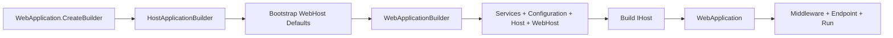

## 深入阅读导航

这份笔记聚焦 Minimal API 的承载与组装外壳，而不是参数绑定内部。主线是：CreateBuilder 初始化共享可变状态；Build 创建根容器和 WebApplication；随后 Map/Use 收集 Endpoint 与中间件；Run 时 GenericWebHostService 才把用户管道接入自动路由、认证、授权和 Endpoint 执行链。

| 阶段 | 核心问题 | 关键入口 |
| --- | --- | --- |
| 1. 统一门面 | 一个对象如何同时表现为 Host、管道和路由 Builder？ | `WebApplication` |
| 2. 运行与接线 | Build、Map/Use、Run 分别发生在何时？ | `BuildRequestDelegate` / `RunAsync` |
| 3. 初始化设置 | 哪些环境属性必须在 CreateBuilder 前确定？ | `WebApplicationOptions` |
| 4. 通用 Builder 状态 | Configuration、Environment、Services 为什么立即可用？ | `HostApplicationBuilder` |
| 5. 容器与 Build | 第三方容器和服务集合何时冻结？ | `HostApplicationBuilder.Build` |
| 6. WebApplicationBuilder | Generic Host 与 Web 默认值怎样组合？ | `WebApplicationBuilder` |
| 7. 自动管道 | 路由、认证、授权和用户管道怎样接线？ | `ConfigureApplication` |
| 8. Bootstrap | 为什么临时实现 IHostBuilder 又禁止 Build？ | `BootstrapHostBuilder` |
| 9. Host 适配器 | 旧 IHostBuilder API 哪些可用、哪些被冻结？ | `ConfigureHostBuilder` |
| 10. WebHost 适配器 | IWebHostBuilder 的 Startup/Build 为什么被禁止？ | `ConfigureWebHostBuilder` |

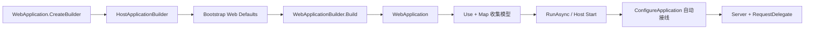

## 核心类型索引

| 类型 | 所在章节 | 说明 |
| --- | --- | --- |
| `WebApplication` | 1-2. 统一门面与运行 | IHost、IApplicationBuilder、IEndpointRouteBuilder 组合对象 |
| `WebApplicationOptions` | 3. 初始化设置 | Minimal API 基础环境设置 |
| `HostApplicationBuilderSettings` | 3. 初始化设置 | 通用 Host 初始化设置 |
| `IHostApplicationBuilder` | 4. 通用 Builder 状态 | 立即可用的配置、环境与服务接口 |
| `HostApplicationBuilder` | 4-5. 通用 Builder | 配置初始化、容器创建和 Build |
| `WebApplicationBuilder` | 6-7. Web Builder | Web 默认值、统一状态与自动管道 |
| `BootstrapHostBuilder` | 8. Bootstrap | 默认回调收集与重放适配器 |
| `ConfigureHostBuilder` | 9. Host 适配器 | 受限 IHostBuilder 兼容层 |
| `ConfigureWebHostBuilder` | 10. WebHost 适配器 | 受限 IWebHostBuilder 兼容层 |
<a id="review-chapter-1"></a>

## 1. WebApplication：Host、管道与路由的统一门面

### 本组解决什么问题

这一组源码回答“为什么 Minimal API 可以在同一个 app 对象上调用 MapGet、Use、Run 和 Services”。WebApplication 同时实现 IHost、IApplicationBuilder 与 IEndpointRouteBuilder，并把职责分别委托给内部 Host、ApplicationBuilder 和 DataSources。

### 关键类型关系图

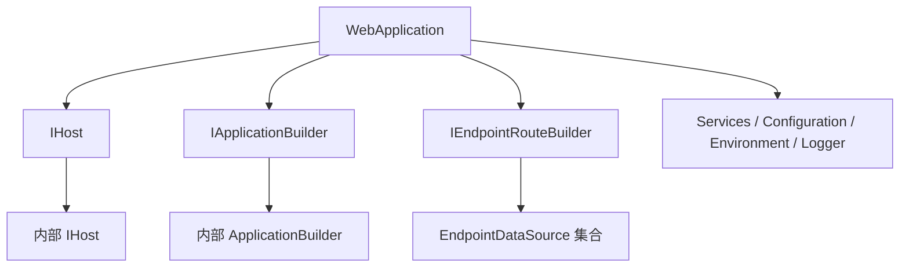

### 核心源码解读

### 一个对象组合三个职责

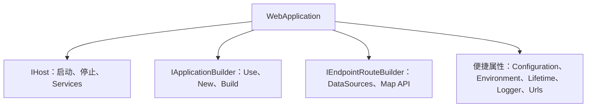

类型本身不重新实现底层算法，而是分别委托给内部 IHost、ApplicationBuilder 和 EndpointDataSource 列表。

### 构造时已经拥有根容器和 Server Features

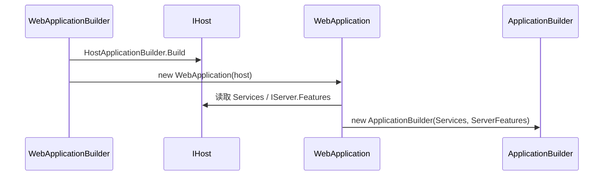

这解释了为什么 `WebApplication` 是 Build 之后的对象，而 `WebApplicationBuilder.Services` 只能在 Build 前修改。

### 显式接口实现控制公共表面

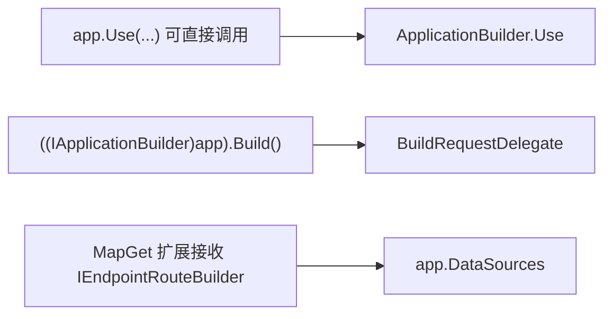

隐藏 Build/New 等低层成员，避免普通 Minimal API 代码误操作完整管道编译过程。

### 全局 EndpointRouteBuilder 标记

WebApplication 在 ApplicationBuilder.Properties 中把自身登记为全局 IEndpointRouteBuilder。路由扩展因此能把 Map 调用的数据源与启动时创建的外层 ApplicationBuilder 对接。

### New 分支会移除全局标记

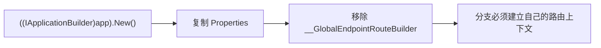

### WebApplication

**读这组源码时关注什么：** 一个对象如何同时承担 Host、管道构建器和 EndpointRouteBuilder。

#### 整体结构

**这段代码回答什么问题：** 一个对象如何同时承担 Host、管道构建器和 EndpointRouteBuilder。

```C#
// 表示 Web 应用程序
// 实现 IHost 并封装实际的 IHost 对象，实现的所有方法最终都会转移到实际的 IHost 上
// 实现 IApplicationBuilder 并封装实际的 IApplicationBuilder 对象，实现的所有方法最终都会转移到实际的 IApplicationBuilder 上
// 实现 IEndpointRouteBuilder 用来注册 EndpointDataSource
public sealed class WebApplication : IHost, IApplicationBuilder, IEndpointRouteBuilder, IAsyncDisposable
{
    internal const string GlobalEndpointRouteBuilderKey = "__GlobalEndpointRouteBuilder";

    private readonly IHost _host;
    private readonly List<EndpointDataSource> _dataSources = new();

    internal WebApplication(IHost host)
    {
        // 封装实际的 IHost 对象
        _host = host;
        // 创建实际的 IApplicationBuilder 对象
        ApplicationBuilder = new ApplicationBuilder(host.Services, ServerFeatures);
        // 创建日志类别为 {IWebHostEnvironment.ApplicationName} 或 "WebApplication" 的 ILogger
        Logger = host.Services.GetRequiredService<ILoggerFactory>().CreateLogger(Environment.ApplicationName ?? nameof(WebApplication));
 
        // 将自身以 "__GlobalEndpointRouteBuilder" 为 Key 添加到共享字典中
        Properties[GlobalEndpointRouteBuilderKey] = this;
    }

    // 从实际的 IHost 中返回表示根容器的 IServiceProvider
    public IServiceProvider Services => _host.Services;

    // 返回应用配置
    // 由 HostApplicationBuilder.Configuration 提供的 ConfigurationManager
    public IConfiguration Configuration => _host.Services.GetRequiredService<IConfiguration>();

    // 利用根容器得到 IWebHostEnvironment
    public IWebHostEnvironment Environment => _host.Services.GetRequiredService<IWebHostEnvironment>();

    // 利用根容器得到 IHostApplicationLifetime
    public IHostApplicationLifetime Lifetime => _host.Services.GetRequiredService<IHostApplicationLifetime>();

    // 返回日志类别为 {IWebHostEnvironment.ApplicationName} 或 "WebApplication" 的 ILogger
    public ILogger Logger { get; }

    // 返回服务器提供的特性集合中 IServerAddressesFeature.Addresses 表示的地址集合
    // 可以直接设置多个监听地址
    public ICollection<string> Urls => ServerFeatures.GetRequiredFeature<IServerAddressesFeature>().Addresses;

    // 返回实际的 IApplicationBuilder
    internal ApplicationBuilder ApplicationBuilder { get; }

    // 实现 IHost
    // 启动宿主，使用实际的 IHost 调用 StartAsync 方法
    public Task StartAsync(CancellationToken cancellationToken = default) =>
        _host.StartAsync(cancellationToken);

    // 实现 IHost
    // 停止宿主，使用实际的 IHost 调用 StopAsync 方法
    public Task StopAsync(CancellationToken cancellationToken = default) =>
        _host.StopAsync(cancellationToken);

    // 以异步方式启动宿主
    // 用于需要长时间运行的服务
    // 支持直接设置监听地址
    public Task RunAsync(string? url = null)
    {
        Listen(url);
        return HostingAbstractionsHostExtensions.RunAsync(this);
    }
    
    // 以同步方式启动宿主
    // 用于需要长时间运行的服务
    // 支持直接设置监听地址
    public void Run(string? url = null)
    {
        Listen(url);
        HostingAbstractionsHostExtensions.Run(this);
    }

    // 设置监听地址
    // 注意：
    // 每次只能设置一个地址，不能使用 ";" 分割设置多个地址
    // 如果需要设置多个地址，可以直接通过 Urls 属性设置
    private void Listen(string? url)
    {
        if (url is null)
        {
            return;
        }
 
        var addresses = ServerFeatures.Get<IServerAddressesFeature>()?.Addresses;
        if (addresses is null)
        {
            throw new InvalidOperationException($"Changing the URL is not supported because no valid {nameof(IServerAddressesFeature)} was found.");
        }
        if (addresses.IsReadOnly)
        {
            throw new InvalidOperationException($"Changing the URL is not supported because {nameof(IServerAddressesFeature.Addresses)} {nameof(ICollection<string>.IsReadOnly)}.");
        }

        // 每次设置都会清空地址集合并添加新的地址
        addresses.Clear();
        addresses.Add(url);
    }

    // 注意：
    // 由于 WebApplication 显式实现了除 Use 方法以外的所有 IApplicationBuilder 接口成员
    // 所以不能直接通过 WebApplication 调用除 Use 方法外的成员

    // 返回 ApplicationBuilder.Properties 表示的共享字典
    internal IDictionary<string, object?> Properties => ApplicationBuilder.Properties;
    // 显式实现 IApplicationBuilder.Properties
    IDictionary<string, object?> IApplicationBuilder.Properties => Properties;

    // 返回由服务器提供的特性集合
    internal IFeatureCollection ServerFeatures => _host.Services.GetRequiredService<IServer>().Features;
    // 显式实现 IApplicationBuilder.ServerFeatures
    IFeatureCollection IApplicationBuilder.ServerFeatures => ServerFeatures;

    // 返回 ApplicationBuilder.ApplicationServices 表示的根容器
    // 显式实现 IApplicationBuilder.ApplicationServices
    IServiceProvider IApplicationBuilder.ApplicationServices
    {
        get => ApplicationBuilder.ApplicationServices;
        set => ApplicationBuilder.ApplicationServices = value;
    }

    // 调用 ApplicationBuilder.Build 方法构建请求处理委托链，并返回位于头部的请求处理器
    internal RequestDelegate BuildRequestDelegate() => ApplicationBuilder.Build();
    // 显式实现 IApplicationBuilder.Build
    RequestDelegate IApplicationBuilder.Build() => BuildRequestDelegate();
 
    // 调用 ApplicationBuilder.New 方法创建新的 IApplicationBuilder
    // 显式实现 IApplicationBuilder.New
    IApplicationBuilder IApplicationBuilder.New()
    {
        var newBuilder = ApplicationBuilder.New();
        // 利用 ApplicationBuilder.New 创建的新的 IApplicationBuilder 时会复制内部的共享字典
        // 为了保证只存在一个代表全局 IEndpointRouteBuilder 的项，需要从新建的 IApplicationBuilder 的共享字典中删除以 "__GlobalEndpointRouteBuilder" 为 Key 的项
        newBuilder.Properties.Remove(GlobalEndpointRouteBuilderKey);
        return newBuilder;
    }
 
    // 实现 IApplicationBuilder.Use
    // 可以通过 WebApplication 直接调用 Use 方法注册中间件的原始形式
    public IApplicationBuilder Use(Func<RequestDelegate, RequestDelegate> middleware)
    {
        ApplicationBuilder.Use(middleware);
        return this;
    }

    // 注意：
    // 由于 WebApplication 显示实现了所有 IEndpointRouteBuilder 接口成员
    // 所以在程序集外部不能直接通过 WebApplication 调用对应的实现方法
    
    // 显式实现 IEndpointRouteBuilder.CreateApplicationBuilder
    IApplicationBuilder IEndpointRouteBuilder.CreateApplicationBuilder() => ((IApplicationBuilder)this).New();

    internal ICollection<EndpointDataSource> DataSources => _dataSources;
    // 显式实现 IEndpointRouteBuilder.DataSources
    ICollection<EndpointDataSource> IEndpointRouteBuilder.DataSources => DataSources;

    // 显式实现 IEndpointRouteBuilder.ServiceProvider
    IServiceProvider IEndpointRouteBuilder.ServiceProvider => Services;

    // 静态方法
    // 创建 WebApplicationBuilder 并调用 WebApplicationBuilder.Build 方法直接构建 WebApplication
    // 注意：
    // 调用此方法创建的 WebApplication 所有的配置和服务注册都使用默认设置
    public static WebApplication Create(string[]? args = null) =>
        new WebApplicationBuilder(new() { Args = args }).Build();
    
    // 静态方法
    // 创建 WebApplicationBuilder，并使用命令行参数
    public static WebApplicationBuilder CreateBuilder(string[] args) =>
        new(new() { Args = args });

    // 静态方法
    // 创建 WebApplicationBuilder，并使用 WebApplicationOptions 选项
    public static WebApplicationBuilder CreateBuilder(WebApplicationOptions options) =>
        new(options);

    // 静态方法
    // 创建 WebApplicationBuilder
    public static WebApplicationBuilder CreateBuilder() =>
        new(new());
}
```

**源码解读：**
- 类型封装实际 IHost 与 ApplicationBuilder，并自己保存 EndpointDataSource。
- Start、Stop 和 Run 转发给 Host，Use 和 Build 转发给 ApplicationBuilder，Map API 通过 IEndpointRouteBuilder 注册数据源。

**读完要记住：**
- 它是 Minimal API 的统一运行门面。
- BuildRequestDelegate 与 GenericWebHostService 启动阶段连接。

## 2. WebApplication 运行：Build、Map/Use、自动接线与 Run

Minimal API 的时间顺序与传统 Startup 不同：Builder.Build 先创建 WebApplication；应用随后调用 Use/Map；真正的 RequestDelegate 外层管道在 Host 启动 GenericWebHostService 时才构建。

### 三个 Build 不要混淆

| 调用 | 产物 | 发生时机 |
| --- | --- | --- |
| `WebApplicationBuilder.Build()` | 根容器、IHost、WebApplication | 用户配置服务后 |
| `ApplicationBuilder.Build()` | RequestDelegate 链 | Web Server 启动阶段 |
| EndpointDataSource 构建 | RouteEndpoint 集合 | 路由 Matcher 读取数据源时 |

### 典型时间线

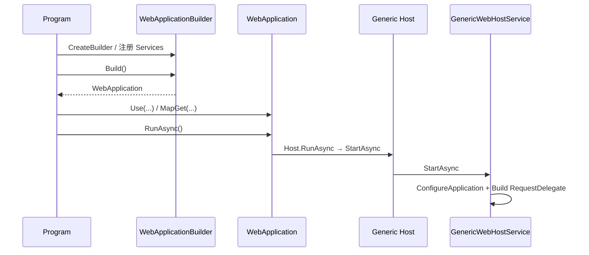

### Use 与 Map 收集到不同位置

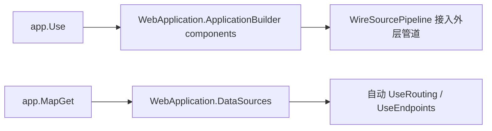

### RunAsync(url) 会替换地址集合

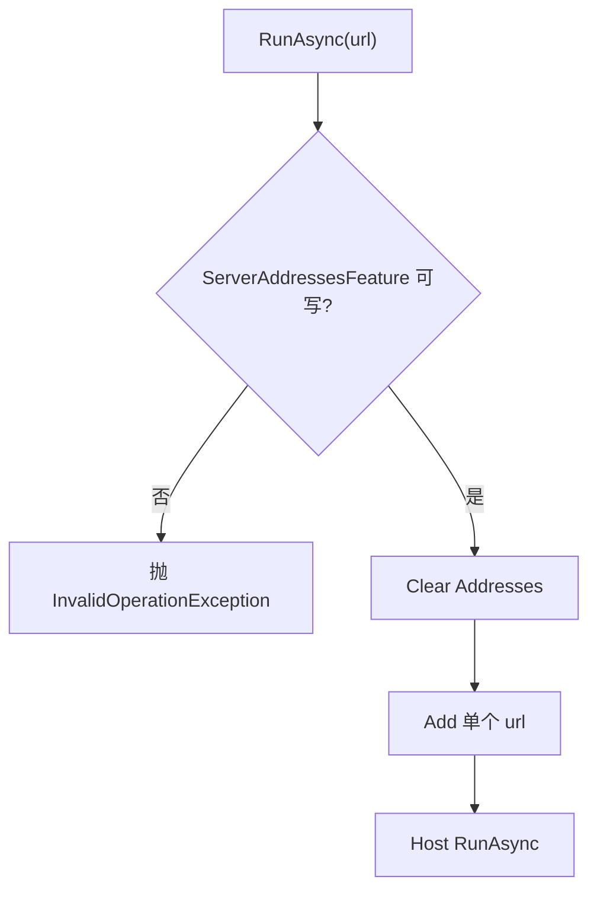

该重载一次只接收一个地址；多个地址应通过 `app.Urls` 添加。

### RunAsync 才是长期等待边界

StartAsync 只启动 Host；RunAsync 启动后等待 ApplicationStopping，并在结束时释放 Host。

### Build 后不能再注册服务

根容器已经创建，ServiceCollection 被设为只读。Map/Use 可以继续登记运行管道模型，但 `builder.Services.Add...` 已越过有效边界。

### 最小例子

```csharp
WebApplication app = WebApplication.CreateBuilder(args).Build();

app.Use(async (context, next) => await next(context));
app.MapGet("/", () => "Hello");

await app.RunAsync();
```

### 回顾要点

- WebApplication 是多个底层抽象的统一门面。
- Map API 收集 EndpointDataSource，Use API 收集中间件。
- Run 最终仍转发到内部 IHost 的生命周期。

## 3. 初始化设置：WebApplicationOptions 与 Host Settings

### 本组解决什么问题

这一组源码回答“WebApplicationBuilder 依赖的通用 Host 基础如何工作”。Settings 在初始化前确定环境，HostApplicationBuilder 随即建立 ConfigurationManager、环境、默认服务和可替换容器工厂。

### 关键类型关系图

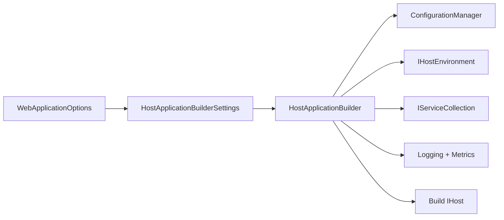

### 核心源码解读

### 初始化前必须确定的属性

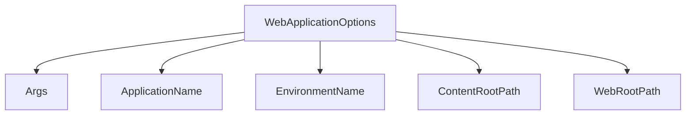

这些值参与环境对象、FileProvider 和默认配置源初始化，不能在 Builder 已创建后任意改写。

### Options 到 Settings 的映射

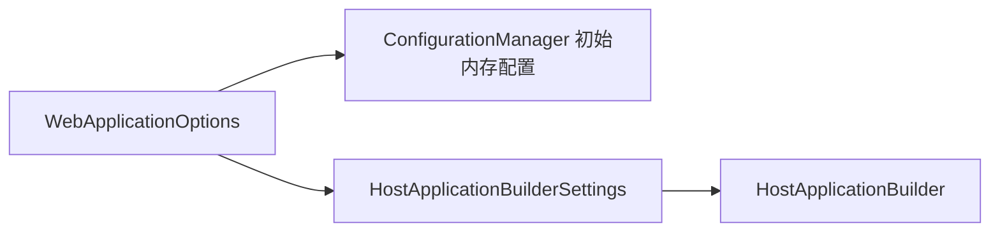

### HostApplicationBuilderSettings 更通用

它还允许提供现有 ConfigurationManager、DisableDefaults 等通用 Host 设置；WebApplicationBuilder 会创建自己的 ConfigurationManager 并注入 ASPNETCORE_ 前缀来源。

### DisableDefaults 的影响范围

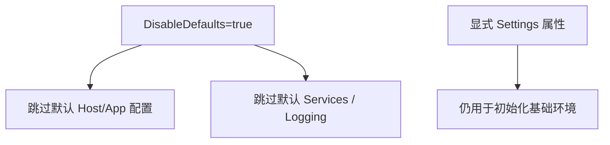

### 环境属性变更应回到 CreateBuilder

后续 Host/WebHost 适配器检测到 ApplicationName、Environment、ContentRoot 或 WebRoot 变化时会抛出异常，并提示使用 WebApplicationOptions。

### WebApplicationOptions

**读这组源码时关注什么：** 创建 Builder 前可以直接锁定哪些环境属性。

#### 整体结构

**这段代码回答什么问题：** 创建 Builder 前可以直接锁定哪些环境属性。

```C#
// Web 应用程序选项
// 提供用于直接设置应用程序环境相关的属性
public class WebApplicationOptions
{
    public string[]? Args { get; init; }
 
    public string? EnvironmentName { get; init; }
 
    public string? ApplicationName { get; init; }
 
    public string? ContentRootPath { get; init; }

    public string? WebRootPath { get; init; }
}
```

**源码解读：**
- 选项保存命令行参数、环境名、应用名、ContentRoot 和 WebRoot。
- 这些值在 HostApplicationBuilder 与 WebHost 初始化前写入配置。

**读完要记住：**
- 基础环境属性应在 CreateBuilder 时确定。
- 后续 Host/WebHost 适配器不允许任意更改它们。

### HostApplicationBuilderSettings

**读这组源码时关注什么：** 通用 HostApplicationBuilder 初始化需要哪些设置。

#### 整体结构

**这段代码回答什么问题：** 通用 HostApplicationBuilder 初始化需要哪些设置。

```C#
// 宿主应用建造者选项
// 大部分属性值来源于 WebApplicationOptions
public sealed class HostApplicationBuilderSettings
{
    public HostApplicationBuilderSettings()
    {
    }
 
    public bool DisableDefaults { get; set; }

    public string[]? Args { get; set; }
 
    public ConfigurationManager? Configuration { get; set; }
 
    public string? EnvironmentName { get; set; }
 
    public string? ApplicationName { get; set; }
 
    public string? ContentRootPath { get; set; }
}
```

**源码解读：**
- 设置包含 Args、外部 Configuration、环境属性与 DisableDefaults。
- WebApplicationBuilder 将 WebApplicationOptions 转换为该设置对象。

**读完要记住：**
- Configuration 可由调用方提前提供。
- DisableDefaults 控制默认配置源和服务是否注册。

<a id="review-chapter-4"></a>

## 4. HostApplicationBuilder：边配置边可读的共享状态

与旧 IHostBuilder 只收集回调不同，IHostApplicationBuilder 直接暴露 Configuration、Environment、Services、Logging 和 Metrics。新增配置源后 ConfigurationManager 立即建立 Provider 并可读取。

### 立即可用对象图

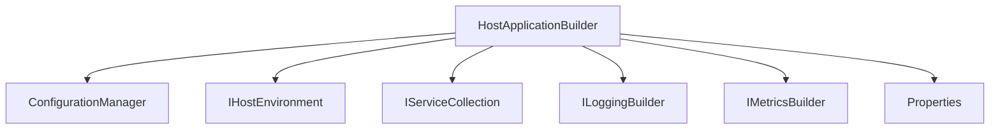

### ConfigurationManager 同时是 Builder 和 Root

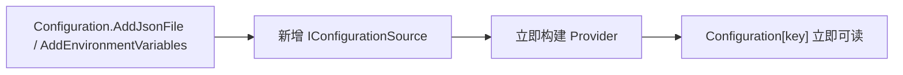

### 初始化顺序

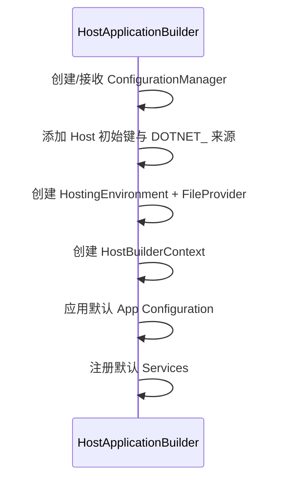

### Services 与 Configuration 共享同一实例

注册进 DI 的 IConfiguration 指向 Builder 正在使用的 ConfigurationManager，因此 Options 和组件读取的是同一配置视图。

### Properties 仍是构建期扩展状态

它不会自动变成配置键或服务；第三方扩展可用它协调 Builder 行为。

### IHostApplicationBuilder

**读这组源码时关注什么：** 新式 Host Builder 对外统一暴露哪些可变对象。

#### 整体结构

**这段代码回答什么问题：** 新式 Host Builder 对外统一暴露哪些可变对象。

```C#
// 宿主应用建造者接口
public interface IHostApplicationBuilder
{
    // 构建过程中用于共享的数据的字典
    IDictionary<object, object> Properties { get; }
    
    // 返回 IConfigurationManager
    IConfigurationManager Configuration { get; }
    
    // 返回 IHostEnvironment
    IHostEnvironment Environment { get; }
 
    // 返回 ILoggingBuilder
    ILoggingBuilder Logging { get; }
 
    // 返回 IMetricsBuilder
    IMetricsBuilder Metrics { get; }
 
    // 返回 IServiceCollection
    IServiceCollection Services { get; }
    
    // 主要用于第三方 IServiceProvider 工厂创建容器建造者，并使用对应的容器建造者配置
    void ConfigureContainer<TContainerBuilder>(IServiceProviderFactory<TContainerBuilder> factory, Action<TContainerBuilder>? configure = null) where TContainerBuilder : notnull;
}
```

**源码解读：**
- 接口直接暴露 Configuration、Environment、Logging、Metrics、Services 和 Properties。
- ConfigureContainer 支持替换 ServiceProviderFactory。

**读完要记住：**
- 与旧 IHostBuilder 不同，它边配置边提供可用对象。
- 最终构建由具体 HostApplicationBuilder 完成。

### HostApplicationBuilder

**读这组源码时关注什么：** 通用 Host 如何边配置边构建环境与服务。

#### 整体结构

**这段代码回答什么问题：** 通用 Host 如何边配置边构建环境与服务。

```C#
// IHostApplicationBuilder 的默认实现
// 主要作用：
// 1. 构建默认的宿主和应用配置
// 2. 注册默认的服务
// 3. 使用第三方 IServiceProvider 工厂创建容器建造者，并使用对应的容器建造者配置
// 4. 构建实际的 IHost
// 5. 对外提供核心属性用来收集配置和注册服务
public sealed class HostApplicationBuilder : IHostApplicationBuilder
{
    private readonly HostBuilderContext _hostBuilderContext;
    private readonly ServiceCollection _serviceCollection = new();
    private readonly IHostEnvironment _environment;
    private readonly LoggingBuilder _logging;
    private readonly MetricsBuilder _metrics;
 
    // 创建 IServiceProvider 的工厂委托
    private Func<IServiceProvider> _createServiceProvider;
    // 用于容器建造者的配置委托，默认是一个空配置委托
    private Action<object> _configureContainer = _ => { };
    private HostBuilderAdapter? _hostBuilderAdapter;
 
    // 表示根容器的 IServiceProvider
    private IServiceProvider? _appServices;
    // 用于标记构建状态，防止重复调用 Build 方法
    private bool _hostBuilt;
 
    public HostApplicationBuilder()
        : this(args: null)
    {
    }
 
    public HostApplicationBuilder(string[]? args)
        : this(new HostApplicationBuilderSettings { Args = args })
    {
    }
 
    public HostApplicationBuilder(HostApplicationBuilderSettings? settings)
    {
        settings ??= new HostApplicationBuilderSettings();
        // 如果 HostApplicationBuilderSettings.Configuration 属性为 null，则创建 ConfigurationManager 用来收集配置源
        // 注意：
        // ConfigurationManager 使用的是一种边收集边构建配置的方式
        // 即每次添加新的 IConfigurationSource 都会立即触发构建对应的 IConfigurationProvider 用来提供配置
        Configuration = settings.Configuration ?? new ConfigurationManager();
 
        if (!settings.DisableDefaults)
        {
            // 确定配置中是否已经设置了工作目录路径
            if (settings.ContentRootPath is null && Configuration[HostDefaults.ContentRootKey] is null)
            {
                // 添加内存配置源用于设置工作目录路径（一般为应用程序根目录）
                HostingHostBuilderExtensions.SetDefaultContentRoot(Configuration);
            }

            // 添加 "DOTNET_" 前缀的环境变量配置源 
            Configuration.AddEnvironmentVariables(prefix: "DOTNET_");
        }

        // 执行初始化
        Initialize(settings, out _hostBuilderContext, out _environment, out _logging, out _metrics);
 
        ServiceProviderOptions? serviceProviderOptions = null;
        if (!settings.DisableDefaults)
        {
            // 添加默认应用配置源
            HostingHostBuilderExtensions.ApplyDefaultAppConfiguration(_hostBuilderContext, Configuration, settings.Args);
            // 注册默认服务
            HostingHostBuilderExtensions.AddDefaultServices(_hostBuilderContext, Services);
            // 根据环境创建 ServiceProviderOptions 选项
            serviceProviderOptions = HostingHostBuilderExtensions.CreateDefaultServiceProviderOptions(_hostBuilderContext);
        }
 
        // 创建默认的 IServiceProvider
        _createServiceProvider = () =>
        {
            // 默认情况下是一个空配置委托
            _configureContainer(Services);
            return serviceProviderOptions is null ? Services.BuildServiceProvider() : Services.BuildServiceProvide(serviceProviderOptions);
        };
    }
    
    // 初始化
    private void Initialize(HostApplicationBuilderSettings settings, out HostBuilderContext hostBuilderContext, out IHostEnvironment environment, out LoggingBuilder logging, out MetricsBuilder metrics)
    {
        // 添加命令行配置源
        HostingHostBuilderExtensions.AddCommandLineConfig(Configuration, settings.Args);
 
        // 添加内存配置源，利用 HostApplicationBuilderSettings 中的属性作为配置值
        // 添加 "applicationName" 配置节表示的应用程序名称
        // 添加 "environment" 配置节表示的环境名称
        // 添加 "contentRoot" 配置节表示的工作目录路径
        List<KeyValuePair<string, string?>>? optionList = null;
        if (settings.ApplicationName is not null)
        {
            optionList ??= new List<KeyValuePair<string, string?>>();
            optionList.Add(new KeyValuePair<string, string?>(HostDefaults.ApplicationKey, settings.ApplicationName));
        }
        if (settings.EnvironmentName is not null)
        {
            optionList ??= new List<KeyValuePair<string, string?>>();
            optionList.Add(new KeyValuePair<string, string?>(HostDefaults.EnvironmentKey, settings.EnvironmentName));
        }
        if (settings.ContentRootPath is not null)
        {
            optionList ??= new List<KeyValuePair<string, string?>>();
            optionList.Add(new KeyValuePair<string, string?>(HostDefaults.ContentRootKey, settings.ContentRootPath));
        }
        if (optionList is not null)
        {
            Configuration.AddInMemoryCollection(optionList);
        }

        // 利用配置创建 HostingEnvironment 和 PhysicalFileProvider
        (HostingEnvironment hostingEnvironment, PhysicalFileProvider physicalFileProvider) = HostBuilder.CreateHostingEnvironment(Configuration);

        // 向 IConfigurationBuilder.Properties 共享字典添加默认的 IFileProvider
        // 目的是为后续添加基于文件的配置源提供默认的 IFileProvider
        Configuration.SetFileProvider(physicalFileProvider);

        // 创建 HostBuilderContext
        hostBuilderContext = new HostBuilderContext(new Dictionary<object, object>())
        {
            HostingEnvironment = hostingEnvironment,
            Configuration = Configuration
        };
 
        environment = hostingEnvironment;

        // 注册默认服务
        HostBuilder.PopulateServiceCollection(
            Services,
            hostBuilderContext,
            hostingEnvironment,
            physicalFileProvider,
            Configuration,
            () => _appServices!);
 
        logging = new LoggingBuilder(Services);
        metrics = new MetricsBuilder(Services);
    }
 
    IDictionary<object, object> IHostApplicationBuilder.Properties => _hostBuilderContext.Properties;
 
    public IHostEnvironment Environment => _environment;
 
    public ConfigurationManager Configuration { get; }
 
    IConfigurationManager IHostApplicationBuilder.Configuration => Configuration;
 
    public IServiceCollection Services => _serviceCollection;
 
    public ILoggingBuilder Logging => _logging;
 
    public IMetricsBuilder Metrics => _metrics;
    
    // 使用第三方 IServiceProvider 工厂和对应的容器建造者配置
    public void ConfigureContainer<TContainerBuilder>(IServiceProviderFactory<TContainerBuilder> factory, Action<TContainerBuilder>? configure = null) where TContainerBuilder : notnull
    {
        // 定义 Func<IServiceProvider> 委托的原型方法
        _createServiceProvider = () =>
        {
            // 利用第三方 IServiceProvider 工厂创建容器建造者
            TContainerBuilder containerBuilder = factory.CreateBuilder(Services);
            // 配置容器建造者
            _configureContainer(containerBuilder);
            // 创建 IServiceProvider 并返回
            return factory.CreateServiceProvider(containerBuilder);
        };

        // 模拟适配器模式
        _configureContainer = containerBuilder => configure?.Invoke((TContainerBuilder)containerBuilder);
    }
 
    // 构建得到实际的 IHost
    public IHost Build()
    {
        if (_hostBuilt)
        {
            throw new InvalidOperationException(SR.BuildCalled);
        }
        _hostBuilt = true;
 
        using DiagnosticListener diagnosticListener = HostBuilder.LogHostBuilding(this);
        _hostBuilderAdapter?.ApplyChanges();

        // 利用 Func<IServiceProvider> 工厂委托创建表示根容器的 IServiceProvider
        _appServices = _createServiceProvider();
 
        // 将 ServiceCollection 标记为只读，不允许再添加服务注册
        _serviceCollection.MakeReadOnly();

        // 利用根容器创建实际的 IHost
        return HostBuilder.ResolveHost(_appServices, diagnosticListener);
    }
 
    private sealed class LoggingBuilder : ILoggingBuilder
    {
        public LoggingBuilder(IServiceCollection services)
        {
            Services = services;
        }
 
        public IServiceCollection Services { get; }
    }
 
    private sealed class MetricsBuilder(IServiceCollection services) : IMetricsBuilder
    {
        public IServiceCollection Services { get; } = services;
    }
}
```

**源码解读：**
- 构造时创建 ConfigurationManager、环境、Context 和默认服务。
- Build 应用适配器变更，创建根容器，将 ServiceCollection 设为只读并解析 IHost。

**读完要记住：**
- ConfigurationManager 添加配置源后立即可读取。
- Build 只能调用一次。

<a id="review-chapter-5"></a>

## 5. HostApplicationBuilder Build：容器工厂、冻结与 IHost

Build 应用兼容适配器的延迟变更，调用当前 ServiceProvider 工厂创建根容器，把 ServiceCollection 设为只读，最后从容器解析 Internal Host。

### 默认容器路径

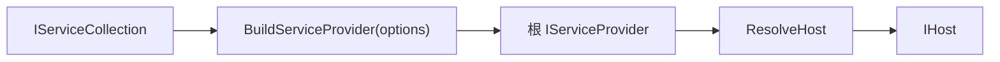

### 第三方容器路径

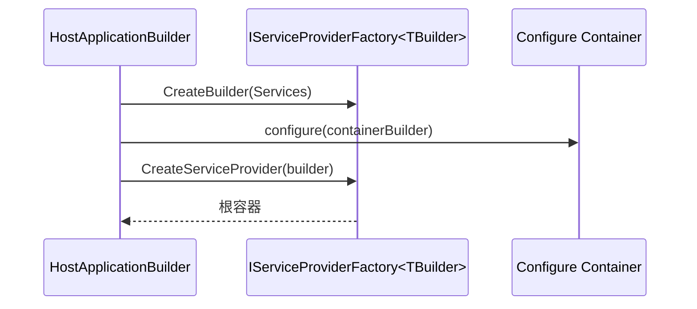

### Build 是一次性状态转换

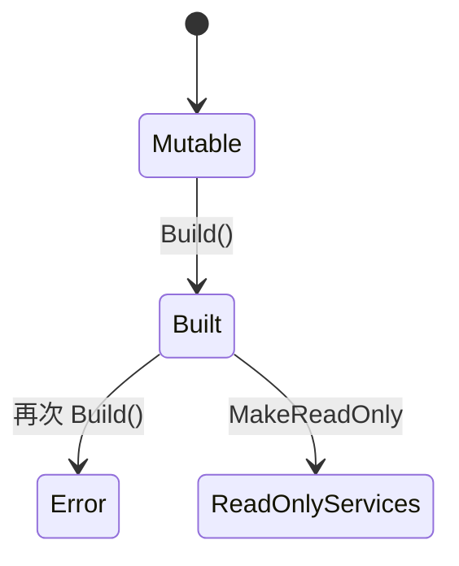

### 适配器变更在容器创建前应用

ConfigureHostBuilder 收集的第三方工厂和 ConfigureContainer 动作会在 WebApplicationBuilder.Build 中转交给 HostApplicationBuilder，随后统一创建容器。

### 配置仍可动态重载

ServiceCollection 冻结只禁止新增服务描述，不等于 ConfigurationManager 停止监听配置源。已注册的 Options 仍可响应 ChangeToken。

### 最小例子

```csharp
var options = new WebApplicationOptions
{
    Args = args,
    EnvironmentName = Environments.Staging,
    ContentRootPath = AppContext.BaseDirectory,
    WebRootPath = "public"
};

WebApplicationBuilder builder = WebApplication.CreateBuilder(options);
```

### 回顾要点

- 环境基础属性在 Builder 初始化前确定。
- ConfigurationManager 支持添加配置后立即读取。
- HostApplicationBuilder.Build 创建根容器后会冻结 ServiceCollection。

<a id="review-chapter-6"></a>

## 6. WebApplicationBuilder：Generic Host 与 Web 默认值组装

### 本组解决什么问题

这一组源码回答“Minimal API 如何复用 Generic Host 与 WebHostDefaults，又避免传统两阶段 Builder 的复杂度”。BootstrapHostBuilder 只执行默认回调，WebApplicationBuilder 随后暴露共享状态并在 Build 时恢复 Web HostedService。

### 关键类型关系图

```mermaid
flowchart TD
    A["WebApplicationBuilder"] --> B["HostApplicationBuilder"]
    A --> C["BootstrapHostBuilder"]
    C --> D["ConfigureWebHostDefaults"]
    D --> E["暂存 GenericWebHostService 描述符"]
    A --> F["Build"]
    F --> G["恢复 GenericWebHostService"]
    F --> H["HostApplicationBuilder.Build"]
    H --> I["WebApplication"]
    I --> J["自动 Routing / Auth / Endpoint 管道"]
```

### 核心源码解读

### Builder 是多个视图共享同一底层状态

```mermaid
flowchart TB
    A["WebApplicationBuilder"] --> B["HostApplicationBuilder"]
    A --> C["Services / Configuration / Logging / Metrics"]
    A --> D["ConfigureHostBuilder Host"]
    A --> E["ConfigureWebHostBuilder WebHost"]
    B --> C
    B --> D
    B --> E
```

Host 和 WebHost 不是独立 Builder；它们操作相同 ConfigurationManager 与 IServiceCollection。

### 构造阶段的两层环境变量

```mermaid
flowchart LR
    A["ASPNETCORE_ 环境变量"] --> C["初始 ConfigurationManager"]
    B["DOTNET_ + 默认 App 配置"] --> D["HostApplicationBuilder"]
    C --> D
```

### Bootstrap Web Defaults

```mermaid
sequenceDiagram
    participant W as WebApplicationBuilder
    participant H as HostApplicationBuilder
    participant B as BootstrapHostBuilder
    W->>H: 创建共享通用 Builder
    W->>B: 包装 HostApplicationBuilder
    W->>B: ConfigureWebHostDefaults
    B->>H: RunDefaultCallbacks 应用配置与服务
    B-->>W: 暂存 GenericWebHostService 描述符
```

### Build 恢复 Web HostedService

```mermaid
flowchart LR
    A["Bootstrap 暂时移除 GenericWebHostService"] --> B["用户继续注册服务"]
    B --> C["WebApplicationBuilder.Build 重新 Add 描述符"]
    C --> D["HostApplicationBuilder.Build"]
```

重新加入的位置让 Web 服务与用户 HostedService 的注册顺序可控，并避免 Bootstrap 阶段提前作为最终服务集合结束。

### WebApplicationBuilder 本身不实现传统继承层次

它通过组合 HostApplicationBuilder 和两个适配器提供兼容 API，避免重新进入旧 HostBuilder 的延迟构建流程。

### WebApplicationBuilder

**读这组源码时关注什么：** Minimal API Builder 如何组合通用 Host 与 WebHost 默认值。

#### 整体结构

**这段代码回答什么问题：** Minimal API Builder 如何组合通用 Host 与 WebHost 默认值。

```C#
// 表示 Web 应用程序建造者
// 实现 IHostApplicationBuilder 并封装实际的 HostApplicationBuilder 
public sealed class WebApplicationBuilder : IHostApplicationBuilder
{
    private const string EndpointRouteBuilderKey = "__EndpointRouteBuilder";
    private const string AuthenticationMiddlewareSetKey = "__AuthenticationMiddlewareSet";
    private const string AuthorizationMiddlewareSetKey = "__AuthorizationMiddlewareSet";
    private const string UseRoutingKey = "__UseRouting";

    // 实际的 IHostApplicationBuilder
    private readonly HostApplicationBuilder _hostApplicationBuilder;
    // 表示针对 GenericWebHostService 服务注册的 ServiceDescriptor
    private readonly ServiceDescriptor _genericWebHostServiceDescriptor;

    // 保存构建得到的 WebApplication
    private WebApplication? _builtApplication;

    internal WebApplicationBuilder(WebApplicationOptions options, Action<IHostBuilder>? configureDefaults = null)
    {
        // 创建 ConfigurationManager 用于收集和提供配置
        var configuration = new ConfigurationManager();
        
        // 在 WebApplication 编程模型下，最早添加的是以 "ASPNETCORE_" 为前缀的环境变量配置源
        configuration.AddEnvironmentVariables(prefix: "ASPNETCORE_");
 
        // 使用 HostApplicationBuilderSettings 创建 HostApplicationBuilder
        _hostApplicationBuilder = new HostApplicationBuilder(new HostApplicationBuilderSettings
        {
            Args = options.Args,
            ApplicationName = options.ApplicationName,
            EnvironmentName = options.EnvironmentName,
            ContentRootPath = options.ContentRootPath,
            Configuration = configuration
        });
 
        // 添加内存配置源
        // 添加 "webroot" 配置节表示的 Web 目录路径
        if (options.WebRootPath is not null)
        {
            Configuration.AddInMemoryCollection(new[]
            {
                new KeyValuePair<string, string?>(WebHostDefaults.WebRootKey, options.WebRootPath),
            });
        }
 
        // 创建 BootstrapHostBuilder
        var bootstrapHostBuilder = new BootstrapHostBuilder(_hostApplicationBuilder);

        // 测试方法
        // 使用 BootstrapHostBuilder 收集配置和注册服务
        // 注意：
        // 虽然 BootstrapHostBuilder 实现了 IHostBuilder，但内部很多功能已经不支持
        configureDefaults?.Invoke(bootstrapHostBuilder);
 
        // 调用 IHostBuilder.ConfigureWebHostDefaults 扩展方法添加默认配置源和注册默认服务
        bootstrapHostBuilder.ConfigureWebHostDefaults(
            webHostBuilder =>
            {
                // 添加针对中间件建造者的配置
                webHostBuilder.Configure(ConfigureApplication);

                // 为 IWebHostBuilder 的备用配置添加环境配置信息
                InitializeWebHostSettings(webHostBuilder);
            },
            options =>
            {
                // 禁用环境变量配置源
                // 因为以 "ASPNETCORE_" 为前缀的环境变量配置源已经添加，无需重复添加
                options.SuppressEnvironmentConfiguration = true;
            }
        );

        // 得到表示 GenericWebHostService 服务注册的 ServiceDescriptor
        _genericWebHostServiceDescriptor = InitializeHosting(bootstrapHostBuilder);
    }

    // 通过 IWebHostBuilder.UseSetting 方法为 IWebHostBuilder 的备用配置添加环境配置信息
    private void InitializeWebHostSettings(IWebHostBuilder webHostBuilder)
    {
        webHostBuilder.UseSetting(WebHostDefaults.ApplicationKey, _hostApplicationBuilder.Environment.ApplicationName ?? "");
        webHostBuilder.UseSetting(WebHostDefaults.PreventHostingStartupKey, Configuration[WebHostDefaults.PreventHostingStartupKey]);
        webHostBuilder.UseSetting(WebHostDefaults.HostingStartupAssembliesKey, Configuration[WebHostDefaults.HostingStartupAssembliesKey]);
        webHostBuilder.UseSetting(WebHostDefaults.HostingStartupExcludeAssembliesKey, Configuration[WebHostDefaults.HostingStartupExcludeAssembliesKey]);
    }
    
    // 应用 BootstrapHostBuilder 收集配置和服务注册
    private ServiceDescriptor InitializeHosting(BootstrapHostBuilder bootstrapHostBuilder)
    {
        // 收集配置和注册服务
        var genericWebHostServiceDescriptor = bootstrapHostBuilder.RunDefaultCallbacks();
 
        // 从共享字典中得到 WebHostBuilderContext
        var webHostContext = (WebHostBuilderContext)bootstrapHostBuilder.Properties[typeof(WebHostBuilderContext)];
        Environment = webHostContext.HostingEnvironment;
 
        // 创建 ConfigureHostBuilder
        // 对外提供 IHostBuilder 用来收集配置和注册服务
        Host = new ConfigureHostBuilder(bootstrapHostBuilder.Context, Configuration, Services);
        // 创建 ConfigureWebHostBuilder
        // 对外提供 IWebHostBuilder 用来收集配置和注册服务
        WebHost = new ConfigureWebHostBuilder(webHostContext, Configuration, Services);
 
        return genericWebHostServiceDescriptor;
    }

    public IWebHostEnvironment Environment { get; private set; }
 
    public IServiceCollection Services => _hostApplicationBuilder.Services;
 
    public ConfigurationManager Configuration => _hostApplicationBuilder.Configuration;
 
    public ILoggingBuilder Logging => _hostApplicationBuilder.Logging;
 
    public IMetricsBuilder Metrics => _hostApplicationBuilder.Metrics;
 
    public ConfigureWebHostBuilder WebHost { get; private set; }
 
    public ConfigureHostBuilder Host { get; private set; }
 
    IDictionary<object, object> IHostApplicationBuilder.Properties => ((IHostApplicationBuilder)_hostApplicationBuilder).Properties;
 
    IConfigurationManager IHostApplicationBuilder.Configuration => Configuration;
 
    IHostEnvironment IHostApplicationBuilder.Environment => Environment;

    // 构建 WebApplication
    public WebApplication Build()
    {
        // 重新添加表示 GenericWebHostService 的服务注册
        _hostApplicationBuilder.Services.Add(_genericWebHostServiceDescriptor);
        // 应用第三方 IServiceProvider 工厂和对应的容器建造者配置
        Host.ApplyServiceProviderFactory(_hostApplicationBuilder);
        // 构建实际的 IHost 并创建 WebApplication
        _builtApplication = new WebApplication(_hostApplicationBuilder.Build());
        return _builtApplication;
    }

    // 中间件建造者配置方法
    private void ConfigureApplication(WebHostBuilderContext context, IApplicationBuilder app) =>
        ConfigureApplication(context, app, allowDeveloperExceptionPage: true);
    
    // 中间件建造者配置方法
    // 注意：
    // 方法调用时候的 IApplicationBuilder 实参是由 GenericWebHostService 通过 IApplicationBuilderFactory 创建的
    private void ConfigureApplication(WebHostBuilderContext context, IApplicationBuilder app, bool allowDeveloperExceptionPage)
    {
        Debug.Assert(_builtApplication is not null);
 
        // 如果存在以 "__EndpointRouteBuilder" 为 Key 的项，则将其移除
        // 因为在 Minimal API 编程模型中，WebApplication 扮演着全局 IEndpointRouteBuilder 的角色
        if (app.Properties.TryGetValue(EndpointRouteBuilderKey, out var priorRouteBuilder))
        {
            app.Properties.Remove(EndpointRouteBuilderKey);
        }
 
        // 开发环境添加开发者异常页中间件
        if (allowDeveloperExceptionPage && context.HostingEnvironment.IsDevelopment())
        {
            app.UseDeveloperExceptionPage();
        }

        // 将 WebApplication 以 "__GlobalEndpointRouteBuilder" 为 Key 添加到当前 IApplicationBuilder 的共享字典中作为全局 IEndpointRouteBuilder
        app.Properties.Add(WebApplication.GlobalEndpointRouteBuilderKey, _builtApplication);

        // 如果利用 WebApplication 作为 IEndpointRouteBuilder 已经注册了 EndpointDataSource
        if (_builtApplication.DataSources.Count > 0)
        {
            // 检查是否已经利用 WebApplication 作为 IApplicationBuilder 调用了 IApplicationBuilder.UseRouting 扩展方法注册 EndpointRoutingMiddleware 中间件
            if (!_builtApplication.Properties.TryGetValue(EndpointRouteBuilderKey, out var localRouteBuilder))
            {
                // 没有则使用当前 IApplicationBuilder 调用 IApplicationBuilder.UseRouting 扩展方法注册 EndpointRoutingMiddleware 中间件
                app.UseRouting();
                _builtApplication.Properties[UseRoutingKey] = app.Properties[UseRoutingKey];
            }
            else
            {
                // 有则只需将对应的 IEndpointRouteBuilder 添加到当前 IApplicationBuilder 的共享字典中
                app.Properties[EndpointRouteBuilderKey] = localRouteBuilder;
            }
        }
 
        // 得到 IServiceProviderIsService 服务
        // 注意：
        // 如果使用默认的依赖注入框架，则实际返回 CallSiteFactory
        var serviceProviderIsService = _builtApplication.Services.GetService<IServiceProviderIsService>();
        // 检查是否注册了 IAuthenticationSchemeProvider 服务
        if (serviceProviderIsService?.IsService(typeof(IAuthenticationSchemeProvider)) is true)
        {
            // 检查是否使用 WebApplication 作为 IApplicationBuilder 时调用 IApplicationBuilder.UseAuthentication 扩展方法注册 AuthenticationMiddleware 中间件
            if (!_builtApplication.Properties.ContainsKey(AuthenticationMiddlewareSetKey))
            {
                // 没有则需要使用当前 IApplicationBuilder 调用 IApplicationBuilder.UseAuthentication 扩展方法注册 AuthenticationMiddleware 中间件
                _builtApplication.Properties[AuthenticationMiddlewareSetKey] = true;
                app.UseAuthentication();
            }
        }

        // 检查是否注册了 IAuthorizationHandlerProvider 服务
        if (serviceProviderIsService?.IsService(typeof(IAuthorizationHandlerProvider)) is true)
        {
            // 检查是否使用 WebApplication 作为 IApplicationBuilder 时调用 IApplicationBuilder.UseAuthorization 扩展方法注册 AuthorizationMiddleware 中间件
            if (!_builtApplication.Properties.ContainsKey(AuthorizationMiddlewareSetKey))
            {
                // 没有则需要使用当前 IApplicationBuilder 调用 IApplicationBuilder.UseAuthorization 扩展方法注册 AuthorizationMiddleware 中间件
                _builtApplication.Properties[AuthorizationMiddlewareSetKey] = true;
                app.UseAuthorization();
            }
        }
 
        // 注册导线中间件
        var wireSourcePipeline = new WireSourcePipeline(_builtApplication);
        app.Use(wireSourcePipeline.CreateMiddleware);

        // 如果利用 WebApplication 作为 IEndpointRouteBuilder 注册了 EndpointDataSource
        if (_builtApplication.DataSources.Count > 0)
        {
            // 使用当前 IApplicationBuilder 调用 IApplicationBuilder.UseEndpoints 扩展方法注册 EndpointMiddleware 中间件
            // 注意：
            // 此处的目的是确保注册 EndpointMiddleware 中间件，并且传入一个空的配置委托，表示不再需要通过 IEndpointRouteBuilder 注册 EndpointDataSource
            app.UseEndpoints(_ => { });
        }
 
        MergeMiddlewareDescriptions(app);

        // 将 WebApplication 在扮演 IApplicationBuilder 时利用共享字典收集的数据转移到当前 IApplicationBuilder 的共享字典中
        foreach (var item in _builtApplication.Properties)
        {
            app.Properties[item.Key] = item.Value;
        }
 
        // 移除以 "__GlobalEndpointRouteBuilder" 为 Key 的项
        app.Properties.Remove(WebApplication.GlobalEndpointRouteBuilderKey);
 
        if (priorRouteBuilder is not null)
        {
            app.Properties[EndpointRouteBuilderKey] = priorRouteBuilder;
        }
    }

    // 使用第三方 IServiceProvider 工厂和对应的容器建造者配置
    void IHostApplicationBuilder.ConfigureContainer<TContainerBuilder>(IServiceProviderFactory<TContainerBuilder> factory, Action<TContainerBuilder>? configure) =>
        // 直接调用 HostApplicationBuilder.ConfigureContainer 方法
        _hostApplicationBuilder.ConfigureContainer(factory, configure);

    // 管道导线
    // 作用是构建请求处理委托链用于连接到其他管道上
    private sealed class WireSourcePipeline(IApplicationBuilder builtApplication)
    {
        private readonly IApplicationBuilder _builtApplication = builtApplication;
 
        public RequestDelegate CreateMiddleware(RequestDelegate next)
        {
            // 短路操作，目的是在构建请求处理委托链时丢弃自己的末端处理器（一般为 404 处理器），使请求能够直接传递到外部传入的请求处理委托链
            _builtApplication.Run(next);
            return _builtApplication.Build();
        }
    }
}
```

**源码解读：**
- 内部创建 HostApplicationBuilder，再用 BootstrapHostBuilder 执行 ConfigureWebHostDefaults。
- Build 恢复 GenericWebHostService 注册、应用容器工厂并创建 WebApplication。

**读完要记住：**
- ConfigureApplication 自动连接全局 EndpointRouteBuilder、路由、认证、授权和 Endpoint 执行。
- 用户通过 Services、Configuration、Logging、Host 和 WebHost 修改同一构建状态。

<a id="review-chapter-7"></a>

## 7. 自动管道：ConfigureApplication 如何连接用户管道

ConfigureApplication 在 GenericWebHostService 启动时执行。它检查 WebApplication 已登记的数据源和服务，补齐开发者异常页、路由、认证、授权、用户中间件链及 Endpoint 执行。

### 自动管道顺序

```mermaid
flowchart LR
    A["DeveloperExceptionPage? "] --> B["UseRouting? "]
    B --> C["UseAuthentication? "]
    C --> D["UseAuthorization? "]
    D --> E["WireSourcePipeline：用户 app.Use 链"]
    E --> F["UseEndpoints? "]
```

问号表示按环境、服务注册、EndpointDataSource 和手动中间件标记决定是否自动添加。

### 自动路由条件

```mermaid
flowchart TD
    A["WebApplication.DataSources.Count > 0"] --> B{"用户管道已 UseRouting?"}
    B -->|否| C["外层 app.UseRouting"]
    B -->|是| D["复用用户记录的 RouteBuilder"]
    C --> E["最后外层 UseEndpoints"]
    D --> E
```

### 认证与授权按服务存在性推断

```mermaid
flowchart TD
    A["IServiceProviderIsService"] --> B{"IAuthenticationSchemeProvider 已注册?"}
    B -->|是且用户未手动添加| C["UseAuthentication"]
    A --> D{"IAuthorizationHandlerProvider 已注册?"}
    D -->|是且用户未手动添加| E["UseAuthorization"]
```

自动插入依赖服务注册，不只是 Endpoint 是否带授权元数据。

### WireSourcePipeline 丢弃用户链自身 404 末端

```mermaid
sequenceDiagram
    participant Outer as GenericWebHostService 外层 Builder
    participant Wire as WireSourcePipeline
    participant User as WebApplication 用户 Builder
    participant Next as 外层 EndpointMiddleware/末端
    Outer->>Wire: Build 时传入 next
    Wire->>User: Run(next)
    Wire->>User: Build 用户链
    User-->>Outer: 返回用户 RequestDelegate
```

这样用户中间件链结束后继续进入外层 Endpoint 执行，而不是先落到自己的默认 404。

### 手动顺序仍可覆盖自动顺序

用户显式调用 UseRouting/UseAuthentication/UseAuthorization 时，Properties 标记阻止自动重复插入，并保留用户指定的位置。

## 8. BootstrapHostBuilder：只重放默认回调的临时适配器

BootstrapHostBuilder 实现 IHostBuilder 只是为了复用 ConfigureWebHostDefaults 等旧扩展。它不拥有最终 Build 和容器创建能力。

### 三类回调先收集后重放

```mermaid
flowchart TB
    A["ConfigureHostConfiguration Actions"] --> D["RunDefaultCallbacks"]
    B["ConfigureAppConfiguration Actions"] --> D
    C["ConfigureServices Actions"] --> D
    D --> E["共享 ConfigurationManager / Services"]
```

### 禁止能力

```mermaid
flowchart LR
    A["Build"] --> X["InvalidOperationException"]
    B["ConfigureContainer"] --> X
    C["UseServiceProviderFactory"] --> X
```

这些能力由外层 HostApplicationBuilder 与 ConfigureHostBuilder 统一处理。

### 为什么暂时移除 GenericWebHostService

```mermaid
flowchart LR
    A["默认 Web 服务注册完成"] --> B["找到 GenericWebHostService 描述符"]
    B --> C["从 Services 移除并返回"]
    C --> D["WebApplicationBuilder.Build 时恢复"]
```

### Bootstrap Context 必须已存在

构造函数从 Services 中查找 HostBuilderContext 实例；不存在说明 HostApplicationBuilder 基础初始化未完成，无法正确重放旧 Builder 回调。

### 该对象不会进入运行时

RunDefaultCallbacks 完成后，后续用户通过 builder.Host / builder.WebHost 两个适配器修改共享状态。

### BootstrapHostBuilder

**读这组源码时关注什么：** 为什么初始化 WebHost 默认值需要一个临时 IHostBuilder。

#### 整体结构

**这段代码回答什么问题：** 为什么初始化 WebHost 默认值需要一个临时 IHostBuilder。

```C#
// 实现 IHostBuilder
// 在 Minimal API 编程模型中 BootstrapHostBuilder 承担 IHostBuilder 的作用，但只提供部分功能
// 保留功能：
// 1. 用来收集针对宿主的配置
// 2. 用来收集针对应用的配置
// 3. 用来收集针对服务注册的配置
internal sealed class BootstrapHostBuilder : IHostBuilder
{
    private readonly HostApplicationBuilder _builder;
 
    private readonly List<Action<IConfigurationBuilder>> _configureHostActions = new();
    private readonly List<Action<HostBuilderContext, IConfigurationBuilder>> _configureAppActions = new();
    private readonly List<Action<HostBuilderContext, IServiceCollection>> _configureServicesActions = new();
 
    public BootstrapHostBuilder(HostApplicationBuilder builder)
    {
        _builder = builder;

        // 从服务注册描述符中确保取出 HostBuilderContext
        foreach (var descriptor in _builder.Services)
        {
            if (descriptor.ServiceType == typeof(HostBuilderContext))
            {
                Context = (HostBuilderContext)descriptor.ImplementationInstance!;
                break;
            }
        }

        if (Context is null)
        {
            throw new InvalidOperationException($"{nameof(HostBuilderContext)} must exist in the {nameof(IServiceCollection)}");
        }
    }
 
    public IDictionary<object, object> Properties => Context.Properties;
 
    public HostBuilderContext Context { get; }
    
    // 收集针对宿主的配置
    public IHostBuilder ConfigureHostConfiguration(Action<IConfigurationBuilder> configureDelegate)
    {
        _configureHostActions.Add(configureDelegate ?? throw new ArgumentNullException(nameof(configureDelegate)));
        return this;
    }
    
    // 收集针对应用的配置
    public IHostBuilder ConfigureAppConfiguration(Action<HostBuilderContext, IConfigurationBuilder> configureDelegate)
    {
        _configureAppActions.Add(configureDelegate ?? throw new ArgumentNullException(nameof(configureDelegate)));
        return this;
    }
    
    // 收集针对服务注册的配置
    public IHostBuilder ConfigureServices(Action<HostBuilderContext, IServiceCollection> configureDelegate)
    {
        _configureServicesActions.Add(configureDelegate ?? throw new ArgumentNullException(nameof(configureDelegate)));
        return this;
    }
    
    // 不支持
    public IHost Build()
    {
        throw new InvalidOperationException();
    }
 
    // 不支持
    public IHostBuilder ConfigureContainer<TContainerBuilder>(Action<HostBuilderContext, TContainerBuilder> configureDelegate)
    {
        throw new InvalidOperationException();
    }
 
    // 不支持
    public IHostBuilder UseServiceProviderFactory<TContainerBuilder>(IServiceProviderFactory<TContainerBuilder> factory) where TContainerBuilder : notnull
    {
        throw new InvalidOperationException();
    }
    
    // 不支持
    public IHostBuilder UseServiceProviderFactory<TContainerBuilder>(Func<HostBuilderContext, IServiceProviderFactory<TContainerBuilder>> factory) where TContainerBuilder : notnull
    {
        throw new InvalidOperationException();
    }
    
    // 执行默认回调
    // 收集配置和注册服务并返回表示 GenericWebHostService 的服务注册
    public ServiceDescriptor RunDefaultCallbacks()
    {
        // 注意：
        // 这里收集的宿主配置是通过调用 IHostBuilder.ConfigureWebHostDefaults 扩展方法时添加的
        // 在 WebApplication 编程模型中属于优先级比较高的配置
        foreach (var configureHostAction in _configureHostActions)
        {
            configureHostAction(_builder.Configuration);
        }
 
        foreach (var configureAppAction in _configureAppActions)
        {
            configureAppAction(Context, _builder.Configuration);
        }
 
        foreach (var configureServicesAction in _configureServicesActions)
        {
            configureServicesAction(Context, _builder.Services);
        }
 
        ServiceDescriptor? genericWebHostServiceDescriptor = null;
 
        // 确保 GenericWebHostService 的服务注册存在
        for (int i = _builder.Services.Count - 1; i >= 0; i--)
        {
            var descriptor = _builder.Services[i];
            if (descriptor.ServiceType == typeof(IHostedService))
            {
                Debug.Assert(descriptor.ImplementationType?.Name == "GenericWebHostService");
 
                genericWebHostServiceDescriptor = descriptor;
                // 找到后先暂时移除该服务注册，后续会在 WebApplicationBuild.Build 方法中重新添加对应的服务注册
                _builder.Services.RemoveAt(i);
                break;
            }
        }
 
        return genericWebHostServiceDescriptor ?? throw new InvalidOperationException($"GenericWebHostedService must exist in the {nameof(IServiceCollection)}");
    }
}
```

**源码解读：**
- 适配器只收集宿主配置、应用配置和服务注册回调。
- RunDefaultCallbacks 将回调立即应用到 HostApplicationBuilder，并暂时移出 GenericWebHostService 描述符。

**读完要记住：**
- 它只用于 Bootstrap 阶段。
- Build、容器配置和 ServiceProviderFactory 在该阶段不受支持。

### 最小例子

```csharp
WebApplicationBuilder builder = WebApplication.CreateBuilder(args);
builder.Services.AddAuthentication().AddCookie();
builder.Services.AddAuthorization();

WebApplication app = builder.Build();
app.MapGet("/secure", () => "ok").RequireAuthorization();
await app.RunAsync();
```

### 回顾要点

- BootstrapHostBuilder 只执行初始化期所需的 IHostBuilder 回调。
- GenericWebHostService 注册在 Bootstrap 后暂存，Build 时恢复。
- 检测到相关服务和 Endpoint 后，框架会补齐默认路由、认证、授权和执行中间件。

<a id="review-chapter-9"></a>

## 9. ConfigureHostBuilder：旧 Host API 的受限兼容层

### 本组解决什么问题

这一组源码回答“为什么 builder.Host 和 builder.WebHost 看似实现旧 Builder 接口，却有大量不支持操作”。Minimal API 已提前建立环境和共享配置，因此适配器只允许安全地追加配置、服务与容器设置，并拒绝重新构建或改变基础环境。

### 关键类型关系图

```mermaid
flowchart TD
    A["WebApplicationBuilder"] --> B["ConfigureHostBuilder"]
    A --> C["ConfigureWebHostBuilder"]
    B --> D["追加 App Configuration / Services"]
    B --> E["收集 Container Factory"]
    C --> F["追加 Web Configuration / Services"]
    G["修改 Environment / ContentRoot / AppName"] --> H["NotSupportedException"]
    I["Build / UseStartup / ConfigureWebHost"] --> H
```

### 核心源码解读

### 支持与禁止能力

| API | 行为 |
| --- | --- |
| ConfigureAppConfiguration | 立即作用于 ConfigurationManager |
| ConfigureServices | 立即作用于 IServiceCollection |
| ConfigureContainer | 收集，Build 前应用 |
| UseServiceProviderFactory | 收集第三方工厂 |
| Build | 禁止，必须调用 WebApplicationBuilder.Build |
| ConfigureWebHost | 禁止，改用 builder.WebHost 或最终 app |

### Host 基础属性已经冻结

```mermaid
flowchart TD
    A["ConfigureHostConfiguration"] --> B["执行配置委托"]
    B --> C{"ApplicationName / ContentRoot / Environment 改变?"}
    C -->|是| D["抛 NotSupportedException"]
    C -->|否| E["保留新配置"]
```

### 为什么委托先执行再验证

ConfigurationManager 是实时配置对象，适配器记录旧值、执行委托后比较关键键。非基础键可以保留，基础环境键变化则被拒绝。

### 容器动作延迟到 Build

```mermaid
flowchart LR
    A["ConfigureContainer Actions"] --> B["ConfigureHostBuilder 暂存"]
    C["UseServiceProviderFactory"] --> B
    B --> D["ApplyServiceProviderFactory"]
    D --> E["HostApplicationBuilder.ConfigureContainer"]
```

### 默认容器与第三方容器的分支

没有第三方工厂时，容器动作直接作用于 IServiceCollection；有工厂时，动作接收该工厂创建的 ContainerBuilder。

### 旧扩展方法兼容不代表完整旧生命周期

适配器只为常见库保留配置入口，不允许它再次构建独立 Host 或重置已初始化环境。

### ConfigureHostBuilder

**读这组源码时关注什么：** WebApplicationBuilder.Host 为什么只支持部分 IHostBuilder 能力。

#### 整体结构

**这段代码回答什么问题：** WebApplicationBuilder.Host 为什么只支持部分 IHostBuilder 能力。

```C#
// 用于提供 IHostBuilder 编程模型
public sealed class ConfigureHostBuilder : IHostBuilder, ISupportsConfigureWebHost
{
    private readonly ConfigurationManager _configuration;
    private readonly IServiceCollection _services;
    private readonly HostBuilderContext _context;
 
    private readonly List<Action<HostBuilderContext, object>> _configureContainerActions = new();
    private IServiceProviderFactory<object>? _serviceProviderFactory;
 
    internal ConfigureHostBuilder(
        HostBuilderContext context,
        ConfigurationManager configuration,
        IServiceCollection services)
    {
        _configuration = configuration;
        _services = services;
        _context = context;
    }
 
    public IDictionary<object, object> Properties => _context.Properties;
 
    // 不支持
    IHost IHostBuilder.Build()
    {
        throw new NotSupportedException($"Call {nameof(WebApplicationBuilder)}.{nameof(WebApplicationBuilder.Build)}() instead.");
    }

    // 添加针对宿主的配置
    public IHostBuilder ConfigureHostConfiguration(Action<IConfigurationBuilder> configureDelegate)
    {
        var previousApplicationName = _configuration[HostDefaults.ApplicationKey];
        var previousContentRoot = HostingPathResolver.ResolvePath(_context.HostingEnvironment.ContentRootPath);
        var previousContentRootConfig = _configuration[HostDefaults.ContentRootKey];
        var previousEnvironment = _configuration[HostDefaults.EnvironmentKey];
 
        // 执行配置收集
        configureDelegate(_configuration);
 
        // 注意：
        // 确保收集的配置没有更改应用程序名称、工作目录路径和环境名称

        if (!string.Equals(previousApplicationName, _configuration[HostDefaults.ApplicationKey], StringComparison.OrdinalIgnoreCase))
        {
            throw new NotSupportedException($"The application name changed from \"{previousApplicationName}\" to \"{_configuration[HostDefaults.ApplicationKey]}\". Changing the host configuration using WebApplicationBuilder.Host is not supported. Use WebApplication.CreateBuilder(WebApplicationOptions) instead.");
        }
 
        if (!string.Equals(previousContentRootConfig, _configuration[HostDefaults.ContentRootKey], StringComparison.OrdinalIgnoreCase)
            && !string.Equals(previousContentRoot, HostingPathResolver.ResolvePath(_configuration[HostDefaults.ContentRootKey]), StringComparison.OrdinalIgnoreCase))
        {
            throw new NotSupportedException($"The content root changed from \"{previousContentRoot}\" to \"{HostingPathResolver.ResolvePath(_configuration[HostDefaults.ContentRootKey])}\". Changing the host configuration using WebApplicationBuilder.Host is not supported. Use WebApplication.CreateBuilder(WebApplicationOptions) instead.");
        }
 
        if (!string.Equals(previousEnvironment, _configuration[HostDefaults.EnvironmentKey], StringComparison.OrdinalIgnoreCase))
        {
            throw new NotSupportedException($"The environment changed from \"{previousEnvironment}\" to \"{_configuration[HostDefaults.EnvironmentKey]}\". Changing the host configuration using WebApplicationBuilder.Host is not supported. Use WebApplication.CreateBuilder(WebApplicationOptions) instead.");
        }
 
        return this;
    }

    // 添加针对应用的配置
    public IHostBuilder ConfigureAppConfiguration(Action<HostBuilderContext, IConfigurationBuilder> configureDelegate)
    {
        // 执行配置收集
        configureDelegate(_context, _configuration);
        return this;
    }

    // 添加注册服务
    public IHostBuilder ConfigureServices(Action<HostBuilderContext, IServiceCollection> configureDelegate)
    {
        // 执行服务注册
        configureDelegate(_context, _services);
        return this;
    }
 
    // 添加针对容器建造者的配置
    public IHostBuilder ConfigureContainer<TContainerBuilder>(Action<HostBuilderContext, TContainerBuilder> configureDelegate)
    {
        ArgumentNullException.ThrowIfNull(configureDelegate);
 
        _configureContainerActions.Add((context, containerBuilder) => configureDelegate(context, (TContainerBuilder)containerBuilder));
 
        return this;
    }
 
    // 使用第三方 IServiceProvider 工厂
    public IHostBuilder UseServiceProviderFactory<TContainerBuilder>(IServiceProviderFactory<TContainerBuilder> factory) where TContainerBuilder : notnull
    {
        ArgumentNullException.ThrowIfNull(factory);
 
        _serviceProviderFactory = new ServiceProviderFactoryAdapter<TContainerBuilder>(factory);
        return this;
    }
 
    // 使用第三方 IServiceProvider 工厂
    public IHostBuilder UseServiceProviderFactory<TContainerBuilder>(Func<HostBuilderContext, IServiceProviderFactory<TContainerBuilder>> factory) where TContainerBuilder : notnull
    {
        // 利用工厂委托得到第三方 IServiceProvider 工厂
        return UseServiceProviderFactory(factory(_context));
    }
    
    // 不支持
    IHostBuilder ISupportsConfigureWebHost.ConfigureWebHost(Action<IWebHostBuilder> configure, Action<WebHostBuilderOptions> configureOptions)
    {
        throw new NotSupportedException("ConfigureWebHost() is not supported by WebApplicationBuilder.Host. Use the WebApplication returned by WebApplicationBuilder.Build() instead.");
    }
 
    // 应用第三方 IServiceProvider 工厂和对应的容器建造者配置
    internal void ApplyServiceProviderFactory(HostApplicationBuilder hostApplicationBuilder)
    {
        // 如果没有使用第三方 IServiceProvider 工厂，则直接应用容器建造者配置并返回
        // 注意：
        // 默认 IServiceProvider 工厂的容器建造者类型就是 IServiceCollection，所以本质就是针对 IServiceCollection 进行配置
        if (_serviceProviderFactory is null)
        {
            foreach (var action in _configureContainerActions)
            {
                action(_context, _services);
            }
 
            return;
        }
 
        void ConfigureContainerBuilderAdapter(object containerBuilder)
        {
            foreach (var action in _configureContainerActions)
            {
                action(_context, containerBuilder);
            }
        }
 
        hostApplicationBuilder.ConfigureContainer(_serviceProviderFactory, ConfigureContainerBuilderAdapter);
    }
    
    // IServiceProviderFactory<object> 默认实现
    // 用于以适配器模式封装第三方 IServiceProvider 工厂
    private sealed class ServiceProviderFactoryAdapter<TContainerBuilder> : IServiceProviderFactory<object> where TContainerBuilder : notnull
    {
        private readonly IServiceProviderFactory<TContainerBuilder> _serviceProviderFactory;
 
        public ServiceProviderFactoryAdapter(IServiceProviderFactory<TContainerBuilder> serviceProviderFactory)
        {
            _serviceProviderFactory = serviceProviderFactory;
        }
 
        public object CreateBuilder(IServiceCollection services) => _serviceProviderFactory.CreateBuilder(services);
        public IServiceProvider CreateServiceProvider(object containerBuilder) => _serviceProviderFactory.CreateServiceProvider((TContainerBuilder)containerBuilder);
    }
}
```

**源码解读：**
- 适配器将应用配置和服务回调立即作用于共享 ConfigurationManager 与 IServiceCollection。
- 容器配置和第三方工厂先收集，Build 前再交给 HostApplicationBuilder。

**读完要记住：**
- 环境、应用名和 ContentRoot 等已初始化属性禁止改变。
- 再次 ConfigureWebHost 也不受支持。

<a id="review-chapter-10"></a>

## 10. ConfigureWebHostBuilder：Web 设置兼容与 Startup 禁区

该适配器让依赖 IWebHostBuilder 的扩展继续注册配置和服务，但 WebApplication 已经拥有管道入口，因此 Build、UseStartup 和 Configure 被禁止。

### 允许的能力

```mermaid
flowchart LR
    A["ConfigureAppConfiguration"] --> D["共享 ConfigurationManager"]
    B["ConfigureServices"] --> E["共享 IServiceCollection"]
    C["UseSetting 非冻结键"] --> D
```

### 冻结的 Web 环境键

```mermaid
flowchart TB
    A["UseSetting / ConfigureAppConfiguration"] --> B{"修改关键键?"}
    B -->|WebRoot / ContentRoot| C["NotSupportedException"]
    B -->|ApplicationName / Environment| C
    B -->|HostingStartup include/exclude| C
    B -->|其他键| D["允许"]
```

### 被禁止的旧编程模型

```mermaid
flowchart LR
    A["IWebHostBuilder.Build"] --> X["使用 WebApplicationBuilder.Build"]
    B["UseStartup<T>"] --> Y["直接在 WebApplication 上 Use/Map"]
    C["Configure(app => ...)"] --> Y
```

### Host 与 WebHost 适配器共享状态

```mermaid
flowchart LR
    A["builder.Host.ConfigureServices"] --> C["同一 IServiceCollection"]
    B["builder.WebHost.ConfigureServices"] --> C
    D["builder.Configuration"] --> E["同一 ConfigurationManager"]
```

### 选择 API 的原则

环境与根路径使用 WebApplicationOptions；通用服务直接使用 builder.Services；应用配置使用 builder.Configuration；仅在复用旧扩展时进入 builder.Host 或 builder.WebHost。

### ConfigureWebHostBuilder

**读这组源码时关注什么：** WebApplicationBuilder.WebHost 为什么限制 Build、Startup 和环境属性修改。

#### 整体结构

**这段代码回答什么问题：** WebApplicationBuilder.WebHost 为什么限制 Build、Startup 和环境属性修改。

```C#
// 用于提供 IWebHostBuilder 编程模型
public sealed class ConfigureWebHostBuilder : IWebHostBuilder, ISupportsStartup
{
    private readonly IWebHostEnvironment _environment;
    private readonly ConfigurationManager _configuration;
    private readonly IServiceCollection _services;
    private readonly WebHostBuilderContext _context;
 
    internal ConfigureWebHostBuilder(WebHostBuilderContext webHostBuilderContext, ConfigurationManager configuration, IServiceCollection services)
    {
        _configuration = configuration;
        _environment = webHostBuilderContext.HostingEnvironment;
        _services = services;
        _context = webHostBuilderContext;
    }
    
    // 不支持
    IWebHost IWebHostBuilder.Build()
    {
        throw new NotSupportedException($"Call {nameof(WebApplicationBuilder)}.{nameof(WebApplicationBuilder.Build)}() instead.");
    }
 
    // 添加针对应用的配置
    public IWebHostBuilder ConfigureAppConfiguration(Action<WebHostBuilderContext, IConfigurationBuilder> configureDelegate)
    {
        var previousContentRoot = HostingPathResolver.ResolvePath(_context.HostingEnvironment.ContentRootPath);
        var previousContentRootConfig = _configuration[WebHostDefaults.ContentRootKey];
        var previousWebRoot = HostingPathResolver.ResolvePath(_context.HostingEnvironment.WebRootPath, previousContentRoot);
        var previousWebRootConfig = _configuration[WebHostDefaults.WebRootKey];
        var previousApplication = _configuration[WebHostDefaults.ApplicationKey];
        var previousEnvironment = _configuration[WebHostDefaults.EnvironmentKey];
        var previousHostingStartupAssemblies = _configuration[WebHostDefaults.HostingStartupAssembliesKey];
        var previousHostingStartupAssembliesExclude = _configuration[WebHostDefaults.HostingStartupExcludeAssembliesKey];
 
        // 执行配置收集
        configureDelegate(_context, _configuration);
 
        // 注意：
        // 确保收集的配置没有更改 Web 目录路径、应用程序名称、工作目录路径、环境名称、托管启动程序集列表和托管启动程序集排除列表
        
        if (!string.Equals(previousWebRootConfig, _configuration[WebHostDefaults.WebRootKey], StringComparison.OrdinalIgnoreCase)
            && !string.Equals(HostingPathResolver.ResolvePath(previousWebRoot, previousContentRoot), HostingPathResolver.ResolvePath(_configuration[WebHostDefaults.WebRootKey], previousContentRoot), StringComparison.OrdinalIgnoreCase))
        {
            throw new NotSupportedException($"The web root changed from \"{HostingPathResolver.ResolvePath(previousWebRoot, previousContentRoot)}\" to \"{HostingPathResolver.ResolvePath(_configuration[WebHostDefaults.WebRootKey], previousContentRoot)}\". Changing the host configuration using WebApplicationBuilder.WebHost is not supported. Use WebApplication.CreateBuilder(WebApplicationOptions) instead.");
        }
        else if (!string.Equals(previousApplication, _configuration[WebHostDefaults.ApplicationKey], StringComparison.OrdinalIgnoreCase))
        {
            throw new NotSupportedException($"The application name changed from \"{previousApplication}\" to \"{_configuration[WebHostDefaults.ApplicationKey]}\". Changing the host configuration using WebApplicationBuilder.WebHost is not supported. Use WebApplication.CreateBuilder(WebApplicationOptions) instead.");
        }
        else if (!string.Equals(previousContentRootConfig, _configuration[WebHostDefaults.ContentRootKey], StringComparison.OrdinalIgnoreCase)
            && !string.Equals(previousContentRoot, HostingPathResolver.ResolvePath(_configuration[WebHostDefaults.ContentRootKey]), StringComparison.OrdinalIgnoreCase))
        {
            throw new NotSupportedException($"The content root changed from \"{previousContentRoot}\" to \"{HostingPathResolver.ResolvePath(_configuration[WebHostDefaults.ContentRootKey])}\". Changing the host configuration using WebApplicationBuilder.WebHost is not supported. Use WebApplication.CreateBuilder(WebApplicationOptions) instead.");
        }
        else if (!string.Equals(previousEnvironment, _configuration[WebHostDefaults.EnvironmentKey], StringComparison.OrdinalIgnoreCase))
        {
            throw new NotSupportedException($"The environment changed from \"{previousEnvironment}\" to \"{_configuration[WebHostDefaults.EnvironmentKey]}\". Changing the host configuration using WebApplicationBuilder.WebHost is not supported. Use WebApplication.CreateBuilder(WebApplicationOptions) instead.");
        }
        else if (!string.Equals(previousHostingStartupAssemblies, _configuration[WebHostDefaults.HostingStartupAssembliesKey], StringComparison.OrdinalIgnoreCase))
        {
            throw new NotSupportedException($"The hosting startup assemblies changed from \"{previousHostingStartupAssemblies}\" to \"{_configuration[WebHostDefaults.HostingStartupAssembliesKey]}\". Changing the host configuration using WebApplicationBuilder.WebHost is not supported. Use WebApplication.CreateBuilder(WebApplicationOptions) instead.");
        }
        else if (!string.Equals(previousHostingStartupAssembliesExclude, _configuration[WebHostDefaults.HostingStartupExcludeAssembliesKey], StringComparison.OrdinalIgnoreCase))
        {
            throw new NotSupportedException($"The hosting startup assemblies exclude list changed from \"{previousHostingStartupAssembliesExclude}\" to \"{_configuration[WebHostDefaults.HostingStartupExcludeAssembliesKey]}\". Changing the host configuration using WebApplicationBuilder.WebHost is not supported. Use WebApplication.CreateBuilder(WebApplicationOptions) instead.");
        }
 
        return this;
    }
 
    // 添加注册服务
    public IWebHostBuilder ConfigureServices(Action<WebHostBuilderContext, IServiceCollection> configureServices)
    {
        // 执行服务注册
        configureServices(_context, _services);
        return this;
    }
 
    // 添加注册服务
    public IWebHostBuilder ConfigureServices(Action<IServiceCollection> configureServices)
    {
        // 本质是调用重载的 ConfigureServices 方法
        return ConfigureServices((WebHostBuilderContext context, IServiceCollection services) => configureServices(services));
    }
 
    // 直接从 ConfigurationManager 获取对应配置节的值
    public string? GetSetting(string key)
    {
        return _configuration[key];
    }
 
    // 直接向 ConfigurationManager 添加或更新对应配置节的值
    public IWebHostBuilder UseSetting(string key, string? value)
    {
        if (value is null)
        {
            return this;
        }
 
        var previousContentRoot = HostingPathResolver.ResolvePath(_context.HostingEnvironment.ContentRootPath);
        var previousWebRoot = HostingPathResolver.ResolvePath(_context.HostingEnvironment.WebRootPath);
        var previousApplication = _configuration[WebHostDefaults.ApplicationKey];
        var previousEnvironment = _configuration[WebHostDefaults.EnvironmentKey];
        var previousHostingStartupAssemblies = _configuration[WebHostDefaults.HostingStartupAssembliesKey];
        var previousHostingStartupAssembliesExclude = _configuration[WebHostDefaults.HostingStartupExcludeAssembliesKey];

        // 注意：
        // 不支持更改 Web 目录路径、应用程序名称、工作目录路径、环境名称、托管启动程序集列表和托管启动程序集排除列表

        if (string.Equals(key, WebHostDefaults.WebRootKey, StringComparison.OrdinalIgnoreCase) &&
                !string.Equals(HostingPathResolver.ResolvePath(previousWebRoot, previousContentRoot), HostingPathResolver.ResolvePath(value, previousContentRoot), StringComparison.OrdinalIgnoreCase))
        {
            throw new NotSupportedException($"The web root changed from \"{HostingPathResolver.ResolvePath(previousWebRoot, previousContentRoot)}\" to \"{HostingPathResolver.ResolvePath(value, previousContentRoot)}\". Changing the host configuration using WebApplicationBuilder.WebHost is not supported. Use WebApplication.CreateBuilder(WebApplicationOptions) instead.");
        }
        else if (string.Equals(key, WebHostDefaults.ApplicationKey, StringComparison.OrdinalIgnoreCase) &&
                !string.Equals(previousApplication, value, StringComparison.OrdinalIgnoreCase))
        {
            throw new NotSupportedException($"The application name changed from \"{previousApplication}\" to \"{value}\". Changing the host configuration using WebApplicationBuilder.WebHost is not supported. Use WebApplication.CreateBuilder(WebApplicationOptions) instead.");
        }
        else if (string.Equals(key, WebHostDefaults.ContentRootKey, StringComparison.OrdinalIgnoreCase) &&
                !string.Equals(previousContentRoot, HostingPathResolver.ResolvePath(value), StringComparison.OrdinalIgnoreCase))
        {
            throw new NotSupportedException($"The content root changed from \"{previousContentRoot}\" to \"{HostingPathResolver.ResolvePath(value)}\". Changing the host configuration using WebApplicationBuilder.WebHost is not supported. Use WebApplication.CreateBuilder(WebApplicationOptions) instead.");
        }
        else if (string.Equals(key, WebHostDefaults.EnvironmentKey, StringComparison.OrdinalIgnoreCase) &&
                !string.Equals(previousEnvironment, value, StringComparison.OrdinalIgnoreCase))
        {
            throw new NotSupportedException($"The environment changed from \"{previousEnvironment}\" to \"{value}\". Changing the host configuration using WebApplicationBuilder.WebHost is not supported. Use WebApplication.CreateBuilder(WebApplicationOptions) instead.");
        }
        else if (string.Equals(key, WebHostDefaults.HostingStartupAssembliesKey, StringComparison.OrdinalIgnoreCase) &&
                !string.Equals(previousHostingStartupAssemblies, value, StringComparison.OrdinalIgnoreCase))
        {
            throw new NotSupportedException($"The hosting startup assemblies changed from \"{previousHostingStartupAssemblies}\" to \"{value}\". Changing the host configuration using WebApplicationBuilder.WebHost is not supported. Use WebApplication.CreateBuilder(WebApplicationOptions) instead.");
        }
        else if (string.Equals(key, WebHostDefaults.HostingStartupExcludeAssembliesKey, StringComparison.OrdinalIgnoreCase) &&
                !string.Equals(previousHostingStartupAssembliesExclude, value, StringComparison.OrdinalIgnoreCase))
        {
            throw new NotSupportedException($"The hosting startup assemblies exclude list changed from \"{previousHostingStartupAssembliesExclude}\" to \"{value}\". Changing the host configuration using WebApplicationBuilder.WebHost is not supported. Use WebApplication.CreateBuilder(WebApplicationOptions) instead.");
        }
 
        _configuration[key] = value;
 
        return this;
    }
    
    // 已不再支持实现 ISupportsStartup 接口的所有方法
    IWebHostBuilder ISupportsStartup.Configure(Action<IApplicationBuilder> configure)
    {
        throw new NotSupportedException("Configure() is not supported by WebApplicationBuilder.WebHost. Use the WebApplication returned by WebApplicationBuilder.Build() instead.");
    }
 
    // 已不再支持实现 ISupportsStartup 接口的所有方法
    IWebHostBuilder ISupportsStartup.Configure(Action<WebHostBuilderContext, IApplicationBuilder> configure)
    {
        throw new NotSupportedException("Configure() is not supported by WebApplicationBuilder.WebHost. Use the WebApplication returned by WebApplicationBuilder.Build() instead.");
    }
 
    // 已不再支持实现 ISupportsStartup 接口的所有方法
    IWebHostBuilder ISupportsStartup.UseStartup(Type startupType)
    {
        throw new NotSupportedException("UseStartup() is not supported by WebApplicationBuilder.WebHost. Use the WebApplication returned by WebApplicationBuilder.Build() instead.");
    }
 
    // 已不再支持实现 ISupportsStartup 接口的所有方法
    IWebHostBuilder ISupportsStartup.UseStartup<TStartup>(Func<WebHostBuilderContext, TStartup> startupFactory)
    {
        throw new NotSupportedException("UseStartup() is not supported by WebApplicationBuilder.WebHost. Use the WebApplication returned by WebApplicationBuilder.Build() instead.");
    }
}
```

**源码解读：**
- 适配器允许追加应用配置、服务和普通设置。
- 修改 WebRoot、ContentRoot、应用名、环境及 HostingStartup 列表会被检测并拒绝。

**读完要记住：**
- IWebHostBuilder.Build 与传统 UseStartup 不受支持。
- 中间件和 Endpoint 应在 Build 返回的 WebApplication 上注册。

### 最小例子

```csharp
WebApplicationBuilder builder = WebApplication.CreateBuilder(args);

builder.Host.ConfigureServices((context, services) =>
    services.AddSingleton<Clock>());
builder.WebHost.ConfigureServices(services =>
    services.AddRouting());

WebApplication app = builder.Build();
```

### 回顾要点

- 两个适配器都操作同一 ConfigurationManager 和 IServiceCollection。
- 基础环境属性不能在初始化后通过 Host 或 WebHost 改写。
- 中间件注册属于 Build 后的 WebApplication，而不是传统 UseStartup。

## 复习顺序建议

1. 先读[第 1 章：WebApplication](#review-chapter-1)，明确它同时代理 Host、管道和 Endpoint 注册。
2. 再读[第 4 章：HostApplicationBuilder](#review-chapter-4)，理解 ConfigurationManager 与服务集合为何立即可用。
3. 接着读[第 5 章：HostApplicationBuilder Build](#review-chapter-5)与[第 6 章：WebApplicationBuilder](#review-chapter-6)，梳理容器构建、Bootstrap 与 GenericWebHostService。
4. 然后读[第 7 章：自动管道](#review-chapter-7)，理解 ConfigureApplication 自动插入中间件的条件。
5. 最后对比[第 9 章：ConfigureHostBuilder](#review-chapter-9)与[第 10 章：ConfigureWebHostBuilder](#review-chapter-10)的支持范围和限制。

## 容易混淆的点

- `WebApplicationBuilder` 不是传统 HostBuilder 的简单子类，而是围绕 HostApplicationBuilder 的组合对象。
- `WebApplication` 同时是 IHost、IApplicationBuilder 和 IEndpointRouteBuilder，但多个成员采用显式接口实现。
- Map 调用发生在 Build 之后，但最终 RequestDelegate 管道要到 GenericWebHostService 启动时才完成接线。
- 认证和授权服务存在且用户未手动添加对应中间件时，Minimal API 会自动补齐。
- Environment、ApplicationName、ContentRoot 和 WebRoot 应通过 WebApplicationOptions 在初始化前设置。
- builder.Host 和 builder.WebHost 只提供兼容配置入口，不能各自 Build 或重新使用传统 Startup 模型。
