# 依赖注入源码解读版

> 这份笔记基于原始 `依赖注入.md` 重组，仍然以源码批注为主体。新增内容只负责把相关类型放到同一组，并在源码前后补充阅读焦点、最小例子和 Mermaid 图解。

## 阅读主线

依赖注入容器的主线可以按“注册信息 → 容器构建 → CallSite 创建 → 实例解析 → Scope 缓存与释放”来读。后文每一组源码都对应这条链路上的一个阶段。

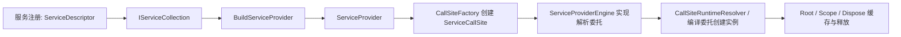

## 深入阅读导航

这版笔记采用“先定位阶段，再进入算法分支”的两层阅读方式。第一次阅读建议只看每章开头、关系图和阶段小结；第二次阅读再沿源码块追踪字段、缓存键、锁和释放路径。

```mermaid
flowchart LR
    A["1-2 注册描述与 API"] --> B["3-4 容器构建与 ServiceProvider"]
    B --> C["5 Scope 与释放"]
    C --> D["6 CallSite 索引与入口"]
    D --> E["7 精确匹配 / 泛型 / 构造函数"]
    E --> F["8 IEnumerable 与 Slot"]
    F --> G["9 生命周期与缓存位置"]
    G --> H["10 CallSite 模型与 Visitor"]
    H --> I["11 RuntimeResolver"]
    I --> J["12 解析引擎"]
    J --> K["13 消费 API 与容器适配"]
```

| 阅读目标 | 优先章节 | 需要回答的问题 |
| --- | --- | --- |
| 会使用 DI | 1、2、5、13 | 注册保存什么，Scope 如何创建和释放 |
| 理解生命周期 | 5、8、9、11 | 实例缓存在哪里，谁负责释放 |
| 排查解析失败 | 4、6、7、8 | CallSite 为什么创建失败，构造函数为何未选中 |
| 理解性能 | 6、9、11、12 | 哪些结构被缓存，何时编译解析委托 |
| 适配第三方容器 | 3、4、13 | IServiceCollection 如何交给外部 Builder |

## 核心类型索引

| 类型 | 所在章节 | 说明 |
| --- | --- | --- |
| `ServiceDescriptor` | 1. 注册描述模型 | 服务类型、实现来源和生命周期的最小注册单元 |
| `IServiceCollection` | 1. 注册描述模型 | 有序的 `ServiceDescriptor` 集合接口 |
| `ServiceCollection` | 1. 注册描述模型 | 默认注册表实现 |
| `ServiceCollectionDescriptorExtensions` | 2. 注册 API | TryAdd、TryAddEnumerable 等去重注册语义 |
| `ServiceCollectionServiceExtensions` | 2. 注册 API | AddTransient、AddScoped、AddSingleton 入口 |
| `ServiceCollectionContainerBuilderExtensions` | 3. 容器构建入口 | BuildServiceProvider 入口 |
| `ServiceProviderOptions` | 3. 容器构建入口 | ValidateScopes 与 ValidateOnBuild |
| `IServiceProvider` | 3. 容器构建入口 | 运行时服务解析接口 |
| `ServiceProvider` | 4. ServiceProvider 初始化 | 容器运行时核心对象 |
| `IServiceScope` | 5. Scope 与释放 | 子作用域抽象 |
| `IServiceScopeFactory` | 5. Scope 与释放 | Scope 创建入口 |
| `ServiceProviderEngineScope` | 5. Scope 与释放 | 解析上下文、缓存与释放边界 |
| `CallSiteFactory` | 6-8. CallSite 创建 | 从服务类型生成解析计划 |
| `ServiceDescriptorCacheItem` | 8. IEnumerable 与 Slot | 同类型多次注册的链式索引 |
| `ServiceCacheKey` | 9. 生命周期与缓存 | 服务类型与 Slot 组成的缓存键 |
| `CallSiteResultCacheLocation` | 9. 生命周期与缓存 | Root、Scope、Dispose、None 位置 |
| `ResultCache` | 9. 生命周期与缓存 | 生命周期到缓存位置的映射 |
| `ServiceCallSite` | 10. CallSite 模型 | 解析计划节点基类 |
| `CallSiteVisitor<TArgument, TResult>` | 10. CallSite 模型 | 按 CallSiteKind 分派的访问器骨架 |
| `CallSiteRuntimeResolver` | 11. RuntimeResolver | 解释执行 CallSite 的默认解析器 |
| `RuntimeResolverContext` | 11. RuntimeResolver | 当前 Scope、锁状态和访问上下文 |
| `RuntimeResolverLock` | 11. RuntimeResolver | Root 与 Scope 锁位标记 |
| `CompiledServiceProviderEngine` | 12. 解析引擎 | 表达式编译解析委托 |
| `DynamicServiceProviderEngine` | 12. 解析引擎 | 首次解释、后台编译的动态引擎 |
| `ServiceProviderServiceExtensions` | 13. 消费与适配 | GetRequiredService、GetServices、CreateScope |
| `IServiceProviderFactory<TContainerBuilder>` | 13. 消费与适配 | 第三方容器适配接口 |
| `DefaultServiceProviderFactory` | 13. 消费与适配 | 默认容器工厂实现 |

<a id="review-chapter-1"></a>

## 1. 注册描述模型：ServiceDescriptor 与有序注册表

### 本组解决什么问题

这一组源码回答“注册一个服务时，容器究竟保存了什么”。ASP.NET Core DI 不会在注册阶段创建普通服务实例，注册阶段主要是把服务类型、实现类型/工厂/实例和生命周期封装成 `ServiceDescriptor`，再放进 `IServiceCollection`。

### 关键类型关系图

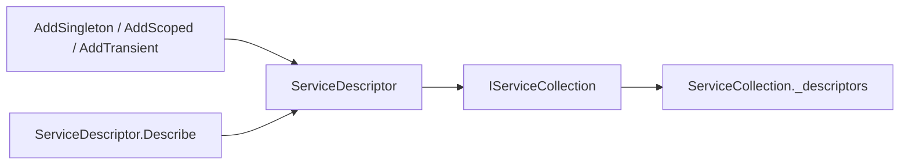

### 核心源码解读

### ServiceDescriptor

**读这组源码时关注什么：** `ServiceDescriptor` 如何用同一个描述对象表达服务类型、实现来源和生命周期。

#### 整体结构

**这段代码回答什么问题：** 一次服务注册最终在容器里保存成什么结构。

```csharp
// 描述服务生命周期、服务注册类型、实现注册类型、实现工厂、实例
public class ServiceDescriptor
{
    // 生命周期
    public ServiceLifetime Lifetime { get; }
 
    // 服务注册类型
    // 注册的可能是开放泛型类型
    public Type ServiceType { get; }
 
    // 实现注册类型
    // 注册的可能是开放泛型类型
    public Type? ImplementationType { get; }

    // 实现工厂
    // 实际的实现工厂类型可能满足泛型委托的协变
    public Func<IServiceProvider, object>? ImplementationFactory { get; }

    // 实例
    public object? ImplementationInstance { get; }

    // 得到实现注册类型
    internal Type GetImplementationType()
    {
        if (ImplementationType != null)
        {
            // 实现注册类型
            return ImplementationType;
        }
        else if (ImplementationInstance != null)
        {
            // 实例类型
            return ImplementationInstance.GetType();
        }
        else if (ImplementationFactory != null)
        {
            // 实际的实现工厂委托类型可能满足泛型委托的协变
            // 所以使用工厂委托的第二个泛型参数类型（即返回值类型）作为实现类型
            Type[]? typeArguments = ImplementationFactory.GetType().GenericTypeArguments;
 
            Debug.Assert(typeArguments.Length == 2);

            return typeArguments[1];
        }
 
        Debug.Assert(false, "ImplementationType, ImplementationInstance or ImplementationFactory must be non null");
        return null;
    }

    // 针对不同生命周期的 ServiceDescriptor 创建方法，内部大部分最终都是调用 Describe 静态方法创建 ServiceDescriptor
    public static ServiceDescriptor Transient<...>(...);
    public static ServiceDescriptor Scoped<...>(...);
    public static ServiceDescriptor Singleton<...>(...);

    private static ServiceDescriptor Describe<TService, TImplementation>(ServiceLifetime lifetime)
        where TService : class
        where TImplementation : class, TService
    {
         return Describe(typeof(TService), typeof(TImplementation), lifetime: lifetime);
    }
 
    public static ServiceDescriptor Describe(Type serviceType, Type implementationType, ServiceLifetime lifetime)
    {
        return new ServiceDescriptor(serviceType, implementationType, lifetime);
    }
 
    public static ServiceDescriptor Describe(Type serviceType, Func<IServiceProvider, object> implementationFactory, ServiceLifetime lifetime)
    {
        return new ServiceDescriptor(serviceType, implementationFactory, lifetime);
    }
}
```

**源码解读：**
- `Lifetime` 保存生命周期。
- `ServiceType` 保存被请求的服务类型。
- 实现来源三选一：`ImplementationType`、`ImplementationFactory`、`ImplementationInstance`。
- 静态工厂方法最终会收敛到创建 `ServiceDescriptor`。

**局部图解：**

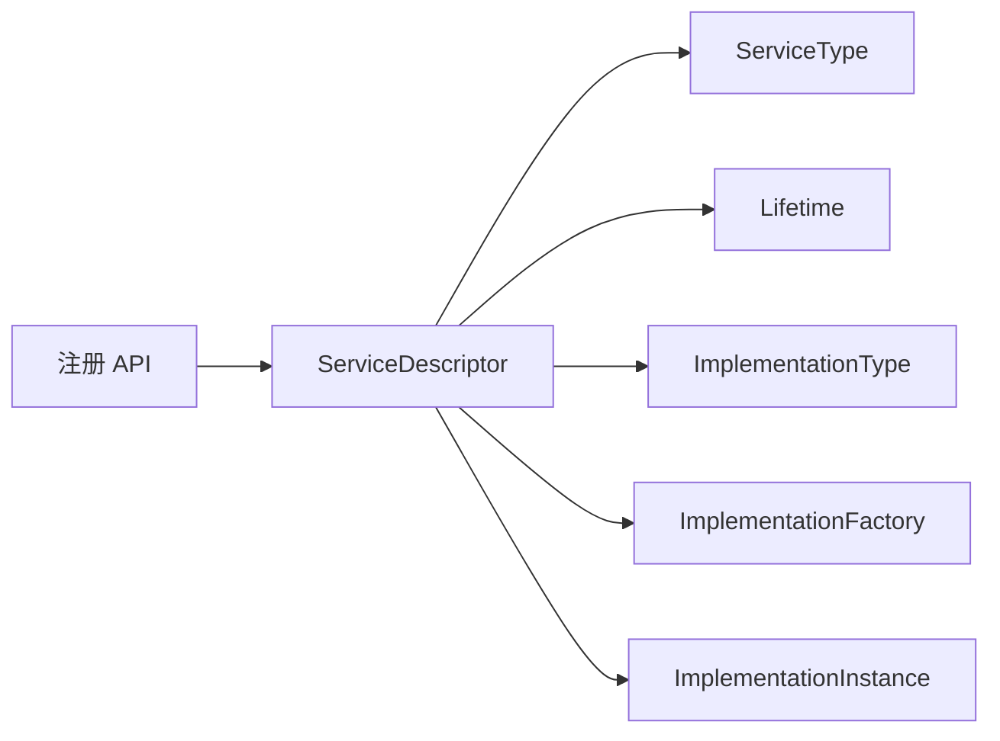

**读完要记住：**
- `ServiceDescriptor` 是注册信息的最小单位。
- 注册阶段保存的是“怎么创建”，不是立即创建实例。

### 深入理解：一个注册为什么有三种实现来源

`ServiceDescriptor` 把“服务对外暴露的类型”和“实例从哪里来”分开。实现来源只允许三选一，后续 CallSiteFactory 正是根据这一分支创建 ConstructorCallSite、FactoryCallSite 或 ConstantCallSite。

| 实现来源 | 注册阶段保存 | 解析阶段动作 | 典型 API |
| --- | --- | --- | --- |
| ImplementationType | 类型 | 选择构造函数并递归解析参数 | `AddScoped<IService, Service>()` |
| ImplementationFactory | 委托 | 调用工厂并传入当前 Scope | `AddSingleton(sp => ...)` |
| ImplementationInstance | 对象 | 直接返回同一实例 | `AddSingleton(instance)` |

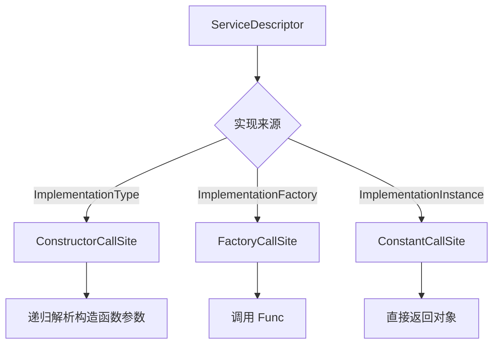

### 深入理解：注册顺序为什么是容器语义的一部分

`IServiceCollection` 不是集合意义上的“无序 Set”，而是有序列表。同一服务类型多次注册时，单服务解析选择最后一项；`IEnumerable<T>` 则保留全部注册并按注册顺序返回。

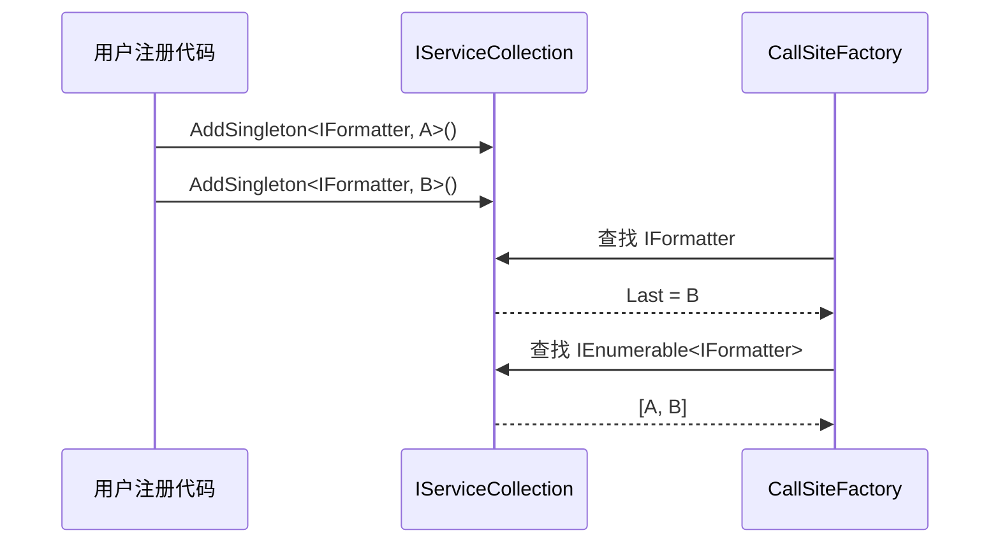

### IServiceCollection / ServiceCollection

**读这组源码时关注什么：** `IServiceCollection` 作为注册表接口，`ServiceCollection` 作为默认列表实现，各自承担什么职责。

#### IServiceCollection：注册表抽象

**这段代码回答什么问题：** `IServiceCollection` 为什么可以直接被看作 `ServiceDescriptor` 集合。

```csharp
// 表示 ServiceDescriptor 集合
public interface IServiceCollection : IList<ServiceDescriptor>
{
}
```

**源码解读：**
- 接口只继承 `IList<ServiceDescriptor>`，没有额外方法。
- 这说明 DI 注册阶段的核心数据结构就是一个有序的描述集合。
- 扩展方法能统一操作它，是因为它就是可追加的列表。

**局部图解：**

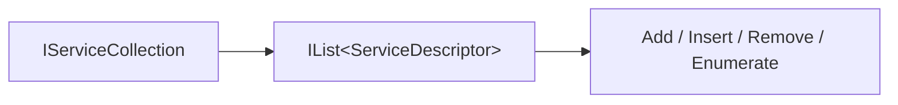

**读完要记住：**
- `IServiceCollection` 是注册表抽象。
- 注册顺序很重要，后续解析和 `IEnumerable<T>` 都会用到。

#### ServiceCollection：默认注册表实现

**这段代码回答什么问题：** 默认实现如何围绕内部 `List<ServiceDescriptor>` 提供增删查和只读保护。

```csharp
// IServiceCollection 的默认实现
public class ServiceCollection : IServiceCollection
{
    private readonly List<ServiceDescriptor> _descriptors = new List<ServiceDescriptor>();
    private bool _isReadOnly;
 
    // 实现 ICollection<T>
    public int Count => _descriptors.Count;
 
    // 实现 ICollection<T>
    public bool IsReadOnly => _isReadOnly;
 
    // 实现 IList<T>
    public ServiceDescriptor this[int index]
    {
        get
        {
            return _descriptors[index];
        }
        set
        {
            CheckReadOnly();
            _descriptors[index] = value;
        }
    }

    // 实现 IList<T>
    public int IndexOf(ServiceDescriptor item)
    {
        return _descriptors.IndexOf(item);
    }
    
    // 实现 IList<T>
    public void Insert(int index, ServiceDescriptor item)
    {
        CheckReadOnly();
        _descriptors.Insert(index, item);
    }
    
    // 实现 IList<T>
    public void RemoveAt(int index)
    {
        CheckReadOnly();
        _descriptors.RemoveAt(index);
    }

    // 实现 ICollection<T>
    void ICollection<ServiceDescriptor>.Add(ServiceDescriptor item)
    {
        CheckReadOnly();
        _descriptors.Add(item);
    }
    
    // 实现 ICollection<T>
    public void Clear()
    {
        CheckReadOnly();
        _descriptors.Clear();
    }
    
    // 实现 ICollection<T>
    public bool Contains(ServiceDescriptor item)
    {
        return _descriptors.Contains(item);
    }
 
    // 实现 ICollection<T>
    public void CopyTo(ServiceDescriptor[] array, int arrayIndex)
    {
        _descriptors.CopyTo(array, arrayIndex);
    }
 
    // 实现 ICollection<T>
    public bool Remove(ServiceDescriptor item)
    {
        CheckReadOnly();
        return _descriptors.Remove(item);
    }
    
    // 实现 IEnumerable<T>
    public IEnumerator<ServiceDescriptor> GetEnumerator()
    {
        return _descriptors.GetEnumerator();
    }
    
    // 显示实现 IEnumerable
    IEnumerator IEnumerable.GetEnumerator()
    {
        return GetEnumerator();
    }
 
    // 设置为只读
    public void MakeReadOnly()
    {
        _isReadOnly = true;
    }
    
    // 检查是否已设置为只读
    // 如果设置为只读，所有对字段 _descriptors 引用的集合的修改都会抛出 InvalidOperationException
    private void CheckReadOnly()
    {
        if (_isReadOnly)
        {
            throw new InvalidOperationException(SR.ServiceCollectionReadOnly);
        }
    }
}
```

**源码解读：**
- `_descriptors` 是真正存储注册项的列表。
- 所有修改方法都会先调用 `CheckReadOnly()`。
- `MakeReadOnly()` 后，再修改集合会抛出异常。
- 枚举和查询能力都委托给内部列表。

**局部图解：**

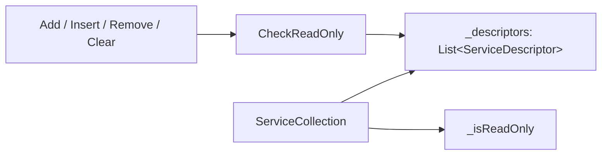

**读完要记住：**
- `ServiceCollection` 只是注册表实现，不负责解析服务。
- 只读保护用于防止构建后继续修改注册集合。

### 阶段小结：注册表已经具备哪些信息

- 每项注册都已规范化为 `ServiceDescriptor`。
- 列表顺序被完整保留，后续用于“最后注册优先”和 `IEnumerable<T>` 聚合。
- 此时尚未选择构造函数，也没有创建普通服务实例。

<a id="review-chapter-2"></a>

## 2. 注册 API：Add、TryAdd 与 TryAddEnumerable

### 本组解决什么问题

这一章只关注“用户调用不同注册 API 时，最终向集合追加什么，以及哪些 API 会去重”。生命周期 API 本身不负责缓存实例，真正的缓存位置在 CallSite 创建后才确定。

### 注册 API 收敛图

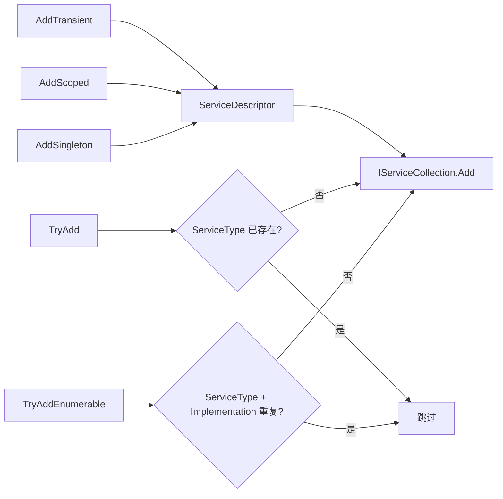

### Add、TryAdd、TryAddEnumerable 行为矩阵

| API | 去重依据 | 适合场景 |
| --- | --- | --- |
| AddXxx | 不去重 | 应用显式叠加注册 |
| TryAdd | ServiceType | 框架提供默认实现，允许应用覆盖 |
| TryAddEnumerable | ServiceType + 实现来源 | 框架追加多个互不重复的策略实现 |

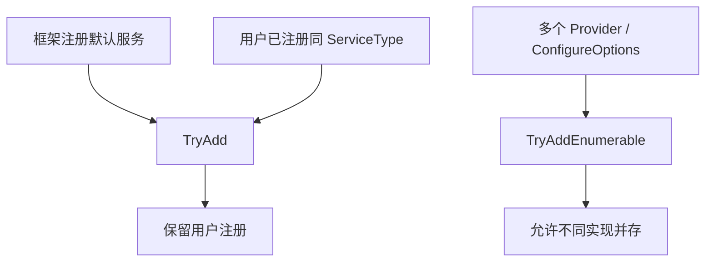

### ServiceCollectionDescriptorExtensions

**读这组源码时关注什么：** 直接以 `ServiceDescriptor` 为单位注册服务的底层扩展方法。

#### 整体结构

**这段代码回答什么问题：** 已有 `ServiceDescriptor` 时如何放入 `IServiceCollection`。

```csharp
// 直接使用 ServiceDescriptor 注册服务的扩展方法
// 内部最终调用 ICollection<T>.Add 方法添加 ServiceDescriptor
// 一般配合 ServiceDescriptor.Transient、ServiceDescriptor.Scoped、ServiceDescriptor.Singleton 等静态方法使用
public static class ServiceCollectionDescriptorExtensions
{
    public static IServiceCollection Add(this IServiceCollection collection, ...);
    public static void TryAdd(this IServiceCollection collection, ...)
    {
        int count = collection.Count;
        for (int i = 0; i < count; i++)
        {
            // 如果已经存在服务注册类型的 ServiceDescriptor，则忽略
            if (collection[i].ServiceType == descriptor.ServiceType)
            {
                return;
            }
        }
    }

    public static void TryAddTransient(this IServiceCollection collection, ...);
    public static void TryAddScoped(this IServiceCollection collection, ...);
    public static void TryAddSingleton(this IServiceCollection collection, ...);

    public static void TryAddEnumerable(this IServiceCollection services, ...)
    {
        // 得到实现注册类型
        Type? implementationType = descriptor.GetImplementationType();
 
        // 实现注册类型是 object 类型或者服务注册类型和实现注册类型相同，则抛出 ArgumentException
        // 1. new ServiceCollection().TryAddEnumerable(ServiceDescriptor.Singleton<IFoo>(_ => new Foo()));
        //    这种方式最终编译器生成的 IL 指令会创建 Func<IServiceProvider, IFoo> 类型的委托
        //    服务注册类型和实现注册类型相同，则抛出 ArgumentException
        // 2. Func<IServiceProvider, Foo> func = _ => new Foo();
        //    new ServiceCollection().TryAddEnumerable(ServiceDescriptor.Singleton<IFoo>(func));
        //    这种方式通过创建 Func<IServiceProvider, Foo> 类型的委托并利用了泛型委托的协变
        //    服务注册类型和实现注册类型不相同，运行正常
        if (implementationType == typeof(object) || implementationType == descriptor.ServiceType)
        {
            throw new ArgumentException(
                SR.Format(SR.TryAddIndistinguishableTypeToEnumerable,
                    implementationType,
                    descriptor.ServiceType),
                nameof(descriptor));
        }
 
        int count = services.Count;
        for (int i = 0; i < count; i++)
        {
            ServiceDescriptor service = services[i];
            // 如果已经存在服务注册类型和实现注册类型的 ServiceDescriptor，则忽略
            if (service.ServiceType == descriptor.ServiceType && service.GetImplementationType() == implementationType)
            {
                return;
            }
        }
    }

    public static IServiceCollection Replace(this IServiceCollection collection, ServiceDescriptor descriptor)
    {
        int count = collection.Count;
        for (int i = 0; i < count; i++)
        {
            // 服务注册类型存在，则删除
            if (collection[i].ServiceType == descriptor.ServiceType)
            {
                collection.RemoveAt(i);
                break;
            }
        }

        // 最终在末尾添加新的 ServiceDescriptor
        collection.Add(descriptor);

        ...
    }

    public static IServiceCollection RemoveAll<T>(this IServiceCollection collection);
    public static IServiceCollection RemoveAll(this IServiceCollection collection, Type ServiceType)
    {
        for (int i = collection.Count - 1; i >= 0; i--)
        {
            ServiceDescriptor? descriptor = collection[i];
            // 根据服务注册类型删除所有 ServiceDescriptor
            if (descriptor.ServiceType == serviceType)
            {
                collection.RemoveAt(i);
            }
        }

        ...
    }
}
```

**源码解读：**
- 这些扩展方法不关心实现类型或生命周期如何得来。
- 核心动作是调用集合的 `Add` 或插入相关方法。
- 它们通常配合 `ServiceDescriptor.Transient/Scoped/Singleton` 使用。

**局部图解：**

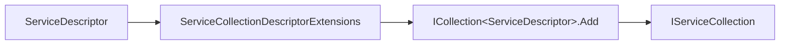

**读完要记住：**
- 这是最贴近集合操作的一层注册 API。
- 复杂注册重载最终也会落成 `ServiceDescriptor` 再加入集合。

### ServiceCollectionServiceExtensions

**读这组源码时关注什么：** 常用 `AddSingleton/AddScoped/AddTransient` 如何把参数转换成 `ServiceDescriptor`。

#### 整体结构

**这段代码回答什么问题：** 面向服务类型、实现类型、工厂和实例的注册 API 如何统一落表。

```csharp
// 使用服务类型、实现类型、实现工厂、实例等参数创建 ServiceDescriptor 注册服务的扩展方法
// 内部最终调用 ICollection<T>.Add 方法添加 ServiceDescriptor
public static class ServiceCollectionServiceExtensions
{
    // 内部大部分最终调用 Add 扩展方法
    // 泛型方法需要满足 where TImplementation : class, TService 泛型约束
    public static IServiceCollection AddTransient<...>(this IServiceCollection services, ...);
    public static IServiceCollection AddScoped<...>(this IServiceCollection services, ...);
    public static IServiceCollection AddSingleton<...>(this IServiceCollection services, ...);

    private static IServiceCollection Add(
        IServiceCollection collection, 
        Type serviceType, 
        Type implementationType, 
        ServiceLifetime lifetime)
    {
        var descriptor = new ServiceDescriptor(serviceType, implementationType, lifetime);
        collection.Add(descriptor);
        return collection;
    }
 
    private static IServiceCollection Add(
        IServiceCollection collection,
        Type serviceType,
        Func<IServiceProvider, object> implementationFactory,
        ServiceLifetime lifetime)
    {
        var descriptor = new ServiceDescriptor(serviceType, implementationFactory, lifetime);
        collection.Add(descriptor);
        return collection;
    }
}
```

**源码解读：**
- 公开重载面向用户使用，覆盖泛型、非泛型、工厂、实例等注册方式。
- 私有 `Add` 方法创建 `ServiceDescriptor`。
- 创建完成后调用 `collection.Add(descriptor)`。

**局部图解：**

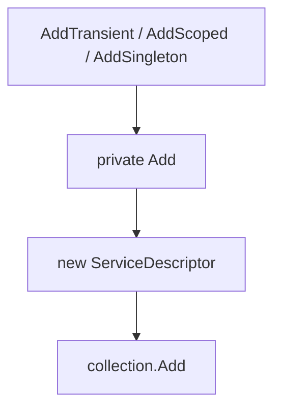

**读完要记住：**
- 常用注册 API 只是更友好的 `ServiceDescriptor` 创建器。
- 生命周期差异先保存在描述对象里，解析阶段才真正影响缓存位置。


### 最小例子：AddXxx 如何落成不同生命周期的 ServiceDescriptor

```csharp
IServiceCollection services = new ServiceCollection();

services.AddSingleton<IClock, SystemClock>();
services.AddScoped<IUnitOfWork, EfUnitOfWork>();
services.AddTransient<IMessageHandler, MessageHandler>();

// 注册完成后，services 中保存的是 ServiceDescriptor：
// IClock        -> SystemClock     -> Singleton
// IUnitOfWork   -> EfUnitOfWork    -> Scoped
// IMessageHandler -> MessageHandler -> Transient
```

### 回顾要点

- `IServiceCollection` 是注册表，不是容器。
- `ServiceDescriptor` 是注册信息的最小单位。
- 注册阶段不会解析构造函数依赖，构造函数依赖会在后面的 `CallSiteFactory` 阶段处理。

<a id="review-chapter-3"></a>

## 3. 容器构建入口：从 IServiceCollection 到 IServiceProvider

### 本组解决什么问题

这一组源码回答“什么时候注册表变成真正的容器”。`BuildServiceProvider` 只是入口，真正的初始化发生在 `ServiceProvider` 构造函数里：创建根作用域、选择解析引擎、创建 `CallSiteFactory`，并注册几个内置服务。

### 关键类型关系图

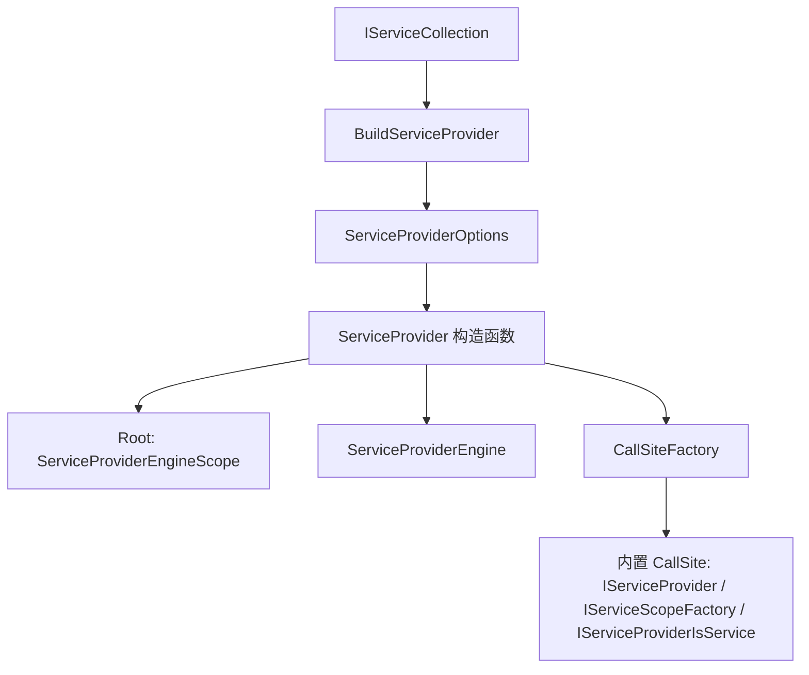

### 核心源码解读

### ServiceCollectionContainerBuilderExtensions

**读这组源码时关注什么：** `BuildServiceProvider` 如何从注册表进入默认容器构建。

#### 整体结构

**这段代码回答什么问题：** `IServiceCollection` 是在哪里变成 `ServiceProvider` 的。

```csharp
// 使用 IServiceCollection 构建默认 ServiceProvider 的扩展方法
public static class ServiceCollectionContainerBuilderExtensions
{
    public static ServiceProvider BuildServiceProvider(this IServiceCollection services)
    {
        return BuildServiceProvider(services, ServiceProviderOptions.Default);
    }

    public static ServiceProvider BuildServiceProvider(this IServiceCollection services, bool validateScopes)
    {
        return services.BuildServiceProvider(new ServiceProviderOptions { ValidateScopes = validateScopes });
    }

    public static ServiceProvider BuildServiceProvider(this IServiceCollection services, ServiceProviderOptions options)
    {
        if (services is null)
        {
            throw new ArgumentNullException(nameof(services));
        }
        if (options is null)
        {
            throw new ArgumentNullException(nameof(options));
        }
 
        return new ServiceProvider(services, options);
    }
}
```

**源码解读：**
- 无参重载使用默认选项。
- `validateScopes` 重载会创建 `ServiceProviderOptions`。
- 最终重载检查参数后调用 `new ServiceProvider(services, options)`。

**局部图解：**

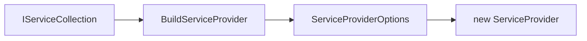

**读完要记住：**
- `BuildServiceProvider` 是注册表到默认容器的边界。
- 真正复杂的初始化发生在 `ServiceProvider` 构造函数。

### ServiceProviderOptions

**读这组源码时关注什么：** 默认容器构建时两个验证开关分别控制什么。

#### 整体结构

**这段代码回答什么问题：** `ValidateScopes` 和 `ValidateOnBuild` 的语义边界是什么。

```csharp
// 配置默认 ServiceProviderOptions 选项
public class ServiceProviderOptions
{
    // 默认行为，不验证服务范围并且所有服务是否可以被解析不在 ServiceProvider 构造函数执行时验证
    internal static readonly ServiceProviderOptions Default = new ServiceProviderOptions();

    // 验证服务范围
    // 即不能由根容器解析 Scoped 生命周期的服务
    public bool ValidateScopes { get; set; }

    // 如果设置为 true，则在 ServiceProvider 构造函数执行时验证所有已注册服务的服务范围
    // 否则，则会在实际通过 GetService 方法获取服务实例时验证服务范围
    public bool ValidateOnBuild { get; set; }
}
```

**源码解读：**
- `ValidateScopes` 检查作用域使用，例如根容器解析 Scoped 服务。
- `ValidateOnBuild` 尝试在构建容器时提前验证注册能否形成 CallSite。
- 默认配置不开启这些验证。

**局部图解：**

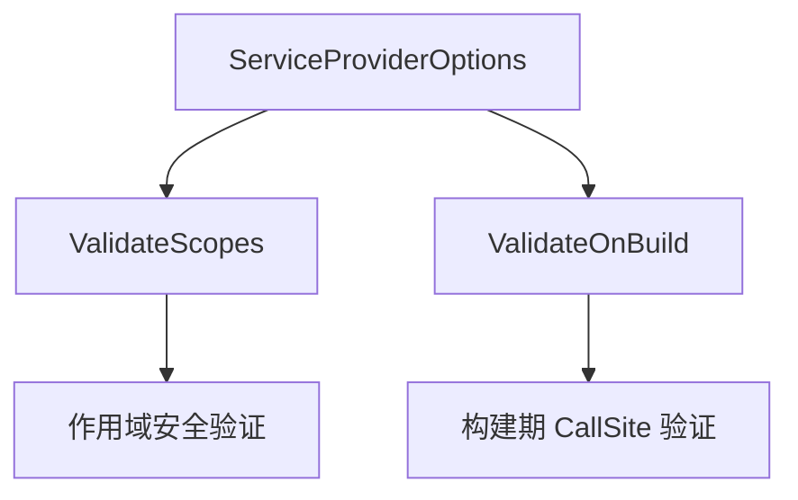

**读完要记住：**
- 两个选项都服务于提前发现错误。
- 它们不改变服务生命周期语义，只改变校验时机和范围。

### 深入理解：BuildServiceProvider 只是入口，不是全部构建工作

扩展方法只负责把 `IServiceCollection` 和 `ServiceProviderOptions` 交给 `ServiceProvider` 构造函数。真正的描述符索引、内置服务注册、Scope 创建和可选验证都在构造函数中发生。

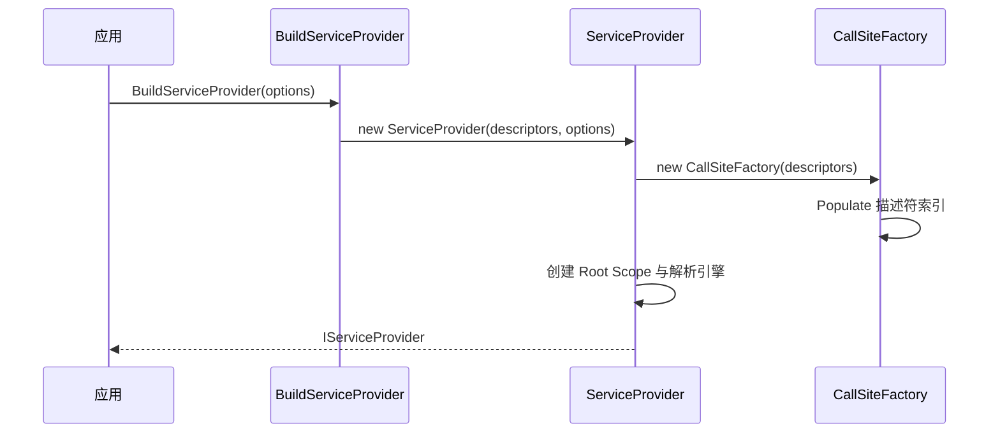

### ServiceProviderOptions 组合效果

| ValidateScopes | ValidateOnBuild | 效果 |
| --- | --- | --- |
| false | false | 最快构建，错误延迟到解析时出现 |
| true | false | 解析时阻止根容器消费 Scoped 服务 |
| false | true | 构建时尽量创建所有 CallSite |
| true | true | 同时检查结构可建性与作用域安全 |

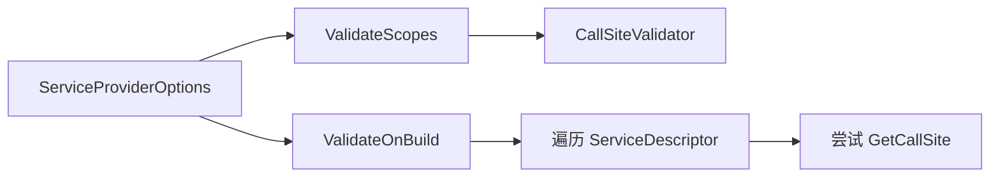

### IServiceProvider

**读这组源码时关注什么：** 容器最小抽象为什么只有一个 `GetService(Type)`。

#### 整体结构

**这段代码回答什么问题：** DI 容器对外暴露的最低能力是什么。

```csharp
// IoC 容器的抽象表示
// 只提供唯一的 GetService 方法
public interface IServiceProvider
{
    object? GetService(Type serviceType);
}
```

**源码解读：**
- 接口只提供按 `Type` 获取服务。
- 泛型获取、Required 语义、多服务获取都不是这个接口的一部分。
- 这让第三方容器适配成本很低。

**局部图解：**

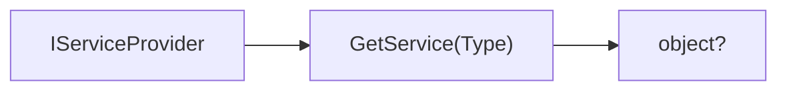

**读完要记住：**
- `IServiceProvider` 是极小抽象。
- 便利 API 都在扩展方法或额外接口中补充。

### 阶段小结：容器构建入口完成了什么

到这里，调用方只确定了构建选项和最外层接口。下一章进入 `ServiceProvider` 构造函数，观察运行时组件如何真正组装。

<a id="review-chapter-4"></a>

## 4. ServiceProvider：运行时组件初始化、验证与引擎选择

### 本组解决什么问题

这一章回答“一个可运行容器内部持有哪些对象”。重点区分描述符索引、CallSite 缓存、实例缓存、Root Scope 和解析引擎，它们虽然都带有“缓存”概念，但保存的数据完全不同。

### ServiceProvider 所有权图

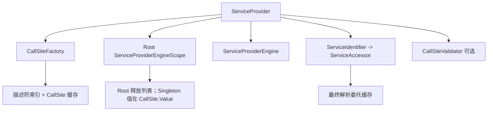

### 五类缓存不要混淆

| 缓存 | 保存内容 | 生命周期 |
| --- | --- | --- |
| 描述符索引 | ServiceIdentifier 到注册链 | 容器生命周期 |
| CallSite 缓存 | ServiceCacheKey 到解析计划 | 容器生命周期 |
| ServiceAccessor 缓存 | 服务类型到解析委托 | 容器生命周期 |
| ServiceCallSite.Value | Singleton 真实实例 | 容器生命周期 |
| Scope.ResolvedServices | Scoped 真实实例 | 当前 Scope 生命周期 |

### ServiceProvider

**读这组源码时关注什么：** `ServiceProvider` 如何把注册表转换成运行时解析系统，并负责 `GetService` 的委托缓存与执行。

这个类型是默认容器的核心入口。下面按字段、构造、验证、解析入口和引擎选择拆开看。

#### 字段结构：容器运行时的核心组件

**这段代码回答什么问题：** `ServiceProvider` 内部保存哪些对象，分别负责验证、创建解析计划、缓存解析委托和表示根作用域。

```csharp
// IServiceProvider 的默认实现
public sealed class ServiceProvider : IServiceProvider, IDisposable, IAsyncDisposable
{
    // 服务范围验证器
    // 继承 CallSiteVisitor<TArgument, TResult>
    // 用来验证是否存在通过根容器解析 Scoped 生命周期的服务
    private readonly CallSiteValidator? _callSiteValidator;

    // 服务解析引擎
    // 核心方法 RealizeService 的作用是根据 ServiceCallSite 创建 Func<ServiceProviderEngineScope, object?>> 委托
    // 实现类型：
    // 1. CompiledServiceProviderEngine
    //      DynamicServiceProviderEngine
    // 2. ExpressionsServiceProviderEngine
    // 3. ILEmitServiceProviderEngine
    // 4. RuntimeServiceProviderEngine
    internal ServiceProviderEngine _engine;

    // 如果 _realizedServices 没有对应服务类型的 Func<ServiceProviderEngineScope, object?> 委托就通过 _createServiceAccessor 创建
    private readonly Func<Type, Func<ServiceProviderEngineScope, object?>> _createServiceAccessor;
    // 用来缓存服务类型和其对应的 Func<ServiceProviderEngineScope, object?> 委托
    // 当缓存中没有对应的服务类型时，将通过 _createServiceAccessor 创建 Func<ServiceProviderEngineScope, object?> 委托
    // 服务实例最终是利用 Func<ServiceProviderEngineScope, object?> 委托来创建的
    private ConcurrentDictionary<Type, Func<ServiceProviderEngineScope, object?>> _realizedServices;

    // ServiceCallSite 工厂
    internal CallSiteFactory CallSiteFactory { get; }

    // 根容器（服务范围）
    internal ServiceProviderEngineScope Root { get; }
```

**源码解读：**
- `_callSiteValidator` 只在开启 `ValidateScopes` 时存在。
- `_engine` 负责把 `ServiceCallSite` 变成解析委托。
- `_realizedServices` 缓存“服务类型 -> 解析委托”。
- `CallSiteFactory` 创建解析计划，`Root` 表示根作用域。

**局部图解：**

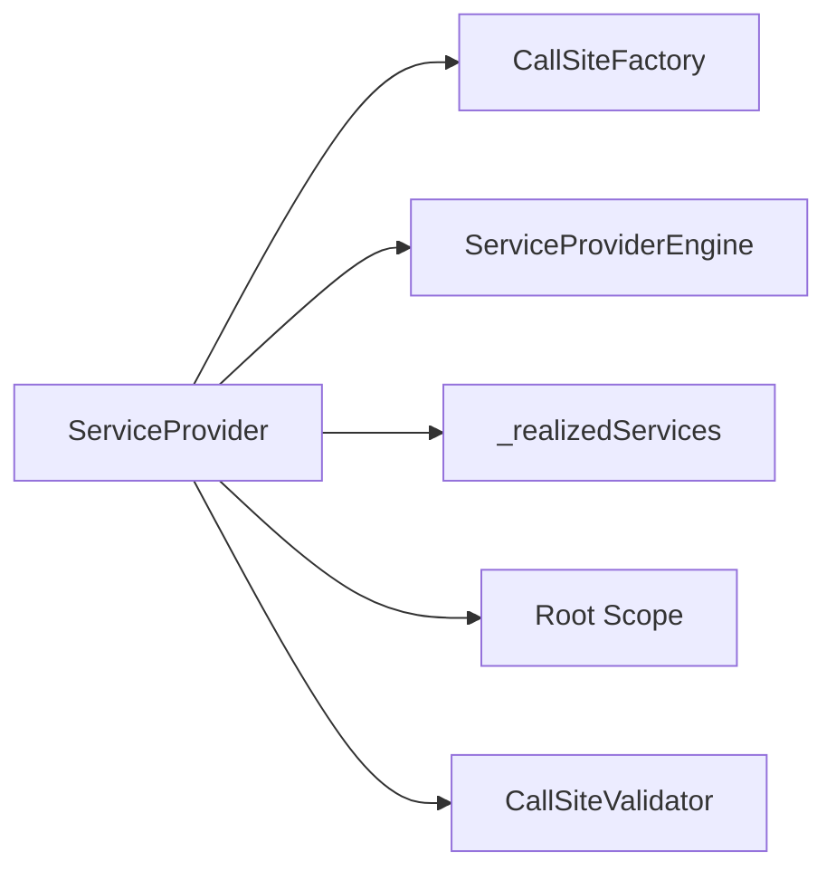

**读完要记住：**
- `ServiceProvider` 保存的是解析运行时，不只是注册表。
- 解析服务会先找到或创建解析委托，再用 Scope 执行。

#### 构造函数初始化：把注册表转换成容器运行时

**这段代码回答什么问题：** `BuildServiceProvider` 调用 `new ServiceProvider(...)` 后，默认容器初始化了哪些基础对象。

```csharp
internal ServiceProvider(ICollection<ServiceDescriptor> serviceDescriptors, ServiceProviderOptions options)
    {
        // 创建根容器
        Root = new ServiceProviderEngineScope(this, isRootScope: true);

        // 根据运行时情况决定服务解析引擎的实现类型
        _engine = GetEngine();

        // 使用 CreateServiceAccessor 方法创建 Func<Type, Func<ServiceProviderEngineScope, object?>> 委托
        _createServiceAccessor = CreateServiceAccessor;
        _realizedServices = new ConcurrentDictionary<Type, Func<ServiceProviderEngineScope, object?>>();

        // 使用注册的 ServiceDescriptor 集合创建 ServiceCallSite 工厂
        CallSiteFactory = new CallSiteFactory(serviceDescriptors);

        // 添加三个特殊服务类型的 ServiceCallSite
        
        // 针对 IServiceProvider 的 ServiceProviderCallSite
        // 本质是在使用 Func<ServiceProviderEngineScope, object?> 解析服务实例时根据传入的 ServiceProviderEngineScope 决定
        CallSiteFactory.Add(typeof(IServiceProvider), new ServiceProviderCallSite());
        // 针对 IServiceScopeFactory 的 ConstantCallSite
        // 使用 ServiceProviderEngineScope 根容器自己作为服务解析实例提供
        CallSiteFactory.Add(typeof(IServiceScopeFactory), new ConstantCallSite(typeof(IServiceScopeFactory), Root));
        // 针对 IServiceProviderIsService 的 ConstantCallSite
        // 使用 CallSiteFactory 作为服务解析实例提供
        CallSiteFactory.Add(typeof(IServiceProviderIsService), new ConstantCallSite(typeof(IServiceProviderIsService), CallSiteFactory));
```

**源码解读：**
- 先创建根 `ServiceProviderEngineScope`。
- `GetEngine()` 根据运行时能力选择解析引擎。
- `CallSiteFactory` 根据注册描述建立查找表。
- 内置服务直接以 `ServiceCallSite` 形式加入工厂。

**局部图解：**

```mermaid
flowchart TB
    A["ServiceDescriptor 集合"] --> B["ServiceProvider 构造函数"]
    B --> C["Root Scope"]
    B --> D["Engine"]
    B --> E["CallSiteFactory"]
    E --> F["内置 CallSite"]
```

**读完要记住：**
- 容器构建阶段的核心产物是 Root、Engine、CallSiteFactory。
- 内置服务绕过普通注册扩展方法。

#### ValidateScopes / ValidateOnBuild：构建期验证

**这段代码回答什么问题：** `ServiceProviderOptions` 的两个验证开关分别在哪里生效。

```csharp
// 判断是否启用服务范围验证
        if (options.ValidateScopes)
        {
            // 启用则创建服务范围验证器
            _callSiteValidator = new CallSiteValidator();
        }

        // 判断是否现在立即验证所有的服务注册可以得到对应的 ServiceCallSite
        // 而不是等到调用 IServiceProvider.GetService 方法解析服务实例时验证
        if (options.ValidateOnBuild)
        {
            foreach (ServiceDescriptor serviceDescriptor in serviceDescriptors)
            {
                try
                {
                    ValidateService(serviceDescriptor);
                }
                catch (Exception e)
                {
                    exceptions ??= new List<Exception>();
                    exceptions.Add(e);
                }
            }
        }

        ...
    }

    // 验证服务注册可以得到对应的 ServiceCallSite
    // 否则抛出 InvalidOperationException 异常
    private void ValidateService(ServiceDescriptor descriptor)
    {
        // 此时无法验证使用泛型开放类型注册的服务，只能等到实际解析服务实例时验证
        if (descriptor.ServiceType.IsGenericType && !descriptor.ServiceType.IsConstructedGenericType)
        {
            return;
        }

        try
        {
            // 尝试得到对应服务注册的 ServiceCallSite
            // 使用 CallSiteChain 来检查是否存在循环依赖问题，存在则抛出 InvalidOperationException 异常
            ServiceCallSite? callSite = CallSiteFactory.GetCallSite(descriptor, new CallSiteChain());
            if (callSite != null)
            {
                // 如果服务范围验证器被创建
                // 验证是否存在通过根容器解析 Scoped 生命周期的服务
                _callSiteValidator?.ValidateCallSite(callSite);
            }
        }
        catch (Exception e)
        {
            throw new InvalidOperationException($"Error while validating the service descriptor '{descriptor}': {e.Message}", e);
        }
    }
```

**源码解读：**
- `ValidateScopes` 创建 `CallSiteValidator`。
- `ValidateOnBuild` 遍历 `ServiceDescriptor` 并尝试创建 CallSite。
- 开放泛型不能在构建期完全验证。

**局部图解：**

```mermaid
flowchart LR
    A["ValidateScopes"] --> B["CallSiteValidator"]
    C["ValidateOnBuild"] --> D["遍历 ServiceDescriptor"]
    D --> E["GetCallSite"]
    E --> F["ValidateCallSite"]
```

**读完要记住：**
- `ValidateScopes` 管作用域安全。
- `ValidateOnBuild` 管构建期提前发现解析计划问题。

##### 深入理解：ValidateOnBuild 为什么仍不能保证运行期绝对成功

构建期验证验证的是“能否形成 CallSite”，并不会执行所有用户工厂，也无法预知工厂内部的运行时异常。开放泛型只有在封闭类型真正请求时才能完成约束检查，因此也不能被一次性穷举。

```mermaid
flowchart TD
    A["ValidateOnBuild"] --> B["遍历已注册描述符"]
    B --> C["创建 CallSite"]
    C --> D{"结构是否合法?"}
    D -->|否| E["构建失败"]
    D -->|是| F["通过"]
    F --> G["用户 Factory 尚未执行"]
    F --> H["开放泛型尚未全部封闭"]
```

##### 深入理解：ValidateScopes 检查的是依赖路径

验证器不是只看“当前请求类型是否 Scoped”，而是遍历整个 CallSite。Singleton 如果间接依赖 Scoped，同样属于 Captive Dependency。

```mermaid
flowchart LR
    A["Singleton Controller"] --> B["Transient Facade"]
    B --> C["Scoped DbContext"]
    D["CallSiteValidator"] --> A
    D --> E["发现 Singleton 路径包含 Scoped"]
    E --> F["抛出作用域错误"]
```

#### GetService 入口：从服务类型到解析委托

**这段代码回答什么问题：** 调用 `GetService(Type)` 时，`ServiceProvider` 如何复用或创建解析委托。

```csharp
// 实现 IServiceProvider
    // 根据服务类型解析服务实例
    public object? GetService(Type serviceType) => GetService(serviceType, Root);

    // 内部实际解析服务实例的方法
    // 需要传入实际用来解析服务实例的 ServiceProviderEngineScope
    internal object? GetService(Type serviceType, ServiceProviderEngineScope serviceProviderEngineScope)
    {
        // 创建对应服务的 Func<ServiceProviderEngineScope, object?> 委托
        Func<ServiceProviderEngineScope, object?> realizedService = _realizedServices.GetOrAdd(serviceType, _createServiceAccessor);
        // 如果服务范围验证器被创建
        // 验证当前服务是否是 Scoped 生命周期服务，并且通过根容器解析的
        _callSiteValidator?.ValidateResolution(serviceType, serviceProviderEngineScope, Root);
        // 使用 Func<ServiceProviderEngineScope, object?> 委托和 serviceProviderEngineScope 解析服务
        var result = realizedService.Invoke(serviceProviderEngineScope);
        return result;
    }

    private Func<ServiceProviderEngineScope, object?> CreateServiceAccessor(Type serviceType)
    {
        // 根据服务类型得到对应的 ServiceCallSite
        // 使用 CallSiteChain 来检查是否存在循环依赖问题，存在则抛出 InvalidOperationException 异常
        ServiceCallSite? callSite = CallSiteFactory.GetCallSite(serviceType, new CallSiteChain());
        if (callSite != null)
        {
            // 验证是否存在通过根容器解析 Scoped 生命周期的服务
            _callSiteValidator?.ValidateCallSite(callSite);

            // 如果服务缓存位置是根容器
            if (callSite.Cache.Location == CallSiteResultCacheLocation.Root)
            {
                // 使用 CallSiteRuntimeResolver 直接解析服务
                object? value = CallSiteRuntimeResolver.Instance.Resolve(callSite, Root);
                // 下次解析对应服务实例时直接返回，属于针对 Singleton 生命周期服务的优化错误，用以提高性能
                return scope => value;
            }

            // 使用解析引擎得到 Func<ServiceProviderEngineScope, object?> 委托
            return _engine.RealizeService(callSite);
        }

        return _ => null;
    }
```

**源码解读：**
- 公开 `GetService(Type)` 默认使用根作用域。
- 内部重载接收实际 Scope。
- `_realizedServices.GetOrAdd` 保证解析委托只创建一次。
- Root 缓存位置会走 Singleton 快路径。

**局部图解：**

```mermaid
sequenceDiagram
    participant User as 调用方
    participant Provider as ServiceProvider
    participant Cache as _realizedServices
    participant Factory as CallSiteFactory
    User->>Provider: GetService(Type)
    Provider->>Cache: GetOrAdd(serviceType)
    Cache->>Factory: 创建 ServiceCallSite
    Factory-->>Cache: 解析委托
    Provider-->>User: realizedService(scope)
```

**读完要记住：**
- `GetService` 的核心是执行服务类型到委托的缓存流程。
- Scope 决定 Scoped/Transient 实例归属。

#### GetEngine：选择解析引擎

**这段代码回答什么问题：** 默认容器如何根据运行时能力选择不同的解析实现。

```csharp
private ServiceProviderEngine GetEngine()
    {
        ServiceProviderEngine engine;

#if NETFRAMEWORK || NETSTANDARD2_0
            // 动态决定解析服务方式
            engine = new DynamicServiceProviderEngine(this);
#else
        if (RuntimeFeature.IsDynamicCodeCompiled)
        {
            engine = new DynamicServiceProviderEngine(this);
        }
        else
        {
            // 反射方式解析服务
            engine = RuntimeServiceProviderEngine.Instance;
        }
#endif
        return engine;
    }
}
```

**源码解读：**
- 支持动态代码时优先使用 `DynamicServiceProviderEngine`。
- 否则退回到反射解析引擎。
- 不同引擎共享同一套 `ServiceCallSite` 语义。

**局部图解：**

```mermaid
flowchart TB
    A["GetEngine"] --> B{"RuntimeFeature.IsDynamicCodeCompiled"}
    B -->|true| C["DynamicServiceProviderEngine"]
    B -->|false| D["RuntimeServiceProviderEngine"]
```

**读完要记住：**
- 解析引擎影响性能路径，不改变 DI 语义。
- `ServiceCallSite` 是各种引擎共享的中间表示。


### 最小例子：构建容器时开启作用域校验

```csharp
var services = new ServiceCollection();
services.AddScoped<RequestContext>();

using ServiceProvider provider = services.BuildServiceProvider(
    new ServiceProviderOptions
    {
        ValidateScopes = true,
        ValidateOnBuild = true
    });

// ValidateOnBuild：构建阶段尽量检查已注册服务能否创建 CallSite。
// ValidateScopes：后续如果从根容器解析 Scoped 服务，会触发作用域校验。
```

### 回顾要点

- `BuildServiceProvider` 本身不复杂，重点是 `ServiceProvider` 构造函数。
- 根容器本身也是一个 `ServiceProviderEngineScope`。
- 内置服务不是通过普通 `ServiceDescriptor` 注册，而是直接向 `CallSiteFactory` 添加特殊 `ServiceCallSite`。

<a id="review-chapter-5"></a>

## 5. Scope、缓存边界与释放

### 本组解决什么问题

这一组源码回答“一个 Scope 到底是什么”。`ServiceProviderEngineScope` 同时实现 `IServiceProvider`、`IServiceScope`、`IServiceScopeFactory`，它既能解析服务，也能保存 Scoped 实例和待释放实例。

### 关键类型关系图

```mermaid
flowchart TB
    Root["Root ServiceProviderEngineScope"] -->|CreateScope| Child["Child ServiceProviderEngineScope"]
    Root --> RootCache["ResolvedServices: 误从根解析的 Scoped 缓存"]
    Root --> SingletonCache["ServiceCallSite.Value: Singleton 缓存"]
    Child --> ChildCache["ResolvedServices: 当前 Scope 缓存"]
    Child --> Disposables["_disposables: 待释放对象"]
    Child -->|Dispose / DisposeAsync| Release["逆序释放 IDisposable / IAsyncDisposable"]
```

### 核心源码解读

### IServiceScope

**读这组源码时关注什么：** 一个 Scope 对外只需要暴露当前范围的 `ServiceProvider`。

#### 整体结构

**这段代码回答什么问题：** 服务范围接口最小职责是什么。

```csharp
// 服务范围的抽象表示
public interface IServiceScope
{
    IServiceProvider ServiceProvider { get; }
}
```

**源码解读：**
- 接口只包含 `ServiceProvider` 属性。
- 实现者同时负责释放范围内创建或捕获的服务。
- 具体解析逻辑由返回的 `IServiceProvider` 承担。

**局部图解：**

```mermaid
flowchart LR
    A["IServiceScope"] --> B["ServiceProvider"]
    B --> C["当前 Scope 内解析服务"]
```

**读完要记住：**
- `IServiceScope` 是范围边界。
- 解析服务仍通过它暴露的 `ServiceProvider`。

### IServiceScopeFactory

**读这组源码时关注什么：** 创建新服务范围的统一入口。

#### 整体结构

**这段代码回答什么问题：** 调用方如何从容器创建一个新的 Scope。

```csharp
// 服务范围工厂的抽象表示
public interface IServiceScopeFactory
{
    IServiceScope CreateScope();
}
```

**源码解读：**
- 接口只有 `CreateScope()`。
- 默认容器把根 `ServiceProviderEngineScope` 注册为 `IServiceScopeFactory`。
- 扩展方法 `CreateScope()` 最终会解析这个服务。

**局部图解：**

```mermaid
flowchart LR
    A["IServiceScopeFactory"] --> B["CreateScope"]
    B --> C["IServiceScope"]
```

**读完要记住：**
- Scope 创建能力通过单独接口暴露。
- 这让 `IServiceProvider` 本身保持极小。

### ServiceProviderEngineScope

**读这组源码时关注什么：** `ServiceProviderEngineScope` 如何同时承担 Scope、ServiceProvider、ScopeFactory 和释放追踪职责。

这个类型是生命周期行为的承载点。下面按角色字段、解析入口、释放捕获和异步释放拆开看。

#### 角色与字段：Scope 同时是容器、范围和工厂

**这段代码回答什么问题：** `ServiceProviderEngineScope` 为什么会同时实现多个接口。

```csharp
// 集服务容器、服务范围、服务范围工厂三种角色于一体
// 扮演服务范围工厂时，通过 CreateScope 方式创建新的服务范围（服务容器）
// 每个 ServiceProviderEngineScope 直接引用在逻辑上扮演根容器的 ServiceProvider 而不是调用 CreateScope 方法的 ServiceProviderEngineScope
// 即 ServiceProviderEngineScope 之间不存在树形依赖结构
internal sealed class ServiceProviderEngineScope : IServiceScope, IServiceProvider, IAsyncDisposable, IServiceScopeFactory
{
    // 是否已经执行 DisposeAsync 或 Dispose 方法
    private bool _disposed;
    // 由当前容器解析的，并且实现了 IDisposable 或 IAsyncDisposable 接口的服务，则会保存在此集合中
    private List<object>? _disposables;

    public ServiceProviderEngineScope(ServiceProvider provider, bool isRootScope)
    {
        ResolvedServices = new Dictionary<ServiceCacheKey, object?>();
        RootProvider = provider;
        IsRootScope = isRootScope;
    }

    // 所有 Scoped 生命周期的服务实例保存在此范围容器的字典中
    // ServiceProvider 内部引用的 ServiceProviderEngineScope 是根容器
    // 所有 singleton 生命周期的服务实例实际保存在 ServiceCallSite 的 Value 属性中，而不会使用此字典
    internal Dictionary<ServiceCacheKey, object?> ResolvedServices { get; }

    // 同步锁（在并发情况下对 ResolvedServices 的同步访问）
    internal object Sync => ResolvedServices;
    
    // 是否是根容器
    public bool IsRootScope { get; }
    
    // 引用默认的根容器 ServiceProvider
    internal ServiceProvider RootProvider { get; }
```

**源码解读：**
- 它实现 `IServiceProvider`，可以在当前 Scope 中解析服务。
- 它实现 `IServiceScope`，`ServiceProvider` 属性返回自己。
- 它实现 `IServiceScopeFactory`，可作为内置 Scope 工厂。
- `ResolvedServices` 保存 Scoped 缓存，`_disposables` 保存待释放对象。

**局部图解：**

```mermaid
flowchart LR
    A["ServiceProviderEngineScope"] --> B["IServiceProvider"]
    A --> C["IServiceScope"]
    A --> D["IServiceScopeFactory"]
    A --> E["ResolvedServices"]
    A --> F["_disposables"]
```

**读完要记住：**
- Scope 本身就是当前范围里的 `IServiceProvider`。
- Scope 通过 `RootProvider` 回到根容器。

### Root Scope 与 Child Scope 的角色矩阵

| 能力 | Root Scope | Child Scope |
| --- | --- | --- |
| 提供 IServiceProvider | 是 | 是 |
| 缓存 Singleton | 是 | 否，转到 Root |
| 缓存 Scoped | 若关闭校验可能发生 | 是 |
| 捕获 Transient Disposable | 是 | 是 |
| 释放时机 | 容器释放 | Scope 释放 |

```mermaid
flowchart TD
    A["ServiceProvider"] --> B["Root Scope"]
    B --> C["Singleton cache"]
    B --> D["Root disposables"]
    B --> E["CreateScope"]
    E --> F["Child Scope A"]
    E --> G["Child Scope B"]
    F --> H["Scoped cache A"]
    G --> I["Scoped cache B"]
```

### 同一 Scoped 服务在两个 Scope 中的解析时序

```mermaid
sequenceDiagram
    participant A as Scope A
    participant B as Scope B
    participant R as RuntimeResolver
    A->>R: Resolve DbContext
    R-->>A: 创建并缓存 instance-A
    A->>R: Resolve DbContext
    R-->>A: 命中 instance-A
    B->>R: Resolve DbContext
    R-->>B: 创建并缓存 instance-B
```

#### GetService / CreateScope：Scope 如何参与解析

**这段代码回答什么问题：** 从某个 Scope 解析服务时，实际执行逻辑在哪里。

```csharp
// 通过服务类型得到服务实例
    public object? GetService(Type serviceType)
    {
        if (_disposed)
        {
            ThrowHelper.ThrowObjectDisposedException();
        }

        // 实际的服务解析交由 ServiceProvider 执行
        return RootProvider.GetService(serviceType, this);
    }
    
    // 扮演服务容器
    public IServiceProvider ServiceProvider => this;
    
    // 扮演服务范围工厂
    public IServiceScope CreateScope() => RootProvider.CreateScope();
```

**源码解读：**
- Scope 会先检查是否已释放。
- 真正解析委托给根 `ServiceProvider.GetService(serviceType, this)`。
- `CreateScope()` 回到根容器创建新 Scope。

**局部图解：**

```mermaid
sequenceDiagram
    participant Scope as 当前 Scope
    participant RootProvider as RootProvider
    Scope->>RootProvider: GetService(serviceType, this)
    Scope->>RootProvider: CreateScope()
```

**读完要记住：**
- Scope 保存状态，解析算法仍在 `ServiceProvider`。
- 新 Scope 不形成 Scope 树。

#### CaptureDisposable：捕获需要释放的实例

**这段代码回答什么问题：** 解析出的对象什么时候会进入 Scope 的释放列表。

原始笔记省略了方法体。以下补充取自 [dotnet/runtime v7.0.0 的 ServiceProviderEngineScope.cs](https://github.com/dotnet/runtime/blob/v7.0.0/src/libraries/Microsoft.Extensions.DependencyInjection/src/ServiceLookup/ServiceProviderEngineScope.cs)（MIT 许可），保留该方法的完整控制流并补充中文注释。这里固定版本仅用于说明捕获机制，不代表本文所有原始节选均已核定为该版本。

```csharp
    [return: NotNullIfNotNull(nameof(service))]
    internal object? CaptureDisposable(object? service)
    {
        // 不捕获 Scope 自身，也不捕获无需释放的对象（包括 null）。
        if (ReferenceEquals(this, service) || !(service is IDisposable || service is IAsyncDisposable))
        {
            return service;
        }

        bool disposed = false;
        lock (Sync)
        {
            if (_disposed)
            {
                disposed = true;
            }
            else
            {
                _disposables ??= new List<object>();
                _disposables.Add(service);
            }
        }

        // 用户释放代码在锁外执行；Scope 已释放时不能再接收新实例。
        if (disposed)
        {
            if (service is IDisposable disposable)
            {
                disposable.Dispose();
            }
            else
            {
                Task.Run(() => ((IAsyncDisposable)service).DisposeAsync().AsTask()).GetAwaiter().GetResult();
            }

            ThrowHelper.ThrowObjectDisposedException();
        }

        return service;
    }
```

**源码解读：**
- 实际实例是否实现 `IDisposable` 或 `IAsyncDisposable`，决定是否需要捕获；Scope 自身直接返回。
- 在 `Sync` 锁内检查 Scope 状态并更新 `_disposables`，避免与释放过程竞争。
- 如果 Scope 已释放，就在锁外释放刚创建的实例，再抛出 `ObjectDisposedException`；不会把它追加到已结束的释放列表。
- 捕获只记录释放责任，不会让下一次 Transient 解析复用该实例。

**局部图解：**

```mermaid
flowchart LR
    A["解析得到 service"] --> B{"是 Scope 自身或无需释放?"}
    B -->|是| D["直接返回 service"]
    B -->|否| C["进入锁内检查 Scope 状态"]
```

**读完要记住：**
- Transient 不代表容器完全不管。
- 释放归属跟解析时使用的 Scope 相关。

##### 可释放对象捕获决策

是否捕获与服务生命周期不是一一对应。在本文的 `CallSiteRuntimeResolver` 中，Transient 经 `VisitDisposeCache` 创建实例后调用 `CaptureDisposable`，由后者检查实际对象。`ServiceCallSite.CaptureDisposable` 是基于实现类型的可释放性提示，不是此方法检查实际实例的替代条件。外部传入的常量实例走 `VisitConstant`，不会因此转移释放责任。

```mermaid
flowchart TD
    A["通过实际实例检查"] --> D{"锁内检查：Scope 已释放?"}
    D -->|否| E["追加到 _disposables"]
    E --> C["退出锁并返回实例"]
    D -->|是| F["退出锁后立即释放实例"]
    F --> G["抛出 ObjectDisposedException"]
```

| 注册方式 | 容器是否通常拥有释放责任 |
| --- | --- |
| 类型或工厂创建的 Disposable | 是，由创建它的 Scope 捕获 |
| `AddSingleton(instance)` 外部实例 | 否，所有权保留给调用方 |
| 非 Disposable | 不进入释放列表 |

#### DisposeAsync：逆序释放 Scope 捕获的对象

**这段代码回答什么问题：** Scope 释放时如何处理同步和异步释放。

```csharp
// 支持异步方式执行释放操作
    // 实现 IAsyncDisposable 接口的服务
    // 如果执行 DisposeAsync 方法非同步完成，则通过异步方式执行
    // 目的是如果所有服务实例的释放全部同步完成可以避免在运行时创建状态机
    public ValueTask DisposeAsync()
    {
        try
        {
            for (int i = toDispose.Count - 1; i >= 0; i--)
            {
                object disposable = toDispose[i];
                if (disposable is IAsyncDisposable asyncDisposable)
                {
                    ValueTask vt = asyncDisposable.DisposeAsync();
                    // 非同步完成
                    if (!vt.IsCompletedSuccessfully)
                    {
                        // 剩余的服务使用异步方式执行释放
                        return Await(i, vt, toDispose);
                    }

                    // 同步完成，继续循环
                    vt.GetAwaiter().GetResult();
                }
                else
                {
                    ((IDisposable)disposable).Dispose();
                }
            }
        }
        catch (Exception ex)
        {
            return new ValueTask(Task.FromException(ex));
        }

        return default;

        // 剩余的服务通过异步方式执行释放
        static async ValueTask Await(int i, ValueTask vt, List<object> toDispose)
        {
            // 等待第一个非同步完成的释放操作
            await vt.ConfigureAwait(false);
            i--;

            for (; i >= 0; i--)
            {
                object disposable = toDispose[i];
                if (disposable is IAsyncDisposable asyncDisposable)
                {
                    await asyncDisposable.DisposeAsync().ConfigureAwait(false);
                }
                else
                {
                    ((IDisposable)disposable).Dispose();
                }
            }
        }
    }
}
```

**源码解读：**
- 释放顺序从后往前。
- 遇到 `IAsyncDisposable` 时优先调用 `DisposeAsync()`。
- 异步释放不能同步完成时，局部函数 `Await` 接管剩余对象。

**局部图解：**

```mermaid
flowchart TB
    A["DisposeAsync"] --> B["逆序遍历 toDispose"]
    B --> C{"IAsyncDisposable?"}
    C -->|是| D["DisposeAsync"]
    C -->|否| E["Dispose"]
    D --> F{"同步完成?"}
    F -->|否| G["Await 继续释放剩余对象"]
    F -->|是| B
    E --> B
```

**读完要记住：**
- Scope 释放按捕获列表逆序执行。
- 异步释放路径会先尝试同步完成。


##### 为什么必须逆序释放

对象通常按依赖先后创建：先创建依赖，再创建消费者。释放时必须先释放消费者，再释放它依赖的对象，避免消费者在 Dispose 中访问已经失效的依赖。

```mermaid
sequenceDiagram
    participant DB as DbConnection
    participant Repo as Repository
    participant Svc as OrderService
    Note over DB,Svc: 创建顺序 DB -> Repo -> Service
    Svc->>Svc: Dispose
    Repo->>Repo: Dispose
    DB->>DB: Dispose
    Note over DB,Svc: 释放顺序 Service -> Repo -> DB
```

##### 同步与异步释放分支

```mermaid
flowchart TD
    A["逆序遍历 _disposables"] --> B{"实现 IAsyncDisposable?"}
    B -->|是| C["await DisposeAsync"]
    B -->|否| D{"实现 IDisposable?"}
    D -->|是| E["Dispose"]
    D -->|否| F["跳过"]
    C --> G["下一个对象"]
    E --> G
```

### 最小例子：Root Scope 和 Child Scope 的缓存隔离

```csharp
services.AddScoped<RequestContext>();

using ServiceProvider root = services.BuildServiceProvider();
using IServiceScope scope1 = root.CreateScope();
using IServiceScope scope2 = root.CreateScope();

var a = scope1.ServiceProvider.GetRequiredService<RequestContext>();
var b = scope1.ServiceProvider.GetRequiredService<RequestContext>();
var c = scope2.ServiceProvider.GetRequiredService<RequestContext>();

// a 和 b 来自同一个 Child Scope，应该是同一个实例。
// c 来自另一个 Child Scope，是另一个实例。
```

### 回顾要点

- Scope 不是树形结构，子 Scope 直接引用根 `ServiceProvider`。
- Scoped 实例缓存在当前 Scope 的 `ResolvedServices` 中。
- Transient 如果需要释放，会进入当前 Scope 的释放列表。

<a id="review-chapter-6"></a>

## 6. CallSite 索引与创建入口

### 本组解决什么问题

这一组源码回答“容器如何从服务类型推导出创建对象的计划”。`CallSiteFactory` 不直接创建服务实例，而是创建 `ServiceCallSite`：它描述应该用常量、工厂、构造函数、`IEnumerable<T>` 还是内置 `IServiceProvider` 来解析服务。

### 关键类型关系图

```mermaid
flowchart LR
    A["GetService(Type)"] --> B["CallSiteFactory.GetCallSite"]
    B --> C{"创建方式"}
    C -->|精确匹配| D["TryCreateExact"]
    C -->|开放泛型| E["TryCreateOpenGeneric"]
    C -->|IEnumerable&lt;T&gt;| F["TryCreateEnumerable"]
    D --> G["Constant / Factory / Constructor CallSite"]
    E --> G
    F --> H["IEnumerableCallSite"]
    G --> I["_callSiteCache"]
    H --> I
```

### 核心源码解读

### CallSiteFactory / ServiceDescriptorCacheItem

**读这组源码时关注什么：** `CallSiteFactory` 如何根据服务类型创建 `ServiceCallSite`，以及 `ServiceDescriptorCacheItem` 如何保存多次注册。

这是全篇最长、信息量最大的一组源码。下面按照“注册表构建 -> 创建入口 -> 三类创建路径 -> 注册链结构”的顺序拆开。

#### 字段与构造函数：建立 CallSiteFactory 的工作台

**这段代码回答什么问题：** `CallSiteFactory` 创建 `ServiceCallSite` 前需要哪些缓存和查找表。

```csharp
// 用来创建对应服务的 ServiceCallSite 工厂
internal sealed class CallSiteFactory : IServiceProviderIsService
{
    // 默认槽位
    private const int DefaultSlot = 0;
    // 所有注册服务的描述集合
    private readonly ServiceDescriptor[] _descriptors;
    // ServiceCallSite 缓存表
    // 通过 ServiceCacheKey 保证 ServiceCallSite 的唯一性
    private readonly ConcurrentDictionary<ServiceCacheKey, ServiceCallSite> _callSiteCache 
        = new ConcurrentDictionary<ServiceCacheKey, ServiceCallSite>();
    // 服务注册类型查找表
    // 将相同注册服务的所有 ServiceDescriptor 封装为 ServiceDescriptorCacheItem
    private readonly Dictionary<Type, ServiceDescriptorCacheItem> _descriptorLookup = new Dictionary<Type, ServiceDescriptorCacheItem>();
    // 用于相同服务类型并发创建 ServiceCallSite 时的同步锁
    private readonly ConcurrentDictionary<Type, object> _callSiteLocks = new ConcurrentDictionary<Type, object>();

    public CallSiteFactory(ICollection<ServiceDescriptor> descriptors)
    {
        // 拷贝服务描述
        _descriptors = new ServiceDescriptor[descriptors.Count];
        descriptors.CopyTo(_descriptors, 0);

        // 遍历 ServiceDescriptor 集合，构建服务注册类型查找表
        Populate();
    }
```

**源码解读：**
- `_descriptors` 是注册描述快照。
- `_callSiteCache` 缓存已经创建好的 `ServiceCallSite`。
- `_descriptorLookup` 按服务类型聚合同类注册。
- `_callSiteLocks` 保护并发创建同一服务类型的 CallSite。

**局部图解：**

```mermaid
flowchart LR
    A["CallSiteFactory"] --> B["_descriptors"]
    A --> C["_descriptorLookup"]
    A --> D["_callSiteCache"]
    A --> E["_callSiteLocks"]
```

**读完要记住：**
- `CallSiteFactory` 构建和缓存解析计划。
- 注册集合会先被拷贝成快照。

#### Populate：把注册集合整理成查找表

**这段代码回答什么问题：** 注册阶段留下的 `ServiceDescriptor` 如何被整理为可查询结构。

```csharp
// 构建服务注册类型查找表
    private void Populate()
    {
        foreach (ServiceDescriptor descriptor in _descriptors)
        {
            Type serviceType = descriptor.ServiceType;
            // 如果服务注册类型是开放泛型类型（未被构建的）
            if (serviceType.IsGenericTypeDefinition)
            {
                Type? implementationType = descriptor.ImplementationType;

                // 服务注册类型是开放泛型类型时实现注册类型也必须是开放泛型类型，否则抛出 ArgumentException 异常
                if (implementationType == null || !implementationType.IsGenericTypeDefinition)
                {
                    throw new ArgumentException(
                        SR.Format(SR.OpenGenericServiceRequiresOpenGenericImplementation, serviceType),
                        "descriptors");
                }

                // 所以实现注册类型不能是抽象类型或接口等开放类型（无法实例化），否则抛出 ArgumentException 异常
                if (implementationType.IsAbstract || implementationType.IsInterface)
                {
                    throw new ArgumentException(
                        SR.Format(SR.TypeCannotBeActivated, implementationType, serviceType));
                }

                Type[] serviceTypeGenericArguments = serviceType.GetGenericArguments();
                Type[] implementationTypeGenericArguments = implementationType.GetGenericArguments();
                // 泛型开放类型的泛型参数数量必须一致，否则抛出 ArgumentException 异常
                if (serviceTypeGenericArguments.Length != implementationTypeGenericArguments.Length)
                {
                    throw new ArgumentException(
                        SR.Format(SR.ArityOfOpenGenericServiceNotEqualArityOfOpenGenericImplementation, serviceType, implementationType), "descriptors");
                }
            }
            else if (descriptor.ImplementationInstance == null && descriptor.ImplementationFactory == null)
            {
                // 服务注册类型是封闭类型并且实现实例和实现工厂为 null 时必须具有实现注册类型
                Debug.Assert(descriptor.ImplementationType != null);
                Type implementationType = descriptor.ImplementationType;

                // 实现注册类型不能是开放泛型类型、抽象类型、接口这些开放类型，否则抛出 ArgumentException 异常
                if (implementationType.IsGenericTypeDefinition ||
                    implementationType.IsAbstract ||
                    implementationType.IsInterface)
                {
                    throw new ArgumentException(
                        SR.Format(SR.TypeCannotBeActivated, implementationType, serviceType));
                }
            }

            // 相同服务注册类型的多个 ServiceDescriptor 会被封装为 ServiceDescriptorCacheItem
            // 并且具有如下引用逻辑
            // 1. ServiceDescriptorCacheItem.Last 指向最后添加的服务注册类型
            // 2. ServiceDescriptorCacheItem._item 指向最早添加的服务注册类型
            // 3. ServiceDescriptorCacheItem._items 保存除 ServiceDescriptorCacheItem._item 以外的注册链
            Type cacheKey = serviceType;
            _descriptorLookup.TryGetValue(cacheKey, out ServiceDescriptorCacheItem cacheItem);
            _descriptorLookup[cacheKey] = cacheItem.Add(descriptor);
        }
    }
```

**源码解读：**
- 开放泛型注册要求服务类型和实现类型都是开放泛型。
- 普通实现类型不能是开放泛型定义、抽象类型或接口。
- 同一服务类型的多个注册被压入 `ServiceDescriptorCacheItem`。

**局部图解：**

```mermaid
flowchart TB
    A["ServiceDescriptor[]"] --> B["Populate"]
    B --> C{"开放泛型?"}
    C -->|是| D["验证开放泛型约束"]
    C -->|否| E["验证实现类型可实例化"]
    D --> F["ServiceDescriptorCacheItem.Add"]
    E --> F
    F --> G["_descriptorLookup[serviceType]"]
```

**读完要记住：**
- `Populate` 是注册信息进入解析系统的第一道结构化处理。
- 同一服务类型多次注册不会覆盖，而是组成注册链。

### 描述符索引与 CallSite 缓存的区别

```mermaid
flowchart LR
    A["ServiceDescriptor[]"] --> B["_descriptorLookup"]
    B --> C["ServiceIdentifier -> 注册链"]
    D["请求 ServiceIdentifier + Slot"] --> E["_callSiteCache"]
    E --> F["ServiceCallSite"]
    C --> G["CreateCallSite"]
    G --> F
```

- `_descriptorLookup` 回答“有哪些注册可用”。
- `_callSiteCache` 回答“这个服务应如何解析”。
- Scope 的实例缓存回答“这个解析计划是否已经产生实例”。

### CallSiteChain 如何发现循环依赖

```mermaid
flowchart TD
    A["创建 A 的 CallSite"] --> B["Chain 加入 A"]
    B --> C["解析构造参数 B"]
    C --> D["Chain 加入 B"]
    D --> E["解析构造参数 A"]
    E --> F{"Chain 已包含 A?"}
    F -->|是| G["抛出循环依赖异常"]
    F -->|否| H["继续递归"]
```

#### GetCallSite / CreateCallSite：三种创建路径的分派入口

**这段代码回答什么问题：** 给定服务类型时，容器按什么顺序尝试创建解析计划。

```csharp
// 根据服务类型和默认槽 0（基于最后注册的 ServiceDescriptor）得到 ServiceCallSite
    internal ServiceCallSite? GetCallSite(Type serviceType, CallSiteChain callSiteChain) =>
        _callSiteCache.TryGetValue(new ServiceCacheKey(serviceType, DefaultSlot), out ServiceCallSite? site) ? site :
        CreateCallSite(serviceType, callSiteChain);
    
    // 根据 ServiceDescriptor 中的的服务注册类型得到 ServiceCallSite
    // 所以不支持 ServiceDescriptor 的服务注册类型是开放泛型类型
    // 调用此方法前需要判断 ServiceDescriptor 的服务注册类型是否为开放泛型类型
    // 此方法目前只在 ServiceProvider 构造函数中启用 ServiceProviderOptions.ValidateOnBuild 选项时才会被调用
    internal ServiceCallSite? GetCallSite(ServiceDescriptor serviceDescriptor, CallSiteChain callSiteChain)
    {
        if (_descriptorLookup.TryGetValue(serviceDescriptor.ServiceType, out ServiceDescriptorCacheItem descriptor))
        {
            // 由于使用的是 ServiceDescriptor 中的服务注册类型尝试解析得到 ServiceCallSite
            // 所以只支持针对封闭类型的 TryCreateExact 方法
            // 因为服务类型是开放类型时无法得到 ServiceCallSite
            return TryCreateExact(serviceDescriptor, serviceDescriptor.ServiceType, callSiteChain, descriptor.GetSlot(serviceDescriptor));
        }
 
        Debug.Fail("_descriptorLookup didn't contain requested serviceDescriptor");
        return null;
    }

    private ServiceCallSite? CreateCallSite(Type serviceType, CallSiteChain callSiteChain)
    {
        if (!_stackGuard.TryEnterOnCurrentStack())
        {
            return _stackGuard.RunOnEmptyStack(CreateCallSite, serviceType, callSiteChain);
        }

        // 针对每个服务类型得到同步锁
        var callsiteLock = _callSiteLocks.GetOrAdd(serviceType, static _ => new object());

        // 针对每个服务类型创建 ServiceCallSite 的过程需要同步完成
        // 比如如下的服务依赖关系 C 和 E 同时依赖 D、A：
        // C -> D -> A
        // E -> D -> A
        // 在并发创建服务 C、E 的 ServiceCallSite 时，需要保证他们依赖的服务 D、A 的 ServiceCallSite 是同一个实例
        lock (callsiteLock)
        {
            // 检查循环依赖
            callSiteChain.CheckCircularDependency(serviceType);

            // 通过服务类型得到 ServiceCallSite 通过三种方式
            // 1. 针对封闭类型的 TryCreateExact
            // 2. 针对开放泛型类型的 TryCreateOpenGeneric
            // 3. 针对 IEnumerable<> 类型的 TryCreateEnumerable
            ServiceCallSite? callSite = TryCreateExact(serviceType, callSiteChain) ??
                                    TryCreateOpenGeneric(serviceType, callSiteChain) ??
                                    TryCreateEnumerable(serviceType, callSiteChain);

            return callSite;
        }
    }
```

**源码解读：**
- 普通解析使用服务类型和默认槽位 0。
- 构建期验证可以从具体 `ServiceDescriptor` 进入。
- `CreateCallSite` 按 Exact、OpenGeneric、Enumerable 顺序尝试。

**局部图解：**

```mermaid
flowchart LR
    A["GetCallSite(serviceType)"] --> B["CreateCallSite"]
    B --> C["CheckCircularDependency"]
    C --> D["TryCreateExact"]
    D --> E["TryCreateOpenGeneric"]
    E --> F["TryCreateEnumerable"]
```

**读完要记住：**
- 普通服务、开放泛型、`IEnumerable<T>` 是三条不同路径。
- 循环依赖检查发生在创建解析计划阶段。

### 阶段小结：索引与分派入口

Populate 只建立查找结构，GetCallSite 先查计划缓存，CreateCallSite 才进入具体匹配算法。下面把 Exact、开放泛型和构造函数递归单独展开。

<a id="review-chapter-7"></a>

## 7. CallSite 精确匹配、开放泛型与构造函数选择

### 本组解决什么问题

这一章回答“一个服务类型如何落成 Constructor、Factory 或 Constant CallSite，以及构造函数参数如何递归解析”。

### 三条创建路径的优先顺序

```mermaid
flowchart TD
    A["CreateCallSite(serviceType)"] --> B["TryCreateExact"]
    B -->|命中| Z["返回 CallSite"]
    B -->|未命中| C["TryCreateOpenGeneric"]
    C -->|命中| Z
    C -->|未命中| D["TryCreateEnumerable"]
    D -->|命中| Z
    D -->|未命中| E["返回 null"]
```

### 实现来源到 CallSiteKind

```mermaid
flowchart LR
    A["ImplementationInstance"] --> B["ConstantCallSite"]
    C["ImplementationFactory"] --> D["FactoryCallSite"]
    E["ImplementationType"] --> F["ConstructorCallSite"]
    G["内置 IServiceProvider"] --> H["ServiceProviderCallSite"]
```

#### TryCreateExact：封闭类型的精确匹配

**这段代码回答什么问题：** 普通服务类型如何从 `ServiceDescriptor` 变成具体 CallSite。

```csharp
// 针对封闭类型创建 ServiceCallSite
    private ServiceCallSite? TryCreateExact(Type serviceType, CallSiteChain callSiteChain)
    {
        // 根据服务注册类型查找表得到 ServiceDescriptor
        if (_descriptorLookup.TryGetValue(serviceType, out ServiceDescriptorCacheItem descriptor))
        {
            // 尝试使用最后注册的 ServiceDescriptor 和默认默认槽 0 创建 ServiceCallSite
            return TryCreateExact(descriptor.Last, serviceType, callSiteChain, DefaultSlot);
        }
 
        return null;
    }

    private ServiceCallSite? TryCreateExact(ServiceDescriptor descriptor, Type serviceType, CallSiteChain callSiteChain, int slot)
    {
        // 封闭类型的服务注册类型和服务类型必须相同
        if (serviceType == descriptor.ServiceType)
        {
            // 利用服务类型和指定槽位创建 ServiceCacheKey
            ServiceCacheKey callSiteKey = new ServiceCacheKey(serviceType, slot);
            // 已经存在直接返回
            if (_callSiteCache.TryGetValue(callSiteKey, out ServiceCallSite? serviceCallSite))
            {
                return serviceCallSite;
            }

            ServiceCallSite callSite;
            // 创建结果缓存
            // 用来指明利用 ServiceCallSite 解析服务实例后的保存位置
            var lifetime = new ResultCache(descriptor.Lifetime, serviceType, slot);
            if (descriptor.ImplementationInstance != null)
            {
                // 根据实现实例得到 ConstantCallSite
                // 创建 ConstantCallSite 不需要使用 ResultCache 指明实例保存位置
                // 因为已经将 ServiceDescriptor.ImplementationInstance 的值保存到 ServiceCallSite.Value 中
                // 本质上内部会创建一个 ResultCache.None 的 ResultCache，其 ResultCache.Location 属性的值为 CallSiteResultCacheLocation.None
                callSite = new ConstantCallSite(descriptor.ServiceType, descriptor.ImplementationInstance);
            }
            else if (descriptor.ImplementationFactory != null)
            {
                // 根据实现工厂得到 FactoryCallSite
                callSite = new FactoryCallSite(lifetime, descriptor.ServiceType, descriptor.ImplementationFactory);
            }
            else if (descriptor.ImplementationType != null)
            {
                // 根据实现类型创建 ConstructorCallSite
                // 使用 ConstructorCallSite 解析服务时可能存在针对构造函数参数类型的服务解析
                // 需要检查是否存在循环依赖问题
                callSite = CreateConstructorCallSite(lifetime, descriptor.ServiceType, descriptor.ImplementationType, callSiteChain);
            }
            else
            {
                throw new InvalidOperationException(SR.InvalidServiceDescriptor);
            }

            // 根据 ServiceCacheKey 缓存 ServiceCallSite
            return _callSiteCache[callSiteKey] = callSite;
        }

        return null;
    }
```

**源码解读：**
- 请求服务类型必须和 `descriptor.ServiceType` 相同。
- `ImplementationInstance` 生成 `ConstantCallSite`。
- `ImplementationFactory` 生成 `FactoryCallSite`。
- `ImplementationType` 进入构造函数选择流程。

**局部图解：**

```mermaid
flowchart TB
    A["ServiceDescriptor"] --> B{"注册形态"}
    B -->|ImplementationInstance| C["ConstantCallSite"]
    B -->|ImplementationFactory| D["FactoryCallSite"]
    B -->|ImplementationType| E["ConstructorCallSite"]
    C --> F["_callSiteCache"]
    D --> F
    E --> F
```

**读完要记住：**
- 三种注册形态对应三类主要 CallSite。
- `ResultCache` 在这里根据生命周期创建。

### 构造函数选择：候选规则总览

| 情况 | 结果 |
| --- | --- |
| 没有公共构造函数 | 失败 |
| 只有一个公共构造函数 | 尝试解析全部参数 |
| 多个构造函数 | 按参数数量降序尝试 |
| 两个可解析构造函数参数集合互不包含 | 歧义失败 |
| 更短构造函数参数是已选构造函数子集 | 保留更长构造函数 |

```mermaid
flowchart TD
    A["获取公共构造函数"] --> B["按参数数量降序"]
    B --> C["尝试解析参数"]
    C -->|全部成功| D{"已有候选?"}
    C -->|失败| E["尝试下一个"]
    D -->|否| F["记录候选"]
    D -->|是且不兼容| G["抛出歧义异常"]
    D -->|是且为子集| H["保留更长候选"]
```

#### CreateConstructorCallSite：构造函数选择规则

**这段代码回答什么问题：** 实现类型有多个构造函数时，默认容器如何选择一个最优构造函数。

```csharp
// 创建 ConstructorCallSite
    private ServiceCallSite CreateConstructorCallSite(
            ResultCache lifetime,
            Type serviceType,
            Type implementationType,
            CallSiteChain callSiteChain)
    {
        try
        {
            // 先将服务类型和实现类型添加到 callSiteChain 中
            callSiteChain.Add(serviceType, implementationType);
            // 得到实现类型的公开实例构造函数（BindingFlags.Public | BindingFlags.Instance）
            ConstructorInfo[] constructors = implementationType.GetConstructors();

            ServiceCallSite[]? parameterCallSites = null;

            // 没有候选构造函数，则抛出 InvalidOperationException 异常
            if (constructors.Length == 0)
            {
                throw new InvalidOperationException(SR.Format(SR.NoConstructorMatch, implementationType));
            }
            else if (constructors.Length == 1)
            {
                // 唯一的候选构造函数，即最优构造函数
                ConstructorInfo constructor = constructors[0];
                // 得到构造函数参数的定义元数据
                ParameterInfo[] parameters = constructor.GetParameters();
                if (parameters.Length == 0)
                {
                    // 没有参数
                    // 即存在默认构造函数
                    return new ConstructorCallSite(lifetime, serviceType, constructor);
                }

                // 构造函数存在参数
                // 根据所有参数类型得到对应的 ServiceCallSite
                // 如果存在无法解析的参数类型，则抛出异常
                parameterCallSites = CreateArgumentCallSites(
                    implementationType,
                    callSiteChain,
                    parameters,
                    throwIfCallSiteNotFound: true)!;

                return new ConstructorCallSite(lifetime, serviceType, constructor, parameterCallSites);
            }

            // 如果候选构造函数多于一个，需要选择最优的构造函数
            // 最优匹配原则：
            // 1. 优先选择参数列表最长的
            // 2. 所有参数类型可以通过服务注册类型查找表找到，并且可以得到 ServiceCallSite
            // 3. 最优构造函数的参数列表是所有候选构造函数参数列表的超集

            // 根据构造函数参数长度进行降序排序
            Array.Sort(constructors,
                (a, b) => b.GetParameters().Length.CompareTo(a.GetParameters().Length));
            
            ConstructorInfo? bestConstructor = null;
            HashSet<Type>? bestConstructorParameterTypes = null;
            for (int i = 0; i < constructors.Length; i++)
            {
                ParameterInfo[] parameters = constructors[i].GetParameters();

                // 根据所有参数类型得到对应的 ServiceCallSite
                // 当前还无法确定候选构造函数是否是最优构造函数，先不抛出异常
                // 果存在无法解析的参数类型，则返回 null
                ServiceCallSite[]? currentParameterCallSites = CreateArgumentCallSites(
                    implementationType,
                    callSiteChain,
                    parameters,
                    throwIfCallSiteNotFound: false);

                // currentParameterCallSites != null 表明所有参数类型可以解析
                if (currentParameterCallSites != null)
                {
                    // 因为数组元素已经降序排列（最长参数列表）
                    // 所以首次参数解析成功的构造函数即为候选最优构造函数
                    if (bestConstructor == null)
                    {
                        bestConstructor = constructors[i];
                        parameterCallSites = currentParameterCallSites;
                    }
                    else
                    {
                        // 将候选最优构造函数的参数类型提取出来
                        // 用来和本次候选构造函数参数对比
                        if (bestConstructorParameterTypes == null)
                        {
                            bestConstructorParameterTypes = new HashSet<Type>();
                            foreach (ParameterInfo p in bestConstructor.GetParameters())
                            {
                                bestConstructorParameterTypes.Add(p.ParameterType);
                            }
                        }

                        foreach (ParameterInfo p in parameters)
                        {
                            // 后续的候选构造函数的参数如果存在参数类型不在候选最优构造函数的参数列表中（不满足子集原则），则抛出 InvalidOperationException 异常
                            if (!bestConstructorParameterTypes.Contains(p.ParameterType))
                            {
                                throw new InvalidOperationException(string.Join(
                                    Environment.NewLine,
                                    SR.Format(SR.AmbiguousConstructorException, implementationType),
                                    bestConstructor,
                                    constructors[i]));
                            }
                        }
                    }
                }
            }

            // 没有找到最优构造函数，则抛出 InvalidOperationException 异常
            if (bestConstructor == null)
            {
                throw new InvalidOperationException(
                    SR.Format(SR.UnableToActivateTypeException, implementationType));
            }
            else
            {
                // 多于一个公开实例构造函数的类型至少存在一个非默认构造函数
                // 所以一定会执行参数解析，要么属于候选最优构造函数，要门不满足子集原则
                // 所以此处可以用断言判断是否解析参数列表成功
                Debug.Assert(parameterCallSites != null);
                return new ConstructorCallSite(lifetime, serviceType, bestConstructor, parameterCallSites);
            }
        }
        finally
        {
            // 完成后从 callSiteChain 移除服务类型
            callSiteChain.Remove(serviceType);
        }
    }
```

**源码解读：**
- 没有公开实例构造函数会抛异常。
- 只有一个构造函数时，所有参数必须能解析或有默认值。
- 多个构造函数按参数数量降序。
- 后续候选必须是最优构造函数参数集合的子集。

**局部图解：**

```mermaid
flowchart TB
    A["实现类型构造函数"] --> B{"数量"}
    B -->|0| C["抛出异常"]
    B -->|1| D["参数必须可解析"]
    B -->|多个| E["按参数数量降序"]
    E --> F["找到参数全可解析的构造函数"]
    F --> G["检查参数子集"]
```

**读完要记住：**
- 默认容器倾向选择参数最多且都能解析的构造函数。
- 多个候选无法形成明确超集关系时会抛歧义异常。

### 构造参数递归：输入与输出

对每个 `ParameterInfo`，工厂首先按参数类型寻找 CallSite；找不到时才考虑默认值。只要一个必需参数无法解析，当前构造函数就不可用。

```mermaid
sequenceDiagram
    participant C as CreateConstructorCallSite
    participant A as CreateArgumentCallSites
    participant F as CallSiteFactory
    C->>A: ParameterInfo[]
    loop 每个参数
        A->>F: GetCallSite(parameterType)
        alt 找到注册
            F-->>A: ServiceCallSite
        else 有默认值
            A-->>A: ConstantCallSite(defaultValue)
        else 无法解析
            A-->>C: null / throw
        end
    end
    A-->>C: ServiceCallSite[]
```

#### CreateArgumentCallSites：递归解析构造函数参数

**这段代码回答什么问题：** 构造函数参数如何继续变成自己的 `ServiceCallSite`。

```csharp
// 根据参数类型创建 ServiceCallSite
    private ServiceCallSite[]? CreateArgumentCallSites(
            Type implementationType,
            CallSiteChain callSiteChain,
            ParameterInfo[] parameters,
            bool throwIfCallSiteNotFound)
    {
        var parameterCallSites = new ServiceCallSite[parameters.Length];
        for (int index = 0; index < parameters.Length; index++)
        {
            // 得到参数类型
            Type parameterType = parameters[index].ParameterType;
            // 使用参数类型作为服务类型调用 GetCallSite 得到 ServiceCallSite
            ServiceCallSite? callSite = GetCallSite(parameterType, callSiteChain);

            // 没有得到 ServiceCallSite 时尝试得到服务类型的默认值
            // 注意：只生成值类型（不包括可空值类型）的默认值
            if (callSite == null && ParameterDefaultValue.TryGetDefaultValue(parameters[index], out object? defaultValue))
            {
                // 使用默认值创建 ConstantCallSite
                callSite = new ConstantCallSite(parameterType, defaultValue);
            }

            if (callSite == null)
            {
                // 没有得到 ServiceCallSite 时是否需要抛出异常
                if (throwIfCallSiteNotFound)
                {
                    throw new InvalidOperationException(SR.Format(SR.CannotResolveService,
                        parameterType,
                        implementationType));
                }

                // 如果不抛出异常，则中断循环直接返回 null
                return null;
            }

            parameterCallSites[index] = callSite;
        }

        return parameterCallSites;
    }
```

**源码解读：**
- 每个参数类型再次调用 `GetCallSite`。
- 没有注册但有默认值时创建 `ConstantCallSite`。
- `throwIfCallSiteNotFound` 控制找不到参数时抛异常或返回 null。

**局部图解：**

```mermaid
flowchart LR
    A["Constructor 参数"] --> B["GetCallSite(parameterType)"]
    B --> C{"找到?"}
    C -->|是| D["参数 CallSite"]
    C -->|否，有默认值| E["ConstantCallSite(defaultValue)"]
    C -->|否，无默认值| F["抛异常或返回 null"]
```

**读完要记住：**
- 构造函数注入本质是参数类型的递归 CallSite 创建。
- 默认值参数可以成为 `ConstantCallSite`。

### 开放泛型：从定义到封闭实现

```mermaid
flowchart LR
    A["请求 IRepository<Order>"] --> B["查找 IRepository<>"]
    B --> C["实现 Repository<>"]
    C --> D["MakeGenericType(Order)"]
    D --> E["Repository<Order>"]
    E --> F["CreateConstructorCallSite"]
```

约束检查发生在 `MakeGenericType`。因此 `where T : class` 等约束只有在具体封闭类型被请求时才能验证；这也是 ValidateOnBuild 无法穷举开放泛型的原因。

#### TryCreateOpenGeneric：开放泛型到封闭实现类型

**这段代码回答什么问题：** 注册 `IRepository<> -> Repository<>` 后，请求 `IRepository<User>` 时如何创建 CallSite。

```csharp
// 针对开放泛型类型创建 ServiceCallSite
    private ServiceCallSite? TryCreateOpenGeneric(Type serviceType, CallSiteChain callSiteChain)
    {
        // 服务类型必须是被构造的泛型类型（封闭类型）
        // 并且在服务注册类型查找表中存在该开放泛型类型的服务注册
        if (serviceType.IsConstructedGenericType
            && _descriptorLookup.TryGetValue(serviceType.GetGenericTypeDefinition(), out ServiceDescriptorCacheItem descriptor))
        {
            // 尝试使用最后注册的 ServiceDescriptor 和默认默认槽 0 创建 ServiceCallSite
            return TryCreateOpenGeneric(descriptor.Last, serviceType, callSiteChain, DefaultSlot, true);
        }
 
        return null;
    }

    private ServiceCallSite? TryCreateOpenGeneric(ServiceDescriptor descriptor, Type serviceType, CallSiteChain callSiteChain, int slot, bool throwOnConstraintViolation)
    {
        // 服务类型必须是被构造的泛型类型（封闭类型）
        // 并且服务类型的泛型类型定义（开放泛型类型）与服务注册类型相同
        if (serviceType.IsConstructedGenericType &&
            serviceType.GetGenericTypeDefinition() == descriptor.ServiceType)
        {
            // 利用服务类型和槽位创建 ServiceCacheKey
            ServiceCacheKey callSiteKey = new ServiceCacheKey(serviceType, slot);
            // 已经存在直接返回
            if (_callSiteCache.TryGetValue(callSiteKey, out ServiceCallSite? serviceCallSite))
            {
                return serviceCallSite;
            }

            Debug.Assert(descriptor.ImplementationType != null, "descriptor.ImplementationType != null");
            // 创建结果缓存
            var lifetime = new ResultCache(descriptor.Lifetime, serviceType, slot);
            Type closedType;
            try
            {
                // 根据服务类型的泛型实参构建实现注册类型（开放泛型类型）的封闭类型
                closedType = descriptor.ImplementationType.MakeGenericType(serviceType.GenericTypeArguments);
            }
            catch (ArgumentException)
            {
                if (throwOnConstraintViolation)
                {
                    throw;
                }

                return null;
            }

            // 开放泛型类型作为服务注册类型时，创建的 ServiceCallSite 只能是基于构造函数的 ConstructorCallSite
            // 因为需要利用服务类型的泛型实参构建实现注册类型的封闭类型，所以在服务注册时只能通过 ImplementationType 指定实现注册类型
            return _callSiteCache[callSiteKey] = CreateConstructorCallSite(lifetime, serviceType, closedType, callSiteChain);
        }

        return null;
    }
```

**源码解读：**
- 请求类型必须是已构造泛型类型。
- 用请求类型的泛型定义查找开放泛型注册。
- 用请求类型的泛型实参构造封闭实现类型。
- 开放泛型最终仍走构造函数 CallSite。

**局部图解：**

```mermaid
flowchart LR
    A["IRepository&lt;User&gt;"] --> B["GetGenericTypeDefinition"]
    B --> C["IRepository&lt;&gt;"]
    C --> D["查找开放泛型注册"]
    D --> E["Repository&lt;&gt;.MakeGenericType(User)"]
    E --> F["ConstructorCallSite"]
```

**读完要记住：**
- 开放泛型注册只有在请求封闭泛型时才能真正创建 CallSite。
- 泛型约束不满足时可能在 `MakeGenericType` 阶段失败。

### 阶段小结：单服务 CallSite 已经确定

精确匹配和开放泛型都以“选择一个注册”为目标。`IEnumerable<T>` 不同，它必须恢复全部候选并同时维持注册顺序和每项独立缓存键。

<a id="review-chapter-8"></a>

## 8. IEnumerable<T>、多次注册与 Slot

### 本组解决什么问题

这一章回答“为什么单服务解析最后一项，而集合解析能返回全部项，以及同类型多个实例如何避免缓存键冲突”。

### 注册顺序、解析顺序与 Slot

```mermaid
flowchart TD
    A["注册顺序: A, B, C"] --> B["单个 IFoo"]
    B --> C["选择 C"]
    A --> D["IEnumerable<IFoo>"]
    D --> E["输出 A, B, C"]
    E --> F["缓存 Slot: A=2, B=1, C=0"]
```

Slot 从最后注册项向前编号，是为了让单服务解析和集合中的最后一项共享同一个 Slot 0 缓存键。

#### TryCreateEnumerable：多个注册聚合成 IEnumerableCallSite

**这段代码回答什么问题：** `IEnumerable<T>` 为什么即使没有显式注册也能被解析。

```csharp
// 针对 IEnumerable<> 类型创建 ServiceCallSite
    private ServiceCallSite? TryCreateEnumerable(Type serviceType, CallSiteChain callSiteChain)
    {
        // 利用服务类型和槽位创建 ServiceCacheKey
        ServiceCacheKey callSiteKey = new ServiceCacheKey(serviceType, DefaultSlot);
        // 已经存在直接返回
        if (_callSiteCache.TryGetValue(callSiteKey, out ServiceCallSite? serviceCallSite))
        {
            return serviceCallSite;
        }

        try
        {
            // 添加服务类型到 callSiteChain 中
            callSiteChain.Add(serviceType);

            // 确定 IEnumerable<> 的泛型实参是封闭类型
            if (serviceType.IsConstructedGenericType &&
                serviceType.GetGenericTypeDefinition() == typeof(IEnumerable<>))
            {
                // 得到泛型实参的类型
                Type itemType = serviceType.GenericTypeArguments[0];
                // 先假设默认缓存位置是根容器
                CallSiteResultCacheLocation cacheLocation = CallSiteResultCacheLocation.Root;

                var callSites = new List<ServiceCallSite>();

                // 基于前面的判断此处 IEnumerable<> 的泛型实参是封闭类型（封闭泛型类型或非泛型类型）
                // 如果是非泛型类型，利用 itemType 查找服务注册类型查找表得到 ServiceDescriptorCacheItem
                if (!itemType.IsConstructedGenericType &&
                    _descriptorLookup.TryGetValue(itemType, out ServiceDescriptorCacheItem descriptors))
                {
                    // 从最早注册的 ServiceDescriptor 开始遍历
                    // 所以对于非泛型类型，越早注册的 ServiceDescriptor，最终解析得到的实例会出现在返回数组的前面
                    for (int i = 0; i < descriptors.Count; i++)
                    {
                        ServiceDescriptor descriptor = descriptors[i];

                        // ServiceDescriptorCacheItem._item 槽位最大，依次递减
                        // 最后添加的 ServiceDescriptorCacheItem.Last 槽位最小为 0
                        int slot = descriptors.Count - i - 1;
                        // 此处一定为非泛型类型，直接调用 TryCreateExact 尝试创建 ServiceCallSite
                        ServiceCallSite? callSite = TryCreateExact(descriptor, itemType, callSiteChain, slot);
                        Debug.Assert(callSite != null);

                        // 使用基础类型值最大的作为最终缓存位置
                        // 基础类型值从小到大依次为 Root -> Scope -> Dispose -> None
                        cacheLocation = GetCommonCacheLocation(cacheLocation, callSite.Cache.Location);
                        callSites.Add(callSite);
                    }
                }
                else
                {
                    // 此处 itemType 一定是被构造的泛型类型（泛型封闭类型）
                    // 不能直接通过服务注册类型查找表得到 ServiceDescriptorCacheItem
                    // 因为可能存在通过开放泛型类型注册的服务
                    int slot = 0;
                    // 从后往前遍历所有 ServiceDescriptor
                    for (int i = _descriptors.Length - 1; i >= 0; i--)
                    {
                        ServiceDescriptor descriptor = _descriptors[i];
                        // 被构造的泛型类型（泛型封闭类型）先尝试通过 TryCreateExact 得到 ServiceCallSite
                        // 如果 TryCreateExact 方法中的判断 descriptor.ServiceType == itemType 为 false，则说明当前 ServiceDescriptor 的服务注册类型是开放泛型类型
                        // 继续通过 TryCreateOpenGeneric 得到 ServiceCallSite
                        ServiceCallSite? callSite = TryCreateExact(descriptor, itemType, callSiteChain, slot) ??
                                    TryCreateOpenGeneric(descriptor, itemType, callSiteChain, slot, false);

                        if (callSite != null)
                        {
                            // 因为是从后往前遍历，所以槽位递增
                            slot++;

                            // 使用基础类型值最大的作为最终缓存位置
                            // 基础类型值从小到大依次为 Root -> Scope -> Dispose -> None
                            cacheLocation = GetCommonCacheLocation(cacheLocation, callSite.Cache.Location);
                            callSites.Add(callSite);
                        }
                    }

                    // 反转列表
                    // 保证越早注册的 ServiceDescriptor，最终解析得到的实例会出现在返回数组的前面
                    callSites.Reverse();
                }


                ResultCache resultCache = ResultCache.None;
                // 如果缓存位置是 Scope 或 Root
                if (cacheLocation == CallSiteResultCacheLocation.Scope || cacheLocation == CallSiteResultCacheLocation.Root)
                {
                    // 创建结果缓存
                    // 具体结果缓存位置由解析过程中得到的每个 ServiceCallSite.Cache.Location 决定
                    resultCache = new ResultCache(cacheLocation, callSiteKey);
                }

                // 创建 IEnumerableCallSite
                return _callSiteCache[callSiteKey] = new IEnumerableCallSite(resultCache, itemType, callSites.ToArray());
            }

            return null;
        }
        finally
        {
            // 完成后从 callSiteChain 移除服务类型
            callSiteChain.Remove(serviceType);
        }
    }
```

**源码解读：**
- 请求类型是 `IEnumerable<>` 的封闭类型就进入特殊处理。
- 非泛型 itemType 可直接从 `ServiceDescriptorCacheItem` 取注册。
- 泛型 itemType 需要遍历全部描述。
- 最终创建 `IEnumerableCallSite`。

**局部图解：**

```mermaid
flowchart TB
    A["IEnumerable&lt;T&gt;"] --> B["itemType = T"]
    B --> C{"非构造泛型?"}
    C -->|是| D["从 ServiceDescriptorCacheItem 顺序取注册"]
    C -->|否| E["反向遍历 _descriptors"]
    D --> F["多个 ServiceCallSite"]
    E --> F
    F --> G["IEnumerableCallSite"]
```

**读完要记住：**
- `IEnumerable<T>` 是容器内置的特殊解析路径。
- 返回顺序要和注册顺序一致。

### 多次注册索引：ServiceDescriptorCacheItem

第一项单独保存在 `_item`，后续项按需放入 `_items`，既优化单注册常见路径，又保留多注册顺序。

```mermaid
flowchart LR
    A["ServiceIdentifier"] --> B["ServiceDescriptorCacheItem"]
    B --> C["_item = 第一个注册"]
    B --> D["_items = 后续注册"]
    B --> E["Last = 最后注册"]
    B --> F["Count = 总数"]
    G["GetSlot(descriptor)"] --> H["从末尾计算 Slot"]
```

#### Exact 与 OpenGeneric 两次扫描

```mermaid
flowchart TD
    A["TryCreateEnumerable"] --> B{"itemType 有精确索引?"}
    B -->|是| C["按 descriptor chain 快速创建"]
    B -->|否/含开放泛型| D["扫描全部 descriptors"]
    D --> E["Exact pass"]
    D --> F["OpenGeneric pass"]
    E --> G["按原注册索引排序"]
    F --> G
    C --> H["IEnumerableCallSite"]
    G --> H
```

#### ServiceDescriptorCacheItem：多次注册的链表结构

**这段代码回答什么问题：** 同一服务类型的多次注册如何记录顺序和槽位。

```csharp
// 表示相同服务注册类型的多个 ServiceDescriptor 组成的链表
    private struct ServiceDescriptorCacheItem
    {
        // 最早添加的 ServiceDescriptor
        private ServiceDescriptor? _item;

        // 除最早添加的 ServiceDescriptor 集合
        private List<ServiceDescriptor>? _items;

        // 从 _item 中得到最后添加的 ServiceDescriptor
        public ServiceDescriptor Last
        {
            get
            {
                if (_items != null && _items.Count > 0)
                {
                    // 返回集合中最后的元素
                    return _items[_items.Count - 1];
                }

                Debug.Assert(_item != null);
                // 如果集合没有元素就返回唯一的最早添加的
                return _item;
            }
        }

        // 添加的 ServiceDescriptor 总数
        public int Count
        {
            get
            {
                if (_item == null)
                {
                    Debug.Assert(_items == null);
                    return 0;
                }

                return 1 + (_items?.Count ?? 0);
            }
        }

        // 根据索引得到 ServiceDescriptor
        public ServiceDescriptor this[int index]
        {
            get
            {
                if (index >= Count)
                {
                    throw new ArgumentOutOfRangeException(nameof(index));
                }

                if (index == 0)
                {
                    return _item!;
                }

                return _items![index - 1];
            }
        }

        // 槽位根据添加顺序的倒序表示
        // 最后添加的槽位为 0
        // 最早添加的槽位为 Count - 1
        public int GetSlot(ServiceDescriptor descriptor)
        {
            if (descriptor == _item)
            {
                return Count - 1;
            }

            if (_items != null)
            {
                int index = _items.IndexOf(descriptor);
                if (index != -1)
                {
                    return _items.Count - (index + 1);
                }
            }

            throw new InvalidOperationException(SR.ServiceDescriptorNotExist);
        }

        // 添加 ServiceDescriptor
        public ServiceDescriptorCacheItem Add(ServiceDescriptor descriptor)
        {
            // 每次添加都初始化新的 ServiceDescriptorCacheItem，保证其不可变性
            var newCacheItem = default(ServiceDescriptorCacheItem);
            if (_item == null)
            {
                Debug.Assert(_items == null);
                newCacheItem._item = descriptor;
            }
            else
            {
                newCacheItem._item = _item;
                newCacheItem._items = _items ?? new List<ServiceDescriptor>();
                newCacheItem._items.Add(descriptor);
            }
            return newCacheItem;
        }
    }
}
```

**源码解读：**
- `_item` 保存最早注册的描述。
- `_items` 保存后续注册。
- `Last` 返回最后注册项。
- `GetSlot` 使用倒序槽位区分同一服务类型的多个注册。
- `Add` 每次返回新的结构值。

**局部图解：**

```mermaid
flowchart LR
    A["最早注册"] --> B["_item"]
    C["后续注册"] --> D["_items"]
    D --> E["Last = 最后注册"]
    E --> F["slot 0"]
    B --> G["slot Count - 1"]
```

**读完要记住：**
- 单服务解析默认最后注册优先。
- `IEnumerable<T>` 依靠注册链和槽位恢复全部注册。


### 最小例子：IEnumerable<T> 为什么能返回多个实现

```csharp
services.AddSingleton<IFormatter, JsonFormatter>();
services.AddSingleton<IFormatter, XmlFormatter>();

IEnumerable<IFormatter> formatters = provider.GetServices<IFormatter>();

// CallSiteFactory 会为 IEnumerable<IFormatter> 创建 IEnumerableCallSite。
// 其中保存两个 IFormatter 对应的 ServiceCallSite，解析时再逐个 Visit。
```

### 回顾要点

- `GetService(IFoo)` 默认使用最后一次注册的 `ServiceDescriptor`。
- `GetServices<IFoo>()` 会保留多个注册，并按注册顺序返回。
- `ServiceDescriptorCacheItem` 是理解“最后注册优先”和 `IEnumerable<T>` 顺序的关键。

<a id="review-chapter-9"></a>

## 9. 生命周期到缓存位置的映射

### 本组解决什么问题

这一组源码回答“生命周期最终如何影响缓存位置”。生命周期不是直接在解析器里用 `if Singleton/Scoped/Transient` 到处判断，而是在创建 `ServiceCallSite` 时先转成 `ResultCache`，后续访问者按缓存位置分派。

### 关键类型关系图

```mermaid
flowchart TB
    A["ServiceLifetime.Singleton"] --> B["CallSiteResultCacheLocation.Root"]
    C["ServiceLifetime.Scoped"] --> D["CallSiteResultCacheLocation.Scope"]
    E["ServiceLifetime.Transient"] --> F["CallSiteResultCacheLocation.Dispose"]
    G["ImplementationInstance / ConstantCallSite"] --> H["CallSiteResultCacheLocation.None"]
    B --> I["ServiceCallSite.Value"]
    D --> J["Scope.ResolvedServices"]
    F --> K["CaptureDisposable 检查实际实例"]
    K -->|需要释放且不是 Scope 自身| M["Scope._disposables"]
    K -->|无需释放或为 Scope 自身| N["不捕获"]
    H --> L["ConstantCallSite.DefaultValue"]
```

### 核心源码解读

### ServiceCacheKey

**读这组源码时关注什么：** 服务缓存 Key 如何区分服务类型和同类型多次注册。

#### 整体结构

**这段代码回答什么问题：** 缓存中如何唯一标识一个服务 CallSite 或实例。

```csharp
// 服务缓存 Key
// 由服务类型和槽位决定
internal readonly struct ServiceCacheKey : IEquatable<ServiceCacheKey>
{
    public static ServiceCacheKey Empty { get; } = new ServiceCacheKey(null, 0);

    // 服务类型
    public Type? Type { get; }

    // 槽位
    public int Slot { get; }

    public ServiceCacheKey(Type? type, int slot)
    {
        Type = type;
        Slot = slot;
    }

    public bool Equals(ServiceCacheKey other) =>
        Type == other.Type && Slot == other.Slot;

    // 重写 Equals
    public override bool Equals([NotNullWhen(true)] object? obj) =>
        obj is ServiceCacheKey other && Equals(other);

    // 重写 GetHashCode
    public override int GetHashCode()
    {
        unchecked
        {
            return ((Type?.GetHashCode() ?? 23) * 397) ^ Slot;
        }
    }
}
```

**源码解读：**
- `Type` 表示服务类型。
- `Slot` 表示同一服务类型多次注册时的槽位。
- `Equals` 和 `GetHashCode` 都同时考虑 Type 和 Slot。

**局部图解：**

```mermaid
flowchart LR
    A["ServiceCacheKey"] --> B["Type"]
    A --> C["Slot"]
    B --> D["服务类型"]
    C --> E["同类型注册位置"]
```

**读完要记住：**
- 只有服务类型不够，还需要槽位区分多次注册。
- `ServiceCacheKey` 是 CallSite 缓存和 Scope 实例缓存的重要基础。

### 生命周期到缓存位置的完整映射

```mermaid
flowchart LR
    A["Singleton"] --> B["Root"]
    C["Scoped"] --> D["Scope"]
    E["Transient：无论是否可释放"] --> F["Dispose"]
    G["外部实例 / ConstantCallSite"] --> H["None"]
    B --> I["ServiceCallSite.Value"]
    D --> J["CurrentScope.ResolvedServices"]
    F --> K["创建实例后调用 CaptureDisposable"]
    K --> L{"需要释放且不是 Scope 自身?"}
    L -->|是| M["当前 Scope 未释放时加入 _disposables"]
    L -->|否| N["直接返回，不进入释放列表"]
```

这里必须区分两个判断：`ResultCache` 把 `Transient` 映射为 `Dispose`，而 `CaptureDisposable` 再决定实际对象是否进入释放列表。`Dispose` 是解析分派位置，不是“复用 Transient 实例的缓存”；Scope 已释放时的异常分支见前文捕获机制。

| 生命周期/形态 | 重复解析是否同实例 | 存放位置 | 释放者 |
| --- | --- | --- | --- |
| Singleton | 全容器相同 | `ServiceCallSite.Value` | Root Scope 捕获并释放 |
| Scoped | 同 Scope 相同 | Child Scope | Child Scope |
| Transient Disposable | 每次不同 | 不缓存，只捕获 | 当前 Scope |
| Transient 普通对象 | 每次不同 | 不保存 | GC/调用方 |

### ServiceCacheKey 为什么包含 Slot

```mermaid
flowchart TD
    A["ServiceCacheKey"] --> B["ServiceIdentifier"]
    A --> C["Slot"]
    D["IFoo -> A"] --> E["Key(IFoo, 1)"]
    F["IFoo -> B"] --> G["Key(IFoo, 0)"]
    E --> H["两个独立缓存实例"]
    G --> H
```

### CallSiteResultCacheLocation

**读这组源码时关注什么：** 不同生命周期最终会落到哪些缓存位置。

#### 整体结构

**这段代码回答什么问题：** 解析结果应该保存在哪里。

```csharp
// 结果缓存位置枚举
// 服务根据时的不同生命周期，最终由依赖注入容器创建的服务实例会缓存在不同的服务范围中
internal enum CallSiteResultCacheLocation
{
    // 用 ServiceLifetime.Singleton 生命周期注册的服务，其服务实例会（在逻辑上）缓存在表示根容器的服务范围中
    Root,
    // 用 ServiceLifetime.Scoped 生命周期注册的服务，其服务实例会（在物理上）缓存在表示当前容器的服务范围中
    Scope,
    // Transient 的解析分派位置；是否进入待释放列表由实际实例是否需要释放决定，不用于复用实例
    Dispose,
    // 用于 ConstantCallSite 的结果缓存位置
    None
}
```

**源码解读：**
- `Root` 对应 Singleton。
- `Scope` 对应 Scoped。
- `Dispose` 对应 Transient 的解析路径；实际实例不需要释放时，`CaptureDisposable` 直接返回。
- `None` 用于常量等无需缓存路径。

**局部图解：**

```mermaid
flowchart TB
    A["Singleton"] --> B["Root"]
    C["Scoped"] --> D["Scope"]
    E["Transient"] --> F["Dispose"]
    G["Constant"] --> H["None"]
```

**读完要记住：**
- 生命周期最终会被转换成缓存位置。
- 访问者按缓存位置选择解析路径。

### ResultCache

**读这组源码时关注什么：** `ResultCache` 如何把生命周期转换为缓存位置和缓存 Key。

#### 整体结构

**这段代码回答什么问题：** 创建 `ServiceCallSite` 时如何记录结果缓存策略。

```csharp
// 服务实例结果缓存
// 在 ServiceCallSite 中根据服务注册的生命周期决定创建的服务实例保存位置
internal struct ResultCache
{   
    // 无缓存
    public static ResultCache None { get; } = new ResultCache(CallSiteResultCacheLocation.None, ServiceCacheKey.Empty);

    internal ResultCache(CallSiteResultCacheLocation lifetime, ServiceCacheKey cacheKey)
    {
        Location = lifetime;
        Key = cacheKey;
    }

    // 不同生命周期对应的结果缓存位置
    public ResultCache(ServiceLifetime lifetime, Type? type, int slot)
    {
        Debug.Assert(lifetime == ServiceLifetime.Transient || type != null);

        switch (lifetime)
        {
            case ServiceLifetime.Singleton:
                Location = CallSiteResultCacheLocation.Root;
                break;
            case ServiceLifetime.Scoped:
                Location = CallSiteResultCacheLocation.Scope;
                break;
            case ServiceLifetime.Transient:
                Location = CallSiteResultCacheLocation.Dispose;
                break;
            default:
                Location = CallSiteResultCacheLocation.None;
                break;
        }
        Key = new ServiceCacheKey(type, slot);
    }

    public CallSiteResultCacheLocation Location { get; set; }

    public ServiceCacheKey Key { get; set; }
}
```

**源码解读：**
- `None` 表示不使用普通缓存。
- 构造函数根据 `ServiceLifetime` 设置 `Location`。
- `Key` 使用服务类型和槽位构造。

**局部图解：**

```mermaid
flowchart LR
    A["ServiceLifetime"] --> B["ResultCache"]
    B --> C["Location"]
    B --> D["ServiceCacheKey"]
    C --> E["Root / Scope / Dispose / None"]
```

**读完要记住：**
- `ResultCache` 是生命周期和解析缓存之间的桥。
- 后续解析器只看缓存位置，不需要反复判断生命周期。


### 最小例子：同一个服务类型多次注册时为什么需要 Slot

```csharp
services.AddSingleton<IFormatter, JsonFormatter>();
services.AddSingleton<IFormatter, XmlFormatter>();

// GetRequiredService<IFormatter>() 使用默认槽位 0：最后注册的 XmlFormatter。
// GetServices<IFormatter>() 需要为两个注册分别创建 ServiceCallSite，
// 所以 ServiceCacheKey = 服务类型 + slot，避免缓存互相覆盖。
```

### 回顾要点

- 缓存位置由 `ResultCache.Location` 决定。
- Singleton 实例最终保存在 `ServiceCallSite.Value` 上。
- Scoped 实例保存在当前 Scope 的 `ResolvedServices` 字典中。

<a id="review-chapter-10"></a>

## 10. CallSite 节点模型与 Visitor 分派

### 本组解决什么问题

这一组源码回答“解析计划如何变成对象实例”。`ServiceCallSite` 是计划，`CallSiteVisitor` 是读取计划的统一模板，`CallSiteRuntimeResolver` 是反射解析实现；编译型引擎则会把计划转成委托以提升性能。

### 关键类型关系图

```mermaid
sequenceDiagram
    participant User as 调用方
    participant Provider as ServiceProvider
    participant Factory as CallSiteFactory
    participant Engine as ServiceProviderEngine
    participant Resolver as CallSiteRuntimeResolver
    User->>Provider: GetService(typeof(T))
    Provider->>Factory: GetCallSite(T)
    Factory-->>Provider: ServiceCallSite
    Provider->>Engine: RealizeService(callSite)
    Engine-->>Provider: 返回解析委托
    Provider->>Resolver: Resolve(callSite, scope)
    Resolver-->>User: 服务实例
```

### 核心源码解读

### ServiceCallSite

**读这组源码时关注什么：** 解析计划对象如何描述服务类型、实现类型、创建方式和缓存策略。

#### 整体结构

**这段代码回答什么问题：** 一个 `ServiceCallSite` 至少包含哪些解析信息。

```csharp
// 实现类型：
// 1. ConstantCallSite 
//    针对常量值或者通过 ServiceDescriptor.ImplementationInstance 注册的服务
//    创建 ConstantCallSite 时，构造函数中会检查 ServiceDescriptor.ImplementationInstance 的实际类型是否继承或实现了服务类型
// 2. ConstructorCallSite
//    通过 ServiceDescriptor.ImplementationType 注册的服务
//    构创建 ConstructorCallSite 时，造函数中会检查 ServiceDescriptor.ImplementationType 是否继承或实现了服务类型
// 3. FactoryCallSite
//    通过 ServiceDescriptor.ImplementationFactory 注册的服务
//    创建 FactoryCallSite 时，不会检查 ServiceDescriptor.ImplementationFactory 返回的实例类型是否继承或实现了服务类型
// 4. IEnumerableCallSite
//    针对 IEnumerable<> 服务消费所创建的 ServiceCallSite
// 5. ServiceProviderCallSite
//    针对 IServiceProvider 服务消费所创建的 ServiceCallSite
internal abstract class ServiceCallSite
{
    protected ServiceCallSite(ResultCache cache)
    {
        Cache = cache;
    }
    
    // 服务类型
    public abstract Type ServiceType { get; }
    // 实现类型
    public abstract Type? ImplementationType { get; }
    // CallSite 类别，分别对应 ServiceCallSite 同名的实现类型
    public abstract CallSiteKind Kind { get; }
    // 结果缓存
    public ResultCache Cache { get; }
    // 保存如下服务实例：
    // 1. 通过 ConstantCallSite 保存服务默认值
    // 2. 通过 ConstantCallSite 保存 ServiceDescriptor.ImplementationInstance
    // 3. 生命周期为 Singleton 的服务
    public object? Value { get; set; }

    // 捕获实现类型实现了 IDisposable 或 IAsyncDisposable 接口的服务
    public bool CaptureDisposable =>
        ImplementationType == null ||
        typeof(IDisposable).IsAssignableFrom(ImplementationType) ||
        typeof(IAsyncDisposable).IsAssignableFrom(ImplementationType);
}
```

**源码解读：**
- `ServiceType` 是被请求的服务类型。
- `ImplementationType` 是实际实现类型。
- `Kind` 区分 Constructor、Factory、Constant、IEnumerable、ServiceProvider。
- `Cache` 决定结果缓存路径。
- `Value` 可保存常量或 Singleton 实例。

**局部图解：**

```mermaid
flowchart LR
    A["ServiceCallSite"] --> B["ServiceType"]
    A --> C["ImplementationType"]
    A --> D["Kind"]
    A --> E["Cache"]
    A --> F["Value"]
```

**读完要记住：**
- `ServiceCallSite` 是对象创建计划，不是实例。
- 解析器根据 `Kind` 和 `Cache` 两个维度执行计划。

### CallSite 是计划树，不是实例

```mermaid
flowchart TD
    A["ConstructorCallSite: OrderService"] --> B["ConstructorCallSite: Repository"]
    B --> C["ConstructorCallSite: DbContext"]
    A --> D["FactoryCallSite: Clock"]
    E["RuntimeResolver / Compiler"] --> A
    E --> F["遍历计划树后才创建实例"]
```

### Visitor 分派的两层结构

第一层 `VisitCallSite` 根据缓存位置决定是否进入 Root、Scope、Dispose 或 Main 路径；第二层 `VisitCallSiteMain` 再根据 CallSiteKind 调用 Constructor、Factory、Constant、IEnumerable 等具体方法。

```mermaid
flowchart TD
    A["VisitCallSite"] --> B{"Cache.Location"}
    B --> C["VisitRootCache"]
    B --> D["VisitScopeCache"]
    B --> E["VisitDisposeCache"]
    B --> F["VisitNoCache"]
    C --> G["VisitCallSiteMain"]
    D --> G
    E --> G
    F --> G
    G --> H{"CallSite.Kind"}
    H --> I["Constructor / Factory / Constant / IEnumerable"]
```

### CallSiteVisitor<TArgument, TResult>

**读这组源码时关注什么：** 访问者如何先按缓存位置，再按 CallSite 类型分派。

#### 整体结构

**这段代码回答什么问题：** 读取 `ServiceCallSite` 的统一骨架是什么。

```csharp
// 使用访问者模式读取 ServiceCallSite 解析服务
// 实现类型：
// 1. CallSiteValidator 开启 ServiceProviderOptions 选项中的 ValidateScopes 配置时验证服务范围的有效性
// 2. CallSiteRuntimeResolver 使用反射方式解析服务
// 3. ILEmitResolverBuilder 使用 ILEmit 方式解析服务
// 4. ExpressionResolverBuilder 使用表达式树方式解析服务
internal abstract class CallSiteVisitor<TArgument, TResult>
{
    private readonly StackGuard _stackGuard;

    protected CallSiteVisitor()
    {
        _stackGuard = new StackGuard();
    }

    // 根据不同的结果缓存位置读取 ServiceCallSite
    protected virtual TResult VisitCallSite(ServiceCallSite callSite, TArgument argument)
    {
        if (!_stackGuard.TryEnterOnCurrentStack())
        {
            return _stackGuard.RunOnEmptyStack(VisitCallSite, callSite, argument);
        }

        // 根据不同的结果缓存位置调用对应的方法
        switch (callSite.Cache.Location)
        {
            case CallSiteResultCacheLocation.Root:
                return VisitRootCache(callSite, argument);
            case CallSiteResultCacheLocation.Scope:
                return VisitScopeCache(callSite, argument);
            case CallSiteResultCacheLocation.Dispose:
                return VisitDisposeCache(callSite, argument);
            case CallSiteResultCacheLocation.None:
                return VisitNoCache(callSite, argument);
            default:
                throw new ArgumentOutOfRangeException();
        }
    }

    // 根据不同的 CallSite 类别调用对应的方法
    protected virtual TResult VisitCallSiteMain(ServiceCallSite callSite, TArgument argument)
    {
        switch (callSite.Kind)
        {
            case CallSiteKind.Factory:
                return VisitFactory((FactoryCallSite)callSite, argument);
            case CallSiteKind.IEnumerable:
                return VisitIEnumerable((IEnumerableCallSite)callSite, argument);
            case CallSiteKind.Constructor:
                return VisitConstructor((ConstructorCallSite)callSite, argument);
            case CallSiteKind.Constant:
                return VisitConstant((ConstantCallSite)callSite, argument);
            case CallSiteKind.ServiceProvider:
                return VisitServiceProvider((ServiceProviderCallSite)callSite, argument);
            default:
                throw new NotSupportedException(SR.Format(SR.CallSiteTypeNotSupported, callSite.GetType()));
        }
    }

    protected virtual TResult VisitNoCache(ServiceCallSite callSite, TArgument argument)
    {
        return VisitCallSiteMain(callSite, argument);
    }

    protected virtual TResult VisitDisposeCache(ServiceCallSite callSite, TArgument argument)
    {
        return VisitCallSiteMain(callSite, argument);
    }

    protected virtual TResult VisitRootCache(ServiceCallSite callSite, TArgument argument)
    {
        return VisitCallSiteMain(callSite, argument);
    }

    protected virtual TResult VisitScopeCache(ServiceCallSite callSite, TArgument argument)
    {
        return VisitCallSiteMain(callSite, argument);
    }

    protected abstract TResult VisitConstructor(ConstructorCallSite constructorCallSite, TArgument argument);

    protected abstract TResult VisitConstant(ConstantCallSite constantCallSite, TArgument argument);

    protected abstract TResult VisitServiceProvider(ServiceProviderCallSite serviceProviderCallSite, TArgument argument);

    protected abstract TResult VisitIEnumerable(IEnumerableCallSite enumerableCallSite, TArgument argument);

    protected abstract TResult VisitFactory(FactoryCallSite factoryCallSite, TArgument argument);
}
```

**源码解读：**
- `VisitCallSite` 先根据 `Cache.Location` 分派。
- `VisitCallSiteMain` 再根据 `Kind` 分派。
- 具体创建逻辑由子类实现抽象方法。
- `StackGuard` 用于避免递归过深导致栈问题。

**局部图解：**

```mermaid
flowchart TB
    A["VisitCallSite"] --> B["按 Cache.Location 分派"]
    B --> C["VisitRootCache / VisitScopeCache / VisitDisposeCache / VisitNoCache"]
    C --> D["VisitCallSiteMain"]
    D --> E["按 CallSiteKind 分派"]
```

**读完要记住：**
- 访问者模式把缓存策略和创建方式解耦。
- 验证器、运行时解析器、表达式/IL 构建器都可以复用这套骨架。

### 阶段小结：计划树与执行方式解耦

同一棵 ServiceCallSite 树可以被验证器、运行时解释器、表达式编译器等不同 Visitor 使用。下面进入默认运行时解析器，关注锁、缓存写入和释放捕获。

<a id="review-chapter-11"></a>

## 11. RuntimeResolver：锁、缓存命中与实例创建

### 本组解决什么问题

这一章回答“第一次解析和后续解析分别发生什么”。RuntimeResolver 解释执行 CallSite，并保证 Root/Scope 缓存并发安全。

### 第一次与第二次解析对比

```mermaid
sequenceDiagram
    participant U as 调用方
    participant A as ServiceAccessor
    participant R as RuntimeResolver
    participant S as Scope Cache
    U->>A: GetService<T>() 第一次
    A->>R: Resolve(callSite, scope)
    R->>S: TryGetValue(cacheKey)
    S-->>R: miss
    R->>R: 遍历 CallSite 创建实例
    R->>S: Add(cacheKey, instance)
    R-->>U: instance
    U->>A: GetService<T>() 第二次
    A->>R: Resolve(callSite, scope)
    R->>S: TryGetValue(cacheKey)
    S-->>U: same instance
```

### CallSiteRuntimeResolver / RuntimeResolverContext / RuntimeResolverLock

**读这组源码时关注什么：** `CallSiteRuntimeResolver` 如何按缓存位置和 CallSiteKind 递归创建实例。

这组源码是运行时反射解析路径。下面按入口、Root 缓存、Scope 缓存、Dispose 捕获和各类 CallSite 访问拆开。

#### Resolve 入口：先尝试 Root 快取

**这段代码回答什么问题：** 运行时解析器开始解析一个 `ServiceCallSite` 时做的第一件事是什么。

```csharp
// 反射方式解析服务
internal sealed class CallSiteRuntimeResolver : CallSiteVisitor<RuntimeResolverContext, object?>
{
    // 单例模式
    public static CallSiteRuntimeResolver Instance { get; } = new();

    private CallSiteRuntimeResolver()
    {
    }

    // 解析服务
    public object? Resolve(ServiceCallSite callSite, ServiceProviderEngineScope scope)
    {
        // 解析的服务范围是根容器，则会尝试直接从 ServiceCallSite.Value 中得到服务，提升性能
        if (scope.IsRootScope && callSite.Value is object cached)
        {
            return cached;
        }

        // 读取 ServiceCallSite
        return VisitCallSite(callSite, new RuntimeResolverContext
        {
            Scope = scope
        });
    }
```

**源码解读：**
- `CallSiteRuntimeResolver` 是单例。
- 当前 Scope 是 Root 且 `callSite.Value` 已有对象时直接返回。
- 否则进入 `VisitCallSite`。

**局部图解：**

```mermaid
flowchart LR
    A["Resolve(callSite, scope)"] --> B{"Root 且 Value 已缓存?"}
    B -->|是| C["直接返回 Value"]
    B -->|否| D["VisitCallSite"]
```

**读完要记住：**
- Root 缓存路径有最快返回分支。
- 真正解析逻辑从 `VisitCallSite` 开始。

#### VisitRootCache：Singleton 的缓存路径

**这段代码回答什么问题：** Root 缓存位置的服务实例保存在哪里。

```csharp
// 访问 Root 服务范围解析服务
    protected override object? VisitRootCache(ServiceCallSite callSite, RuntimeResolverContext context)
    {
        // 尝试从 ServiceCallSite.Value 中得到服务，提升性能
        if (callSite.Value is object value)
        {
            return value;
        }

        var lockType = RuntimeResolverLock.Root;
        // 强制将服务范围切换为根容器
        ServiceProviderEngineScope serviceProviderEngine = context.Scope.RootProvider.Root;

        // 在并发访问的情况下，保证同步访问 ServiceCallSite 解析得到单一实例
        lock (callSite)
        {
            // 再次尝试从 ServiceCallSite.Value 中得到服务，因为当前线程可能刚刚从阻塞状态恢复
            if (callSite.Value is object callSiteValue)
            {
                return callSiteValue;
            }

            // 根据不同的 CallSiteKind 解析得到服务实例
            object? resolved = VisitCallSiteMain(callSite, new RuntimeResolverContext
            {
                Scope = serviceProviderEngine,
                // 按位或操作，当前解析上下文添加锁定范围
                AcquiredLocks = context.AcquiredLocks | lockType
            });
            // 捕获服务是否需要放入服务范围的 ServiceProviderEngineScope._disposables 集合中
            serviceProviderEngine.CaptureDisposable(resolved);
            // 服务范围是根容器解析的服务实例实际上并不保存在 ServiceProviderEngineScope.ResolvedServices 字典中
            // 而是保存在 ServiceCallSite 的 Value 属性中
            callSite.Value = resolved;
            return resolved;
        }
    }
```

**源码解读：**
- 再次检查 `callSite.Value` 可处理并发等待后已有值的情况。
- 强制使用根 Scope 解析实例。
- 加锁对象是 `callSite` 本身。
- 创建完成后写入 `callSite.Value`。

**局部图解：**

```mermaid
flowchart TB
    A["VisitRootCache"] --> B{"callSite.Value 已有?"}
    B -->|是| C["返回 Value"]
    B -->|否| D["lock(callSite)"]
    D --> E["VisitCallSiteMain"]
    E --> F["Root.CaptureDisposable"]
    F --> G["callSite.Value = resolved"]
```

**读完要记住：**
- Singleton 实例主要缓存在 `ServiceCallSite.Value`。
- Root 缓存路径使用 `callSite` 锁保证并发单例性。

##### Root 缓存的双重命中检查

进入锁前先检查一次缓存可避开已初始化 Singleton 的锁开销；获得锁后必须再次检查，防止等待期间其他线程已经创建实例。

```mermaid
flowchart TD
    A["VisitRootCache"] --> B{"缓存命中?"}
    B -->|是| C["直接返回"]
    B -->|否| D["获取 Root 锁"]
    D --> E{"再次命中?"}
    E -->|是| C
    E -->|否| F["创建实例"]
    F --> G["CaptureDisposable"]
    G --> H["写入 Root cache"]
```

##### 为什么 RuntimeResolverContext 要记录已持有锁

构造函数递归解析可能再次进入同一个缓存位置。上下文记录 Root/Scope 锁位，避免重复获取同一非重入逻辑路径并帮助确定锁的所有权。

#### VisitScopeCache / VisitCache：Scoped 的缓存路径

**这段代码回答什么问题：** Scoped 生命周期如何保证同一个 Scope 内只创建一次。

```csharp
// 访问 Scope 服务范围解析服务
    // 如果 context 中的 Scope 是根容器，则使用 Root 服务范围解析服务
    // 注意：如果没有通过 ServiceProviderOptions.ValidateScopes 选项配置验证服务范围，那么此时的 context.Scope 可能会是根容器，就会发生由根容器解析 Scope 生命周期的服务
    protected override object? VisitScopeCache(ServiceCallSite callSite, RuntimeResolverContext context)
    {
        // 如果当前解析服务的服务范围是根容器，则调用 VisitRootCache
        return context.Scope.IsRootScope ?
            VisitRootCache(callSite, context) :
            VisitCache(callSite, context, context.Scope, RuntimeResolverLock.Scope);
    }

    private object? VisitCache(
        ServiceCallSite callSite, 
        RuntimeResolverContext context, 
        ServiceProviderEngineScope serviceProviderEngine, 
        RuntimeResolverLock lockType)
    {
        bool lockTaken = false;
        object sync = serviceProviderEngine.Sync;
        Dictionary<ServiceCacheKey, object?> resolvedServices = serviceProviderEngine.ResolvedServices;

        // 当前线程首次通过 Visit 访问 ServiceProviderEngineScope.ResolvedServices 时，则需要对 ServiceProviderEngineScope.ResolvedServices 加锁
        // 在同一线程只需对 ServiceProviderEngineScope.ResolvedServices 锁定一次，因为后续的 Visit 操作一定是同步完成的
        // 不同线程对 ServiceProviderEngineScope.ResolvedServices 的访问需要通过锁定 ServiceProviderEngineScope.ResolvedServices 同步访问
        if ((context.AcquiredLocks & lockType) == 0)
        {
            Monitor.Enter(sync, ref lockTaken);
        }

        try
        {
            // 从服务范围的 ServiceProviderEngineScope.ResolvedServices 中尝试得到服务
            if (resolvedServices.TryGetValue(callSite.Cache.Key, out object? resolved))
            {
                return resolved;
            }

            // 根据不同的 CallSiteKind 解析得到服务实例
            resolved = VisitCallSiteMain(callSite, new RuntimeResolverContext
            {
                Scope = serviceProviderEngine,
                // 按位或操作，当前解析上下文添加上锁定范围
                AcquiredLocks = context.AcquiredLocks | lockType
            });

            // 捕获服务是否需要放入服务范围的 ServiceProviderEngineScope._disposables 集合中
            serviceProviderEngine.CaptureDisposable(resolved);
            // 解析得到的服务存入 ServiceProviderEngineScope.ResolvedServices 字典中
            resolvedServices.Add(callSite.Cache.Key, resolved);
            return resolved;
        }
        finally
        {
            // 如果加锁，则释放
            if (lockTaken)
            {
                Monitor.Exit(sync);
            }
        }
    }
```

**源码解读：**
- 当前 Scope 是根容器时退到 Root 缓存路径。
- 非根 Scope 读取当前 Scope 的 `ResolvedServices`。
- `RuntimeResolverLock` 避免同一解析链重复加锁。
- 缓存未命中时创建实例并写回字典。

**局部图解：**

```mermaid
flowchart TB
    A["VisitScopeCache"] --> B{"当前 Scope 是 Root?"}
    B -->|是| C["VisitRootCache"]
    B -->|否| D["VisitCache"]
    D --> E["lock Scope.Sync"]
    E --> F{"ResolvedServices 命中?"}
    F -->|是| G["返回缓存"]
    F -->|否| H["VisitCallSiteMain 创建"]
    H --> I["CaptureDisposable"]
    I --> J["ResolvedServices.Add"]
```

**读完要记住：**
- Scoped 实例缓存在当前 Scope 的 `ResolvedServices`。
- 根容器解析 Scoped 如果没被验证拦截，会走 Root 缓存路径。

##### Scoped 缓存的并发路径

```mermaid
sequenceDiagram
    participant T1 as Thread 1
    participant T2 as Thread 2
    participant S as Child Scope
    T1->>S: Resolve Scoped X
    T2->>S: Resolve Scoped X
    T1->>S: lock + miss + create
    T1->>S: cache instance-X
    T2->>S: lock + hit
    S-->>T1: instance-X
    S-->>T2: same instance-X
```

如果关闭 `ValidateScopes` 并从 Root 解析 Scoped，当前 Scope 就是 Root，Scoped 实例会被根缓存持有到应用结束。这不是 Scoped 的正常使用方式，也是作用域验证要阻止的情况。

#### VisitDisposeCache 与简单 CallSite 访问

**这段代码回答什么问题：** Transient 可释放对象、工厂、常量和 IServiceProvider 分别如何解析。

```csharp
protected override object? VisitDisposeCache(ServiceCallSite transientCallSite, RuntimeResolverContext context)
    {
        // 根据不同的 CallSiteKind 解析得到服务实例
        // 捕获服务是否需要放入服务范围的 ServiceProviderEngineScope._disposables 集合中
        return context.Scope.CaptureDisposable(VisitCallSiteMain(transientCallSite, context));
    }

    // 使用 FactoryCallSite 解析服务实例
    protected override object? VisitFactory(FactoryCallSite factoryCallSite, RuntimeResolverContext context)
    {
        // 使用当前服务范围调用 FactoryCallSite.Factory 委托解析服务实例
        return factoryCallSite.Factory(context.Scope);
    }

    // 使用 ConstantCallSite 解析服务实例
    protected override object? VisitConstant(ConstantCallSite constantCallSite, RuntimeResolverContext context)
    {
        // DefaultValue 就是在创建 ConstantCallSite 时将 ServiceDescriptor.ImplementationInstance 赋值给 ServiceCallSite.Value 属性的值
        return constantCallSite.DefaultValue;
    }

    // 使用 ServiceProviderCallSite 得到服务实例
    protected override object VisitServiceProvider(ServiceProviderCallSite serviceProviderCallSite, RuntimeResolverContext context)
    {
        // 直接返回当前服务范围
        return context.Scope;
    }
```

**源码解读：**
- `VisitDisposeCache` 创建实例后交给当前 Scope 捕获释放。
- `VisitFactory` 调用注册时的工厂委托。
- `VisitConstant` 返回保存的默认值或实例。
- `VisitServiceProvider` 返回当前 Scope。

**局部图解：**

```mermaid
flowchart LR
    A["Dispose"] --> B["CaptureDisposable"]
    C["Factory"] --> D["Factory(context.Scope)"]
    E["Constant"] --> F["DefaultValue"]
    G["ServiceProvider"] --> H["context.Scope"]
```

**读完要记住：**
- Factory 委托接收当前 Scope。
- 注入 `IServiceProvider` 时拿到当前解析范围。

##### Transient Disposable 的路径只有捕获，没有实例缓存

```mermaid
flowchart LR
    A["VisitDisposeCache"] --> B["VisitCallSiteMain"]
    B --> C["每次创建新实例"]
    C --> D["Scope.CaptureDisposable"]
    D --> E["返回实例"]
```

### 实例创建：构造函数与集合

```mermaid
sequenceDiagram
    participant R as RuntimeResolver
    participant C as ConstructorCallSite
    participant P as Parameter CallSites
    R->>C: VisitConstructor
    loop 按参数位置
        C->>P: VisitCallSite(parameter)
        P-->>C: argument instance
    end
    C->>C: ConstructorInfo.Invoke(arguments)
    C-->>R: service instance
```

#### IEnumerableCallSite 为什么返回数组

容器内部按元素 CallSite 顺序逐个解析，并创建目标元素类型数组。扩展 API 可将该数组作为 `IEnumerable<T>` 返回，避免额外集合适配。

```mermaid
flowchart LR
    A["IEnumerableCallSite"] --> B["Item CallSite A"]
    A --> C["Item CallSite B"]
    A --> D["Item CallSite C"]
    B --> E["T[]"]
    C --> E
    D --> E
```

#### VisitConstructor：构造函数注入的执行点

**这段代码回答什么问题：** `ConstructorCallSite` 如何真正调用构造函数创建实例。

```csharp
// 使用 ConstructorCallSite 解析服务实例（反射方式）
    // 在替换为 ILEmit 方式（ILEmitResolverBuilder）后则是通过运行时编织 IL 指令方式调用构造函数创建服务实例
    protected override object VisitConstructor(ConstructorCallSite constructorCallSite, RuntimeResolverContext context)
    {
        object?[] parameterValues;
        // 没有参数
        if (constructorCallSite.ParameterCallSites.Length == 0)
        {
            parameterValues = Array.Empty<object>();
        }
        else
        {
            parameterValues = new object?[constructorCallSite.ParameterCallSites.Length];
            for (int index = 0; index < parameterValues.Length; index++)
            {
                // 根据每个参数对应的 ServiceCallSite 调用 VisitCallSite 得到服务实例
                parameterValues[index] = VisitCallSite(constructorCallSite.ParameterCallSites[index], context);
            }
        }

    #if NETFRAMEWORK || NETSTANDARD2_0
                try
                {
                    // 通过反射方式调用构造函数创建服务实例
                    return constructorCallSite.ConstructorInfo.Invoke(parameterValues);
                }
                catch (Exception ex) when (ex.InnerException != null)
                {
                    ExceptionDispatchInfo.Capture(ex.InnerException).Throw();
                    throw;
                }
    #else
        return constructorCallSite.ConstructorInfo.Invoke(BindingFlags.DoNotWrapExceptions, binder: null, parameters: parameterValues, culture: null);
    #endif
    }
```

**源码解读：**
- 先递归解析每个参数的 `ServiceCallSite`。
- 参数数组准备好后反射调用构造函数。
- 不同目标框架异常包装处理不同，但核心是 `ConstructorInfo.Invoke`。

**局部图解：**

```mermaid
sequenceDiagram
    participant Resolver as Resolver
    participant Param as 参数 CallSite
    participant Ctor as ConstructorInfo
    Resolver->>Param: VisitCallSite(parameterCallSite)
    Param-->>Resolver: 参数实例
    Resolver->>Ctor: Invoke(parameterValues)
    Ctor-->>Resolver: 实例
```

**读完要记住：**
- 构造函数注入执行阶段就是递归解析参数再反射调用。
- 参数解析仍遵守各自生命周期缓存位置。

#### VisitIEnumerable 与运行时上下文

**这段代码回答什么问题：** `IEnumerableCallSite` 如何变成数组，解析上下文保存了什么状态。

```csharp
// 使用 IEnumerableCallSite 解析服务实例
    protected override object VisitIEnumerable(IEnumerableCallSite enumerableCallSite, RuntimeResolverContext context)
    {
        // 根据 IEnumerable<> 获取服务的泛型实参类型创建一个对应类型的空数组
        var array = Array.CreateInstance(
            enumerableCallSite.ItemType,
            enumerableCallSite.ServiceCallSites.Length);
 
        for (int index = 0; index < enumerableCallSite.ServiceCallSites.Length; index++)
        {
            // 遍历每个 ServiceCallSite 调用 VisitCallSite 得到服务实例
            object? value = VisitCallSite(enumerableCallSite.ServiceCallSites[index], context);
            // 反射添加数组元素
            array.SetValue(value, index);
        }
        // 即使没有注册服务也会返回一个空数组
        return array;
    }
}

// 运行时解析服务上下文
internal struct RuntimeResolverContext
{
    // 服务范围
    public ServiceProviderEngineScope Scope { get; set; }
    
    // 保证每一个 Scope 服务范围内服务的单例性
    public RuntimeResolverLock AcquiredLocks { get; set; }
}

[Flags]
internal enum RuntimeResolverLock
{
    Scope = 1,
    Root = 2
}
```

**源码解读：**
- 先根据 itemType 和 CallSite 数量创建数组。
- 逐个访问 `ServiceCallSites` 得到元素实例。
- 没有注册服务时返回空数组。
- `RuntimeResolverContext` 保存当前 Scope 和已获取锁类型。

**局部图解：**

```mermaid
flowchart TB
    A["IEnumerableCallSite"] --> B["Array.CreateInstance"]
    B --> C["遍历 ServiceCallSites"]
    C --> D["VisitCallSite"]
    D --> E["array.SetValue"]
    E --> F["返回数组"]
```

**读完要记住：**
- `IEnumerable<T>` 最终是一个数组。
- 锁标记避免递归解析时重复锁定同一缓存。

### 阶段小结：解释执行路径已经完整

RuntimeResolver 能正确执行所有 CallSite，但反射和 Visitor 分派不一定适合长期热路径。解析引擎负责把计划树转成可缓存的高效委托。

<a id="review-chapter-12"></a>

## 12. 解析引擎：解释执行、表达式编译与动态优化

### 本组解决什么问题

这一章比较“直接解释 CallSite”和“编译解析委托”的时间分布。核心权衡是首次解析延迟与后续吞吐。

### 引擎策略对比

| 策略 | 首次成本 | 后续成本 | 适用特点 |
| --- | --- | --- | --- |
| Runtime Resolver | 低 | 每次遍历 CallSite | 启动快、实现直接 |
| Compiled Engine | 编译表达式较高 | 委托调用低 | 热路径性能稳定 |
| Dynamic Engine | 先解释，后台编译 | 预热后切换编译委托 | 平衡冷启动与吞吐 |

```mermaid
flowchart TD
    A["ServiceCallSite"] --> B["RuntimeResolver"]
    A --> C["ExpressionResolverBuilder"]
    C --> D["Compiled delegate"]
    A --> E["Dynamic Engine"]
    E --> F["前两次 RuntimeResolver"]
    E --> G["后台编译并替换 accessor"]
```

### CompiledServiceProviderEngine

**读这组源码时关注什么：** 编译型解析引擎如何把 CallSite 转成解析委托。

#### 整体结构

**这段代码回答什么问题：** `RealizeService` 的输出是什么。

```csharp
// 服务解析引擎抽象表示
// 如果编译时使用的目标框架支持 ILEmit
// 则返回的 Func<ServiceProviderEngineScope, object?> 委托方法将通过运行时编织的方式生成获取服务实例的 IL 指令
// 否则使用 Expression 表达式树的方式生成获取服务实例
internal abstract class CompiledServiceProviderEngine : ServiceProviderEngine
{
#if IL_EMIT
    public ILEmitResolverBuilder ResolverBuilder { get; }
#else
    public ExpressionResolverBuilder ResolverBuilder { get; }
#endif

    [RequiresDynamicCode("Creates DynamicMethods")]
    public CompiledServiceProviderEngine(ServiceProvider provider)
    {
        ResolverBuilder = new(provider);
    }

    // 构建新的 Func<ServiceProviderEngineScope, object?> 委托用于替换
    public override Func<ServiceProviderEngineScope, object?> RealizeService(ServiceCallSite callSite) => ResolverBuilder.Build(callSite);
}
```

**源码解读：**
- `RealizeService` 接收 `ServiceCallSite`。
- 返回 `Func<ServiceProviderEngineScope, object?>`。
- 具体实现可以用 IL Emit 或表达式树。

**局部图解：**

```mermaid
flowchart LR
    A["ServiceCallSite"] --> B["CompiledServiceProviderEngine.RealizeService"]
    B --> C["Func&lt;ServiceProviderEngineScope, object?&gt;"]
```

**读完要记住：**
- 编译型引擎的目标是生成可复用解析委托。
- 委托输入是 Scope，输出是服务实例。

### Dynamic Engine 预热时序

```mermaid
sequenceDiagram
    participant U as 调用方
    participant D as Dynamic Engine
    participant R as RuntimeResolver
    participant C as Compiler
    U->>D: 第一次解析
    D->>R: 解释执行
    R-->>U: 实例
    U->>D: 后续解析达到阈值
    D->>C: 后台编译 CallSite
    C-->>D: 替换为编译委托
    U->>D: 热路径解析
    D-->>U: 直接执行编译委托
```

动态引擎不是改变生命周期或缓存语义，只改变“如何执行 CallSite”。Root/Scope 缓存仍由同一计划和解析约定控制。

### DynamicServiceProviderEngine

**读这组源码时关注什么：** 动态引擎如何先运行时解析，再替换为更高性能的编译委托。

#### 整体结构

**这段代码回答什么问题：** 为什么动态引擎不是一开始就全部编译。

```csharp
// 动态服务解析引擎
// 根据服务解析的次数决定是否从反射方式替换为性能更高的 ILEmit 方式得到服务
internal sealed class DynamicServiceProviderEngine : CompiledServiceProviderEngine
{
    private readonly ServiceProvider _serviceProvider;
 
    public DynamicServiceProviderEngine(ServiceProvider serviceProvider): base(serviceProvider)
    {
        _serviceProvider = serviceProvider;
    }
 
    public override Func<ServiceProviderEngineScope, object?> RealizeService(ServiceCallSite callSite)
    {
        return scope =>
        {
            var result = CallSiteRuntimeResolver.Instance.Resolve(callSite, scope);
            
            // 如果对某个服务类型的 ServiceCallSite 有多于一次的获取请求，则通过异步方式替换使用 ILEmit 方式解析服务
            if (Interlocked.Increment(ref callCount) == 2)
            {
                _ = ThreadPool.UnsafeQueueUserWorkItem(_ =>
                {
                    try
                    {
                        // 将原来 DynamicServiceProviderEngine.RealizeService 方法返回的 Func<ServiceProviderEngineScope, object?> 委托
                        // 替换为 ILEmitResolverBuilder.Builder 方法返回的 Func<ServiceProviderEngineScope, object?> 委托
                        // 或者为 ExpressionResolverBuilder.Builder 方法返回的 Func<ServiceProviderEngineScope, object?> 委托
                        // 具体使用哪种方法根据编译时的目标框架决定
                        _serviceProvider.ReplaceServiceAccessor(callSite, base.RealizeService(callSite));
                    }
                    catch (Exception ex)
                    {
                        DependencyInjectionEventSource.Log.ServiceRealizationFailed(ex, _serviceProvider.GetHashCode());
 
                        Debug.Fail($"We should never get exceptions from the background compilation.{Environment.NewLine}{ex}");
                    }
                },
                null);
            }
 
            return result;
        };
    }
}
```

**源码解读：**
- 初期可以使用运行时解析方式。
- 调用次数达到阈值后构建编译委托。
- 替换后后续解析走更快路径。

**局部图解：**

```mermaid
flowchart TB
    A["首次解析"] --> B["运行时解析"]
    B --> C["计数"]
    C --> D{"达到阈值?"}
    D -->|是| E["构建编译委托"]
    D -->|否| B
    E --> F["替换解析委托"]
```

**读完要记住：**
- 动态引擎平衡启动成本和长期性能。
- 语义仍由 `ServiceCallSite` 决定。


### 最小例子：GetRequiredService<T> 最终仍然进入 GetService(Type)

```csharp
MessageHandler handler = provider.GetRequiredService<MessageHandler>();

// 扩展方法做泛型和 null 检查：
// GetRequiredService<T>()
//   -> GetRequiredService(typeof(T))
//   -> provider.GetService(typeof(T))
//   -> ServiceProvider.GetService(ServiceIdentifier, Root)
//   -> CallSiteFactory + ServiceProviderEngine + Resolver
```

### 回顾要点

- `ServiceCallSite` 是对象创建计划，不是对象实例。
- `CallSiteVisitor` 把“缓存位置”和“创建方式”分成两层处理。
- 构造函数注入本质上是递归解析构造函数参数对应的 `ServiceCallSite`。

<a id="review-chapter-13"></a>

## 13. 消费 API、Scope 扩展与第三方容器适配

### 本组解决什么问题

这一组源码回答“用户侧 API 如何包在最小抽象上，以及默认容器如何被替换”。`IServiceProvider` 本身只有 `GetService(Type)`，泛型、Required、多服务、创建 Scope 都来自扩展方法；`IServiceProviderFactory<T>` 则是宿主适配第三方容器的抽象。

### 关键类型关系图

```mermaid
flowchart LR
    A["GetService&lt;T&gt;"] --> D["IServiceProvider.GetService(Type)"]
    B["GetRequiredService&lt;T&gt;"] --> D
    C["GetServices&lt;T&gt;"] --> E["GetRequiredService&lt;IEnumerable&lt;T&gt;&gt;"]
    F["CreateScope()"] --> G["GetRequiredService&lt;IServiceScopeFactory&gt;"]
    G --> H["CreateScope"]
    I["IServiceProviderFactory&lt;TBuilder&gt;"] --> J["CreateBuilder(IServiceCollection)"]
    J --> K["CreateServiceProvider(TBuilder)"]
```

### 核心源码解读

### ServiceProviderServiceExtensions

**读这组源码时关注什么：** 消费侧便利 API 如何包在 `IServiceProvider.GetService(Type)` 之上。

#### 整体结构

**这段代码回答什么问题：** 泛型获取、Required、多服务和 Scope 创建怎么实现。

```csharp
// IServiceProvider 的扩展方法
public static class ServiceProviderServiceExtensions
{
    
    // 根据泛型强类型得到服务
    public static T? GetService<T>(this IServiceProvider provider)
    {
        ThrowHelper.ThrowIfNull(provider);

        return (T?)provider.GetService(typeof(T));
    }

    // 得到必要服务，如果为 null，则抛出 InvalidOperationException 异常
    public static object GetRequiredService(this IServiceProvider provider, Type serviceType)
    {
        ThrowHelper.ThrowIfNull(provider);
        ThrowHelper.ThrowIfNull(serviceType);

        if (provider is ISupportRequiredService requiredServiceSupportingProvider)
        {
            return requiredServiceSupportingProvider.GetRequiredService(serviceType);
        }

        object? service = provider.GetService(serviceType);
        if (service == null)
        {
            throw new InvalidOperationException(SR.Format(SR.NoServiceRegistered, serviceType));
        }

        return service;
    }

    // 根据泛型强类型得到必要服务，如果为 null，则抛出 InvalidOperationException 异常
    public static T GetRequiredService<T>(this IServiceProvider provider) where T : notnull
    {
        ThrowHelper.ThrowIfNull(provider);

        return (T)provider.GetRequiredService(typeof(T));
    }

    // 得到 IEnumerable<> 承载的多个 T 类型的服务实例
    public static IEnumerable<T> GetServices<T>(this IServiceProvider provider)
    {
        ThrowHelper.ThrowIfNull(provider);

        // 由于获取 IEnumerable<> 类型服务的特殊性
        // 即使没有注册服务也会返回一个空数组
        // 所以此处不会抛出异常
        return provider.GetRequiredService<IEnumerable<T>>();
    }

    // 同上
    // T 类型由 serviceType 参数表示
    public static IEnumerable<object?> GetServices(this IServiceProvider provider, Type serviceType)
    {
        ThrowHelper.ThrowIfNull(provider);
        ThrowHelper.ThrowIfNull(serviceType);

        // 构造 IEnumerable<> 封闭类型
        Type? genericEnumerable = typeof(IEnumerable<>).MakeGenericType(serviceType);
        // 此处使用了泛型接口的协变
        return (IEnumerable<object>)provider.GetRequiredService(genericEnumerable);
    }

    // 创建服务范围
    public static IServiceScope CreateScope(this IServiceProvider provider)
    {
        // 通过调用 GetRequiredService 获取 IServiceScopeFactory 服务实例
        return provider.GetRequiredService<IServiceScopeFactory>().CreateScope();
    }

    ...
}
```

**源码解读：**
- `GetService<T>` 只是调用 `GetService(typeof(T))` 后强转。
- `GetRequiredService` 在 null 时抛异常。
- `GetServices<T>` 通过 `IEnumerable<T>` 特殊服务实现。
- `CreateScope` 先解析 `IServiceScopeFactory`。

**局部图解：**

```mermaid
flowchart TB
    A["GetService&lt;T&gt;"] --> D["GetService(Type)"]
    B["GetRequiredService&lt;T&gt;"] --> D
    C["GetServices&lt;T&gt;"] --> E["IEnumerable&lt;T&gt;"]
    F["CreateScope"] --> G["IServiceScopeFactory.CreateScope"]
```

**读完要记住：**
- `IServiceProvider` 很小，便利语义都在扩展方法中。
- `GetServices<T>` 依赖 `IEnumerable<T>` 的特殊 CallSite。

### 消费扩展方法的收敛关系

```mermaid
flowchart TD
    A["GetRequiredService<T>"] --> B["GetRequiredService(Type)"]
    B --> C["IServiceProvider.GetService(Type)"]
    C --> D{"结果为 null?"}
    D -->|是| E["抛出未注册异常"]
    D -->|否| F["返回实例"]
    G["GetServices<T>"] --> H["GetRequiredService<IEnumerable<T>>"]
    I["CreateScope"] --> J["GetRequiredService<IServiceScopeFactory>"]
```

### 第三方容器适配时序

```mermaid
sequenceDiagram
    participant H as HostBuilder
    participant F as IServiceProviderFactory<TBuilder>
    participant C as IServiceCollection
    participant B as TBuilder
    participant P as IServiceProvider
    H->>F: CreateBuilder(C)
    F-->>H: B
    H->>B: ConfigureContainer actions
    H->>F: CreateServiceProvider(B)
    F-->>H: P
```

适配接口只规定两个边界：如何把 `IServiceCollection` 转成第三方 Builder，以及如何从 Builder 创建最终 `IServiceProvider`。注册 API 与消费 API 因此可以保持不变。

### IServiceProviderFactory<TContainerBuilder>

**读这组源码时关注什么：** 第三方容器如何接入通用 Host 构建流程。

#### 整体结构

**这段代码回答什么问题：** 为什么需要先 CreateBuilder 再 CreateServiceProvider。

```csharp
// 服务容器工厂的抽象表示
// 用来适配第三方依赖注入框架
public interface IServiceProviderFactory<TContainerBuilder> where TContainerBuilder : notnull
{
    // 根据 IServiceCollection 创建 TContainerBuilder 容器建造者
    TContainerBuilder CreateBuilder(IServiceCollection services);
    
    // 使用 CreateBuilder 方法创建的 TContainerBuilder 容器建造者创建 IServiceProvider 服务容器
    IServiceProvider CreateServiceProvider(TContainerBuilder containerBuilder);
}
```

**源码解读：**
- `CreateBuilder` 把 `IServiceCollection` 转换成第三方容器 builder。
- `CreateServiceProvider` 再由 builder 创建最终 `IServiceProvider`。
- 泛型参数表示具体容器建造者类型。

**局部图解：**

```mermaid
flowchart LR
    A["IServiceCollection"] --> B["CreateBuilder"]
    B --> C["TContainerBuilder"]
    C --> D["CreateServiceProvider"]
    D --> E["IServiceProvider"]
```

**读完要记住：**
- 这个接口是默认 DI 与第三方容器的适配边界。
- Host 只需要知道最终能得到 `IServiceProvider`。

### DefaultServiceProviderFactory

**读这组源码时关注什么：** 默认容器工厂如何实现 `IServiceProviderFactory<IServiceCollection>`。

#### 整体结构

**这段代码回答什么问题：** 默认 DI 为什么可以把 `IServiceCollection` 直接当 builder。

```csharp
// ASP.NET Core 框架内建的默认服务容器工厂
public class DefaultServiceProviderFactory : IServiceProviderFactory<IServiceCollection>
{
    private readonly ServiceProviderOptions _options;

    public DefaultServiceProviderFactory() : this(ServiceProviderOptions.Default)
    {
        // 使用默认的 ServiceProviderOptions
    }

    public DefaultServiceProviderFactory(ServiceProviderOptions options)
    {
        // 必须指定 ServiceProviderOptions
        _options = options ?? throw new ArgumentNullException(nameof(options));
    }

    // 使用 IServiceCollection 作为容器建造者
    public IServiceCollection CreateBuilder(IServiceCollection services)
    {
        return services;
    }

    // 使用 IServiceCollection 创建 ServiceProvider 作为根容器
    public IServiceProvider CreateServiceProvider(IServiceCollection containerBuilder)
    {
        return containerBuilder.BuildServiceProvider(_options);
    }
}
```

**源码解读：**
- 构造函数保存 `ServiceProviderOptions`。
- `CreateBuilder` 直接返回传入的 `IServiceCollection`。
- `CreateServiceProvider` 调用 `BuildServiceProvider(_options)`。

**局部图解：**

```mermaid
flowchart LR
    A["IServiceCollection"] --> B["CreateBuilder: 原样返回"]
    B --> C["CreateServiceProvider"]
    C --> D["BuildServiceProvider(options)"]
```

**读完要记住：**
- 默认容器不需要额外 builder 类型。
- 第三方容器可用同一接口替换默认实现。


### 最小例子：CreateScope 扩展方法实际解析 IServiceScopeFactory

```csharp
using IServiceScope scope = provider.CreateScope();

// CreateScope() 并不是 IServiceProvider 接口方法。
// 它会先 provider.GetRequiredService<IServiceScopeFactory>()，
// 再调用 IServiceScopeFactory.CreateScope()。
// 默认容器中 IServiceScopeFactory 对应的是根 ServiceProviderEngineScope。
```

### 回顾要点

- `IServiceProvider` 抽象非常小，便利 API 都在扩展方法中。
- `GetServices<T>` 依赖 `IEnumerable<T>` 的特殊 CallSite。
- `IServiceProviderFactory<T>` 是默认 DI 与第三方容器之间的边界。

## 复习顺序建议

1. 先看[第 1 章：注册描述模型](#review-chapter-1)与[第 2 章：注册 API](#review-chapter-2)，确认注册阶段只是保存服务描述信息。
2. 再看[第 3 章：容器构建入口](#review-chapter-3)与[第 4 章：ServiceProvider 初始化](#review-chapter-4)，理解构造、验证与引擎选择。
3. 接着看[第 6 章：CallSite 索引](#review-chapter-6)、[第 7 章：匹配与构造函数](#review-chapter-7)、[第 8 章：IEnumerable 与 Slot](#review-chapter-8)和[第 9 章：缓存位置](#review-chapter-9)，还原解析计划的创建过程。
4. 然后看[第 10 章：Visitor 分派](#review-chapter-10)、[第 11 章：RuntimeResolver](#review-chapter-11)与[第 12 章：解析引擎](#review-chapter-12)，区分计划、执行和优化。
5. 最后回到[第 5 章：Scope、缓存与释放](#review-chapter-5)和[第 13 章：消费 API](#review-chapter-13)，把实例复用、释放归属与调用入口串起来。

## 容易混淆的点

- `IServiceCollection` 是注册表，`ServiceProvider` 才是默认容器。
- `ServiceDescriptor` 描述“如何创建”，`ServiceCallSite` 描述“解析计划”。
- `Singleton` 的缓存位置是 Root，但实际实例常保存在 `ServiceCallSite.Value`。
- `Scoped` 是否安全取决于解析时使用的 Scope；开启 `ValidateScopes` 后，根容器解析 Scoped 服务会被验证器拦截。
- `Transient` 不缓存解析结果用于复用；如果实例需要释放，会被当前 Scope 捕获到待释放列表。释放跟踪不是实例复用缓存。
- `GetServices<T>` 不是查找一个普通服务，而是依赖 `IEnumerable<T>` 的特殊 `ServiceCallSite`。
