# 异常处理源码解读版

> 目标：区分“下游抛出未处理异常”和“下游正常结束但留下空错误状态码”两类问题，理解开发者异常页、生产异常处理器、ProblemDetails、重新路由与状态码页如何协作。本文完整保留 `异常处理.md` 中的核心源码。

## 阅读主线

异常处理源码最容易混淆的是三个中间件都可能生成错误响应，但触发条件完全不同：开发者异常页和生产异常处理器捕获异常，状态码页只观察已经生成的响应状态。

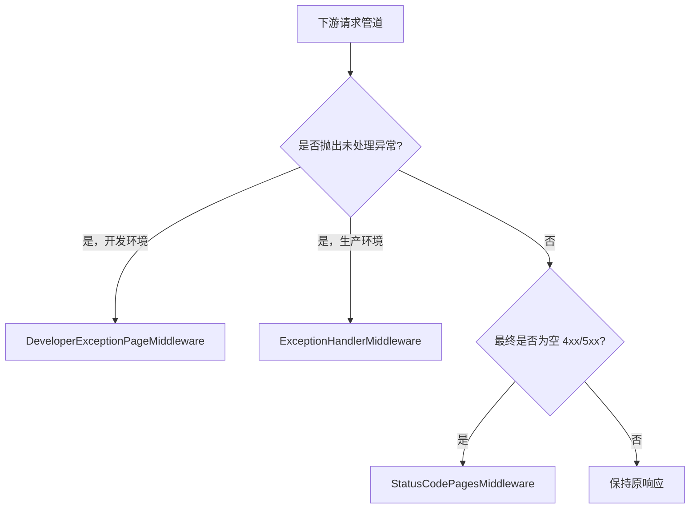

## 深入阅读导航

| 路径 | 入口 | 关键决策 | 结果 |
|---|---|---|---|
| 开发者诊断 | `UseDeveloperExceptionPage` | Accept、异常类型、响应是否开始 | HTML、文本或 ProblemDetails |
| 生产异常 | `UseExceptionHandler` | Handler 链、错误路径、ProblemDetails | 统一错误响应或重新抛出 |
| 路径重执行 | `RerouteHelper` | 是否需要重新经过 Routing | 新错误 Endpoint |
| 空状态码响应 | `UseStatusCodePages` | 400-599、无正文、未禁用 | 状态码正文、Redirect 或 ReExecute |

## 核心类型索引

- **第 1 章**：`ErrorContext`、`IDeveloperPageExceptionFilter`、`DeveloperExceptionPageOptions`
- **第 2 章**：`DeveloperExceptionPageMiddlewareImpl`
- **第 3 章**：`DeveloperExceptionPageExtensions`
- **第 4 章**：`IExceptionHandler`、`ExceptionHandlerOptions`
- **第 5 章**：`ExceptionHandlerMiddlewareImpl`
- **第 6 章**：`ExceptionHandlerExtensions`、`RerouteHelper`
- **第 7 章**：`StatusCodeContext`、`StatusCodePagesOptions`
- **第 8 章**：`StatusCodePagesMiddleware`
- **第 9 章**：`StatusCodePagesExtensions`

## 1. 开发者异常页基础：上下文、过滤器与选项

### 本组解决什么问题

开发者异常页不仅要拿到异常，还要支持过滤器包裹和源码定位配置。这三个类型定义了渲染前的输入与扩展协议。

### 关键流程图

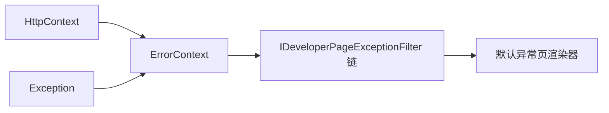

### 补充机制图

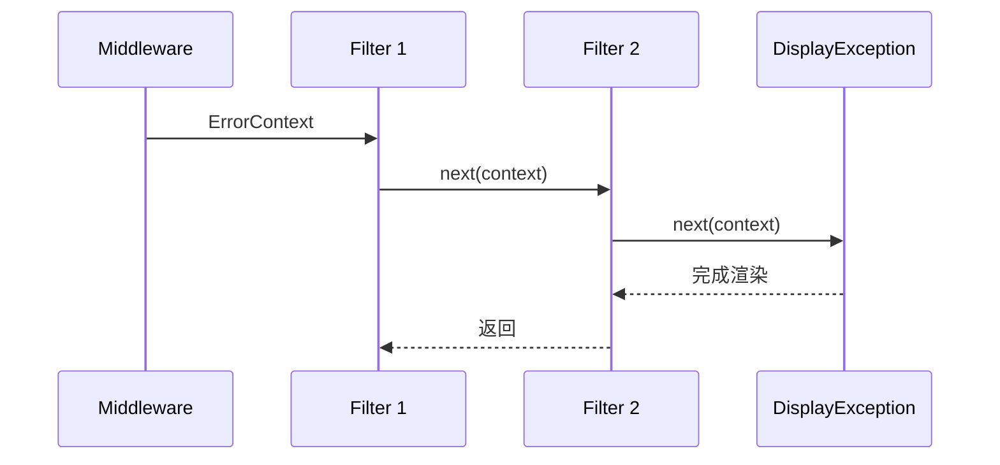

### 机制拆解

过滤器采用显式 `next` 委托，因此既能在默认页面之前处理，也能在其返回后观察结果。构造函数反向遍历过滤器，保证运行顺序与 DI 枚举顺序一致。

### 核心源码解读

### ErrorContext

**读这组源码时关注什么：** 开发者异常页过滤器需要哪些输入。

#### 整体结构

**这段代码回答什么问题：** 开发者异常页过滤器需要哪些输入。

```C#
// 错误上下文
// 对 HttpContext 和 Exception 的封装
public class ErrorContext
{
    public ErrorContext(HttpContext httpContext, Exception exception)
    {
        HttpContext = httpContext ?? throw new ArgumentNullException(nameof(httpContext));
        Exception = exception ?? throw new ArgumentNullException(nameof(exception));
    }

    public HttpContext HttpContext { get; }
 
    public Exception Exception { get; }
}
```

**源码解读：**
- 它把当前 HttpContext 与原始 Exception 绑定为一个不可缺少的上下文。
- 对象只承载数据，不决定响应格式。

**读完要记住：**
- 它属于异常页专用过滤器管线。
- 异常对象保持原样向下传递。

### IDeveloperPageExceptionFilter

**读这组源码时关注什么：** 开发者异常页如何开放前后包裹式扩展。

#### 整体结构

**这段代码回答什么问题：** 开发者异常页如何开放前后包裹式扩展。

```C#
// 开发者异常页过滤器接口
// 用于在渲染错误页之前对异常做一些额外的处理
public interface IDeveloperPageExceptionFilter
{
    // 处理异常并可以将 ErrorContext 传递给异常处理器委托链
    Task HandleExceptionAsync(ErrorContext errorContext, Func<ErrorContext, Task> next);
}
```

**源码解读：**
- HandleExceptionAsync 同时收到上下文和 next 委托。
- 实现可以记录、改写或继续交给下一过滤器。

**读完要记住：**
- 过滤器按反向注册构造成委托链。
- 不调用 next 就会短路默认异常页。

### DeveloperExceptionPageOptions

**读这组源码时关注什么：** 源码片段展示依赖哪些配置。

#### 整体结构

**这段代码回答什么问题：** 源码片段展示依赖哪些配置。

```C#
// 开发者异常页选项
public class DeveloperExceptionPageOptions
{
    public DeveloperExceptionPageOptions()
    {
        // 默认包含异常发生位置的前后源码各 6 行
        SourceCodeLineCount = 6;
    }
 
    // 显示异常发生位置的前后源代码行数
    public int SourceCodeLineCount { get; set; }
 
    // 文件提供器
    // 用于提供源代码文件所在的目录
    public IFileProvider? FileProvider { get; set; }
}
```

**源码解读：**
- SourceCodeLineCount 控制异常位置前后的源码行数。
- FileProvider 决定源码文件如何被定位。

**读完要记住：**
- 默认前后各读取六行。
- 未指定 FileProvider 时使用内容根文件提供器。

### 最小例子

一个过滤器可以先记录异常标识，再调用 `next` 生成默认页面；若它直接写入自定义响应且不调用 `next`，默认页面不会执行。

### 回顾要点

- ErrorContext 是过滤器链的共享输入。
- Options 控制源码展示，不控制异常捕获范围。

## 2. DeveloperExceptionPageMiddlewareImpl：捕获与内容协商

### 本组解决什么问题

开发环境需要尽可能展示诊断细节，但仍必须处理请求取消、响应已开始、Accept 协商和异常页自身失败。

### 关键流程图

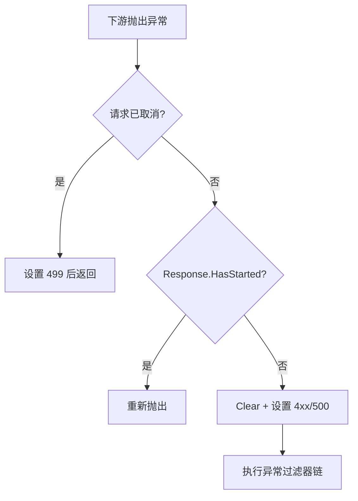

### 补充机制图

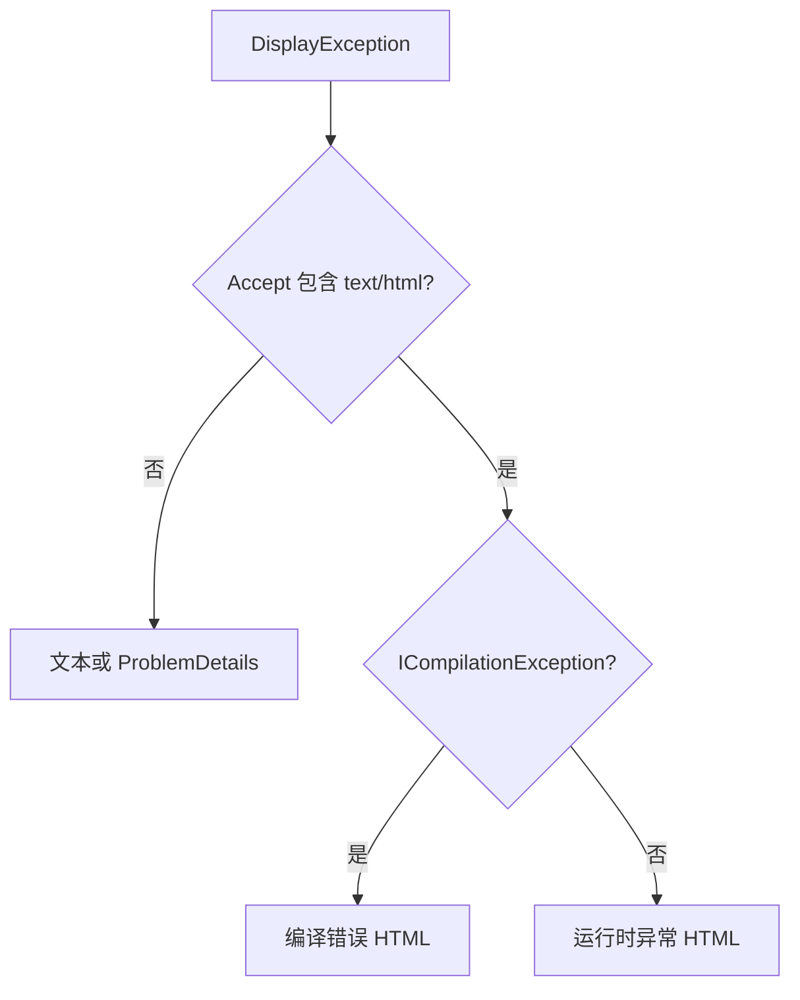

### 机制拆解

中间件先判断响应是否仍可重写，再清空缓冲并设置状态码。异常过滤器链的末端才负责内容协商，因此过滤器可以在最终格式确定前介入。

### 核心源码解读

### DeveloperExceptionPageMiddlewareImpl

**读这组源码时关注什么：** 开发环境未处理异常如何被捕获并渲染。

#### 整体结构

**这段代码回答什么问题：** 开发环境未处理异常如何被捕获并渲染。

```C#
// 开发者异常页中间件
internal class DeveloperExceptionPageMiddlewareImpl
{
    private readonly RequestDelegate _next;
    private readonly DeveloperExceptionPageOptions _options;
    private readonly ILogger _logger;
    private readonly IFileProvider _fileProvider;
    private readonly DiagnosticSource _diagnosticSource;
    private readonly DiagnosticsMetrics _metrics;
    private readonly ExceptionDetailsProvider _exceptionDetailsProvider;
    // 异常处理器委托链的入口
    private readonly Func<ErrorContext, Task> _exceptionHandler;
    // 开发者异常页响应的媒体类型为 text/html
    private static readonly MediaTypeHeaderValue _textHtmlMediaType = new MediaTypeHeaderValue("text/html");
    private readonly ExtensionsExceptionJsonContext _serializationContext;
    private readonly IProblemDetailsService? _problemDetailsService;
 
    public DeveloperExceptionPageMiddlewareImpl(
        RequestDelegate next,
        IOptions<DeveloperExceptionPageOptions> options,
        ILoggerFactory loggerFactory,
        IWebHostEnvironment hostingEnvironment,
        DiagnosticSource diagnosticSource,
        IEnumerable<IDeveloperPageExceptionFilter> filters,
        IMeterFactory meterFactory,
        IOptions<JsonOptions>? jsonOptions = null,
        IProblemDetailsService? problemDetailsService = null)
    {
        ArgumentNullException.ThrowIfNull(next);
        ArgumentNullException.ThrowIfNull(options);
        ArgumentNullException.ThrowIfNull(filters);
 
        _next = next;
        _options = options.Value;
        _logger = loggerFactory.CreateLogger<DeveloperExceptionPageMiddleware>();
        // 如果 DeveloperExceptionPageOptions.FileProvider 为 null，则使用 IWebHostEnvironment.ContentRootFileProvider
        _fileProvider = _options.FileProvider ?? hostingEnvironment.ContentRootFileProvider;
        _diagnosticSource = diagnosticSource;
        _metrics = new DiagnosticsMetrics(meterFactory);
        _exceptionDetailsProvider = new ExceptionDetailsProvider(_fileProvider, _logger, _options.SourceCodeLineCount);
        // 封装末端异常处理方法
        _exceptionHandler = DisplayException;
        _serializationContext = CreateSerializationContext(jsonOptions?.Value);
        _problemDetailsService = problemDetailsService;
        // 反转 IDeveloperPageExceptionFilter 集合构建异常处理委托链
        foreach (var filter in filters.Reverse())
        {
            var nextFilter = _exceptionHandler;
            _exceptionHandler = errorContext => filter.HandleExceptionAsync(errorContext, nextFilter);
        }
    }

    public async Task Invoke(HttpContext context)
    {
        // 尝试捕获后续请求处理器管道中发生的所有未处理异常
        try
        {
            await _next(context);
        }
        catch (Exception ex)
        {
            var exceptionName = ex.GetType().FullName!;

            // 如果异常是客户端主动发起的取消请求
            if ((ex is OperationCanceledException || ex is IOException) && context.RequestAborted.IsCancellationRequested)
            {
                _logger.RequestAbortedException();
                _metrics.RequestException(exceptionName, ExceptionResult.Aborted, handler: null);
 
                // 如果 HTTP 响应尚未开始
                if (!context.Response.HasStarted)
                {
                    // 设置 HTTP 响应状态码为 499
                    // 表示客户端主动发起的取消请求
                    context.Response.StatusCode = StatusCodes.Status499ClientClosedRequest;
                }

                // 直接返回，结束异常处理
                return;
            }

            // 记录日志类别为 "Microsoft.AspNetCore.Diagnostics.DeveloperExceptionPageMiddleware" 的日志
            DiagnosticsTelemetry.ReportUnhandledException(_logger, context, ex);

            // 如果 HTTP 响应已经开始则重新抛出异常，中断后续处理
            if (context.Response.HasStarted)
            {
                _logger.ResponseStartedErrorPageMiddleware();
                _metrics.RequestException(exceptionName, ExceptionResult.Skipped, handler: null);
                throw;
            }
 
            try
            {
                // 清空 HTTP 响应缓冲区
                context.Response.Clear();
 
                // 如果是客户端异常
                if (ex is BadHttpRequestException badHttpRequestException)
                {
                    // 设置 HTTP 响应状态码 4xx
                    context.Response.StatusCode = badHttpRequestException.StatusCode;
                }
                else
                {
                    // 其他异常统一设置 HTTP 响应状态码为 500
                    context.Response.StatusCode = 500;
                }

                // 创建 ErrorContext 开始执行异常处理管道
                await _exceptionHandler(new ErrorContext(context, ex));
 
                const string eventName = "Microsoft.AspNetCore.Diagnostics.UnhandledException";
                if (_diagnosticSource.IsEnabled(eventName))
                {
                    WriteDiagnosticEvent(_diagnosticSource, eventName, new { httpContext = context, exception = ex });
                }
 
                _metrics.RequestException(exceptionName, ExceptionResult.Unhandled, handler: null);
                // 异常处理完成，结束异常处理
                return;
            }
            catch (Exception ex2)
            {
                // 在异常处理阶段如果再次发生异常则不再处理
                _logger.DisplayErrorPageException(ex2);
            }
 
            _metrics.RequestException(exceptionName, ExceptionResult.Unhandled, handler: null);
            // 对于在异常处理阶段发生的异常不做处理，重新抛出异常
            throw;
        }
 
        [UnconditionalSuppressMessage("ReflectionAnalysis", "IL2026",
            Justification = "The values being passed into Write have the commonly used properties being preserved with DynamicDependency.")]
        static void WriteDiagnosticEvent<[DynamicallyAccessedMembers(DynamicallyAccessedMemberTypes.PublicProperties)] TValue>(DiagnosticSource diagnosticSource, string name, TValue value)
            => diagnosticSource.Write(name, value);
    }

    // 末端异常处理方法
    private Task DisplayException(ErrorContext errorContext)
    {
        var httpContext = errorContext.HttpContext;
        var headers = httpContext.Request.GetTypedHeaders();
        var acceptHeader = headers.Accept;
 
        // 如果 HTTP 请求头的 Accept 不包含 text/html 媒体类型，则以纯文本内容返回异常信息
        if (acceptHeader == null || !acceptHeader.Any(h => h.IsSubsetOf(_textHtmlMediaType)))
        {
            // 设置 HTTP 响应的媒体类型为 text/plain
            return DisplayExceptionContent(errorContext);
        }

        // 如果 HTTP 请求头的 Accept 包含 text/html 媒体类型
        // 设置 HTTP 响应的媒体类型为 text/html，然后渲染包含详细异常信息的 HTML 页面

        // 如果是编译异常，比如 Razor 页面编译时发生的异常
        // 注意：
        // 被访问的 Razor 页面会先将 .cshtml 模板文件转成某种 C# 代码，然后再使用编译器编译成 IL 指令
        // 这个过程是在运行时动态发生的，可能会发生编译错误
        if (errorContext.Exception is ICompilationException compilationException)
        {
            // 渲染 HTML 页面，显示编译错误信息
            return DisplayCompilationException(httpContext, compilationException);
        }

        // 渲染 HTML 页面，显示其他运行时发生的异常信息
        return DisplayRuntimeException(httpContext, errorContext.Exception);
    }
}
```

**源码解读：**
- Invoke 区分请求取消、响应已开始和可安全清空响应三种情况。
- DisplayException 再依据 Accept 与异常类型选择文本、HTML 或编译错误页面。

**读完要记住：**
- 开发者异常页用于诊断而非生产错误协议。
- 响应开始后不能替换错误页。

### 最小例子

浏览器请求通常声明 `text/html`，会得到带源码和堆栈的 HTML；API 客户端没有该媒体类型时，会走文本或 ProblemDetails 路径。

### 回顾要点

- 499 专门表示客户端取消。
- 异常页自身再次失败时会记录并重新抛出原异常。

## 3. 开发者异常页注册：中间件位置与选项传递

### 本组解决什么问题

扩展方法把无参和显式选项两种调用方式统一到同一个实现中间件，并保留管道分析元数据。

### 关键流程图

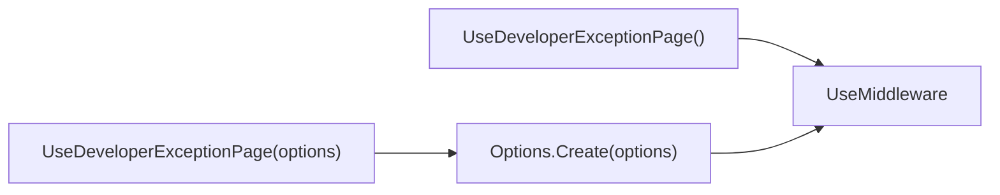

### 补充机制图

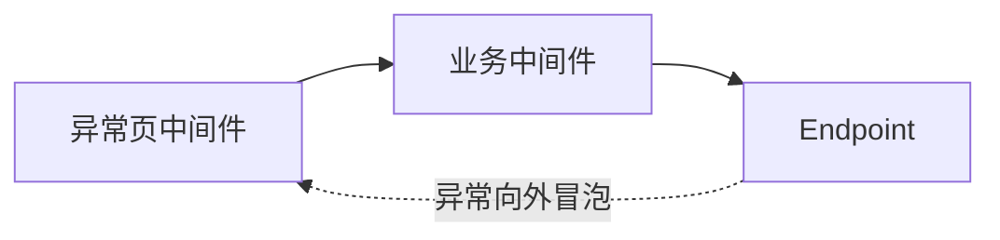

### 机制拆解

异常中间件只能捕获它调用的下游委托产生的异常，所以注册位置直接决定覆盖范围。开发环境通常在路由和业务处理之前注册。

### 核心源码解读

### DeveloperExceptionPageExtensions

**读这组源码时关注什么：** UseDeveloperExceptionPage 实际向管道注册什么。

#### 整体结构

**这段代码回答什么问题：** UseDeveloperExceptionPage 实际向管道注册什么。

```C#
// 用于提供注册开发者异常页中间件的扩展方法
public static class DeveloperExceptionPageExtensions
{
    // 注册开发者异常页中间件
    public static IApplicationBuilder UseDeveloperExceptionPage(this IApplicationBuilder app)
    {
        ArgumentNullException.ThrowIfNull(app);
 
        app.Properties["analysis.NextMiddlewareName"] = "Microsoft.AspNetCore.Diagnostics.DeveloperExceptionPageMiddleware";
        return app.UseMiddleware<DeveloperExceptionPageMiddlewareImpl>();
    }
    
    // 注册开发者异常页中间件
    // 提供 DeveloperExceptionPageOptions 选项
    public static IApplicationBuilder UseDeveloperExceptionPage(
        this IApplicationBuilder app,
        DeveloperExceptionPageOptions options)
    {
        ArgumentNullException.ThrowIfNull(app);
        ArgumentNullException.ThrowIfNull(options);
 
        // 利用 Options.Create<> 静态方法得到 OptionsWrapper<>（实现 IOptions<>）
        app.Properties["analysis.NextMiddlewareName"] = "Microsoft.AspNetCore.Diagnostics.DeveloperExceptionPageMiddleware";
        return app.UseMiddleware<DeveloperExceptionPageMiddlewareImpl>(Options.Create(options));
    }
}
```

**源码解读：**
- 无参重载从 DI 获取选项，有参重载用 Options.Create 包装实例。
- 最终都注册 DeveloperExceptionPageMiddlewareImpl。

**读完要记住：**
- 扩展方法只负责组装中间件。
- 应尽量靠前注册才能覆盖更多下游异常。

### 最小例子

把异常页注册在某个会抛异常的自定义中间件之后，它就无法捕获该中间件的异常。

### 回顾要点

- 选项实例通过 IOptions 包装传入。
- 异常捕获范围由管道位置决定。

## 4. 生产异常处理契约：Handler 与 Options

### 本组解决什么问题

生产错误处理需要可组合的处理器、重执行路径、直接委托和可选的新 DI 作用域。

### 关键流程图

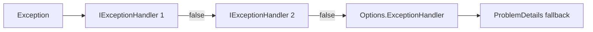

### 补充机制图

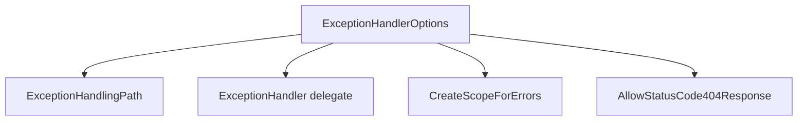

### 机制拆解

`IExceptionHandler` 适合注册多个按顺序尝试的策略；`ExceptionHandlerOptions.ExceptionHandler` 则是一个最终请求委托。返回布尔值让处理器链不依赖异常类型硬编码。

### 核心源码解读

### IExceptionHandler

**读这组源码时关注什么：** 多个生产异常处理器如何协作。

#### 整体结构

**这段代码回答什么问题：** 多个生产异常处理器如何协作。

```C#
// 异常处理器接口
public interface IExceptionHandler
{
    // 尝试处理异常，可以使用 CancellationToken 来取消异常处理
    // 返回的布尔值代表是否中断后续异常处理
    ValueTask<bool> TryHandleAsync(HttpContext httpContext, Exception exception, CancellationToken cancellationToken);
}
```

**源码解读：**
- TryHandleAsync 返回 true 表示当前处理器已接管异常。
- CancellationToken 允许请求终止时取消处理。

**读完要记住：**
- 处理器按 DI 注册顺序尝试。
- false 表示继续寻找下一个处理器。

### ExceptionHandlerOptions

**读这组源码时关注什么：** 生产异常处理有哪些互斥或组合配置。

#### 整体结构

**这段代码回答什么问题：** 生产异常处理有哪些互斥或组合配置。

```C#
// 异常处理器选项
public class ExceptionHandlerOptions
{
    // 异常处理路径
    // 可以使用这个路径重新进入请求处理管道通过 EndpointRoutingMiddleware 中间件匹配 Endpoint 来处理异常
    public PathString ExceptionHandlingPath { get; set; }
 
    // 是否需要利用 IServiceScopeFactory 创建一个新的服务范围来处理异常
    public bool CreateScopeForErrors { get; set; }
 
    // 表示异常处理器
    public RequestDelegate? ExceptionHandler { get; set; }
 
    // 是否允许返回 HTTP 响应状态码为 404
    public bool AllowStatusCode404Response { get; set; }
}
```

**源码解读：**
- 可配置重执行路径、直接 RequestDelegate、新服务范围和 404 策略。
- ExceptionHandlingPath 会临时替换请求路径。

**读完要记住：**
- 路径和委托决定异常处理入口。
- CreateScopeForErrors 隔离错误处理服务范围。

### 最小例子

可以先注册一个处理业务异常的 Handler，再注册一个处理基础设施异常的 Handler，未命中的异常最终交给统一 ProblemDetails。

### 回顾要点

- Handler 返回 true 才表示已处理。
- 404 默认会被视为异常处理配置错误。

## 5. ExceptionHandlerMiddlewareImpl：生产异常处理主流程

### 本组解决什么问题

生产中间件必须统一同步和异步异常、保存原堆栈、清理旧路由状态，并在处理失败时恢复请求上下文。

### 关键流程图

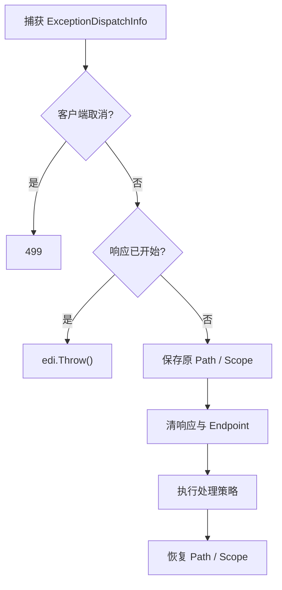

### 补充机制图

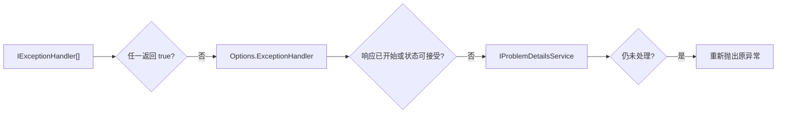

### 机制拆解

同步异常在 `Invoke` 的 catch 中捕获，异步异常在局部 `Awaited` 中捕获，两者都转换成 `ExceptionDispatchInfo` 后进入同一 `HandleException`。这避免两条路径产生不同恢复语义。

### 核心源码解读

### ExceptionHandlerMiddlewareImpl

**读这组源码时关注什么：** 生产异常中间件怎样保证同步异步异常走同一路径。

#### 整体结构

**这段代码回答什么问题：** 生产异常中间件怎样保证同步异步异常走同一路径。

```C#
// 异常处理器中间件
internal sealed class ExceptionHandlerMiddlewareImpl
{
    // 默认 HTTP 响应状态码为 500
    private const int DefaultStatusCode = StatusCodes.Status500InternalServerError;
 
    private readonly RequestDelegate _next;
    private readonly ExceptionHandlerOptions _options;
    private readonly ILogger _logger;
    private readonly Func<object, Task> _clearCacheHeadersDelegate;
    private readonly DiagnosticListener _diagnosticListener;
    private readonly IExceptionHandler[] _exceptionHandlers;
    private readonly DiagnosticsMetrics _metrics;
    private readonly IProblemDetailsService? _problemDetailsService;
 
    public ExceptionHandlerMiddlewareImpl(
        RequestDelegate next,
        ILoggerFactory loggerFactory,
        IOptions<ExceptionHandlerOptions> options,
        DiagnosticListener diagnosticListener,
        IEnumerable<IExceptionHandler> exceptionHandlers,
        IMeterFactory meterFactory,
        IProblemDetailsService? problemDetailsService = null)
    {
        _next = next;
        _options = options.Value;
        _logger = loggerFactory.CreateLogger<ExceptionHandlerMiddleware>();
        _clearCacheHeadersDelegate = ClearCacheHeaders;
        _diagnosticListener = diagnosticListener;
        _exceptionHandlers = exceptionHandlers as IExceptionHandler[] ?? new List<IExceptionHandler>(exceptionHandlers).ToArray();
        _metrics = new DiagnosticsMetrics(meterFactory);
        _problemDetailsService = problemDetailsService;
 
        // 如果没有通过 ExceptionHandlerOptions.ExceptionHandler 属性配置自定义的异常处理器
        if (_options.ExceptionHandler == null)
        {
            // 如果也没有通过 ExceptionHandlerOptions.ExceptionHandlingPath 属性配置异常处理路径
            if (_options.ExceptionHandlingPath == null)
            {
                // 则必须确保 IProblemDetailsService 服务已注册
                if (problemDetailsService == null)
                {
                    // 没有异常处理逻辑，抛出异常
                    throw new InvalidOperationException(Resources.ExceptionHandlerOptions_NotConfiguredCorrectly);
                }
            }
            else
            {
                // 如果配置了异常处理路径则使用后续请求处理器作为异常处理器
                // 注意：
                // 这里有个前提就是后续请求处理管道中存在 EndpointRoutingMiddleware 中间件
                // 这样才能基于异常处理路径重新匹配新的 Endpoint 来处理异常
                _options.ExceptionHandler = _next;
            }
        }
    }

    public Task Invoke(HttpContext context)
    {
        ExceptionDispatchInfo edi;
 
        // 尝试捕获后续管道中发生的未处理异常
        try
        {
            var task = _next(context);
            // 后续管道的执行没有同步完成
            if (!task.IsCompletedSuccessfully)
            {
                // 转为异步执行
                // 返回一个 Task，用于等待后续请求处理管道的执行结果
                return Awaited(this, context, task);
            }
 
            return Task.CompletedTask;
        }
        catch (Exception exception)
        {
            // 利用 ExceptionDispatchInfo 捕获同步发生的异常并保留堆栈信息
            edi = ExceptionDispatchInfo.Capture(exception);
        }

        // 同步方式开始处理异常
        return HandleException(context, edi);
 
        static async Task Awaited(ExceptionHandlerMiddlewareImpl middleware, HttpContext context, Task task)
        {
            ExceptionDispatchInfo? edi = null;
            try
            {
                await task;
            }
            catch (Exception exception)
            {
                // 利用 ExceptionDispatchInfo 捕获异步发生的异常并保留堆栈信息
                edi = ExceptionDispatchInfo.Capture(exception);
            }

            // 如果发生异常
            if (edi != null)
            {
                // 异步方式处理异常
                await middleware.HandleException(context, edi);
            }
        }
    }

    // 异常处理方法
    private async Task HandleException(HttpContext context, ExceptionDispatchInfo edi)
    {
        // 得到原始异常的类型全名
        var exceptionName = edi.SourceException.GetType().FullName!;

        // 如果异常是客户端主动发起的取消请求
        if ((edi.SourceException is OperationCanceledException || edi.SourceException is IOException) && context.RequestAborted.IsCancellationRequested)
        {
            _logger.RequestAbortedException();
            
            // 如果 HTTP 响应尚未开始则设置响应状态码为 499
            if (!context.Response.HasStarted)
            {
                context.Response.StatusCode = StatusCodes.Status499ClientClosedRequest;
            }
 
            _metrics.RequestException(exceptionName, ExceptionResult.Aborted, handler: null);
            // 直接返回，退出异常处理
            return;
        }

        // 记录日志类别为 "Microsoft.AspNetCore.Diagnostics.ExceptionHandlerMiddleware" 的日志
        DiagnosticsTelemetry.ReportUnhandledException(_logger, context, edi.SourceException);
 
        // 如果 HTTP 响应已经开始则重新抛出异常，终止后续处理
        if (context.Response.HasStarted)
        {
            _logger.ResponseStartedErrorHandler();
 
            _metrics.RequestException(exceptionName, ExceptionResult.Skipped, handler: null);
            // 重新抛出异常
            edi.Throw();
        }

        // 保存原始请求路径
        var originalPath = context.Request.Path;
        // 如果配置了异常处理路径，则将请求路径改为异常处理路径，以便后续使用 EndpointRoutingMiddleware 中间件重新匹配 Endpoint 处理异常
        if (_options.ExceptionHandlingPath.HasValue)
        {
            context.Request.Path = _options.ExceptionHandlingPath;
        }
        // 保存原始的 IServiceProvider
        var oldScope = _options.CreateScopeForErrors ? context.RequestServices : null;
        // 确定是否需要利用 IServiceScopeFactory 创建一个新的服务范围
        using var scope = _options.CreateScopeForErrors ? context.RequestServices.GetRequiredService<IServiceScopeFactory>().CreateScope() : null;
 
        try
        {
            if (scope != null)
            {
                // 使用服务范围创建新的 IServiceProvider 并替换 HttpContext 中的原始的 IServiceProvider
                context.RequestServices = scope.ServiceProvider;
            }

            // 创建 ExceptionHandlerFeature 用于保存原始异常、原始请求路径、原始匹配到的 Endpoint 和原始路由值字典
            // 注意：
            // 只有通过 EndpointRoutingMiddleware 中间件才会在此处得到匹配的 Endpoint
            var exceptionHandlerFeature = new ExceptionHandlerFeature()
            {
                Error = edi.SourceException,
                Path = originalPath.Value!,
                Endpoint = context.GetEndpoint(),
                RouteValues = context.Features.Get<IRouteValuesFeature>()?.RouteValues
            };

            // 清空 HTTP 响应缓冲区和匹配到的 Endpoint
            ClearHttpContext(context);

            // 使用特性集合保存 ExceptionHandlerFeature，以便给后续异常处理管道的中间件
            context.Features.Set<IExceptionHandlerFeature>(exceptionHandlerFeature);
            context.Features.Set<IExceptionHandlerPathFeature>(exceptionHandlerFeature);
            // 设置 HTTP 响应状态码为 500
            context.Response.StatusCode = DefaultStatusCode;
            // 只要发生异常就清除 HTTP 响应中的缓存报头，表示无需缓存并使缓存失效
            context.Response.OnStarting(_clearCacheHeadersDelegate, context.Response);
 
            // 用于记录异常处理器的类型全名
            string? handler = null;
            // 用于标记异常已处理
            var handled = false;
            // 遍历 IExceptionHandler 集合中的异常处理器处理异常
            foreach (var exceptionHandler in _exceptionHandlers)
            {
                // 支持客户端主动取消请求中断异常处理
                handled = await exceptionHandler.TryHandleAsync(context, edi.SourceException, context.RequestAborted);
                // 只要当前 IExceptionHandler 异常处理器表示处理了异常，则停止遍历
                if (handled)
                {
                    // 记录当前异常处理器的类型全名
                    handler = exceptionHandler.GetType().FullName;
                    break;
                }
            }
 
            // 如果异常未被任何 IExceptionHandler 异常处理器处理
            if (!handled)
            {
                // 如果 ExceptionHandlerOptions.ExceptionHandler 属性表示的异常处理器存在
                if (_options.ExceptionHandler is not null)
                {
                    // 利用 ExceptionHandlerOptions.ExceptionHandler 属性表示的异常处理器处理异常
                    await _options.ExceptionHandler!(context);
                }
                else
                {
                    // 否则利用 IProblemDetailsService 服务作为异常处理器处理异常
                    handled = await _problemDetailsService!.TryWriteAsync(new()
                    {
                        HttpContext = context,
                        AdditionalMetadata = exceptionHandlerFeature.Endpoint?.Metadata,
                        ProblemDetails = { Status = DefaultStatusCode },
                        Exception = edi.SourceException,
                    });
                    if (handled)
                    {
                        handler = _problemDetailsService.GetType().FullName;
                    }
                }
            }
            // 如果在异常处理阶段没有发生异常，则以下任何情况都可以正常退出异常处理器中间件
            // 1. HTTP 响应已经正常开始
            // 2. 标记异常已处理
            // 3. HTTP 响应状态码不是 404
            // 4. 允许返回 404 状态码的响应
            if (context.Response.HasStarted || handled || context.Response.StatusCode != StatusCodes.Status404NotFound || _options.AllowStatusCode404Response)
            {
                const string eventName = "Microsoft.AspNetCore.Diagnostics.HandledException";
                if (_diagnosticListener.IsEnabled() && _diagnosticListener.IsEnabled(eventName))
                {
                    WriteDiagnosticEvent(_diagnosticListener, eventName, new { httpContext = context, exception = edi.SourceException });
                }
 
                _metrics.RequestException(exceptionName, ExceptionResult.Handled, handler);
                // 直接返回，结束异常处理
                return;
            }
 
            // 在异常处理阶段返回了 404 状态码的响应，表明异常处理器配置错误
            edi = ExceptionDispatchInfo.Capture(new InvalidOperationException($"The exception handler configured on {nameof(ExceptionHandlerOptions)} produced a 404 status response. " +
                $"This {nameof(InvalidOperationException)} containing the original exception was thrown since this is often due to a misconfigured {nameof(ExceptionHandlerOptions.ExceptionHandlingPath)}. " +
                $"If the exception handler is expected to return 404 status responses then set {nameof(ExceptionHandlerOptions.AllowStatusCode404Response)} to true.", edi.SourceException));
        }
        catch (Exception ex2)
        {
            // 通过日志记录在异常处理阶段发生异常，不再做任何处理
            _logger.ErrorHandlerException(ex2);
        }
        finally
        {
            // 恢复原始请求路径
            context.Request.Path = originalPath;
            // 恢复原始的 IServiceProvider
            if (oldScope != null)
            {
                context.RequestServices = oldScope;
            }
        }
 
        _metrics.RequestException(exceptionName, ExceptionResult.Unhandled, handler: null);
        // 利用 ExceptionDispatchInfo 重新抛出原始异常
        edi.Throw();
 
        [UnconditionalSuppressMessage("ReflectionAnalysis", "IL2026",
            Justification = "The values being passed into Write have the commonly used properties being preserved with DynamicDependency.")]
        static void WriteDiagnosticEvent<[DynamicallyAccessedMembers(DynamicallyAccessedMemberTypes.PublicProperties)] TValue>(DiagnosticSource diagnosticSource, string name, TValue value)
            => diagnosticSource.Write(name, value);
    }

    // 清除 HTTP 响应缓冲区、匹配到的 Endpoint、路由值字典
    private static void ClearHttpContext(HttpContext context)
    {
        context.Response.Clear();
 
        HttpExtensions.ClearEndpoint(context);
    }
    
    // 设置 HTTP 响应禁用缓存和缓存失效报头
    private static Task ClearCacheHeaders(object state)
    {
        var headers = ((HttpResponse)state).Headers;
        headers.CacheControl = "no-cache,no-store";
        headers.Pragma = "no-cache";
        headers.Expires = "-1";
        headers.ETag = default;
        return Task.CompletedTask;
    }
}
```

**源码解读：**
- ExceptionDispatchInfo 保留原始堆栈，HandleException 统一执行恢复和处理逻辑。
- 处理优先级是 IExceptionHandler、选项委托、ProblemDetailsService，失败时重新抛出。

**读完要记住：**
- 响应开始后异常无法安全改写。
- 原始 Path、Endpoint、RouteValues 与 RequestServices 必须恢复。

### 最小例子

配置 `/error` 后，中间件会临时改写 Path、清除原 Endpoint，并把原始异常和路由信息放入 `IExceptionHandlerFeature`，错误端点可从 Feature 读取。

### 回顾要点

- ExceptionDispatchInfo 保留原始抛出位置。
- finally 必须恢复 Path 和 RequestServices。

## 6. 异常处理注册与重新路由

### 本组解决什么问题

异常路径重执行不是简单调用下一个中间件；在 WebApplication 自动路由模型下，需要重新建立一段以路由匹配开头的管道。

### 关键流程图

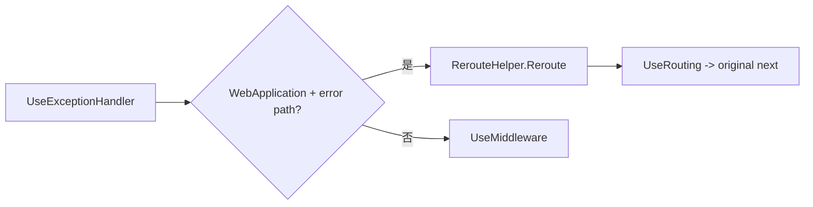

### 补充机制图

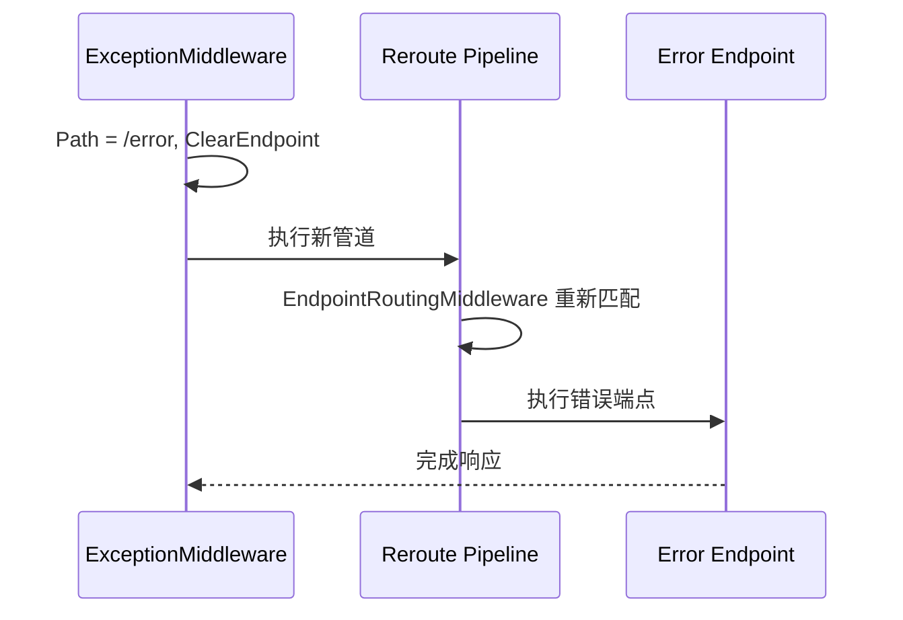

### 机制拆解

原请求已经匹配过 Endpoint，改写 Path 后若不清除并重跑路由，仍会携带旧端点。`RerouteHelper` 从共享属性中恢复 UseRouting 注册逻辑，构建只用于错误处理的分支。

### 核心源码解读

### ExceptionHandlerExtensions

**读这组源码时关注什么：** UseExceptionHandler 如何适配不同宿主与重执行配置。

#### 整体结构

**这段代码回答什么问题：** UseExceptionHandler 如何适配不同宿主与重执行配置。

```C#
// 用于提供注册异常处理器中间件的扩展方法
public static class ExceptionHandlerExtensions
{
    // 注册异常处理器中间件
    public static IApplicationBuilder UseExceptionHandler(this IApplicationBuilder app)
    {
        ArgumentNullException.ThrowIfNull(app);
 
        return SetExceptionHandlerMiddleware(app, options: null);
    }
    
    // 注册异常处理器中间件
    // 提供异常处理路径
    public static IApplicationBuilder UseExceptionHandler(this IApplicationBuilder app, string errorHandlingPath)
    {
        ArgumentNullException.ThrowIfNull(app);

        // 提供 ExceptionHandlerOptions 选项
        return app.UseExceptionHandler(new ExceptionHandlerOptions
        {
            ExceptionHandlingPath = new PathString(errorHandlingPath)
        });
    }
    
    // 注册异常处理器中间件
    // 提供异常处理路径和是否需要利用 IServiceScopeFactory 创建一个新的服务范围处理异常
    public static IApplicationBuilder UseExceptionHandler(this IApplicationBuilder app, string errorHandlingPath, bool createScopeForErrors)
    {
        ArgumentNullException.ThrowIfNull(app);

        // 提供 ExceptionHandlerOptions 选项
        return app.UseExceptionHandler(new ExceptionHandlerOptions
        {
            ExceptionHandlingPath = new PathString(errorHandlingPath),
            CreateScopeForErrors = createScopeForErrors
        });
    }
    
    // 注册异常处理器中间件
    // 提供 Action<IApplicationBuilder> 配置注册中间件
    public static IApplicationBuilder UseExceptionHandler(this IApplicationBuilder app, Action<IApplicationBuilder> configure)
    {
        ArgumentNullException.ThrowIfNull(app);
        ArgumentNullException.ThrowIfNull(configure);
 
        // 利用 IApplicationBuilder.New 方法创建一个新的 IApplicationBuilder
        var subAppBuilder = app.New();
        // 利用 Action<IApplicationBuilder> 配置注册中间件
        configure(subAppBuilder);
        // 构建 RequestDelegate 请求处理委托链作为异常处理管道
        var exceptionHandlerPipeline = subAppBuilder.Build();
 
        // 提供 ExceptionHandlerOptions 选项
        return app.UseExceptionHandler(new ExceptionHandlerOptions
        {
            ExceptionHandler = exceptionHandlerPipeline
        });
    }
    
    // 注册异常处理器中间件
    // 提供 ExceptionHandlerOptions 选项
    public static IApplicationBuilder UseExceptionHandler(this IApplicationBuilder app, ExceptionHandlerOptions options)
    {
        ArgumentNullException.ThrowIfNull(app);
        ArgumentNullException.ThrowIfNull(options);

        // 利用 Options.Create<> 静态方法得到 OptionsWrapper<>（实现 IOptions<>）
        var iOptions = Options.Create(options);
        return SetExceptionHandlerMiddleware(app, iOptions);
    }
    
    // 注册异常处理器中间件核心方法
    private static IApplicationBuilder SetExceptionHandlerMiddleware(IApplicationBuilder app, IOptions<ExceptionHandlerOptions>? options)
    {
        var problemDetailsService = app.ApplicationServices.GetService<IProblemDetailsService>();
 
        app.Properties["analysis.NextMiddlewareName"] = "Microsoft.AspNetCore.Diagnostics.ExceptionHandlerMiddleware";
 
        // 如果使用的是 WebApplication 编程模型，此处的 IApplicationBuilder 就是 WebApplication
        if (app.Properties.TryGetValue(RerouteHelper.GlobalRouteBuilderKey, out var routeBuilder) && routeBuilder is not null)
        {
            // 注册 Func<RequestDelegate, RequestDelegate> 形式的原始中间件
            return app.Use(next =>
            {
                var loggerFactory = app.ApplicationServices.GetRequiredService<ILoggerFactory>();
                var diagnosticListener = app.ApplicationServices.GetRequiredService<DiagnosticListener>();
                var exceptionHandlers = app.ApplicationServices.GetRequiredService<IEnumerable<IExceptionHandler>>();
                var meterFactory = app.ApplicationServices.GetRequiredService<IMeterFactory>();
 
                if (options is null)
                {
                    // 尝试利用根容器得到 IOptions<ExceptionHandlerOptions>
                    options = app.ApplicationServices.GetRequiredService<IOptions<ExceptionHandlerOptions>>();
                }

                // 如果配置了异常处理路径但没有配置异常处理器，则需要利用 EndpointRoutingMiddleware 中间件匹配新的 Endpoint 来处理异常
                // 在 WebApplication 编程模型中，EndpointRoutingMiddleware 中间件的注册很可能早于 ExceptionHandlerMiddleware 中间件，所以需要重新构建一条以 EndpointRoutingMiddleware 中间件作为管道头部处理器并连接后续中间件的请求处理管道用于处理异常
                if (!string.IsNullOrEmpty(options.Value.ExceptionHandlingPath) && options.Value.ExceptionHandler is null)
                {
                    // 重新构建一条用于异常处理的管道
                    var newNext = RerouteHelper.Reroute(app, routeBuilder, next);
                    // 将新的请求处理管道用于异常处理
                    options.Value.ExceptionHandler = newNext;
                }
 
                return new ExceptionHandlerMiddlewareImpl(next, loggerFactory, options, diagnosticListener, exceptionHandlers, meterFactory, problemDetailsService).Invoke;
            });
        }

        // IHostBuilder 编程模型下直接注册中间件

        if (options is null)
        {
            return app.UseMiddleware<ExceptionHandlerMiddlewareImpl>();
        }
 
        return app.UseMiddleware<ExceptionHandlerMiddlewareImpl>(options);
    }
}
```

**源码解读：**
- WebApplication 模型下可能重建带 EndpointRoutingMiddleware 的异常管道。
- 传统模型直接通过 UseMiddleware 注册。

**读完要记住：**
- 重执行需要路由重新匹配。
- 扩展方法负责把配置转换为实际 RequestDelegate。

### RerouteHelper

**读这组源码时关注什么：** 异常和状态码重执行为什么需要一条新的路由管道。

#### 整体结构

**这段代码回答什么问题：** 异常和状态码重执行为什么需要一条新的路由管道。

```C#
// 重建路由管道帮助类
internal static class RerouteHelper
{
    internal const string GlobalRouteBuilderKey = "__GlobalEndpointRouteBuilder";
    internal const string UseRoutingKey = "__UseRouting";
    
    // 重新构建以 EndpointRoutingMiddleware 中间件作为管道头部处理器的请求处理管道
    // 此处的 IApplicationBuilder 就是 WebApplication
    internal static RequestDelegate Reroute(IApplicationBuilder app, object routeBuilder, RequestDelegate next)
    {
        if (app.Properties.TryGetValue(UseRoutingKey, out var useRouting) && useRouting is Func<IApplicationBuilder, IApplicationBuilder> useRoutingFunc)
        {
            // 创建一个新的 IApplicationBuilder
            var builder = app.New();
            // 需要以 "__GlobalEndpointRouteBuilder" 为键填充新建的 IApplicationBuilder 中的共享字典，以便在后续调用 UseEndpoints 注册 EndpointMiddleware 中间件时从 IApplicationBuilder.Properties 字典中获取 IEndpointRouteBuilder
            // 注意：
            // // 此处的 IEndpointRouteBuilder 就是 WebApplication
            builder.Properties[GlobalRouteBuilderKey] = routeBuilder;
 
            // 调用 IApplicationBuilder.UseRouting 扩展方法注册 EndpointRoutingMiddleware 中间件
            useRoutingFunc(builder);
 
            // 使用 IApplicationBuilder.Run 扩展方法以短路方式注册后续中间件，因为新建的请求处理管道不需要 404 请求处理器中间件
            builder.Run(next);

            // 构建请求处理管道并返回
            return builder.Build();
        }
 
        return next;
    }
}
```

**源码解读：**
- 它从 ApplicationBuilder.Properties 取回 UseRouting 委托和全局 RouteBuilder。
- 新管道以 UseRouting 开头并以原 next 结尾。

**读完要记住：**
- 重写 Path 后必须重新执行路由匹配。
- 找不到路由注册信息时回退原 next。

### 最小例子

`UseExceptionHandler("/error")` 可以把异常交给 MVC 控制器端点，但前提是错误分支确实重新经过 EndpointRoutingMiddleware。

### 回顾要点

- 路径重执行仍是同一个 HttpContext。
- Reroute 管道不需要默认 404 终结器。

## 7. 状态码页基础：上下文与默认响应策略

### 本组解决什么问题

状态码页面对的是没有异常、只有空 4xx/5xx 响应的场景，需要一个上下文和可替换的正文生成策略。

### 关键流程图

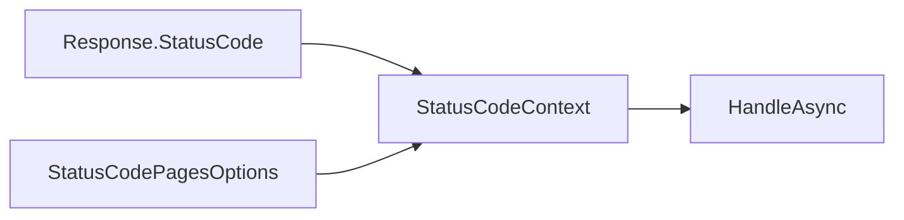

### 补充机制图

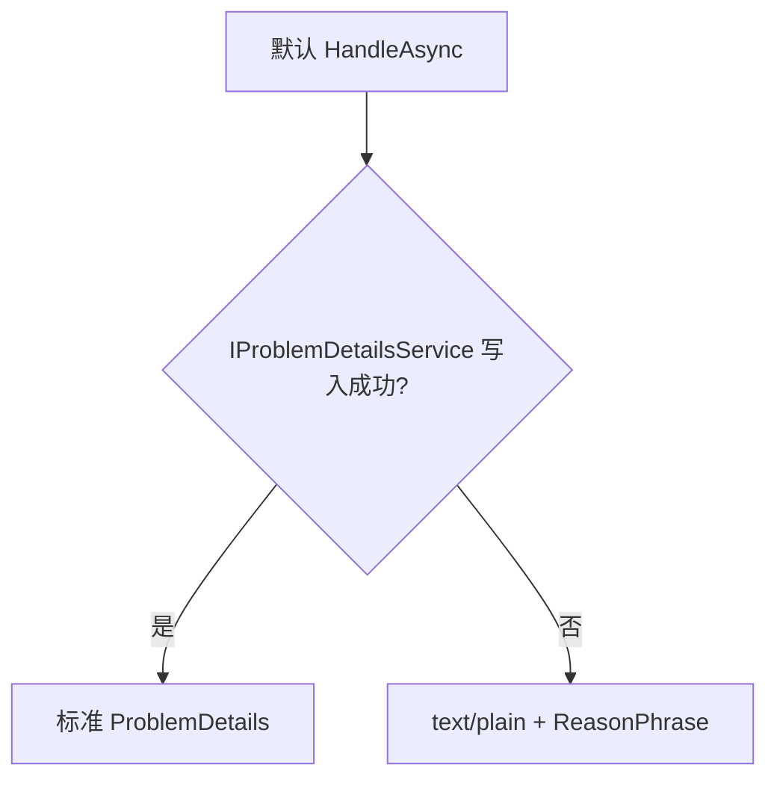

### 机制拆解

状态码页不关心错误来源，只检查下游最终留下的响应。默认实现优先复用 ProblemDetails 基础设施，保证异常响应与普通错误状态码可以采用一致协议。

### 核心源码解读

### StatusCodeContext

**读这组源码时关注什么：** 状态码页处理器需要哪些上下文。

#### 整体结构

**这段代码回答什么问题：** 状态码页处理器需要哪些上下文。

```C#
// 响应状态码上下文
public class StatusCodeContext
{
    public StatusCodeContext(HttpContext context, StatusCodePagesOptions options, RequestDelegate next)
    {
        HttpContext = context;
        Options = options;
        Next = next;
    }
 
    public HttpContext HttpContext { get; private set; }

    public StatusCodePagesOptions Options { get; private set; }

    public RequestDelegate Next { get; private set; }
}
```

**源码解读：**
- 它同时提供 HttpContext、Options 与原后续 RequestDelegate。
- Next 使重执行型处理器能够再次进入管道。

**读完要记住：**
- 它处理的是响应结果而不是 Exception。
- 状态码已经由下游组件确定。

### StatusCodePagesOptions

**读这组源码时关注什么：** 空错误响应默认如何生成正文。

#### 整体结构

**这段代码回答什么问题：** 空错误响应默认如何生成正文。

```C#
// 响应状态码页选项
// 主要用于配置响应状态码页处理器
public class StatusCodePagesOptions
{
    public StatusCodePagesOptions()
    {
        // 配置默认的状态码页处理器
        HandleAsync = async context =>
        {
            var statusCode = context.HttpContext.Response.StatusCode;
            var problemDetailsService = context.HttpContext.RequestServices.GetService<IProblemDetailsService>();

            // 如果没有注册 IProblemDetailsService 服务
            if (problemDetailsService == null ||
                !await problemDetailsService.TryWriteAsync(new() { HttpContext = context.HttpContext, ProblemDetails = { Status = statusCode } }))
            {
                // 以纯文本形式渲染 HTTP 响应的主体内容
                var body = BuildResponseBody(statusCode);
 
                // 设置 HTTP 响应的媒体类型为 text/plain
                context.HttpContext.Response.ContentType = "text/plain";
                // 写入响应内容
                await context.HttpContext.Response.WriteAsync(body);
            }
        };
    }
 
    private static string BuildResponseBody(int httpStatusCode)
    {
        var internetExplorerWorkaround = new string(' ', 500);

        // 得到响应状态码原因短语
        var reasonPhrase = ReasonPhrases.GetReasonPhrase(httpStatusCode);

        // 返回格式化字符串
        return string.Format(CultureInfo.InvariantCulture, "Status Code: {0}{1}{2}{3}",
                                                                httpStatusCode,
                                                                string.IsNullOrWhiteSpace(reasonPhrase) ? "" : "; ",
                                                                reasonPhrase,
                                                                internetExplorerWorkaround);
    }
 
    // 状态码页处理器
    // 因为 StatusCodeContext 是对 HttpContext 的封装，所以状态码页处理器和请求处理器在本质上没有区别
    public Func<StatusCodeContext, Task> HandleAsync { get; set; }
}
```

**源码解读：**
- 默认优先调用 IProblemDetailsService，失败时写纯文本原因短语。
- HandleAsync 是状态码页唯一执行策略。

**读完要记住：**
- ProblemDetails 是首选标准格式。
- 自定义委托可完全替换默认正文。

### 最小例子

一个端点只设置 `Response.StatusCode = 404` 而不写正文时，默认状态码页会补充 ProblemDetails 或纯文本。

### 回顾要点

- StatusCodeContext 不包含 Exception。
- HandleAsync 是可完全替换的策略。

## 8. StatusCodePagesMiddleware：后置检查与跳过条件

### 本组解决什么问题

中间件必须等待下游完成后判断响应是否为空，同时允许 Endpoint 元数据和 Feature 动态关闭状态码页。

### 关键流程图

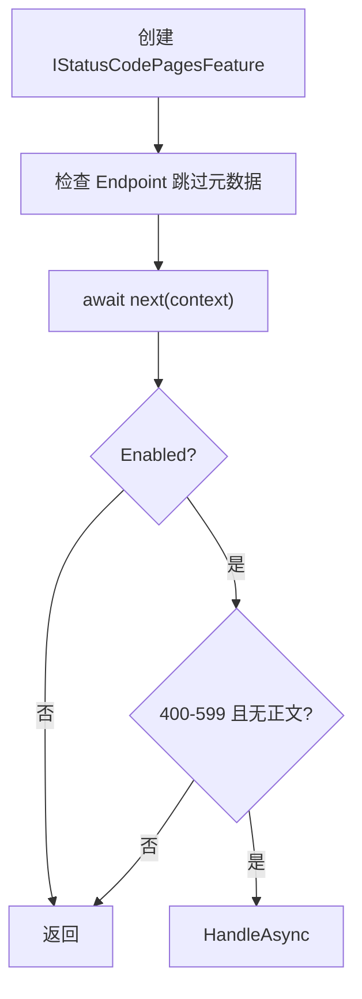

### 补充机制图

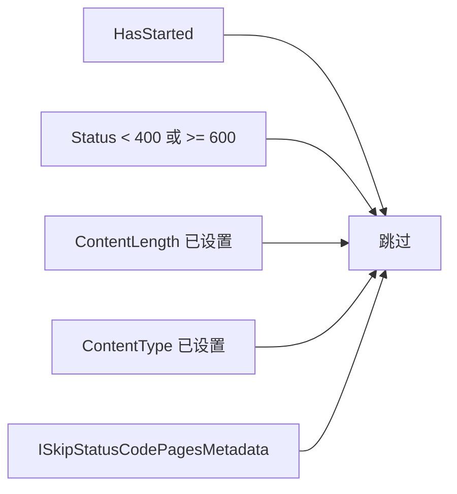

### 机制拆解

这是典型的后置中间件：先 `await _next`，再根据最终响应做补偿。Endpoint 可能在下游才完成匹配，因此代码在必要时会第二次检查跳过元数据。

### 核心源码解读

### StatusCodePagesMiddleware

**读这组源码时关注什么：** 哪些 4xx 或 5xx 响应才需要补状态码页。

#### 整体结构

**这段代码回答什么问题：** 哪些 4xx 或 5xx 响应才需要补状态码页。

```C#
// 响应状态码页中间件
public class StatusCodePagesMiddleware
{
    private readonly RequestDelegate _next;
    private readonly StatusCodePagesOptions _options;
 
    public StatusCodePagesMiddleware(RequestDelegate next, IOptions<StatusCodePagesOptions> options)
    {
        _next = next;
        _options = options.Value;
        // 必须存在 StatusCodePagesOptions.HandleAsync 表示的状态码页处理器
        if (_options.HandleAsync == null)
        {
            throw new ArgumentException("Missing options.HandleAsync implementation.");
        }
    }
 
    public async Task Invoke(HttpContext context)
    {
        // 创建 StatusCodePagesFeature 以 IStatusCodePagesFeature 接口的形式保存到 HttpContext 的特性集合中
        var statusCodeFeature = new StatusCodePagesFeature();
        context.Features.Set<IStatusCodePagesFeature>(statusCodeFeature);
        // 尝试得到 Endpoint
        var endpoint = context.GetEndpoint();
        // 如果当前 HttpContext 中没有匹配到的 Endpoint
        // 可能还没有执行 EndpointRoutingMiddleware 中间件，需要设置重新检查标志
        var shouldCheckEndpointAgain = endpoint is null;

        // 检查 Endpoint 的元数据集合中是否包含 ISkipStatusCodePagesMetadata 元数据
        if (HasSkipStatusCodePagesMetadata(endpoint))
        {
            // 将 IStatusCodePagesFeature.Enabled 属性设置为 false，表示不需要执行响应状态码页中间件
            statusCodeFeature.Enabled = false;
        }

        // 执行后续请求处理管道
        // 后续中间件也可以通过设置 IStatusCodePagesFeature.Enabled 属性来标记是否需要执行响应状态码页中间件 
        await _next(context);

        // 检查 IStatusCodePagesFeature.Enabled 决定是否跳过响应状态码页中间件
        if (!statusCodeFeature.Enabled)
        {
            return;
        }

        // 重新检查 Endpoint 的元数据集合中是否包含 ISkipStatusCodePagesMetadata 元数据
        if (shouldCheckEndpointAgain && HasSkipStatusCodePagesMetadata(context.GetEndpoint()))
        {
            return;
        }
 
        // 以下情况也不执行响应状态码页处理器
        // 1. HTTP 响应已经开始
        // 2. 不在 400 - 599 响应状态码范围内
        // 3. 已经设置了 HTTP 响应内容长度
        // 4. 已经设置了 HTTP 响应的媒体类型
        if (context.Response.HasStarted
            || context.Response.StatusCode < 400
            || context.Response.StatusCode >= 600
            || context.Response.ContentLength.HasValue
            || !string.IsNullOrEmpty(context.Response.ContentType))
        {
            return;
        }

        // 创建 StatusCodeContext
        var statusCodeContext = new StatusCodeContext(context, _options, _next);
        // 执行响应状态码页处理器
        await _options.HandleAsync(statusCodeContext);
    }
    
    // 检查 Endpoint 的终结点元数据集合中是否包含了 ISkipStatusCodePagesMetadata 类型的元数据
    private static bool HasSkipStatusCodePagesMetadata(Endpoint? endpoint)
    {
        var skipStatusCodePageMetadata = endpoint?.Metadata.GetMetadata<ISkipStatusCodePagesMetadata>();
 
        return skipStatusCodePageMetadata is not null;
    }
}
```

**源码解读：**
- 中间件先执行下游，再检查 Enabled、Endpoint 元数据、响应状态和正文信息。
- 只有尚未开始且无正文的 400 到 599 响应才调用 HandleAsync。

**读完要记住：**
- 状态码页不捕获异常。
- 已有 ContentType 或 ContentLength 表示应用已提供响应。

### 最小例子

API 已经返回带 JSON 正文的 404 时，ContentType 或 ContentLength 会阻止状态码页覆盖业务响应。

### 回顾要点

- 状态码页只填补空错误响应。
- Feature.Enabled 允许下游按请求关闭功能。

## 9. 状态码页注册：文本、重定向与 ReExecute

### 本组解决什么问题

注册扩展把多种用户体验统一为处理器委托，其中 Redirect 与 ReExecute 的请求模型完全不同。

### 关键流程图

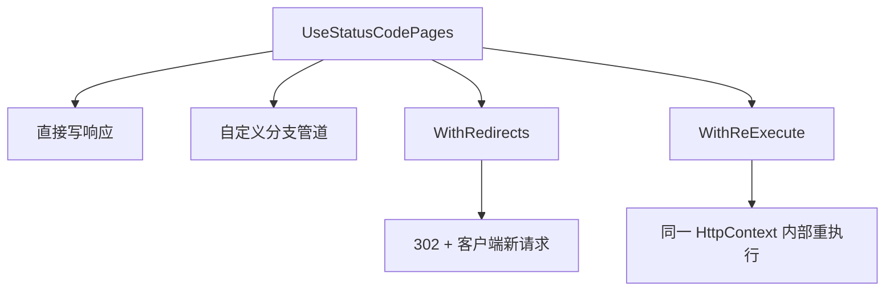

### 补充机制图

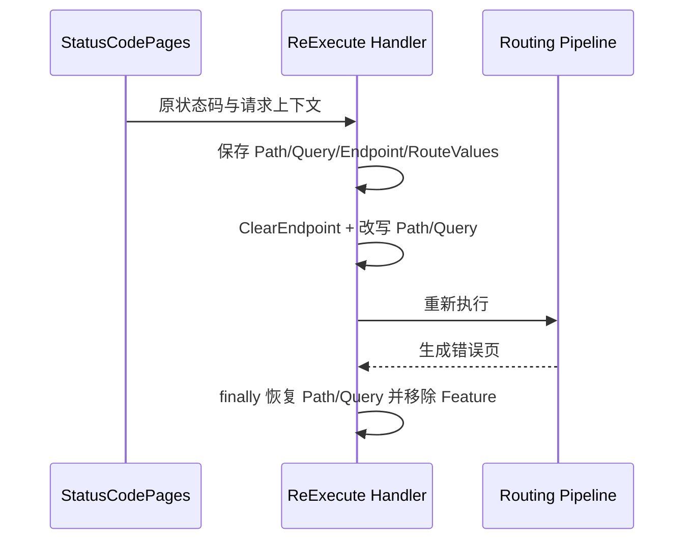

### 机制拆解

所有重载最终都变成 `Func<StatusCodeContext, Task>`。ReExecute 使用 `IStatusCodeReExecuteFeature` 暴露原始请求信息，并在 finally 中恢复 Path 与 Query，避免污染后续诊断。

### 核心源码解读

### StatusCodePagesExtensions

**读这组源码时关注什么：** 状态码页如何支持文本、重定向和服务端重执行。

#### 整体结构

**这段代码回答什么问题：** 状态码页如何支持文本、重定向和服务端重执行。

```C#
// 用于提供注册响应状态码页中间件的扩展方法
public static class StatusCodePagesExtensions
{
    // 注册响应状态码页中间件
    public static IApplicationBuilder UseStatusCodePages(this IApplicationBuilder app)
    {
        ArgumentNullException.ThrowIfNull(app);
 
        return app.UseMiddleware<StatusCodePagesMiddleware>();
    }

    // 注册响应状态码页中间件
    // 提供 StatusCodePagesOptions 选项
    public static IApplicationBuilder UseStatusCodePages(this IApplicationBuilder app, StatusCodePagesOptions options)
    {
        ArgumentNullException.ThrowIfNull(app);
        ArgumentNullException.ThrowIfNull(options);
 
        return app.UseMiddleware<StatusCodePagesMiddleware>(Options.Create(options));
    }
 
    // 注册响应状态码页中间件
    // 提供 Func<StatusCodeContext, Task> 响应状态码页处理器
    public static IApplicationBuilder UseStatusCodePages(this IApplicationBuilder app, Func<StatusCodeContext, Task> handler)
    {
        ArgumentNullException.ThrowIfNull(app);
        ArgumentNullException.ThrowIfNull(handler);
 
        return app.UseStatusCodePages(new StatusCodePagesOptions
        {
            HandleAsync = handler
        });
    }
 
    // 注册响应状态码页中间件
    // 提供用于格式化响应内容的字符串，可以包含一个 "{0}" 占位符，用于格式化字符串时替换为具体的 HTTP 响应状态码，以及一个媒体类型字符串
    public static IApplicationBuilder UseStatusCodePages(this IApplicationBuilder app, string contentType, string bodyFormat)
    {
        ArgumentNullException.ThrowIfNull(app);
 
        return app.UseStatusCodePages(context =>
        {
            var body = string.Format(CultureInfo.InvariantCulture, bodyFormat, context.HttpContext.Response.StatusCode);
            context.HttpContext.Response.ContentType = contentType;
            return context.HttpContext.Response.WriteAsync(body);
        });
    }

    // 注册响应状态码页中间件
    // 提供 Action<IApplicationBuilder> 配置，用于注册中间件并构建状态码页处理器管道
    public static IApplicationBuilder UseStatusCodePages(this IApplicationBuilder app, Action<IApplicationBuilder> configuration)
    {
        ArgumentNullException.ThrowIfNull(app);
 
        var builder = app.New();
        configuration(builder);
        var tangent = builder.Build();
        // 在状态码页处理器内部调用构建的请求处理管道处理状态码页
        return app.UseStatusCodePages(context => tangent(context.HttpContext));
    }
 
    // 注册响应状态码页中间件
    // 提供用于客户端重定向路径的格式化字符串，可以包含一个 "{0}" 占位符，用于格式化字符串时替换为具体的 HTTP 响应状态码
    public static IApplicationBuilder UseStatusCodePagesWithRedirects(this IApplicationBuilder app, string locationFormat)
    {
        ArgumentNullException.ThrowIfNull(app);

        // 使用 "~" 开头的重定向路径格式化字符串（相对路径）
        // 最终会使用当前 HTTP 请求的 HttpContext.Request.PathBase 作为基础路径拼接成完整的重定向路径
        if (locationFormat.StartsWith('~'))
        {
            // 需要去掉路径中的 "~" 字符
            locationFormat = locationFormat.Substring(1);
            return app.UseStatusCodePages(context =>
            {
                var location = string.Format(CultureInfo.InvariantCulture, locationFormat, context.HttpContext.Response.StatusCode);
                // 响应状态码为 302 的临时重定向
                context.HttpContext.Response.Redirect(context.HttpContext.Request.PathBase + location);
                return Task.CompletedTask;
            });
        }
        else
        {
            return app.UseStatusCodePages(context =>
            {
                var location = string.Format(CultureInfo.InvariantCulture, locationFormat, context.HttpContext.Response.StatusCode);
                // 响应状态码为 302 的临时重定向
                context.HttpContext.Response.Redirect(location);
                return Task.CompletedTask;
            });
        }
    }
 
    // 注册响应状态码页中间件
    // 提供用于服务端重定向路径的格式化字符串，可以包含一个 "{0}" 占位符，用于替换为具体的 HTTP 响应状态码，并且可以额外提供一个查询字符串，可以包含一个 "{0}" 占位符，用于替换为具体的 HTTP 响应状态码
    public static IApplicationBuilder UseStatusCodePagesWithReExecute(
        this IApplicationBuilder app,
        string pathFormat,
        string? queryFormat = null)
    {
        ArgumentNullException.ThrowIfNull(app);
 
        // 如果使用的是 WebApplication 编程模型，此处的 IApplicationBuilder 就是 WebApplication
        if (app.Properties.TryGetValue(RerouteHelper.GlobalRouteBuilderKey, out var routeBuilder) && routeBuilder is not null)
        {
            // 注册 Func<RequestDelegate, RequestDelegate> 形式的原始中间件
            return app.Use(next =>
            {
                // 在 WebApplication 编程模型中，EndpointRoutingMiddleware 中间件的注册很可能早于 StatusCodePagesMiddleware 中间件，所以需要重新构建一条以 EndpointRoutingMiddleware 中间件作为管道头部处理器并连接后续中间件的请求处理管道用于处理状态码页
                var newNext = RerouteHelper.Reroute(app, routeBuilder, next);
                return new StatusCodePagesMiddleware(next,
                    Options.Create(new StatusCodePagesOptions() { HandleAsync = CreateHandler(pathFormat, queryFormat, newNext) })).Invoke;
            });
        }

        // IHostBuilder 编程模型下直接注册中间件
 
        return app.UseStatusCodePages(CreateHandler(pathFormat, queryFormat));
    }
 
    // 创建响应状态码页处理器
    private static Func<StatusCodeContext, Task> CreateHandler(string pathFormat, string? queryFormat, RequestDelegate? next = null)
    {
        var handler = async (StatusCodeContext context) =>
        {
            var originalStatusCode = context.HttpContext.Response.StatusCode;

            // 利用格式化字符串和具体的 HTTP 响应状态码构建新的请求路径和查询字符串
            var newPath = new PathString(
                string.Format(CultureInfo.InvariantCulture, pathFormat, originalStatusCode));
            var formatedQueryString = queryFormat == null ? null :
                string.Format(CultureInfo.InvariantCulture, queryFormat, originalStatusCode);
            var newQueryString = queryFormat == null ? QueryString.Empty : new QueryString(formatedQueryString);

            // 保存原始的请求路径和查询字符串
            var originalPath = context.HttpContext.Request.Path;
            var originalQueryString = context.HttpContext.Request.QueryString;
 
            // 保存原始的路由值字典
            var routeValuesFeature = context.HttpContext.Features.Get<IRouteValuesFeature>();
 
            // 创建 StatusCodeReExecuteFeature 以 IStatusCodeReExecuteFeature 接口的形式保存到 HttpContext 的特性集合中
            // 保存的内容包括原始的请求路径、原始的查询字符串、原始的 HTTP 响应状态码、原始匹配到的 Endpoint 和原始路由值字典
            context.HttpContext.Features.Set<IStatusCodeReExecuteFeature>(new StatusCodeReExecuteFeature()
            {
                OriginalPathBase = context.HttpContext.Request.PathBase.Value!,
                OriginalPath = originalPath.Value!,
                OriginalQueryString = originalQueryString.HasValue ? originalQueryString.Value : null,
                OriginalStatusCode = originalStatusCode,
                Endpoint = context.HttpContext.GetEndpoint(),
                RouteValues = routeValuesFeature?.RouteValues
            });
 
            // 清除 HTTP 响应缓冲区、匹配到的 Endpoint、路由值字典
            HttpExtensions.ClearEndpoint(context.HttpContext);

            // 设置新的请求路径和查询字符串
            context.HttpContext.Request.Path = newPath;
            context.HttpContext.Request.QueryString = newQueryString;
            try
            {
                if (next is not null)
                {
                    // 执行请求处理管道处理状态码页
                    await next(context.HttpContext);
                }
                else
                {
                    await context.Next(context.HttpContext);
                }
            }
            finally
            {
                // 恢复原始的请求路径、原始的查询字符串
                context.HttpContext.Request.QueryString = originalQueryString;
                context.HttpContext.Request.Path = originalPath;
                // 从 HttpContext 的特性集合中移除 IStatusCodeReExecuteFeature 特性
                context.HttpContext.Features.Set<IStatusCodeReExecuteFeature?>(null);
            }
        };
 
        return handler;
    }
}
```

**源码解读：**
- 各重载最终归一化为 StatusCodePagesOptions.HandleAsync。
- ReExecute 保存原始请求特征、清除 Endpoint、修改路径后再执行路由管道。

**读完要记住：**
- Redirect 会产生客户端第二次请求。
- ReExecute 在同一 HttpContext 内部完成。

### 最小例子

`UseStatusCodePagesWithRedirects("/errors/{0}")` 会让浏览器发起新请求；`UseStatusCodePagesWithReExecute("/errors/{0}")` 则在服务端内部执行错误端点并保留原请求 Feature。

### 回顾要点

- Redirect 会改变客户端地址和请求次数。
- ReExecute 必须清除旧 Endpoint 并重新路由。

## 三条错误响应链路对照

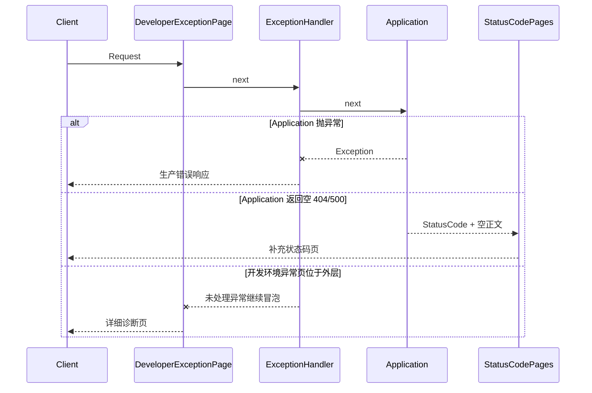

## 容易混淆的边界

| 概念 | 正确理解 |
|---|---|
| ExceptionHandler 与 StatusCodePages | 前者捕获异常；后者等待下游正常返回后检查空 4xx/5xx。 |
| Redirect 与 ReExecute | Redirect 返回 302 并由客户端发起新请求；ReExecute 在服务端复用当前 HttpContext。 |
| ExceptionHandlingPath 与 ExceptionHandler | 前者需要重新路由到错误端点；后者可直接执行一个 RequestDelegate。 |
| Response.HasStarted | 一旦响应头已发送，异常中间件通常不能 Clear 或替换错误响应，只能重新抛出。 |
| 404 错误处理结果 | 生产异常处理默认不接受 404，除非显式允许，避免错误路径配置错却被误判为已处理。 |
| ProblemDetails | 它既可作为异常处理回退，也可作为默认状态码页正文，但两条触发链路不同。 |

## 建议复习顺序

1. 先看第 2、5、8 章，分别掌握三个中间件的 Invoke 主流程。
2. 再看第 4、6 章，理解生产异常处理器选择与重新路由。
3. 最后看第 7、9 章，对比状态码页的默认正文、Redirect 和 ReExecute。
4. 调试时先检查 `Response.HasStarted`，再检查 Endpoint、Features 和当前 Path 是否已被错误分支改写。
