# 日志源码解读版

> 这份笔记基于原始 `日志.md` 重组，仍然以源码批注为主体。新增内容只负责把相关类型放到同一条运行链路中，并在源码前后补充阅读焦点、最小例子和 Mermaid 图解。

## 阅读主线

日志系统可以按“应用调用 ILogger → LoggerFactory 按类别找到聚合 Logger → 过滤后扇出到 Provider Logger → Scope/Activity 补充上下文 → Provider 格式化并输出”来读。DI 与 Options 负责注册 Provider、规则和动态配置，ChangeToken 使过滤和输出选项能够热更新。

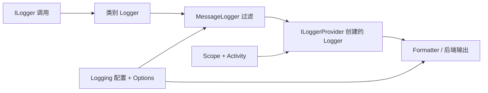

## 深入阅读导航

日志系统的关键不是某个扩展方法，而是“类别 Logger 的创建与缓存、规则预计算、一次调用向多个 Provider 扇出、上下文传播、后端格式化与动态配置”这条完整链路。下面拆成 14 个阶段阅读。

| 阶段 | 核心问题 | 关键入口 |
| --- | --- | --- |
| 1. 公共契约 | 一条日志携带哪些结构化信息？ | `ILogger.Log` |
| 2. 类别包装 | `ILogger<T>` 如何确定稳定类别名？ | `Logger<T>` |
| 3. 复合分发 | 一个类别如何扇出到多个 Provider？ | 内部 `Logger.Log` |
| 4. 过滤规则 | Provider、Category 与 MinLevel 如何选出最佳规则？ | `LoggerRuleSelector.Select` |
| 5. Factory | 类别缓存、动态 Provider 和规则刷新如何协作？ | `LoggerFactory` |
| 6. Scope | BeginScope 如何跨异步调用传播？ | `LoggerFactoryScopeProvider` |
| 7. Activity | Trace/Span 信息怎样进入日志上下文？ | `Activity.Current` |
| 8. 消息 API | 易用扩展和高性能模板有什么差异？ | `LoggerMessage.Define` |
| 9. DI 基础 | AddLogging 注册哪些核心服务？ | `LoggingServiceCollectionExtensions` |
| 10. 过滤配置 | 配置节如何变成可热更新规则？ | `LoggerFilterConfigureOptions` |
| 11. Provider Options | Provider 专属配置如何绑定与失效？ | `LoggerProviderOptions` |
| 12. Console Provider | 格式化器、Logger 缓存和队列如何共享？ | `ConsoleLoggerProvider` |
| 13. Console 输出 | 单条日志如何格式化、入队并选择 stdout/stderr？ | `ConsoleLogger.Log` |
| 14. Console 注册 | Formatter Options 如何注册并热更新？ | `ConsoleLoggerExtensions` |

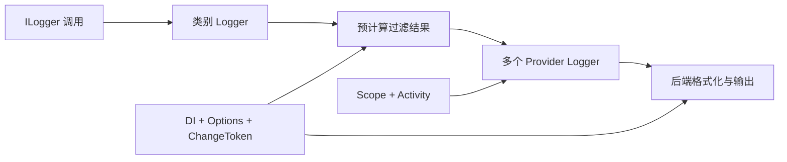

## 核心类型索引

| 类型 | 所在章节 | 说明 |
| --- | --- | --- |
| `EventId` | 1. 公共契约 | 标识事件，不是日志类别 |
| `LogLevel` | 1. 公共契约 | 等级顺序用于阈值比较 |
| `ILogger` | 1. 公共契约 | 通用写入、检查与 Scope 入口 |
| `ILogger<>` | 2. 类别包装 | 泛型类别接口 |
| `Logger<>` | 2. 类别包装 | 将类型映射为类别名称 |
| 内部 `Logger` | 3. 复合分发 | 单类别的聚合分发器 |
| `LoggerInformation` | 3. 复合分发 | Provider 与类别组合元数据 |
| `MessageLogger` | 3. 复合分发 | 过滤后的写入目标 |
| `ScopeLogger` | 3. 复合分发 | 自有 Scope 与外部 Scope 适配 |
| `LoggerFactoryOptions` | 3. 复合分发 | Activity 跟踪行为选项 |
| `LoggerFilterOptions` | 4. 过滤规则 | 全局阈值、Scope 开关和规则集合 |
| `LoggerFilterRule` | 4. 过滤规则 | Provider/Category/Level/Filter 声明 |
| `ILoggerFactory` | 5. Factory | 类别 Logger 创建与 Provider 注册契约 |
| `LoggerFactory` | 5. Factory | 缓存、过滤刷新与 Provider 生命周期 |
| `ILoggerProvider` | 5. Factory | 为每个类别创建后端 Logger |
| `IExternalScopeProvider` | 6. Scope | Scope 存储与枚举契约 |
| `LoggerFactoryScopeProvider` | 6. Scope | AsyncLocal Scope 链实现 |
| `Scope` | 6. Scope | 父链节点与出栈对象 |
| `Activity` | 7. Activity | 当前跟踪操作与时间跨度 |
| `ActivitySource` | 7. Activity | Activity 创建入口与监听优化 |
| `ActivityListener` | 7. Activity | 采样和生命周期监听器 |
| `LoggerMessage` | 8. 消息 API | 预编译结构化消息委托 |
| `LoggerExtensions` | 8. 消息 API | 便捷日志扩展方法 |
| `LoggingServiceCollectionExtensions` | 9. DI 基础 | 日志核心服务注册 |
| `DefaultLoggerLevelConfigureOptions` | 10. 过滤配置 | 最低等级 Options 适配器 |
| `LoggerFilterConfigureOptions` | 10. 过滤配置 | 配置节到过滤规则的转换 |
| `LoggingBuilder` | 10. 过滤配置 | IServiceCollection 包装器 |
| `LoggingBuilderExtensions` | 10. 过滤配置 | Provider、Filter 和 Factory Options 注册 API |
| `LoggingBuilderConfigurationExtensions` | 10. 过滤配置 | 配置接入扩展 |
| `LoggingConfiguration` | 10. 过滤配置 | 日志配置根包装 |
| `ILoggerProviderConfigurationFactory` | 11. Provider Options | Provider 配置视图工厂契约 |
| `LoggerProviderConfigurationFactory` | 11. Provider Options | 按全名和别名组合配置节 |
| `ILoggerProviderConfiguration<>` | 11. Provider Options | 泛型配置视图契约 |
| `LoggerProviderConfiguration<>` | 11. Provider Options | Provider 类型驱动配置选择 |
| `LoggerProviderOptions` | 11. Provider Options | 绑定与 TokenSource 双注册入口 |
| `LoggerProviderConfigureOptions<,>` | 11. Provider Options | Provider Options 绑定适配器 |
| `LoggerProviderOptionsChangeTokenSource<,>` | 11. Provider Options | Provider Options 变更源 |
| `FilterLoggingBuilderExtensions` | 11. Provider Options | 编程式过滤规则注册（源码位于 Provider Options 组末尾） |
| `ConsoleLoggerProvider` | 12. Console Provider | Console Logger、Formatter 和队列协调器 |
| `ConsoleLogger` | 13. Console 输出 | 格式化并将消息送入队列 |
| `LogEntry<>` | 13. Console 输出 | Formatter 的只读载荷 |
| `ConsoleLoggerOptions` | 13. Console 输出 | Formatter、stderr 和队列选项 |
| `ConsoleFormatterOptions` | 13. Console 输出 | Formatter 公共选项 |
| `SimpleConsoleFormatterOptions` | 13. Console 输出 | Simple Formatter 专属选项 |
| `ConsoleFormatter` | 13. Console 输出 | 格式化扩展契约 |
| `ConsoleLoggerExtensions` | 14. Console 注册 | Provider 与 Formatter 注册 API |
| `ConsoleLoggerFormatterConfigureOptions<,>` | 14. Console 注册 | Formatter Options 绑定适配器 |
| `ConsoleLoggerFormatterOptionsChangeTokenSource<,>` | 14. Console 注册 | Formatter Options 变更源 |
## 1. 公共契约：事件、等级与 ILogger

### 本组解决什么问题

这一组源码回答“应用代码的一次日志调用携带什么，以及泛型 Logger 如何确定类别”。所有便捷 API 最终都回到 ILogger 的 Log、IsEnabled 和 BeginScope。

### 关键类型关系图

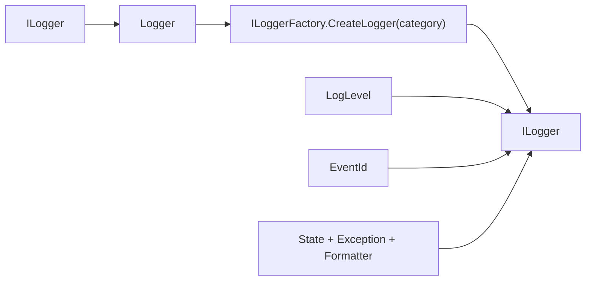

### 核心源码解读

### 一条日志的五个核心维度

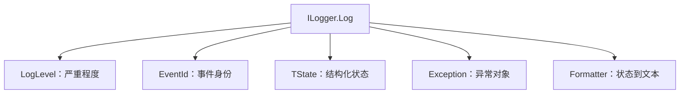

类别不在 `Log` 参数中，因为类别在 `ILogger` 创建时已经固定。一次调用只携带这条事件自身的数据。

### LogLevel 是有序阈值，不是标签集合

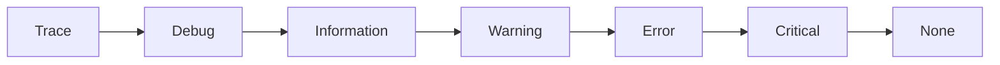

过滤通常使用 `level < minLevel` 判断。`None` 位于有效等级之后，作为禁用结果时会使 Provider 从 `MessageLoggers` 中被排除。

### EventId、Category 与模板各自回答不同问题

| 维度 | 回答的问题 | 示例 |
| --- | --- | --- |
| Category | 谁在记录？ | `Orders.Submission` |
| EventId | 发生了哪类业务事件？ | `OrderSubmitted(1001)` |
| Message Template | 事件有哪些结构化字段？ | `Order {OrderId} submitted` |

### IsEnabled 是调用方的成本闸门

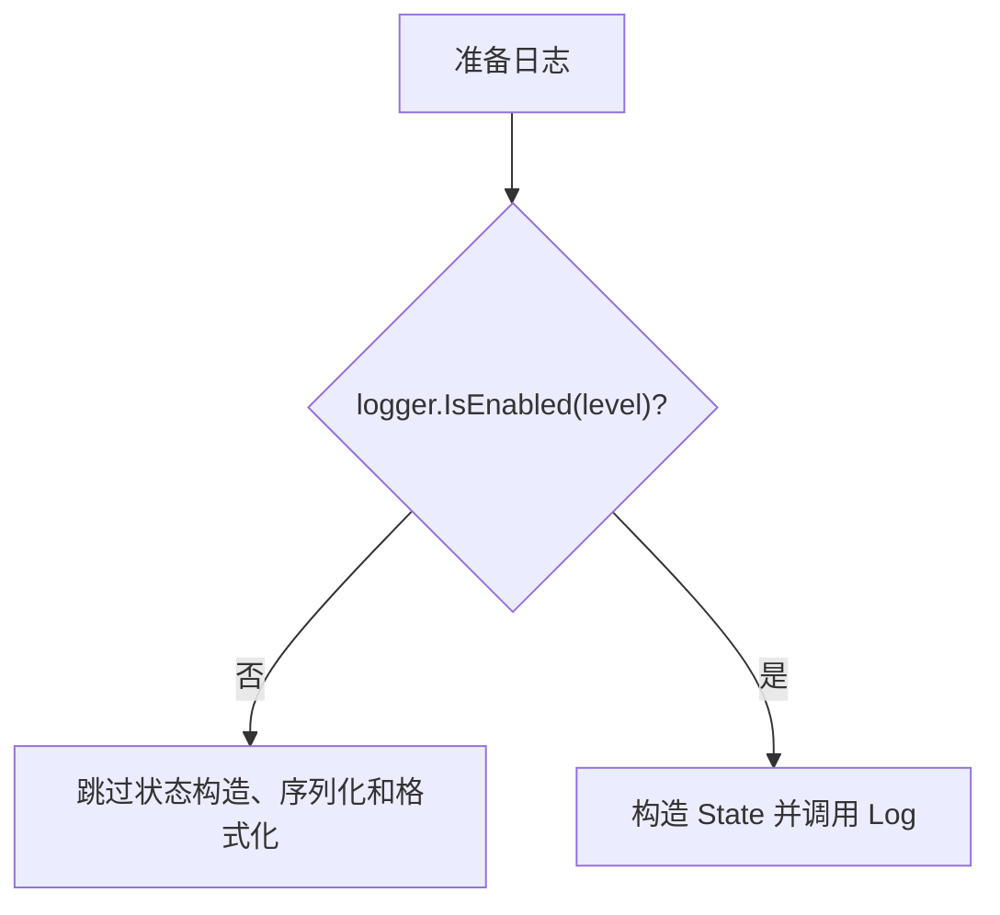

框架扩展通常会检查，但昂贵参数、对象序列化或字符串拼接若在调用前已经发生，框架无法追回这部分成本。

### EventId

**读这组源码时关注什么：** 日志事件如何携带稳定编号和可选名称。

#### 整体结构

**这段代码回答什么问题：** 日志事件如何携带稳定编号和可选名称。

```C#
// 表示日志事件
public readonly struct EventId : IEquatable<EventId>
{
    // 重载隐式转换操作
    // 支持将 int 类型隐式转换为 EventId 类型
    public static implicit operator EventId(int i)
    {
        return new EventId(i);
    }

    // 重载 == 运算符
    public static bool operator ==(EventId left, EventId right)
    {
        return left.Equals(right);
    }

    // 重载 != 运算符
    public static bool operator !=(EventId left, EventId right)
    {
        return !left.Equals(right);
    }

    // name 默认为 null
    public EventId(int id, string? name = null)
    {
        Id = id;
        Name = name;
    }

    // 事件 ID
    public int Id { get; }

    // 事件 Name
    public string? Name { get; }

    // 重写 ToString
    public override string ToString()
    {
        return Name ?? Id.ToString();
    }

    // 实现 IEquatable<EventId>
    public bool Equals(EventId other)
    {
        return Id == other.Id;
    }

    // 重写 Equals
    public override bool Equals(object? obj)
    {
        if (obj is null)
        {
            return false;
        }

        return obj is EventId eventId && Equals(eventId);
    }

    // 重写 GetHashCode
    public override int GetHashCode()
    {
        return Id;
    }
}
```

**源码解读：**
- 值类型同时保存 Id 与 Name，并支持从 int 隐式转换。
- 相等性与哈希只基于 Id，Name 主要用于可读输出。

**读完要记住：**
- EventId 标识事件而不是日志类别。
- 相同 Id 即被视为同一事件。

### LogLevel

**读这组源码时关注什么：** 日志等级如何表达严重程度和禁用状态。

#### 整体结构

**这段代码回答什么问题：** 日志等级如何表达严重程度和禁用状态。

```C#
// 日志事件等级
// 严重程度由低到高
public enum LogLevel
{
    Trace = 0,
    Debug = 1,
    Information = 2,
    Warning = 3,
    Error = 4,
    Critical = 5,
    None = 6
}
```

**源码解读：**
- 枚举值从 Trace 到 Critical 逐级升高。
- None 位于有效等级之外，常用于关闭输出。

**读完要记住：**
- 最低等级比较依赖枚举顺序。
- None 表示不记录任何有效日志。

### ILogger

**读这组源码时关注什么：** 所有日志调用最终收敛到哪三个操作。

#### 整体结构

**这段代码回答什么问题：** 所有日志调用最终收敛到哪三个操作。

```C#
// 日志记录器接口
public interface ILogger
{
    // 为应用程序提供的日志写入方法
    // 泛型参数 TState 为日志荷载类型
    void Log<TState>(LogLevel logLevel, EventId eventId, TState state, Exception? exception, Func<TState, Exception?, string> formatter);

    // 日志事件等级检查方法
    bool IsEnabled(LogLevel logLevel);

    // 开始日志范围方法
    // 用于记录日志范围的活动跟踪
    // 泛型参数 TState 为日志荷载类型
    IDisposable? BeginScope<TState>(TState state) where TState : notnull;
}
```

**源码解读：**
- `Log<TState>` 接收结构化状态、异常和格式化器。
- `IsEnabled` 用于提前跳过工作，`BeginScope` 建立上下文范围。

**读完要记住：**
- Log 是真正的通用写入入口。
- 扩展方法最终都会调用这三个成员。

### ILogger<>

**读这组源码时关注什么：** 泛型 Logger 接口增加了什么语义。

#### 整体结构

**这段代码回答什么问题：** 泛型 Logger 接口增加了什么语义。

```C#
// 泛型 ILogger，便于利用依赖注入方式使用日志
// 泛型参数可以将组件、服务等类型的名称作为日志类别
public interface ILogger<out TCategoryName> : ILogger
{

}
```

**源码解读：**
- 接口继承 ILogger，本身不增加成员。
- 泛型参数被 DI 用作日志类别名称来源。

**读完要记住：**
- 泛型只负责类别绑定。
- 运行时仍通过非泛型 ILogger 执行写入。

## 2. 类别包装：ILogger<T> 如何得到稳定名称

泛型 Logger 不实现过滤和输出，它只把类型转换为类别字符串，并将三项核心调用转发给 Factory 创建的非泛型 ILogger。

### 类型只在构造时转换一次

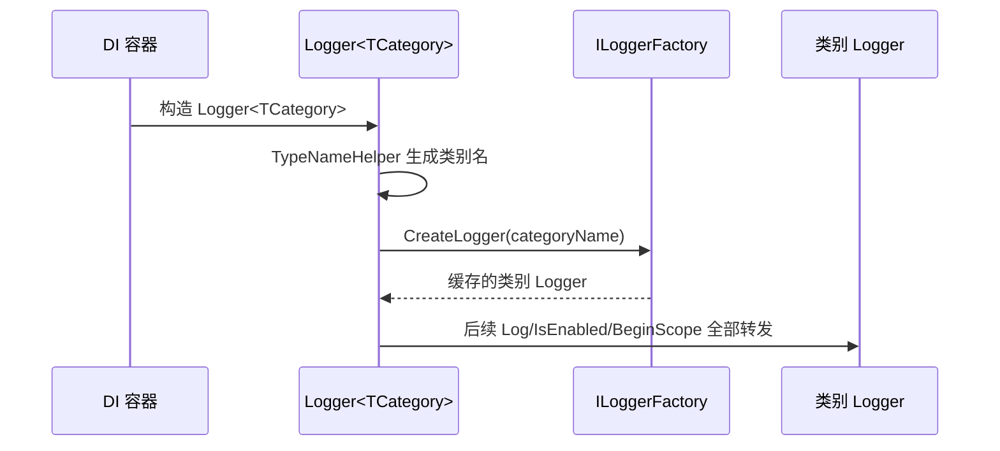

### 类别名来自完整类型显示名

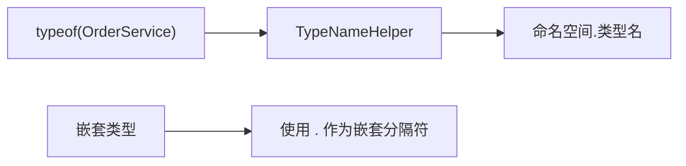

这使配置可以用命名空间前缀统一控制一组组件，也避免手写类别字符串发生漂移。

### 泛型包装不等于每次创建新后端

Factory 按类别缓存内部 Logger；多个 `Logger<T>` 实例只要类别相同，最终会共享同一个聚合 Logger。

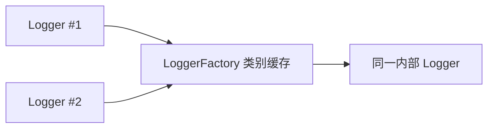

### 什么时候直接使用非泛型 ILogger

动态插件、租户或脚本系统若类别在运行时才确定，可调用 `ILoggerFactory.CreateLogger(string)`；普通服务优先注入 `ILogger<T>`，让重命名和命名空间调整自动反映到类别。

### Logger<>

**读这组源码时关注什么：** 泛型 Logger 默认实现如何委托实际记录器。

#### 整体结构

**这段代码回答什么问题：** 泛型 Logger 默认实现如何委托实际记录器。

```C#
// ILogger<> 默认实现，ILogger 的包装类型
// 利用泛型强类型名称表示日志类别，便于将组件、服务等类型作为日志类别
public class Logger<T> : ILogger<T>
{
    private readonly ILogger _logger;

    public Logger(ILoggerFactory factory)
    {
        ThrowHelper.ThrowIfNull(factory);

        // 使用泛型实参 T 的类型全名作为日志类别创建 ILogger
        // 如果是泛型类型，不包含泛型参数类型
        // 如果是内嵌类型，使用 “.” 作为分割符
        _logger = factory.CreateLogger(TypeNameHelper.GetTypeDisplayName(typeof(T), includeGenericParameters: false, nestedTypeDelimiter: '.'));
    }

    void ILogger.Log<TState>(LogLevel logLevel, EventId eventId, TState state, Exception? exception, Func<TState, Exception?, string> formatter)
    {
        _logger.Log(logLevel, eventId, state, exception, formatter);
    }

    bool ILogger.IsEnabled(LogLevel logLevel)
    {
        return _logger.IsEnabled(logLevel);
    }

    IDisposable? ILogger.BeginScope<TState>(TState state)
    {
        return _logger.BeginScope(state);
    }
}
```

**源码解读：**
- 构造时通过 ILoggerFactory 按 T 类别创建内部 ILogger。
- 所有接口调用直接转发给内部记录器。

**读完要记住：**
- 每个 T 对应固定类别名称。
- 该包装器不实现过滤或 Provider 分发。

### 最小例子

```csharp
public sealed class OrderService
{
    private readonly ILogger<OrderService> _logger;

    public OrderService(ILogger<OrderService> logger) => _logger = logger;

    public void Submit(int orderId)
    {
        _logger.LogInformation(new EventId(1001, "OrderSubmitted"),
            "Submitting order {OrderId}", orderId);
    }
}
```

### 回顾要点

- ILogger<T> 的泛型参数用于生成类别名称。
- LogLevel 决定严重程度，EventId 标识具体事件。
- 所有扩展 API 最终调用非泛型 ILogger。

## 3. 复合分发：一个类别如何扇出到多个 Provider

### 本组解决什么问题

这一组源码回答“一个类别 Logger 如何由多个 Provider 共同组成，以及过滤规则何时应用”。LoggerFactory 缓存类别 Logger，并把每个 Provider 的 Logger 预处理为 MessageLogger 和 ScopeLogger 数组。

### 关键类型关系图

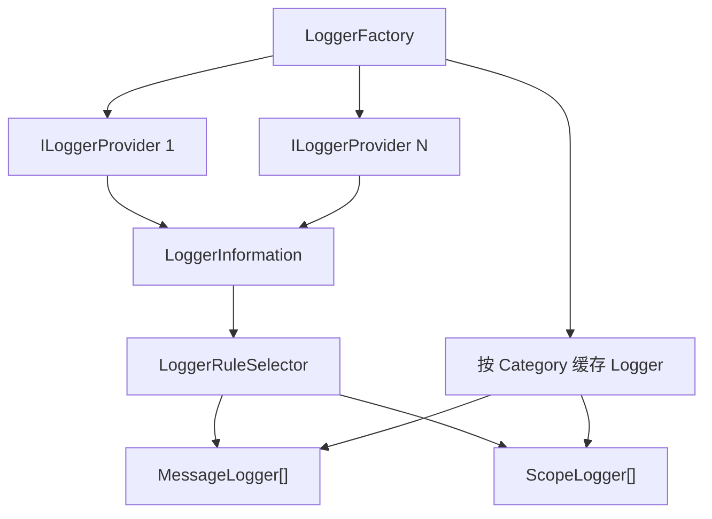

### 核心源码解读

### 三组数组分别服务三个阶段

| 数组 | 何时构建 | 保存什么 | 热路径用途 |
| --- | --- | --- | --- |
| `Loggers` | Provider 加入或类别首次创建 | 原始 Provider Logger 元数据 | 重新应用规则 |
| `MessageLoggers` | ApplyFilters | 通过静态筛选的写入目标 | Log / IsEnabled |
| `ScopeLoggers` | ApplyFilters | 自有 Scope 与共享外部 Scope | BeginScope |

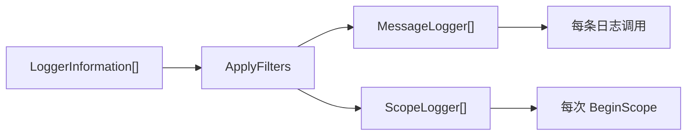

### Log 是容错扇出，不是单一后端调用

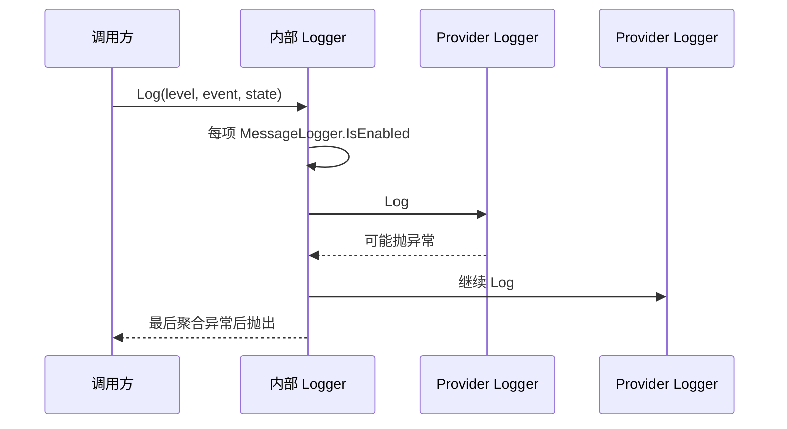

一个 Provider 失败不会阻止后续 Provider 收到本条日志，但调用结束时会以 `AggregateException` 报告所有失败。

### IsEnabled 是“是否至少有一个目标接受”

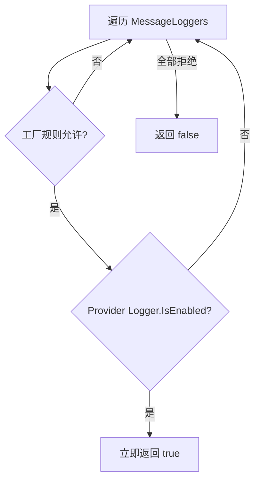

工厂规则是第一层，Provider 自身仍可执行第二层判断。直接调用 `Log` 时，内部 Logger 不会先统一调用所有 Provider 的 `IsEnabled`，Provider 应在自己的 `Log` 中保持必要防护。

### Scope 目标会合并成一个 IDisposable

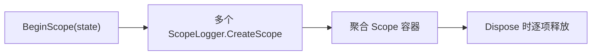

### Logger

**读这组源码时关注什么：** 一个类别的日志如何扇出到多个 Provider Logger。

#### 整体结构

**这段代码回答什么问题：** 一个类别的日志如何扇出到多个 Provider Logger。

```C#
// ILogger 的默认实现
// 每个日志类别对应一个 Logger
internal sealed class Logger : ILogger
{
    public Logger(LoggerInformation[] loggers) => Loggers = loggers;

    // 数组的元素数量与注册的 ILoggerProvider 数量一致
    public LoggerInformation[] Loggers { get; set; }
    // 数组的元素数量与注册的 ILoggerProvider 数量一致
    public MessageLogger[]? MessageLoggers { get; set; }
    // 数组的元素数量与注册的 ILoggerProvider 数量可能不一致
    // 如果注册的 ILoggerProvider 没有一个实现了 ISupportExternalScope 接口，则数量一致
    // 如果注册的 ILoggerProvider 有一个实现了 ISupportExternalScope 接口，则数量可能就会少于注册的 ILoggerProvider 数量
    // 因为实现了 ISupportExternalScope 接口的所有 ILoggerProvider 本质上共用一个 IExternalScopeProvider 来提供日志范围的活动跟踪
    public ScopeLogger[]? ScopeLoggers { get; set; }

    // 作为提供应用程序发送日志事件的入口方法
    public void Log<TState>(LogLevel logLevel, EventId eventId, TState state, Exception? exception, Func<TState, Exception?, string> formatter)
    {
        MessageLogger[]? loggers = MessageLoggers;
        if (loggers == null)
        {
            return;
        }

        List<Exception>? exceptions = null;
        for (int i = 0; i < loggers.Length; i++)
        {
            ref readonly MessageLogger loggerInfo = ref loggers[i];
            // 检查当前 MessageLogger 的日志事件等级和过滤规则
            if (!loggerInfo.IsEnabled(logLevel))
            {
                continue;
            }

            // 最终使用 ILoggerProvider 创建的 ILogger 发送日志事件
            LoggerLog(logLevel, eventId, loggerInfo.Logger, exception, formatter, ref exceptions, state);
        }

        if (exceptions != null && exceptions.Count > 0)
        {
            ThrowLoggingError(exceptions);
        }

        // 使用 ILoggerProvider 创建的 ILogger 发送日志事件
        static void LoggerLog(
            LogLevel logLevel, 
            EventId eventId, 
            ILogger logger, 
            Exception? exception, 
            Func<TState, Exception?, string> formatter, 
            ref List<Exception>? exceptions, 
            in TState state)
        {
            try
            {
                logger.Log(logLevel, eventId, state, exception, formatter);
            }
            catch (Exception ex)
            {
                exceptions ??= new List<Exception>();
                exceptions.Add(ex);
            }
        }
    }

    // 检查日志事件等级和过滤规则方法
    // 此方法用于检查是否存在至少一个满足最低日志事件等级和过滤规则的 ILogger
    public bool IsEnabled(LogLevel logLevel)
    {
        MessageLogger[]? loggers = MessageLoggers;
        if (loggers == null)
        {
            return false;
        }

        List<Exception>? exceptions = null;
        int i = 0;
        for (; i < loggers.Length; i++)
        {
            ref readonly MessageLogger loggerInfo = ref loggers[i];
            // 当前 MessageLogger 不满足最低日志事件等级和过滤规则则继续下一个检查
            if (!loggerInfo.IsEnabled(logLevel))
            {
                continue;
            }

            // 继续使用由 ILoggerProvider 创建的 ILogger 检查是否满足最低日志事件等级和其他过滤规则
            if (LoggerIsEnabled(logLevel, loggerInfo.Logger, ref exceptions))
            {
                break;
            }
        }

        if (exceptions != null && exceptions.Count > 0)
        {
            ThrowLoggingError(exceptions);
        }

        // i < loggers.Length 表明至少有一个 ILoggerProvider 满足最低日志事件等级和过滤规则
        return i < loggers.Length ? true : false;

        static bool LoggerIsEnabled(LogLevel logLevel, ILogger logger, ref List<Exception>? exceptions)
        {
            try
            {
                if (logger.IsEnabled(logLevel))
                {
                    return true;
                }
            }
            catch (Exception ex)
            {
                exceptions ??= new List<Exception>();
                exceptions.Add(ex);
            }

            return false;
        }
    }

    // 开始日志范围的活动跟踪方法
    public IDisposable? BeginScope<TState>(TState state) where TState : notnull
    {
        ScopeLogger[]? loggers = ScopeLoggers;

        if (loggers == null)
        {
            return NullScope.Instance;
        }

        if (loggers.Length == 1)
        {
            // 只有一个 ScopeLogger 时，接返回创建的日志范围
            return loggers[0].CreateScope(state);
        }

        // 多于一个 ScopeLogger 时，通过 Scope 收集所有创建的日志范围
        // 便于后续日志范围的统一出栈
        var scope = new Scope(loggers.Length);
        List<Exception>? exceptions = null;
        for (int i = 0; i < loggers.Length; i++)
        {
            ref readonly ScopeLogger scopeLogger = ref loggers[i];

            try
            {
                scope.SetDisposable(i, scopeLogger.CreateScope(state));
            }
            catch (Exception ex)
            {
                exceptions ??= new List<Exception>();
                exceptions.Add(ex);
            }
        }

        if (exceptions != null && exceptions.Count > 0)
        {
            ThrowLoggingError(exceptions);
        }

        return scope;
    }

    private static void ThrowLoggingError(List<Exception> exceptions)
    {
        throw new AggregateException(
            message: "An error occurred while writing to logger(s).", innerExceptions: exceptions);
    }
}
```

**源码解读：**
- MessageLoggers 保存过滤后的写入目标，Log 逐一调用。
- IsEnabled 先检查工厂规则，再询问具体 Logger；BeginScope 遍历 ScopeLoggers。

**读完要记住：**
- Logger 是单个类别的聚合分发器。
- Provider 异常会被收集后统一报告。

### LoggerInformation

**读这组源码时关注什么：** 工厂如何保存 Provider 为某类别创建的 Logger 元数据。

#### 整体结构

**这段代码回答什么问题：** 工厂如何保存 Provider 为某类别创建的 Logger 元数据。

```C#
// 日志信息
// 每个 LoggerInformation 代表一个 ILoggerProvider 和日志类别的组合
internal readonly struct LoggerInformation
{
    public LoggerInformation(ILoggerProvider provider, string category) : this()
    {
        ProviderType = provider.GetType();
        // 利用 ILoggerProvider 创建对应的 ILogger
        Logger = provider.CreateLogger(category);
        Category = category;
        ExternalScope = provider is ISupportExternalScope;
    }
    
    // 由 ILoggerProvider 创建的 ILogger
    public ILogger Logger { get; }

    // 日志类别
    public string Category { get; }

    // ILoggerProvider 的具体类型
    public Type ProviderType { get; }

    // ILoggerProvider 是否实现了 ISupportExternalScope 接口
    // 实现接口就表示需要借助 IExternalScopeProvider 来提供日志范围的活动跟踪
    // 没有实现则表示 ILoggerProvider 自身可以提供日志范围的活动跟踪
    public bool ExternalScope { get; }
}
```

**源码解读：**
- 结构体保存 ILogger、类别、Provider 类型和外部 Scope 能力。
- 这些静态信息随后用于规则选择和 Scope 路径构建。

**读完要记住：**
- 每个 Provider 与类别组合对应一项。
- 它是应用过滤前的原始描述。

### MessageLogger

**读这组源码时关注什么：** 过滤后的写入目标需要保存哪些信息。

#### 整体结构

**这段代码回答什么问题：** 过滤后的写入目标需要保存哪些信息。

```C#
// 消息日志
// 主要用来过滤日志
internal readonly struct MessageLogger
{
    public MessageLogger(ILogger logger, string? category, string? providerTypeFullName, LogLevel? minLevel, Func<string?, string?, LogLevel, bool>? filter)
    {
        Logger = logger;
        Category = category;
        ProviderTypeFullName = providerTypeFullName;
        MinLevel = minLevel;
        Filter = filter;
    }

    // 由 ILoggerProvider 创建的 ILogger
    public ILogger Logger { get; }

    // 日志类别
    public string? Category { get; }

    // ILoggerProvider 实现类型的类型全名
    // 可以使用 ProviderAliasAttribute 特性配置别名
    private string? ProviderTypeFullName { get; }

    // 利用 ProviderTypeFullName 和 Category 匹配得到 LoggerFilterRule 中的 LogLevel 属性值
    public LogLevel? MinLevel { get; }

    // 利用 ProviderTypeFullName 和 Category 匹配得到 LoggerFilterRule 中的 Filter 属性值
    public Func<string?, string?, LogLevel, bool>? Filter { get; }

    // 只有不低于 MinLevel 属性值的日志事件等级才认为有效
    public bool IsEnabled(LogLevel level)
    {
        // 优先比较 MinLevel 属性值
        if (MinLevel != null && level < MinLevel)
        {
            return false;
        }

        // 如果存在过滤规则，则使用过滤规则进行判断
        if (Filter != null)
        {
            return Filter(ProviderTypeFullName, Category, level);
        }

        return true;
    }
}
```

**源码解读：**
- 结构体组合 ILogger、类别、Provider 名、最低等级与过滤委托。
- IsEnabled 同时执行 MinLevel 和 Filter 判断。

**读完要记住：**
- 一项 MessageLogger 对应一个 Provider Logger。
- 它避免每次日志调用重新选择规则。

### ScopeLogger

**读这组源码时关注什么：** BeginScope 如何同时支持 Provider 自有 Scope 和共享外部 Scope。

#### 整体结构

**这段代码回答什么问题：** BeginScope 如何同时支持 Provider 自有 Scope 和共享外部 Scope。

```C#
// 范围日志
// 用于创建日志范围
internal readonly struct ScopeLogger
{
    public ScopeLogger(ILogger? logger, IExternalScopeProvider? externalScopeProvider)
    {
        Debug.Assert(logger != null || externalScopeProvider != null, "Logger can't be null when there isn't an ExternalScopeProvider");

        Logger = logger;
        ExternalScopeProvider = externalScopeProvider;
    }

    // 由 ILoggerProvider 创建的 ILogger
    public ILogger? Logger { get; }

    // 范围提供者
    public IExternalScopeProvider? ExternalScopeProvider { get; }

    // 创建日志范围，返回 IDisposable
    // 可以通过调用 IDisposable.Dispose 方法实现范围出栈
    public IDisposable? CreateScope<TState>(TState state) where TState : notnull
    {
        if (ExternalScopeProvider != null)
        {
            return ExternalScopeProvider.Push(state);
        }

        Debug.Assert(Logger != null);
        return Logger.BeginScope<TState>(state);
    }
}
```

**源码解读：**
- 结构体保存 ILogger 或 IExternalScopeProvider 二者之一。
- 创建范围时调用 Logger.BeginScope 或外部 ScopeProvider.Push。

**读完要记住：**
- 实现外部 Scope 的 Provider 共享全局 ScopeProvider。
- 未实现者继续使用自己的 BeginScope。

### LoggerFactoryOptions

**读这组源码时关注什么：** LoggerFactory 有哪些全局行为选项。

#### 整体结构

**这段代码回答什么问题：** LoggerFactory 有哪些全局行为选项。

```C#
// 日志工厂选项
// 主要用来配置在启用 Activity 活动跟踪时的信息内容
public class LoggerFactoryOptions
{
    public LoggerFactoryOptions() { }

    // 活动跟踪选项
    // ActivityTrackingOptions 是一个带有位标志的枚举类型
    public ActivityTrackingOptions ActivityTrackingOptions { get; set; }
}
```

**源码解读：**
- 主要保存 ActivityTrackingOptions。
- 工厂据此决定 Scope 中自动加入哪些 Activity 字段。

**读完要记住：**
- 该选项影响上下文跟踪而非等级过滤。
- 未知位标志会在工厂构造时被拒绝。

## 4. 过滤规则：Provider、Category 与等级如何决策

过滤规则在类别 Logger 创建或选项变化时选择一次，结果写入 `MessageLogger`。热路径只做最低等级比较和可选 Filter 委托，不会重新扫描完整规则列表。

### 一条规则的四个筛选维度

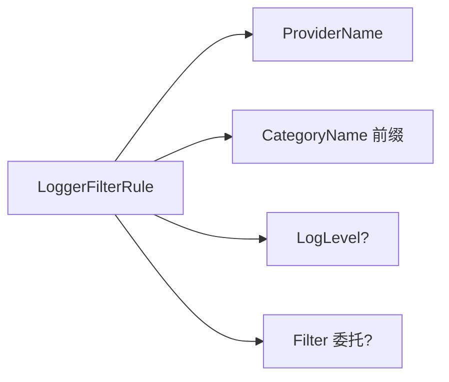

ProviderName 和 CategoryName 决定规则是否候选；LogLevel 和 Filter 决定候选规则选中后如何判断事件。

### 最佳规则选择顺序

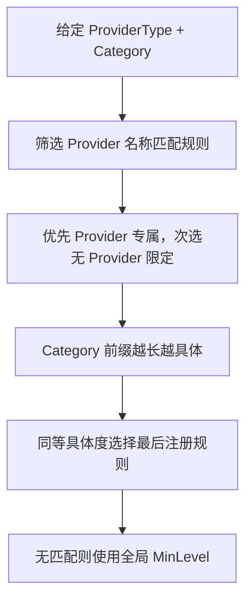

Category 使用前缀匹配，所以 `Microsoft.AspNetCore` 比 `Microsoft` 更具体；同等规则的最后注册者获胜，使后续配置可以覆盖早期默认值。

### 配置示例如何落到规则

```text
Logging:LogLevel:Default = Information
Logging:LogLevel:Microsoft = Warning
Logging:Console:LogLevel:Microsoft.Hosting = Debug
```

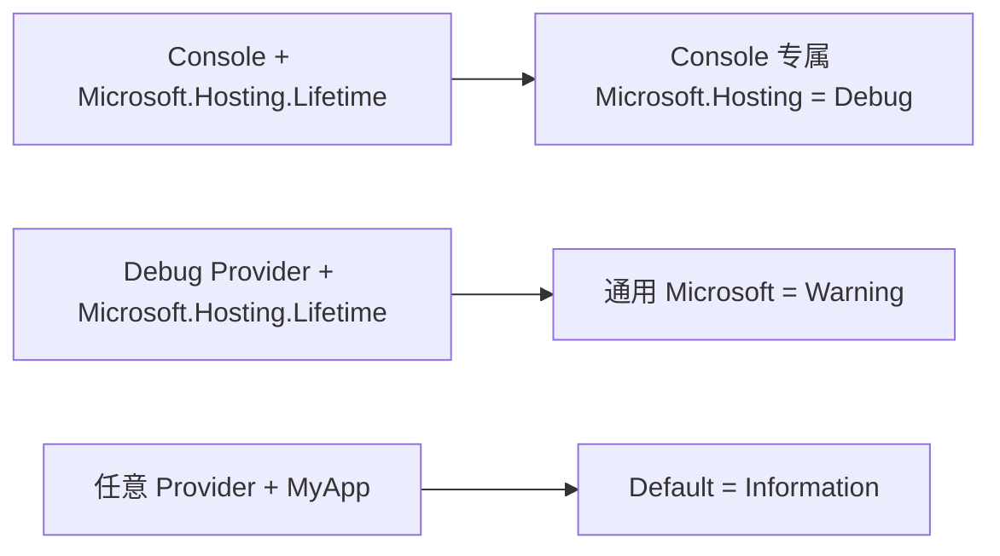

### None 在 ApplyFilters 阶段直接移除目标

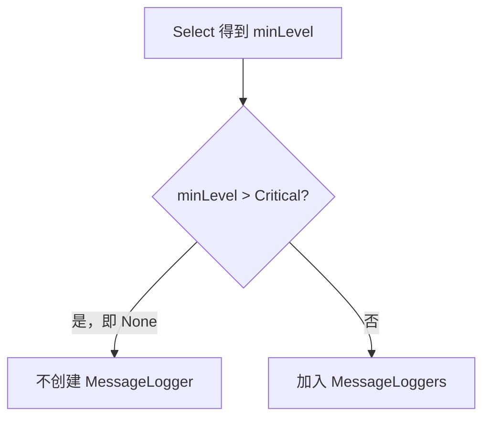

这比每条事件都比较 `None` 更直接，也意味着规则刷新后 `MessageLoggers` 数组长度可能变化。

### CaptureScopes 与等级过滤互相独立

`CaptureScopes` 决定是否构造 `ScopeLoggers`，不会改变消息等级；关闭后 `BeginScope` 返回空 Scope，但日志本身仍按 MessageLogger 规则输出。

### LoggerFilterOptions

**读这组源码时关注什么：** 日志过滤的全局状态由什么组成。

#### 整体结构

**这段代码回答什么问题：** 日志过滤的全局状态由什么组成。

```C#
// 日志过滤选项
public class LoggerFilterOptions
{
    public LoggerFilterOptions() { }

    // 是否启用日志范围的活动跟踪
    // 这是一个针对所有 ILoggerProvider 的全局配置，默认值为 true
    public bool CaptureScopes { get; set; } = true;

    // 全局最小日志等级
    public LogLevel MinLevel { get; set; }

    // 日志过滤规则集合
    public IList<LoggerFilterRule> Rules => RulesInternal;

    internal List<LoggerFilterRule> RulesInternal { get; } = new List<LoggerFilterRule>();
}
```

**源码解读：**
- MinLevel 提供无规则匹配时的默认等级。
- Rules 保存按 Provider、类别和委托配置的规则，CaptureScopes 控制范围捕获。

**读完要记住：**
- 过滤选项可由 OptionsMonitor 动态更新。
- 规则选择发生在 LoggerFactory 中。

### LoggerFilterRule

**读这组源码时关注什么：** 单条过滤规则如何描述匹配条件。

#### 整体结构

**这段代码回答什么问题：** 单条过滤规则如何描述匹配条件。

```C#
// 日志过滤规则
public class LoggerFilterRule
{
    public LoggerFilterRule(string? providerName, string? categoryName, LogLevel? logLevel, Func<string?, string?, LogLevel, bool>? filter)
    {
        ProviderName = providerName;
        CategoryName = categoryName;
        LogLevel = logLevel;
        Filter = filter;
    }

    public string? ProviderName { get; }

    public string? CategoryName { get; }

    public LogLevel? LogLevel { get; }

    public Func<string?, string?, LogLevel, bool>? Filter { get; }

    public override string ToString()
    {
        return $"{nameof(ProviderName)}: '{ProviderName}', {nameof(CategoryName)}: '{CategoryName}', {nameof(LogLevel)}: '{LogLevel}', {nameof(Filter)}: '{Filter}'";
    }
}
```

**源码解读：**
- 规则可指定 ProviderName、CategoryName、LogLevel 和 Filter。
- 字段为空表示该维度不限制。

**读完要记住：**
- 规则只是声明数据，选择优先级由 LoggerRuleSelector 处理。
- 同优先级时后注册规则优先。

## 5. LoggerFactory：类别缓存、Provider 生命周期与规则刷新

Factory 是全局协调器：保存 Provider、按类别缓存聚合 Logger、把 Options 规则预计算到每个类别，并为支持外部 Scope 的 Provider 注入共享 ScopeProvider。

### 类别首次创建路径

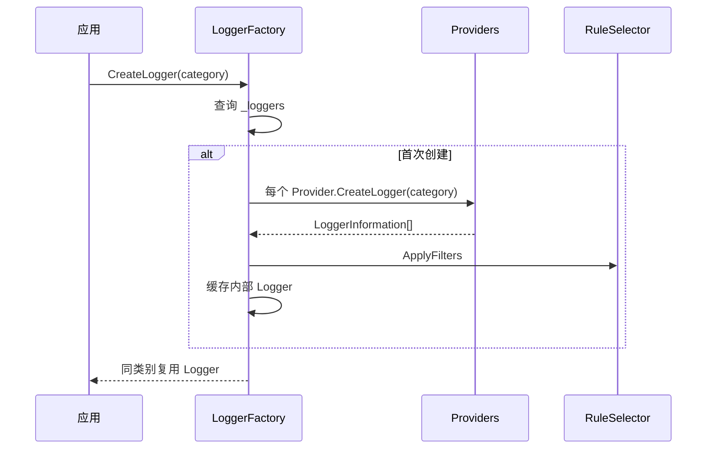

### 过滤热更新不重建 Provider Logger

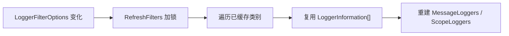

Provider Logger 保持原对象，只替换预计算的过滤视图，因此已有 `ILogger` 引用会立即看到新规则。

### 动态 AddProvider 会补齐所有已有类别

```mermaid
sequenceDiagram
    participant F as LoggerFactory
    participant P as 新 Provider
    participant L as 已缓存类别 Logger
    F->>F: AddProviderRegistration(dispose: true)
    loop 每个已缓存 category
        F->>P: CreateLogger(category)
        F->>L: 扩展 LoggerInformation[]
        F->>L: 重新 ApplyFilters
    end
```

### Provider 所有权决定 Factory 是否 Dispose

| Provider 来源 | `ShouldDispose` | Factory.Dispose 行为 |
| --- | --- | --- |
| 构造函数注入 | false | 默认不释放，由外部容器拥有 |
| `AddProvider` 动态加入 | true | Factory 释放时调用 Provider.Dispose |

```mermaid
flowchart TD
    A["LoggerFactory.Dispose"] --> B["取消 FilterOptions OnChange"]
    B --> C["遍历 ProviderRegistration"]
    C --> D{"ShouldDispose?"}
    D -->|是| E["尝试 Dispose Provider"]
    D -->|否| F["保留外部所有权"]
```

Provider 释放异常在这版实现中被吞掉，Factory 会继续释放后续由自己拥有的 Provider。

### ILoggerFactory

**读这组源码时关注什么：** 日志工厂向外暴露哪些职责。

#### 整体结构

**这段代码回答什么问题：** 日志工厂向外暴露哪些职责。

```C#
// 日志工厂的抽象表示
public interface ILoggerFactory : IDisposable
{
    // 根据日志类别创建 ILogger
    ILogger CreateLogger(string categoryName);

    // 添加 ILoggerProvider
    void AddProvider(ILoggerProvider provider);
}
```

**源码解读：**
- 按类别创建 ILogger，并允许动态添加 Provider。
- 接口继承 IDisposable，负责相关资源生命周期。

**读完要记住：**
- 工厂缓存类别 Logger。
- Provider 是工厂扩展输出目标的单位。

### LoggerFactory

**读这组源码时关注什么：** Provider、类别 Logger、过滤规则和 Scope 如何汇合。

#### 整体结构

**这段代码回答什么问题：** Provider、类别 Logger、过滤规则和 Scope 如何汇合。

```C#
// ILoggerFactory 的默认实现
public class LoggerFactory : ILoggerFactory
{
    // 根据日志类别缓存创建的 ILogger
    private readonly Dictionary<string, Logger> _loggers = new Dictionary<string, Logger>(StringComparer.Ordinal);
    // ILoggerProvider 注册列表
    private readonly List<ProviderRegistration> _providerRegistrations = new List<ProviderRegistration>();
    // 同步锁
    private readonly object _sync = new object();
    // 是否执行过释放操作标志
    private volatile bool _disposed;
    // 通过 IOptionsMonitor<LoggerFilterOptions>.OnChange 注册回调后返回的 IDisposable
    // 可以通过调用 IDisposable.Dispose 方法取消注册
    private IDisposable? _changeTokenRegistration;
    // 日志过滤选项
    private LoggerFilterOptions _filterOptions;
    // 全局的外部范围提供者
    private IExternalScopeProvider? _scopeProvider;
    // 日志工厂选项
    private LoggerFactoryOptions _factoryOptions;

    public LoggerFactory() : this(Array.Empty<ILoggerProvider>())
    {
    }

    public LoggerFactory(IEnumerable<ILoggerProvider> providers) : this(providers, new StaticFilterOptionsMonitor(new LoggerFilterOptions()))
    {
    }

    public LoggerFactory(IEnumerable<ILoggerProvider> providers, LoggerFilterOptions filterOptions) 
        : this(providers, new StaticFilterOptionsMonitor(filterOptions))
    {
    }

    public LoggerFactory(IEnumerable<ILoggerProvider> providers, IOptionsMonitor<LoggerFilterOptions> filterOption) 
        : this(providers, filterOption, null)
    {
    }

    public LoggerFactory(
        IEnumerable<ILoggerProvider> providers, 
        IOptionsMonitor<LoggerFilterOptions> filterOption, 
        IOptions<LoggerFactoryOptions>? options) 
            : this(providers, filterOption, options, null)
    {
    }

    public LoggerFactory(
        IEnumerable<ILoggerProvider> providers, 
        IOptionsMonitor<LoggerFilterOptions> filterOption, 
        IOptions<LoggerFactoryOptions>? options = null, 
        IExternalScopeProvider? scopeProvider = null)
    {
        _scopeProvider = scopeProvider;

        // 可能未注册 LoggerFactoryOptions 的选项配置
        _factoryOptions = options == null || options.Value == null ? new LoggerFactoryOptions() : options.Value;

        // 对除 None 以外的所有枚举按位或后再按位取反
        // 即得到一个全为 0 的掩码
        const ActivityTrackingOptions ActivityTrackingOptionsMask = ~(ActivityTrackingOptions.SpanId | 
                                                                      ActivityTrackingOptions.TraceId | 
                                                                      ActivityTrackingOptions.ParentId | 
                                                                      ActivityTrackingOptions.TraceFlags | 
                                                                      ActivityTrackingOptions.TraceState | 
                                                                      ActivityTrackingOptions.Tags | 
                                                                      ActivityTrackingOptions.Baggage);

        // 与 LoggerFactoryOptions.ActivityTrackingOptions 按位与后不为 0 的话
        // 表明存在未知的枚举值，需要抛出异常
        if ((_factoryOptions.ActivityTrackingOptions & ActivityTrackingOptionsMask) != 0)
        {
            throw new ArgumentException(SR.Format(SR.InvalidActivityTrackingOptions, _factoryOptions.ActivityTrackingOptions), nameof(options));
        }
        // 遍历所有注册的 ILoggerPrivider，添加进注册中心
        foreach (ILoggerProvider provider in providers)
        {
            AddProviderRegistration(provider, dispose: false);
        }
        
        // 监听日志过滤规则改变
        _changeTokenRegistration = filterOption.OnChange(RefreshFilters);
        // 读取当前的 LoggerFilterOptions 应用日志过滤规则
        RefreshFilters(filterOption.CurrentValue);
    }

    // 刷新过滤规则
    private void RefreshFilters(LoggerFilterOptions filterOptions)
    {
        lock (_sync)
        {
            // 更新 LoggerFilterOptions
            _filterOptions = filterOptions;
            foreach (KeyValuePair<string, Logger> registeredLogger in _loggers)
            {
                Logger logger = registeredLogger.Value;
                // 应用新的过滤规则
                (logger.MessageLoggers, logger.ScopeLoggers) = ApplyFilters(logger.Loggers);
            }
        }
    }

    // 实现 ILoggerFactory
    // 根据日志类别创建 ILogger
    public ILogger CreateLogger(string categoryName)
    {
        if (CheckDisposed())
        {
            throw new ObjectDisposedException(nameof(LoggerFactory));
        }

        lock (_sync)
        {
            if (!_loggers.TryGetValue(categoryName, out Logger? logger))
            {
                // 基于日志类别创建 ILogger
                logger = new Logger(categoryName, CreateLoggers(categoryName));

                // 应用过滤规则
                (logger.MessageLoggers, logger.ScopeLoggers) = ApplyFilters(logger.Loggers);

                // 根据日志类别添加或替换新的 ILogger
                _loggers[categoryName] = logger;
            }

            return logger;
        }
    }

    // 创建由不同 ILoggerProvider 提供的 ILogger 集合
    private LoggerInformation[] CreateLoggers(string categoryName)
    {
        var loggers = new LoggerInformation[_providerRegistrations.Count];
        for (int i = 0; i < _providerRegistrations.Count; i++)
        {
            loggers[i] = new LoggerInformation(_providerRegistrations[i].Provider, categoryName);
        }
        return loggers;
    }

    // 应用过滤规则
    private (MessageLogger[] MessageLoggers, ScopeLogger[]? ScopeLoggers) ApplyFilters(LoggerInformation[] loggers)
    {
        var messageLoggers = new List<MessageLogger>();
        // 根据 LoggerFilterOptions.CaptureScopes 属性决定是否启用日志范围的活动跟踪
        // 启用情况下才会创建 ScopeLogger 集合
        List<ScopeLogger>? scopeLoggers = _filterOptions.CaptureScopes ? new List<ScopeLogger>() : null;

        foreach (LoggerInformation loggerInformation in loggers)
        {
            // 选择最优的 LoggerFilterRule
            // 匹配规则：
            // 1. 存在具体 ILoggerProvider 名称（类型全名或别名）的规则优先级高于默认的 Default 规则
            // 2. 日志类别基于前缀最多匹配规则，比如当前日志类别是 Foo.Bar.Baz 时，配置中 Foo.Bar 的规则比 Foo 的规则优先级更高
            // 3. 有多个优先级相同的规则时选择最后一个
            // 4. 以上规则没有匹配到则使用全局最低日志事件等级 LoggerFilterOptions.MinLevel
            LoggerRuleSelector.Select(
                _filterOptions,
                loggerInformation.ProviderType,
                loggerInformation.Category,
                out LogLevel? minLevel,
                out Func<string?, string?, LogLevel, bool>? filter);

            // 无效的最低日志事件等级
            if (minLevel is not null and > LogLevel.Critical)
            {
                continue;
            }

            messageLoggers.Add(new MessageLogger(loggerInformation.Logger, loggerInformation.Category, loggerInformation.ProviderType.FullName, minLevel, filter));

            // 如果 ILoggerProvider 实现了 ISupportExternalScope 接口
            // 则不创建 ScopeLogger
            if (!loggerInformation.ExternalScope)
            {
                scopeLoggers?.Add(new ScopeLogger(logger: loggerInformation.Logger, externalScopeProvider: null));
            }
        }

        // 添加针对全局的 IExternalScopeProvider
        if (_scopeProvider != null)
        {
            scopeLoggers?.Add(new ScopeLogger(logger: null, externalScopeProvider: _scopeProvider));
        }

        return (messageLoggers.ToArray(), scopeLoggers?.ToArray());
    }

    // 实现 ILoggerFactory
    // 添加新的 ILoggerProvider
    public void AddProvider(ILoggerProvider provider)
    {
        if (CheckDisposed())
        {
            throw new ObjectDisposedException(nameof(LoggerFactory));
        }

        ThrowHelper.ThrowIfNull(provider);

        lock (_sync)
        {
            // 添加 ILoggerProvider
            AddProviderRegistration(provider, dispose: true);
            // 遍历所有已经创建的 Logger
            // 利用新添加的 ILoggerProvider 创建 LoggerInformation 并应用过滤规则
            foreach (KeyValuePair<string, Logger> existingLogger in _loggers)
            {
                Logger logger = existingLogger.Value;
                LoggerInformation[] loggerInformation = logger.Loggers;

                int newLoggerIndex = loggerInformation.Length;
                // 扩容数组
                Array.Resize(ref loggerInformation, loggerInformation.Length + 1);
                // 利用 ILoggerProvider 和日志类别创建新的 LoggerInformation 并添加到到末尾
                loggerInformation[newLoggerIndex] = new LoggerInformation(provider, existingLogger.Key);

                logger.Loggers = loggerInformation;
                // 应用过滤规则
                (logger.MessageLoggers, logger.ScopeLoggers) = ApplyFilters(logger.Loggers);
            }
        }
    }

    // 添加 ILoggerProvider 进注册中心
    private void AddProviderRegistration(ILoggerProvider provider, bool dispose)
    {
        _providerRegistrations.Add(new ProviderRegistration
        {
            Provider = provider,
            ShouldDispose = dispose
        });

        // 如果 ILoggerProvider 实现了 ISupportExternalScope 
        // 就为 ILoggerProvider 添加 LoggerFactoryScopeProvider（LoggerFactoryScopeProvider 实现了 IExternalScopeProvider）
        // 利用 IExternalScopeProvider 为 ILoggerProvider 提供基于范围的活动跟踪
        if (provider is ISupportExternalScope supportsExternalScope)
        {
            // 利用 ActivityTrackingOptions 创建 LoggerFactoryScopeProvider
            // 作为全局默认 IExternalScopeProvider
            _scopeProvider ??= new LoggerFactoryScopeProvider(_factoryOptions.ActivityTrackingOptions);

            supportsExternalScope.SetScopeProvider(_scopeProvider);
        }
    }

    // 创建 ILoggerFactory 的静态工具方法
    // 用来快速创建一个独立的 ILoggerFactory
    public static ILoggerFactory Create(Action<ILoggingBuilder> configure)
    {
        var serviceCollection = new ServiceCollection();
        serviceCollection.AddLogging(configure);
        ServiceProvider serviceProvider = serviceCollection.BuildServiceProvider();
        ILoggerFactory loggerFactory = serviceProvider.GetRequiredService<ILoggerFactory>();
        return new DisposingLoggerFactory(loggerFactory, serviceProvider);
    }

    // 检查是否已经执行过释放
    protected virtual bool CheckDisposed() => _disposed;

    // 释放
    public void Dispose()
    {
        if (!_disposed)
        {
            _disposed = true;

            _changeTokenRegistration?.Dispose();

            foreach (ProviderRegistration registration in _providerRegistrations)
            {
                try
                {
                    if (registration.ShouldDispose)
                    {
                        registration.Provider.Dispose();
                    }
                }
                catch
                {

                }
            }
        }
    }

    private struct ProviderRegistration
    {
        public ILoggerProvider Provider;
        public bool ShouldDispose;
    }
}
```

**源码解读：**
- 构造时注册 Provider 并监听 LoggerFilterOptions 变化。
- CreateLogger 按类别缓存聚合 Logger，ApplyFilters 为每个 Provider 选择最佳规则。

**读完要记住：**
- 过滤变化会重建已有 Logger 的 MessageLoggers 和 ScopeLoggers。
- 动态添加 Provider 也会更新所有已缓存类别。

### ILoggerProvider

**读这组源码时关注什么：** 日志输出后端需要实现的最小契约。

#### 整体结构

**这段代码回答什么问题：** 日志输出后端需要实现的最小契约。

```C#
// 日志提供者的抽象表示
public interface ILoggerProvider : IDisposable
{
    // 由具体的 ILoggerProvider 根据日志类别创建对应日志类别的 ILogger
    ILogger CreateLogger(string categoryName);
}
```

**源码解读：**
- Provider 按类别创建具体 ILogger。
- Provider 自身可持有共享资源并负责释放。

**读完要记住：**
- 一个 Provider 可为多个类别创建 Logger。
- LoggerFactory 不关心后端如何输出。

### 最小例子

```csharp
using ILoggerFactory factory = LoggerFactory.Create(builder =>
{
    builder.SetMinimumLevel(LogLevel.Information);
    builder.AddConsole();
});

ILogger logger = factory.CreateLogger("Orders.Submission");
logger.LogInformation("Factory dispatches this entry to enabled providers");
```

### 回顾要点

- 每个类别只缓存一个聚合 Logger。
- 过滤规则先按 Provider 和 Category 选优，再在调用时检查等级与委托。
- 新增 Provider 或过滤选项变化都会刷新已缓存 Logger。

## 6. Scope：跨异步调用链传播日志上下文

### 本组解决什么问题

这一组源码回答“BeginScope 的状态如何跨异步调用保持，以及分布式跟踪信息如何进入日志范围”。默认 ScopeProvider 用 AsyncLocal 保存父链，并按 ActivityTrackingOptions 附加当前 Activity。

### 关键类型关系图

```mermaid
flowchart TD
    A["ILogger.BeginScope"] --> B["IExternalScopeProvider.Push"]
    B --> C["AsyncLocal<Scope>"]
    C --> D["Parent Scope 链"]
    E["Activity.Current"] --> F["TraceId / SpanId / Tags / Baggage"]
    D --> G["ForEachScope"]
    F --> G
    G --> H["Provider Formatter"]
```

### 核心源码解读

### 外部 Scope 让多个 Provider 共享同一上下文链

```mermaid
flowchart LR
    A["ILogger.BeginScope"] --> B["内部 Logger"]
    B --> C["Provider 自有 BeginScope"]
    B --> D["共享 IExternalScopeProvider.Push"]
    D --> E["所有 ISupportExternalScope Provider 读取"]
```

支持 `ISupportExternalScope` 的 Provider 不再各自维护 Scope；Factory 只在 `ScopeLoggers` 中加入一次共享 Provider，避免同一状态重复 Push。

### AsyncLocal 保存的是当前节点，不是完整列表副本

```mermaid
flowchart TB
    A["Scope A"] --> B["Scope B"]
    B --> C["Scope C = AsyncLocal.Current"]
    C -.Parent.-> B
    B -.Parent.-> A
```

每次 Push 创建一个包含 State 和 Parent 的节点。异步执行上下文传播 AsyncLocal 当前引用，父链随之可见。

### ForEachScope 必须从根到当前输出

```mermaid
flowchart LR
    C["当前 Scope C"] --> B["递归 Parent B"]
    B --> A["递归 Parent A"]
    A --> O1["回调 A"] --> O2["回调 B"] --> O3["回调 C"]
```

虽然存储是从当前指向父节点，格式化输出通常期望外层到内层，因此实现先递归父节点再执行当前回调。

### Scope 依赖栈式释放纪律

```mermaid
sequenceDiagram
    participant P as ScopeProvider
    participant A as Scope A
    participant B as Scope B
    P->>A: Push(A)
    A->>B: Push(B)
    B->>P: Dispose → Current = A
    A->>P: Dispose → Current = null
```

源码直接把 Current 恢复为 Parent，因此应使用嵌套 `using` 按后进先出释放；乱序 Dispose 会破坏当前链。

### IExternalScopeProvider

**读这组源码时关注什么：** 共享日志范围需要哪些操作。

#### 整体结构

**这段代码回答什么问题：** 共享日志范围需要哪些操作。

```C#
// 外部日志范围提供者的抽象表示
public interface IExternalScopeProvider
{
    // 遍历日志范围
    void ForEachScope<TState>(Action<object?, TState> callback, TState state);

    // 新建一个日志范围并压栈
    IDisposable Push(object? state);
}
```

**源码解读：**
- Push 把状态压入当前异步上下文。
- ForEachScope 按顺序枚举已有范围。

**读完要记住：**
- 接口把 Scope 存储与具体日志后端解耦。
- 支持外部 Scope 的 Provider 可共享同一范围链。

### LoggerFactoryScopeProvider

**读这组源码时关注什么：** 默认外部 Scope 如何跨异步调用链保存。

#### 整体结构

**这段代码回答什么问题：** 默认外部 Scope 如何跨异步调用链保存。

```C#
// IExternalScopeProvider 的默认实现
// 提供日志范围的压栈和出栈操作
internal sealed class LoggerFactoryScopeProvider : IExternalScopeProvider
{
    // 此处可以使用 static readonly 类似 Activity 类中的 s_current 字段
    private readonly AsyncLocal<Scope?> _currentScope = new AsyncLocal<Scope?>();
    private readonly ActivityTrackingOptions _activityTrackingOption;

    // 遍历从根范围到当前范围
    public void ForEachScope<TState>(Action<object?, TState> callback, TState state)
    {
        void Report(Scope? current)
        {
            if (current == null)
            {
                return;
            }
            Report(current.Parent);
            callback(current.State, state);
        }

        if (_activityTrackingOption != ActivityTrackingOptions.None)
        {
            Activity? activity = Activity.Current;
            // 检查是否开启 Activity 活动跟踪
            if (activity != null)
            {
                const string propertyKey = "__ActivityLogScope__";

                ActivityLogScope? activityLogScope = activity.GetCustomProperty(propertyKey) as ActivityLogScope;
                if (activityLogScope == null)
                {
                    activityLogScope = new ActivityLogScope(activity, _activityTrackingOption);
                    activity.SetCustomProperty(propertyKey, activityLogScope);
                }

                // 最终通过调用 ActivityLogScope.ToString 方法格式化日志范围的活动跟踪消息
                callback(activityLogScope, state);

                if ((_activityTrackingOption & ActivityTrackingOptions.Tags) != 0
                    && activity.TagObjects.GetEnumerator().MoveNext())
                {
                    callback(activity.TagObjects, state);
                }

                if ((_activityTrackingOption & ActivityTrackingOptions.Baggage) != 0)
                {
                    IEnumerable<KeyValuePair<string, string?>> baggage = activity.Baggage;
                    if (baggage.GetEnumerator().MoveNext())
                    {
                        ActivityBaggageLogScopeWrapper scope = GetOrCreateActivityBaggageLogScopeWrapper(activity, baggage);
                        callback(scope, state);
                    }
                }
            }
        }

        Report(_currentScope.Value);
    }

    // 新建一个范围并压栈
    public IDisposable Push(object? state)
    {
        // 当前范围作为父范围
        Scope? parent = _currentScope.Value;
        // 新建一个范围
        var newScope = new Scope(this, state, parent);
        // 将新建的范围保存到 AsyncLocal<>.Value 中，作为当前范围
        _currentScope.Value = newScope;

        return newScope;
    }
}
```

**源码解读：**
- AsyncLocal 保存当前 Scope 节点。
- ForEachScope 从根到当前递归输出，并可附加 Activity、Tags 和 Baggage。

**读完要记住：**
- 每条异步执行流拥有自己的当前 Scope。
- Activity 上下文会在普通 Scope 之前输出。

### Scope

**读这组源码时关注什么：** Dispose 如何实现日志范围出栈。

#### 整体结构

**这段代码回答什么问题：** Dispose 如何实现日志范围出栈。

```C#
// 表示日志范围
// 实现 IDisposable.Dispose 方法，用来实现日志范围的出栈
private sealed class Scope : IDisposable
{
    // IExternalScopeProvider
    private readonly LoggerFactoryScopeProvider _provider;
    private bool _isDisposed;

    internal Scope(LoggerFactoryScopeProvider provider, object? state, Scope? parent)
    {
        _provider = provider;
        State = state;
        Parent = parent;
    }

    // 父 Scope
    public Scope? Parent { get; }

    public object? State { get; }

    public override string? ToString()
    {
        return State?.ToString();
    }

    // 将父范围还原回 AsyncLocal<>.Value 中，实现当前日志范围的出栈
    public void Dispose()
    {
        if (!_isDisposed)
        {
            _provider._currentScope.Value = Parent;
            _isDisposed = true;
        }
    }
}
```

**源码解读：**
- Scope 保存 State 与 Parent。
- Dispose 把 Provider 当前值恢复为 Parent，并防止重复操作。

**读完要记住：**
- Scope 节点形成单向父链。
- 必须按 using 生命周期释放才能恢复上下文。

## 7. Activity：分布式跟踪上下文如何进入日志

Scope 表示应用显式添加的日志上下文；Activity 表示一次可传播的跟踪操作。FactoryScopeProvider 可以根据位标志把当前 Activity 的标识、标签和 Baggage 作为额外 Scope 输出。

### Activity.Current 同样基于 AsyncLocal

```mermaid
stateDiagram-v2
    [*] --> Parent: 父 Activity 已启动
    Parent --> Child: Start 子 Activity
    Child --> Parent: Stop 子 Activity
    Parent --> [*]: Stop 父 Activity
```

Start 保存前一个 Current 并把自身设为当前；Stop 恢复前一个 Activity，使嵌套调用自然形成跟踪树。

### ActivityTrackingOptions 控制日志中暴露什么

```mermaid
flowchart LR
    A["Activity.Current"] --> B["TraceId / SpanId / ParentId"]
    A --> C["TraceFlags / TraceState"]
    A --> D["Tags"]
    A --> E["Baggage"]
    F["LoggerFactoryOptions 位标志"] --> B
    F --> C
    F --> D
    F --> E
```

这些选项影响日志上下文投影，不决定 Activity 是否被创建或采样。

### ActivitySource 先询问 Listener 再决定分配

```mermaid
flowchart TD
    A["ActivitySource.StartActivity"] --> B{"存在感兴趣 Listener?"}
    B -->|否| C["返回 null，避免 Activity 分配"]
    B -->|是| D["执行采样回调"]
    D --> E{"采样结果"}
    E -->|None| C
    E -->|PropagationData/AllData| F["创建并启动 Activity"]
```

调用方应接受 `StartActivity` 返回 null，并使用空条件或 using 模式处理未采样情况。

### Scope 与 Activity 的输出次序

```mermaid
flowchart LR
    A["Activity 标识与标签"] --> B["显式 Scope 外层"]
    B --> C["显式 Scope 内层"]
    C --> D["日志消息"]
```

二者都可能由 Formatter 枚举，但来源和生命周期不同：Activity 通常跨进程传播，Scope 通常只服务当前日志调用链。

### Activity

**读这组源码时关注什么：** 分布式跟踪活动如何保存当前上下文和时间跨度。

#### 整体结构

**这段代码回答什么问题：** 分布式跟踪活动如何保存当前上下文和时间跨度。

```C#
// 活动跟踪
public partial class Activity : IDisposable
{
    private static readonly AsyncLocal<Activity?> s_current = new AsyncLocal<Activity?>();
    // 默认会创建一个空字符串命名的 ActivitySource
    private static readonly ActivitySource s_defaultSource = new ActivitySource(string.Empty);

    public Activity(string operationName)
    {
        Source = s_defaultSource;
        // 用于指示是否应该收集该 Activity 的所有数据
        IsAllDataRequested = true;

        if (string.IsNullOrEmpty(operationName))
        {
            NotifyError(new ArgumentException(SR.OperationNameInvalid));
        }

        OperationName = operationName ?? string.Empty;
    }

    // 操作名称
    public string OperationName { get; }

    // 父 Activity
    public Activity? Parent { get; private set; }

    // 从 AsyncLocal<>.Value 读取和保存 Activity
    public static Activity? Current
    {
        get { return s_current.Value; }
        set
        {
            if (ValidateSetCurrent(value))
            {
                SetCurrent(value);
            }
        }
    }

    // 确定是否已经设置 W3C Trace Context 规范定义的 “Flags” 位
    private bool W3CIdFlagsSet
    {
        get => (_w3CIdFlags & ActivityTraceFlagsIsSet) != 0;
    }

    // 重新设置 AsyncLocal<>.Value 的值
    private static void SetCurrent(Activity? activity)
    {
        EventHandler<ActivityChangedEventArgs>? handler = CurrentChanged;
        if (handler is null)
        {
            s_current.Value = activity;
        }
        else
        {
            Activity? previous = s_current.Value;
            s_current.Value = activity;
            handler.Invoke(null, new ActivityChangedEventArgs(previous, activity));
        }
    }

    // 设置 ParentId
    public Activity SetParentId(string parentId)
    {
        if (Parent != null)
        {
            NotifyError(new InvalidOperationException(SR.SetParentIdOnActivityWithParent));
        }
        else if (ParentId != null || _parentSpanId != null)
        {
            NotifyError(new InvalidOperationException(SR.ParentIdAlreadySet));
        }
        else if (string.IsNullOrEmpty(parentId))
        {
            NotifyError(new ArgumentException(SR.ParentIdInvalid));
        }
        else
        {
            _parentId = parentId;
        }
        return this;
    }

    // 启动 Activity
    // 此操作将实际生成 id 与 span-id 的值
    // 并且会将 AsyncLocal<>.Value 中的当前 Activity 作为父 Activity
    // 并将自己作为 AsyncLocal<>.Value 的当前值
    public Activity Start()
    {
        // 一个 Activity 不能重复调用 Start 方法
        // 如果 _id 或 _spanId 存在，表明已经调用过 Start 方法，则抛出异常
        if (_id != null || _spanId != null)
        {
            NotifyError(new InvalidOperationException(SR.ActivityStartAlreadyStarted));
        }
        else
        {
            // 从 AsyncLocal<>.Value 中读取 Activity 作为前一个 Activity
            _previousActiveActivity = Current;
            if (_parentId == null && _parentSpanId is null)
            {
                if (_previousActiveActivity != null)
                {
                    Parent = _previousActiveActivity;
                }
            }

            if (StartTimeUtc == default)
                StartTimeUtc = GetUtcNow();

            // 如果 IdFormat 未设置，则根据 Parent、_parentSpanId 和 _parentId 来决定 IdFormat
            if (IdFormat == ActivityIdFormat.Unknown)
            {
                IdFormat =
                    ForceDefaultIdFormat ? DefaultIdFormat :
                    Parent != null ? Parent.IdFormat :
                    _parentSpanId != null ? ActivityIdFormat.W3C :
                    _parentId == null ? DefaultIdFormat :
                    IsW3CId(_parentId) ? ActivityIdFormat.W3C :
                    ActivityIdFormat.Hierarchical;
            }

            if (IdFormat == ActivityIdFormat.W3C)
                // 如果 IdFormat 是 W3C，则生成符合 W3C Trace Context 规范的 id
                GenerateW3CId();
            else
                // 如果 IdFormat 是 Hierarchical，则生成分层的 id
                _id = GenerateHierarchicalId();

            // 将自己保存到 AsyncLocal<>.Value 中
            SetCurrent(this);

            // 触发 ActivityListener.ActivityStarted 回调
            Source.NotifyActivityStart(this);
        }
        return this;
    }

    // 停止 Activity
    public void Stop()
    {
        // 一个 Activity 没有启动前不能调用 Stop 方法
        // 如果 id 或 span-id 不存在，表明没有调用 Start 方法，则抛出异常
        if (_id == null && _spanId == null)
        {
            NotifyError(new InvalidOperationException(SR.ActivityNotStarted));
            return;
        }

        if (!IsStopped)
        {
            IsStopped = true;

            if (Duration == TimeSpan.Zero)
            {
                SetEndTime(GetUtcNow());
            }

            Source.NotifyActivityStop(this);
            // 将前一个 Activity 重新赋给 AsyncLocal<>.Value
            SetCurrent(_previousActiveActivity);
        }
    }

    // 实现 IDisposable
    // 本质是调用 Stop 方法
    public void Dispose()
    {
        if (!IsStopped)
        {
            Stop();
        }

        Dispose(true);
        GC.SuppressFinalize(this);
    }

    // 创建 Activity 的静态方法
    // 主要提供给 ActivitySource.StartActivity 方法使用
    internal static Activity Create(ActivitySource source, string name, ActivityKind kind, string? parentId, ActivityContext parentContext,
                                    IEnumerable<KeyValuePair<string, object?>>? tags, IEnumerable<ActivityLink>? links, DateTimeOffset startTime,
                                    ActivityTagsCollection? samplerTags, ActivitySamplingResult request, bool startIt, ActivityIdFormat idFormat, string? traceState)
    {
        Activity activity = new Activity(name);

        // 替换默认的 ActivitySource
        activity.Source = source;
        activity.Kind = kind;
        activity.IdFormat = idFormat;
        activity._traceState = traceState;

        if (links != null)
        {
            using (IEnumerator<ActivityLink> enumerator = links.GetEnumerator())
            {
                if (enumerator.MoveNext())
                {
                    activity._links = new DiagLinkedList<ActivityLink>(enumerator);
                }
            }
        }

        if (tags != null)
        {
            using (IEnumerator<KeyValuePair<string, object?>> enumerator = tags.GetEnumerator())
            {
                if (enumerator.MoveNext())
                {
                    activity._tags = new TagsLinkedList(enumerator);
                }
            }
        }

        if (samplerTags != null)
        {
            if (activity._tags == null)
            {
                activity._tags = new TagsLinkedList(samplerTags!);
            }
            else
            {
                activity._tags.Add(samplerTags!);
            }
        }

        if (parentId != null)
        {
            activity._parentId = parentId;
        }
        else if (parentContext != default)
        {
            activity._traceId = parentContext.TraceId.ToString();

            if (parentContext.SpanId != default)
            {
                activity._parentSpanId = parentContext.SpanId.ToString();
            }

            activity.ActivityTraceFlags = parentContext.TraceFlags;
            activity._parentTraceFlags = (byte)parentContext.TraceFlags;
            activity.HasRemoteParent = parentContext.IsRemote;
        }

        // 根据采样结果设置是否收集所有数据
        activity.IsAllDataRequested = request == ActivitySamplingResult.AllData || request == ActivitySamplingResult.AllDataAndRecorded;

        if (request == ActivitySamplingResult.AllDataAndRecorded)
        {
            activity.ActivityTraceFlags |= ActivityTraceFlags.Recorded;
        }

        if (startTime != default)
        {
            activity.StartTimeUtc = startTime.UtcDateTime;
        }

        if (startIt)
        {
            // 启动 Activity
            activity.Start();
        }

        return activity;
    }
}
```

**源码解读：**
- Activity 保存 TraceId、SpanId、父关系、标签、Baggage 与生命周期状态。
- Start 和 Stop 管理 Current 以及监听通知。

**读完要记住：**
- Activity 是一次操作的跟踪上下文。
- Logger ScopeProvider 可按配置读取其字段。

### ActivitySource

**读这组源码时关注什么：** Activity 创建如何受监听器采样决策控制。

#### 整体结构

**这段代码回答什么问题：** Activity 创建如何受监听器采样决策控制。

```C#
// 表示 Activity 源生成器
public sealed class ActivitySource : IDisposable
{
    // 启动 Activity
    public Activity? StartActivity(string name = "", ActivityKind kind = ActivityKind.Internal)
        => CreateActivity(name, kind, default, null, null, null, default);

    // 启动 Activity
    public Activity? StartActivity(string name, ActivityKind kind, ActivityContext parentContext, IEnumerable<KeyValuePair<string, object?>>? tags = null, IEnumerable<ActivityLink>? links = null, DateTimeOffset startTime = default)
        => CreateActivity(name, kind, parentContext, null, tags, links, startTime);
    
    // 启动 Activity
    public Activity? StartActivity(string name, ActivityKind kind, string? parentId, IEnumerable<KeyValuePair<string, object?>>? tags = null, IEnumerable<ActivityLink>? links = null, DateTimeOffset startTime = default)
        => CreateActivity(name, kind, default, parentId, tags, links, startTime);
    
    // 启动 Activity
    public Activity? StartActivity(ActivityKind kind, ActivityContext parentContext = default, IEnumerable<KeyValuePair<string, object?>>? tags = null, IEnumerable<ActivityLink>? links = null, DateTimeOffset startTime = default, string name = "")
        => CreateActivity(name, kind, parentContext, null, tags, links, startTime);

    // 创建并启动 Activity
    private Activity? CreateActivity(string name, ActivityKind kind, ActivityContext context, string? parentId, IEnumerable<KeyValuePair<string, object?>>? tags, IEnumerable<ActivityLink>? links, DateTimeOffset startTime, bool startIt = true, ActivityIdFormat idFormat = ActivityIdFormat.Unknown)
    {
        SynchronizedList<ActivityListener>? listeners = _listeners;
        // 如果没有注册的 ActivityListener 直接返回
        if (listeners == null || listeners.Count == 0)
        {
            return null;
        }

        Activity? activity = null;
        ActivityTagsCollection? samplerTags;
        string? traceState;

        // 默认采样结果为 ActivitySamplingResult.None
        ActivitySamplingResult samplingResult = ActivitySamplingResult.None;

        if (parentId != null)
        {
            ActivityCreationOptions<string> aco = default;
            ActivityCreationOptions<ActivityContext> acoContext = default;

            aco = new ActivityCreationOptions<string>(this, name, parentId, kind, tags, links, idFormat);
            if (aco.IdFormat == ActivityIdFormat.W3C)
            {
                acoContext = new ActivityCreationOptions<ActivityContext>(this, name, aco.GetContext(), kind, tags, links, ActivityIdFormat.W3C);
            }

            listeners.EnumWithFunc(
                (ActivityListener listener, ref ActivityCreationOptions<string> data, ref ActivitySamplingResult result, ref ActivityCreationOptions<ActivityContext> dataWithContext) => 
                {
                    SampleActivity<string>? sampleUsingParentId = listener.SampleUsingParentId;
                    if (sampleUsingParentId != null)
                    {
                        ActivitySamplingResult sr = sampleUsingParentId(ref data);
                        dataWithContext.SetTraceState(data.TraceState);

                        if (sr > result)
                        {
                            result = sr;
                        }
                    }
                    else if (data.IdFormat == ActivityIdFormat.W3C)
                    {
                        SampleActivity<ActivityContext>? sample = listener.Sample;
                        if (sample != null)
                        {
                            // 触发 ActivityListener.Sample 回调
                            ActivitySamplingResult sr = sample(ref dataWithContext);
                            data.SetTraceState(dataWithContext.TraceState);

                            if (sr > result)
                            {
                                result = sr;
                            }
                        }
                    }
                }, ref aco, ref samplingResult, ref acoContext);

            if (context == default)
            {
                if (aco.GetContext() != default)
                {
                    context = aco.GetContext();
                    parentId = null;
                }
                else if (acoContext.GetContext() != default)
                {
                    context = acoContext.GetContext();
                    parentId = null;
                }
            }

            samplerTags = aco.GetSamplingTags();
            ActivityTagsCollection? atc = acoContext.GetSamplingTags();
            if (atc != null)
            {
                if (samplerTags == null)
                {
                    samplerTags = atc;
                }
                else
                {
                    foreach (KeyValuePair<string, object?> tag in atc)
                    {
                        samplerTags.Add(tag);
                    }
                }
            }

            idFormat = aco.IdFormat;
            traceState = aco.TraceState;
        }
        else
        {
            bool useCurrentActivityContext = context == default && Activity.Current != null;
            var aco = new ActivityCreationOptions<ActivityContext>(this, name, useCurrentActivityContext ? Activity.Current!.Context : context, kind, tags, links, idFormat);
            listeners.EnumWithFunc(
                (ActivityListener listener, ref ActivityCreationOptions<ActivityContext> data, ref ActivitySamplingResult result, ref ActivityCreationOptions<ActivityContext> unused) => 
                {
                    SampleActivity<ActivityContext>? sample = listener.Sample;
                    if (sample != null)
                    {
                        // 触发 ActivityListener.Sample 回调
                        ActivitySamplingResult dr = sample(ref data);
                        if (dr > result)
                        {
                            result = dr;
                        }
                    }
                }, ref aco, ref samplingResult, ref aco);

            if (!useCurrentActivityContext)
            {
                context = aco.GetContext();
            }

            samplerTags = aco.GetSamplingTags();
            idFormat = aco.IdFormat;
            traceState = aco.TraceState;
        }

        // 采样结果不为 ActivitySamplingResult.None，则创建并启动 Activity
        if (samplingResult != ActivitySamplingResult.None)
        {   
            // 创建并启动 Activity
            activity = Activity.Create(this, name, kind, parentId, context, tags, links, startTime, samplerTags, samplingResult, startIt, idFormat, traceState);
        }

        return activity;
    }
}
```

**源码解读：**
- Source 按名称和版本代表埋点来源。
- StartActivity 先查询 Listener，再决定是否创建并启动 Activity。

**读完要记住：**
- 没有感兴趣的 Listener 时可以避免分配。
- Source 负责发布，Listener 负责订阅和采样。

### ActivityListener

**读这组源码时关注什么：** 监听器如何声明关注范围并接收 Activity 生命周期事件。

#### 整体结构

**这段代码回答什么问题：** 监听器如何声明关注范围并接收 Activity 生命周期事件。

```C#
public delegate ActivitySamplingResult SampleActivity<T>(ref ActivityCreationOptions<T> options);

// Activity 监听器
// 通过 ActivitySource.AddActivityListener 方法添加监听器
public sealed class ActivityListener : IDisposable
{
    public ActivityListener()
    {
    }

    // 创建的 Activity 调用 Start 方法时执行
    public Action<Activity>? ActivityStarted { get; set; }

    // 创建的 Activity 调用 Stop 方法时执行
    public Action<Activity>? ActivityStopped { get; set; }

    // 创建 ActivitySource 时执行调用 ActivityListener.ShouldListenTo 委托
    // 基于发布订阅模式，将创建的 ActivitySource 绑定监听器
    public Func<ActivitySource, bool>? ShouldListenTo { get; set; }

    // 设置对 Activity 的采样策略
    public SampleActivity<ActivityContext>? Sample { get; set; }

    // 从全局监听器注册表中移除监听器的注册
    public void Dispose() => ActivitySource.DetachListener(this);
}
```

**源码解读：**
- ShouldListenTo 筛选 ActivitySource。
- Sample 决定采样数据，ActivityStarted 与 ActivityStopped 接收回调。

**读完要记住：**
- Listener 控制是否创建和记录 Activity。
- 释放 Listener 会取消全局订阅。

### 最小例子

```csharp
using Activity? activity = activitySource.StartActivity("SubmitOrder");
using (_logger.BeginScope(new Dictionary<string, object?>
{
    ["OrderId"] = orderId
}))
{
    _logger.LogInformation("Submitting order");
}
```

### 回顾要点

- AsyncLocal 让 Scope 跟随异步执行上下文。
- 支持外部 Scope 的 Provider 共享 LoggerFactoryScopeProvider。
- Activity 字段是否进入日志由 ActivityTrackingOptions 控制。

## 8. 消息 API：便捷扩展与高性能模板

### 本组解决什么问题

这一组源码回答“常用 LogInformation API 如何构造结构化状态，以及高频日志如何减少模板解析和装箱”。LoggerExtensions 偏易用性，LoggerMessage.Define 偏热路径性能。

### 关键类型关系图

```mermaid
flowchart LR
    A["LoggerExtensions.LogInformation"] --> C["结构化 State"]
    B["LoggerMessage.Define"] --> D["预解析模板 + 强类型委托"]
    D --> C
    C --> E["ILogger.Log"]
```

### 核心源码解读

### 便捷扩展与预编译委托的成本位置不同

```mermaid
flowchart TB
    A["LoggerExtensions.LogInformation"] --> B["每次构造 FormattedLogValues"]
    B --> C["模板格式化缓存/解析路径"]
    D["LoggerMessage.Define 初始化一次"] --> E["缓存 LogValuesFormatter"]
    E --> F["热路径只构造专用结构化 State"]
```

两者最终都调用 `ILogger.Log`，差别在模板解析、装箱和委托创建是否被移出高频路径。

### Define 生成的委托默认先检查等级

```mermaid
flowchart TD
    A["调用预编译委托"] --> B{"SkipEnabledCheck?"}
    B -->|否| C{"logger.IsEnabled(level)?"}
    C -->|否| D["返回"]
    C -->|是| E["构造 LogValues 并 Log"]
    B -->|是| E
```

只有调用方已经可靠检查过等级时才使用 `SkipEnabledCheck`，否则会把禁用日志的状态构造工作重新带回热路径。

### 模板字段保留结构化信息

```csharp
private static readonly Action<ILogger, int, Exception?> s_orderProcessed =
    LoggerMessage.Define<int>(
        LogLevel.Information,
        new EventId(1001, "OrderProcessed"),
        "Order {OrderId} processed");

s_orderProcessed(logger, orderId, null);
```

`{OrderId}` 不是字符串插值占位符，而是结构化状态键；Provider 可以同时保存模板、字段和值。

### BeginScope 也可以使用结构化模板

```mermaid
flowchart LR
    A["LoggerMessage.DefineScope<T>"] --> B["预编译 Scope 委托"]
    B --> C["logger.BeginScope(LogValues<T>)"]
    C --> D["Formatter 枚举结构化字段"]
```

### 异常应作为独立参数传递

把异常对象传给 `Log` 可让 Provider 提取堆栈和类型；只把 `exception.Message` 填入模板会丢失结构化异常信息。

### LoggerMessage

**读这组源码时关注什么：** 高性能日志委托如何预解析模板并减少装箱。

#### 整体结构

**这段代码回答什么问题：** 高性能日志委托如何预解析模板并减少装箱。

```C#
// 提供基于占位符的日志消息模板方法
// 避免消息模板的重复解析
public static class LoggerMessage
{
    // 最多支持 6 个日志荷载类型
    // formateString 支持 {数字} 和 {文本} 占位符
    public static Action<ILogger, T1, T2, T3, T4, T5, T6, Exception?> Define<T1, T2, T3, T4, T5, T6>(
        LogLevel logLevel, EventId eventId, string formatString, LogDefineOptions? options)
    {
        // 根据消息模板字符串解析得到格式化器
        // 不管是使用 {数字} 或 {文本} 占位符，内部最终会转换为 string.Format 方法所支持的以参数索引形式的格式化字符串
        LogValuesFormatter formatter = CreateLogValuesFormatter(formatString, expectedNamedParameterCount: 6);

        // 编译器会根据闭包变量 formatter、logLevel、eventId 和泛型参数创建内部匿名泛型类型
        // 避免重复解析的关键就是利用编译时生成的内部匿名泛型类型创建对应实例
        void Log(ILogger logger, T1 arg1, T2 arg2, T3 arg3, T4 arg4, T5 arg5, T6 arg6, Exception? exception)
        {
            logger.Log(logLevel, eventId, new LogValues<T1, T2, T3, T4, T5, T6>(formatter, arg1, arg2, arg3, arg4, arg5, arg6), exception, LogValues<T1, T2, T3, T4, T5, T6>.Callback);
        }

        // 是否跳过 IsEnable 检查
        if (options != null && options.SkipEnabledCheck)
        {
            return Log;
        }

        // 需要执行 IsEnable 检查
        return (logger, arg1, arg2, arg3, arg4, arg5, arg6, exception) =>
        {
            if (logger.IsEnabled(logLevel))
            {
                Log(logger, arg1, arg2, arg3, arg4, arg5, arg6, exception);
            }
        };
    }

    // 最多支持 6 个日志荷载类型
    // formateString 支持 {数字} 和 {文本} 占位符
    public static Func<ILogger, T1, T2, T3, T4, T5, T6, IDisposable?> DefineScope<T1, T2, T3, T4, T5, T6>(string formatString)
    {
        LogValuesFormatter formatter = CreateLogValuesFormatter(formatString, expectedNamedParameterCount: 6);

        return (logger, arg1, arg2, arg3, arg4, arg5, arg6) => logger.BeginScope(new LogValues<T1, T2, T3, T4, T5, T6>(formatter, arg1, arg2, arg3, arg4, arg5, arg6));
    }

    // 格式化日志包装类型
    private readonly struct LogValues<T0, T1, T2, T3, T4, T5> : IReadOnlyList<KeyValuePair<string, object?>>
    {
        // 格式化日志消息委托
        public static readonly Func<LogValues<T0, T1, T2, T3, T4, T5>, Exception?, string> Callback = (state, exception) => state.ToString();

        private readonly LogValuesFormatter _formatter;
        private readonly T0 _value0;
        private readonly T1 _value1;
        private readonly T2 _value2;
        private readonly T3 _value3;
        private readonly T4 _value4;
        private readonly T5 _value5;

        public int Count => 7;

        public KeyValuePair<string, object?> this[int index]
        {
            get
            {
                switch (index)
                {
                    case 0:
                        return new KeyValuePair<string, object?>(_formatter.ValueNames[0], _value0);
                    case 1:
                        return new KeyValuePair<string, object?>(_formatter.ValueNames[1], _value1);
                    case 2:
                        return new KeyValuePair<string, object?>(_formatter.ValueNames[2], _value2);
                    case 3:
                        return new KeyValuePair<string, object?>(_formatter.ValueNames[3], _value3);
                    case 4:
                        return new KeyValuePair<string, object?>(_formatter.ValueNames[4], _value4);
                    case 5:
                        return new KeyValuePair<string, object?>(_formatter.ValueNames[5], _value5);
                    case 6:
                        return new KeyValuePair<string, object?>("{OriginalFormat}", _formatter.OriginalFormat);
                    default:
                        throw new IndexOutOfRangeException(nameof(index));
                }
            }
        }

        public LogValues(LogValuesFormatter formatter, T0 value0, T1 value1, T2 value2, T3 value3, T4 value4, T5 value5)
        {
            _formatter = formatter;
            _value0 = value0;
            _value1 = value1;
            _value2 = value2;
            _value3 = value3;
            _value4 = value4;
            _value5 = value5;
        }

        // 日志事件输出消息参数
        private object?[] ToArray() => new object?[] { _value0, _value1, _value2, _value3, _value4, _value5 };

        // 格式化器利用解析得到的格式化字符串和参数输出格式化消息
        public override string ToString() => _formatter.FormatWithOverwrite(ToArray());

        public IEnumerator<KeyValuePair<string, object?>> GetEnumerator()
        {
            for (int i = 0; i < Count; ++i)
            {
                yield return this[i];
            }
        }

        IEnumerator IEnumerable.GetEnumerator()
        {
            return GetEnumerator();
        }
    }
}
```

**源码解读：**
- Define 系列方法预先创建 LogValuesFormatter 和强类型委托。
- 返回委托先检查 IsEnabled，再构造结构化状态并调用 ILogger.Log。

**读完要记住：**
- 模板解析成本从热路径移到初始化阶段。
- 适合高频、固定模板日志。

### LoggerExtensions

**读这组源码时关注什么：** 常用 LogInformation 等 API 如何收敛到 ILogger.Log。

#### 整体结构

**这段代码回答什么问题：** 常用 LogInformation 等 API 如何收敛到 ILogger.Log。

```C#
// 提供针对不同日志事件等级的日志记录扩展方法
public static class LoggerExtensions
{
    private static readonly Func<FormattedLogValues, Exception?, string> _messageFormatter = MessageFormatter;

    public static void LogDebug(this ILogger logger, EventId eventId, Exception? exception, string? message, params object?[] args)
    {
        logger.Log(LogLevel.Debug, eventId, exception, message, args);
    }

    public static void LogDebug(this ILogger logger, EventId eventId, string? message, params object?[] args)
    {
        logger.Log(LogLevel.Debug, eventId, message, args);
    }

    public static void LogDebug(this ILogger logger, Exception? exception, string? message, params object?[] args)
    {
        logger.Log(LogLevel.Debug, exception, message, args);
    }

    public static void LogDebug(this ILogger logger, string? message, params object?[] args)
    {
        logger.Log(LogLevel.Debug, message, args);
    }

    public static void LogTrace(this ILogger logger, EventId eventId, Exception? exception, string? message, params object?[] args)
    {
        logger.Log(LogLevel.Trace, eventId, exception, message, args);
    }

    public static void LogTrace(this ILogger logger, EventId eventId, string? message, params object?[] args)
    {
        logger.Log(LogLevel.Trace, eventId, message, args);
    }

    public static void LogTrace(this ILogger logger, Exception? exception, string? message, params object?[] args)
    {
        logger.Log(LogLevel.Trace, exception, message, args);
    }

    public static void LogTrace(this ILogger logger, string? message, params object?[] args)
    {
        logger.Log(LogLevel.Trace, message, args);
    }

    public static void LogInformation(this ILogger logger, EventId eventId, Exception? exception, string? message, params object?[] args)
    {
        logger.Log(LogLevel.Information, eventId, exception, message, args);
    }

    public static void LogInformation(this ILogger logger, EventId eventId, string? message, params object?[] args)
    {
        logger.Log(LogLevel.Information, eventId, message, args);
    }

    public static void LogInformation(this ILogger logger, Exception? exception, string? message, params object?[] args)
    {
        logger.Log(LogLevel.Information, exception, message, args);
    }

    public static void LogInformation(this ILogger logger, string? message, params object?[] args)
    {
        logger.Log(LogLevel.Information, message, args);
    }

    public static void LogWarning(this ILogger logger, EventId eventId, Exception? exception, string? message, params object?[] args)
    {
        logger.Log(LogLevel.Warning, eventId, exception, message, args);
    }

    public static void LogWarning(this ILogger logger, EventId eventId, string? message, params object?[] args)
    {
        logger.Log(LogLevel.Warning, eventId, message, args);
    }

    public static void LogWarning(this ILogger logger, Exception? exception, string? message, params object?[] args)
    {
        logger.Log(LogLevel.Warning, exception, message, args);
    }

    public static void LogWarning(this ILogger logger, string? message, params object?[] args)
    {
        logger.Log(LogLevel.Warning, message, args);
    }

    public static void LogError(this ILogger logger, EventId eventId, Exception? exception, string? message, params object?[] args)
    {
        logger.Log(LogLevel.Error, eventId, exception, message, args);
    }

    public static void LogError(this ILogger logger, EventId eventId, string? message, params object?[] args)
    {
        logger.Log(LogLevel.Error, eventId, message, args);
    }

    public static void LogError(this ILogger logger, Exception? exception, string? message, params object?[] args)
    {
        logger.Log(LogLevel.Error, exception, message, args);
    }

    public static void LogError(this ILogger logger, string? message, params object?[] args)
    {
        logger.Log(LogLevel.Error, message, args);
    }

    public static void LogCritical(this ILogger logger, EventId eventId, Exception? exception, string? message, params object?[] args)
    {
        logger.Log(LogLevel.Critical, eventId, exception, message, args);
    }

    public static void LogCritical(this ILogger logger, EventId eventId, string? message, params object?[] args)
    {
        logger.Log(LogLevel.Critical, eventId, message, args);
    }

    public static void LogCritical(this ILogger logger, Exception? exception, string? message, params object?[] args)
    {
        logger.Log(LogLevel.Critical, exception, message, args);
    }

    public static void LogCritical(this ILogger logger, string? message, params object?[] args)
    {
        logger.Log(LogLevel.Critical, message, args);
    }

    public static void Log(this ILogger logger, LogLevel logLevel, string? message, params object?[] args)
    {
        logger.Log(logLevel, 0, null, message, args);
    }

    public static void Log(this ILogger logger, LogLevel logLevel, EventId eventId, string? message, params object?[] args)
    {
        logger.Log(logLevel, eventId, null, message, args);
    }

    public static void Log(this ILogger logger, LogLevel logLevel, Exception? exception, string? message, params object?[] args)
    {
        logger.Log(logLevel, 0, exception, message, args);
    }

    public static void Log(this ILogger logger, LogLevel logLevel, EventId eventId, Exception? exception, string? message, params object?[] args)
    {
        ThrowHelper.ThrowIfNull(logger);

        // 本质是使用 FormattedLogValues 作为日志参数的荷载
        logger.Log(logLevel, eventId, new FormattedLogValues(message, args), exception, _messageFormatter);
    }

    public static IDisposable? BeginScope(
        this ILogger logger,
        string messageFormat,
        params object?[] args)
    {
        ThrowHelper.ThrowIfNull(logger);

        return logger.BeginScope(new FormattedLogValues(messageFormat, args));
    }

    private static string MessageFormatter(FormattedLogValues state, Exception? error)
    {
        return state.ToString();
    }
}
```

**源码解读：**
- 级别扩展方法构造 EventId、参数和格式化状态。
- BeginScope 模板重载同样创建结构化状态。

**读完要记住：**
- 扩展方法提供易用性，核心协议仍是 ILogger。
- 调用 IsEnabled 可避免昂贵参数准备。

### 最小例子

```csharp
private static readonly Action<ILogger, int, Exception?> s_orderSubmitted =
    LoggerMessage.Define<int>(
        LogLevel.Information,
        new EventId(1001, "OrderSubmitted"),
        "Submitting order {OrderId}");

s_orderSubmitted(_logger, orderId, null);
```

### 回顾要点

- LoggerExtensions 适合普通调用。
- LoggerMessage.Define 把模板解析移到静态初始化。
- 两条路径最终都进入 ILogger.Log。

## 9. DI 基础：AddLogging 与核心服务注册

### 本组解决什么问题

这一组源码回答“AddLogging、AddFilter 和配置文件如何变成 LoggerFactory 可观察的选项”。Builder 负责服务注册，Options 负责规则与 Provider 配置绑定，ChangeTokenSource 负责热更新。

### 关键类型关系图

```mermaid
flowchart TD
    A["services.AddLogging"] --> B["ILoggerFactory / ILogger<T>"]
    A --> C["ILoggingBuilder"]
    C --> D["AddFilter / SetMinimumLevel"]
    C --> E["AddConfiguration"]
    D --> F["LoggerFilterOptions"]
    E --> F
    E --> G["Provider Configuration"]
    G --> H["Provider TOptions + ChangeToken"]
    F --> I["LoggerFactory RefreshFilters"]
```

### 核心源码解读

### AddLogging 建立日志基础设施，不自动代表存在输出后端

```mermaid
flowchart TB
    A["services.AddLogging"] --> B["ILoggerFactory → LoggerFactory"]
    A --> C["ILogger<T> → Logger<T>"]
    A --> D["Options 基础设施"]
    E["AddConsole / AddDebug / 自定义 Provider"] --> F["ILoggerProvider 集合"]
    F --> B
```

没有注册 Provider 时仍可解析 ILogger，但没有实际写入目标。

### configure 委托只修改 IServiceCollection

```mermaid
sequenceDiagram
    participant App as Startup
    participant Ext as AddLogging
    participant B as LoggingBuilder
    participant S as IServiceCollection
    App->>Ext: AddLogging(configure)
    Ext->>S: TryAdd 核心服务
    Ext->>B: new LoggingBuilder(services)
    Ext->>App: 执行 configure(builder)
    App->>S: 通过扩展注册 Provider/Options
```

Builder 本身不在运行时参与日志调用，它只是让相关扩展共享同一个服务集合入口。

### TryAdd 与 TryAddEnumerable 用途不同

```mermaid
flowchart LR
    A["TryAdd 核心单一映射"] --> B["避免覆盖已有 ILoggerFactory"]
    C["Add/TryAddEnumerable Provider 与配置动作"] --> D["允许多个实现共同组成 IEnumerable"]
```

### 独立 LoggerFactory.Create 的所有权

静态 `LoggerFactory.Create` 内部构建 ServiceProvider，并返回包装对象；释放返回的 Factory 会同时释放内部容器和其服务。

### LoggingServiceCollectionExtensions

**读这组源码时关注什么：** AddLogging 注册了哪些日志基础设施。

#### 整体结构

**这段代码回答什么问题：** AddLogging 注册了哪些日志基础设施。

```C#
// 提供日志核心服务注册的扩展方法
public static class LoggingServiceCollectionExtensions
{
    public static IServiceCollection AddLogging(this IServiceCollection services)
    {
        return AddLogging(services, builder => { });
    }

    public static IServiceCollection AddLogging(this IServiceCollection services, Action<ILoggingBuilder> configure)
    {
        ThrowHelper.ThrowIfNull(services);

        // 注册选项核心服务
        services.AddOptions();

        // 注册日志工厂
        services.TryAdd(ServiceDescriptor.Singleton<ILoggerFactory, LoggerFactory>());
        // 注册 ILogger<>
        services.TryAdd(ServiceDescriptor.Singleton(typeof(ILogger<>), typeof(Logger<>)));

        // 注册默认最低日志等级的选项配置
        services.TryAddEnumerable(ServiceDescriptor.Singleton<IConfigureOptions<LoggerFilterOptions>>(
            new DefaultLoggerLevelConfigureOptions(LogLevel.Information)));

        // 创建 LoggingBuilder 并调用 Action<ILoggingBuilder> 配置日志
        configure(new LoggingBuilder(services));
        return services;
    }
}
```

**源码解读：**
- 注册 Options、LoggerFactory、泛型 Logger 和默认过滤选项。
- 配置委托通过 LoggingBuilder 继续添加 Provider 与规则。

**读完要记住：**
- 核心服务使用 TryAdd 避免重复注册。
- Provider 通常以 IEnumerable<ILoggerProvider> 形式注入工厂。

## 10. 过滤配置：Builder、配置节与规则热更新

过滤配置最终进入 `LoggerFilterOptions`。编程式 AddFilter 与配置文件解析都注册 Options 动作，LoggerFactory 再通过 `IOptionsMonitor` 监听变化并刷新已缓存类别。

### SetMinimumLevel 只是 Options 配置动作

```mermaid
flowchart LR
    A["builder.SetMinimumLevel(level)"] --> B["DefaultLoggerLevelConfigureOptions"]
    B --> C["options.MinLevel = level"]
    C --> D["LoggerFactory ApplyFilters 的兜底阈值"]
```

### 配置节到规则的转换

```mermaid
flowchart TB
    A["Logging:LogLevel"] --> B["Default / Category 前缀规则"]
    C["Logging:Console:LogLevel"] --> D["Provider 专属规则"]
    E["ProviderAliasAttribute"] --> F["Console 等别名匹配"]
    B --> G["LoggerFilterOptions.Rules"]
    D --> G
```

### 过滤配置热更新链

```mermaid
sequenceDiagram
    participant Config as IConfiguration
    participant Options as IOptionsMonitor<LoggerFilterOptions>
    participant Factory as LoggerFactory
    participant L as 已缓存 Logger
    Config-->>Options: ReloadToken
    Options->>Options: 重新运行配置动作
    Options-->>Factory: OnChange(newOptions)
    Factory->>L: 重新 ApplyFilters
```

已有 ILogger 引用不需要重新解析；内部 `MessageLoggers` 被替换后下一次调用直接使用新规则。

### 编程式规则仍遵循注册顺序

```mermaid
flowchart LR
    A["AddFilter 早期默认规则"] --> B["Rules 列表"]
    C["AddFilter 后续覆盖规则"] --> B
    B --> D["同等具体度最后一条获胜"]
```

### LoggingConfiguration 是配置根的共享包装

它让 Provider 配置工厂、过滤配置器和其他日志组件从 DI 取得同一个日志配置视图，而不是各自捕获零散 IConfiguration。

### DefaultLoggerLevelConfigureOptions

**读这组源码时关注什么：** 默认最低等级如何写入过滤选项。

#### 整体结构

**这段代码回答什么问题：** 默认最低等级如何写入过滤选项。

```C#
// 默认全局最低日志等级的选项配置
internal sealed class DefaultLoggerLevelConfigureOptions : ConfigureOptions<LoggerFilterOptions>
{
    public DefaultLoggerLevelConfigureOptions(LogLevel level) : base(options => options.MinLevel = level)
    {
    }
}
```

**源码解读：**
- 类型继承 ConfigureOptions<LoggerFilterOptions>。
- 构造时封装设置 MinLevel 的 Action。

**读完要记住：**
- 它把 SetMinimumLevel 转换为 Options 配置。
- 最终由 LoggerFactory 读取 MinLevel。

### LoggerFilterConfigureOptions

**读这组源码时关注什么：** 配置文件中的 LogLevel 节如何转换为过滤规则。

#### 整体结构

**这段代码回答什么问题：** 配置文件中的 LogLevel 节如何转换为过滤规则。

```C#
// 针对 LoggerFilterOptions 的选项配置
internal sealed class LoggerFilterConfigureOptions : IConfigureOptions<LoggerFilterOptions>
{
    private const string LogLevelKey = "LogLevel";
    private const string DefaultCategory = "Default";
    private readonly IConfiguration _configuration;

    public LoggerFilterConfigureOptions(IConfiguration configuration)
    {
        _configuration = configuration;
    }

    public void Configure(LoggerFilterOptions options)
    {
        LoadDefaultConfigValues(options);
    }

    private void LoadDefaultConfigValues(LoggerFilterOptions options)
    {
        if (_configuration == null)
        {
            return;
        }

        // 解析配置
        // 确定启用日志范围的活动跟踪
        options.CaptureScopes = GetCaptureScopesValue(options);

        // 遍历子配置节
        foreach (IConfigurationSection configurationSection in _configuration.GetChildren())
        {
            if (configurationSection.Key.Equals(LogLevelKey, StringComparison.OrdinalIgnoreCase))
            {
                // 如果是 'LogLevel' 配置节
                // 表明属于默认配置，不属于任何 LoggerProvider 类型
                LoadRules(options, configurationSection, null);
            }
            else
            {
                // 属于特定 LoggerProvider 类型的配置节
                // 尝试得到特定配置节下的 'LogLevel' 子配置节
                IConfigurationSection logLevelSection = configurationSection.GetSection(LogLevelKey);
                if (logLevelSection != null)
                {
                    // 将特定 LoggerProvider 类型的配置节名称作为 LoggerFilterRule.ProviderName
                    string logger = configurationSection.Key;
                    LoadRules(options, logLevelSection, logger);
                }
            }
        }

        // 解析 'CaptureScopes' 子配置节
        [UnconditionalSuppressMessage("ReflectionAnalysis", "IL2026:RequiresUnreferencedCode",
            Justification = "IConfiguration.GetValue is safe when T is a bool.")]
        bool GetCaptureScopesValue(LoggerFilterOptions options) 
            => _configuration.GetValue(nameof(options.CaptureScopes), options.CaptureScopes);
    }

    // 加载规则集合
    private static void LoadRules(LoggerFilterOptions options, IConfigurationSection configurationSection, string? logger)
    {
        // 枚举 'LogLevel' 配置节下的所有配置节路径
        // 配置节路径是不包含 'LogLevel' 的相对路径
        foreach (System.Collections.Generic.KeyValuePair<string, string?> section in configurationSection.AsEnumerable(true))
        {
            // 尝试将叶配置节的字符串值转换为 LogLevel 类型的枚举值
            if (TryGetSwitch(section.Value, out LogLevel level))
            {
                // 配置节名称作为 LoggerFilterRule.CategoryName
                string? category = section.Key;
                // 如果是 'Default' 配置节，则 LoggerFilterRule.CategoryName 为 null
                if (category.Equals(DefaultCategory, StringComparison.OrdinalIgnoreCase))
                {
                    category = null;
                }
                var newRule = new LoggerFilterRule(logger, category, level, null);
                options.Rules.Add(newRule);
            }
        }
    }

    private static bool TryGetSwitch(string? value, out LogLevel level)
    {
        if (string.IsNullOrEmpty(value))
        {
            level = LogLevel.None;
            return false;
        }
        else if (Enum.TryParse(value, true, out level))
        {
            return true;
        }
        else
        {
            throw new InvalidOperationException(SR.Format(SR.ValueNotSupported, value));
        }
    }
}
```

**源码解读：**
- 配置对象读取 Default 和各类别等级。
- 每个配置项转换为 LoggerFilterRule 并加入 Rules。

**读完要记住：**
- 配置规则通过 Options 机制支持重新加载。
- Provider 专属节可生成带 ProviderName 的规则。

### LoggingBuilder

**读这组源码时关注什么：** ILoggingBuilder 的默认实现保存了什么。

#### 整体结构

**这段代码回答什么问题：** ILoggingBuilder 的默认实现保存了什么。

```C#
// 日志构建者
// 本质是对 IServiceCollection 的封装
// 为 ILoggingBuilder 扩展方法提供日志相关服务的注册
internal sealed class LoggingBuilder : ILoggingBuilder
{
    public LoggingBuilder(IServiceCollection services)
    {
        Services = services;
    }

    public IServiceCollection Services { get; }
}
```

**源码解读：**
- 对象只公开 IServiceCollection。
- 所有日志扩展方法最终借此注册服务和选项。

**读完要记住：**
- Builder 是 DI 注册上下文包装器。
- 它不创建 LoggerFactory 或 Provider。

### LoggingBuilderExtensions

**读这组源码时关注什么：** 清空 Provider、设最低等级和配置工厂如何落到服务注册。

#### 整体结构

**这段代码回答什么问题：** 清空 Provider、设最低等级和配置工厂如何落到服务注册。

```C#
// 提供 ILoggingBuilder 的扩展方法用于服务注册
public static class LoggingBuilderExtensions
{
    // 注册 LoggerFilterOptions 选项配置
    // 用来设置最小日志事件等级
    public static ILoggingBuilder SetMinimumLevel(this ILoggingBuilder builder, LogLevel level)
    {
        builder.Services.Add(
            ServiceDescriptor.Singleton<IConfigureOptions<LoggerFilterOptions>>(
                new DefaultLoggerLevelConfigureOptions(level)));
        return builder;
    }

    // 注册 ILoggerProvider 实例
    public static ILoggingBuilder AddProvider(this ILoggingBuilder builder, ILoggerProvider provider)
    {
        builder.Services.AddSingleton(provider);
        return builder;
    }

    // 清空所有已注册的 ILoggerProvider 服务
    public static ILoggingBuilder ClearProviders(this ILoggingBuilder builder)
    {
        builder.Services.RemoveAll<ILoggerProvider>();
        return builder;
    }

    // 注册 LoggerFactoryOptions 选项配置
    // 用来设置 ActivityTrackingOptions 活动跟踪枚举
    public static ILoggingBuilder Configure(this ILoggingBuilder builder, Action<LoggerFactoryOptions> action)
    {
        builder.Services.Configure(action);
        return builder;
    }

    // 使用 IConfiguration 注册 LoggerFilterOptions 选项配置
    public static ILoggingBuilder AddConfiguration(this ILoggingBuilder builder, IConfiguration configuration)
    {
        // 注册 ILoggerProviderConfigurationFactory 和 ILoggerProviderConfiguration<> 服务
        builder.AddConfiguration();

        // 注册基于 IConfiguration 的 LoggerFilterOptions 选项配置
        builder.Services.AddSingleton<IConfigureOptions<LoggerFilterOptions>>(new LoggerFilterConfigureOptions(configuration));
        // 注册 IOptionsChangeTokenSource<LoggerFilterOptions> 服务
        // 监听配置变更并发出回调更新 LoggerFilterOptions
        builder.Services.AddSingleton<IOptionsChangeTokenSource<LoggerFilterOptions>>(
            new ConfigurationChangeTokenSource<LoggerFilterOptions>(configuration));

        // 注册 LoggingConfiguration 封装 IConfiguration
        builder.Services.AddSingleton(new LoggingConfiguration(configuration));

        return builder;
    }
}
```

**源码解读：**
- ClearProviders 删除 ILoggerProvider 注册。
- SetMinimumLevel 和 Configure 分别注册 Options 配置。

**读完要记住：**
- 扩展 API 主要修改 IServiceCollection。
- 实际生效发生在 LoggerFactory 构造或选项刷新时。

### LoggingBuilderConfigurationExtensions

**读这组源码时关注什么：** 日志 IConfiguration 如何接入 Builder。

#### 整体结构

**这段代码回答什么问题：** 日志 IConfiguration 如何接入 Builder。

```C#
// 注册 ILoggerProviderConfigurationFactory 和 ILoggerProviderConfiguration<> 服务的扩展方法
public static class LoggingBuilderConfigurationExtensions
{
    // 注册 ILoggerProviderConfigurationFactory 和 ILoggerProviderConfiguration<> 服务
    public static void AddConfiguration(this ILoggingBuilder builder)
    {
        // 注册 ILoggerProviderConfigurationFactory
        builder.Services.TryAddSingleton<ILoggerProviderConfigurationFactory, LoggerProviderConfigurationFactory>();
        // 注册 ILoggerProviderConfiguration<>
        // 泛型实参使用不同的 ILoggerProvider 类型
        builder.Services.TryAddSingleton(typeof(ILoggerProviderConfiguration<>), typeof(LoggerProviderConfiguration<>));
    }
}
```

**源码解读：**
- AddConfiguration 注册 LoggingConfiguration 和过滤配置服务。
- 同一 IConfiguration 同时用于全局规则和 Provider 专属配置。

**读完要记住：**
- 调用只建立 DI 绑定关系。
- 配置变化由 Options ChangeToken 链路传播。

### LoggingConfiguration

**读这组源码时关注什么：** 日志配置根如何作为独立服务保存。

#### 整体结构

**这段代码回答什么问题：** 日志配置根如何作为独立服务保存。

```C#
// 用于封装 IConfiguration
internal sealed class LoggingConfiguration
{
    public IConfiguration Configuration { get; }

    public LoggingConfiguration(IConfiguration configuration)
    {
        Configuration = configuration;
    }
}
```

**源码解读：**
- 包装传入的 IConfiguration。
- Provider 配置工厂从中定位具体 Provider 配置节。

**读完要记住：**
- 它避免各组件重复持有注册细节。
- 配置对象本身仍负责 reload token。

## 11. Provider Options：全名、别名、绑定与失效

Provider 专属选项采用与通用 Options 相同的双链路：ConfigureOptions 负责当前值绑定，ChangeTokenSource 负责配置变化后使缓存失效。

### Provider 配置路径同时考虑类型全名和别名

```mermaid
flowchart TD
    A["Provider Type"] --> B["读取类型 FullName 配置节"]
    A --> C{"存在 ProviderAlias?"}
    C -->|是| D["再读取 Alias 配置节"]
    B --> E["ConfigurationBuilder.AddConfiguration"]
    D --> E
    E --> F["组合后的 Provider Configuration"]
```

别名提供面向用户的稳定配置路径，全名路径则允许没有别名的自定义 Provider 接入。

### 泛型配置视图由 Provider 类型驱动

```mermaid
flowchart LR
    A["ILoggerProviderConfiguration<TProvider>"] --> B["LoggerProviderConfiguration<TProvider>"]
    B --> C["Factory.GetConfiguration(typeof(TProvider))"]
```

### Provider Options 双注册

```mermaid
flowchart LR
    A["RegisterProviderOptions<TOptions,TProvider>"] --> B["IConfigureOptions<TOptions>"]
    A --> C["IOptionsChangeTokenSource<TOptions>"]
    B --> D["OptionsFactory 创建时 Bind"]
    C --> E["配置变化时驱逐缓存"]
    E --> D
```

缺少绑定动作时新实例没有配置值；缺少 TokenSource 时首次值正确但不会热更新。

### Provider Options 热更新粒度

```mermaid
sequenceDiagram
    participant Config as Provider Configuration
    participant Token as ChangeTokenSource
    participant Monitor as IOptionsMonitor<TOptions>
    participant Provider as ILoggerProvider
    Config-->>Token: ReloadToken
    Token-->>Monitor: 选项失效
    Monitor-->>Provider: OnChange(newOptions)
    Provider->>Provider: 更新运行时字段或已有 Logger
```

具体 Provider 决定怎样应用新选项；Options 机制只负责提供新对象和通知。

### ILoggerProviderConfigurationFactory

**读这组源码时关注什么：** Provider 配置定位需要怎样的抽象。

#### 整体结构

**这段代码回答什么问题：** Provider 配置定位需要怎样的抽象。

```C#
// ILoggerProvider 的配置工厂
public interface ILoggerProviderConfigurationFactory
{
    // 利用 LoggingConfiguration 封装的 IConfiguration
    // 得到针对具体 ILoggerProvider 类型的 IConfigurationRoot
    IConfiguration GetConfiguration(Type providerType);
}
```

**源码解读：**
- 接口按 Provider 类型返回 IConfiguration。
- 调用方不必知道别名和类型全名匹配规则。

**读完要记住：**
- 它是 Provider 与日志配置结构之间的边界。
- 返回值可继续读取选项子节。

### LoggerProviderConfigurationFactory

**读这组源码时关注什么：** 具体 Provider 的配置节如何选择。

#### 整体结构

**这段代码回答什么问题：** 具体 Provider 的配置节如何选择。

```C#
// ILoggerProviderConfigurationFactory 默认实现
internal sealed class LoggerProviderConfigurationFactory : ILoggerProviderConfigurationFactory
{
    private readonly IEnumerable<LoggingConfiguration> _configurations;

    public LoggerProviderConfigurationFactory(IEnumerable<LoggingConfiguration> configurations)
    {
        _configurations = configurations;
    }

    // 得到针对具体 ILoggerProvider 类型的 IConfigurationRoot
    public IConfiguration GetConfiguration(Type providerType)
    {
        ThrowHelper.ThrowIfNull(providerType);

        string fullName = providerType.FullName!;
        string? alias = ProviderAliasUtilities.GetAlias(providerType);
        // 新建 ConfigurationBuilder 用来构建 IConfigurationRoot
        var configurationBuilder = new ConfigurationBuilder();
        foreach (LoggingConfiguration configuration in _configurations)
        {
            IConfigurationSection sectionFromFullName = configuration.Configuration.GetSection(fullName);
            // 将 ILoggerProvider 类型全名配置节作为链接配置源添加到 ConfigurationBuilder
            configurationBuilder.AddConfiguration(sectionFromFullName);

            // 如果 ILoggerProvider 类型存在别名
            // 将别名配置节作为链接配置源添加到 ConfigurationBuilder
            // 由于别名配置节后注册，所以优先级高于全名配置节
            if (!string.IsNullOrWhiteSpace(alias))
            {
                IConfigurationSection sectionFromAlias = configuration.Configuration.GetSection(alias);
                configurationBuilder.AddConfiguration(sectionFromAlias);
            }
        }
        return configurationBuilder.Build();
    }
}
```

**源码解读：**
- 工厂从 LoggingConfiguration 中读取 Provider 节。
- 通常同时考虑 Provider 别名与完整类型名，并组合配置视图。

**读完要记住：**
- Provider 类型决定配置路径。
- 具体选项绑定交给后续 Options 适配器。

### ILoggerProviderConfiguration<>

**读这组源码时关注什么：** 强类型 Provider 如何获得自己的 IConfiguration。

#### 整体结构

**这段代码回答什么问题：** 强类型 Provider 如何获得自己的 IConfiguration。

```C#
// ILoggerProvider 配置的抽象表示
public interface ILoggerProviderConfiguration<T>
{
    // 使用 ILoggerProviderConfigurationFactory 
    // 得到对应 ILoggerProvider 类型的 IConfigurationRoot
    IConfiguration Configuration { get; }
}
```

**源码解读：**
- 接口暴露 Configuration 属性。
- 泛型参数把 Provider 类型固定在 DI 服务类型中。

**读完要记住：**
- 它只提供配置视图。
- 不负责把配置绑定成 Options。

### LoggerProviderConfiguration<>

**读这组源码时关注什么：** 强类型 Provider 配置默认实现如何工作。

#### 整体结构

**这段代码回答什么问题：** 强类型 Provider 配置默认实现如何工作。

```C#
// ILoggerProviderConfiguration<> 默认实现
internal sealed class LoggerProviderConfiguration<T> : ILoggerProviderConfiguration<T>
{
    public LoggerProviderConfiguration(ILoggerProviderConfigurationFactory providerConfigurationFactory)
    {
        // 得到对应 ILoggerProvider 类型的 IConfigurationRoot
        Configuration = providerConfigurationFactory.GetConfiguration(typeof(T));
    }

    public IConfiguration Configuration { get; }
}
```

**源码解读：**
- 构造时调用 ILoggerProviderConfigurationFactory.GetConfiguration。
- 得到的配置节通过属性提供给选项配置组件。

**读完要记住：**
- 泛型类型驱动配置节选择。
- 实例是 Provider 配置的轻量包装器。

### LoggerProviderOptions

**读这组源码时关注什么：** Provider Options 注册需要同时建立哪两条链路。

#### 整体结构

**这段代码回答什么问题：** Provider Options 注册需要同时建立哪两条链路。

```C#
// 用于 ILoggerProvider 的选项配置注册
// 通过注册选项配置来将对应的 ILoggerProviderConfiguration<> 封装进选项中
public static class LoggerProviderOptions
{
    public static void RegisterProviderOptions<TOptions, TProvider>(IServiceCollection services) where TOptions : class
    {
        // 根据选项类型和 ILoggerProvider 类型注册选项配置
        services.TryAddEnumerable(
            ServiceDescriptor.Singleton<IConfigureOptions<TOptions>, LoggerProviderConfigureOptions<TOptions, TProvider>>());
        // 根据选项类型和 ILoggerProvider 类型注册 IOptionsChangeTokenSource<>
        services.TryAddEnumerable(ServiceDescriptor
            .Singleton<IOptionsChangeTokenSource<TOptions>, LoggerProviderOptionsChangeTokenSource<TOptions, TProvider>>());
    }
}
```

**源码解读：**
- RegisterProviderOptions 注册配置绑定和变更 TokenSource。
- 泛型参数关联 TOptions 与 TProvider。

**读完要记住：**
- 绑定负责读取当前值，Token 负责通知重建。
- 这与通用 Options 配置热更新模型一致。

### LoggerProviderConfigureOptions<,>

**读这组源码时关注什么：** Provider 配置如何绑定到选项对象。

#### 整体结构

**这段代码回答什么问题：** Provider 配置如何绑定到选项对象。

```C#
// 用于 ILoggerProvider 配置的选项
// 继承自 ConfigureFromConfigurationOptions<>
internal sealed class LoggerProviderConfigureOptions<TOptions, TProvider> : ConfigureFromConfigurationOptions<TOptions> where TOptions : class
{
    public LoggerProviderConfigureOptions(ILoggerProviderConfiguration<TProvider> providerConfiguration)
        : base(providerConfiguration.Configuration)
    {
    }
}
```

**源码解读：**
- 类型继承 ConfigureFromConfigurationOptions。
- 构造时使用对应 Provider 的 Configuration。

**读完要记住：**
- 绑定发生在 OptionsFactory 创建 TOptions 时。
- Provider 类型只用于选择配置节。

### LoggerProviderOptionsChangeTokenSource<,>

**读这组源码时关注什么：** Provider 配置变化如何通知 OptionsMonitor。

#### 整体结构

**这段代码回答什么问题：** Provider 配置变化如何通知 OptionsMonitor。

```C#
// 针对 ILoggerProvider 配置的 IOptionsChangeTokenSource<>
// 继承自 ConfigurationChangeTokenSource<>
public class LoggerProviderOptionsChangeTokenSource<TOptions, TProvider> : ConfigurationChangeTokenSource<TOptions>
{
    public LoggerProviderOptionsChangeTokenSource(ILoggerProviderConfiguration<TProvider> providerConfiguration) 
        : base(providerConfiguration.Configuration)
    {
    }
}
```

**源码解读：**
- 类型继承 ConfigurationChangeTokenSource<TOptions>。
- 构造时把 Provider Configuration 作为 Token 来源。

**读完要记住：**
- 配置变化会使对应 TOptions 缓存失效。
- 它与 ConfigureOptions 配套注册。

### FilterLoggingBuilderExtensions

**读这组源码时关注什么：** AddFilter 重载如何统一生成 LoggerFilterRule。

#### 整体结构

**这段代码回答什么问题：** AddFilter 重载如何统一生成 LoggerFilterRule。

```C#
// 注册 LoggerFilterOptions 选项配置的扩展方法
public static class FilterLoggingBuilderExtensions
{
    // ILoggingBuilder 扩展方法
    // 注册选项配置
    public static ILoggingBuilder AddFilter(this ILoggingBuilder builder, Func<string?, string?, LogLevel, bool> filter) =>
        builder.ConfigureFilter(options => options.AddFilter(filter));

    public static ILoggingBuilder AddFilter(this ILoggingBuilder builder, Func<string?, LogLevel, bool> categoryLevelFilter) =>
        builder.ConfigureFilter(options => options.AddFilter(categoryLevelFilter));

    public static ILoggingBuilder AddFilter<T>(this ILoggingBuilder builder, Func<string?, LogLevel, bool> categoryLevelFilter) where T : ILoggerProvider =>
        builder.ConfigureFilter(options => options.AddFilter<T>(categoryLevelFilter));

    public static ILoggingBuilder AddFilter(this ILoggingBuilder builder, Func<LogLevel, bool> levelFilter) =>
        builder.ConfigureFilter(options => options.AddFilter(levelFilter));

    public static ILoggingBuilder AddFilter<T>(this ILoggingBuilder builder, Func<LogLevel, bool> levelFilter) where T : ILoggerProvider =>
        builder.ConfigureFilter(options => options.AddFilter<T>(levelFilter));

    public static ILoggingBuilder AddFilter(this ILoggingBuilder builder, string? category, LogLevel level) =>
        builder.ConfigureFilter(options => options.AddFilter(category, level));

    public static ILoggingBuilder AddFilter<T>(this ILoggingBuilder builder, string? category, LogLevel level) where T : ILoggerProvider =>
        builder.ConfigureFilter(options => options.AddFilter<T>(category, level));

    public static ILoggingBuilder AddFilter(this ILoggingBuilder builder, string? category, Func<LogLevel, bool> levelFilter) =>
        builder.ConfigureFilter(options => options.AddFilter(category, levelFilter));

    public static ILoggingBuilder AddFilter<T>(this ILoggingBuilder builder, string? category, Func<LogLevel, bool> levelFilter) where T : ILoggerProvider =>
        builder.ConfigureFilter(options => options.AddFilter<T>(category, levelFilter));

    // 注册选项配置
    private static ILoggingBuilder ConfigureFilter(this ILoggingBuilder builder, Action<LoggerFilterOptions> configureOptions)
    {
        builder.Services.Configure(configureOptions);
        return builder;
    }

    // LoggerFilterOptions 扩展方法
    // 以下 AddFilter 方法应该被定义为 private
    public static LoggerFilterOptions AddFilter(this LoggerFilterOptions builder, Func<string?, string?, LogLevel, bool> filter) =>
        AddRule(builder, filter: filter);

    public static LoggerFilterOptions AddFilter(this LoggerFilterOptions builder, Func<string?, LogLevel, bool> categoryLevelFilter) =>
        AddRule(builder, filter: (type, name, level) => categoryLevelFilter(name, level));

    public static LoggerFilterOptions AddFilter<T>(this LoggerFilterOptions builder, Func<string?, LogLevel, bool> categoryLevelFilter) where T : ILoggerProvider =>
        AddRule(builder, type: typeof(T).FullName, filter: (type, name, level) => categoryLevelFilter(name, level));

    public static LoggerFilterOptions AddFilter(this LoggerFilterOptions builder, Func<LogLevel, bool> levelFilter) =>
        AddRule(builder, filter: (type, name, level) => levelFilter(level));

    public static LoggerFilterOptions AddFilter<T>(this LoggerFilterOptions builder, Func<LogLevel, bool> levelFilter) where T : ILoggerProvider =>
        AddRule(builder, type: typeof(T).FullName, filter: (type, name, level) => levelFilter(level));

    public static LoggerFilterOptions AddFilter(this LoggerFilterOptions builder, string? category, LogLevel level) =>
        AddRule(builder, category: category, level: level);

    public static LoggerFilterOptions AddFilter<T>(this LoggerFilterOptions builder, string? category, LogLevel level) where T : ILoggerProvider =>
        AddRule(builder, type: typeof(T).FullName, category: category, level: level);

    public static LoggerFilterOptions AddFilter(this LoggerFilterOptions builder, string? category, Func<LogLevel, bool> levelFilter) =>
        AddRule(builder, category: category, filter: (type, name, level) => levelFilter(level));

    public static LoggerFilterOptions AddFilter<T>(this LoggerFilterOptions builder, string? category, Func<LogLevel, bool> levelFilter) where T : ILoggerProvider =>
        AddRule(builder, type: typeof(T).FullName, category: category, filter: (type, name, level) => levelFilter(level));

    // 根据 ILoggerProvider 类型全名或别名、日志类别添加 LoggerFilterRule 规则
    private static LoggerFilterOptions AddRule(LoggerFilterOptions options,
        string? type = null,
        string? category = null,
        LogLevel? level = null,
        Func<string?, string?, LogLevel, bool>? filter = null)
    {
        options.Rules.Add(new LoggerFilterRule(type, category, level, filter));
        return options;
    }
}
```

**源码解读：**
- 不同重载最终构造包含 Provider、类别、等级或委托的规则。
- 规则通过 LoggerFilterOptions 配置加入集合。

**读完要记住：**
- 注册顺序会影响同优先级规则选择。
- Provider 和类别条件都可省略。

### 最小例子

```csharp
services.AddLogging(builder =>
{
    builder.AddConfiguration(configuration.GetSection("Logging"));
    builder.SetMinimumLevel(LogLevel.Information);
    builder.AddFilter("Microsoft", LogLevel.Warning);
});
```

### 回顾要点

- ILoggingBuilder 只是 IServiceCollection 的日志注册视图。
- 全局和 Provider 过滤最终都写入 LoggerFilterOptions.Rules。
- Provider Options 的绑定与 ChangeTokenSource 必须成对注册才能热更新。

## 12. Console Provider：格式化器、缓存与队列协调

### 本组解决什么问题

这一组源码回答“控制台 Provider 收到日志后如何选择格式化器并有序输出”。ConsoleLogger 在调用线程格式化为文本，再交给共享队列串行写入标准输出或标准错误。

### 关键类型关系图

```mermaid
flowchart LR
    A["ConsoleLogger.Log"] --> B["LogEntry<TState>"]
    B --> C["ConsoleFormatter.Write"]
    D["IExternalScopeProvider"] --> C
    C --> E["StringWriter"]
    E --> F["ConsoleLoggerProcessor Queue"]
    F --> G["stdout / stderr"]
    H["ConsoleLoggerOptions"] --> C
    H --> F
```

### 核心源码解读

### Console Provider 共享三类运行时资源

```mermaid
flowchart TB
    P["ConsoleLoggerProvider"] --> L["按 Category 缓存 ConsoleLogger"]
    P --> F["按 Name 缓存 ConsoleFormatter"]
    P --> Q["单一 ConsoleLoggerProcessor 队列"]
    L --> F
    L --> Q
```

每个类别有独立 Logger，但所有类别共享格式化器实例集合与输出队列，保证控制台写入顺序可控。

### Formatter 选择顺序

```mermaid
flowchart TD
    A["ConsoleLoggerOptions"] --> B{"FormatterName 存在且已注册?"}
    B -->|是| C["使用对应 Formatter"]
    B -->|否| D{"旧 Format == Systemd?"}
    D -->|是| E["systemd"]
    D -->|否| F["simple"]
```

如果没有注册任何 Formatter，Provider 会自行提供 simple、systemd、json 三个内建实现。

### Options 热更新会修改已有 ConsoleLogger

```mermaid
sequenceDiagram
    participant O as IOptionsMonitor<ConsoleLoggerOptions>
    participant P as ConsoleLoggerProvider
    participant Q as QueueProcessor
    participant L as 已缓存 ConsoleLogger
    O-->>P: ReloadLoggerOptions(newOptions)
    P->>P: 重新选择 Formatter
    P->>Q: 更新 FullMode / MaxQueueLength
    P->>L: 替换 Options 与 Formatter
```

### 外部 Scope 注入同时覆盖新旧 Logger

`SetScopeProvider` 保存共享 Provider 并遍历已有 ConsoleLogger 更新；之后创建的新 Logger 也会在构造时得到同一 ScopeProvider。

### Dispose 停止动态更新和后台输出

```mermaid
flowchart LR
    A["ConsoleLoggerProvider.Dispose"] --> B["取消 Options OnChange"]
    A --> C["Dispose ConsoleLoggerProcessor"]
    C --> D["结束队列消费并释放输出资源"]
```

### ConsoleLoggerProvider

**读这组源码时关注什么：** 控制台 Provider 如何管理类别 Logger、格式化器和异步队列。

#### 整体结构

**这段代码回答什么问题：** 控制台 Provider 如何管理类别 Logger、格式化器和异步队列。

```C#
// 针对控制台的 ILoggerProvider 实现，别名 "Console"
[UnsupportedOSPlatform("browser")]
[ProviderAlias("Console")]
public class ConsoleLoggerProvider : ILoggerProvider, ISupportExternalScope
{
    // ConsoleLoggerOptions 选项
    // 当前 ConsoleLoggerOptions 类型中的大部分属性已经作废
    // 使用 ConsoleFormatterOptions 类型代替
    private readonly IOptionsMonitor<ConsoleLoggerOptions> _options;
    // 缓存根据不同日志类别创建的 ILogger
    private readonly ConcurrentDictionary<string, ConsoleLogger> _loggers;
    // 缓存格式化器
    // 系统内建的三个格式化器对应的名称：
    // 1. simple
    // 2. json
    // 3. systemd
    private ConcurrentDictionary<string, ConsoleFormatter> _formatters;
    // 日志处理器，本质是利用内部的一个消息队列顺序输出日志消息
    private readonly ConsoleLoggerProcessor _messageQueue;

    // 利用 IOptionsMonitor<>.OnChange 注册回调后返回的 IDisposable
    private IDisposable? _optionsReloadToken;
    // 通过 SetScopeProvider 方法传入的 IExternalScopeProvider 用来收集日志范围的活动跟踪
    // 默认为 NullExternalScopeProvider，内部实现全部是空方法，表明不支持日志范围的活动跟踪
    private IExternalScopeProvider _scopeProvider = NullExternalScopeProvider.Instance;

    public ConsoleLoggerProvider(IOptionsMonitor<ConsoleLoggerOptions> options)
            : this(options, Array.Empty<ConsoleFormatter>()) { }
 
    // 会被依赖注入框架选为最优构造函数
    public ConsoleLoggerProvider(IOptionsMonitor<ConsoleLoggerOptions> options, IEnumerable<ConsoleFormatter>? formatters)
    {
        _options = options;
        _loggers = new ConcurrentDictionary<string, ConsoleLogger>();
        // 设置格式化器
        SetFormatters(formatters);
        // 标准输出
        // 可以通过 Console.SetOut 静态方法设置标准输出使用的 TextWriter 写入器
        IConsole? console;
        // 错误输出
        // 可以通过 Console.SetError 静态方法设置错误输出使用的 TextWriter 写入器
        IConsole? errorConsole;
        // 判断是否支持 ansi 编码
        if (DoesConsoleSupportAnsi())
        {
            console = new AnsiLogConsole();
            errorConsole = new AnsiLogConsole(stdErr: true);
        }
        else
        {
            console = new AnsiParsingLogConsole();
            errorConsole = new AnsiParsingLogConsole(stdErr: true);
        }
        // 创建日志处理器
        _messageQueue = new ConsoleLoggerProcessor(
            console,
            errorConsole,
            options.CurrentValue.QueueFullMode,
            options.CurrentValue.MaxQueueLength);

        // 根据当前选项加载格式化器
        ReloadLoggerOptions(options.CurrentValue);
        // 注册改变回调
        _optionsReloadToken = _options.OnChange(ReloadLoggerOptions);
    }

    // 设置格式化器
    private void SetFormatters(IEnumerable<ConsoleFormatter>? formatters = null)
    {
        // 名称忽略大小写
        var cd = new ConcurrentDictionary<string, ConsoleFormatter>(StringComparer.OrdinalIgnoreCase);

        bool added = false;
        if (formatters != null)
        {
            // 将注册的格式化器添加到缓存中
            foreach (ConsoleFormatter formatter in formatters)
            {
                cd.TryAdd(formatter.Name, formatter);
                added = true;
            }
        }

        // 如果没有注册任何自定义的格式化器，则添加三个系统内建的格式化器
        if (!added)
        {
            // ConsoleFormatterNames.Simple 常量对应名称 "simple"
            cd.TryAdd(ConsoleFormatterNames.Simple, new SimpleConsoleFormatter(new FormatterOptionsMonitor<SimpleConsoleFormatterOptions>(new SimpleConsoleFormatterOptions())));
            // ConsoleFormatterNames.Systemd 常量对应名称 "systemd"
            cd.TryAdd(ConsoleFormatterNames.Systemd, new SystemdConsoleFormatter(new FormatterOptionsMonitor<ConsoleFormatterOptions>(new ConsoleFormatterOptions())));
            // ConsoleFormatterNames.Json 常量对应名称 "json"
            cd.TryAdd(ConsoleFormatterNames.Json, new JsonConsoleFormatter(new FormatterOptionsMonitor<JsonConsoleFormatterOptions>(new JsonConsoleFormatterOptions())));
        }

        _formatters = cd;
    }

    // 重新加载新的 ConsoleLoggerOptions 选项
    // 并根据选项选择应用新的格式化器
    private void ReloadLoggerOptions(ConsoleLoggerOptions options)
    {
        // ConsoleLoggerOptions.FormatterName 为 null 或缓存中没有对应名称的格式化器
        // 则根据 ConsoleLoggerOptions.Format 属性的枚举值选择 "systemd" 或 "simple" 的内建格式化器
        if (options.FormatterName == null || !_formatters.TryGetValue(options.FormatterName, out ConsoleFormatter? logFormatter))
        {
#pragma warning disable CS0618
            logFormatter = options.Format switch
            {
                ConsoleLoggerFormat.Systemd => _formatters[ConsoleFormatterNames.Systemd],
                // 只要 ConsoleLoggerOptions.Format != ConsoleLoggerFormat.Systemd，则使用名称为 "simple" 的格式化器
                // 名称为 "simple" 的格式化器属于全局默认的格式化器
                _ => _formatters[ConsoleFormatterNames.Simple],
            };
            if (options.FormatterName == null)
            {
                // 如果不是通过配置的 ConsoleLoggerOptions.FormatterName 属性从缓存中获取的格式化器
                // 那么需要使用 ConsoleLoggerOptions 选项更新格式化器的 ConsoleFormatterOptions
                UpdateFormatterOptions(logFormatter, options);
            }
#pragma warning restore CS0618
        }

        _messageQueue.FullMode = options.QueueFullMode;
        _messageQueue.MaxQueueLength = options.MaxQueueLength;

        // 用重新选择的格式化器和更新后的 ConsoleLoggerOptions 选项更新每个创建的 ConsoleLogger 
        foreach (KeyValuePair<string, ConsoleLogger> logger in _loggers)
        {
            logger.Value.Options = options;
            logger.Value.Formatter = logFormatter;
        }
    }

    #pragma warning disable CS0618
    // 更新格式化器的 FormatterOptions 属性
    private static void UpdateFormatterOptions(ConsoleFormatter formatter, ConsoleLoggerOptions deprecatedFromOptions)
    {
        if (formatter is SimpleConsoleFormatter defaultFormatter)
        {
            defaultFormatter.FormatterOptions = new SimpleConsoleFormatterOptions()
            {
                // SimpleConsoleFormatterOptions 可以用来控制颜色行为和单行显示行为
                ColorBehavior = deprecatedFromOptions.DisableColors ? LoggerColorBehavior.Disabled : LoggerColorBehavior.Default,
                IncludeScopes = deprecatedFromOptions.IncludeScopes,
                TimestampFormat = deprecatedFromOptions.TimestampFormat,
                UseUtcTimestamp = deprecatedFromOptions.UseUtcTimestamp,
            };
        }
        else if (formatter is SystemdConsoleFormatter systemdFormatter)
        {
            systemdFormatter.FormatterOptions = new ConsoleFormatterOptions()
            {
                IncludeScopes = deprecatedFromOptions.IncludeScopes,
                TimestampFormat = deprecatedFromOptions.TimestampFormat,
                UseUtcTimestamp = deprecatedFromOptions.UseUtcTimestamp,
            };
        }
    }
#pragma warning restore CS0618

    // 实现 IDisposable
    public void Dispose()
    {
        // 取消 IOptionsMonitor<>.OnChange 注册的回调
        _optionsReloadToken?.Dispose();
        // 释放消息队列
        _messageQueue.Dispose();
    }

    // LoggerFactory 会根据注入的 ILoggerProvider 是否实现了 ISupportExternalScope 接口
    // 如果是，则调用 ISupportExternalScope.SetScopeProvider 方法将 IExternalScopeProvider 传入
    public void SetScopeProvider(IExternalScopeProvider scopeProvider)
    {
        _scopeProvider = scopeProvider;

        // 将 IExternalScopeProvider 传递给每个创建的 ILogger
        foreach (System.Collections.Generic.KeyValuePair<string, ConsoleLogger> logger in _loggers)
        {
            logger.Value.ScopeProvider = _scopeProvider;
        }
    }

    // 根据日志类别创建 ConsoleLogger
    public ILogger CreateLogger(string name)
    {
        if (_options.CurrentValue.FormatterName == null || !_formatters.TryGetValue(_options.CurrentValue.FormatterName, out ConsoleFormatter? logFormatter))
        {
#pragma warning disable CS0618
            logFormatter = _options.CurrentValue.Format switch
            {
                ConsoleLoggerFormat.Systemd => _formatters[ConsoleFormatterNames.Systemd],
                _ => _formatters[ConsoleFormatterNames.Simple],
            };
#pragma warning restore CS0618

            if (_options.CurrentValue.FormatterName == null)
            {
                UpdateFormatterOptions(logFormatter, _options.CurrentValue);
            }
        }

        return _loggers.TryGetValue(name, out ConsoleLogger? logger) 
            ? logger 
            : _loggers.GetOrAdd(name, new ConsoleLogger(name, _messageQueue, logFormatter, _scopeProvider, _options.CurrentValue));
    }
}
```

**源码解读：**
- 按类别缓存 ConsoleLogger，并共享 ConsoleLoggerProcessor。
- 监听 ConsoleLoggerOptions 变化后更新格式化器、队列参数和已有 Logger。

**读完要记住：**
- 实现外部 Scope 支持以接收工厂共享 ScopeProvider。
- Provider 释放时取消选项监听并停止队列。

## 13. Console 输出：格式化、队列背压与 stdout/stderr

ConsoleLogger 在调用线程完成格式化，再把最终字符串交给共享队列。队列负责串行写入控制台，因此“异步输出”并不等于“格式化也在后台完成”。

### 单条消息的完整路径

```mermaid
sequenceDiagram
    participant App as 调用线程
    participant L as ConsoleLogger
    participant F as ConsoleFormatter
    participant W as ThreadStatic StringWriter
    participant Q as ConsoleLoggerProcessor
    participant C as stdout / stderr
    App->>L: Log<TState>
    L->>L: IsEnabled != None
    L->>F: Write(LogEntry, ScopeProvider, writer)
    F->>W: 写入格式化文本
    L->>Q: EnqueueMessage(text, logAsError)
    Q-->>C: 后台串行输出
```

### ThreadStatic Writer 降低重复分配

```mermaid
flowchart LR
    A["当前线程首次日志"] --> B["创建 StringWriter"]
    C["同线程后续日志"] --> D["复用 StringBuilder"]
    D --> E["ToString 后 Clear"]
    E --> F{"Capacity > 1024?"}
    F -->|是| G["缩回 1024，避免长期保留大缓冲"]
```

### Formatter 输出空文本时不会入队

Formatter 可以根据状态决定不写任何字符；ConsoleLogger 检查缓冲区长度为零后直接返回。

### stdout 与 stderr 由阈值决定

```mermaid
flowchart TD
    A["格式化消息"] --> B{"level >= LogToStandardErrorThreshold?"}
    B -->|是| C["error console / stderr"]
    B -->|否| D["normal console / stdout"]
```

默认阈值为 `None`，通常意味着有效日志不会达到该值，因此默认走标准输出。

### 队列满策略是吞吐与完整性的取舍

```mermaid
flowchart TD
    A["队列达到 MaxQueueLength"] --> B{"QueueFullMode"}
    B -->|Wait| C["调用线程等待可用空间"]
    B -->|DropWrite| D["丢弃新消息，保持调用方吞吐"]
```

高吞吐服务选择 DropWrite 前应接受日志可能丢失；关键审计日志不应仅依赖可丢弃控制台队列。

### LogEntry 保留结构化输入直到 Formatter

Formatter 能访问 Level、Category、EventId、State、Exception 和原 Formatter 委托，再决定文本布局、Scope 输出和异常展示。

### Provider 过滤后 ConsoleLogger 的 IsEnabled 很轻

ConsoleLogger 只拒绝 `LogLevel.None`，主要等级过滤已经由 LoggerFactory 的 MessageLogger 完成。这是过滤分层的具体例子。

### ConsoleLogger

**读这组源码时关注什么：** 单条控制台日志如何从结构化状态进入输出队列。

#### 整体结构

**这段代码回答什么问题：** 单条控制台日志如何从结构化状态进入输出队列。

```C#
// 由 ConsoleLoggerProvider 创建的 ILogger
internal sealed class ConsoleLogger : ILogger
{
    // 日志类别
    private readonly string _name;
    // 用来实现日志消息的有序输出
    // 由 ConsoleLoggerProvider 提供
    private readonly ConsoleLoggerProcessor _queueProcessor;

    internal ConsoleLogger(
        string name,
        ConsoleLoggerProcessor loggerProcessor,
        ConsoleFormatter formatter,
        IExternalScopeProvider? scopeProvider,
        ConsoleLoggerOptions options)
    {
        ThrowHelper.ThrowIfNull(name);

        _name = name;
        _queueProcessor = loggerProcessor;
        Formatter = formatter;
        ScopeProvider = scopeProvider;
        Options = options;
    }

    // 格式化器
    internal ConsoleFormatter Formatter { get; set; }
    // 调用 ConsoleLoggerProvider.SetScopeProvider 方法传入
    // 实现日志范围的活动跟踪
    internal IExternalScopeProvider? ScopeProvider { get; set; }
    // ConsoleLoggerOptions 选项
    internal ConsoleLoggerOptions Options { get; set; }

    [ThreadStatic]
    private static StringWriter? t_stringWriter;

    // 日志输出方法
    public void Log<TState>(LogLevel logLevel, EventId eventId, TState state, Exception? exception, Func<TState, Exception?, string> formatter)
    {
        // 检查日志事件等级
        if (!IsEnabled(logLevel))
        {
            return;
        }

        ThrowHelper.ThrowIfNull(formatter);

        // 使用 StringWriter 作为写入器
        t_stringWriter ??= new StringWriter();
        // 创建日志荷载
        LogEntry<TState> logEntry = new LogEntry<TState>(logLevel, _name, eventId, state, exception, formatter);
        // 利用格式化器对日志荷载进行格式化并写入 StringWriter 缓冲区
        Formatter.Write(in logEntry, ScopeProvider, t_stringWriter);

        // 冲洗 StringWriter 缓冲区，获取格式化日志消息
        var sb = t_stringWriter.GetStringBuilder();
        if (sb.Length == 0)
        {
            return;
        }
        string computedAnsiString = sb.ToString();
        sb.Clear();
        if (sb.Capacity > 1024)
        {
            sb.Capacity = 1024;
        }
        // 将格式化日志消息送入队列
        // 大于等于 LogLevel.None 的日志事件等级作为错误输出
        _queueProcessor.EnqueueMessage(new LogMessageEntry(computedAnsiString, logAsError: logLevel >= Options.LogToStandardErrorThreshold));
    }

    // 日志事件等级过滤方法
    public bool IsEnabled(LogLevel logLevel)
    {
        // 日志事件等级只要不为 LogLevel.None 皆为 true
        return logLevel != LogLevel.None;
    }

    // 因为 ConsoleLoggerProvider 实现了 IExternalScopeProvider 接口
    // 所以最终会使用 IExternalScopeProvider 统一负责日志范围的活动跟踪
    // 实际上这个方法不会被调用
    public IDisposable BeginScope<TState>(TState state) where TState : notnull => ScopeProvider?.Push(state) ?? NullScope.Instance;
}
```

**源码解读：**
- 创建 LogEntry 并调用当前 ConsoleFormatter 写入 StringWriter。
- 非空结果封装为队列消息，根据阈值选择标准输出或错误输出。

**读完要记住：**
- 格式化在调用线程完成，实际控制台写入由队列串行化。
- ScopeProvider 被传给格式化器。

### LogEntry<>

**读这组源码时关注什么：** 格式化器需要怎样的只读日志载荷。

#### 整体结构

**这段代码回答什么问题：** 格式化器需要怎样的只读日志载荷。

```C#
// ConsoleFormatter 的处理目标
public readonly struct LogEntry<TState>
{
    public LogEntry(LogLevel logLevel, string category, EventId eventId, TState state, Exception? exception, Func<TState, Exception?, string> formatter)
    {
        LogLevel = logLevel;
        Category = category;
        EventId = eventId;
        State = state;
        Exception = exception;
        Formatter = formatter;
    }

    // 日志事件等级
    public LogLevel LogLevel { get; }

    // 日志类别
    public string Category { get; }

    // 日志事件 ID
    public EventId EventId { get; }

    // 日志荷载
    public TState State { get; }

    // 异常
    public Exception? Exception { get; }

    // 日志格式化委托
    public Func<TState, Exception?, string> Formatter { get; }
}
```

**源码解读：**
- 结构体聚合等级、类别、EventId、State、异常和 Formatter。
- 它避免 ConsoleFormatter 依赖 ILogger 调用参数列表。

**读完要记住：**
- LogEntry 只是数据载体。
- 具体文本布局由 ConsoleFormatter 决定。

### ConsoleLoggerOptions

**读这组源码时关注什么：** 控制台 Provider 的全局运行选项有哪些。

#### 整体结构

**这段代码回答什么问题：** 控制台 Provider 的全局运行选项有哪些。

```C#
// 针对 ConsoleLogger 的选项
public class ConsoleLoggerOptions
{
    // 格式化器名称
    public string? FormatterName { get; set; }

    // 默认不使用错误输出，只有高于此日志事件等级的使用错误输出
    public LogLevel LogToStandardErrorThreshold { get; set; } = LogLevel.None;

    private ConsoleLoggerQueueFullMode _queueFullMode = ConsoleLoggerQueueFullMode.Wait;
    // 默认队列填满时执行 ConsoleLoggerQueueFullMode.Wait 等待
    // 也可以使用 ConsoleLoggerQueueFullMode.DropWrite 丢弃日志写入
    public ConsoleLoggerQueueFullMode QueueFullMode
    {
        get => _queueFullMode;
        set
        {
            if (value != ConsoleLoggerQueueFullMode.Wait && value != ConsoleLoggerQueueFullMode.DropWrite)
            {
                throw new ArgumentOutOfRangeException(SR.Format(SR.QueueModeNotSupported, nameof(value)));
            }
            _queueFullMode = value;
        }
    }

    internal const int DefaultMaxQueueLengthValue = 2500;
    private int _maxQueuedMessages = DefaultMaxQueueLengthValue;

    // 日志处理器的最大队列容量
    public int MaxQueueLength
    {
        get => _maxQueuedMessages;
        set
        {
            if (value <= 0)
            {
                throw new ArgumentOutOfRangeException(SR.Format(SR.MaxQueueLengthBadValue, nameof(value)));
            }

            _maxQueuedMessages = value;
        }
    }

#pragma warning disable CS0618
    private ConsoleLoggerFormat _format = ConsoleLoggerFormat.Default;
    // 格式化器的类别，ConsoleLoggerFormat.Default 表示使用名称为 "simple" 的格式化器
    // 已废弃，用 ConsoleLoggerOptions.FormatterName 替代
    [System.ObsoleteAttribute("ConsoleLoggerOptions.Format has been deprecated. Use ConsoleLoggerOptions.FormatterName instead.")]
    public ConsoleLoggerFormat Format
    {
        get => _format;
        set
        {
            if (value < ConsoleLoggerFormat.Default || value > ConsoleLoggerFormat.Systemd)
            {
                throw new ArgumentOutOfRangeException(nameof(value));
            }
            _format = value;
        }
#pragma warning restore CS0618
    }

    // 是否启用颜色行为
    // 已废弃，用 SimpleConsoleFormatterOptions.ColorBehavior 替代
    [System.ObsoleteAttribute("ConsoleLoggerOptions.DisableColors has been deprecated. Use SimpleConsoleFormatterOptions.ColorBehavior instead.")]
    public bool DisableColors { get; set; }

    // 是否输出包含日志范围的活动跟踪信息
    // 已废弃，用 ConsoleFormatterOptions.IncludeScopes 替代
    [System.ObsoleteAttribute("ConsoleLoggerOptions.IncludeScopes has been deprecated. Use ConsoleFormatterOptions.IncludeScopes instead.")]
    public bool IncludeScopes { get; set; }

    // 时间戳格式化
    // 已废弃，用 ConsoleFormatterOptions.TimestampFormat 替代
    [System.ObsoleteAttribute("ConsoleLoggerOptions.TimestampFormat has been deprecated. Use ConsoleFormatterOptions.TimestampFormat instead.")]
    public string? TimestampFormat { get; set; }

    // 是否使用 Utc 时间戳
    // 已废弃，用 ConsoleFormatterOptions.UseUtcTimestamp 替代
    [System.ObsoleteAttribute("ConsoleLoggerOptions.UseUtcTimestamp has been deprecated. Use ConsoleFormatterOptions.UseUtcTimestamp instead.")]
    public bool UseUtcTimestamp { get; set; }
}
```

**源码解读：**
- 指定 FormatterName、错误输出阈值、队列满策略和最大长度。
- 旧版 Format、颜色和时间戳属性保留兼容但已废弃。

**读完要记住：**
- 队列参数会在选项更新时应用到处理器。
- 格式化细节优先放在具体 FormatterOptions。

### ConsoleFormatterOptions

**读这组源码时关注什么：** 控制台格式化器共享哪些设置。

#### 整体结构

**这段代码回答什么问题：** 控制台格式化器共享哪些设置。

```C#
// 格式化器选项
public class ConsoleFormatterOptions
{
    public ConsoleFormatterOptions() { }

    // 日志消息输出中是否包含日志范围的活动跟踪信息
    public bool IncludeScopes { get; set; }

    // 时间戳格式
    [StringSyntax(StringSyntaxAttribute.DateTimeFormat)]
    public string? TimestampFormat { get; set; }

    // 是否使用 UTC 时间
    public bool UseUtcTimestamp { get; set; }
}
```

**源码解读：**
- IncludeScopes 控制范围输出。
- TimestampFormat 和 UseUtcTimestamp 控制时间戳。

**读完要记住：**
- 这是具体格式化器选项的基类。
- 选项可从 FormatterOptions 配置节热更新。

### SimpleConsoleFormatterOptions

**读这组源码时关注什么：** Simple 格式化器增加了哪些专属设置。

#### 整体结构

**这段代码回答什么问题：** Simple 格式化器增加了哪些专属设置。

```C#
// SimpleConsoleFormatter 格式化器配套的选项
public class SimpleConsoleFormatterOptions : ConsoleFormatterOptions
{
    public SimpleConsoleFormatterOptions() { }

    // 是否启用颜色
    public LoggerColorBehavior ColorBehavior { get; set; }

    // 是否单行显示
    public bool SingleLine { get; set; }
}
```

**源码解读：**
- 在公共选项上增加 ColorBehavior 和 SingleLine。
- 它只影响 SimpleConsoleFormatter。

**读完要记住：**
- 颜色与单行行为不属于 Provider 全局选项。
- 仍继承 Scope 和时间戳设置。

### ConsoleFormatter

**读这组源码时关注什么：** 控制台格式化器的扩展契约是什么。

#### 整体结构

**这段代码回答什么问题：** 控制台格式化器的扩展契约是什么。

```C#
// 格式化器的抽象表示
// 内建的三个具体的实现类型：
// 1. SimpleConsoleFormatter
// 2. SystemdConsoleFormatter
// 3. JsonConsoleFormatter
public abstract class ConsoleFormatter
{
    // 实现类必须为格式化器指定一个名称
    protected ConsoleFormatter(string name)
    {
        ThrowHelper.ThrowIfNull(name);

        Name = name;
    }

    // 格式化器名称
    public string Name { get; }

    // 具体实现类型通过重写此方法，将日志消息格式化后写入 TextWriter 缓冲区
    // 输出消息的顺序：
    // 1. 范围消息
    // 2. 日志消息
    // 3. 异常消息
    public abstract void Write<TState>(in LogEntry<TState> logEntry, IExternalScopeProvider? scopeProvider, TextWriter textWriter);
}
```

**源码解读：**
- 每个格式化器有唯一 Name。
- Write 接收 LogEntry、ScopeProvider 和 TextWriter，将结构化日志写成文本。

**读完要记住：**
- Provider 按名称选择格式化器。
- 格式化器不直接写 Console 或管理队列。

### 最小例子

```csharp
builder.AddSimpleConsole(options =>
{
    options.SingleLine = true;
    options.TimestampFormat = "HH:mm:ss ";
    options.IncludeScopes = true;
});
```

### 回顾要点

- Provider 按类别缓存 ConsoleLogger，并共享一个消息队列。
- ConsoleFormatter 只负责把 LogEntry 和 Scope 写成文本。
- 队列容量、满策略和 stderr 阈值来自 ConsoleLoggerOptions。

## 14. Console 注册：Provider、Formatter 与热更新

### 本组解决什么问题

这一组源码回答“AddConsole 为什么同时注册 Provider、格式化器、配置绑定和变更令牌”。每个 Formatter 的 Options 都从 Console Provider 的 FormatterOptions 子节绑定，并随配置变化重建。

### 关键类型关系图

```mermaid
flowchart TD
    A["AddConsole"] --> B["ConsoleLoggerProvider"]
    A --> C["内建 ConsoleFormatter 集合"]
    A --> D["ConsoleLoggerOptions"]
    C --> E["Formatter TOptions"]
    F["Logging:Console:FormatterOptions"] --> G["ConfigureOptions"]
    F --> H["OptionsChangeTokenSource"]
    G --> E
    H --> E
```

### 核心源码解读

### AddConsole 同时接入配置与 Provider

```mermaid
flowchart LR
    A["builder.AddConsole()"] --> B["builder.AddConfiguration()"]
    A --> C["注册 ConsoleLoggerProvider"]
    A --> D["注册内建 Formatter"]
    B --> E["Console Options 可从配置热更新"]
```

### AddSimpleConsole 等方法主要选择 Formatter

```mermaid
flowchart TD
    A["AddSimpleConsole(configure)"] --> B["AddConsole"]
    B --> C["ConsoleLoggerOptions.FormatterName = simple"]
    A --> D["配置 SimpleConsoleFormatterOptions"]
```

Provider 全局选项和 Formatter 专属选项分开注册，避免颜色、单行等细节污染 ConsoleLoggerOptions。

### Formatter Options 仍是绑定与通知双链路

```mermaid
flowchart LR
    A["FormatterOptions 配置节"] --> B["ConsoleLoggerFormatterConfigureOptions"]
    A --> C["ConsoleLoggerFormatterOptionsChangeTokenSource"]
    B --> D["绑定当前 Formatter Options"]
    C --> E["配置变化后重建 Options"]
    E --> D
```

### 自定义 Formatter 注册示例

```csharp
services.AddLogging(builder =>
{
    builder.AddConsole(options => options.FormatterName = "compact");
    builder.AddConsoleFormatter<CompactConsoleFormatter, CompactConsoleFormatterOptions>();
});
```

自定义 Formatter 的 `Name` 必须与 `FormatterName` 对应；名称查找忽略大小写。

### 控制台配置排错顺序

```mermaid
flowchart TD
    A["控制台输出不符合预期"] --> B{"消息是否通过 LoggerFactory 过滤?"}
    B -->|否| C["检查 LogLevel 规则"]
    B -->|是| D{"FormatterName 是否存在?"}
    D -->|否| E["检查注册名称与回退 Formatter"]
    D -->|是| F{"FormatterOptions 是否绑定?"}
    F -->|否| G["检查 FormatterOptions 配置节"]
    F -->|是| H["检查队列满策略与 stdout/stderr 阈值"]
```

### ConsoleLoggerExtensions

**读这组源码时关注什么：** AddConsole 如何注册 Provider、内建格式化器及其选项。

#### 整体结构

**这段代码回答什么问题：** AddConsole 如何注册 Provider、内建格式化器及其选项。

```C#
// 控制台日志扩展方法
public static class ConsoleLoggerExtensions
{
    // 注册控制台日志的核心服务
    public static ILoggingBuilder AddConsole(this ILoggingBuilder builder)
    {
        // 确保注册 ILoggerProviderConfigurationFactory 和 ILoggerProviderConfiguration<> 服务
        builder.AddConfiguration();

        // 注册三个内建的格式化器和它们所对应的 ConsoleFormatterOptions 选项配置
        builder.AddConsoleFormatter<JsonConsoleFormatter, JsonConsoleFormatterOptions>();
        builder.AddConsoleFormatter<SystemdConsoleFormatter, ConsoleFormatterOptions>();
        builder.AddConsoleFormatter<SimpleConsoleFormatter, SimpleConsoleFormatterOptions>();

        // 注册 ILoggerProvider
        builder.Services.TryAddEnumerable(ServiceDescriptor.Singleton<ILoggerProvider, ConsoleLoggerProvider>());
        // 注册 ConsoleLoggerOptions 选项配置
        LoggerProviderOptions.RegisterProviderOptions<ConsoleLoggerOptions, ConsoleLoggerProvider>(builder.Services);

        return builder;
    }

    // 通过 Action<ConsoleLoggerOptions> 注册 ConsoleLoggerOptions 选项配置
    public static ILoggingBuilder AddConsole(this ILoggingBuilder builder, Action<ConsoleLoggerOptions> configure)
    {
        ThrowHelper.ThrowIfNull(configure);

        builder.AddConsole();
        builder.Services.Configure(configure);

        return builder;
    }

    // 注册 ConsoleLoggerOptions 选项配置
    // 配置 ConsoleLoggerOptions.FormatterName 为 ConsoleFormatterNames.Simple
    // AddJsonConsole 和 AddSystemdConsole 方法具有相似的实现
    public static ILoggingBuilder AddSimpleConsole(this ILoggingBuilder builder) =>
            builder.AddFormatterWithName(ConsoleFormatterNames.Simple);

    // 注册 ConsoleLoggerOptions 选项配置
    private static ILoggingBuilder AddFormatterWithName(this ILoggingBuilder builder, string name) =>
        builder.AddConsole((ConsoleLoggerOptions options) => options.FormatterName = name);
    
    // 注册 SimpleConsoleFormatterOptions 选项配置
    // AddJsonConsole 和 AddSystemdConsole 方法具有相似的实现
    public static ILoggingBuilder AddSimpleConsole(this ILoggingBuilder builder, Action<SimpleConsoleFormatterOptions> configure)
    {
        return builder.AddConsoleWithFormatter<SimpleConsoleFormatterOptions>(ConsoleFormatterNames.Simple, configure);
    }

    // 注册 ConsoleFormatterOptions 选项配置
    internal static ILoggingBuilder AddConsoleWithFormatter<TOptions>(this ILoggingBuilder builder, string name, Action<TOptions> configure)
        where TOptions : ConsoleFormatterOptions
    {
        ThrowHelper.ThrowIfNull(configure);

        builder.AddFormatterWithName(name);
        builder.Services.Configure(configure);

        return builder;
    }

    // 注册格式化器和对应的 ConsoleFormatterOptions 选项配置
    public static ILoggingBuilder AddConsoleFormatter<TFormatter, TOptions>(this ILoggingBuilder builder)
        where TOptions : ConsoleFormatterOptions
        where TFormatter : ConsoleFormatter
    {
        builder.AddConfiguration();

        // 注册格式化器
        builder.Services.TryAddEnumerable(ServiceDescriptor.Singleton<ConsoleFormatter, TFormatter>());
        // 注册 ConsoleFormatterOptions 选项配置
        builder.Services.TryAddEnumerable(ServiceDescriptor.Singleton<IConfigureOptions<TOptions>, ConsoleLoggerFormatterConfigureOptions<TFormatter, TOptions>>());
        // 注册 IOptionsChangeTokenSource<> 选项配置改变源
        builder.Services.TryAddEnumerable(
            ServiceDescriptor.Singleton<IOptionsChangeTokenSource<TOptions>, 
            ConsoleLoggerFormatterOptionsChangeTokenSource<TFormatter, TOptions>>());

        return builder;
    }

    // 通过 Action<TOptions> 注册 ConsoleFormatterOptions 选项配置
    public static ILoggingBuilder AddConsoleFormatter<TFormatter, TOptions>(this ILoggingBuilder builder, Action<TOptions> configure)
        where TOptions : ConsoleFormatterOptions
        where TFormatter : ConsoleFormatter
    {
        ThrowHelper.ThrowIfNull(configure);

        builder.AddConsoleFormatter<TFormatter, TOptions>();
        builder.Services.Configure(configure);
        return builder;
    }
}
```

**源码解读：**
- 先确保日志配置基础设施存在，再注册三个内建 Formatter。
- 注册 ConsoleLoggerProvider，并为 Provider 与 Formatter Options 建立配置和 TokenSource。

**读完要记住：**
- AddSimpleConsole 等方法主要选择格式化器并配置其选项。
- TryAddEnumerable 避免覆盖其他 Provider 和 Formatter。

### ConsoleLoggerFormatterConfigureOptions<,>

**读这组源码时关注什么：** 某个 Formatter 的选项从哪个配置节绑定。

#### 整体结构

**这段代码回答什么问题：** 某个 Formatter 的选项从哪个配置节绑定。

```C#
// ConsoleLoggerFormatter 选项配置
internal sealed class ConsoleLoggerFormatterConfigureOptions<TFormatter, TOptions> : ConfigureFromConfigurationOptions<TOptions>
    where TOptions : ConsoleFormatterOptions
    where TFormatter : ConsoleFormatter
{
    // 利用 ConsoleLoggerProvider 对应配置节下的 "FormatterOptions" 子配置节
    public ConsoleLoggerFormatterConfigureOptions(ILoggerProviderConfiguration<ConsoleLoggerProvider> providerConfiguration) :
        base(providerConfiguration.Configuration.GetSection("FormatterOptions"))
    {
    }
}
```

**源码解读：**
- 类型继承 ConfigureFromConfigurationOptions<TOptions>。
- 使用 ConsoleLoggerProvider 配置下的 FormatterOptions 子节。

**读完要记住：**
- 该适配器负责当前值绑定。
- 具体 Formatter 泛型用于区分注册服务。

### ConsoleLoggerFormatterOptionsChangeTokenSource<,>

**读这组源码时关注什么：** FormatterOptions 变化如何触发格式化器选项重建。

#### 整体结构

**这段代码回答什么问题：** FormatterOptions 变化如何触发格式化器选项重建。

```C#
// ConsoleLoggerFormatter 选项配置改变源
internal sealed class ConsoleLoggerFormatterOptionsChangeTokenSource<TFormatter, TOptions> : ConfigurationChangeTokenSource<TOptions>
    where TOptions : ConsoleFormatterOptions
    where TFormatter : ConsoleFormatter
{
    // 利用 ConsoleLoggerProvider 对应配置节下的 "FormatterOptions" 子配置节
    public ConsoleLoggerFormatterOptionsChangeTokenSource(ILoggerProviderConfiguration<ConsoleLoggerProvider> providerConfiguration)
        : base(providerConfiguration.Configuration.GetSection("FormatterOptions"))
    {
    }
}
```

**源码解读：**
- 类型继承 ConfigurationChangeTokenSource<TOptions>。
- 同样监听 FormatterOptions 子配置节。

**读完要记住：**
- 它负责热更新通知而非绑定。
- 与对应 ConfigureOptions 成对注册。

### 最小例子

```csharp
services.AddLogging(builder =>
{
    builder.AddJsonConsole(options =>
    {
        options.IncludeScopes = true;
        options.TimestampFormat = "O";
    });
});
```

### 回顾要点

- AddConsole 注册三个内建格式化器和 ConsoleLoggerProvider。
- Formatter Options 从 FormatterOptions 子节绑定。
- ConfigureOptions 负责当前值，ChangeTokenSource 负责变化通知。

## 复习顺序建议

1. 先读 `ILogger`、`Logger<T>` 和 `Logger`，区分类别包装器与聚合分发器。
2. 再读 `LoggerFactory.ApplyFilters`，掌握 Provider、Category 和规则优先级。
3. 接着读 `LoggerFactoryScopeProvider`，把 Scope、AsyncLocal 和 Activity 串起来。
4. 然后读 LoggingBuilder 与 Options 配置链，理解规则和 Provider 选项如何热更新。
5. 最后沿 ConsoleLoggerProvider → ConsoleLogger → ConsoleFormatter → 队列梳理输出路径。

## 容易混淆的点

- `ILogger<T>` 的 T 决定类别；真正执行分发的是内部非泛型 `Logger`。
- LoggerFactory 过滤通过后，具体 Provider Logger 的 `IsEnabled` 仍可能再次拒绝日志。
- ProviderName 规则优先于默认规则，Category 使用最长前缀匹配，同优先级取最后一条。
- `BeginScope` 不一定调用每个 Provider Logger；支持外部 Scope 的 Provider 共享一个 ScopeProvider。
- `LoggerMessage.Define` 优化模板解析和装箱，但不会绕过等级检查或 Provider 分发。
- ConsoleFormatter 只格式化文本，真正的有序控制台写入由共享消息队列完成。
