# 服务承载源码解读版

> 这份笔记基于原始 `服务承载.md` 重组，仍然以源码批注为主体。新增内容只负责把相关类型放到同一条运行链路中，并在源码前后补充阅读焦点、最小例子和 Mermaid 图解。

## 阅读主线

服务承载可以按“收集 HostBuilder 回调 → 构建宿主配置和应用配置 → 创建环境与根容器 → 解析 IHost → 启动 HostedService → 等待停止信号 → 反向停止并释放”来读。Build、StartAsync 和 RunAsync 分别对应对象图构建、服务启动和运行等待三个不同边界。

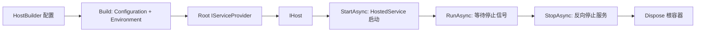

## 深入阅读导航

服务承载的主线要按阶段读：先收集 Builder 回调，再构建 Host 配置、环境、应用配置和根容器；运行期由 HostLifetime 协调外部环境，Internal Host 启停 HostedService，ApplicationLifetime 只发布信号，Run/Wait 扩展决定主程序在哪里持续等待。

| 阶段 | 核心问题 | 关键入口 |
| --- | --- | --- |
| 1. 服务契约 | HostedService 的启动与停止承诺是什么？ | `IHostedService` |
| 2. 后台执行 | 长时间任务如何与 Start/Stop 解耦？ | `BackgroundService` |
| 3. DI 注册 | AddHostedService 为什么避免重复实现类型？ | `ServiceCollectionHostedServiceExtensions` |
| 4. 环境上下文 | Host 与应用配置共享哪些基础状态？ | `HostBuilderContext` |
| 5. Builder 核心 | Build 的五个初始化阶段是什么？ | `HostBuilder.Build` |
| 6. 默认配置与容器 | ConfigureDefaults 和容器工厂怎样接入？ | `HostingHostBuilderExtensions` |
| 7. Host 入口 | 静态 Host API 如何提供默认 Builder？ | `Host.CreateDefaultBuilder` |
| 8. 应用信号 | Started、Stopping、Stopped 各在何时触发？ | `ApplicationLifetime` |
| 9. 进程生命周期 | Ctrl+C 如何转换为停止请求？ | `ConsoleLifetime` |
| 10. Host 编排 | HostedService 以什么顺序启动和停止？ | Internal `Host` |
| 11. 运行等待 | Start、Run、WaitForShutdown 的阻塞边界是什么？ | `HostingAbstractionsHostExtensions` |
| 12. 失败与取消 | 超时、后台异常和部分启动失败如何处理？ | `HostOptions` 相关分支 |

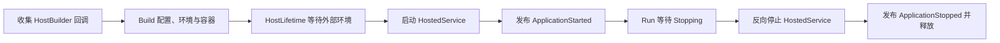

## 核心类型索引

| 类型 | 所在章节 | 说明 |
| --- | --- | --- |
| `IHostedService` | 1. 服务契约 | 启动与停止契约 |
| `BackgroundService` | 2. 后台执行 | 长时间任务基类 |
| `ServiceCollectionHostedServiceExtensions` | 3. DI 注册 | HostedService 注册扩展 |
| `Environments` | 4. 环境上下文 | 标准环境名常量 |
| `HostDefaults` | 4. 环境上下文 | Host 配置键常量 |
| `IHostEnvironment` | 4. 环境上下文 | 环境抽象 |
| `HostingEnvironment` | 4. 环境上下文 | 默认环境实现 |
| `HostBuilderContext` | 4. 环境上下文 | 构建阶段共享上下文 |
| `IHostBuilder` | 5. Builder 核心 | 分阶段配置契约 |
| `HostBuilder` | 5. Builder 核心 | 默认分阶段构建实现 |
| `HostingHostBuilderExtensions` | 6. 默认配置与容器 | 常用扩展与默认配置组合 |
| 静态 `Host` | 7. Host 入口 | 默认 Builder 创建入口 |
| `IHostApplicationLifetime` | 8. 应用信号 | 三枚应用 Token 与停止请求 |
| `ApplicationLifetime` | 8. 应用信号 | 应用信号实现 |
| `IHostLifetime` | 9. 进程生命周期 | 外部环境启动/停止协调契约 |
| `ConsoleLifetime` | 9. 进程生命周期 | 控制台信号适配器 |
| `IHost` | 10. Host 编排 | 根服务与启停契约 |
| Internal `Host` | 10. Host 编排 | HostedService 生命周期编排实现 |
| `HostingAbstractionsHostExtensions` | 11. 运行等待 | Start、Run、Wait、Stop 扩展 |
## 1. HostedService 契约：启动与停止的最小边界

### 本组解决什么问题

这一组源码回答“Host 管理的长时间运行服务需要遵守什么协议”。IHostedService 定义启停边界，BackgroundService 把持续任务和取消通知封装起来，AddHostedService 负责把实现加入 Host 可枚举的服务集合。

### 关键类型关系图

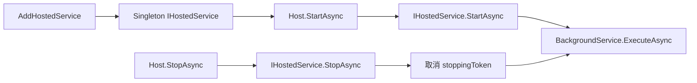

### 核心源码解读

### 两个方法对应两个不同完成条件

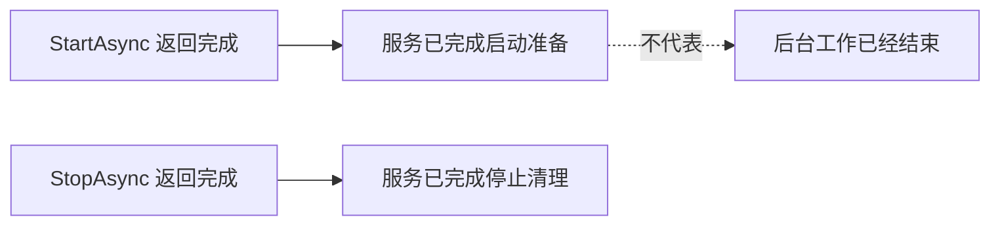

`IHostedService` 适合同时描述短启动任务和长期服务，但 Host 只根据返回 Task 判断该阶段是否完成。

### Host 控制调用顺序，服务控制内部语义

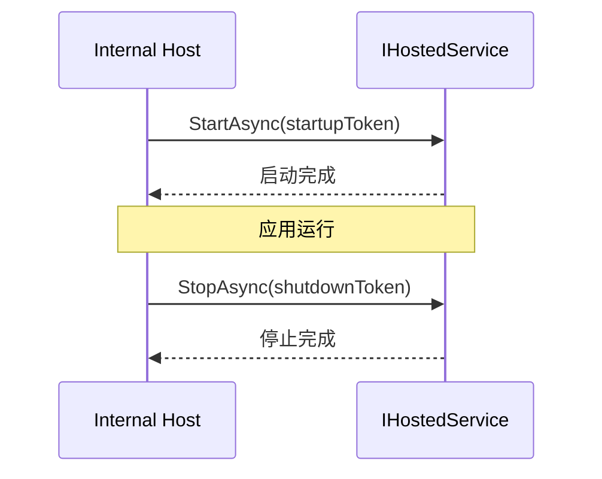

### cancellationToken 表示阶段预算

StartAsync 的 Token 可能来自调用方取消、ApplicationStopping 或 StartupTimeout；StopAsync 的 Token 可能来自调用方取消或 ShutdownTimeout。服务应把它视为“Host 不再愿意等待”，而不是假设它一定代表进程即刻终止。

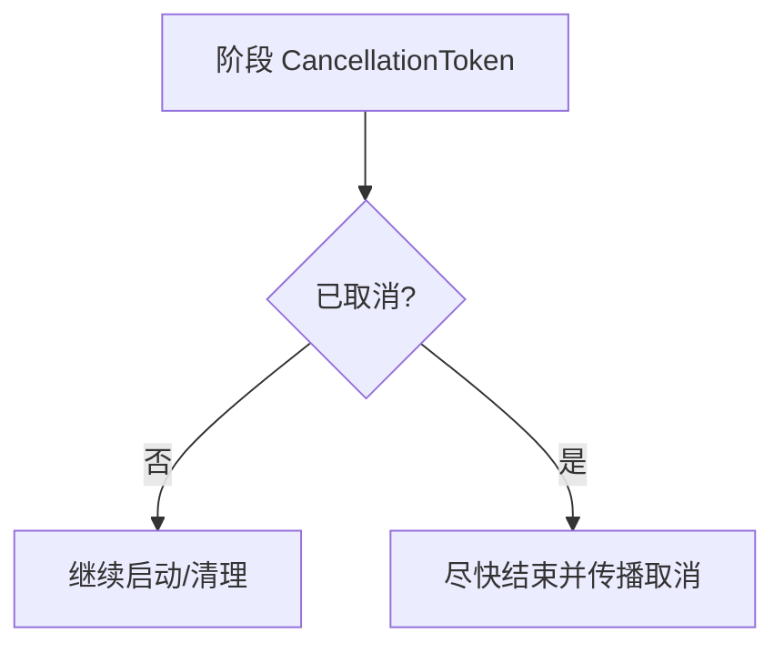

### StartAsync 不应承载无限循环

直接在 StartAsync 中等待无限循环会阻止后续 HostedService 启动，也阻止 ApplicationStarted 发布。长期工作应使用 BackgroundService 或自行启动独立 Task。

### IHostedService

**读这组源码时关注什么：** 宿主管理的长时间运行服务需要实现哪些生命周期方法。

#### 整体结构

**这段代码回答什么问题：** 宿主管理的长时间运行服务需要实现哪些生命周期方法。

```C#
// 寄宿服务的抽象表示
// 表示一个长时间运行的服务
public interface IHostedService
{
    // 启动服务
    Task StartAsync(CancellationToken cancellationToken);

    // 停止服务
    Task StopAsync(CancellationToken cancellationToken);
}
```

**源码解读：**
- 接口只定义 StartAsync 和 StopAsync。
- Host 负责按注册顺序调用启动，并在停止时按反向顺序调用。

**读完要记住：**
- HostedService 的启动完成不等于后台任务结束。
- 取消令牌用于限制启动和停止过程。

## 2. BackgroundService：长时间任务、取消与退出任务

BackgroundService 把“Host 启动阶段”和“后台执行生命周期”拆开：StartAsync 启动并保存 ExecuteAsync Task，StopAsync 请求取消并等待该 Task 完成。

### StartAsync 的两条返回路径

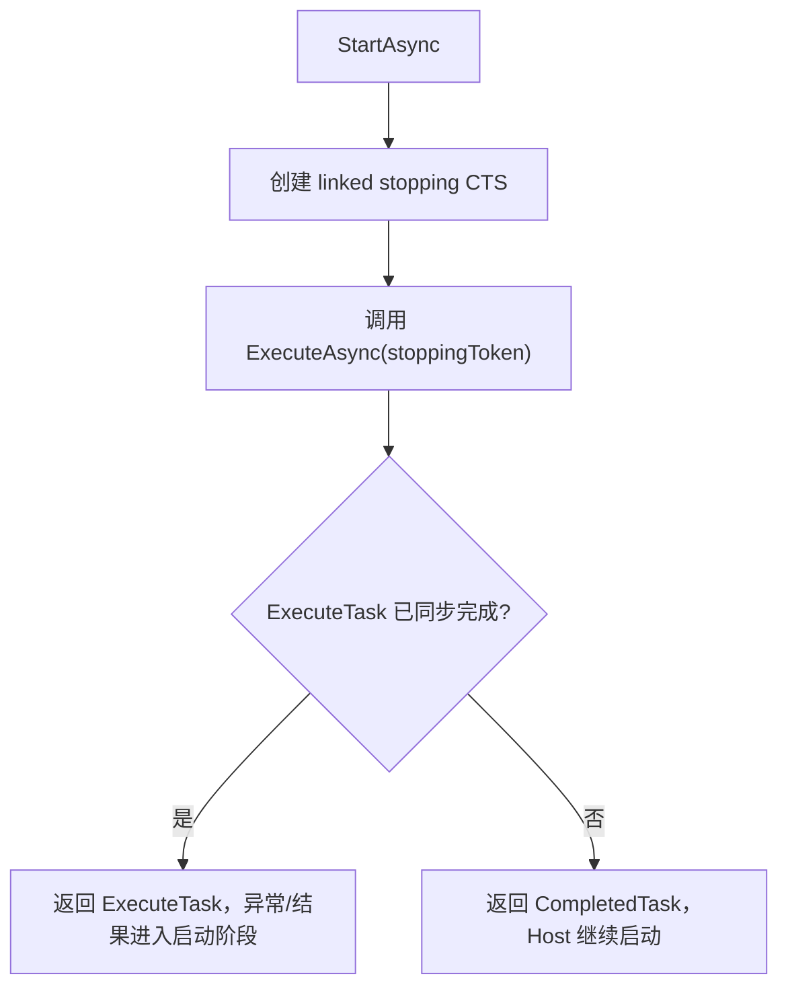

如果 ExecuteAsync 在第一次异步让出前就失败，StartAsync 会把失败暴露给 Host；真正进入长期运行后，Host 会单独观察 ExecuteTask。

### StopAsync 是“请求取消 + 等待”

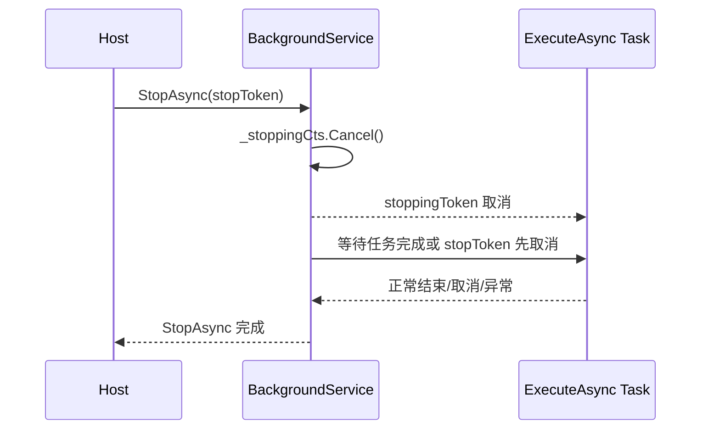

StopAsync 不会强行终止线程。ExecuteAsync 若不观察 stoppingToken，Host 只能等到外部停止预算耗尽。

### ExecuteTask 是后台服务的状态句柄

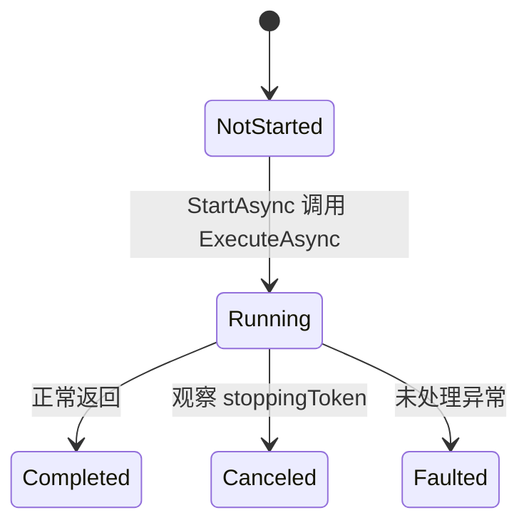

Internal Host 使用该 Task 监视后台服务是否意外退出或抛出异常。

### 推荐循环结构

```csharp
protected override async Task ExecuteAsync(CancellationToken stoppingToken)
{
    while (!stoppingToken.IsCancellationRequested)
    {
        await ProcessNextAsync(stoppingToken);
    }
}
```

内部等待同样要传递 stoppingToken；只检查 while 条件但在不可取消的长等待中阻塞，仍无法及时停止。

### Dispose 只负责释放取消源

正常优雅停止仍应走 Host.StopAsync。直接 Dispose BackgroundService 不是完整停止协议，也不会等待 ExecuteTask 完成。

### BackgroundService

**读这组源码时关注什么：** 后台循环如何适配 IHostedService 的启动停止协议。

#### 整体结构

**这段代码回答什么问题：** 后台循环如何适配 IHostedService 的启动停止协议。

```C#
// 实现 IHostedService 接口的抽象类
// 表示一个后台任务
public abstract class BackgroundService : IHostedService, IDisposable
{
    private Task? _executeTask;
    private CancellationTokenSource? _stoppingCts;

    // 返回一个长时间运行的任务
    public virtual Task? ExecuteTask => _executeTask;
 
    // 实现类重写该方法，返回一个长时间运行的任务
    protected abstract Task ExecuteAsync(CancellationToken stoppingToken);

    // 启动服务
    public virtual Task StartAsync(CancellationToken cancellationToken)
    {
        // 利用外部的 CancellationToken，创建一个被链接 CancellationTokenSource
        // 根据被链接 CancellationToken 数量有如下几个实现：
        // 1. Linked1CancellationTokenSource
        // 2. Linked2CancellationTokenSource
        // 3. LinkedNCancellationTokenSource
        _stoppingCts = CancellationTokenSource.CreateLinkedTokenSource(cancellationToken);

        // 创建一个长时间运行的任务，由实现类重写
        // 此处传入的 CancellationToken 是被链接的 CancellationTokenSource 创建的
        _executeTask = ExecuteAsync(_stoppingCts.Token);

        // 如果任务同步完成，直接返回这个已经完成的 Task
        if (_executeTask.IsCompleted)
        {
            return _executeTask;
        }

        // 否则返回一个 Task.CompletedTask 创建的 Task
        // 注意：此处的完成仅表示启动完成
        return Task.CompletedTask;
    }

    // 停止服务
    public virtual async Task StopAsync(CancellationToken cancellationToken)
    {
        // 没有任务，直接返回
        if (_executeTask == null)
        {
            return;
        }

        try
        {
            // 停止服务是通过被链接的 CancellationTokenSource 调用 Cancel 方法发出取消任务通知
            _stoppingCts!.Cancel();
        }
        finally
        {
            // 创建一个任务完成源
            var tcs = new TaskCompletionSource<object>();
            using CancellationTokenRegistration registration 
                = cancellationToken.Register(s => ((TaskCompletionSource<object>)s!).SetCanceled(), tcs);
            // 可以不等待任务取消，通过外部取消任务完成源提前结束
            await Task.WhenAny(_executeTask, tcs.Task).ConfigureAwait(false);
        }
    }

    // 释放操作
    // 本质是通知任务取消
    public virtual void Dispose()
    {
        _stoppingCts?.Cancel();
    }
}
```

**源码解读：**
- StartAsync 调用 ExecuteAsync 并保存长时间运行任务。
- StopAsync 发出取消信号，并等待任务结束或外部停止令牌先取消。

**读完要记住：**
- ExecuteAsync 必须观察 stoppingToken。
- StartAsync 通常快速返回，实际工作保存在 ExecuteTask。

## 3. HostedService DI 注册：实现类型、服务类型与重复控制

`AddHostedService<T>` 注册的是 `IHostedService` 服务描述，运行时 Host 通过 `IEnumerable<IHostedService>` 解析全部服务。

### 注册关系

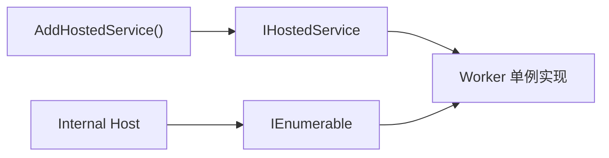

### TryAddEnumerable 防止同一实现重复加入

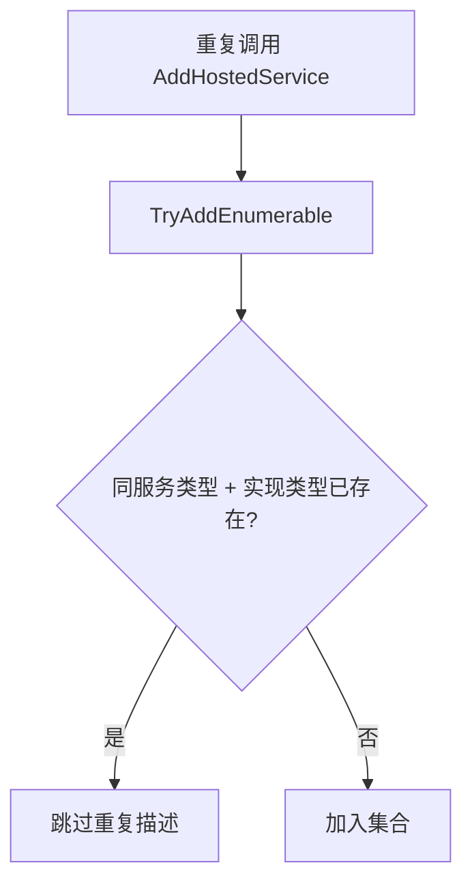

不同 HostedService 实现仍会全部注册并按服务集合顺序解析。

### 工厂重载决定实例创建方式

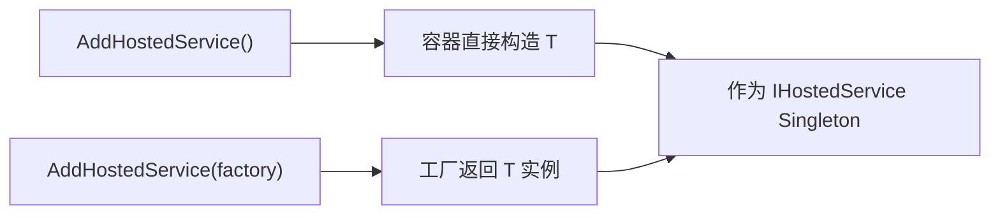

### 不会自动注册 Worker 自身服务类型

若其他组件还需要注入 `Worker`，应显式注册同一个实例关系，避免容器分别创建两个对象。

```csharp
services.AddSingleton<QueueWorker>();
services.AddSingleton<IHostedService>(sp => sp.GetRequiredService<QueueWorker>());
```

### ServiceCollectionHostedServiceExtensions

**读这组源码时关注什么：** AddHostedService 最终如何注册后台服务。

#### 整体结构

**这段代码回答什么问题：** AddHostedService 最终如何注册后台服务。

```C#
// 提供注册 IHostedService 服务的扩展方法
public static class ServiceCollectionHostedServiceExtensions
{
    public static IServiceCollection AddHostedService<THostedService>(this IServiceCollection services)
        where THostedService : class, IHostedService
    {
        services.TryAddEnumerable(ServiceDescriptor.Singleton<IHostedService, THostedService>());

        return services;
    }

    public static IServiceCollection AddHostedService<THostedService>(this IServiceCollection services, Func<IServiceProvider,THostedService> implementationFactory)
        where THostedService : class, IHostedService
    {
        services.TryAddEnumerable(ServiceDescriptor.Singleton<IHostedService>(implementationFactory));

        return services;
    }
}
```

**源码解读：**
- 扩展方法把实现注册为 Singleton IHostedService。
- TryAddEnumerable 避免同一实现类型重复加入集合。

**读完要记住：**
- Host 通过 IEnumerable<IHostedService> 统一解析所有服务。
- 需要直接解析实现类型时还应单独注册该类型。

### 最小例子

```csharp
public sealed class QueueWorker : BackgroundService
{
    protected override async Task ExecuteAsync(CancellationToken stoppingToken)
    {
        while (!stoppingToken.IsCancellationRequested)
        {
            await ProcessNextMessageAsync(stoppingToken);
        }
    }
}

services.AddHostedService<QueueWorker>();
```

### 回顾要点

- AddHostedService 把实现注册为 Singleton IHostedService。
- BackgroundService.StartAsync 通常只表示后台任务已成功启动。
- ExecuteAsync 必须配合 stoppingToken 才能优雅停止。

## 4. 环境与上下文：Host 构建的基础状态

### 本组解决什么问题

这一组源码回答“Host 在执行应用配置和服务注册前需要确定哪些基础状态”。宿主配置中的环境、应用名和内容根被投影为 IHostEnvironment，并与当前配置及共享属性一起放入 HostBuilderContext。

### 关键类型关系图

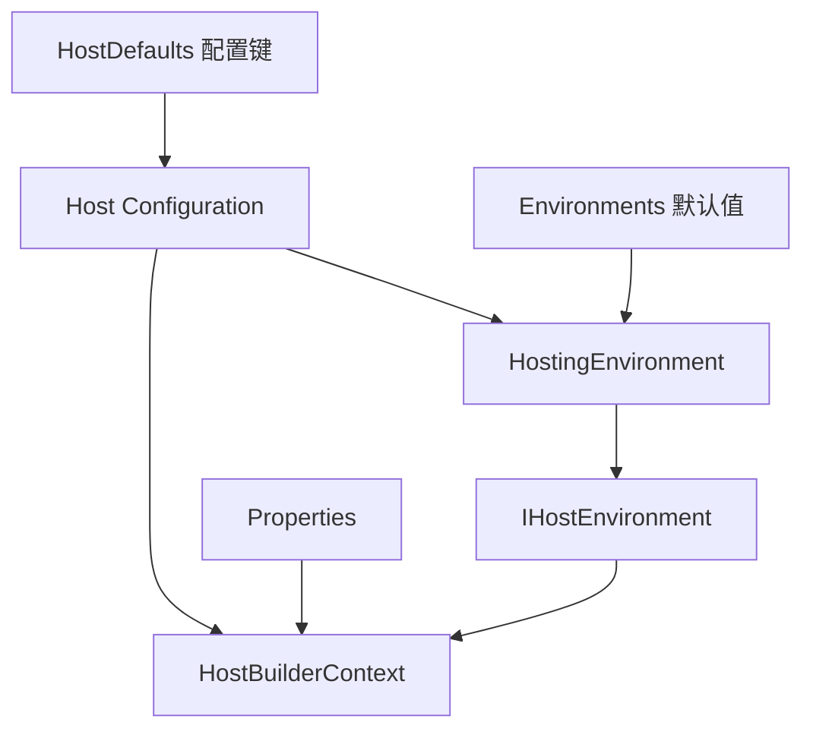

### 核心源码解读

### 环境对象由 Host 配置初始化

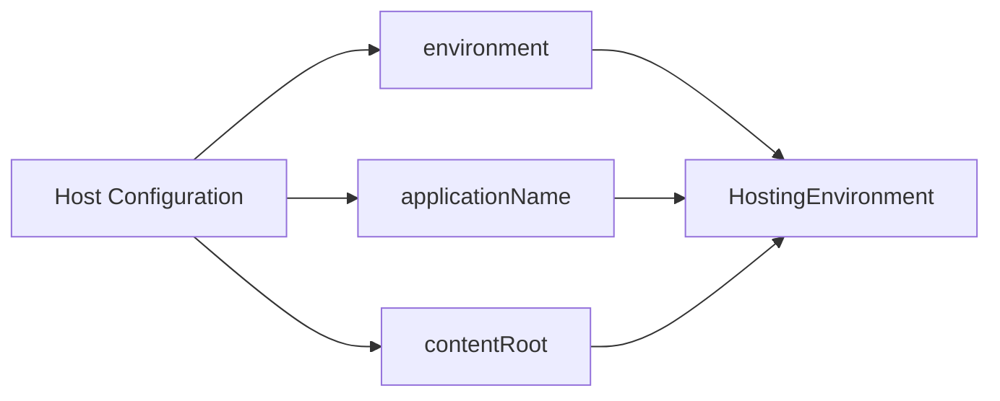

Host 配置决定构建基础设施本身；应用配置随后以已经确定的 Environment 和 ContentRoot 为上下文继续构建。

### Host Configuration 与 App Configuration 分工

| 配置层 | 主要决定 | 可否在后续任意改变 |
| --- | --- | --- |
| Host Configuration | 环境名、应用名、内容根、容器相关基础状态 | 构建早期固定 |
| App Configuration | 业务配置、Provider 配置、Options 数据 | 可叠加并支持重载 |

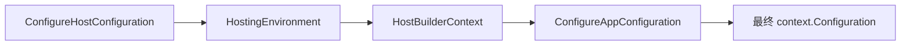

### HostBuilderContext 是回调之间的共享状态

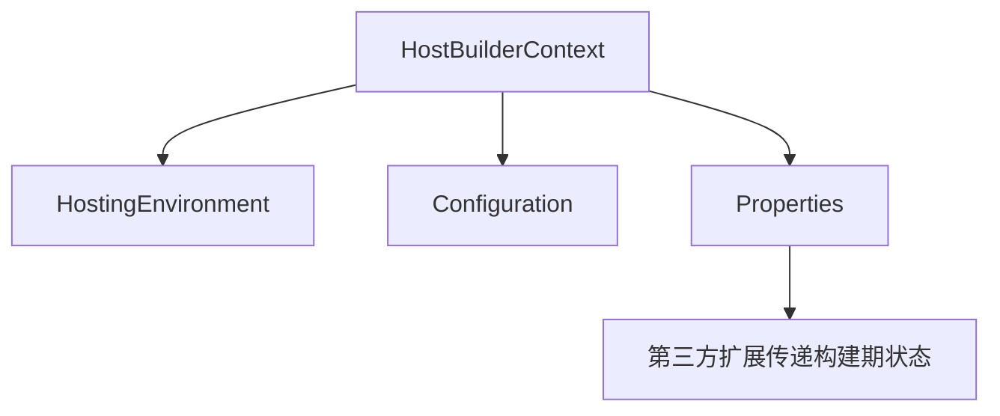

Properties 属于构建期扩展通信，不会自动进入最终 IConfiguration 或 DI 容器。

### EnvironmentName 影响默认配置文件选择

ConfigureDefaults 通常按 `appsettings.json`、`appsettings.{Environment}.json` 顺序叠加；环境名还影响 Development 下的 User Secrets 和默认容器验证策略。

### ContentRoot 与 BasePath

内容根用于设置文件配置等组件的基础路径。相对路径最终相对于 ContentRoot 对应的文件提供者，而不是任意调用点的当前目录。

### Environments

**读这组源码时关注什么：** 标准环境名称由哪里统一定义。

#### 整体结构

**这段代码回答什么问题：** 标准环境名称由哪里统一定义。

```C#
// 环境名称
public static class Environments
{
    // 开发
    public static readonly string Development = "Development";
    // 预发（测试）
    public static readonly string Staging = "Staging";
    // 生产
    public static readonly string Production = "Production";
}
```

**源码解读：**
- 静态字段提供 Development、Staging 和 Production 字符串。
- 环境判断扩展方法以这些约定值为基础。

**读完要记住：**
- 默认环境是 Production。
- 这些值是约定而不是封闭枚举。

### HostDefaults

**读这组源码时关注什么：** 宿主初始配置使用哪些保留键。

#### 整体结构

**这段代码回答什么问题：** 宿主初始配置使用哪些保留键。

```C#
// 默认配置键
public static class HostDefaults
{
    public static readonly string ApplicationKey = "applicationName";

    public static readonly string EnvironmentKey = "environment";

    public static readonly string ContentRootKey = "contentRoot";
}
```

**源码解读：**
- 定义 applicationName、environment 和 contentRoot。
- HostBuilder 在创建 HostingEnvironment 时读取这些键。

**读完要记住：**
- 宿主配置决定构建环境的基础属性。
- 应用配置是在此基础上继续构建的。

### IHostEnvironment

**读这组源码时关注什么：** 运行时环境需要向应用暴露哪些信息。

#### 整体结构

**这段代码回答什么问题：** 运行时环境需要向应用暴露哪些信息。

```C#
// 宿主环境的抽象表示
public interface IHostEnvironment
{
    // 环境名称
    string EnvironmentName { get; set; }

    // 应用名称
    string ApplicationName { get; set; }

    // 根目录路径
    string ContentRootPath { get; set; }

    // 指向根目录的 IFileProvider
    IFileProvider ContentRootFileProvider { get; set; }
}
```

**源码解读：**
- 接口包含环境名、应用名、内容根路径和文件提供者。
- 配置与文件加载可据此选择路径和环境文件。

**读完要记住：**
- 它描述 Host 运行上下文。
- ContentRootFileProvider 与 ContentRootPath 指向同一根目录。

### HostingEnvironment

**读这组源码时关注什么：** 默认环境对象如何承载 IHostEnvironment 数据。

#### 整体结构

**这段代码回答什么问题：** 默认环境对象如何承载 IHostEnvironment 数据。

```C#
// IHostEnvironment 的默认实现
// 实现的 IHostingEnvironment 接口已作废，换用 IHostEnvironment 接口替代
#pragma warning disable CS0618 // Type or member is obsolete
public class HostingEnvironment : IHostingEnvironment, IHostEnvironment
#pragma warning restore CS0618 // Type or member is obsolete
{
    public string EnvironmentName { get; set; } = string.Empty;

    public string ApplicationName { get; set; } = string.Empty;

    public string ContentRootPath { get; set; } = string.Empty;

    public IFileProvider ContentRootFileProvider { get; set; } = null!;
}
```

**源码解读：**
- 类型是可写属性的简单实现。
- 同时兼容已废弃的 IHostingEnvironment。

**读完要记住：**
- 实例在 HostBuilder 初始化环境阶段创建。
- 随后作为单例注册进根容器。

### HostBuilderContext

**读这组源码时关注什么：** 不同构建回调之间如何共享环境、配置和自定义状态。

#### 整体结构

**这段代码回答什么问题：** 不同构建回调之间如何共享环境、配置和自定义状态。

```C#
// 宿主建造者上下文
public class HostBuilderContext
{
    public HostBuilderContext(IDictionary<object, object> properties)
    {
        ThrowHelper.ThrowIfNull(properties);

        Properties = properties;
    }

    // 宿主环境
    public IHostEnvironment HostingEnvironment { get; set; } = null!;

    // 初始表示针对宿主的配置
    // 最终会结合针对应用的配置
    public IConfiguration Configuration { get; set; } = null!;

    // 在宿主构建过程中用于共享的属性字典
    public IDictionary<object, object> Properties { get; }
}
```

**源码解读：**
- Context 保存 HostingEnvironment、当前 Configuration 和 Properties。
- 应用配置构建完成后 Configuration 会从宿主配置替换为完整应用配置。

**读完要记住：**
- 同一 Context 传给配置、服务和容器回调。
- Properties 用于扩展间共享构建状态。

### 最小例子

```csharp
hostBuilder
    .UseEnvironment(Environments.Staging)
    .UseContentRoot(AppContext.BaseDirectory)
    .ConfigureServices((context, services) =>
    {
        bool isStaging = context.HostingEnvironment.EnvironmentName == Environments.Staging;
    });
```

### 回顾要点

- 宿主配置先于应用配置构建。
- IHostEnvironment 来自 applicationName、environment 和 contentRoot。
- HostBuilderContext.Configuration 最终会替换为完整应用配置。

## 5. HostBuilder 核心：从分阶段配置到根容器

### 本组解决什么问题

这一组源码回答“多个 Configure 回调如何按顺序落成 IHost”。HostBuilder 先建立宿主和应用配置，再注册基础服务与用户服务，最后借助 IServiceProviderFactory 创建根容器并解析 IHost。

### 关键类型关系图

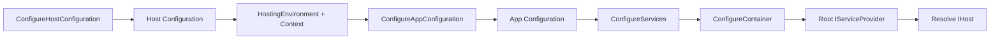

### 核心源码解读

### Builder 先收集回调，Build 时按阶段执行

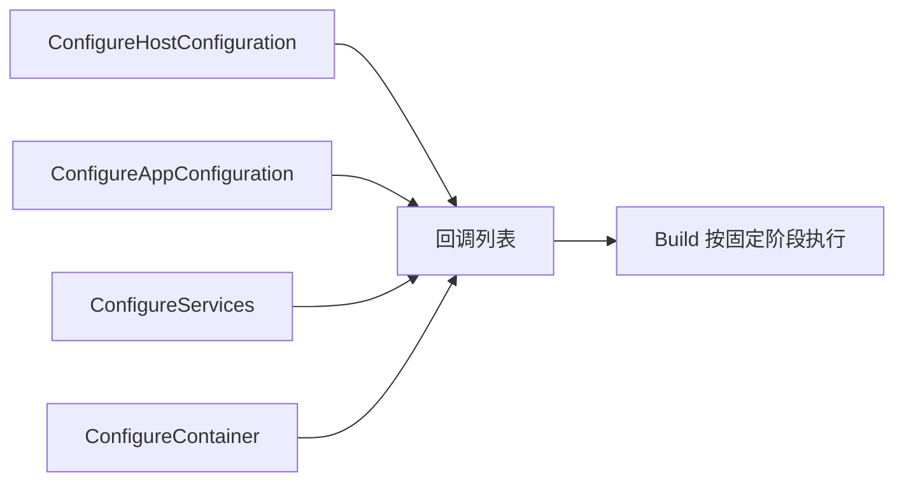

调用 ConfigureXxx 通常不立即构建配置或注册完成对象，只是记录委托。

### Build 的五个初始化阶段

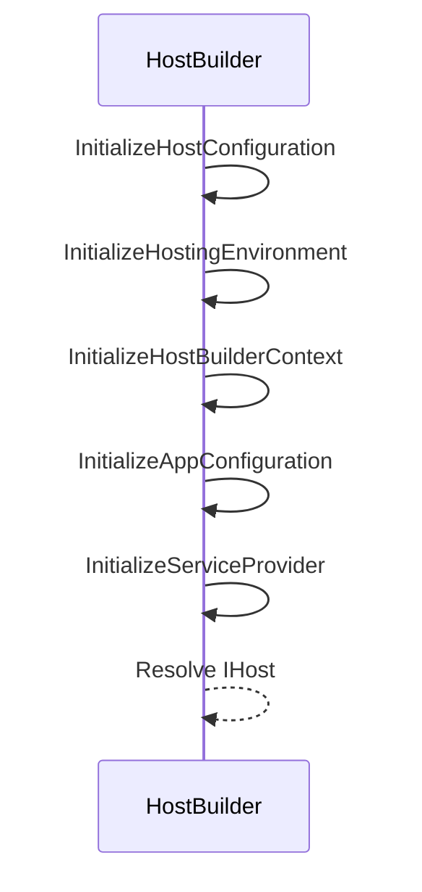

阶段顺序形成约束：应用配置回调可以读取 Environment；服务注册回调可以读取最终应用 Configuration；容器回调可以看到已经完成的 ServiceCollection。

### Build 只允许执行一次

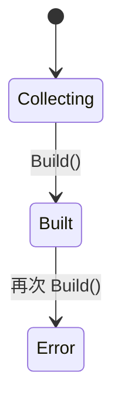

Builder 持有大量一次性构建状态和根容器所有权，重复 Build 会导致语义不明确，因此默认实现显式拒绝。

### Build 不启动 HostedService

```mermaid
flowchart LR
    A["builder.Build()"] --> B["配置 + 根 IServiceProvider + IHost"]
    B -.尚未.-> C["IHostedService.StartAsync"]
    D["host.StartAsync / RunAsync"] --> C
```

### 根容器中的承载核心服务

HostBuilder 会注册环境、配置、ApplicationLifetime、HostLifetime、HostOptions 和 Internal Host 等基础服务，再叠加用户 ConfigureServices 回调。

### IHostBuilder

**读这组源码时关注什么：** Host 构建过程开放了哪些扩展阶段。

#### 整体结构

**这段代码回答什么问题：** Host 构建过程开放了哪些扩展阶段。

```C#
// 宿主建造者的抽象表示
public interface IHostBuilder
{
    // 在宿主构建过程中用于共享的属性字典
    IDictionary<object, object> Properties { get; }

    // 添加针对宿主的配置
    IHostBuilder ConfigureHostConfiguration(Action<IConfigurationBuilder> configureDelegate);

    // 添加针对应用的配置
    IHostBuilder ConfigureAppConfiguration(Action<HostBuilderContext, IConfigurationBuilder> configureDelegate);

    // 添加针对服务注册的配置
    IHostBuilder ConfigureServices(Action<HostBuilderContext, IServiceCollection> configureDelegate);

    // 使用指定的 IServiceProvider 工厂
    IHostBuilder UseServiceProviderFactory<TContainerBuilder>(IServiceProviderFactory<TContainerBuilder> factory) where TContainerBuilder : notnull;

    // 使用指定的 IServiceProvider 工厂
    // 利用 HostBuilderContext 得到 IServiceProvider 工厂
    IHostBuilder UseServiceProviderFactory<TContainerBuilder>(Func<HostBuilderContext, IServiceProviderFactory<TContainerBuilder>> factory)  where TContainerBuilder : notnull;

    // 添加针对容器建造者的配置
    IHostBuilder ConfigureContainer<TContainerBuilder>(Action<HostBuilderContext, TContainerBuilder> configureDelegate);

    // 构建 IHost
    IHost Build();
}
```

**源码解读：**
- 接口允许配置宿主、应用、服务、容器和 ServiceProviderFactory。
- Build 将收集的回调按固定阶段执行。

**读完要记住：**
- Configure 方法只登记回调。
- 真正构建只发生一次。

### HostBuilder

**读这组源码时关注什么：** Build 如何从配置回调逐步得到 IHost。

#### 整体结构

**这段代码回答什么问题：** Build 如何从配置回调逐步得到 IHost。

```C#
// IHostBuilder 的默认实现
// 通过收集针对宿主、应用、服务注册、容器建造者的配置来构建 IHost
public partial class HostBuilder : IHostBuilder
{
    // 创建 DiagnosticListener 的名称
    private const string HostBuildingDiagnosticListenerName = "Microsoft.Extensions.Hosting";
    // 通过 DiagnosticListener 发送的诊断日志事件名称
    private const string HostBuildingEventName = "HostBuilding";
    private const string HostBuiltEventName = "HostBuilt";

    // 收集针对宿主配置的列表
    private readonly List<Action<IConfigurationBuilder>> _configureHostConfigActions = new List<Action<IConfigurationBuilder>>();
    // 收集针对应用配置的列表
    private readonly List<Action<HostBuilderContext, IConfigurationBuilder>> _configureAppConfigActions 
        = new List<Action<HostBuilderContext, IConfigurationBuilder>>();
    // 收集针对服务注册配置的列表
    private readonly List<Action<HostBuilderContext, IServiceCollection>> _configureServicesActions 
        = new List<Action<HostBuilderContext, IServiceCollection>>();
    // 收集针对容器建造者配置的列表
    private readonly List<IConfigureContainerAdapter> _configureContainerActions = new List<IConfigureContainerAdapter>();
    // 针对 IServiceProviderFactory<> 的适配器
    private IServiceFactoryAdapter _serviceProviderFactory;
    // 构建完成标志，用于检查是否重复构建
    private bool _hostBuilt;
    // 宿主配置
    private IConfiguration? _hostConfiguration;
    // 应用配置
    // 构建应用配置时宿主配置会作为 ChainedConfigurationSource 配置源添加
    private IConfiguration? _appConfiguration;
    // 宿主建造者上下文
    private HostBuilderContext? _hostBuilderContext;
    // 通过宿主配置创建的 HostingEnvironment
    private HostingEnvironment? _hostingEnvironment;
    // 代表根容器的 IServiceProvider
    private IServiceProvider? _appServices;
    // 指向 IHostEnvironment.ContentRootPath 目录（一般为应用程序根目录 AppContext.BaseDirectory）的 IFileProvider
    // 此处的 IFileProvider 和 IHostEnvironment.ContentRootFileProvider 是同一个实例
    private PhysicalFileProvider? _defaultProvider;

    public HostBuilder()
    {
        // 利用 DefaultServiceProviderFactory 创建 IServiceFactoryAdapter
        // 如果在构建过程中没有调用 UseServiceProviderFactory 方法添加外部的 IServiceProvider 工厂
        // 则使用 DefaultServiceProviderFactory 作为默认的 IServiceProvider 工厂
        _serviceProviderFactory = new ServiceFactoryAdapter<IServiceCollection>(new DefaultServiceProviderFactory());
    }

    // 在宿主构建过程中用于共享的属性字典
    public IDictionary<object, object> Properties { get; } = new Dictionary<object, object>();

    // 收集针对宿主的配置
    public IHostBuilder ConfigureHostConfiguration(Action<IConfigurationBuilder> configureDelegate)
    {
        ThrowHelper.ThrowIfNull(configureDelegate);

        _configureHostConfigActions.Add(configureDelegate);
        return this;
    }

    // 收集针对应用的配置
    public IHostBuilder ConfigureAppConfiguration(Action<HostBuilderContext, IConfigurationBuilder> configureDelegate)
    {
        ThrowHelper.ThrowIfNull(configureDelegate);

        _configureAppConfigActions.Add(configureDelegate);
        return this;
    }

    // 收集针对服务注册的配置
    public IHostBuilder ConfigureServices(Action<HostBuilderContext, IServiceCollection> configureDelegate)
    {
        ThrowHelper.ThrowIfNull(configureDelegate);

        _configureServicesActions.Add(configureDelegate);
        return this;
    }

    // 使用指定的 IServiceProvider 工厂
    public IHostBuilder UseServiceProviderFactory<TContainerBuilder>(IServiceProviderFactory<TContainerBuilder> factory) where TContainerBuilder : notnull
    {
        ThrowHelper.ThrowIfNull(factory);

        // 利用 IServiceProviderFactory<> 适配器封装 IServiceProviderFactory<TContainerBuilder>
        _serviceProviderFactory = new ServiceFactoryAdapter<TContainerBuilder>(factory);
        return this;
    }

    // 根据 Func<HostBuilderContext, IServiceProviderFactory<TContainerBuilder>> 得到 IServiceProvider 工厂
    public IHostBuilder UseServiceProviderFactory<TContainerBuilder>(Func<HostBuilderContext, IServiceProviderFactory<TContainerBuilder>> factory) where TContainerBuilder : notnull
    {
        ThrowHelper.ThrowIfNull(factory);

        // 利用 IServiceProviderFactory<> 适配器封装 Func<HostBuilderContext, IServiceProviderFactory<TContainerBuilder>>
        _serviceProviderFactory = new ServiceFactoryAdapter<TContainerBuilder>(() => _hostBuilderContext!, factory);
        return this;
    }

    // 添加针对容器建造者的配置
    public IHostBuilder ConfigureContainer<TContainerBuilder>(Action<HostBuilderContext, TContainerBuilder> configureDelegate)
    {
        ThrowHelper.ThrowIfNull(configureDelegate);

        // 利用 IServiceProviderFactory<> 适配器封装针对 TContainerBuilder 的配置
        _configureContainerActions.Add(new ConfigureContainerAdapter<TContainerBuilder>(configureDelegate));
        return this;
    }

    // 构建 IHost
    public IHost Build()
    {
        // 不支持重复构建，否则抛出异常
        if (_hostBuilt)
        {
            throw new InvalidOperationException(SR.BuildCalled);
        }
        _hostBuilt = true;
 
        // 利用诊断日志创建名为 "Microsoft.Extensions.Hosting" 的 DiagnosticListener
        // 用于记录名为 "HostBuilding" 的诊断日志
        using DiagnosticListener diagnosticListener = LogHostBuilding(this);

        // 创建宿主配置
        InitializeHostConfiguration();
        // 利用宿主配置创建以下内容：
        // 1. 表示环境的 IHostEnvironment
        // 2. 指向 IHostEnvironment.ContentRootPath 的 IFileProvider
        InitializeHostingEnvironment();
        // 创建 HostBuilderContext
        InitializeHostBuilderContext();
        // 利用 HostBuilderContext 创建应用配置
        InitializeAppConfiguration();
        // 创建表示根容器的 IServiceProvider
        InitializeServiceProvider();
 
        // 创建 IHost
        return ResolveHost(_appServices, diagnosticListener);
    }

    // 创建宿主配置
    private void InitializeHostConfiguration()
    {
        // 默认添加一个空的内存配置源
        IConfigurationBuilder configBuilder = new ConfigurationBuilder().AddInMemoryCollection();

        // 遍历并执行收集的宿主配置
        foreach (Action<IConfigurationBuilder> buildAction in _configureHostConfigActions)
        {
            buildAction(configBuilder);
        }

        // 构建宿主配置
        _hostConfiguration = configBuilder.Build();
    }

    // 利用宿主配置创建 IHostEnvironment 与表示应用程序根目录的 IFileProvider
    private void InitializeHostingEnvironment()
    {
        (_hostingEnvironment, _defaultProvider) = CreateHostingEnvironment(_hostConfiguration!);
    }

    internal static (HostingEnvironment, PhysicalFileProvider) CreateHostingEnvironment(IConfiguration hostConfiguration)
    {
        var hostingEnvironment = new HostingEnvironment()
        {
            // HostDefaults.EnvironmentKey 表示的配置节不存，则环境默认为 Production 表示的生产环境
            EnvironmentName = hostConfiguration[HostDefaults.EnvironmentKey] ?? Environments.Production,
            // 存在以下三种情况：
            // 1. HostDefaults.ContentRootKey 表示的配置节不存在，则使用 AppContext.BaseDirectory 表示的应用程序根目录的绝对路径
            // 2. HostDefaults.ContentRootKey 表示的配置节的值为绝对路径，则使用 HostDefaults.ContentRootKey 配置节的值表示的绝对路径
            // 3. HostDefaults.ContentRootKey 表示的配置节的值为相对路径，则使用 AppContext.BaseDirectory 表示的应用程序根目录的绝对路径与 HostDefaults.ContentRootKey 配置节的值表示的相对路径拼接
            ContentRootPath = ResolveContentRootPath(hostConfiguration[HostDefaults.ContentRootKey], AppContext.BaseDirectory),
        };
 
        // 如果 HostDefaults.ApplicationKey 表示的配置节存在，则使用 HostDefaults.ApplicationKey 表示的配置节的值作为应用名称
        // 否则使用入口程序集的名称作为应用程序名称
        string? applicationName = hostConfiguration[HostDefaults.ApplicationKey];
        if (string.IsNullOrEmpty(applicationName))
        {
            applicationName = Assembly.GetEntryAssembly()?.GetName().Name;
        }
 
        if (applicationName is not null)
        {
            hostingEnvironment.ApplicationName = applicationName;
        }

        // 利用 IHostEnvironment.ContentRootPath 创建 IFileProvider
        var physicalFileProvider = new PhysicalFileProvider(hostingEnvironment.ContentRootPath);
        hostingEnvironment.ContentRootFileProvider = physicalFileProvider;
 
        return (hostingEnvironment, physicalFileProvider);
    }

    // 利用 IHostEnvironment 与宿主配置创建 HostBuilderContext
    private void InitializeHostBuilderContext()
    {
        _hostBuilderContext = new HostBuilderContext(Properties)
        {
            HostingEnvironment = _hostingEnvironment!,
            Configuration = _hostConfiguration!
        };
    }

    // 创建应用配置
    private void InitializeAppConfiguration()
    {
        // 利用 IHostEnvironment.ContentRootPath 创建共享的 IFileProvider 
        // 并且将宿主配置作为链接配置源添加
        IConfigurationBuilder configBuilder = new ConfigurationBuilder()
            .SetBasePath(_hostingEnvironment!.ContentRootPath)
            .AddConfiguration(_hostConfiguration!, shouldDisposeConfiguration: true);

        // 利用 HostBuilderContext 遍历执行收集的应用配置
        foreach (Action<HostBuilderContext, IConfigurationBuilder> buildAction in _configureAppConfigActions)
        {
            buildAction(_hostBuilderContext!, configBuilder);
        }
        _appConfiguration = configBuilder.Build();
        // 将 HostBuilderContext.Configuration 更换为应用配置
        _hostBuilderContext!.Configuration = _appConfiguration;
    }

    // 创建表示根容器的 IServiceProvider
    private void InitializeServiceProvider()
    {
        var services = new ServiceCollection();

        // 注册基础服务
        PopulateServiceCollection(
            services,
            _hostBuilderContext!,
            _hostingEnvironment!,
            _defaultProvider!,
            _appConfiguration!,
            () => _appServices!);

        // 遍历并执行收集的服务注册配置
        foreach (Action<HostBuilderContext, IServiceCollection> configureServicesAction in _configureServicesActions)
        {
            configureServicesAction(_hostBuilderContext!, services);
        }
 
        // 利用 IServiceProviderFactory<> 适配器创建容器建造者
        object containerBuilder = _serviceProviderFactory.CreateBuilder(services);
 
        // 遍历并执行收集的容器建造者配置
        foreach (IConfigureContainerAdapter containerAction in _configureContainerActions)
        {
            containerAction.ConfigureContainer(_hostBuilderContext!, containerBuilder);
        }

        // 利用容器建造者创建表示根容器的 IServiceProvider
        _appServices = _serviceProviderFactory.CreateServiceProvider(containerBuilder);
    }

    // 注册基础服务
    internal static void PopulateServiceCollection(
        IServiceCollection services,
        HostBuilderContext hostBuilderContext,
        HostingEnvironment hostingEnvironment,
        PhysicalFileProvider defaultFileProvider,
        IConfiguration appConfiguration,
        Func<IServiceProvider> serviceProviderGetter)
    {
#pragma warning disable CS0618 // IHostingEnvironment 已经作废，用 IHostEnvironment 替代
        services.AddSingleton<IHostingEnvironment>(hostingEnvironment);
#pragma warning restore CS0618
        // 注册 IHostEnvironment，使用 HostingEnvironment 实例
        services.AddSingleton<IHostEnvironment>(hostingEnvironment);
        // 注册 HostBuilderContext，使用 HostBuilderContext 实例
        services.AddSingleton(hostBuilderContext);
        // 注册 IConfiguration，使用 Func<IServiceProvider, IConfiguration> 工厂
        services.AddSingleton(_ => appConfiguration);
#pragma warning disable CS0618 // IApplicationLifetime 已经作废，用 IHostApplicationLifetime 替代
        services.AddSingleton(s => (IApplicationLifetime)s.GetRequiredService<IHostApplicationLifetime>());
#pragma warning restore CS0618 
        // 注册 IHostApplicationLifetime，使用 ApplicationLifetime 类型
        services.AddSingleton<IHostApplicationLifetime, ApplicationLifetime>();

        // 注册宿主生命周期服务
        AddLifetime(services);
 
        // 注册 IHost，使用 Func<IServiceProvider, Internal.Host> 工厂
        services.AddSingleton<IHost>(_ =>
        {
            // 利用闭包方式从 _appServices 中获取 IServiceProvider
            IServiceProvider appServices = serviceProviderGetter();
            return new Internal.Host(appServices,
                hostingEnvironment,
                defaultFileProvider,
                appServices.GetRequiredService<IHostApplicationLifetime>(),
                appServices.GetRequiredService<ILogger<Internal.Host>>(),
                appServices.GetRequiredService<IHostLifetime>(),
                appServices.GetRequiredService<IOptions<HostOptions>>());
        });
        // 注册选项的基础服务
        services
            .AddOptions()
            .Configure<HostOptions>(
                options => options.Initialize(hostBuilderContext.Configuration));
        // 注册日志的基础服务
        services.AddLogging();
        services.AddMetrics();
    }

    // 注册宿主生命周期服务
    private static void AddLifetime(IServiceCollection services)
    {
        // 非移动端情况下注册 IHostLifetime，使用 ConsoleLifetime 类型
        if (!OperatingSystem.IsAndroid() && !OperatingSystem.IsBrowser() && !OperatingSystem.IsIOS() && !OperatingSystem.IsTvOS())
        {
            services.AddSingleton<IHostLifetime, ConsoleLifetime>();
        }
        else
        {
            services.AddSingleton<IHostLifetime, NullLifetime>();
        }
    }

    // 创建 IHost
    internal static IHost ResolveHost(IServiceProvider serviceProvider, DiagnosticListener diagnosticListener)
    {
        if (serviceProvider is null)
        {
            throw new InvalidOperationException(SR.NullIServiceProvider);
        }

        // 利用根容器显式获取一次 IConfiguration，确保根容器存在
        _ = serviceProvider.GetService<IConfiguration>();
 
        // 利用根容器显式获取 IHost
        var host = serviceProvider.GetRequiredService<IHost>();

        // 利用诊断日志创建名为 "Microsoft.Extensions.Hosting" 的 DiagnosticListener
        // 用于记录名为 "HostBuilt" 的事件日志
        if (diagnosticListener.IsEnabled() && diagnosticListener.IsEnabled(HostBuiltEventName))
        {
            Write(diagnosticListener, HostBuiltEventName, host);
        }
 
        return host;
    }
}
```

**源码解读：**
- 依次初始化宿主配置、环境、Context、应用配置和根容器。
- 基础 Hosting、Options、Logging、Lifetime 与 IHost 服务在容器阶段注册。

**读完要记住：**
- 宿主配置会作为 ChainedConfigurationSource 进入应用配置。
- Build 完成的是对象图，不会启动 HostedService。

## 6. 默认配置与容器：ConfigureDefaults、扩展 API 与 ServiceProviderFactory

HostBuilder 的核心方法保持抽象，常用扩展负责把环境变量、JSON、命令行、日志和默认 DI 验证组合成约定。

### ConfigureDefaults 的组合顺序

```mermaid
flowchart TB
    A["ConfigureDefaults(args)"] --> B["默认 Host Configuration"]
    B --> C["默认 App Configuration"]
    C --> D["默认 Services / Logging"]
    D --> E["默认 ServiceProviderFactory 选项"]
```

后续用户回调仍可追加配置和服务，且配置 Provider 的后注册项通常覆盖先注册项。

### 默认 Host 与 App 配置来源不同

```mermaid
flowchart LR
    A["DOTNET_ 前缀环境变量 + 命令行"] --> B["Host Configuration"]
    C["appsettings*.json + UserSecrets + 环境变量 + 命令行"] --> D["App Configuration"]
```

### ServiceProviderFactory 把 ServiceCollection 转换为容器

```mermaid
sequenceDiagram
    participant H as HostBuilder
    participant F as IServiceProviderFactory<TBuilder>
    participant C as ConfigureContainer 回调
    H->>F: CreateBuilder(IServiceCollection)
    F-->>H: TContainerBuilder
    H->>C: ConfigureContainer(context, builder)
    H->>F: CreateServiceProvider(builder)
    F-->>H: 根 IServiceProvider
```

这条抽象让第三方容器接入，同时保持 HostBuilder 的服务注册阶段不依赖具体容器 API。

### ConfigureServices 与 ConfigureContainer 的边界

| 回调 | 面向对象 | 适合用途 |
| --- | --- | --- |
| ConfigureServices | `IServiceCollection` | 框架无关服务描述 |
| ConfigureContainer | 第三方 ContainerBuilder | 容器专属注册与策略 |

### Development 下的默认 DI 验证

默认扩展会根据环境创建 `ServiceProviderOptions`，通常在 Development 启用 Scope 和 Build 验证，尽早发现 Singleton 捕获 Scoped 等问题。

### 扩展 API 只是阶段适配器

`UseEnvironment` 写入 Host Configuration；无 Context 的 ConfigureServices/ConfigureAppConfiguration 重载只是包装到完整签名；ConfigureLogging 最终仍向 ServiceCollection 注册日志服务。

### HostingHostBuilderExtensions

**读这组源码时关注什么：** 常用 UseEnvironment、ConfigureServices 和 ConfigureDefaults 如何映射到底层阶段。

#### 整体结构

**这段代码回答什么问题：** 常用 UseEnvironment、ConfigureServices 和 ConfigureDefaults 如何映射到底层阶段。

```C#
// 提供额外添加宿主构建配置的扩展方法
public static class HostingHostBuilderExtensions
{
    // 通过指定的环境名称，添加针对宿主的配置
    public static IHostBuilder UseEnvironment(this IHostBuilder hostBuilder, string environment)
    {
        return hostBuilder.ConfigureHostConfiguration(configBuilder =>
        {
            ThrowHelper.ThrowIfNull(environment);

            configBuilder.AddInMemoryCollection(new[]
            {
                new KeyValuePair<string, string?>(HostDefaults.EnvironmentKey, environment)
            });
        });
    }

    // 通过指定的工作目录路径，添加针对宿主的配置
    public static IHostBuilder UseContentRoot(this IHostBuilder hostBuilder, string contentRoot)
    {
        return hostBuilder.ConfigureHostConfiguration(configBuilder =>
        {
            ThrowHelper.ThrowIfNull(contentRoot);

            configBuilder.AddInMemoryCollection(new[]
            {
                new KeyValuePair<string, string?>(HostDefaults.ContentRootKey, contentRoot)
            });
        });
    }

    // 使用 ServiceProviderOptions 配置创建 DefaultServiceProviderFactory
    public static IHostBuilder UseDefaultServiceProvider(this IHostBuilder hostBuilder, Action<ServiceProviderOptions> configure)
        => hostBuilder.UseDefaultServiceProvider((context, options) => configure(options));

    // 使用 ServiceProviderOptions 配置创建 DefaultServiceProviderFactory
    public static IHostBuilder UseDefaultServiceProvider(this IHostBuilder hostBuilder, Action<HostBuilderContext, ServiceProviderOptions> configure)
    {
        return hostBuilder.UseServiceProviderFactory(context =>
        {
            var options = new ServiceProviderOptions();
            configure(context, options);
            return new DefaultServiceProviderFactory(options);
        });
    }
    
    // 添加针对容器建造者的配置
    public static IHostBuilder ConfigureContainer<TContainerBuilder>(this IHostBuilder hostBuilder, Action<TContainerBuilder> configureDelegate)
    {
        return hostBuilder.ConfigureContainer<TContainerBuilder>((context, builder) => configureDelegate(builder));
    }

    // 添加针对服务注册的配置
    public static IHostBuilder ConfigureServices(this IHostBuilder hostBuilder, Action<IServiceCollection> configureDelegate)
    {
        return hostBuilder.ConfigureServices((context, collection) => configureDelegate(collection));
    }

    // 添加针对日志的配置
    public static IHostBuilder ConfigureLogging(this IHostBuilder hostBuilder, Action<ILoggingBuilder> configureLogging)
    {
        return hostBuilder.ConfigureServices((context, collection) => collection.AddLogging(builder => configureLogging(builder)));
    }
    
    // 添加针对日志的配置
    public static IHostBuilder ConfigureLogging(this IHostBuilder hostBuilder, Action<HostBuilderContext, ILoggingBuilder> configureLogging)
    {
        return hostBuilder.ConfigureServices((context, collection) => collection.AddLogging(builder => configureLogging(context, builder)));
    }

    // 添加针对应用的配置
    public static IHostBuilder ConfigureAppConfiguration(this IHostBuilder hostBuilder, Action<IConfigurationBuilder> configureDelegate)
    {
        return hostBuilder.ConfigureAppConfiguration((context, builder) => configureDelegate(builder));
    }

    // 注册 HostOptions 选项配置
    public static IHostBuilder ConfigureHostOptions(this IHostBuilder hostBuilder, Action<HostBuilderContext, HostOptions> configureOptions)
    {
        return hostBuilder.ConfigureServices(
            (context, collection) => collection.Configure<HostOptions>(options => configureOptions(context, options)));
    }

    // 注册 HostOptions 选项配置
    public static IHostBuilder ConfigureHostOptions(this IHostBuilder hostBuilder, Action<HostOptions> configureOptions)
    {
        return hostBuilder.ConfigureServices(collection => collection.Configure(configureOptions));
    }

    // 添加默认配置
    public static IHostBuilder ConfigureDefaults(this IHostBuilder builder, string[]? args)
    {
        return builder
            .ConfigureHostConfiguration(config => ApplyDefaultHostConfiguration(config, args))
            .ConfigureAppConfiguration((hostingContext, config) => ApplyDefaultAppConfiguration(hostingContext, config, args))
            .ConfigureServices(AddDefaultServices)
            .UseServiceProviderFactory(context => new DefaultServiceProviderFactory(CreateDefaultServiceProviderOptions(context)));
    }

    // 应用默认宿主配置
    private static void ApplyDefaultHostConfiguration(IConfigurationBuilder hostConfigBuilder, string[]? args)
    {
        // 添加内存配置源
        // 设置默认的工作目录路径（一般为应用程序根目录）
        SetDefaultContentRoot(hostConfigBuilder);

        // 添加前缀为 DOTNET_ 的环境变量配置源
        hostConfigBuilder.AddEnvironmentVariables(prefix: "DOTNET_");
        // 添加命令行参数配置源
        AddCommandLineConfig(hostConfigBuilder, args);
    }

    internal static void SetDefaultContentRoot(IConfigurationBuilder hostConfigBuilder)
    {
        string cwd = Environment.CurrentDirectory;
        if (
#if NETFRAMEWORK
            Environment.OSVersion.Platform != PlatformID.Win32NT ||
#else
            !RuntimeInformation.IsOSPlatform(OSPlatform.Windows) ||
#endif
            !string.Equals(cwd, Environment.SystemDirectory, StringComparison.OrdinalIgnoreCase))
        {
            hostConfigBuilder.AddInMemoryCollection(new[]
            {
                new KeyValuePair<string, string?>(HostDefaults.ContentRootKey, cwd),
            });
        }
    }

    internal static void AddCommandLineConfig(IConfigurationBuilder configBuilder, string[]? args)
    {
        if (args is { Length: > 0 })
        {
            configBuilder.AddCommandLine(args);
        }
    }

    // 应用默认应用配置
    internal static void ApplyDefaultAppConfiguration(HostBuilderContext hostingContext, IConfigurationBuilder appConfigBuilder, string[]? args)
    {
        IHostEnvironment env = hostingContext.HostingEnvironment;
        // 利用宿主的配置，确定是否需要打开针对文件变动的监控
        bool reloadOnChange = GetReloadConfigOnChangeValue(hostingContext);

        // 以可选形式添加名称为 appsettings.json 和 appsettings.{环境名称}.json 的文件配置源
        // 是否监控文件变动由 reloadOnChange 的值决定
        appConfigBuilder.AddJsonFile("appsettings.json", optional: true, reloadOnChange: reloadOnChange)
                .AddJsonFile($"appsettings.{env.EnvironmentName}.json", optional: true, reloadOnChange: reloadOnChange);

        // 如果是开发环境并且 ApplicationName 不为空，则添加用户机密配置源
        if (env.IsDevelopment() && env.ApplicationName is { Length: > 0 })
        {
            try
            {
                // 加载应用程序名称所对应的程序集
                var appAssembly = Assembly.Load(new AssemblyName(env.ApplicationName));
                // 如果程序集使用了 UserSecretsIdAttribute 特性
                // 则从 UserSecretsIdAttribute.UserSecretsId 中读取用户机密 ID
                // 根据不同的操作系统加载用户机密 ID 目录下的 secrets.json 文件作为配置源
                // 1. Windows 系统加载 %APPDATA%\Microsoft\UserSecrets\<用户机密 ID>\secrets.json
                // 2. Mac/Linux 系统加载 ~/.microsoft/usersecrets/<用户机密 ID>/secrets.json
                appConfigBuilder.AddUserSecrets(appAssembly, optional: true, reloadOnChange: reloadOnChange);
            }
            catch (FileNotFoundException)
            {
                // 没有找到程序集，跳过
            }
        }

        // 添加环境变量配置源（所有环境变量）
        appConfigBuilder.AddEnvironmentVariables();

        // 添加命令行配置源
        AddCommandLineConfig(appConfigBuilder, args);

        // 从宿主配置的 "hostBuilder:reloadConfigOnChange" 配置节确定是否需要打开针对文件配置源变动的监控
        static bool GetReloadConfigOnChangeValue(HostBuilderContext hostingContext) => hostingContext.Configuration.GetValue("hostBuilder:reloadConfigOnChange", defaultValue: true);
    }

    // 注册默认服务
    // 针对日志的服务注册
    internal static void AddDefaultServices(HostBuilderContext hostingContext, IServiceCollection services)
    {
        services.AddLogging(logging =>
        {
            bool isWindows =
#if NETCOREAPP
                OperatingSystem.IsWindows();
#elif NETFRAMEWORK
                Environment.OSVersion.Platform == PlatformID.Win32NT;
#else
                RuntimeInformation.IsOSPlatform(OSPlatform.Windows);
#endif
 
            if (isWindows)
            {
                // 在 Windows 系统上添加针对 EventLogLoggerProvider 的日志过滤
                // 默认 EventLogLoggerProvider 的日志过滤级别不低于 Warning
                logging.AddFilter<EventLogLoggerProvider>(level => level >= LogLevel.Warning);
            }

            // 得到 Logging 配置节作为日志配置
            logging.AddConfiguration(hostingContext.Configuration.GetSection("Logging"));
#if NETCOREAPP
            if (!OperatingSystem.IsBrowser())
#endif
            {
                // 注册 ConsoleLoggerProvider
                logging.AddConsole();
            }
            // 注册 DebugLoggerProvider
            logging.AddDebug();
            // 注册 EventSourceLoggerProvider
            logging.AddEventSourceLogger();
 
            if (isWindows)
            {
                // 在 Windows 系统上注册 EventLogLoggerProvider
                logging.AddEventLog();
            }
 
            // 注册 ActivityTrackingOptions 选项配置
            // 使用 Activity 作为日志范围的活动跟踪
            logging.Configure(options =>
            {
                options.ActivityTrackingOptions =
                    ActivityTrackingOptions.SpanId |
                    ActivityTrackingOptions.TraceId |
                    ActivityTrackingOptions.ParentId;
            });
        });
 
        services.AddMetrics(metrics =>
        {
            metrics.AddConfiguration(hostingContext.Configuration.GetSection("Metrics"));
        });
    }

    // 配置默认 ServiceProviderOptions
    // 只在开发环境启用服务范围验证，并在构建时验证
    internal static ServiceProviderOptions CreateDefaultServiceProviderOptions(HostBuilderContext context)
    {
        bool isDevelopment = context.HostingEnvironment.IsDevelopment();
        return new ServiceProviderOptions
        {
            ValidateScopes = isDevelopment,
            ValidateOnBuild = isDevelopment,
        };
    }
}
```

**源码解读：**
- 扩展方法把参数转换为 IHostBuilder 的配置回调。
- ConfigureDefaults 组合内容根、环境变量、JSON、命令行、日志和默认容器设置。

**读完要记住：**
- 这些 API 仍然只是收集构建配置。
- 后注册回调可以基于 HostBuilderContext 调整行为。

## 7. 静态 Host 入口：默认 Builder 与空白 Builder

静态 Host 类型提供约定入口，不是运行时 Internal Host。它负责创建 Builder，并决定是否立即应用默认配置集合。

### 两种入口的意图

```mermaid
flowchart TD
    A["Host.CreateDefaultBuilder(args)"] --> B["new HostBuilder + ConfigureDefaults"]
    C["new HostBuilder()"] --> D["从空白回调集合开始"]
    B --> E["适合常规应用"]
    D --> F["适合测试、库或完全自定义宿主"]
```

### CreateDefaultBuilder 仍然返回可继续配置的 Builder

```mermaid
flowchart LR
    A["CreateDefaultBuilder(args)"] --> B["IHostBuilder"]
    B --> C["ConfigureAppConfiguration"]
    C --> D["ConfigureServices"]
    D --> E["Build"]
```

默认值不是封闭模板，用户配置在其后继续叠加。

### 参数只在默认配置阶段解释

命令行参数会同时参与 Host 和 App Configuration 的默认来源；若从空白 HostBuilder 开始，需要自行决定是否添加命令行配置。

### 入口选择不会改变运行时 IHost 契约

无论 Builder 怎样创建，Build 最终仍解析同一个 IHost 抽象，启动与停止编排由 Internal Host 负责。

### Microsoft.Extensions.Hosting.Host

**读这组源码时关注什么：** 静态 Host 类如何提供默认 Builder 入口。

#### 整体结构

**这段代码回答什么问题：** 静态 Host 类如何提供默认 Builder 入口。

```C#
// 静态 Host
public static class Host
{
    // 创建 IHostBuilder 并添加默认配置
    public static IHostBuilder CreateDefaultBuilder() =>
        CreateDefaultBuilder(args: null);

    // 创建 IHostBuilder 并添加默认配置并接收命令行参数
    public static IHostBuilder CreateDefaultBuilder(string[]? args)
    {
        HostBuilder builder = new();
        return builder.ConfigureDefaults(args);
    }
}
```

**源码解读：**
- CreateDefaultBuilder 创建 HostBuilder 并调用 ConfigureDefaults。
- args 会进入默认命令行配置。

**读完要记住：**
- 它只返回 IHostBuilder。
- 调用者仍需 Build 和 Start 或 Run。

### 最小例子

```csharp
using IHost host = Host.CreateDefaultBuilder(args)
    .ConfigureServices((context, services) =>
    {
        services.AddHostedService<QueueWorker>();
    })
    .Build();
```

### 回顾要点

- Configure 方法收集回调，Build 才执行。
- Build 顺序是宿主配置 → 环境与 Context → 应用配置 → 服务与容器。
- Build 只创建 Host 和根容器，不启动 HostedService。

## 8. 应用生命周期：Started、Stopping 与 Stopped

### 本组解决什么问题

这一组源码回答“应用内生命周期通知与外部进程信号如何衔接”。ApplicationLifetime 管理三枚 Token，IHostLifetime 抽象运行环境，ConsoleLifetime 把 Ctrl+C 等信号转换为 StopApplication。

### 关键类型关系图

```mermaid
flowchart TD
    A["Console Ctrl+C / ProcessExit"] --> B["ConsoleLifetime"]
    B --> C["StopApplication"]
    C --> D["ApplicationStopping Token"]
    E["Host 启动完成"] --> F["ApplicationStarted Token"]
    G["Host 停止完成"] --> H["ApplicationStopped Token"]
    I["IHostLifetime.WaitForStartAsync"] --> E
```

### 核心源码解读

### 三枚 Token 是单向状态通知

```mermaid
stateDiagram-v2
    [*] --> Starting
    Starting --> Started: NotifyStarted
    Starting --> Stopping: 启动完成前收到 StopApplication
    Started --> Stopping: StopApplication
    Stopping --> Stopped: NotifyStopped
```

Token 被取消表示状态已经到达，不支持恢复。后注册到已取消 Token 的回调会按 CancellationToken 语义立即得到通知。

### StopApplication 只发请求

```mermaid
flowchart LR
    A["StopApplication()"] --> B["取消 ApplicationStopping Token"]
    B --> C["Run/Wait 结束等待"]
    C --> D["调用 Host.StopAsync"]
```

它不会直接遍历 HostedService，也不会释放根容器。

### 生命周期回调中的异常被记录

```mermaid
flowchart TD
    A["取消生命周期 CTS"] --> B{"注册回调抛异常?"}
    B -->|是| C["ApplicationLifetime 记录错误"]
    B -->|否| D["状态通知完成"]
```

### 多次停止请求具有幂等信号语义

ApplicationLifetime 使用锁与取消源确保 Stopping 只从未触发转为已触发一次；多个 Ctrl+C、后台异常或外部取消可以安全汇聚到同一请求。

### 回调应保持短小

CancellationToken 回调可能在触发线程同步执行。耗时停止逻辑应放在 HostedService.StopAsync，而不是阻塞 ApplicationStopping 回调。

### IHostApplicationLifetime

**读这组源码时关注什么：** 应用内部如何观察和触发三阶段生命周期。

#### 整体结构

**这段代码回答什么问题：** 应用内部如何观察和触发三阶段生命周期。

```C#
// 应用生命周期的抽象表示
public interface IHostApplicationLifetime
{
    // 用来在应用启动完成时候发出通知
    CancellationToken ApplicationStarted { get; }
 
    // 用来在应用开始停止时发出通知
    CancellationToken ApplicationStopping { get; }
 
    // 用来在应用停止完成时发出通知
    CancellationToken ApplicationStopped { get; }
 
    // 停止应用
    void StopApplication();
}
```

**源码解读：**
- 接口暴露 ApplicationStarted、ApplicationStopping、ApplicationStopped 三个 Token。
- StopApplication 请求进入停止流程。

**读完要记住：**
- 这些 Token 是进程内通知机制。
- Stopping 可由控制台信号、后台故障或应用代码触发。

### ApplicationLifetime

**读这组源码时关注什么：** 生命周期 Token 如何被线程安全地触发。

#### 整体结构

**这段代码回答什么问题：** 生命周期 Token 如何被线程安全地触发。

```C#
// IHostApplicationLifetime 的默认实现
// IApplicationLifetime 已经作废，用 IHostApplicationLifetime 替代
#pragma warning disable CS0618
    public class ApplicationLifetime : IApplicationLifetime, IHostApplicationLifetime
#pragma warning restore CS0618
{
    private readonly CancellationTokenSource _startedSource = new CancellationTokenSource();
    private readonly CancellationTokenSource _stoppingSource = new CancellationTokenSource();
    private readonly CancellationTokenSource _stoppedSource = new CancellationTokenSource();
    // 日志类别为 "Microsoft.Extensions.Hosting.Internal.ApplicationLifetime" 的 ILogger
    private readonly ILogger<ApplicationLifetime> _logger;

    public ApplicationLifetime(ILogger<ApplicationLifetime> logger)
    {
        _logger = logger;
    }

    // 这三个属性用来通过对应的 CancellationTokenSource 得到 CancellationToken
    public CancellationToken ApplicationStarted => _startedSource.Token;

    public CancellationToken ApplicationStopping => _stoppingSource.Token;

    public CancellationToken ApplicationStopped => _stoppedSource.Token;

    // 开始停止应用
    public void StopApplication()
    {
        // 此处需要同步调用 CancellationTokenSource.Cancel 方法
        lock (_stoppingSource)
        {
            try
            {
                // 开始停止应用，触发回调
                _stoppingSource.Cancel();
            }
            catch (Exception ex)
            {
                _logger.ApplicationError(LoggerEventIds.ApplicationStoppingException, "An error occurred stopping the application", ex);
            }
        }
    }

    // 通知应用启动完成
    public void NotifyStarted()
    {
        try
        {
            // 应用启动完成，触发回调
            _startedSource.Cancel();
        }
        catch (Exception ex)
        {
            _logger.ApplicationError(LoggerEventIds.ApplicationStartupException, "An error occurred starting the application", ex);
        }
    }

    // 通知应用停止完成
    public void NotifyStopped()
    {
        try
        {
            // 应用停止完成，触发回调
            _stoppedSource.Cancel();
        }
        catch (Exception ex)
        {
            _logger.ApplicationError(LoggerEventIds.ApplicationStoppedException, "An error occurred stopping the application", ex);
        }
    }
}
```

**源码解读：**
- 内部使用三个 CancellationTokenSource。
- NotifyStarted、StopApplication、NotifyStopped 分别取消对应 Token。

**读完要记住：**
- StopApplication 支持多次调用且只触发一次语义。
- 回调异常会被记录而不是改变阶段顺序。

## 9. HostLifetime 与 ConsoleLifetime：外部进程信号适配

IHostLifetime 负责 Host 与运行环境的边界：启动前等待环境准备，停止末尾执行环境收尾。ConsoleLifetime 是面向控制台进程的默认适配器。

### Host 启动先等待 Lifetime

```mermaid
sequenceDiagram
    participant H as Internal Host
    participant L as IHostLifetime
    participant S as HostedServices
    H->>L: WaitForStartAsync(token)
    L-->>H: 环境允许启动
    H->>S: Starting / StartAsync / Started
```

自定义 Lifetime 可以在此等待服务管理器、测试协调器或其他外部环境许可。

### Console 信号到应用停止请求

```mermaid
flowchart LR
    A["Ctrl+C / SIGTERM / ProcessExit"] --> B["ConsoleLifetime 信号处理"]
    B --> C["e.Cancel 或延迟退出"]
    C --> D["ApplicationLifetime.StopApplication"]
    D --> E["ApplicationStopping"]
```

### ConsoleLifetime 监听应用 Token 输出状态日志

```mermaid
flowchart TB
    A["ApplicationStarted"] --> B["记录已启动、环境、内容根"]
    C["ApplicationStopping"] --> D["记录正在关闭"]
```

### IHostLifetime.StopAsync 是外部环境收尾契约

```mermaid
flowchart LR
    A["IHostLifetime"] --> B["WaitForStartAsync：启动前环境准备"]
    A --> C["StopAsync：为外部环境预留收尾动作"]
    D["ConsoleLifetime.StopAsync"] --> E["本实现无额外动作"]
```

ConsoleLifetime 的 StopAsync 无额外动作，但其他 Lifetime 可以用该契约通知服务管理器。需要注意：当前笔记摘录的 Internal Host 源码只显式展示了 `WaitForStartAsync` 调用，追踪停止钩子时应以目标运行时版本源码为准。

### WaitForStartAsync 不是运行等待点

它只完成启动前准备。应用长期等待发生在 `RunAsync` / `WaitForShutdownAsync` 对 ApplicationStopping 的等待中。

### IHostLifetime

**读这组源码时关注什么：** Host 如何抽象外部进程生命周期。

#### 整体结构

**这段代码回答什么问题：** Host 如何抽象外部进程生命周期。

```C#
// 宿主生命周期的抽象表示
public interface IHostLifetime
{
    // 等待寄宿的应用启动完成
    Task WaitForStartAsync(CancellationToken cancellationToken);
    
    // 停止宿主并停止寄宿的应用
    Task StopAsync(CancellationToken cancellationToken);
}
```

**源码解读：**
- WaitForStartAsync 在 HostedService 启动前等待外部环境准备。
- StopAsync 在 Host 停止末尾处理进程生命周期收尾。

**读完要记住：**
- 该接口连接 Host 与控制台、Windows Service 等运行环境。
- 它不同于 IHostApplicationLifetime 的应用内通知。

### ConsoleLifetime

**读这组源码时关注什么：** 控制台进程信号如何转换为 Host 停止请求。

#### 整体结构

**这段代码回答什么问题：** 控制台进程信号如何转换为 Host 停止请求。

```C#
// 基于控制台的宿主生命周期
public partial class ConsoleLifetime : IHostLifetime, IDisposable
{
    // 注册 IHostApplicationLifetime.ApplicationStarted 回调后得到
    private CancellationTokenRegistration _applicationStartedRegistration;
    // 注册 IHostApplicationLifetime.ApplicationStopping 回调后得到
    private CancellationTokenRegistration _applicationStoppingRegistration;

    public ConsoleLifetime(
        IOptions<ConsoleLifetimeOptions> options, 
        IHostEnvironment environment, 
        IHostApplicationLifetime applicationLifetime, 
        IOptions<HostOptions> hostOptions)
            : this(options, environment, applicationLifetime, hostOptions, NullLoggerFactory.Instance) { }

    public ConsoleLifetime(
        IOptions<ConsoleLifetimeOptions> options, 
        IHostEnvironment environment, 
        IHostApplicationLifetime applicationLifetime, 
        IOptions<HostOptions> hostOptions, 
        ILoggerFactory loggerFactory)
    {
        ThrowHelper.ThrowIfNull(options?.Value, nameof(options));
        ThrowHelper.ThrowIfNull(applicationLifetime);
        ThrowHelper.ThrowIfNull(environment);
        ThrowHelper.ThrowIfNull(hostOptions?.Value, nameof(hostOptions));
        ThrowHelper.ThrowIfNull(loggerFactory);
 
        Options = options.Value
        Environment = environment;
        ApplicationLifetime = applicationLifetime;
        HostOptions = hostOptions.Value;
        // 创建日志类别为 "Microsoft.Hosting.Lifetime" 的 ILogger
        Logger = loggerFactory.CreateLogger("Microsoft.Hosting.Lifetime");
    }

    private ConsoleLifetimeOptions Options { get; }
 
    private IHostEnvironment Environment { get; }
 
    private IHostApplicationLifetime ApplicationLifetime { get; }
 
    private HostOptions HostOptions { get; }
 
    private ILogger Logger { get; }

    // 等待寄宿的应用启动完成
    // 本质是利用 IHostApplicationLifetime.ApplicationStarted 与 IHostApplicationLifetime.ApplicationStopping 注册回调
    public Task WaitForStartAsync(CancellationToken cancellationToken)
    {
        // 根据 ConsoleLifetimeOptions.SuppressStatusMessages 决定是否注册回调
        if (!Options.SuppressStatusMessages)
        {
            // 注册 IHostApplicationLifetime.ApplicationStarted 回调
            _applicationStartedRegistration = ApplicationLifetime.ApplicationStarted.Register(state =>
            {
                // 输出应用启动完成日志
                ((ConsoleLifetime)state!).OnApplicationStarted();
            },
            this);
            // 注册 IHostApplicationLifetime.ApplicationStopping 的回调
            _applicationStoppingRegistration = ApplicationLifetime.ApplicationStopping.Register(state =>
            {
                // 输出应用开始停止日志
                ((ConsoleLifetime)state!).OnApplicationStopping();
            },
            this);
        }

        // 注册对 "Ctrl + C" 快捷键的处理，用于停止宿主
        RegisterShutdownHandlers();
 
        return Task.CompletedTask;
    }

    // 注册对 "Ctrl + C" 快捷键处理
    private partial void RegisterShutdownHandlers();

    // 输出应用启动完成日志
    private void OnApplicationStarted()
    {
        Logger.LogInformation("Application started. Press Ctrl+C to shut down.");
        Logger.LogInformation("Hosting environment: {EnvName}", Environment.EnvironmentName);
        Logger.LogInformation("Content root path: {ContentRoot}", Environment.ContentRootPath);
    }

    // 输出应用开始停止日志
    private void OnApplicationStopping()
    {
        Logger.LogInformation("Application is shutting down...");
    }

    // 不支持 ConsoleLifetime 通过调用 IHostLifetime.StopAsync 方法停止宿主
    public Task StopAsync(CancellationToken cancellationToken)
    {
        return Task.CompletedTask;
    }

    // 取消回调的注册
    public void Dispose()
    {
        UnregisterShutdownHandlers();
 
        _applicationStartedRegistration.Dispose();
        _applicationStoppingRegistration.Dispose();
    }
 
    private partial void UnregisterShutdownHandlers();
}
```

**源码解读：**
- WaitForStartAsync 注册 Ctrl+C 和进程退出处理，并监听应用 Token 输出日志。
- 信号处理最终调用 ApplicationLifetime.StopApplication。

**读完要记住：**
- StopAsync 本身无需执行额外停止动作。
- Dispose 负责取消信号和 Token 回调注册。

### 最小例子

```csharp
IHostApplicationLifetime lifetime = host.Services
    .GetRequiredService<IHostApplicationLifetime>();

lifetime.ApplicationStarted.Register(() => Console.WriteLine("Started"));
lifetime.ApplicationStopping.Register(() => Console.WriteLine("Stopping"));
lifetime.ApplicationStopped.Register(() => Console.WriteLine("Stopped"));
```

### 回顾要点

- IHostApplicationLifetime 是应用内通知，IHostLifetime 是运行环境适配。
- StopApplication 触发 Stopping，但不会直接逐个调用 HostedService.StopAsync。
- ConsoleLifetime 负责把控制台信号接入生命周期。

## 10. Host 编排：HostedService 的启动与停止

### 本组解决什么问题

这一组源码回答“Build 出来的 IHost 如何真正运行”。Internal.Host 负责启动验证、LifecycleService、HostedService 和后台任务；停止时反向执行服务生命周期。扩展方法则提供 Start、Run 和等待关闭的同步异步入口。

### 关键类型关系图

```mermaid
flowchart TD
    A["IHost.StartAsync"] --> B["IHostLifetime.WaitForStartAsync"]
    B --> C["StartingAsync"]
    C --> D["IHostedService.StartAsync"]
    D --> E["StartedAsync"]
    E --> F["ApplicationStarted"]
    G["StopApplication / 外部取消"] --> H["IHost.StopAsync"]
    H --> I["反向 StoppingAsync"]
    I --> J["反向 IHostedService.StopAsync"]
    J --> K["反向 StoppedAsync"]
    K --> L["ApplicationStopped"]
```

### 核心源码解读

### IHost 同时拥有根服务与启停入口

```mermaid
flowchart TB
    A["IHost"] --> B["Services：根 IServiceProvider"]
    A --> C["StartAsync"]
    A --> D["StopAsync"]
    A --> E["Dispose；实现类型可额外实现 IAsyncDisposable"]
```

从根 Services 解析 Scoped 服务仍需显式创建 Scope；Host 本身不会为后台服务自动创建请求作用域。

### 启动完整顺序

```mermaid
sequenceDiagram
    participant L as IHostLifetime
    participant V as 启动验证器
    participant S as IHostedLifecycleService / IHostedService
    participant A as ApplicationLifetime
    L->>L: WaitForStartAsync
    V->>V: Validate
    S->>S: StartingAsync
    S->>S: StartAsync
    S->>S: StartedAsync
    A->>A: NotifyStarted
```

只有实现扩展生命周期接口的服务参与 Starting/Started 阶段；所有 IHostedService 都参与 StartAsync。

### 顺序启动与并发启动

```mermaid
flowchart TD
    A["HostOptions.ServicesStartConcurrently"] --> B{"true?"}
    B -->|否| C["按注册顺序逐个 await"]
    B -->|是| D["发起多个服务阶段任务并汇总"]
```

并发可缩短启动时间，但服务之间不能再依赖隐含的完成顺序。

### 停止顺序与启动相反

```mermaid
sequenceDiagram
    participant A as ApplicationLifetime
    participant S as HostedServices 反向列表
    S->>S: StoppingAsync
    A->>A: StopApplication
    S->>S: StopAsync
    S->>S: StoppedAsync
    A->>A: NotifyStopped
```

反向停止让后启动、通常依赖前置服务的组件先释放。

### 停止范围来自已解析的服务集合

这版源码在 `_hostStarting` 为 true 后，会反向遍历已解析的全部 `_hostedServices`，没有单独记录每个服务是否成功完成 StartAsync。因此服务的 StopAsync 应容忍部分初始化和启动中途失败。

### 生命周期异常会聚合

`ForeachService` 会收集异常，使一个服务失败时其他服务仍有机会执行；启动阶段随后调用 `LogAndRethrow`。当前摘录的停止尾部没有展示同样的重新抛出调用，异常传播细节应以目标运行时版本为准。

### IHost

**读这组源码时关注什么：** 构建完成的 Host 对象向外提供什么。

#### 整体结构

**这段代码回答什么问题：** 构建完成的 Host 对象向外提供什么。

```C#
/// <summary>
/// 宿主的抽象表示
/// </summary>
public interface IHost : IDisposable
{
    // 表示根容器的 IServiceProvider
    IServiceProvider Services { get; }

    // 启动宿主
    Task StartAsync(CancellationToken cancellationToken = default);

    // 停止宿主
    Task StopAsync(CancellationToken cancellationToken = default);
}
```

**源码解读：**
- 接口暴露根 IServiceProvider 与 StartAsync、StopAsync。
- Dispose 负责释放根容器及 Host 资源。

**读完要记住：**
- Build 返回 IHost，但此时服务尚未启动。
- 运行控制与服务解析都从该对象进入。

### Microsoft.Extensions.Hosting.Internal.Host

**读这组源码时关注什么：** Host 如何编排 Lifetime、HostedService、后台任务和停止顺序。

#### 整体结构

**这段代码回答什么问题：** Host 如何编排 Lifetime、HostedService、后台任务和停止顺序。

```C#
// IHost 的默认实现
internal sealed class Host : IHost, IAsyncDisposable
{
    // 日志类别为 "Microsoft.Extensions.Hosting.Internal.Host" 的 ILogger
    private readonly ILogger<Host> _logger;
    private readonly IHostLifetime _hostLifetime;
    private readonly ApplicationLifetime _applicationLifetime;
    // 宿主的配置选项
    private readonly HostOptions _options;
    private readonly IHostEnvironment _hostEnvironment;
    private readonly PhysicalFileProvider _defaultProvider;
    private IEnumerable<IHostedService>? _hostedServices;
    private IEnumerable<IHostedLifecycleService>? _hostedLifecycleServices;
    // 标记宿主启动开始
    private bool _hostStarting;
    // 标记宿主停止开始
    private volatile bool _stopCalled;
    // 标记宿主停止完成
    private bool _hostStopped;

    public Host(IServiceProvider services,
                IHostEnvironment hostEnvironment,
                PhysicalFileProvider defaultProvider,
                IHostApplicationLifetime applicationLifetime,
                ILogger<Host> logger,
                IHostLifetime hostLifetime,
                IOptions<HostOptions> options)
    {
        ThrowHelper.ThrowIfNull(services);
        ThrowHelper.ThrowIfNull(applicationLifetime);
        ThrowHelper.ThrowIfNull(logger);
        ThrowHelper.ThrowIfNull(hostLifetime);
 
        Services = services;
        _applicationLifetime = (applicationLifetime as ApplicationLifetime)!;
        _hostEnvironment = hostEnvironment;
        _defaultProvider = defaultProvider;
 
        if (_applicationLifetime is null)
        {
            throw new ArgumentException(SR.IHostApplicationLifetimeReplacementNotSupported, nameof(applicationLifetime));
        }
        _logger = logger;
        _hostLifetime = hostLifetime;
        _options = options?.Value ?? throw new ArgumentNullException(nameof(options));
    }

    // 代表根容器的 IServiceProvider
    public IServiceProvider Services { get; }

    // 启动宿主
    public async Task StartAsync(CancellationToken cancellationToken = default)
    {
        // 用来输出 Debug 日志级别的消息
        _logger.Starting();

        // 创建基于链接的 CancellationTokenSource
        using (var cts = CancellationTokenSource.CreateLinkedTokenSource(cancellationToken, _applicationLifetime.ApplicationStopping))
        {
            // 根据 HostOptions.StartupTimeout 设置启动超时时间
            if (_options.StartupTimeout != Timeout.InfiniteTimeSpan)
                cts.CancelAfter(_options.StartupTimeout);

            cancellationToken = cts.Token;

            await _hostLifetime.WaitForStartAsync(cancellationToken).ConfigureAwait(false);
            cancellationToken.ThrowIfCancellationRequested();

            // 用于收集启动过程中的异常
            List<Exception> exceptions = new();
            // 得到所有注册的 IHostedService 服务
            _hostedServices ??= Services.GetRequiredService<IEnumerable<IHostedService>>();
            // 筛选出实现 IHostedLifecycleService 接口的所有服务
            _hostedLifecycleServices = GetHostLifecycles(_hostedServices);
            // 标记启动中
            _hostStarting = true;

            // 根据 HostOptions.ServicesStartConcurrently 决定服务是否并发启动
            bool concurrent = _options.ServicesStartConcurrently;
            // 如果不是并发启动服务则在遇到第一个服务启动发生错误时抛出异常
            bool abortOnFirstException = !concurrent;

            // 得到所有注册的 IStartupValidator 服务
            IStartupValidator? validator = Services.GetService<IStartupValidator>();
            if (validator is not null)
            {
                try
                {
                    // 启动验证
                    validator.Validate();
                }
                catch (Exception ex)
                {
                    exceptions.Add(ex);

                    LogAndRethrow();
                }
            }

            // 遍历并调用所有的 IHostedLifecycleService.StartingAsync 方法
            if (_hostedLifecycleServices is not null)
            {
                await ForeachService(_hostedLifecycleServices, cancellationToken, concurrent, abortOnFirstException, exceptions,
                    (service, token) => service.StartingAsync(token)).ConfigureAwait(false);

                LogAndRethrow();
            }

            // 遍历并调用所有的 IHostedService.StartAsync 方法
            await ForeachService(_hostedServices, cancellationToken, concurrent, abortOnFirstException, exceptions,
                async (service, token) =>
                {
                    await service.StartAsync(token).ConfigureAwait(false);
 
                    if (service is BackgroundService backgroundService)
                    {
                        // 执行继承 BackgroundService 类型的服务
                        _ = TryExecuteBackgroundServiceAsync(backgroundService);
                    }
                }).ConfigureAwait(false);

            // 遍历并调用所有的 IHostedLifecycleService.StartedAsync 方法
            if (_hostedLifecycleServices is not null)
            {
                await ForeachService(_hostedLifecycleServices, cancellationToken, concurrent, abortOnFirstException, exceptions,
                    (service, token) => service.StartedAsync(token)).ConfigureAwait(false);
            }

            LogAndRethrow();

            // 触发回调，输出应用启动完成日志
            _applicationLifetime.NotifyStarted();
        }

        // 用来输出 Debug 日志级别的消息
        _logger.Started();
    }

    // 停止宿主
    // 过程与启动宿主的过程类似
    public async Task StopAsync(CancellationToken cancellationToken = default)
    {
        // 标记停止开始
        _stopCalled = true;
        // 用来输出 Debug 日志级别的消息
        _logger.Stopping();
 
        CancellationTokenSource? cts = null;
        if (_options.ShutdownTimeout != Timeout.InfiniteTimeSpan)
        {
            cts = CancellationTokenSource.CreateLinkedTokenSource(cancellationToken);
            cts.CancelAfter(_options.ShutdownTimeout);
            cancellationToken = cts.Token;
        }
 
        using (cts)
        {
            List<Exception> exceptions = new();
            if (!_hostStarting)
            {
                // 不是启动中时，触发回调，输出应用停止开始日志
                _applicationLifetime.StopApplication();
            }
            else
            {
                Debug.Assert(_hostedServices != null, "Hosted services are resolved when host is started.");
 
                // 先进后出方式停止所有服务，即先启动的后停止
                IEnumerable<IHostedService> reversedServices = _hostedServices.Reverse();
                IEnumerable<IHostedLifecycleService>? reversedLifetimeServices = _hostedLifecycleServices?.Reverse();
                // 根据 HostOptions.ServicesStopConcurrently 的值设置所有服务是否并发停止
                bool concurrent = _options.ServicesStopConcurrently;
 
                // 遍历并调用所有的 IHostedLifecycleService.StoppingAsync 方法
                if (reversedLifetimeServices is not null)
                {
                    await ForeachService(reversedLifetimeServices, cancellationToken, concurrent, abortOnFirstException: false, exceptions,
                        (service, token) => service.StoppingAsync(token)).ConfigureAwait(false);
                }

                // 触发回调，输出应用开始停止日志
                _applicationLifetime.StopApplication();
 
                // 遍历并调用所有的 IHostedService.StopAsync 方法
                await ForeachService(reversedServices, cancellationToken, concurrent, abortOnFirstException: false, exceptions, (service, token) =>
                    service.StopAsync(token)).ConfigureAwait(false);
 
                // 遍历并调用所有的 IHostedLifecycleService.StoppedAsync 方法
                if (reversedLifetimeServices is not null)
                {
                    await ForeachService(reversedLifetimeServices, cancellationToken, concurrent, abortOnFirstException: false, exceptions, (service, token) =>
                        service.StoppedAsync(token)).ConfigureAwait(false);
                }
            }
 
            // 触发回调，输出应用停止完成日志
            _applicationLifetime.NotifyStopped();
        }

        // 用来输出 Debug 日志级别的消息
        _logger.Stopped();
    }

    // 执行 BackgroundService 类型的服务时需要等待实际的后台任务完成
    private async Task TryExecuteBackgroundServiceAsync(BackgroundService backgroundService)
    {
        Task? backgroundTask = backgroundService.ExecuteTask;
        if (backgroundTask is null)
        {
            return;
        }
 
        try
        {
            // 等待后台任务完成
            await backgroundTask.ConfigureAwait(false);
        }
        catch (Exception ex)
        {
            if (_stopCalled && backgroundTask.IsCanceled && ex is OperationCanceledException)
            {
                return;
            }
 
            _logger.BackgroundServiceFaulted(ex);
            if (_options.BackgroundServiceExceptionBehavior == BackgroundServiceExceptionBehavior.StopHost)
            {
                _logger.BackgroundServiceStoppingHost(ex);
 
                _applicationLifetime.StopApplication();
            }    
        }
    }

    // 遍历 IHostedService 或 IHostedLifecycleService 服务，并通过指定的委托调用他们定义的某个以 Start 或 Stop 为前缀的方法
    private static async Task ForeachService<T>(
        IEnumerable<T> services,
        CancellationToken token,
        bool concurrent,
        bool abortOnFirstException,
        List<Exception> exceptions,
        Func<T, CancellationToken, Task> operation)
    {
        if (concurrent)
        {
            // 并发启动时用来收集所有代表任务启动的 Task
            List<Task>? tasks = null;
 
            foreach (T service in services)
            {
                Task task;
                try
                {
                    // 不等前一个服务启动完成就启动下一个服务
                    task = operation(service, token);
                }
                catch (Exception ex) // 捕获同步发生的异常
                {
                    exceptions.Add(ex);
                    continue;
                }
 
                // 任务同步完成
                if (task.IsCompleted) 
                {
                    if (task.Exception is not null)
                    {
                        // 收集异步发生的异常
                        // 保存在 AggregateException.InnerExceptions 中
                        exceptions.AddRange(task.Exception.InnerExceptions);
                    }
                }
                else
                {
                    tasks ??= new();
                    // 收集所有代表任务启动的 Task
                    tasks.Add(task);
                }
            }
 
            if (tasks is not null)
            {
                Task groupedTasks = Task.WhenAll(tasks);
 
                try
                {
                    // 等待所有代表任务启动的 Task 完成
                    await groupedTasks.ConfigureAwait(false);
                }
                catch (Exception ex)
                {
                    // 基于 async/await 的异步函数发生异常时，为了简化异常处理
                    // 会从 Task.Exception 这个 AggregateException 异常中取出 AggregateException.InnerExceptions 的第一个异常抛出
                    // 所以如果要得到所有的异常，则直接从 Task.Exception.InnerExceptions 中取出即可
                    if (groupedTasks.IsFaulted)
                    {
                        exceptions.AddRange(groupedTasks.Exception.InnerExceptions);
                    }
                    else
                    {
                        exceptions.Add(ex);
                    }
                }
            }
        }
        else
        {
            foreach (T service in services)
            {
                try
                {
                    // 等前一个服务启动完成后再启动下一个服务
                    await operation(service, token).ConfigureAwait(false);
                }
                catch (Exception ex)
                {
                    exceptions.Add(ex);
                    if (abortOnFirstException)
                    {
                        return;
                    }
                }
            }
        }
    }
}
```

**源码解读：**
- StartAsync 先等待 IHostLifetime，再执行验证和 HostedService 生命周期，最后通知 Started。
- StopAsync 反向遍历服务，通知 Stopping，停止服务后通知 Stopped。

**读完要记住：**
- 启动和停止可按 HostOptions 选择串行或并行。
- BackgroundService 异常可按配置触发整个 Host 停止。

## 11. 运行等待：Start、Run、WaitForShutdown 与 Stop

这些扩展不改变 Internal Host 的启停算法，只组合同步/异步等待、停止请求和最终释放，决定主程序的控制流边界。

### API 行为对照

| API | 启动 Host | 等待 Stopping | 调用 StopAsync | 释放 Host |
| --- | --- | --- | --- | --- |
| `Start` / `StartAsync` | 是 | 否 | 否 | 否 |
| `WaitForShutdown` | 否 | 是 | 是 | 否 |
| `Run` / `RunAsync` | 是 | 是 | 是 | 是 |
| `StopAsync(timeout)` | 否 | 否 | 是 | 否 |

### RunAsync 的 try/finally 边界

```mermaid
sequenceDiagram
    participant App as Main
    participant H as IHost
    App->>H: StartAsync(token)
    App->>H: WaitForShutdownAsync(token)
    H->>H: ApplicationStopping 后 StopAsync(None)
    App->>H: finally Dispose
```

RunAsync 适合作为主程序最后一个 await；仅调用 StartAsync 后 Main 返回会结束进程。

### 外部取消先转换为 StopApplication

```mermaid
flowchart LR
    A["WaitForShutdownAsync(token)"] --> B["token.Register"]
    B --> C["StopApplication"]
    C --> D["ApplicationStopping 回调完成等待"]
    D --> E["host.StopAsync(CancellationToken.None)"]
```

外部 Token 用于请求停止；进入真正停止阶段后，这版扩展使用 None，让 HostOptions.ShutdownTimeout 控制预算。

### 同步 API 只是阻塞包装

`Run`、`Start`、`WaitForShutdown` 使用 GetAwaiter().GetResult() 包装异步方法。应用内部仍应优先使用异步入口，减少线程阻塞。

### StopAsync(timeout) 只限制等待

```mermaid
flowchart TD
    A["创建 timeout CTS"] --> B["host.StopAsync(token)"]
    B --> C{"超时?"}
    C -->|是| D["等待被取消/抛出"]
    C -->|否| E["正常完成"]
```

取消不能强制终止不合作的同步代码或线程。

### HostingAbstractionsHostExtensions

**读这组源码时关注什么：** Start、Run 和 WaitForShutdown 的阻塞边界有何不同。

#### 整体结构

**这段代码回答什么问题：** Start、Run 和 WaitForShutdown 的阻塞边界有何不同。

```C#
// 提供针对宿主启动停止的扩展方法
public static class HostingAbstractionsHostExtensions
{
    // 同步方式启动宿主
    // 阻塞主线程直到全部服务启动完成
    // 这个方法不适合那些需要长时间运行的服务，因为主线程在所有服务启动完成后就会结束阻塞
    public static void Start(this IHost host)
    {
        host.StartAsync().GetAwaiter().GetResult();
    }
 
    // 异步方式停止宿主
    // 支持通过指定停止等待超时时间，在所有服务停止完成前提前结束 StopAsync 方法
    public static async Task StopAsync(this IHost host, TimeSpan timeout)
    {
        using CancellationTokenSource cts = new CancellationTokenSource(timeout);
        await host.StopAsync(cts.Token).ConfigureAwait(false);
    }
    
    // 同步方式启动宿主
    // 这是为长时间运行的服务准备的启动方法
    // 阻塞主线程，直到调用 IHostApplicationLifetime.StopApplication 方法触发回调
    public static void Run(this IHost host)
    {
        host.RunAsync().GetAwaiter().GetResult();
    }
    
    // 异步方式启动宿主
    // 这是为长时间运行的服务准备的启动方法
    // 等待 WaitForShutdownAsync 方法，直到调用 IHostApplicationLifetime.StopApplication 方法触发回调
    public static async Task RunAsync(this IHost host, CancellationToken token = default)
    {
        try
        {
            await host.StartAsync(token).ConfigureAwait(false);

            // 同步 Run 方法的阻塞位置
            // 异步 RunAsync 方法的等待位置
            await host.WaitForShutdownAsync(token).ConfigureAwait(false);
        }
        finally
        {
            if (host is IAsyncDisposable asyncDisposable)
            {
                await asyncDisposable.DisposeAsync().ConfigureAwait(false);
            }
            else
            {
                host.Dispose();
            }
        }
    }

    // 同步等待停止宿主方法
    public static void WaitForShutdown(this IHost host)
    {
        host.WaitForShutdownAsync().GetAwaiter().GetResult();
    }
    
    // 异步等待停止宿主方法
    public static async Task WaitForShutdownAsync(this IHost host, CancellationToken token = default)
    {
        IHostApplicationLifetime applicationLifetime = host.Services.GetRequiredService<IHostApplicationLifetime>();
 
        // 注册回调，支持通过外部 CancellationTokenSource 结束等待停止宿主
        token.Register(state =>
        {
            ((IHostApplicationLifetime)state!).StopApplication();
        },
        applicationLifetime);
 
        var waitForStop = new TaskCompletionSource<object?>(TaskCreationOptions.RunContinuationsAsynchronously);
        // 注册回调，支持通过调用 IHostApplicationLifetime.StopApplication 结束等待
        applicationLifetime.ApplicationStopping.Register(obj =>
        {
            var tcs = (TaskCompletionSource<object?>)obj!;
            tcs.TrySetResult(null);
        }, waitForStop);
 
        // 实际等待位置
        await waitForStop.Task.ConfigureAwait(false);
 
        // 停止宿主
        await host.StopAsync(CancellationToken.None).ConfigureAwait(false);
    }
}
```

**源码解读：**
- Start 只等待启动完成，Run 在启动后继续等待 ApplicationStopping。
- RunAsync 最终停止并释放 Host，WaitForShutdownAsync 把外部取消转换为 StopApplication。

**读完要记住：**
- 长时间运行应用通常使用 Run 或 RunAsync。
- StopAsync 超时重载只限制等待，不保证任务已终止。

## 12. 失败与取消：超时、后台异常和部分启动

HostOptions 把关键失败策略集中到启动预算、关闭预算、并发模式和 BackgroundService 异常行为。读 Internal Host 超长源码时，可按下面分支定位。

### 启动 Token 的组合

```mermaid
flowchart LR
    A["StartAsync 调用方 Token"] --> D["Linked CTS"]
    B["ApplicationStopping"] --> D
    C["StartupTimeout"] --> D
    D --> E["Lifetime、验证和服务启动阶段"]
```

任何来源取消都可能中断启动。服务不要只根据 `IsCancellationRequested` 猜测具体原因。

### 关闭预算

```mermaid
flowchart LR
    A["StopAsync 调用方 Token"] --> C["Linked/Timeout CTS"]
    B["ShutdownTimeout"] --> C
    C --> D["Stopping、StopAsync、Stopped、Lifetime.StopAsync"]
```

预算耗尽表示 Host 不再等待，不保证所有外部资源已经释放。

### BackgroundService 异常策略

```mermaid
flowchart TD
    A["ExecuteTask Faulted"] --> B["记录 BackgroundServiceFaulted"]
    B --> C{"BackgroundServiceExceptionBehavior"}
    C -->|StopHost| D["StopApplication"]
    C -->|Ignore| E["Host 保持运行，但该后台任务已结束"]
```

Ignore 不会自动重启服务。需要重试或自恢复时，应在 ExecuteAsync 内实现有界重试和错误策略。

### 启动失败不会发布 Started

```mermaid
flowchart TD
    A["Lifetime 已就绪"] --> B["启动生命周期阶段"]
    B --> C{"任一阶段失败?"}
    C -->|是| D["记录并抛出，跳过 NotifyStarted"]
    C -->|否| E["ApplicationStarted"]
```

调用方应把 StartAsync 失败视为宿主未成功进入运行状态。

### 并发模式下异常仍需汇总

并发启动/停止不会让失败消失。Host 等待阶段任务并收集异常，再按统一规则抛出单个或聚合异常。

### 关闭问题排查顺序

```mermaid
flowchart TD
    A["应用无法及时退出"] --> B{"ApplicationStopping 是否触发?"}
    B -->|否| C["检查 ConsoleLifetime / StopApplication / 外部 Token"]
    B -->|是| D{"卡在哪个 HostedService.StopAsync?"}
    D --> E["检查是否传递停止 Token"]
    E --> F["检查不可取消 I/O、同步阻塞与锁"]
    F --> G["核对 ShutdownTimeout 与日志异常"]
```

### 生命周期实现检查表

| 问题 | 应满足的约束 |
| --- | --- |
| StartAsync 是否快速完成？ | 长期循环移入 ExecuteAsync |
| ExecuteAsync 是否可停止？ | 所有等待传播 stoppingToken |
| StopAsync 是否幂等？ | 能处理多路径停止与部分初始化 |
| 资源是否正确释放？ | StopAsync 完成清理，Dispose 作为最终保障 |
| 后台异常是否可观测？ | 记录上下文并明确 StopHost/Ignore 策略 |

### 最小例子

```csharp
IHost host = Host.CreateDefaultBuilder(args)
    .ConfigureServices(services => services.AddHostedService<QueueWorker>())
    .Build();

await host.RunAsync();
```

### 回顾要点

- 启动顺序是 Lifetime 等待 → Starting → StartAsync → Started → Started Token。
- 停止时 HostedService 按注册顺序反向执行。
- RunAsync 在启动后等待 Stopping，随后停止并释放 Host。

## 复习顺序建议

1. 先读 `IHostedService` 与 `BackgroundService`，明确启动完成和后台任务完成不是一回事。
2. 再读 `HostBuilder.Build`，按宿主配置、环境、应用配置、容器的顺序梳理。
3. 接着读 `ApplicationLifetime` 与 `ConsoleLifetime`，区分应用信号和进程适配。
4. 然后读 Internal.Host 的 StartAsync 与 StopAsync，对照启动顺序和反向停止顺序。
5. 最后读 RunAsync 与 WaitForShutdownAsync，确认主程序真正等待的位置。

## 容易混淆的点

- `Build` 只完成配置、容器和 IHost 构建，不会调用任何 HostedService.StartAsync。
- `BackgroundService.StartAsync` 返回完成通常只表示 ExecuteAsync 已启动，不表示后台工作结束。
- `IHostApplicationLifetime` 提供应用内通知；`IHostLifetime` 负责适配控制台等外部运行环境。
- StopApplication 触发停止信号，真正调用 HostedService.StopAsync 的是 Host.StopAsync。
- 串行停止采用注册顺序的反序，以保证先启动的基础服务最后停止。
- `Start` 只等待启动完成；`Run` 还会持续等待停止信号。
