# 管道中间件源码解读版

> 这份笔记基于原始 `管道中间件.md` 重组，仍然以源码批注为主体。新增内容只负责把相关类型放到同一条运行链路中，并在源码前后补充阅读焦点、最小例子和 Mermaid 图解。

## 阅读主线

ASP.NET Core 请求管道可以按“Generic Host 注册 Web HostedService → WebHostService 创建 ApplicationBuilder → Startup 与 Middleware 注册组件 → Build 编译 RequestDelegate 链 → Server 为请求提供 Feature → HostingApplication 创建 HttpContext 并执行管道 → 响应完成后释放请求作用域”来读。

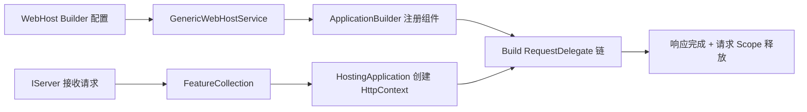

## 深入阅读导航

这份源码同时覆盖 WebHost 构建期、请求管道编译、Middleware 激活、HttpContext/Feature 投影和 Server 请求循环。阅读时必须先区分应用启动时只执行一次的步骤，与每个请求都会执行的步骤。

| 阶段 | 核心问题 | 关键入口 |
| --- | --- | --- |
| 1. WebHost 接入 | Generic Host 如何注册 Web HostedService？ | `ConfigureWebHostDefaults` |
| 2. WebHost 状态 | 默认键、Options 和 Environment 如何形成？ | `WebHostOptions` |
| 3. Builder | WebHostBuilder 如何转接 Generic Host 阶段？ | `GenericWebHostBuilder` |
| 4. Startup | UseStartup、HostingStartup 与 Configure 如何汇合？ | `HostingStartupWebHostBuilder` |
| 5. 管道契约 | IApplicationBuilder 收集什么？ | `Use` / `New` / `Build` |
| 6. 管道编译 | 组件为何逆序包装，分支如何隔离？ | `ApplicationBuilder.Build` |
| 7. IMiddleware | 每请求中间件如何创建与释放？ | `IMiddlewareFactory` |
| 8. 约定式 Middleware | 构造函数与 Invoke 参数分别从哪里解析？ | `UseMiddlewareExtensions` |
| 9. HttpContext | Request、Response 如何投影 Feature？ | `HttpContext` |
| 10. FeatureCollection | Feature 怎样按类型存取和回退？ | `FeatureCollection` |
| 11. 请求作用域 | RequestServices 与 Accessor 何时创建/清理？ | `RequestServicesFeature` |
| 12. Server 契约 | Server 如何驱动三阶段请求处理？ | `IHttpApplication<TContext>` |
| 13. HostingApplication | Feature 如何变成可诊断、可复用的 Context？ | `HostingApplication` |
| 14. Web HostedService | 启动时如何构建管道并交给 Server？ | `GenericWebHostService` |

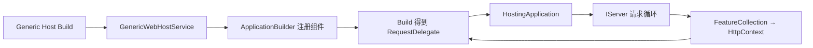

## 核心类型索引

| 类型 | 所在章节 | 说明 |
| --- | --- | --- |
| `GenericHostWebHostBuilderExtensions` | 1. WebHost 接入 | Generic Host 到 WebHost 的桥接 |
| `GenericHostBuilderExtensions` | 1. WebHost 接入 | 默认 Web 配置组合入口 |
| 静态 `WebHost` | 1. WebHost 接入 | 传统 WebHost Builder 入口 |
| `WebHostDefaults` | 2. WebHost 状态 | WebHost 配置键常量 |
| `WebHostOptions` | 2. WebHost 状态 | WebHost 配置快照 |
| `IWebHostEnvironment` | 2. WebHost 状态 | Web 环境抽象 |
| `HostingEnvironment` | 2. WebHost 状态 | Web 环境实现 |
| `IWebHostBuilder` | 3. Builder | Web 构建契约 |
| `ISupportsUseDefaultServiceProvider` | 3. Builder | 默认容器扩展能力 |
| `ISupportsStartup` | 3. Builder | Startup 扩展能力 |
| `WebHostBuilderBase` | 3. Builder | Generic Host 适配基类 |
| `GenericWebHostBuilder` | 3. Builder | Generic Host Web Builder 实现 |
| `HostingStartupWebHostBuilder` | 4. Startup | HostingStartup 回调收集器 |
| `WebHostBuilderExtensions` | 4. Startup | Startup 与 Configure 扩展 API |
| `IHostingStartup` | 4. Startup | 外部程序集启动扩展契约 |
| `IStartupFilter` | 5. 管道契约 | 管道配置装饰器 |
| `IApplicationBuilder` | 5. 管道契约 | 管道组件收集与编译契约 |
| `ApplicationBuilder` | 6. 管道编译 | 默认管道编译器 |
| `IApplicationBuilderFactory` | 6. 管道编译 | 从 Server Features 创建 Builder |
| `ApplicationBuilderFactory` | 6. 管道编译 | 默认 Builder 工厂 |
| `RunExtensions` | 6. 管道编译 | 终止委托注册扩展 |
| `IMiddleware` | 7. IMiddleware | 强类型每请求中间件契约 |
| `IMiddlewareFactory` | 7. IMiddleware | 每请求创建与释放契约 |
| `MiddlewareFactory` | 7. IMiddleware | RequestServices 工厂实现 |
| `UseMiddlewareExtensions` | 8. 约定式 Middleware | 两种激活模型分派器 |
| `HttpContext` | 9. HttpContext | 请求状态统一门面 |
| `HttpRequest` | 9. HttpContext | 请求 Feature 投影 |
| `HttpResponse` | 9. HttpContext | 响应 Feature 投影 |
| `IFeatureCollection` | 10. FeatureCollection | Feature 集合契约 |
| `FeatureCollection` | 10. FeatureCollection | 类型键、Revision 与回退实现 |
| `IHttpContextAccessor` | 11. 请求作用域 | 当前 Context 访问契约 |
| `HttpContextAccessor` | 11. 请求作用域 | AsyncLocal 当前 Context 实现 |
| `HttpServiceCollectionExtensions` | 11. 请求作用域 | Context 服务注册扩展 |
| `IHttpContextFactory` | 11. 请求作用域 | Context 创建与释放契约 |
| `DefaultHttpContextFactory` | 11. 请求作用域 | 默认 Context 初始化器 |
| `IServiceProvidersFeature` | 11. 请求作用域 | RequestServices Feature 契约 |
| `RequestServicesFeature` | 11. 请求作用域 | 请求 Scope 延迟创建与释放 |
| `IServer` | 12. Server 契约 | 网络服务器启停契约 |
| `IHttpApplication<>` | 12. Server 契约 | 三阶段请求适配契约 |
| `HostingApplication` | 13. HostingApplication | Server 与管道的框架适配器 |
| `GenericWebHostServiceOptions` | 14. Web HostedService | 启动期 Web 配置快照 |
| `GenericWebHostService` | 14. Web HostedService | 管道构建与 Server 启停编排 |
## 1. WebHost 接入：从 Generic Host 到 Web HostedService 注册

### 本组解决什么问题

这一组源码回答“ASP.NET Core Web 配置如何附着到 Generic Host”。IWebHostBuilder 收集 Web 专属配置，GenericWebHostBuilder 把它转成服务与选项，最终注册 GenericWebHostService 作为 HostedService。

### 关键类型关系图

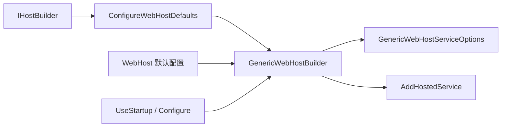

### 核心源码解读

### WebHost 作为 HostedService 接入 Generic Host

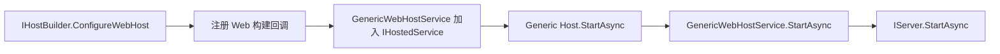

Web 服务器不是在 Builder 调用时启动，而是在 Generic Host 启动 HostedService 阶段启动。

### ConfigureWebHost 与 Defaults 的差异

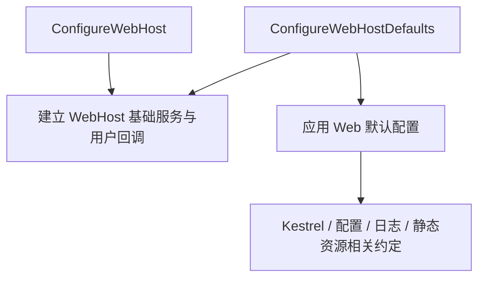

### 支持原生接口时走快速路径

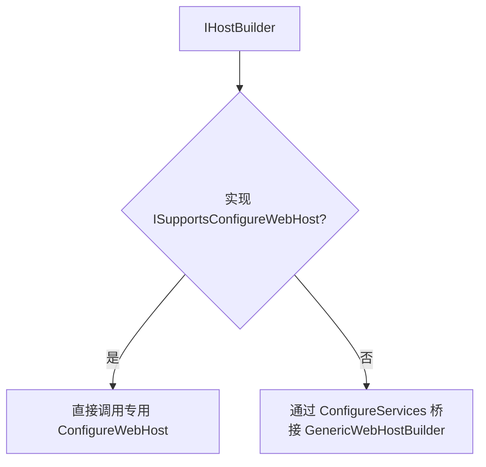

### 构建期与运行期边界

| 阶段 | 主要产物 |
| --- | --- |
| ConfigureWebHost | Web 配置回调和服务描述 |
| Generic Host Build | 根容器和 GenericWebHostService |
| Generic Host Start | RequestDelegate、HostingApplication、Server 监听 |

### WebHost 静态入口与 Generic Host 入口

传统 `WebHost.CreateDefaultBuilder` 返回 IWebHostBuilder；现代 Generic Host 路径以 IHostBuilder 为根并把 Web 运行时作为 HostedService。两条路径共享大量 WebHost 配置与 Startup 基础设施。

### GenericHostWebHostBuilderExtensions

**读这组源码时关注什么：** Generic Host 如何挂接 IWebHostBuilder 与 Web HostedService。

#### 整体结构

**这段代码回答什么问题：** Generic Host 如何挂接 IWebHostBuilder 与 Web HostedService。

```C#
// 提供宿主建造者的扩展方法
// 目的是使用 IWebHostBuilder 收集各种配置
public static class GenericHostWebHostBuilderExtensions
{
    // 添加针对 IWebHostBuilder 的配置
    public static IHostBuilder ConfigureWebHost(this IHostBuilder builder, Action<IWebHostBuilder> configure)
    {
        ArgumentNullException.ThrowIfNull(configure);

        return builder.ConfigureWebHost(configure, _ => { });
    }

    // 添加针对 IWebHostBuilder 的配置
    // 并添加对 WebHostBuilderOptions 选项的配置
    public static IHostBuilder ConfigureWebHost(this IHostBuilder builder, Action<IWebHostBuilder> configure, Action<WebHostBuilderOptions> configureWebHostBuilder)
    {
        // 创建的 IWebHostBuilder 实现类型为 GenericWebHostBuilder
        return ConfigureWebHost(
            builder,
            static (hostBuilder, options) => new GenericWebHostBuilder(hostBuilder, options),
            configure,
            configureWebHostBuilder);
    }

    // 配置 IWebHostBuilder 的扩展方法
    private static IHostBuilder ConfigureWebHost(
        this IHostBuilder builder,
        Func<IHostBuilder, WebHostBuilderOptions, IWebHostBuilder> createWebHostBuilder,
        Action<IWebHostBuilder> configure,
        Action<WebHostBuilderOptions> configureWebHostBuilder)
    {
        ArgumentNullException.ThrowIfNull(configure);
        ArgumentNullException.ThrowIfNull(configureWebHostBuilder);
 
        if (builder is ISupportsConfigureWebHost supportsConfigureWebHost)
        {
            return supportsConfigureWebHost.ConfigureWebHost(configure, configureWebHostBuilder);
        }
 
        var webHostBuilderOptions = new WebHostBuilderOptions();
        // 利用 Action<WebHostBuilderOptions> 配置 WebHostBuilderOptions 选项
        configureWebHostBuilder(webHostBuilderOptions);
        // 利用 IHostBuilder 与 WebHostBuilderOptions 创建 IWebHostBuilder
        var webhostBuilder = createWebHostBuilder(builder, webHostBuilderOptions);
        // 利用 Action<IWebHostBuilder> 配置 IWebHostBuilder
        configure(webhostBuilder);
        // 添加针对服务注册的配置
        // 注册 IHostedService 服务，使用 GenericWebHostService 类型
        builder.ConfigureServices((context, services) 
            => services.AddHostedService<GenericWebHostService>());
        return builder;
    }
}
```

**源码解读：**
- 扩展方法创建 GenericWebHostBuilder 并执行 Web 配置委托。
- 最后把 GenericWebHostService 注册为 IHostedService，使 Web 服务器进入 Host 生命周期。

**读完要记住：**
- WebHost 配置仍依附于 Generic Host。
- 真正启动服务器发生在 GenericWebHostService.StartAsync。

### GenericHostBuilderExtensions

**读这组源码时关注什么：** ConfigureWebHostDefaults 比 ConfigureWebHost 多做了什么。

#### 整体结构

**这段代码回答什么问题：** ConfigureWebHostDefaults 比 ConfigureWebHost 多做了什么。

```C#
// 提供宿主建造者的扩展方法
// 目的是使用 IWebHostBuilder 收集各种默认配置
public static class GenericHostBuilderExtensions
{
    // 使用默认方式配置 IWebHostBuilder
    public static IHostBuilder ConfigureWebHostDefaults(this IHostBuilder builder, Action<IWebHostBuilder> configure)
    {
        ArgumentNullException.ThrowIfNull(configure);
 
        return builder.ConfigureWebHostDefaults(configure, _ => { });
    }
    
    // 使用默认方式配置 IWebHostBuilder
    // 需要提供针对 WebHostBuilderOptions 的配置
    public static IHostBuilder ConfigureWebHostDefaults(this IHostBuilder builder, Action<IWebHostBuilder> configure, Action<WebHostBuilderOptions> configureOptions)
    {
        ArgumentNullException.ThrowIfNull(configure);

        return builder.ConfigureWebHost(webHostBuilder =>
        {
            // 先调用 WebHost.ConfigureWebDefaults 方法收集默认配置
            WebHost.ConfigureWebDefaults(webHostBuilder);

            // 再收集自定义配置
            configure(webHostBuilder);
        }, configureOptions);
    }
}
```

**源码解读：**
- 先调用 WebHost.ConfigureWebDefaults 注册约定服务和服务器。
- 随后执行用户 IWebHostBuilder 配置。

**读完要记住：**
- 默认配置先注册，用户配置后应用。
- 入口仍返回同一个 IHostBuilder。

### WebHost

**读这组源码时关注什么：** 默认 WebHost 配置包含哪些基础设施。

#### 整体结构

**这段代码回答什么问题：** 默认 WebHost 配置包含哪些基础设施。

```C#
// 静态 WebHost
// 通过 IWebHostBuilder 收集默认配置
public static class WebHost
{
    // 配置默认 IWebHostBuilder
    internal static void ConfigureWebDefaults(IWebHostBuilder builder)
    {
        // 添加针对应用的配置
        builder.ConfigureAppConfiguration((ctx, cb) =>
        {
            // 开发环境下，为 IWebHostEnvironment.WebRootFileProvider 创建新的 CompositeFileProvider 作为静态资源文件提供者
            // 步骤如下：
            // 1. 尝试从从宿主配置中得到 "staticWebAssets" 配置节表示的静态资源所在的目录路径
            // 2. 如果配置节不存在，则使用程序根目录下的 "{IWebHostEnvironment.ApplicationName}.staticwebassets.runtime.json" 作为资源文件路径名
            // 3. 读取文件内容并反序列化为 StaticWebAssetManifest 类型对象
            // 4. 遍历 StaticWebAssetManifest.ContentRoots 属性表示的多个静态资源的目录并得到对应的 PhysicalFileProvider
            // 5. 将所有的 PhysicalFileProvider 和原来的 IWebHostEnvironment.WebRootFileProvider 创建 CompositeFileProvider 
            // 6. 将 CompositeFileProvider 作为 IWebHostEnvironment.WebRootFileProvider 的新值
            if (ctx.HostingEnvironment.IsDevelopment())
            {
                StaticWebAssetsLoader.UseStaticWebAssets(ctx.HostingEnvironment, ctx.Configuration);
            }
        });

        // 配置 Kestrel 作为默认的 Web 服务器
        ConfigureWebDefaultsWorker(
            // 使用 Kestrel 作为 Web 服务器
            // 注册 IServer 服务，使用 KestrelServerImpl 类型
            builder.UseKestrel(ConfigureKestrel),
            // 注册路由相关的服务
            services =>
            {
                services.AddRouting();
            });

        // IWebHostBuilder.UseIIS 方法的作用是检查当前操作系统是否为 Windows，并且 AspNetCoreModule 相关的 DLL 已经被加载到进程内（进程内托管）
        // 如果是则使用 IIS 作为 Web 服务器
        // 注册 IServer 服务，使用 IISHttpServer 类型
        // IWebHostBuilder.UseIISIntegration 方法的作用是开启 IIS 集成（进程外托管）
        // 开启 IIS 集成（进程外托管），需要从 IWebHostBuilder 的备用配置或环境变量中读取相应的配置
        // 具体来说需要存在以下配置：
        // 1. 备用配置中的 "PORT" 配置节存在或环境变量 "ASPNETCORE_PORT" 存在
        // 2. 备用配置中的 "APPL_PATH" 配置节存在或环境变量 "ASPNETCORE_APPL_PATH" 存在
        // 3. 备用配置中的 "TOKEN" 配置节存在或环境变量 "ASPNETCORE_TOKEN" 存在
        // 通过 IIS 启动 ASP.NET Core 应用时会自动添加以上环境变量
        // 注册 IStartupFilter 服务，使用 IISSetupFilter 类型
        // 其中会注册 3 个中间件：
        // 1. PathBaseMiddleware 中间件，用来处理 IIS 服务器转发的请求路径前缀
        // 2. ForwardedHeadersMiddleware 中间件，用来处理来自反向代理服务器的转发头信息
        // 3. IISMiddleware 中间件，用来处理与 IIS 服务器的通信
        // 最终会配置 "http://127.0.0.1:{port}" 环回地址作为 Kestrel 服务器的监听地址
        // 这个配置会延迟在配置服务注册时添加，因为这时候宿主配置已经构建完成，保证不会被其他宿主配置覆盖，但会被应用配置覆盖
        // 所以如果使用 IIS 作为反向代理服务器，则需要移除应用配置中对 Urls 的配置，避免 Kestrel 服务器的监听地址被覆盖
        builder
            .UseIIS()
            .UseIISIntegration();
    }

    // 注册默认服务
    private static void ConfigureWebDefaultsWorker(IWebHostBuilder builder, Action<IServiceCollection>? configureRouting)
    {
        builder.ConfigureServices((hostingContext, services) =>
        {
            // 注册 HostFilteringOptions 选项配置
            services.PostConfigure<HostFilteringOptions>(options =>
            {
                if (options.AllowedHosts == null || options.AllowedHosts.Count == 0)
                {
                    // 尝试从应用配置中得到 "AllowedHosts" 配置节表示的主机列表，多个则以 ";" 分割
                    // 例如：
                    // "AllowedHosts": "localhost;127.0.0.1;[::1]"
                    var hosts = hostingContext.Configuration["AllowedHosts"]?.Split(new[] { ';' }, StringSplitOptions.RemoveEmptyEntries);
                    // 如果没有配置，则使用 "*" 作为默认值，表示允许所有主机
                    options.AllowedHosts = (hosts?.Length > 0 ? hosts : new[] { "*" });
                }
            });

            // 监听针对 HostFilteringOptions 选项的配置改变
            services.AddSingleton<IOptionsChangeTokenSource<HostFilteringOptions>>(
                    new ConfigurationChangeTokenSource<HostFilteringOptions>(hostingContext.Configuration));

            // 注册 IStartupFilter 服务
            services.AddTransient<IStartupFilter, HostFilteringStartupFilter>();
            services.AddTransient<IStartupFilter, ForwardedHeadersStartupFilter>();
            // 注册 ForwardedHeadersOptions 的选项配置
            services.AddTransient<IConfigureOptions<ForwardedHeadersOptions>, ForwardedHeadersOptionsSetup>();
 
            // 注册路由相关核心服务或使用自定义服务配置注册
            if (configureRouting == null)
            {
                services.AddRoutingCore();
            }
            else
            {
                configureRouting(services);
            }
        });
    }
}
```

**源码解读：**
- 开发环境加载静态 Web Assets，并默认配置 Kestrel、IIS 集成和路由。
- 还注册主机过滤、转发头等 StartupFilter 与相关选项。

**读完要记住：**
- 该静态类只组织默认注册。
- 中间件管道仍在 WebHostService 启动时构建。

## 2. WebHost 状态：配置键、Options 与 Environment

WebHostDefaults 定义字符串键，WebHostOptions 在构建期一次读取这些键，IWebHostEnvironment 则把环境名、应用名、内容根和 WebRoot 投影为运行时对象。

### 配置键到运行时状态

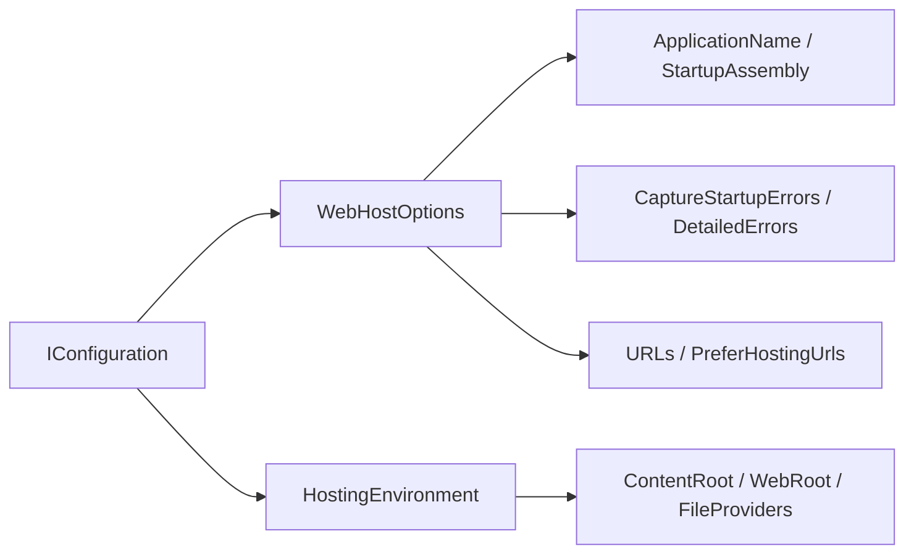

### Options 是构建快照，不是每请求配置查询

GenericWebHostServiceOptions 保存 WebHostOptions，服务器启动时消费该对象。中间件热路径不会反复解析这些宿主键。

### ContentRoot 与 WebRoot 分工

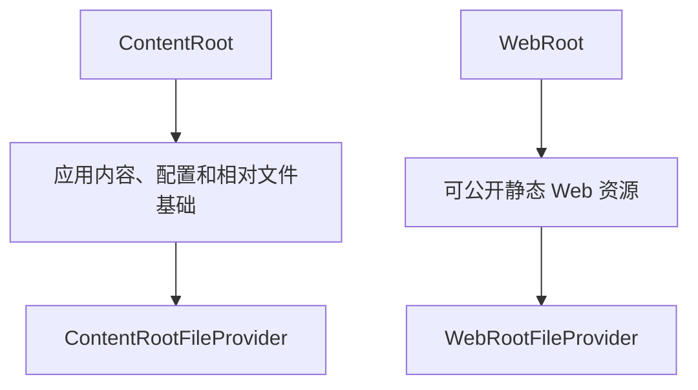

### 地址配置有多层来源

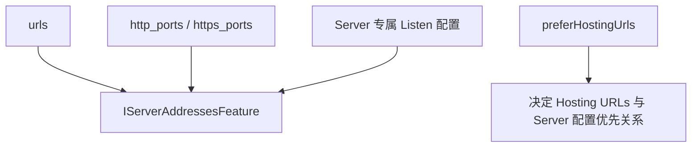

### CaptureStartupErrors 改变失败呈现方式

关闭时，管道构建异常直接使 Host 启动失败；开启时，GenericWebHostService 可构建错误页管道并继续启动 Server，以便浏览器看到诊断信息。

### WebHostDefaults

**读这组源码时关注什么：** Web Host 约定使用哪些配置键。

#### 整体结构

**这段代码回答什么问题：** Web Host 约定使用哪些配置键。

```C#
// 默认配置键
public static class WebHostDefaults
{
    public static readonly string ApplicationKey = "applicationName";
 
    public static readonly string StartupAssemblyKey = "startupAssembly";
 
    public static readonly string HostingStartupAssembliesKey = "hostingStartupAssemblies";
 
    public static readonly string HostingStartupExcludeAssembliesKey = "hostingStartupExcludeAssemblies";
 
    public static readonly string DetailedErrorsKey = "detailedErrors";
 
    public static readonly string EnvironmentKey = "environment";
 
    public static readonly string WebRootKey = "webroot";
 
    public static readonly string CaptureStartupErrorsKey = "captureStartupErrors";
 
    public static readonly string ServerUrlsKey = "urls";
 
    public static readonly string HttpPortsKey = "http_ports";
 
    public static readonly string HttpsPortsKey = "https_ports";
 
    public static readonly string ContentRootKey = "contentRoot";
 
    public static readonly string PreferHostingUrlsKey = "preferHostingUrls";
 
    public static readonly string PreventHostingStartupKey = "preventHostingStartup";
 
    public static readonly string SuppressStatusMessagesKey = "suppressStatusMessages";
 
    public static readonly string ShutdownTimeoutKey = "shutdownTimeoutSeconds";
 
    public static readonly string StaticWebAssetsKey = "staticWebAssets";
}
```

**源码解读：**
- 定义启动程序集、环境、WebRoot、URL、端口和错误行为等键。
- WebHostOptions 与 GenericWebHostService 从配置中读取这些键。

**读完要记住：**
- 这些字段是配置协议的一部分。
- URL、http_ports 和 https_ports 存在明确优先级。

### WebHostOptions

**读这组源码时关注什么：** Web Host 配置如何转换为便于使用的强类型快照。

#### 整体结构

**这段代码回答什么问题：** Web Host 配置如何转换为便于使用的强类型快照。

```C#
// 用于保存从主备 IConfiguration 中读取的各项配置
internal sealed class WebHostOptions
{
    // 读取配置值时使用宿主配置作为主配置，回退配置作为备用配置
    // 部分配置优先从 HostBuilderContext.HostingEnvironment 读取
    public WebHostOptions(IConfiguration primaryConfiguration, IConfiguration? fallbackConfiguration = null, IHostEnvironment? environment = null)
    {
        ArgumentNullException.ThrowIfNull(primaryConfiguration);

        string? GetConfig(string key) => primaryConfiguration[key] ?? fallbackConfiguration?[key];
 
        ApplicationName = environment?.ApplicationName ?? 
            GetConfig(WebHostDefaults.ApplicationKey) ?? 
            Assembly.GetEntryAssembly()?.GetName().Name ?? string.Empty;
        StartupAssembly = GetConfig(WebHostDefaults.StartupAssemblyKey);
        DetailedErrors = WebHostUtilities.ParseBool(GetConfig(WebHostDefaults.DetailedErrorsKey));
        CaptureStartupErrors = WebHostUtilities.ParseBool(GetConfig(WebHostDefaults.CaptureStartupErrorsKey));
        Environment = environment?.EnvironmentName ?? GetConfig(WebHostDefaults.EnvironmentKey);
        WebRoot = GetConfig(WebHostDefaults.WebRootKey);
        ContentRootPath = environment?.ContentRootPath ?? GetConfig(WebHostDefaults.ContentRootKey);
        PreventHostingStartup = WebHostUtilities.ParseBool(GetConfig(WebHostDefaults.PreventHostingStartupKey));
        SuppressStatusMessages = WebHostUtilities.ParseBool(GetConfig(WebHostDefaults.SuppressStatusMessagesKey));
        ServerUrls = GetConfig(WebHostDefaults.ServerUrlsKey);
        PreferHostingUrls = WebHostUtilities.ParseBool(GetConfig(WebHostDefaults.PreferHostingUrlsKey));
 
        HostingStartupAssemblies = Split(ApplicationName, GetConfig(WebHostDefaults.HostingStartupAssembliesKey));
        HostingStartupExcludeAssemblies = Split(GetConfig(WebHostDefaults.HostingStartupExcludeAssembliesKey));
 
        var timeout = GetConfig(WebHostDefaults.ShutdownTimeoutKey);
        if (!string.IsNullOrEmpty(timeout)
            && int.TryParse(timeout, NumberStyles.None, CultureInfo.InvariantCulture, out var seconds))
        {
            ShutdownTimeout = TimeSpan.FromSeconds(seconds);
        }
    }
 
    public string ApplicationName { get; }
 
    public bool PreventHostingStartup { get; }
 
    public bool SuppressStatusMessages { get; }
 
    public IReadOnlyList<string> HostingStartupAssemblies { get; }
 
    public IReadOnlyList<string> HostingStartupExcludeAssemblies { get; }
 
    public bool DetailedErrors { get; }
 
    public bool CaptureStartupErrors { get; }
 
    public string? Environment { get; }
 
    public string? StartupAssembly { get; }
 
    public string? WebRoot { get; }
 
    public string? ContentRootPath { get; }
 
    public TimeSpan ShutdownTimeout { get; } = TimeSpan.FromSeconds(30);
 
    public string? ServerUrls { get; }
 
    public bool PreferHostingUrls { get; }
    
    // 得到 HostingStartup 程序集
    // 包含 "hostingStartupAssemblies" 配置节中通过 ";" 分隔的多个程序集名称
    // 排除 "hostingStartupExcludeAssemblies" 配置节中通过 ";" 分隔的多个程序集名称
    // 并且一定会包含入口程序集名称
    public IEnumerable<string> GetFinalHostingStartupAssemblies()
    {
        return HostingStartupAssemblies.Except(HostingStartupExcludeAssemblies, StringComparer.OrdinalIgnoreCase);
    }
 
    private static IReadOnlyList<string> Split(string? value)
    {
        return value?.Split(';', StringSplitOptions.TrimEntries | StringSplitOptions.RemoveEmptyEntries)
            ?? Array.Empty<string>();
    }
 
    private static IReadOnlyList<string> Split(string applicationName, string? environment)
    {
        if (string.IsNullOrEmpty(environment))
        {
            return new[] { applicationName };
        }
 
        return Split($"{applicationName};{environment}");
    }
}
```

**源码解读：**
- 构造函数从 IConfiguration 读取环境、应用名、启动程序集和地址等值。
- HostingStartup 程序集包含和排除列表也在此解析。

**读完要记住：**
- 它是构建和启动阶段共享的配置快照。
- 布尔值和列表会在构造时规范化。

### IWebHostEnvironment

**读这组源码时关注什么：** Web 环境比通用 Host 环境多出什么。

#### 整体结构

**这段代码回答什么问题：** Web 环境比通用 Host 环境多出什么。

```C#
// Web 宿主环境
// 实现 IHostEnvironment
public interface IWebHostEnvironment : IHostEnvironment
{
    // Web 根目录
    // 默认目录路径为 {IHostEnvironment.ContentRootPath}/wwwroot
    string WebRootPath { get; set; }
    
    // 表示 WebRootPath 目录的 IFileProvider
    IFileProvider WebRootFileProvider { get; set; }
}
```

**源码解读：**
- 接口继承 IHostEnvironment。
- 增加 WebRootPath 与 WebRootFileProvider。

**读完要记住：**
- ContentRoot 面向应用根，WebRoot 面向静态资源根。
- 环境实例会作为单例供服务和管道使用。

### HostingEnvironment

**读这组源码时关注什么：** ASP.NET Core 如何用一个对象实现 Host 与 WebHost 环境。

#### 整体结构

**这段代码回答什么问题：** ASP.NET Core 如何用一个对象实现 Host 与 WebHost 环境。

```C#
// IWebHostEnvironment 的默认实现
#pragma warning disable CS0618
internal sealed class HostingEnvironment : IHostingEnvironment, Extensions.Hosting.IHostingEnvironment, IWebHostEnvironment
#pragma warning restore CS0618
{
    public string EnvironmentName { get; set; } = Extensions.Hosting.Environments.Production;
 
#pragma warning disable CS8766
    public string? ApplicationName { get; set; }
#pragma warning restore CS8766
 
    public string WebRootPath { get; set; } = default!;
 
    public IFileProvider WebRootFileProvider { get; set; } = default!;
 
    public string ContentRootPath { get; set; } = default!;
 
    public IFileProvider ContentRootFileProvider { get; set; } = default!;
}
```

**源码解读：**
- 类型同时实现 IWebHostEnvironment 和旧版兼容接口。
- 保存 ContentRoot 与 WebRoot 的路径和 FileProvider。

**读完要记住：**
- 环境在 WebHost 构建阶段初始化。
- 静态文件和启动配置依赖该对象。

## 3. WebHostBuilder：把 Web 阶段转接到 Generic Host

IWebHostBuilder 暴露 Web 语义，GenericWebHostBuilder 内部仍把配置和服务回调注册到 IHostBuilder。适配层还负责 Startup 发现、容器回调和 HostingStartup 汇合。

### Web Builder 阶段映射

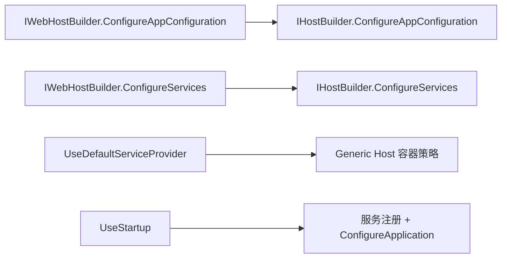

### WebHostBuilderContext 从 HostContext 派生

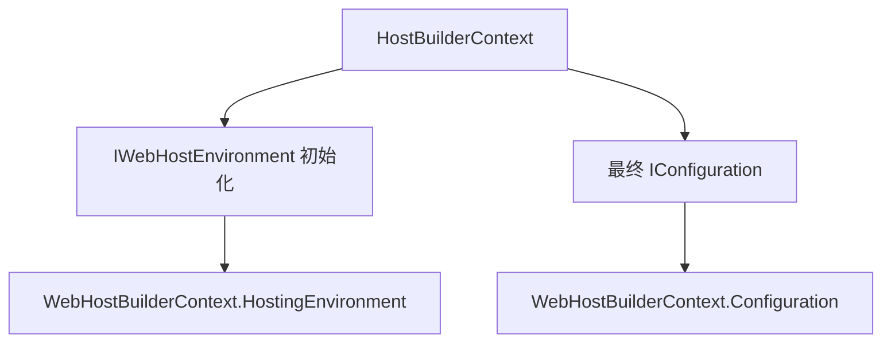

### UseStartup 多次调用时最后一次生效

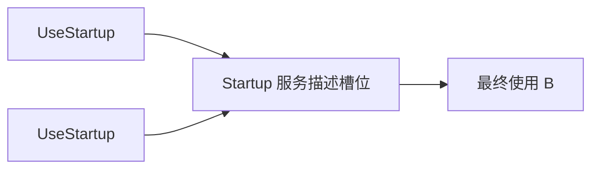

这是单一应用管道配置入口，不是 `IEnumerable<Startup>` 聚合模型。

### Startup 方法按环境查找

StartupLoader 可以选择 `ConfigureDevelopmentServices` 等环境专属方法，再回退到通用 ConfigureServices/Configure。方法签名会被转换为统一 Builder 委托。

### 第三方容器仍由 Generic Host 负责创建

Startup 中的 ConfigureContainer 通过反射转接到 IHostBuilder.ConfigureContainer；旧式返回 IServiceProvider 的 ConfigureServices 在这条 Generic Host 路径中不再支持。

### IWebHostBuilder

**读这组源码时关注什么：** WebHost Builder 对外开放哪些配置入口。

#### 整体结构

**这段代码回答什么问题：** WebHost Builder 对外开放哪些配置入口。

```C#
// Web 宿主建造者的抽象表示
// 在现有的承载系统中已不再利用 Build 方法构建 IWebHost
public interface IWebHostBuilder
{
    // 当前承载系统已不支持此方法
    IWebHost Build();
 
    // 收集针对应用的配置
    IWebHostBuilder ConfigureAppConfiguration(Action<WebHostBuilderContext, IConfigurationBuilder> configureDelegate);
    
    // 收集针对服务注册的配置
    IWebHostBuilder ConfigureServices(Action<IServiceCollection> configureServices);
 
    // 收集针对服务注册的配置
    IWebHostBuilder ConfigureServices(Action<WebHostBuilderContext, IServiceCollection> configureServices);
 
    // 从备用配置读取配置
    string? GetSetting(string key);
    
    // 向备用配置添加配置
    IWebHostBuilder UseSetting(string key, string? value);
}
```

**源码解读：**
- 接口支持读取和写入设置、配置应用与服务以及构建 WebHost。
- 配置方法只收集操作。

**读完要记住：**
- GenericWebHostBuilder 将这些操作转接到 IHostBuilder。
- 现代 Generic Host 路径通常不直接调用 IWebHostBuilder.Build。

### ISupportsUseDefaultServiceProvider

**读这组源码时关注什么：** Builder 适配器如何暴露默认容器配置能力。

#### 整体结构

**这段代码回答什么问题：** Builder 适配器如何暴露默认容器配置能力。

```C#
// 约定实现 IWebHostBuilder 的类型需要提供 DefaultServiceProviderFactory 方法
internal interface ISupportsUseDefaultServiceProvider
{
    IWebHostBuilder UseDefaultServiceProvider(Action<WebHostBuilderContext, ServiceProviderOptions> configure);
}
```

**源码解读：**
- 接口定义 UseDefaultServiceProvider 支持。
- 扩展方法可先检测能力再选择直接调用或通用回退。

**读完要记住：**
- 这是能力接口而非运行时服务。
- 用于避免对具体 Builder 类型强制转换。

### ISupportsStartup

**读这组源码时关注什么：** Builder 适配器如何暴露 Startup 注册能力。

#### 整体结构

**这段代码回答什么问题：** Builder 适配器如何暴露 Startup 注册能力。

```C#
// 约定实现 IWebHostBuilder 的类型需要提供两个额外的功能
// 1. 收集中间件建造者配置
// 2. 注册 Startup 类型，用户收集各种配置
public interface ISupportsStartup
{
    IWebHostBuilder Configure(Action<IApplicationBuilder> configure);
 
    IWebHostBuilder Configure(Action<WebHostBuilderContext, IApplicationBuilder> configure);
 
    IWebHostBuilder UseStartup(Type startupType);
 
    IWebHostBuilder UseStartup<TStartup>(Func<WebHostBuilderContext, TStartup> startupFactory);
}
```

**源码解读：**
- 接口提供 UseStartup 方法。
- WebHostBuilderExtensions 可对支持者走直接路径。

**读完要记住：**
- 它描述构建器能力。
- Startup 最终被转换为服务注册和 ConfigureApplication。

### WebHostBuilderBase

**读这组源码时关注什么：** IWebHostBuilder 如何复用底层 IHostBuilder。

#### 整体结构

**这段代码回答什么问题：** IWebHostBuilder 如何复用底层 IHostBuilder。

```C#
// IWebHostBuilder 的默认实现，并同时实现了 ISupportsUseDefaultServiceProvider
// 这是一个抽象类，主要用来收集针对 Web 应用的各种配置（应用配置、服务注册配置），并最终将这些配置转移到 IHostBuilder 上
// 具体实现类的职责是收集各种针对中间件建造者的配置
internal abstract class WebHostBuilderBase : IWebHostBuilder, ISupportsUseDefaultServiceProvider
{
    // 最终收集到的各种配置都会被转移到 IHostBuilder 上
    private protected readonly IHostBuilder _builder;
    // 为 IWebHostBuilder 准备的备用配置
    // 可以调用 UseSetting 方法添加配置
    private protected readonly IConfiguration _config;
 
    public WebHostBuilderBase(IHostBuilder builder, WebHostBuilderOptions options)
    {
        _builder = builder;
        // 添加一个空的内存配置源
        var configBuilder = new ConfigurationBuilder()
            .AddInMemoryCollection();

        // 根据 WebHostBuilderOptions.SuppressEnvironmentConfiguration 属性判断是否添加前缀为 "ASPNETCORE_" 的环境变量配置源
        if (!options.SuppressEnvironmentConfiguration)
        {
            configBuilder.AddEnvironmentVariables(prefix: "ASPNETCORE_");
        }

        // 构建备用配置
        _config = configBuilder.Build();
    }
    
    // 已不支持用来构建 IWebHost
    public IWebHost Build()
    {
        throw new NotSupportedException($"Building this implementation of {nameof(IWebHostBuilder)} is not supported.");
    }
    
    // 收集针对应用的配置
    public IWebHostBuilder ConfigureAppConfiguration(Action<WebHostBuilderContext, IConfigurationBuilder> configureDelegate)
    {
        // 转移到 IHostBuilder 上
        _builder.ConfigureAppConfiguration((context, builder) =>
        {
            // 利用 HostBuilderContext 得到 WebHostBuilderContext
            // 注意：此时 HostBuilderContext.Configuration 还是宿主配置
            // 得到的 WebHostBuilderContext.Configuration 也是宿主配置
            var webhostBuilderContext = GetWebHostBuilderContext(context);
            configureDelegate(webhostBuilderContext, builder);
        });
 
        return this;
    }
    
    // 收集针对服务注册的配置
    public IWebHostBuilder ConfigureServices(Action<IServiceCollection> configureServices)
    {
        return ConfigureServices((context, services) => configureServices(services));
    }
 
    // 收集针对服务注册的配置
    public IWebHostBuilder ConfigureServices(Action<WebHostBuilderContext, IServiceCollection> configureServices)
    {
        // 转移到 IHostBuilder 上
        _builder.ConfigureServices((context, builder) =>
        {
            // 利用 HostBuilderContext 得到 WebHostBuilderContext
            // 注意：此时 HostBuilderContext.Configuration 是应用配置
            // 得到的 WebHostBuilderContext.Configuration 也是应用配置
            var webhostBuilderContext = GetWebHostBuilderContext(context);
            configureServices(webhostBuilderContext, builder);
        });
 
        return this;
    }
 
    // 实现 ISupportsUseDefaultServiceProvider 接口
    public IWebHostBuilder UseDefaultServiceProvider(Action<WebHostBuilderContext, ServiceProviderOptions> configure)
    {
        // 转移到 IHostBuilder 上
        _builder.UseServiceProviderFactory(context =>
        {
            // 利用 HostBuilderContext 得到 WebHostBuilderContext
            // 注意：此时 HostBuilderContext.Configuration 是应用配置
            // 得到的 WebHostBuilderContext.Configuration 也是应用配置
            var webHostBuilderContext = GetWebHostBuilderContext(context);
            var options = new ServiceProviderOptions();
            configure(webHostBuilderContext, options);
            return new DefaultServiceProviderFactory(options);
        });
 
        return this;
    }
 
    // 利用 HostBuilderContext 得到 WebHostBuilderContext
    protected WebHostBuilderContext GetWebHostBuilderContext(HostBuilderContext context)
    {
        // 利用 IHostBuilder.Properties 共享字典缓存创建的 WebHostBuilderContext
        // 避免多次创建 WebHostBuilderContext
        if (!context.Properties.TryGetValue(typeof(WebHostBuilderContext), out var contextVal))
        {
            // 创建 WebHostOptions
            // 注意：首次调用时候传入的主配置是宿主配置
            var options = new WebHostOptions(context.Configuration, fallbackConfiguration: _config, environment: context.HostingEnvironment);
            var webHostBuilderContext = new WebHostBuilderContext
            {
                // 此时 HostBuilderContext.Configuration 是宿主配置
                Configuration = context.Configuration,
                HostingEnvironment = new HostingEnvironment()
            };
            // 通过 HostBuilderContext.HostingEnvironment 和 WebHostOptions 为 WebHostBuilderContext.HostingEnvironment 赋值
            // 如果配置中不存在 "webroot" 配置节，则使用默认值 "wwwroot"
            // 最终 IWebHostEnvironment.WebRootPath 的值就是 "{IHostEnvironment.ContentRootPath}/wwwroot"，并创建这个目录
            webHostBuilderContext.HostingEnvironment.Initialize(context.HostingEnvironment.ContentRootPath, options, baseEnvironment: context.HostingEnvironment);
            // 缓存避免重复创建转换
            context.Properties[typeof(WebHostBuilderContext)] = webHostBuilderContext;
            context.Properties[typeof(WebHostOptions)] = options;
            return webHostBuilderContext;
        }
 
        var webHostContext = (WebHostBuilderContext)contextVal;
        // 最终 WebHostBuilderContext.Configuration 会被更新为应用配置
        webHostContext.Configuration = context.Configuration;
        return webHostContext;
    }
 
    public string? GetSetting(string key)
    {
        return _config[key];
    }
 
    public IWebHostBuilder UseSetting(string key, string? value)
    {
        _config[key] = value;
        return this;
    }
}
```

**源码解读：**
- 基类保存 HostBuilder、配置与服务回调。
- IWebHostBuilder 的设置和配置调用被适配到底层 Host 阶段。

**读完要记住：**
- 它连接旧 WebHost API 与 Generic Host。
- 具体差异由派生 Builder 实现。

### GenericWebHostBuilder

**读这组源码时关注什么：** Generic Host 场景下 Web 设置、Startup 与服务如何落地。

#### 整体结构

**这段代码回答什么问题：** Generic Host 场景下 Web 设置、Startup 与服务如何落地。

```C#
// 继承 WebHostBuilderBase
// 实现 ISupportsStartup
// 主要功能：
// 1. 使用 Configure 方法收集中间件建造者配置
// 2. 使用 UseStartup 方法注册外部类型，作用是用它来收集各种配置
//    利用外部类型的 ConfigureService 方法收集针对服务注册的配置
//    利用外部类型的 ConfigureContainer 方法收集针对容器建造者的配置
//    利用外部类型的 Configure 方法收集中间件建造者配置
internal sealed class GenericWebHostBuilder : WebHostBuilderBase, ISupportsStartup
{
    private object? _startupObject;
    private readonly object _startupKey = new object();
 
    private AggregateException? _hostingStartupErrors;
    private HostingStartupWebHostBuilder? _hostingStartupWebHostBuilder;
 
    public GenericWebHostBuilder(IHostBuilder builder, WebHostBuilderOptions options)
        : base(builder, options)
    {
        // 添加针对宿主的配置 
        // 转移到 IHostBuilder 上
        _builder.ConfigureHostConfiguration(config =>
        {
            // 将备用配置作为被链接的配置源
            config.AddConfiguration(_config);

            // 根据 "hostingStartupAssemblies" 配置节的配置得到目标程序集
            // 注意：这时候的主要配置来源于以 "ASPNETCORE_" 为前缀的环境变量
            // 检查程序集是否绑定了 HostingStartupAttribute 特性
            // 利用 HostingStartupAttribute.HostingStartupType 创建实现了 IHostingStartup 的类型
            // 调用 IHostingStartup.Configure 方法，用于配置 HostingStartupWebHostBuilder
            ExecuteHostingStartups();
        });
 
        // 添加针对应用的配置
        // 转移到 IHostBuilder 上
        _builder.ConfigureAppConfiguration((context, configurationBuilder) =>
        {
            // 检查是否启用 HostingStartupWebHostBuilder
            if (_hostingStartupWebHostBuilder != null)
            {
                var webhostContext = GetWebHostBuilderContext(context);
                // 执行 HostingStartupWebHostBuilder 中的应用配置委托链
                _hostingStartupWebHostBuilder.ConfigureAppConfiguration(webhostContext, configurationBuilder);
            }
        });

        // 添加针对服务注册的配置
        // 转移到 IHostBuilder 上
        _builder.ConfigureServices((context, services) =>
        {
            var webhostContext = GetWebHostBuilderContext(context);
            var webHostOptions = (WebHostOptions)context.Properties[typeof(WebHostOptions)];
 
            // 注册 IWebHostEnvironment.HostingEnvironment 实例
            services.AddSingleton(webhostContext.HostingEnvironment);
#pragma warning disable CS0618 
            services.AddSingleton((AspNetCore.Hosting.IHostingEnvironment)webhostContext.HostingEnvironment);
            services.AddSingleton<IApplicationLifetime, GenericWebHostApplicationLifetime>();
#pragma warning restore CS0618 
 
            // 注册 GenericWebHostServiceOptions 选项配置
            services.Configure<GenericWebHostServiceOptions>(options =>
            {
                options.WebHostOptions = webHostOptions;
                options.HostingStartupExceptions = _hostingStartupErrors;
            });
 
            // 注册 DiagnosticSource，使用 Func<IServiceProvider, DiagnosticListener> 工厂
            services.TryAddSingleton(sp => new DiagnosticListener("Microsoft.AspNetCore"));
            services.TryAddSingleton<DiagnosticSource>(sp => sp.GetRequiredService<DiagnosticListener>());
            // 注册 ActivitySource，使用 Func<IServiceProvider, ActivitySource> 工厂
            services.TryAddSingleton(sp => new ActivitySource("Microsoft.AspNetCore"));
            services.TryAddSingleton(DistributedContextPropagator.Current);
 
            // 注册 IHttpContextFactory, 使用 DefaultHttpContextFactory 类型
            services.TryAddSingleton<IHttpContextFactory, DefaultHttpContextFactory>();
            // 注册 IMiddlewareFactory，使用 MiddlewareFactory 类型
            services.TryAddScoped<IMiddlewareFactory, MiddlewareFactory>();
            // 注册 IApplicationBuilderFactory, 使用 ApplicationBuilderFactory 类型
            services.TryAddSingleton<IApplicationBuilderFactory, ApplicationBuilderFactory>();
 
            services.AddMetrics();
            services.TryAddSingleton<HostingMetrics>();
 
            // 执行 HostingStartupWebHostBuilder 中的服务注册委托链
            _hostingStartupWebHostBuilder?.ConfigureServices(webhostContext, services);
            
            if (!string.IsNullOrEmpty(webHostOptions.StartupAssembly))
            {
                // 在构建服务注册时利用基于约定的 Startup 类型收集各种配置
                ScanAssemblyAndRegisterStartup(context, services, webhostContext, webHostOptions);
            }
        });
    }
    
    // 创建基于约定的 Startup 类型
    private void ScanAssemblyAndRegisterStartup(HostBuilderContext context, IServiceCollection services, WebHostBuilderContext webhostContext, WebHostOptions webHostOptions)
    {
        try
        {
            // 如果 "startupAssembly" 配置节存在，则尝试加载对应的程序集并找到基于约定的 Startup 类型
            // 查找 Startup 类型的规则和顺序如下：
            // 1. "Startup{IWebHostEnvironment.EnvironmentName}" 
            // 2. "{startupAssembly 配置节表示的程序集名称}.Startup{IWebHostEnvironment.EnvironmentName}"
            // 3. "Startup"
            // 4. "{startupAssembly 配置节表示的程序集名称}.Startup"
            var startupType = StartupLoader.FindStartupType(webHostOptions.StartupAssembly!, webhostContext.HostingEnvironment.EnvironmentName);
            UseStartup(startupType, context, services);
        }
        catch (Exception ex) when (webHostOptions.CaptureStartupErrors)
        {
            var capture = ExceptionDispatchInfo.Capture(ex);
 
            services.Configure<GenericWebHostServiceOptions>(options =>
            {
                options.ConfigureApplication = app =>
                {
                    capture.Throw();
                };
            });
        }
    }
    
    // 创建实现 IHostingStartup 接口的类型
    // 并使用 HostingStartupWebHostBuilder 收集各种配置
    private void ExecuteHostingStartups()
    {
        // 此时备用配置的配置源主要是 "ASPNETCORE_" 前缀的环境变量配置源
        // 或者通过调用 IWebHostBuilder.UseSetting 方法直接添加的配置值
        var webHostOptions = new WebHostOptions(_config);
 
        // 如果 "preventHostingStartup" 配置节不存在或值为 "false"，则不应用 IHostingStartup
        if (webHostOptions.PreventHostingStartup)
        {
            return;
        }
 
        var exceptions = new List<Exception>();
        var processed = new HashSet<Assembly>();
 
        // 创建 HostingStartupWebHostBuilder
        // 是对 GenericWebHostBuilder 的封装
        // 内部在收集针对应用的配置或针对服务注册的配置都是通过委托链形式保存
        // 而其他的配置都将被转移到 GenericWebHostBuilder 上
        _hostingStartupWebHostBuilder = new HostingStartupWebHostBuilder(this);
 
        // 根据备用配置的 "hostingStartupAssemblies" 配置节和 "hostingStartupExcludeAssemblies" 配置节最终得到 IHostingStartup 程序集列表
        // 注意：还会附加入口程序集
        foreach (var assemblyName in webHostOptions.GetFinalHostingStartupAssemblies())
        {
            try
            {
                // 加载程序集
                var assembly = Assembly.Load(new AssemblyName(assemblyName));
 
                // 不会重复处理同名的程序集
                if (!processed.Add(assembly))
                {
                    continue;
                }
 
                // 从程序集得到绑定的 HostingStartupAttribute 特性集合
                foreach (var attribute in assembly.GetCustomAttributes<HostingStartupAttribute>())
                {
                    // 利用 HostingStartupAttribute.HostingStartupType 表示的类型反射得到对应实例，并强制类型转换为 IHostingStartup 接口类型
                    var hostingStartup = (IHostingStartup)Activator.CreateInstance(attribute.HostingStartupType)!;
                    // 调用 IHostingStartup.Configure 方法
                    // 利用 HostingStartupWebHostBuilder 收集各种配置
                    hostingStartup.Configure(_hostingStartupWebHostBuilder);
                }
            }
            catch (Exception ex)
            {
                exceptions.Add(new InvalidOperationException($"Startup assembly {assemblyName} failed to execute. See the inner exception for more details.", ex));
            }
        }
 
        if (exceptions.Count > 0)
        {
            _hostingStartupErrors = new AggregateException(exceptions);
        }
    }
    
    // 应用 Startup 类型
    public IWebHostBuilder UseStartup(Type startupType)
    {
        var startupAssemblyName = startupType.Assembly.GetName().Name;

        // 将 Startup 类型所在的程序集名称作为 "applicationName" 配置节的值
        UseSetting(WebHostDefaults.ApplicationKey, startupAssemblyName);

        // 缓存 Startup 类型
        _startupObject = startupType;

        // 转移到 IHostBuilder 上
        _builder.ConfigureServices((context, services) =>
        {
            // 如果 UseStartup 被多次调用，只有最后一次的调用有效
            if (object.ReferenceEquals(_startupObject, startupType))
            {
                // 在构建服务注册时调用
                UseStartup(startupType, context, services);
            }
        });
 
        return this;
    }
    
    // 应用 Startup 类型
    // 传递 Func<WebHostBuilderContext, TStartup> 委托
    public IWebHostBuilder UseStartup<TStartup>(Func<WebHostBuilderContext, TStartup> startupFactory)
    {
        // 将 startupFactory 委托的原型方法的类型所在程序集名称作为 "applicationName" 配置节的值
        var startupAssemblyName = startupFactory.GetMethodInfo().DeclaringType!.Assembly.GetName().Name;

        UseSetting(WebHostDefaults.ApplicationKey, startupAssemblyName);
 
        // 保存最后一次的 Func<WebHostBuilderContext, TStartup> 委托
        _startupObject = startupFactory;
 
        // 转移到 IHostBuilder 上
        _builder.ConfigureServices(ConfigureStartup);

        void ConfigureStartup(HostBuilderContext context, IServiceCollection services)
        {
            // 如果 UseStartup 被多次调用，只有最后一次的调用有效
            if (object.ReferenceEquals(_startupObject, startupFactory))
            {
                var webHostBuilderContext = GetWebHostBuilderContext(context);
                // 利用 Func<WebHostBuilderContext, TStartup> 委托创建 Startup 类型实例
                var instance = startupFactory(webHostBuilderContext) ?? 
                               throw new InvalidOperationException("The specified factory returned null startup instance.");
                // 在构建服务注册时调用
                UseStartup(instance.GetType(), context, services, instance);
            }
        }
 
        return this;
    }
    
    // 私有 UseStartup 方法
    // 创建基于约定的 Startup 并应用配置
    private void UseStartup(Type startupType, HostBuilderContext context, IServiceCollection services, object? instance = null)
    {
        var webHostBuilderContext = GetWebHostBuilderContext(context);
        var webHostOptions = (WebHostOptions)context.Properties[typeof(WebHostOptions)];
 
        ExceptionDispatchInfo? startupError = null;
        ConfigureBuilder? configureBuilder = null;
 
        try
        {
            // 已不支持 Startup 类型实现 IStartup 接口
            if (typeof(IStartup).IsAssignableFrom(startupType))
            {
                throw new NotSupportedException($"{typeof(IStartup)} isn't supported");
            }
            // 已不支持 Startup 类型中存在返回值类型是 IServiceProvider 的 "ConfigureServices" 方法
            if (StartupLoader.HasConfigureServicesIServiceProviderDelegate(startupType, context.HostingEnvironment.EnvironmentName))
            {
                throw new NotSupportedException($"ConfigureServices returning an {typeof(IServiceProvider)} isn't supported.");
            }

            // 如果没有传入 Startup 类型的实例，则利用反射方式创建 Startup 类型实例
            // 这个过程中会选定 Startup 类型的一个最优构造函数，并利用 HostServiceProvider 作为 IServiceProvider，为构造函数提供 IHostEnvironment、IWebHostEnvironment、IConfiguration 三种服务类型的实例
            instance ??= ActivatorUtilities.CreateInstance(new HostServiceProvider(webHostBuilderContext), startupType);
            // 将 Startup 类型实例存入由 IHostBuilder.Properties 表示的共享字典中
            context.Properties[_startupKey] = instance;
 
            // 在 Startup 类型中查找 "ConfigureServices" 方法时
            // 优先级顺序如下：
            // 1. 名称为 "Configure{IHostEnvironment.EnvironmentName}Services" 的方法
            // 2. 名称为 "ConfigureServices" 的方法
            // 并且该方法必须满足以下条件：
            // 1. public
            // 2. 支持实例或静态方法
            // 3. 返回值类型是 void
            // 4. 找到的方法不能存在重载
            // 并最终封装为 ConfigureServicesBuilder
            var configureServicesBuilder = StartupLoader.FindConfigureServicesDelegate(startupType, context.HostingEnvironment.EnvironmentName);
            // 构建 Func<IServiceCollection, IServiceProvider?> 委托
            var configureServices = configureServicesBuilder.Build(instance);

            // 执行 Func<IServiceCollection, IServiceProvider?> 委托
            // 内部是通过反射方式调用 Startup 类型的 ConfigureService 方法
            configureServices(services);
 
            // 从 Startup 类型中查找 "ConfigureContainer" 方法时
            // 优先级顺序如下：
            // 1. 名称为 "Configure{IHostEnvironment.EnvironmentName}Container" 的方法
            // 2. 名称为 "ConfigureContainer" 的方法
            // 并且该方法必须满足以下条件：
            // 1. public
            // 2. 支持实例或静态方法
            // 3. 返回值类型是 void
            // 4. 找到的方法不能存在重载
            // 并最终封装为 ConfigureContainerBuilder
            var configureContainerBuilder = StartupLoader.FindConfigureContainerDelegate(startupType, context.HostingEnvironment.EnvironmentName);
            // 基于约定的 Startup 类型中可以不定义 "ConfigureContainer" 相关方法
            if (configureContainerBuilder.MethodInfo != null)
            {
                // 将 ConfigureContainerBuilder 实例存入由 IHostBuilder.Properties 表示的共享字典中
                _builder.Properties[typeof(ConfigureContainerBuilder)] = configureContainerBuilder;

                // 通过反射方式调用 IHostBuilder.ConfigureContainer 方法添加针对容器建造者的配置
                InvokeContainer(this, configureContainerBuilder);
            }
 
            // 从 Startup 类型中查找 "Configure" 方法时
            // 优先级顺序如下：
            // 1. 名称为 "Configure{IHostEnvironment.EnvironmentName}" 的方法
            // 2. 名称为 "Configure" 的方法
            // 并且该方法必须满足以下条件：
            // 1. public
            // 2. 返回值类型是 void
            // 3. 支持实例或静态方法
            // 4. 找到的方法不能存在重载
            // 并最终封装为 ConfigureBuilder
            configureBuilder = StartupLoader.FindConfigureDelegate(startupType, context.HostingEnvironment.EnvironmentName);
        }
        catch (Exception ex) when (webHostOptions.CaptureStartupErrors)
        {
            startupError = ExceptionDispatchInfo.Capture(ex);
        }
 
        // 注册 GenericWebHostService 选项配置
        services.Configure<GenericWebHostServiceOptions>(options =>
        {
            // 将中间件建造者的配置委托保存到 GenericWebHostServiceOptions.ConfigureApplication 属性中
            options.ConfigureApplication = app =>
            {
                startupError?.Throw();
 
                if (instance != null && configureBuilder != null)
                {
                    // 通过反射方式调用方法添加中间件建造者配置
                    configureBuilder.Build(instance)(app);
                }
            };
        });
 
        // 通过反射方式调用 IHostBuilder.ConfigureContainer 方法添加针对容器建造者的配置
        static void InvokeContainer(GenericWebHostBuilder genericWebHostBuilder, ConfigureContainerBuilder configureContainerBuilder)
        {
            // 得到 ConfigureContainer 方法的容器建造者类型
            var containerType = configureContainerBuilder.GetContainerType();
 
            // AOT 方式不支持容器建造者类型是值类型
            if (containerType.IsValueType && !RuntimeFeature.IsDynamicCodeSupported)
            {
                throw new InvalidOperationException("A ValueType TContainerBuilder isn't supported with AOT.");
            }

            // 得到容器建造者的具体配置委托类型 Action<HostBuilderContext, TContainerBuilder> 类型
            var actionType = typeof(Action<,>).MakeGenericType(typeof(HostBuilderContext), containerType);
 
            // 创建 Action<HostBuilderContext, TContainerBuilder> 委托实例
            var configureCallback = typeof(GenericWebHostBuilder)
                .GetMethod(nameof(ConfigureContainerImpl), BindingFlags.NonPublic | BindingFlags.Instance)!
                .MakeGenericMethod(containerType)
                .CreateDelegate(actionType, genericWebHostBuilder);
 
            // 反射方式调用 IHostBuilder.ConfigureContainer 方法添加针对容器建造者的配置
            typeof(IHostBuilder).GetMethod(nameof(IHostBuilder.ConfigureContainer))!
                .MakeGenericMethod(containerType)
                .InvokeWithoutWrappingExceptions(genericWebHostBuilder._builder, new object[] { configureCallback });
        }
    }
    
    // 用来构建 Action<HostBuilderContext, TContainerBuilder> 委托的方法原型
    private void ConfigureContainerImpl<TContainer>(HostBuilderContext context, TContainer container) where TContainer : notnull
    {
        // 先从 IHostBuilder.Properties 表示的共享字典中得到 Startup 类型实例
        var instance = context.Properties[_startupKey];
        // 再从 IHostBuilder.Properties 表示的构建共享字典中得到 ConfigureContainerBuilder 实例
        var builder = (ConfigureContainerBuilder)context.Properties[typeof(ConfigureContainerBuilder)];
        // 内部通过反射方式调用 Startup 类型的 ConfigureContainer 方法配置容器建造者
        builder.Build(instance)(container);
    }
 
    // 添加针对中间件建造者的配置
    public IWebHostBuilder Configure(Action<IApplicationBuilder> configure)
    {
        var startupAssemblyName = configure.GetMethodInfo().DeclaringType!.Assembly.GetName().Name!;
 
        // 将配置委托的原型方法的声明类型所在程序集名称作为 "applicationName" 配置节的值
        UseSetting(WebHostDefaults.ApplicationKey, startupAssemblyName);
 
        // 保存最后一次的 Action<IApplicationBuilder> 委托
        _startupObject = configure;
        
        // 转移到 IHostBuilder 上
        _builder.ConfigureServices((context, services) =>
        {
            // 如果 Configure 被多次调用，只有最后一次的调用有效
            if (object.ReferenceEquals(_startupObject, configure))
            {
                // 注册 GenericWebHostService 选项配置
                services.Configure<GenericWebHostServiceOptions>(options =>
                {
                    options.ConfigureApplication = app => configure(app);
                });
            }
        });
 
        return this;
    }
    
    // 添加针对中间件建造者的配置
    public IWebHostBuilder Configure(Action<WebHostBuilderContext, IApplicationBuilder> configure)
    {
        var startupAssemblyName = configure.GetMethodInfo().DeclaringType!.Assembly.GetName().Name!;
 
        // 将定义配置委托的原型方法的声明类型所在程序集名称作为 "applicationName" 配置节的值
        UseSetting(WebHostDefaults.ApplicationKey, startupAssemblyName);
 
        // 保存最后一次的 Action<WebHostBuilderContext, IApplicationBuilder> 委托
        _startupObject = configure;

        // 转移到 IHostBuilder 上
        _builder.ConfigureServices((context, services) =>
        {
            // 如果 Configure 被多次调用，只有最后一次的调用有效
            if (object.ReferenceEquals(_startupObject, configure))
            {
                // 注册 GenericWebHostService 选项配置
                services.Configure<GenericWebHostServiceOptions>(options =>
                {
                    var webhostBuilderContext = GetWebHostBuilderContext(context);
                    options.ConfigureApplication = app => configure(webhostBuilderContext, app);
                });
            }
        });
 
        return this;
    }
    
    // 实现 IServiceProvider
    // 本质是对 WebHostBuilderContext 的包装
    // 对外可以提供 IHostEnvironment、IWebHostEnvironment、IConfiguration 三个服务的实例
    private sealed class HostServiceProvider : IServiceProvider
    {
        private readonly WebHostBuilderContext _context;
 
        public HostServiceProvider(WebHostBuilderContext context)
        {
            _context = context;
        }
 
        public object? GetService(Type serviceType)
        {
            // The implementation of the HostingEnvironment supports both interfaces
#pragma warning disable CS0618 // Type or member is obsolete
            if (serviceType == typeof(Microsoft.Extensions.Hosting.IHostingEnvironment)
                || serviceType == typeof(Microsoft.AspNetCore.Hosting.IHostingEnvironment)
#pragma warning restore CS0618 // Type or member is obsolete
                    || serviceType == typeof(IWebHostEnvironment)
                || serviceType == typeof(IHostEnvironment)
                )
            {
                return _context.HostingEnvironment;
            }
 
            if (serviceType == typeof(IConfiguration))
            {
                return _context.Configuration;
            }
 
            return null;
        }
    }
}
```

**源码解读：**
- 实现把配置写入宿主或应用配置并注册 Web 基础服务。
- Startup 类型会在服务阶段解析并形成 GenericWebHostServiceOptions。

**读完要记住：**
- Builder 本身不启动服务器。
- 最终由根容器创建 GenericWebHostService。

## 4. Startup 汇合：HostingStartup、UseStartup 与 Configure

HostingStartup 用于外部程序集在应用 Startup 之前追加 WebHost 配置。HostingStartupWebHostBuilder 收集这些回调，再由 GenericWebHostBuilder 在对应阶段执行。

### 三类配置入口

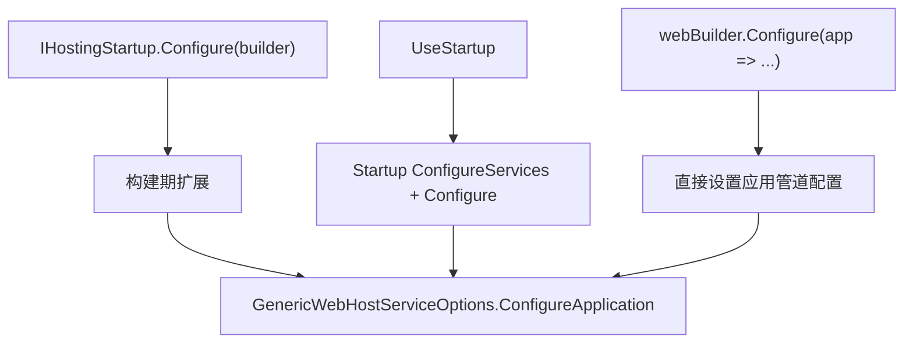

### HostingStartup 的典型用途

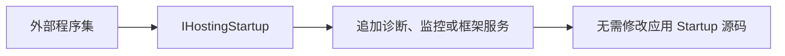

### 启动异常可以延迟汇总

HostingStartup 加载异常会被收集到 GenericWebHostServiceOptions。启动后根据配置记录或转为错误页，而不是在每个扩展入口各自处理。

### Configure 产物是 Action<IApplicationBuilder>

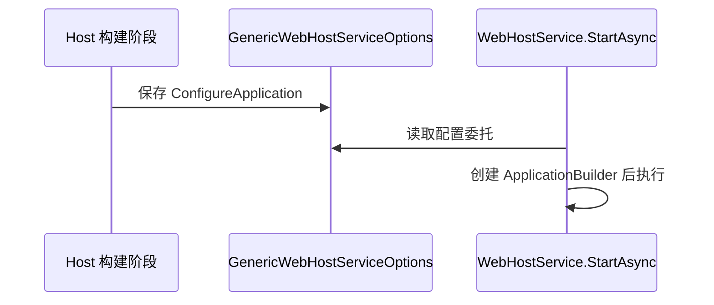

### StartupFilter 在运行配置外层包裹

IStartupFilter 不直接注册 Middleware，而是接收 next Action 并返回新的 Action，使框架能够在应用 Configure 前后插入组件。

### HostingStartupWebHostBuilder

**读这组源码时关注什么：** HostingStartup 执行时为何需要包装 IWebHostBuilder。

#### 整体结构

**这段代码回答什么问题：** HostingStartup 执行时为何需要包装 IWebHostBuilder。

```C#
// 实现 IWebHostBuilder，ISupportsUseDefaultServiceProvider、ISupportsStartup
// 本质是对 GenericWebHostBuilder 的封装
internal sealed class HostingStartupWebHostBuilder : IWebHostBuilder, ISupportsStartup, ISupportsUseDefaultServiceProvider
{
    private readonly GenericWebHostBuilder _builder;
    private Action<WebHostBuilderContext, IConfigurationBuilder>? _configureConfiguration;
    private Action<WebHostBuilderContext, IServiceCollection>? _configureServices;
 
    public HostingStartupWebHostBuilder(GenericWebHostBuilder builder)
    {
        _builder = builder;
    }
 
    // 不支持通过 IWebHostBuilder.Builder 方法构建
    public IWebHost Build()
    {
        throw new NotSupportedException($"Building this implementation of {nameof(IWebHostBuilder)} is not supported.");
    }
 
    // 收集针对应用的配置
    // 利用委托链保存多个配置
    public IWebHostBuilder ConfigureAppConfiguration(Action<WebHostBuilderContext, IConfigurationBuilder> configureDelegate)
    {
        _configureConfiguration += configureDelegate;
        return this;
    }
 
    // 收集针对服务注册的配置
    // 利用委托链保存多个配置
    public IWebHostBuilder ConfigureServices(Action<IServiceCollection> configureServices)
    {
        return ConfigureServices((context, services) => configureServices(services));
    }

    // 收集针对服务注册的配置
    // 利用委托链保存多个配置
    public IWebHostBuilder ConfigureServices(Action<WebHostBuilderContext, IServiceCollection> configureServices)
    {
        _configureServices += configureServices;
        return this;
    }
    
    // 从备用配置读取配置
    // 转移到 GenericWebHostBuilder 上
    public string? GetSetting(string key) => _builder.GetSetting(key);
    
    // 为备用配置添加配置
    // 转移到 GenericWebHostBuilder 上
    public IWebHostBuilder UseSetting(string key, string? value)
    {
        _builder.UseSetting(key, value);
        return this;
    }
    
    // Action<WebHostBuilderContext, IServiceCollection> 委托的原型方法
    // 执行委托链
    public void ConfigureServices(WebHostBuilderContext context, IServiceCollection services)
    {
        _configureServices?.Invoke(context, services);
    }
 
    // Action<WebHostBuilderContext, IConfigurationBuilder> 委托的原型方法
    // 执行委托链
    public void ConfigureAppConfiguration(WebHostBuilderContext context, IConfigurationBuilder builder)
    {
        _configureConfiguration?.Invoke(context, builder);
    }
 
    // 实现 ISupportsUseDefaultServiceProvider 接口
    // 转移到 GenericWebHostBuilder 上
    public IWebHostBuilder UseDefaultServiceProvider(Action<WebHostBuilderContext, ServiceProviderOptions> configure)
    {
        return _builder.UseDefaultServiceProvider(configure);
    }
 
    // 添加针对中间件建造者的配置
    // 转移到 GenericWebHostBuilder 上
    public IWebHostBuilder Configure(Action<IApplicationBuilder> configure)
    {
        return _builder.Configure(configure);
    }
 
    // 添加针对中间件建造者的配置
    // 转移到 GenericWebHostBuilder 上
    public IWebHostBuilder Configure(Action<WebHostBuilderContext, IApplicationBuilder> configure)
    {
        return _builder.Configure(configure);
    }
    
    // 根据 Startup 类型创建基于约定的 Startup 并应用配置
    // 转移到 GenericWebHostBuilder 上
    public IWebHostBuilder UseStartup(Type startupType)
    {
        return _builder.UseStartup(startupType);
    }
 
    // 根据 Func<WebHostBuilderContext, TStartup> 创建基于约定的 Startup 并应用配置
    // 转移到 GenericWebHostBuilder 上
    public IWebHostBuilder UseStartup<TStartup>(Func<WebHostBuilderContext, TStartup> startupFactory)
    {
        return _builder.UseStartup(startupFactory);
    }
}
```

**源码解读：**
- 包装器把允许的配置操作转发给内部 Builder。
- 它用于加载外部 HostingStartup 程序集时隔离或延迟部分行为。

**读完要记住：**
- HostingStartup 可以追加服务和 Web 配置。
- 包装不会单独构建 Host。

### WebHostBuilderExtensions

**读这组源码时关注什么：** UseStartup、Configure 等便捷 API 如何转换为 Builder 配置。

#### 整体结构

**这段代码回答什么问题：** UseStartup、Configure 等便捷 API 如何转换为 Builder 配置。

```C#
// 为 IWebhostBuilder 提供扩展方法
public static class WebHostBuilderExtensions
{
    public static IWebHostBuilder Configure(this IWebHostBuilder hostBuilder, Action<IApplicationBuilder> configureApp)
    {
        ArgumentNullException.ThrowIfNull(configureApp);

        if (hostBuilder is ISupportsStartup supportsStartup)
        {
            return supportsStartup.Configure(configureApp);
        }
 
        // 将配置委托的原型方法的声明类型所在程序集名称作为 "applicationName" 配置节的值
        var startupAssemblyName = configureApp.GetMethodInfo().DeclaringType!.Assembly.GetName().Name!;
 
        hostBuilder.UseSetting(WebHostDefaults.ApplicationKey, startupAssemblyName);
 
        return hostBuilder.ConfigureServices((context, services) =>
        {
            // 注册 IStartup 服务类型
            services.AddSingleton<IStartup>(sp =>
            {
                return new DelegateStartup(sp.GetRequiredService<IServiceProviderFactory<IServiceCollection>>(), (app => configureApp(app)));
            });
        });
    }
 
    public static IWebHostBuilder Configure(this IWebHostBuilder hostBuilder, Action<WebHostBuilderContext, IApplicationBuilder> configureApp)
    {
        ArgumentNullException.ThrowIfNull(configureApp);
 
        if (hostBuilder is ISupportsStartup supportsStartup)
        {
            return supportsStartup.Configure(configureApp);
        }
 
        // 将配置委托的原型方法的声明类型所在程序集名称作为 "applicationName" 配置节的值
        var startupAssemblyName = configureApp.GetMethodInfo().DeclaringType!.Assembly.GetName().Name!;
 
        hostBuilder.UseSetting(WebHostDefaults.ApplicationKey, startupAssemblyName);
 
        return hostBuilder.ConfigureServices((context, services) =>
        {
            // 注册 IStartup 服务类型
            services.AddSingleton<IStartup>(sp =>
            {
                return new DelegateStartup(sp.GetRequiredService<IServiceProviderFactory<IServiceCollection>>(), (app => configureApp(context, app)));
            });
        });
    }
 
    public static IWebHostBuilder UseStartup<TStartup>(this IWebHostBuilder hostBuilder, Func<WebHostBuilderContext, TStartup> startupFactory) where TStartup : class
    {
        ArgumentNullException.ThrowIfNull(startupFactory);
 
        if (hostBuilder is ISupportsStartup supportsStartup)
        {
            return supportsStartup.UseStartup(startupFactory);
        }
 
        var startupAssemblyName = startupFactory.GetMethodInfo().DeclaringType!.Assembly.GetName().Name;
 
        hostBuilder.UseSetting(WebHostDefaults.ApplicationKey, startupAssemblyName);
 
        return hostBuilder
            .ConfigureServices((context, services) =>
            {
                // 注册 IStartup 服务类型
                services.AddSingleton(typeof(IStartup), GetStartupInstance);
 
                [UnconditionalSuppressMessage("Trimmer", "IL2072", Justification = "Startup type created by factory can't be determined statically.")]
                object GetStartupInstance(IServiceProvider serviceProvider)
                {
                    var instance = startupFactory(context) ?? throw new InvalidOperationException("The specified factory returned null startup instance.");
 
                    var hostingEnvironment = serviceProvider.GetRequiredService<IHostEnvironment>();
 
                    if (instance is IStartup startup)
                    {
                        return startup;
                    }
 
                    return new ConventionBasedStartup(StartupLoader.LoadMethods(serviceProvider, instance.GetType(), hostingEnvironment.EnvironmentName, instance));
                }
            });
    }
 
    public static IWebHostBuilder UseStartup(this IWebHostBuilder hostBuilder, Type startupType)
    {
        ArgumentNullException.ThrowIfNull(startupType);
 
        if (hostBuilder is ISupportsStartup supportsStartup)
        {
            return supportsStartup.UseStartup(startupType);
        }
 
        var startupAssemblyName = startupType.Assembly.GetName().Name;
 
        hostBuilder.UseSetting(WebHostDefaults.ApplicationKey, startupAssemblyName);
 
        return hostBuilder
            .ConfigureServices(services =>
            {
                if (typeof(IStartup).IsAssignableFrom(startupType))
                {
                    services.AddSingleton(typeof(IStartup), startupType);
                }
                else
                {
                    // 注册 IStartup 服务类型
                    services.AddSingleton(typeof(IStartup), sp =>
                    {
                        var hostingEnvironment = sp.GetRequiredService<IHostEnvironment>();
                        return new ConventionBasedStartup(StartupLoader.LoadMethods(sp, startupType, hostingEnvironment.EnvironmentName));
                    });
                }
            });
    }
 
    public static IWebHostBuilder UseStartup<TStartup>(this IWebHostBuilder hostBuilder) where TStartup : class
    {
        return hostBuilder.UseStartup(typeof(TStartup));
    }
 
    public static IWebHostBuilder UseDefaultServiceProvider(this IWebHostBuilder hostBuilder, Action<ServiceProviderOptions> configure)
    {
        return hostBuilder.UseDefaultServiceProvider((context, options) => configure(options));
    }
 
    public static IWebHostBuilder UseDefaultServiceProvider(this IWebHostBuilder hostBuilder, Action<WebHostBuilderContext, ServiceProviderOptions> configure)
    {
        if (hostBuilder is ISupportsUseDefaultServiceProvider supportsDefaultServiceProvider)
        {
            return supportsDefaultServiceProvider.UseDefaultServiceProvider(configure);
        }
 
        return hostBuilder.ConfigureServices((context, services) =>
        {
            var options = new ServiceProviderOptions();
            configure(context, options);
            services.Replace(ServiceDescriptor.Singleton<IServiceProviderFactory<IServiceCollection>>(new DefaultServiceProviderFactory(options)));
        });
    }
 
    public static IWebHostBuilder ConfigureAppConfiguration(this IWebHostBuilder hostBuilder, Action<IConfigurationBuilder> configureDelegate)
    {
        return hostBuilder.ConfigureAppConfiguration((context, builder) => configureDelegate(builder));
    }
 
    public static IWebHostBuilder ConfigureLogging(this IWebHostBuilder hostBuilder, Action<ILoggingBuilder> configureLogging)
    {
        return hostBuilder.ConfigureServices(collection => collection.AddLogging(configureLogging));
    }
 
    public static IWebHostBuilder ConfigureLogging(this IWebHostBuilder hostBuilder, Action<WebHostBuilderContext, ILoggingBuilder> configureLogging)
    {
        return hostBuilder.ConfigureServices((context, collection) => collection.AddLogging(builder => configureLogging(context, builder)));
    }
 
    public static IWebHostBuilder UseStaticWebAssets(this IWebHostBuilder builder)
    {
        builder.ConfigureAppConfiguration((context, configBuilder) =>
        {
            StaticWebAssetsLoader.UseStaticWebAssets(context.HostingEnvironment, context.Configuration);
        });
 
        return builder;
    }
}
```

**源码解读：**
- 扩展方法识别能力接口或注册 Startup 相关服务。
- 强类型 Startup 的 ConfigureServices 与 Configure 最终进入既定构建阶段。

**读完要记住：**
- 调用顺序影响服务和管道配置顺序。
- Startup 配置最终保存为 Action<IApplicationBuilder>。

### IHostingStartup

**读这组源码时关注什么：** 外部程序集如何参与 WebHost 构建。

#### 整体结构

**这段代码回答什么问题：** 外部程序集如何参与 WebHost 构建。

```C#
// HostingStartup 接口
// 用来定义强类型 Startup
public interface IHostingStartup
{
    void Configure(IWebHostBuilder builder);
}
```

**源码解读：**
- 接口只定义 Configure(IWebHostBuilder)。
- 实现可在应用 Startup 前追加 Builder 配置。

**读完要记住：**
- 它是宿主级扩展点。
- 异常可由 WebHostOptions 的启动错误策略处理。

### 最小例子

```csharp
IHost host = Host.CreateDefaultBuilder(args)
    .ConfigureWebHostDefaults(webBuilder =>
    {
        webBuilder.Configure(app =>
        {
            app.Run(context => context.Response.WriteAsync("Hello"));
        });
    })
    .Build();
```

### 回顾要点

- WebHost 配置最终附着到 Generic Host 的服务注册。
- GenericWebHostService 作为 IHostedService 随 Host 启停。
- 默认服务器、路由和框架 StartupFilter 在用户配置前注册。

<a id="review-chapter-5"></a>

## 5. 请求管道契约：StartupFilter 与 IApplicationBuilder

### 本组解决什么问题

这一组源码回答“多个中间件组件怎样编译成一个 RequestDelegate”。Use 收集包装函数，Build 以 404 末端为起点从后向前包装；StartupFilter 则在执行应用配置前先构造配置委托链。

### 关键类型关系图

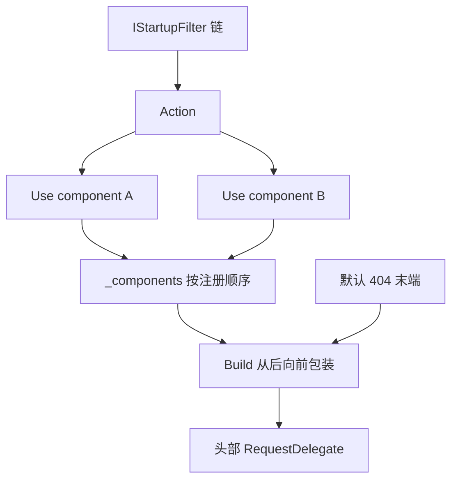

### 核心源码解读

### 管道注册的原始单位

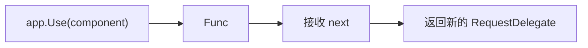

所有 UseMiddleware、Run 等高层 API 最终都转成这种组件函数。

### IApplicationBuilder 的四类状态

| 成员 | 含义 |
| --- | --- |
| ApplicationServices | 应用根容器 |
| ServerFeatures | Server 启动级 Feature |
| Properties | Builder/扩展共享构建状态 |
| Use/New/Build | 注册、分支与编译操作 |

### StartupFilter 的装饰器模型

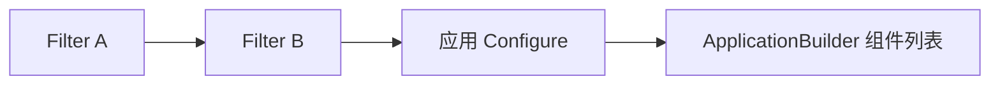

GenericWebHostService 逆序组合 Filter，使注册顺序能够形成稳定的外层到内层嵌套。

### Builder 不是请求对象

IApplicationBuilder 只在应用启动构建管道时使用。每请求状态全部在 HttpContext 中，不应把 HttpContext 或请求 Scoped 服务保存到 Builder.Properties。

### IStartupFilter

**读这组源码时关注什么：** 多个组件如何包装最终的管道配置委托。

#### 整体结构

**这段代码回答什么问题：** 多个组件如何包装最终的管道配置委托。

```C#
// 用来注册 IStartupFilter 服务
public interface IStartupFilter
{
    // 构建 Action<IApplicationBuilder> -> ... -> Action<IApplicationBuilder> 中间件建造者配置链
    Action<IApplicationBuilder> Configure(Action<IApplicationBuilder> next);
}
```

**源码解读：**
- Configure 接收 next 并返回新的 Action<IApplicationBuilder>。
- WebHostService 反转过滤器集合后构造配置链。

**读完要记住：**
- Filter 作用于管道注册阶段。
- 它常用于框架自动插入中间件。

### IApplicationBuilder

**读这组源码时关注什么：** 中间件管道构建器的最小协议是什么。

#### 整体结构

**这段代码回答什么问题：** 中间件管道构建器的最小协议是什么。

```C#
// 中间件建造者
// 用来注册 Func<RequestDelegate, RequestDelegate> 形式的原始中间件
// 并最终将中间件构建成 RequestDelegate -> ... -> RequestDelegate 请求处理委托链
public interface IApplicationBuilder
{
    // 代表根容器的 IServiceProvider
    IServiceProvider ApplicationServices { get; set; }
    
    // 由服务器提供的特性集合
    IFeatureCollection ServerFeatures { get; }

    // 构建过程中用于共享的数据字典
    IDictionary<string, object?> Properties { get; }
    
    // 中间件的原始注册方法
    IApplicationBuilder Use(Func<RequestDelegate, RequestDelegate> middleware);
 
    // 创建一个新的 IApplicationBuilder
    IApplicationBuilder New();
    
    // 构建请求处理委托链
    // 将收集到的 Func<RequestDelegate, RequestDelegate> 形式的中间件构建成请求处理委托链
    RequestDelegate Build();
}
```

**源码解读：**
- Use 收集 Func<RequestDelegate, RequestDelegate>。
- New 创建分支 Builder，Build 编译出头部 RequestDelegate。

**读完要记住：**
- Properties 在构建组件间共享状态。
- ServerFeatures 来自当前 IServer。

<a id="review-chapter-6"></a>

## 6. ApplicationBuilder：逆序编译、分支与默认末端

ApplicationBuilder 收集组件函数，Build 从默认末端开始逆序包装。请求进入时按注册顺序执行，响应返回时按相反顺序退出。

### 逆序包装过程

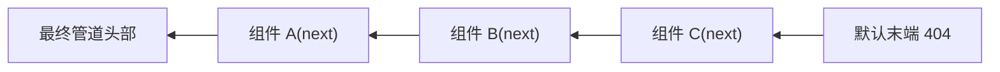

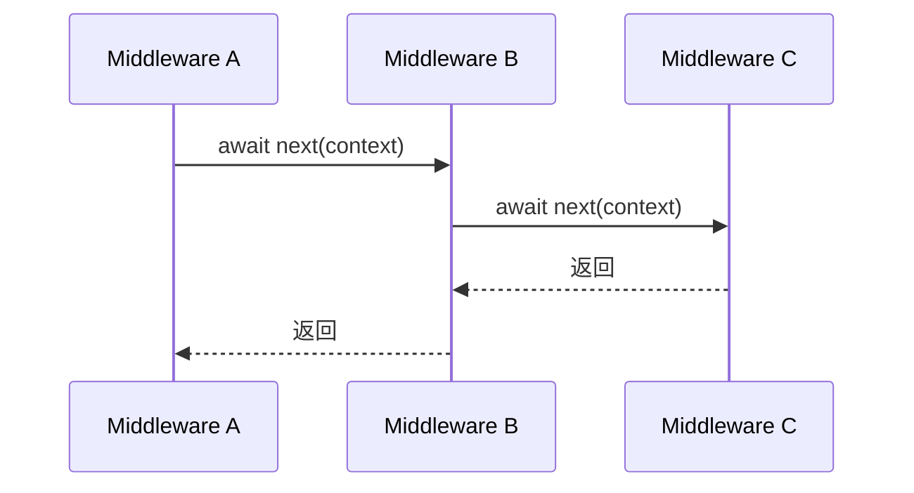

### New 创建空组件列表并共享构建属性视图

```mermaid
flowchart LR
    A["parent.New()"] --> B["新 ApplicationBuilder"]
    A --> C["父 Properties"]
    B --> D["CopyOnWrite Properties"]
    B --> E["空 _components 列表"]
```

这为 Map 等分支提供独立组件集合，同时延续 ApplicationServices、ServerFeatures 等构建状态。

### 默认末端的两个结果

```mermaid
flowchart TD
    A["请求到达管道末端"] --> B{"EndpointFeature 有未执行委托?"}
    B -->|是| C["抛出缺少 EndpointMiddleware 的诊断异常"]
    B -->|否| D{"Response.HasStarted?"}
    D -->|否| E["设置 404"]
    D -->|是| F["保留已开始响应"]
    E --> G["Items 标记 RequestUnhandled"]
    F --> G
```

### Run 是终止组件

```mermaid
flowchart LR
    A["app.Run(handler)"] --> B["app.Use(_ => handler)"]
    B --> C["忽略 next"]
    C --> D["后续注册组件不可达"]
```

### ApplicationBuilderFactory 注入 ServerFeatures

GenericWebHostService 调用工厂时传入 `Server.Features`，使管道构建扩展能够读取服务器能力，但每请求 Feature 仍由 Server 在 CreateContext 时提供。

### ApplicationBuilder

**读这组源码时关注什么：** Use 注册列表如何编译成请求委托链。

#### 整体结构

**这段代码回答什么问题：** Use 注册列表如何编译成请求委托链。

```C#
// IApplicationBuilder 的默认实现
public partial class ApplicationBuilder : IApplicationBuilder
{
    private const string ServerFeaturesKey = "server.Features";
    private const string ApplicationServicesKey = "application.Services";
    private const string MiddlewareDescriptionsKey = "__MiddlewareDescriptions";
    private const string RequestUnhandledKey = "__RequestUnhandled";
 
    private readonly List<Func<RequestDelegate, RequestDelegate>> _components = new();
    private readonly List<string>? _descriptions;
    private readonly IDebugger _debugger;
    
    public ApplicationBuilder(IServiceProvider serviceProvider) : this(serviceProvider, new FeatureCollection())
    {
    }
    
    // 表示中间件数量
    private int MiddlewareCount => _components.Count;
 
    // 利用 IApplicationBuilderFactory 创建 ApplicationBuilder 时调用的构造函数
    // 需要提供表示根容器的 IServiceProvider 和服务器提供的特性集合 IFeatureCollection
    public ApplicationBuilder(IServiceProvider serviceProvider, object server)
    {
        Properties = new Dictionary<string, object?>(StringComparer.Ordinal);
        ApplicationServices = serviceProvider;

        // 使用 "server.Features" 作为 Key 将 IFeatureCollection 特性集合保存到共享字典中
        SetProperty(ServerFeaturesKey, server);
 
        _debugger = (IDebugger?)serviceProvider?.GetService(typeof(IDebugger)) ?? DebuggerWrapper.Instance;
 
        if (_debugger.IsAttached)
        {
            _descriptions = new();
            SetProperty(MiddlewareDescriptionsKey, _descriptions);
        }
    }
 
    // 提供给 New 方法调用的私有构造函数，用于创建新的 ApplicationBuilder 时拷贝共享字典
    private ApplicationBuilder(ApplicationBuilder builder)
    {
        Properties = new CopyOnWriteDictionary<string, object?>(builder.Properties, StringComparer.Ordinal);
        _debugger = builder._debugger;
        if (_debugger.IsAttached)
        {
            _descriptions = new();
        }
    }
    
    // 使用 "application.Services" 作为 Key 存取表示根容器的 IServiceProvider
    public IServiceProvider ApplicationServices
    {
        get
        {
            return GetProperty<IServiceProvider>(ApplicationServicesKey)!;
        }
        set
        {
            SetProperty<IServiceProvider>(ApplicationServicesKey, value);
        }
    }
 
    // 使用 "server.Features" 作为 Key 从共享字典中获取由服务器提供的特性集合 IFeatureCollection
    public IFeatureCollection ServerFeatures
    {
        get
        {
            return GetProperty<IFeatureCollection>(ServerFeaturesKey)!;
        }
    }
 
    // ApplicationServices 和 ServerFeatures 两个属性的存取实际都是通过这个共享字典来完成的
    public IDictionary<string, object?> Properties { get; }
 
    private T? GetProperty<T>(string key)
    {
        return Properties.TryGetValue(key, out var value) ? (T?)value : default(T);
    }
 
    private void SetProperty<T>(string key, T value)
    {
        Properties[key] = value;
    }
 
    // 注册 Func<RequestDelegate, RequestDelegate> 形式的原始中间件
    public IApplicationBuilder Use(Func<RequestDelegate, RequestDelegate> middleware)
    {
        // 收集原始中间件
        _components.Add(middleware);
        _descriptions?.Add(CreateMiddlewareDescription(middleware));
 
        return this;
    }
 
    // 得到原始中间件的名称
    private static string CreateMiddlewareDescription(Func<RequestDelegate, RequestDelegate> middleware)
    {
        if (middleware.Target != null)
        {
            if (middleware.Method.Name == "CreateMiddleware")
            {
                return middleware.Target.ToString()!;
            }
 
            return middleware.Target.GetType().FullName + "." + middleware.Method.Name;
        }
 
        return middleware.Method.Name.ToString();
    }
 
    // 利用自身创建一个新的 IApplicationBuilder
    public IApplicationBuilder New()
    {
        return new ApplicationBuilder(this);
    }
 
    // 构建请求处理委托链
    public RequestDelegate Build()
    {
        // 创建一个响应 404 状态码的 RequestDelegate，作为循环调用 Func<RequestDelegate, RequestDelegate> 创建请求处理委托链时的末端处理器
        // 如果前序的请求处理器没有返回，则最终会到达这个末端处理器，并响应 404 状态码
        RequestDelegate app = context =>
        {
            // 尝试从 HttpContext.Features 中获取 IEndpointFeature 特性对象
            var endpoint = context.GetEndpoint();
            // 得到表示终结点的请求处理器
            var endpointRequestDelegate = endpoint?.RequestDelegate;
            // 如果运行到这个末端处理器时候存在终结点，则表示可能没有通过 UseEndpoints 注册终结点处理器，或者有其他不可预知的问题发生
            // 因为使用 UseEndpoints 注册的终结点处理器会从 HttpContext.Features 特性集合中取出终结点处理并返回
            if (endpointRequestDelegate != null)
            {
                var message =
                    $"The request reached the end of the pipeline without executing the endpoint: '{endpoint!.DisplayName}'. " +
                    $"Please register the EndpointMiddleware using '{nameof(IApplicationBuilder)}.UseEndpoints(...)' if using " +
                    $"routing.";
                throw new InvalidOperationException(message);
            }
 
            // 返回 404 状态码
            // 表明没有任何终结点处理器处理这个请求
            if (!context.Response.HasStarted)
            {
                context.Response.StatusCode = StatusCodes.Status404NotFound;
            }
 
            // 通知前序的请求处理器这个请求没有被任何终结点处理器处理
            context.Items[RequestUnhandledKey] = true;
 
            return Task.CompletedTask;
        };

        // 利用末端处理器从后往前循环执行 Func<RequestDelegate, RequestDelegate> 原始中间件列表
        // 构建 RequestDelegate -> ... -> RequestDelegate 请求处理委托链
        for (var c = _components.Count - 1; c >= 0; c--)
        {
            app = _components[c](app);
        }

        // 返回位于头部的请求处理器
        return app;
    }
}
```

**源码解读：**
- 组件按注册顺序加入列表，Build 从尾到头逐层包装默认末端委托。
- 默认末端在无人处理时返回 404，并检测未执行的 Endpoint。

**读完要记住：**
- 逆序包装保证请求进入顺序与注册顺序一致。
- 响应返回阶段按相反方向退出。

### IApplicationBuilderFactory

**读这组源码时关注什么：** 服务器特性如何进入 ApplicationBuilder 创建过程。

#### 整体结构

**这段代码回答什么问题：** 服务器特性如何进入 ApplicationBuilder 创建过程。

```C#
// 中间件构建者工厂的抽象表示
public interface IApplicationBuilderFactory
{
    // 利用特性集合创建 IApplicationBuilder
    IApplicationBuilder CreateBuilder(IFeatureCollection serverFeatures);
}
```

**源码解读：**
- 工厂接口接收 IFeatureCollection 并返回 Builder。
- WebHostService 不直接依赖具体 ApplicationBuilder。

**读完要记住：**
- 每次服务器启动构建一条应用管道。
- 根 IServiceProvider 由工厂实现注入。

### ApplicationBuilderFactory

**读这组源码时关注什么：** 默认 Builder 工厂如何组合根容器与 Server Features。

#### 整体结构

**这段代码回答什么问题：** 默认 Builder 工厂如何组合根容器与 Server Features。

```C#
// IApplicationBuilderFactory 的默认实现
// 利用表示根容器的 IServiceProvider 和由服务器提供的特性集合 IFeatureCollection 创建 ApplicationBuilder
public class ApplicationBuilderFactory : IApplicationBuilderFactory
{
    private readonly IServiceProvider _serviceProvider;
 
    // 注入表示根容器的 IServiceProvider
    public ApplicationBuilderFactory(IServiceProvider serviceProvider)
    {
        _serviceProvider = serviceProvider;
    }
 
    public IApplicationBuilder CreateBuilder(IFeatureCollection serverFeatures)
    {
        return new ApplicationBuilder(_serviceProvider, serverFeatures);
    }
}
```

**源码解读：**
- 构造时保存根 IServiceProvider。
- CreateBuilder 用它和服务器特性创建 ApplicationBuilder。

**读完要记住：**
- ApplicationServices 指向根容器。
- 请求级服务由 HttpContext.RequestServices 提供。

### RunExtensions

**读这组源码时关注什么：** 终结中间件为什么会短路后续管道。

#### 整体结构

**这段代码回答什么问题：** 终结中间件为什么会短路后续管道。

```C#
// 提供中间件注册的扩展方法
public static class RunExtensions
{
    // 注册末端中间件，属于短路操作
    // 因为返回的 RequestDelegate 请求处理器并未包含对传入的 RequestDelegate 请求处理器的调用
    public static void Run(this IApplicationBuilder app, RequestDelegate handler)
    {
        ArgumentNullException.ThrowIfNull(app);
        ArgumentNullException.ThrowIfNull(handler);
 
        app.Use(_ => handler);
    }
}
```

**源码解读：**
- Run 通过 Use 注册一个忽略 next 的组件。
- 生成的 RequestDelegate 直接调用 handler。

**读完要记住：**
- Run 之后注册的组件不会被该请求到达。
- 它通常放在分支或管道末尾。

### 最小例子

```csharp
app.Use(async (context, next) =>
{
    Console.WriteLine("A: before");
    await next(context);
    Console.WriteLine("A: after");
});

app.Run(context => context.Response.WriteAsync("terminal"));
```

### 回顾要点

- 组件按注册顺序保存，Build 从尾到头包装。
- 请求进入按注册顺序，响应返回按反向顺序。
- Run 忽略 next，因此是终结和短路操作。

<a id="review-chapter-7"></a>

## 7. IMiddleware：每请求实例与工厂协议

### 本组解决什么问题

这一组源码回答“UseMiddleware 为什么存在两种生命周期模型”。实现 IMiddleware 的类型在每个请求中从 RequestServices 创建；约定式类型在构建管道时创建一次，但 Invoke 参数可在请求阶段从作用域解析。

### 关键类型关系图

```mermaid
flowchart TD
    A["UseMiddleware<T>"] --> B{"实现 IMiddleware?"}
    B -->|是| C["每请求解析 IMiddlewareFactory"]
    C --> D["Create / InvokeAsync / Release"]
    B -->|否| E["Build 时反射创建实例"]
    E --> F["每请求调用 Invoke/InvokeAsync"]
    G["RequestServices"] --> C
    G --> F
```

### 核心源码解读

### IMiddleware 把 next 从构造状态变成调用参数

```mermaid
flowchart LR
    A["IMiddleware.InvokeAsync"] --> B["HttpContext"]
    A --> C["RequestDelegate next"]
```

实例不必永久绑定某条 next 链，因此适合由每请求容器创建。

### 每请求激活顺序

```mermaid
sequenceDiagram
    participant P as RequestDelegate 包装器
    participant R as HttpContext.RequestServices
    participant F as IMiddlewareFactory
    participant M as IMiddleware
    P->>R: GetService(IMiddlewareFactory)
    R-->>P: Scoped Factory
    P->>F: Create(middlewareType)
    F-->>P: 当前请求 Middleware
    P->>M: InvokeAsync(context, next)
    P->>F: finally Release(middleware)
```

### MiddlewareFactory 自身是 Scoped

它保存当前 RequestServices，并用 GetRequiredService 解析中间件。默认 Release 无操作，因为请求 Scope 释放时由 DI 统一处理实例。

### IMiddleware 必须提前注册

```csharp
services.AddScoped<RequestAuditMiddleware>();
app.UseMiddleware<RequestAuditMiddleware>();
```

UseMiddleware 只注册调用包装器，不自动为 IMiddleware 实现类型添加 DI 服务。

### 显式构造参数不适用于 IMiddleware

每请求模型要求所有构造依赖来自 RequestServices；传给 UseMiddleware 的 args 会被拒绝，避免把应用级对象混入每请求实例。

### IMiddleware

**读这组源码时关注什么：** 强类型中间件的统一调用协议是什么。

#### 整体结构

**这段代码回答什么问题：** 强类型中间件的统一调用协议是什么。

```C#
// 强类型中间件的抽象表示
public interface IMiddleware
{
    Task InvokeAsync(HttpContext context, RequestDelegate next);
}
```

**源码解读：**
- InvokeAsync 显式接收 HttpContext 与 next。
- 实例创建交给 IMiddlewareFactory。

**读完要记住：**
- 该模式支持每请求解析中间件实例。
- 中间件类型必须注册到 DI。

### IMiddlewareFactory

**读这组源码时关注什么：** 强类型中间件生命周期如何抽象。

#### 整体结构

**这段代码回答什么问题：** 强类型中间件生命周期如何抽象。

```C#
// 中间件工厂的抽象表示
public interface IMiddlewareFactory
{
    // 创建强类型中间件
    IMiddleware? Create(Type middlewareType);
    
    // 对创建的中间件进行回收
    void Release(IMiddleware middleware);
}
```

**源码解读：**
- Create 按类型获取实例，Release 负责回收。
- UseMiddleware 在每次请求中调用这两个方法。

**读完要记住：**
- 自定义工厂可控制池化或释放策略。
- 默认工厂依赖请求作用域容器。

### MiddlewareFactory

**读这组源码时关注什么：** 默认 IMiddlewareFactory 如何从请求作用域解析实例。

#### 整体结构

**这段代码回答什么问题：** 默认 IMiddlewareFactory 如何从请求作用域解析实例。

```C#
// IMiddlewareFactory 的默认实现
public class MiddlewareFactory : IMiddlewareFactory
{
    // 表示范围容器的 IServiceProvider
    private readonly IServiceProvider _serviceProvider;
    
    // 此处注入的是表示范围容器的 IServiceProvider
    // 因为 IMiddlewareFactory 被注册为 Scoped 生命周期
    // 并且在请求处理阶段是由 HttpContext.RequestServices 表示的范围容器创建
    public MiddlewareFactory(IServiceProvider serviceProvider)
    {
        _serviceProvider = serviceProvider;
    }
    
    // 由范围容器创建强类型中间件
    public IMiddleware? Create(Type middlewareType)
    {
        // 强类型中间件在请求作用范围下唯一
        return _serviceProvider.GetRequiredService(middlewareType) as IMiddleware;
    }
    
    // 释放
    public void Release(IMiddleware middleware)
    {
        // 不做任何事情
        // 一般强类型中间件的释放由依赖注入容器管理
    }
}
```

**源码解读：**
- 工厂本身是 Scoped，并持有当前 RequestServices。
- Create 调用 GetRequiredService，Release 留给 DI 容器处理。

**读完要记住：**
- IMiddleware 可安全依赖 Scoped 服务。
- 实例生命周期与请求作用域一致。

<a id="review-chapter-8"></a>

## 8. 约定式 Middleware：应用级实例与请求级 Invoke 参数

不实现 IMiddleware 的类型走反射约定：应用启动构建管道时创建一次实例，构造函数接收 next 和显式/根容器依赖；每次请求调用 Invoke/InvokeAsync，额外方法参数从 RequestServices 解析。

### 两种模型对照

| 维度 | IMiddleware | 约定式 Middleware |
| --- | --- | --- |
| 实例创建 | 每请求 | Build 管道时一次 |
| 创建者 | IMiddlewareFactory / RequestServices | ActivatorUtilities / ApplicationServices |
| next 位置 | InvokeAsync 参数 | 构造函数参数 |
| Scoped 依赖 | 构造函数可直接注入 | 只能放 Invoke 参数 |
| 显式 args | 不支持 | 支持构造参数 |

### 约定方法校验

```mermaid
flowchart TD
    A["扫描公开实例方法"] --> B{"恰好一个 Invoke 或 InvokeAsync?"}
    B -->|否| C["抛出约定错误"]
    B -->|是| D{"返回 Task?"}
    D -->|否| C
    D -->|是| E{"首参数是 HttpContext?"}
    E -->|否| C
    E -->|是| F["创建 ReflectionMiddlewareBinder"]
```

### 构造与调用的服务提供者不同

```mermaid
flowchart LR
    A["管道 Build"] --> B["ApplicationServices 根容器"]
    B --> C["创建 Middleware 单例实例"]
    D["每个请求"] --> E["HttpContext.RequestServices"]
    E --> F["解析 Invoke 附加参数"]
    C --> F
```

因此约定式 Middleware 构造函数不能安全捕获 Scoped 服务。

### 动态代码与反射回退

```mermaid
flowchart TD
    A["Invoke 有附加参数"] --> B{"运行时支持动态代码?"}
    B -->|是| C["编译表达式委托"]
    B -->|否| D["反射 MethodInfo.Invoke"]
    C --> E["每请求解析参数并调用"]
    D --> E
```

### ref/out 参数被拒绝

Invoke 参数需要从 IServiceProvider 按类型解析，ref/out 无法表达这一依赖模型，因此绑定阶段直接抛出异常。

### Scoped 依赖示例

```csharp
public Task InvokeAsync(HttpContext context, RequestAudit audit)
{
    audit.Record(context.Request.Path);
    return _next(context);
}
```

`RequestAudit` 在每个请求调用时从 RequestServices 获取，而 Middleware 实例本身仍属于应用级。

### UseMiddlewareExtensions

**读这组源码时关注什么：** UseMiddleware 如何区分 IMiddleware 与约定式中间件。

#### 整体结构

**这段代码回答什么问题：** UseMiddleware 如何区分 IMiddleware 与约定式中间件。

```C#
// 提供扩展方法用来注册中间件
public static class UseMiddlewareExtensions
{
    // 约定的两个用来在中间件中定义的特定方法名
    internal const string InvokeMethodName = "Invoke";
    internal const string InvokeAsyncMethodName = "InvokeAsync";

    // 得到 UseMiddlewareExtensions.GetService 方法的 MethodInfo
    private static readonly MethodInfo GetServiceInfo = typeof(UseMiddlewareExtensions).GetMethod(nameof(GetService), BindingFlags.NonPublic | BindingFlags.Static)!;

    // 注册中间件
    // 使用泛型参数表示的中间件类型
    public static IApplicationBuilder UseMiddleware<TMiddleware>(this IApplicationBuilder app, params object?[] args)
    {
        return app.UseMiddleware(typeof(TMiddleware), args);
    }

    // 注册中间件
    // 分以下两种情况：
    // 1. 强类型中间件是由 HttpContext.RequestServices 表示的范围容器在请求处理阶段创建的，并且构造函数不支持传递外部参数列表，所有参数由依赖注入容器提供
    //    所以强类型中间可以基于每个请求作用范围创建独立的中间件实例
    // 2. 基于约定的中间件是在构建请求处理委托链时通过反射方式创建的，并且构造函数允许传递外部参数列表
    //    如果外部参数列表中不存在对应类型的参数时，还可以由 IApplicationBuilder.ApplicationServices 表示的根容器创建对应参数类型的实例
    //    另外在请求处理阶段，可以由 HttpContext.RequestServices 表示的范围容器创建除 HttpContext 类型参数以外的其他参数类型的实例
    //    所以基于约定的中间件在整个应用程序生命周期内只会创建一个实例
    public static IApplicationBuilder UseMiddleware(
        this IApplicationBuilder app,
        Type middleware,
        params object?[] args)
    {
        // 如果是强类型中间件，则不支持传递参数列表
        if (typeof(IMiddleware).IsAssignableFrom(middleware))
        {
            if (args.Length > 0)
            {
                throw new NotSupportedException(Resources.FormatException_UseMiddlewareExplicitArgumentsNotSupported(typeof(IMiddleware)));
            }

            // 使用 InterfaceMiddlewareBinder.CreateMiddleware 注册原始中间件
            var interfaceBinder = new InterfaceMiddlewareBinder(middleware);
            return app.Use(interfaceBinder.CreateMiddleware);
        }
 
        // 以下是将基于约定的中间件注册为原始中间件
        // 基于约定中间件必须满足以下条件：
        // 1. 检查中间件类型中是否存在名称为 "Invoke" 或 "InvokeAsync" 的公开实例方法（严格区分大小写）
        // 2. 不能定义 "Invoke" 或 "InvokeAsync" 方法的重载，并且 "Invoke" 和 "InvokeAsync" 方法之间也不能同时存在
        // 3. "Invoke" 或 "InvokeAsync" 方法返回类型必须是 Task
        // 4. "Invoke" 或 "InvokeAsync" 方法的第一个参数必须是 HttpContext 类型
        var methods = middleware.GetMethods(BindingFlags.Instance | BindingFlags.Public);
        MethodInfo? invokeMethod = null;
        foreach (var method in methods)
        {
            if (string.Equals(method.Name, InvokeMethodName, StringComparison.Ordinal) || 
                string.Equals(method.Name, InvokeAsyncMethodName, StringComparison.Ordinal))
            {
                if (invokeMethod is not null)
                {
                    throw new InvalidOperationException(Resources.FormatException_UseMiddleMutlipleInvokes(InvokeMethodName, InvokeAsyncMethodName));
                }

                invokeMethod = method;
            }
        }

        if (invokeMethod is null)
        {
            throw new InvalidOperationException(Resources.FormatException_UseMiddlewareNoInvokeMethod(InvokeMethodName, InvokeAsyncMethodName, middleware));
        }

        if (!typeof(Task).IsAssignableFrom(invokeMethod.ReturnType))
        {
            throw new InvalidOperationException(Resources.FormatException_UseMiddlewareNonTaskReturnType(InvokeMethodName, InvokeAsyncMethodName, nameof(Task)));
        }
 
        var parameters = invokeMethod.GetParameters();
        if (parameters.Length == 0 || parameters[0].ParameterType != typeof(HttpContext))
        {
            throw new InvalidOperationException(Resources.FormatException_UseMiddlewareNoParameters(InvokeMethodName, InvokeAsyncMethodName, nameof(HttpContext)));
        }

        // 使用 ReflectionMiddlewareBinder.CreateMiddleware 注册原始中间件
        var reflectionBinder = new ReflectionMiddlewareBinder(app, middleware, args, invokeMethod, parameters);
        return app.Use(reflectionBinder.CreateMiddleware);
    }

    // 强类型中间件绑定器
    private sealed class InterfaceMiddlewareBinder
    {
        private readonly Type _middlewareType;
 
        public InterfaceMiddlewareBinder(Type middlewareType)
        {
            _middlewareType = middlewareType;
        }
 
        // 中间件的原始形式
        public RequestDelegate CreateMiddleware(RequestDelegate next)
        {
            return async context =>
            {
                // 使用 HttpContext.RequestServices 表示的范围容器创建 IMiddlewareFactory
                var middlewareFactory = (IMiddlewareFactory?)context.RequestServices.GetService(typeof(IMiddlewareFactory));
                if (middlewareFactory == null)
                {
                    
                    throw new InvalidOperationException(Resources.FormatException_UseMiddlewareNoMiddlewareFactory(typeof(IMiddlewareFactory)));
                }

                // 强类型中间件是在请求处理阶段创建的，而且由于是使用 HttpContext.RequestServices 表示的范围容器创建中间件实例，所以中间件类型必须提前注册，并且可以是 Scoped 生命周期
                // 使用 IMiddlewareFactory 创建中间件实例
                var middleware = middlewareFactory.Create(_middlewareType);
                if (middleware == null)
                {
                    throw new InvalidOperationException(Resources.FormatException_UseMiddlewareUnableToCreateMiddleware(middlewareFactory.GetType(), _middlewareType));
                }
 
                try
                {
                    // 调用 IMiddleware.InvokeAsync 方法
                    await middleware.InvokeAsync(context, next);
                }
                finally
                {
                    middlewareFactory.Release(middleware);
                }
            };
        }
 
        public override string ToString() => _middlewareType.ToString();
    }

    // 基于约定的中间件绑定器
    private sealed class ReflectionMiddlewareBinder
    {
        private readonly IApplicationBuilder _app;
        private readonly Type _middleware;
        private readonly object?[] _args;
        private readonly MethodInfo _invokeMethod;
        private readonly ParameterInfo[] _parameters;
 
        public ReflectionMiddlewareBinder(
            IApplicationBuilder app,
            Type middleware,
            object?[] args,
            MethodInfo invokeMethod,
            ParameterInfo[] parameters)
        {
            _app = app;
            _middleware = middleware;
            _args = args;
            _invokeMethod = invokeMethod;
            _parameters = parameters;
        }

        // 中间件的原始形式
        public RequestDelegate CreateMiddleware(RequestDelegate next)
        {
            // 创建中间件的构造函数实参列表，包含代表后续请求处理器的 RequestDelegate 类型参数
            var ctorArgs = new object[_args.Length + 1];
            ctorArgs[0] = next;
            Array.Copy(_args, 0, ctorArgs, 1, _args.Length);
            // 基于约定的中间件是在构造请求处理委托链时创建的，所以在整个应用程序生命周期中基于约定的中间件实例是以单例形式存在的
            // 反射创建基于约定的中间件类型实例
            // 除了 RequestDelegate 类型参数外，其他参数优先从外部的实参列表获取，没有则利用根容器提供，如果还是没有则最终会尝试使用类型的默认值
            var instance = ActivatorUtilities.CreateInstance(_app.ApplicationServices, _middleware, ctorArgs);
            // 如果 "Invoke" 或 "InvokeAsync" 方法的参数个数为 1
            // 表明函数只有 HttpContext 类型参数，直接利用 MethodInfo 方法创建 RequestDelegate 委托返回
            if (_parameters.Length == 1)
            {
                return (RequestDelegate)_invokeMethod.CreateDelegate(typeof(RequestDelegate), instance);
            }
            
            // 如果 "Invoke" 或 "InvokeAsync" 方法存在其他参数，则先确定运行环境是否支持运行时动态代码编译
            // 如果支持会构建表达式树，并将表达式树编译成 Func<object, HttpContext, IServiceProvider, Task> 委托执行
            // 否则使用反射方式调用 "Invoke" 或 "InvokeAsync" 方法
            var factory = RuntimeFeature.IsDynamicCodeCompiled
                ? CompileExpression<object>(_invokeMethod, _parameters)
                : ReflectionFallback<object>(_invokeMethod, _parameters);

            return context =>
            {
                // 可以使用 HttpContext.RequestServices 表示的范围容器创建除 HttpContext 类型参数以外的其他参数实例
                var serviceProvider = context.RequestServices ?? _app.ApplicationServices;
                if (serviceProvider == null)
                {
                    throw new InvalidOperationException(Resources.FormatException_UseMiddlewareIServiceProviderNotAvailable(nameof(IServiceProvider)));
                }
 
                return factory(instance, context, serviceProvider);
            };
        }
 
        public override string ToString() => _middleware.ToString();
    }

    // 内部通过反射方式调用 "Invoke" 或 "InvokeAsync" 方法
    private static Func<T, HttpContext, IServiceProvider, Task> ReflectionFallback<T>(MethodInfo methodInfo, ParameterInfo[] parameters)
    {
        Debug.Assert(!RuntimeFeature.IsDynamicCodeSupported, "Use reflection fallback when dynamic code is not supported.");
 
        // 循环检查每个参数，不支持按地址传递的参数
        for (var i = 1; i < parameters.Length; i++)
        {
            var parameterType = parameters[i].ParameterType;
            if (parameterType.IsByRef)
            {
                throw new NotSupportedException(Resources.FormatException_InvokeDoesNotSupportRefOrOutParams(InvokeMethodName));
            }
        }
 
        return (middleware, context, serviceProvider) =>
        {
            var methodArguments = new object[parameters.Length];
            // 第一个实参必须是 HttpContext 类型参数
            methodArguments[0] = context;
            for (var i = 1; i < parameters.Length; i++)
            {
                // 利用范围容器创建其他参数
                methodArguments[i] = GetService(serviceProvider, parameters[i].ParameterType, methodInfo.DeclaringType!);
            }

            // 通过反射调用 "Invoke" 或 "InvokeAsync" 方法
            return (Task)methodInfo.Invoke(middleware, BindingFlags.DoNotWrapExceptions, binder: null, methodArguments, culture: null)!;
        };
    }
 
    // 构建表达式树并通过动态代码编译成委托执行 "Invoke" 或 "InvokeAsync" 方法
    private static Func<T, HttpContext, IServiceProvider, Task> CompileExpression<T>(MethodInfo methodInfo, ParameterInfo[] parameters)
    {
        Debug.Assert(RuntimeFeature.IsDynamicCodeSupported, "Use compiled expression when dynamic code is supported.");
 
        // 中间件的实际类型
        // 根据调用来看，此处是 object 类型
        var middleware = typeof(T);
 
        // 创建 Func<T, HttpContext, IServiceProvider, Task> 委托原型方法需要的三个入参
        // 1. 表示中间件实例，参数名 "middleware"，object 类型
        // 2. 表示请求上下文，参数名 "httpContext"，HttpContext 类型
        // 3. 表示范围容器，参数名 "serviceProvider"，IServiceProvider 类型
        var instanceArg = Expression.Parameter(middleware, "middleware");
        var httpContextArg = Expression.Parameter(typeof(HttpContext), "httpContext");
        var providerArg = Expression.Parameter(typeof(IServiceProvider), "serviceProvider");

        // 创建调用 "Invoke" 或 "InvokeAsync" 方法的实参列表
        var methodArguments = new Expression[parameters.Length];
        // 第一个实参必须是 HttpContext 类型参数
        methodArguments[0] = httpContextArg;
        for (var i = 1; i < parameters.Length; i++)
        {
            var parameterType = parameters[i].ParameterType;
            if (parameterType.IsByRef)
            {
                throw new NotSupportedException(Resources.FormatException_InvokeDoesNotSupportRefOrOutParams(InvokeMethodName));
            }
 
            // 为调用 UseMiddlewareExtensions.GetService 静态方法准备的参数列表
            var parameterTypeExpression = new Expression[]
            {
                providerArg,
                Expression.Constant(parameterType, typeof(Type)),
                Expression.Constant(methodInfo.DeclaringType, typeof(Type))
            };

            // 调用 UseMiddlewareExtensions.GetService 静态方法
            // 为 "Invoke" 或 "InvokeAsync" 方法创建除 HttpContext 类型参数以外的实参
            var getServiceCall = Expression.Call(GetServiceInfo, parameterTypeExpression);
            // 对实参进行强制类型转换并添加进实参列表
            methodArguments[i] = Expression.Convert(getServiceCall, parameterType);
        }
 
        Expression middlewareInstanceArg = instanceArg;
        if (methodInfo.DeclaringType != null && methodInfo.DeclaringType != typeof(T))
        {
            // 强制类型转换为中间件的实际类型
            middlewareInstanceArg = Expression.Convert(middlewareInstanceArg, methodInfo.DeclaringType);
        }
        
        // 通过中间件实例调用 "Invoke" 或 "InvokeAsync" 方法
        var body = Expression.Call(middlewareInstanceArg, methodInfo, methodArguments);
 
        // 创建 Expression<Func<T, HttpContext, IServiceProvider, Task>> 表达式
        var lambda = Expression.Lambda<Func<T, HttpContext, IServiceProvider, Task>>(body, instanceArg, httpContextArg, providerArg);

        // 将表达式编译成 Func<T, HttpContext, IServiceProvider, Task> 委托
        return lambda.Compile();
    }
 
    // 通过范围容器创建对应类型的实例
    private static object GetService(IServiceProvider sp, Type type, Type middleware)
    {
        var service = sp.GetService(type);
        if (service == null)
        {
            throw new InvalidOperationException(Resources.FormatException_InvokeMiddlewareNoService(type, middleware));
        }
 
        return service;
    }
}
```

**源码解读：**
- IMiddleware 路径每请求通过工厂创建并释放。
- 约定式路径在 Build 时创建单例实例，并反射调用 Invoke 或 InvokeAsync；额外方法参数从 RequestServices 解析。

**读完要记住：**
- 两种模型的构造时机和生命周期不同。
- 约定式中间件构造函数不应直接依赖 Scoped 服务。

### 最小例子

```csharp
public sealed class RequestAuditMiddleware : IMiddleware
{
    public async Task InvokeAsync(HttpContext context, RequestDelegate next)
    {
        await next(context);
    }
}

services.AddScoped<RequestAuditMiddleware>();
app.UseMiddleware<RequestAuditMiddleware>();
```

### 回顾要点

- IMiddleware 实例可使用 Scoped 生命周期。
- 约定式 Middleware 实例通常在应用生命周期内复用。
- 约定式 Invoke 的附加参数仍可从 RequestServices 解析。

## 9. HttpContext：请求与响应的统一门面

### 本组解决什么问题

这一组源码回答“服务器提供的 Feature 如何投影为 HttpContext，以及请求服务作用域何时出现”。DefaultHttpContextFactory 初始化上下文，RequestServicesFeature 在首次访问时延迟创建 Scope，并在响应完成后释放。

### 关键类型关系图

```mermaid
flowchart TD
    A["Server IFeatureCollection"] --> B["DefaultHttpContextFactory"]
    B --> C["HttpContext"]
    C --> D["HttpRequest / HttpResponse"]
    C --> E["RequestServicesFeature"]
    F["首次读取 RequestServices"] --> E
    E --> G["IServiceScopeFactory.CreateScope"]
    G --> H["Scoped IServiceProvider"]
    I["Response 完成"] --> J["DisposeAsync Scope"]
    E --> J
```

### 核心源码解读

### HttpContext 是 Feature 的稳定门面

```mermaid
flowchart TB
    A["HttpContext"] --> B["Features"]
    B --> C["HttpRequest"]
    B --> D["HttpResponse"]
    B --> E["Connection / WebSockets / Endpoint"]
    A --> F["Items / User / RequestAborted / TraceIdentifier"]
    A --> G["RequestServices"]
```

Server 可以提供不同 Feature 实现，而 Middleware 使用稳定的 HttpContext API。

### Request 与 Response 是 Context 的子视图

```mermaid
flowchart LR
    A["HttpRequest"] --> B["IHttpRequestFeature 等"]
    C["HttpResponse"] --> D["IHttpResponseFeature / BodyFeature 等"]
    B --> E["Server 原始请求状态"]
    D --> F["Server 响应写入能力"]
```

### Feature 可在请求中被替换

某些包装 Middleware 会替换 Body、WebSocket 或路由相关 Feature。HttpRequest/Response 属性访问因此通常动态回到 FeatureReferences，而不是假设底层对象永久不变。

### Items 与 RequestServices 生命周期不同

Items 是请求内任意键值存储；RequestServices 是 DI Scope。把服务放进 Items 不会获得自动释放或依赖解析语义。

### 不要跨请求保存 HttpContext

Context 和 Feature 可能被池化复用，且 Accessor 依赖 AsyncLocal。需要延后处理的数据应复制所需值，而不是保存 HttpContext 引用。

### HttpContext

**读这组源码时关注什么：** 一次请求的统一上下文抽象包含哪些入口。

#### 整体结构

**这段代码回答什么问题：** 一次请求的统一上下文抽象包含哪些入口。

```C#
// HTTP 上下文的抽象表示
// DefaultHttpContext 是 HttpContext 的默认实现，但不负责具体属性值的提供，它的核心功能只是代理
// DefaultHttpContext 创建时由不同服务器传入 IFeatureCollection 特性集合，利用相应的特性类型（一般为接口类型）从特性集合中得到特性对象
public abstract class HttpContext
{
    // 不同服务器所提供的特性集合
    public abstract IFeatureCollection Features { get; }

    // 表示 HTTP 请求
    public abstract HttpRequest Request { get; }

    // 表示 HTTP 响应
    public abstract HttpResponse Response { get; }

    // 表示范围容器的 IServiceProvider
    // 为每个请求作用域提供服务
    public abstract IServiceProvider RequestServices { get; set; }

    // 表示当前用户身份的声明持有者
    public abstract ClaimsPrincipal User { get; set; }

    // 用来在请求处理阶段用于共享数据的字典
    public abstract IDictionary<object, object?> Items { get; set; }

    // 表示连接信息
    public abstract ConnectionInfo Connection { get; }

    // 表示当前会话
    public abstract ISession Session { get; set; }

    // 调试追踪 Id
    public abstract string TraceIdentifier { get; set; }
}
```

**源码解读：**
- 抽象类聚合 Request、Response、Features、User、Items 和 RequestServices 等。
- 请求取消、TraceIdentifier 与 WebSocket 也通过该对象访问。

**读完要记住：**
- HttpContext 是管道参数。
- 多数属性实际投影到底层 Feature。

### HttpRequest

**读这组源码时关注什么：** 请求对象如何暴露协议、地址、头、正文和表单。

#### 整体结构

**这段代码回答什么问题：** 请求对象如何暴露协议、地址、头、正文和表单。

```C#
// HTTP 请求的抽象表示
// DefaultHttpRequest 是 HttpRequest 抽象类的默认实现
// DefaultHttpRequest 并不负责具体属性值的提供，它的核心功能只是代理
public abstract class HttpRequest
{
    public abstract HttpContext HttpContext { get; }
 
    // HTTP 请求方法谓词
    public abstract string Method { get; set; }
 
    // 表示请求的协议 "http" 或 "https"
    public abstract string Scheme { get; set; }
 
    // 是否是一个使用了 TSL/SSL 的 https 请求
    public abstract bool IsHttps { get; set; }
 
    // 请求时的的主机名（含端口号）
    public abstract HostString Host { get; set; }
 
    // 请求基础路径
    public abstract PathString PathBase { get; set; }
 
    // 相对于 PathBase 的路径
    public abstract PathString Path { get; set; }
 
    // 查询字符串的原始形式
    public abstract QueryString QueryString { get; set; }
    
    // 查询字符串的 Key/Value 形式
    // 由于查询字符串可以有多个相同的 Key，所以 Value 是一个字符串列表
    public abstract IQueryCollection Query { get; set; }
 
    // http 协议版本
    // 比如：HTTP/1.1 等
    public abstract string Protocol { get; set; }
    
    // 请求头，用 Key/Value 形式表示
    // 由于请求头可以有多个相同的 Key，所以 Value 是一个字符串列表
    public abstract IHeaderDictionary Headers { get; }
 
    // 请求携带的 Cookie 列表，用 Key/Value 形式表示
    public abstract IRequestCookieCollection Cookies { get; set; }
 
    // 请求主体内容的长度，单位字节
    public abstract long? ContentLength { get; set; }
 
    // 请求主体内容的媒体类型
    // 比如：text/html、text/json 等
    public abstract string? ContentType { get; set; }
 
    // 请求主体内容的输入流
    public abstract Stream Body { get; set; }
 
    // 是否为表单媒体类型
    // 表单媒体类型一般为 application/x-www-form-urlencoded 和 multipart/form-data
    public abstract bool HasFormContentType { get; }
 
    // 表单内容，用 Key/Value 形式表示
    // 由于表单内容可以有多个相同的 Key，所以 Value 是一个字符串列表
    public abstract IFormCollection Form { get; set; }
 
    // 读取表单内容
    public abstract Task<IFormCollection> ReadFormAsync(CancellationToken cancellationToken = new CancellationToken());
}
```

**源码解读：**
- 抽象属性覆盖 Method、Scheme、Host、Path、Query、Headers 与 Body。
- ReadFormAsync 等操作依赖对应 Feature。

**读完要记住：**
- HttpRequest 不独立拥有服务器数据。
- 其状态来自 HttpContext.Features。

### HttpResponse

**读这组源码时关注什么：** 响应对象如何暴露状态、头、正文和完成回调。

#### 整体结构

**这段代码回答什么问题：** 响应对象如何暴露状态、头、正文和完成回调。

```C#
// 表示 HTTP 响应
// DefaultHttpResponse 是 HttpRequest 抽象类的默认实现
// DefaultHttpResponse 并不负责具体属性值的提供，它的核心功能只是代理
public abstract class HttpResponse
{
    public abstract HttpContext HttpContext { get; }
 
    // 响应状态码
    public abstract int StatusCode { get; set; }
 
    // 响应头，用 Key/Value 形式表示
    // 由于响应头可以有多个相同的 Key，所以 Value 是一个字符串列表
    public abstract IHeaderDictionary Headers { get; }
 
    // 响应主体内容的输出流
    public abstract Stream Body { get; set; }
 
    // 响应主体内容的长度，单位字节
    public abstract long? ContentLength { get; set; }
 
    // 响应主体内容的媒体类型
    public abstract string? ContentType { get; set; }
 
    // 用于设置响应 Cookie 列表，用 Key/Value 形式表示
    public abstract IResponseCookies Cookies { get; }
 
    // 响应首部是否已经开始发送
    public abstract bool HasStarted { get; }
 
    // 注册回调，在响应开始发送时触发
    public abstract void OnStarting(Func<object, Task> callback, object state);
 
    // 注册回调，在响应开始发送时触发
    public virtual void OnStarting(Func<Task> callback) => OnStarting(_callbackDelegate, callback);
 
    // 注册回调，在响应发送完成后触发
    public abstract void OnCompleted(Func<object, Task> callback, object state);

    // 注册回调，在响应发送完成后触发
    public virtual void OnCompleted(Func<Task> callback) => OnCompleted(_callbackDelegate, callback);
 
    // 注册响应完成后需要回收的对象
    public virtual void RegisterForDispose(IDisposable disposable) => OnCompleted(_disposeDelegate, disposable);
 
    // 注册响应完成后需要回收的对象
    public virtual void RegisterForDisposeAsync(IAsyncDisposable disposable) => OnCompleted(_disposeDelegate, disposable);
 
    // 发送针对指定地址的 302（临时）重定向响应消息
    public virtual void Redirect(string location) => Redirect(location, permanent: false);
 
    // 发送针对指定地址的 301（永久）或 302（临时）重定向响应消息
    public abstract void Redirect(string location, bool permanent);
}
```

**源码解读：**
- 抽象属性包含 StatusCode、Headers、Body 和 HasStarted。
- OnStarting、OnCompleted 与 RegisterForDispose 控制响应生命周期。

**读完要记住：**
- 响应开始后部分元数据不可再修改。
- 请求作用域释放可挂到响应完成回调。

## 10. FeatureCollection：按类型存取、Revision 与默认回退

FeatureCollection 是 Server 与上层框架之间的能力字典。键通常是接口 Type，值是该请求或服务器提供的实现对象。

### 类型键模型

```mermaid
flowchart LR
    A["typeof(IHttpRequestFeature)"] --> B["FeatureCollection"]
    C["typeof(IHttpResponseFeature)"] --> B
    D["typeof(IEndpointFeature)"] --> B
    B --> E["接口实现实例"]
```

### Revision 用于缓存失效

```mermaid
flowchart TD
    A["Set / Remove Feature"] --> B["Revision++"]
    C["FeatureReferences 缓存"] --> D{"记录 Revision == 当前?"}
    D -->|是| E["复用缓存引用"]
    D -->|否| F["重新从集合读取"]
```

这让 HttpContext 属性既能缓存常用 Feature，又能感知运行时替换。

### Defaults 是回退集合

```mermaid
flowchart TD
    A["读取 Feature Type"] --> B{"本地集合存在?"}
    B -->|是| C["返回本地值"]
    B -->|否| D{"Defaults 存在?"}
    D -->|是| E["读取默认集合"]
    D -->|否| F["返回 null"]
```

本地设置可以覆盖默认 Feature；枚举时需要合并并避免重复类型。

### FeatureCollection 不是线程安全共享容器

它主要服务单个请求或服务器启动状态。并发修改请求 Feature 会让上层缓存和底层 Server 状态难以推理。

### Set null 等价于移除

泛型 Set 扩展通常把 null 解释为删除 Feature，调用方应接受后续 Get 返回默认或 null。

### IFeatureCollection

**读这组源码时关注什么：** 服务器和框架如何以开放方式共享协议能力。

#### 整体结构

**这段代码回答什么问题：** 服务器和框架如何以开放方式共享协议能力。

```C#
// 表示由不同服务器提供的特性集合
// 本质是一个保存 Type/object 的字典
// Key 表示特性 TFeature 的类型（一般为接口类型）
// Value 表示特性 TFeature 类型对象
public interface IFeatureCollection : IEnumerable<KeyValuePair<Type, object>>
{
    // 是否只读
    // 实现类型应该永远返回 false，支持可读可写
    bool IsReadOnly { get; }
 
    // 特性集合的版本
    // 向特性集合添加或删除特性都应该自增版本
    int Revision { get; }
 
    // 利用特性类型通过索引器添加或得到特性对象
    object? this[Type key] { get; set; }
    
    // 通过 TFeature 泛型参数类型得到特性对象
    TFeature? Get<TFeature>();
 
    // 向特性集合添加指定 TFeature 泛型参数类型的特性对象
    void Set<TFeature>(TFeature? instance);
}
```

**源码解读：**
- 接口按 Type 读取和写入 Feature，并暴露 Revision。
- 泛型扩展可按接口类型访问。

**读完要记住：**
- Feature 模型避免 HttpContext 固定所有服务器能力。
- Revision 用于缓存失效判断。

### FeatureCollection

**读这组源码时关注什么：** 默认 Feature 集合如何组合本地值与默认集合。

#### 整体结构

**这段代码回答什么问题：** 默认 Feature 集合如何组合本地值与默认集合。

```C#
// IFeatureCollection 的默认实现
public class FeatureCollection : IFeatureCollection
{
    private static readonly KeyComparer FeatureKeyComparer = new KeyComparer();
    private readonly IFeatureCollection? _defaults;
    private readonly int _initialCapacity;
    private IDictionary<Type, object>? _features;
    private volatile int _containerRevision;
    
    // 用来创建一个空特性集合
    public FeatureCollection()
    {
    }
    
    // 用来创建一个初始容量的空特性集合
    public FeatureCollection(int initialCapacity)
    {
        ArgumentOutOfRangeThrowHelper.ThrowIfNegative(initialCapacity);
 
        _initialCapacity = initialCapacity;
    }
    
    // 用来创建一个空特性集合
    // 并传入一个备用特性集合
    public FeatureCollection(IFeatureCollection defaults)
    {
        _defaults = defaults;
    }
 
    // 特性集合的版本
    // 每次添加或修改特性集合都会自增版本
    // 如果存在备用特性集合则版本号会加上备用特性集合的 Revision 属性值
    public virtual int Revision
    {
        get { return _containerRevision + (_defaults?.Revision ?? 0); }
    }
 
    // 永远返回 fasle
    public bool IsReadOnly { get { return false; } }
 
    public object? this[Type key]
    {
        get
        {
            ArgumentNullThrowHelper.ThrowIfNull(key);

            // 尝试得到特性对象，如果没有找到对应类型的特性对象则从备用特性集合中获取
            return _features != null && _features.TryGetValue(key, out var result) ? result : _defaults?[key];
        }
        set
        {
            ArgumentNullThrowHelper.ThrowIfNull(key);

            // 可以通过传 null 来删除对应类型的特性
            if (value == null)
            {
                if (_features != null && _features.Remove(key))
                {
                    // 版本自增
                    _containerRevision++;
                }
                return;
            }
 
            if (_features == null)
            {
                // 此处使用 Dictionary 来保存特性对象，也就决定了相同类型的特性对象只会存在一个
                _features = new Dictionary<Type, object>(_initialCapacity);
            }
            _features[key] = value;
            // 版本自增
            _containerRevision++;
        }
    }
 
    IEnumerator IEnumerable.GetEnumerator()
    {
        return GetEnumerator();
    }
 
    public IEnumerator<KeyValuePair<Type, object>> GetEnumerator()
    {
        if (_features != null)
        {
            foreach (var pair in _features)
            {
                yield return pair;
            }
        }
 
        if (_defaults != null)
        {
            // 从备用特性列表迭代，排除已经存在的特性类型的对象
            foreach (var pair in _features == null ? _defaults : _defaults.Except(_features, FeatureKeyComparer))
            {
                yield return pair;
            }
        }
    }
    
    // 内部是调用索引器得到指定特性类型的对象
    public TFeature? Get<TFeature>()
    {
        if (typeof(TFeature).IsValueType)
        {
            var feature = this[typeof(TFeature)];
            // 非可空值类型的特性类型必须得到特性对象，因为非可空值类型不能为 null
            if (feature is null && Nullable.GetUnderlyingType(typeof(TFeature)) is null)
            {
                throw new InvalidOperationException(
                    $"{typeof(TFeature).FullName} does not exist in the feature collection " +
                    $"and because it is a struct the method can't return null. Use 'featureCollection[typeof({typeof(TFeature).FullName})] is not null' to check if the feature exists.");
            }
            return (TFeature?)feature;
        }
        return (TFeature?)this[typeof(TFeature)];
    }
 
    // 内部是调用索引器添加指定类型的特性对象
    public void Set<TFeature>(TFeature? instance)
    {
        this[typeof(TFeature)] = instance;
    }
 
    private int GetCount() => this.Count();
 
    // 用于在通过迭代器返回时将自身特性集合和备用特性集合中相同的特性做去重处理
    private sealed class KeyComparer : IEqualityComparer<KeyValuePair<Type, object>>
    {
        public bool Equals(KeyValuePair<Type, object> x, KeyValuePair<Type, object> y)
        {
            return x.Key.Equals(y.Key);
        }
 
        public int GetHashCode(KeyValuePair<Type, object> obj)
        {
            return obj.Key.GetHashCode();
        }
    }
}
```

**源码解读：**
- 实现以数组或字典保存 Feature，并可回退到 Defaults。
- 修改本地集合会增加 Revision。

**读完要记住：**
- 枚举时合并本地和默认项。
- 设置 null 可移除 Feature。

<a id="review-chapter-11"></a>

## 11. 请求作用域：HttpContextAccessor、Factory 与 RequestServices

请求 Context 的创建与 DI Scope 的创建不是同一步。DefaultHttpContextFactory 初始化 Context；RequestServicesFeature 只在第一次访问 RequestServices 时延迟创建 Scope。

### Context 创建路径

```mermaid
sequenceDiagram
    participant H as HostingApplication
    participant F as IHttpContextFactory
    participant C as DefaultHttpContext
    participant A as IHttpContextAccessor
    H->>F: Create(features)
    F->>C: Initialize(features)
    F->>C: 设置 FormFactory / ServiceScopeFactory
    F->>A: HttpContext = current
```

### RequestServices 延迟创建

```mermaid
flowchart TD
    A["首次读取 context.RequestServices"] --> B{"已有 provider?"}
    B -->|是| C["直接返回"]
    B -->|否| D["CreateAsyncScope / CreateScope"]
    D --> E["保存 ServiceProvider"]
    D --> F["Response.OnCompleted 注册释放"]
```

从未访问 RequestServices 的请求无需创建 DI Scope。

### Scope 释放与响应完成绑定

```mermaid
sequenceDiagram
    participant R as Response
    participant F as RequestServicesFeature
    participant S as Request Scope
    R-->>F: OnCompleted
    F->>S: DisposeAsync 或 Dispose
    F->>F: 清空 provider/scope
```

异常路径还需要 ContextFactory/HostingApplication 的清理保证，不能只依赖业务 Middleware 正常返回。

### HttpContextAccessor 使用 Holder 间接层

```mermaid
flowchart LR
    A["AsyncLocal<Holder>"] --> B["Holder.Context"]
    C["清理当前 Context"] --> B
    B --> D["所有复制的 ExecutionContext 看到 null"]
```

直接替换 AsyncLocal 值无法清除已经捕获旧 Holder 的执行上下文；共享 Holder 使清理传播到这些副本。

### IHttpContextAccessor 注册是可选的

AddHttpContextAccessor 使用 TryAddSingleton。未注册时 DefaultHttpContextFactory 仍可工作，只是不向全局 Accessor 发布当前 Context。

### Scoped 服务不要逃逸请求

后台 Task 若超出响应生命周期仍使用 RequestServices 中对象，会访问已释放 Scope。应复制数据或创建独立 Scope。

### IHttpContextAccessor

**读这组源码时关注什么：** 非管道参数位置如何访问当前 HttpContext。

#### 整体结构

**这段代码回答什么问题：** 非管道参数位置如何访问当前 HttpContext。

```C#
// 用于服务注册 IHttpContextAccessor 的接口
// 提供通过依赖注入方式访问 HttpContext 的能力
public interface IHttpContextAccessor
{
    HttpContext? HttpContext { get; set; }
}
```

**源码解读：**
- 接口只暴露可空 HttpContext 属性。
- 默认实现借助 AsyncLocal 传播。

**读完要记住：**
- 它是环境上下文访问器而非持久存储。
- 滥用会增加隐式依赖和执行上下文成本。

### HttpContextAccessor

**读这组源码时关注什么：** AsyncLocal 中的 HttpContext 如何在所有执行上下文副本中清空。

#### 整体结构

**这段代码回答什么问题：** AsyncLocal 中的 HttpContext 如何在所有执行上下文副本中清空。

```C#
// IHttpContextAccessor 的默认实现
public class HttpContextAccessor : IHttpContextAccessor
{
    // 利用 AsyncLocal<HttpContextHolder> 保存 HttpContext 实现在不同线程间流动，支持异步编程模型
    private static readonly AsyncLocal<HttpContextHolder> _httpContextCurrent = new AsyncLocal<HttpContextHolder>();
 
    public HttpContext? HttpContext
    {
        get
        {
            return _httpContextCurrent.Value?.Context;
        }
        set
        {
            var holder = _httpContextCurrent.Value;
            // 每次赋值都会首先清空保存的 HttpContext
            // 所以可以通过传 null 来重置
            if (holder != null)
            {
                holder.Context = null;
            }
 
            if (value != null)
            {
                _httpContextCurrent.Value = new HttpContextHolder { Context = value };
            }
        }
    }
 
    private sealed class HttpContextHolder
    {
        public HttpContext? Context;
    }
}
```

**源码解读：**
- AsyncLocal 保存 Holder 间接对象。
- 设置新值前清空旧 Holder.Context，使复制的 ExecutionContext 同步看到清除。

**读完要记住：**
- 当前请求上下文随异步流传播。
- 请求结束时工厂会将其设为 null。

### HttpServiceCollectionExtensions

**读这组源码时关注什么：** HttpContext 相关基础服务如何注册到 DI。

#### 整体结构

**这段代码回答什么问题：** HttpContext 相关基础服务如何注册到 DI。

```C#
// 用来注册 IHttpContextAccessor
public static class HttpServiceCollectionExtensions
{
    public static IServiceCollection AddHttpContextAccessor(this IServiceCollection services)
    {
        ArgumentNullException.ThrowIfNull(services);
 
        // 注册为 Singleton 生命周期
        // 因为本质是从当前线程的 ExecutionContext 中获取 HttpContext
        services.TryAddSingleton<IHttpContextAccessor, HttpContextAccessor>();
        return services;
    }
}
```

**源码解读：**
- 扩展方法注册 IHttpContextAccessor、IHttpContextFactory 和相关 Options。
- TryAdd 保留用户替换能力。

**读完要记住：**
- Accessor 通常为 Singleton。
- ContextFactory 负责每请求初始化和反初始化。

### IHttpContextFactory

**读这组源码时关注什么：** 服务器特性集合如何转换为 HttpContext。

#### 整体结构

**这段代码回答什么问题：** 服务器特性集合如何转换为 HttpContext。

```C#
// HttpContext 工厂的抽象表示
// 负责为每个请求创建 HttpContext，并在完成请求响应后释放
public interface IHttpContextFactory
{
    // 利用服务器提供的 IFeatureCollection 特性集合创建 HttpContext
    HttpContext Create(IFeatureCollection featureCollection);
    
    // 回收 HttpContext
    // 本质是将 IHttpContextAccessor.HttpContext 属性重置，也就是从当前线程的 ExecutionContext 中清空 HttpContext
    void Dispose(HttpContext httpContext);
}
```

**源码解读：**
- Create 接收 IFeatureCollection。
- Dispose 在请求完成后反初始化上下文。

**读完要记住：**
- HostingApplication 通过该接口隔离具体实现。
- 自定义工厂可替换上下文创建策略。

### DefaultHttpContextFactory

**读这组源码时关注什么：** 默认工厂如何初始化 Accessor、表单选项与 ServiceScopeFactory。

#### 整体结构

**这段代码回答什么问题：** 默认工厂如何初始化 Accessor、表单选项与 ServiceScopeFactory。

```C#
// IHttpContextFactory 的默认实现
public class DefaultHttpContextFactory : IHttpContextFactory
{
    private readonly IHttpContextAccessor? _httpContextAccessor;
    private readonly FormOptions _formOptions;
    private readonly IServiceScopeFactory _serviceScopeFactory;
 
    // 因为 IHttpContextFactory 注册为 Singleton 生命周期，所以注入的是表示根容器的 IServiceProvider
    public DefaultHttpContextFactory(IServiceProvider serviceProvider)
    {
        _httpContextAccessor = serviceProvider.GetService<IHttpContextAccessor>();
        _formOptions = serviceProvider.GetRequiredService<IOptions<FormOptions>>().Value;
        // 如果使用的是默认的依赖注入框架，那么得到的 IServiceScopeFactory 就是 ServiceProvider.Root 属性保存的 ServiceProviderEngineScope
        _serviceScopeFactory = serviceProvider.GetRequiredService<IServiceScopeFactory>();
    }
 
    internal IHttpContextAccessor? HttpContextAccessor => _httpContextAccessor;
 
    public HttpContext Create(IFeatureCollection featureCollection)
    {
        ArgumentNullException.ThrowIfNull(featureCollection);

        // 利用服务器提供的 IFeatureCollection 特性集合创建并初始化 DefaultHttpContext
        var httpContext = new DefaultHttpContext(featureCollection);
        Initialize(httpContext, featureCollection);
        return httpContext;
    }
 
    // 初始化 HttpContext
    internal void Initialize(DefaultHttpContext httpContext, IFeatureCollection featureCollection)
    {
        Debug.Assert(featureCollection != null);
        Debug.Assert(httpContext != null);
 
        // 对 DefaultHttpContext 初始化
        httpContext.Initialize(featureCollection);
 
        if (_httpContextAccessor != null)
        {
            _httpContextAccessor.HttpContext = httpContext;
        }
 
        // 将表单选项赋给 HttpContext.FormOptions 属性
        httpContext.FormOptions = _formOptions;
        // 每个请求中表示范围容器的 IServiceProvider 都是由 IServiceScopeFactory 创建的
        // 保存在 HttpContext.RequestServices 属性中
        httpContext.ServiceScopeFactory = _serviceScopeFactory;
    }
 
    // 清除当前线程的 ExecutionContext 中保存的 HttpContext
    public void Dispose(HttpContext httpContext)
    {
        _httpContextAccessor?.HttpContext = null;
    }
    
    // 清除当前线程的 ExecutionContext 中保存的 HttpContext
    // 并对 DefaultHttpContext 进行反初始化
    internal void Dispose(DefaultHttpContext httpContext)
    {
        _httpContextAccessor?.HttpContext = null;
 
        httpContext.Uninitialize();
    }
}
```

**源码解读：**
- Create 构造 DefaultHttpContext 并调用 Initialize。
- 若注册 IHttpContextAccessor，则设置当前上下文；Dispose 时清空。

**读完要记住：**
- ServiceScopeFactory 被放入 Context 供 RequestServicesFeature 延迟使用。
- Context 可被服务器宿主对象复用并重新初始化。

### IServiceProvidersFeature

**读这组源码时关注什么：** RequestServices 在 Feature 层如何表示。

#### 整体结构

**这段代码回答什么问题：** RequestServices 在 Feature 层如何表示。

```C#
// 表示范围容器的特性接口
public interface IServiceProvidersFeature
{
    IServiceProvider RequestServices { get; set; }
}
```

**源码解读：**
- 接口只暴露 IServiceProvider 属性。
- HttpContext.RequestServices 通过该 Feature 访问。

**读完要记住：**
- 它允许服务器或框架替换请求服务提供者。
- 默认实现是 RequestServicesFeature。

### RequestServicesFeature

**读这组源码时关注什么：** 请求作用域何时创建并在何时释放。

#### 整体结构

**这段代码回答什么问题：** 请求作用域何时创建并在何时释放。

```C#
// IServiceProvidersFeature 的默认实现
// 主要功能：
// 1. 利用 IServiceScopeFactory 为每个请求创建表示范围容器的 IServiceProvider
// 2. 注册 HttpResponse.RegisterForDisposeAsync 为每个请求响应完成后执行回收操作，用来释放表示范围容器的 IServiceProvider
public class RequestServicesFeature : IServiceProvidersFeature, IDisposable, IAsyncDisposable
{
    private readonly IServiceScopeFactory? _scopeFactory;
    private IServiceProvider? _requestServices;
    private IServiceScope? _scope;
    private bool _requestServicesSet;
    private readonly HttpContext _context;
 
    public RequestServicesFeature(HttpContext context, IServiceScopeFactory? scopeFactory)
    {
        _context = context;
        _scopeFactory = scopeFactory;
    }
 
    // 利用 IServiceScopeFactory 创建范围容器
    public IServiceProvider RequestServices
    {
        get
        {
            // 针对每个请求只创建一次范围容器
            if (!_requestServicesSet && _scopeFactory != null)
            {
                // 注册自身为响应完成后回收的对象
                _context.Response.RegisterForDisposeAsync(this);
                _scope = _scopeFactory.CreateScope();
                _requestServices = _scope.ServiceProvider;
                _requestServicesSet = true;
            }
            return _requestServices!;
        }
        set
        {
            _requestServices = value;
            _requestServicesSet = true;
        }
    }
 
    // 响应完成后调用回收范围容器
    public ValueTask DisposeAsync()
    {
        switch (_scope)
        {
            case IAsyncDisposable asyncDisposable:
                var vt = asyncDisposable.DisposeAsync();
                if (!vt.IsCompletedSuccessfully)
                {
                    return Awaited(this, vt);
                }
                vt.GetAwaiter().GetResult();
                break;
            case IDisposable disposable:
                disposable.Dispose();
                break;
        }
 
        _scope = null;
        _requestServices = null;
 
        return default;
 
        static async ValueTask Awaited(RequestServicesFeature servicesFeature, ValueTask vt)
        {
            await vt;
            servicesFeature._scope = null;
            servicesFeature._requestServices = null;
        }
    }
    
    // 响应完成后调用，用于回收范围容器
    public void Dispose()
    {
        DisposeAsync().AsTask().GetAwaiter().GetResult();
    }
}
```

**源码解读：**
- 第一次读取 RequestServices 时才用 IServiceScopeFactory 创建 Scope。
- 创建时把自身注册到 Response 完成后的异步释放列表。

**读完要记住：**
- 未访问 RequestServices 的请求无需创建作用域。
- 响应完成后同时支持同步和异步释放 Scope。

### 最小例子

```csharp
app.Use(async (context, next) =>
{
    var service = context.RequestServices.GetRequiredService<RequestService>();
    context.Items["RequestService"] = service;
    await next(context);
});
```

### 回顾要点

- HttpContext 大部分能力来自服务器 Feature。
- RequestServices 在首次读取时才创建请求 Scope。
- Scope 注册到响应完成回调，支持异步释放。

## 12. Server 契约：从网络请求到 IHttpApplication

### 本组解决什么问题

这一组源码回答“Web 服务器如何驱动框架处理每次请求”。IServer 调用 IHttpApplication 的创建、处理、释放三阶段；HostingApplication 把 Feature 转为 HttpContext 并调用管道；GenericWebHostService 负责在 Host 启动时组装一切。

### 关键类型关系图

```mermaid
flowchart LR
    A["GenericWebHostService.StartAsync"] --> B["ApplicationBuilder.Build"]
    B --> C["HostingApplication"]
    C --> D["IServer.StartAsync"]
    D --> E["CreateContext(features)"]
    E --> F["ProcessRequestAsync"]
    F --> G["RequestDelegate 管道"]
    G --> H["DisposeContext"]
```

### 核心源码解读

### Server 与应用通过泛型 Context 解耦

```mermaid
flowchart LR
    A["IServer 网络实现"] --> B["IHttpApplication<TContext>"]
    B --> C["CreateContext(features)"]
    B --> D["ProcessRequestAsync(context)"]
    B --> E["DisposeContext(context, exception)"]
```

Server 不依赖 HttpContext 具体类型，只负责为每个请求提供 FeatureCollection 并驱动三阶段协议。

### 单请求生命周期

```mermaid
sequenceDiagram
    participant S as Server
    participant A as IHttpApplication
    S->>A: CreateContext(features)
    A-->>S: TContext
    S->>A: ProcessRequestAsync(context)
    alt 成功
        S->>A: DisposeContext(context, null)
    else 异常
        S->>A: DisposeContext(context, exception)
    end
```

### Server.Features 与 Request Features 不同

```mermaid
flowchart TB
    A["Server.Features"] --> B["服务器启动级能力：地址等"]
    C["CreateContext(contextFeatures)"] --> D["单请求方法、路径、响应体等"]
```

### StopAsync 属于监听器生命周期

Server.StopAsync 停止接受新请求并按实现策略处理在途请求；Middleware 管道本身没有独立 Stop 方法。

### IServer

**读这组源码时关注什么：** Web 服务器与 ASP.NET Core 应用之间的最小边界是什么。

#### 整体结构

**这段代码回答什么问题：** Web 服务器与 ASP.NET Core 应用之间的最小边界是什么。

```C#
// Web 服务器的抽象表示
public interface IServer : IDisposable
{
    // 服务器提供的特性集合
    IFeatureCollection Features { get; }
 
    // 启动服务器，主要流程如下：
    // 1. 调用 IHttpApplication<TContext>.CreateContext 方法创建 HttpContext
    // 2. 调用 IHttpApplication<TContext>.ProcessRequestAsync 方法将创建的 HttpContext 交由后续的请求处理器处理
    // 3. 调用 IHttpApplication<TContext>.DisposeContext 方法回收 HttpContext
    Task StartAsync<TContext>(IHttpApplication<TContext> application, CancellationToken cancellationToken) where TContext : notnull;
 
    // 停止服务器
    Task StopAsync(CancellationToken cancellationToken);
}
```

**源码解读：**
- Server 暴露 Features，并以 IHttpApplication<TContext> 启停。
- 具体服务器负责接受连接和驱动每次请求回调。

**读完要记住：**
- 服务器不直接依赖中间件实现。
- StopAsync 负责停止监听和请求处理。

### IHttpApplication<>

**读这组源码时关注什么：** 服务器驱动一次请求需要哪三个阶段。

#### 整体结构

**这段代码回答什么问题：** 服务器驱动一次请求需要哪三个阶段。

```C#
// 表示用于处理请求的应用程序
public interface IHttpApplication<TContext> where TContext : notnull
{
    // 利用服务器提供的特性集合创建 TContext
    TContext CreateContext(IFeatureCollection contextFeatures);
 
    // 将创建的 TContext 交由后续的请求处理器处理
    Task ProcessRequestAsync(TContext context);
 
    // 响应完成后回收或反初始化 TContext
    void DisposeContext(TContext context, Exception? exception);
}
```

**源码解读：**
- CreateContext 从 Feature 创建上下文。
- ProcessRequestAsync 执行请求，DisposeContext 结束诊断并回收上下文。

**读完要记住：**
- 泛型 TContext 允许宿主附加诊断状态。
- 异常会传给 DisposeContext。

<a id="review-chapter-13"></a>

## 13. HostingApplication：Context 复用、诊断与管道调用

HostingApplication 实现 IHttpApplication，把 Server Feature 转成 HttpContext，并把 Activity、DiagnosticListener、指标和日志状态放进内部 Context。

### Context 创建与复用

```mermaid
flowchart TD
    A["CreateContext(features)"] --> B{"Feature 支持 IHostContextContainer?"}
    B -->|是且已有 Context| C["复用 Context"]
    B -->|否| D["new Context"]
    C --> E{"已有 DefaultHttpContext?"}
    E -->|是| F["Initialize 新 features"]
    E -->|否| G["Factory.Create"]
    D --> G
```

复用减少请求对象分配，但也要求 DisposeContext 完整 Reset 所有跨请求状态。

### 处理阶段只有一次头部委托调用

```mermaid
flowchart LR
    A["ProcessRequestAsync"] --> B["_application(context.HttpContext)"]
    B --> C["整条 Middleware 链"]
```

Middleware 链已经在服务器启动时 Build，每个请求只调用管道头部。

### 诊断包围整个请求

```mermaid
sequenceDiagram
    participant H as HostingApplication
    participant D as Diagnostics
    participant P as RequestDelegate
    H->>D: BeginRequest
    H->>P: ProcessRequestAsync
    H->>D: RequestEnd(exception)
    H->>H: Factory.Dispose + Context.Reset
```

异常被传给 DisposeContext，使请求结束诊断能够记录失败结果。

### DefaultHttpContextFactory 有快速路径

构造时识别默认工厂后，HostingApplication 可以直接调用 Initialize/Dispose，配合 Context 复用减少虚调用和对象创建。

### Accessor 清理防止旧请求泄漏

若启用 IHttpContextAccessor，DisposeContext 会确保内部 Context 不继续保存旧 HttpContext，并由 Factory 清空 AsyncLocal Holder。

### HostingApplication

**读这组源码时关注什么：** 服务器回调如何进入 RequestDelegate 管道。

#### 整体结构

**这段代码回答什么问题：** 服务器回调如何进入 RequestDelegate 管道。

```C#
// IHttpApplication<TContext> 的默认实现
internal sealed class HostingApplication : IHttpApplication<HostingApplication.Context>
{
    // 表示通过中间件构建的请求处理委托链的头部请求处理器
    private readonly RequestDelegate _application;
    private readonly IHttpContextFactory? _httpContextFactory;
    private readonly DefaultHttpContextFactory? _defaultHttpContextFactory;
    private readonly HostingApplicationDiagnostics _diagnostics;
 
    public HostingApplication(
        RequestDelegate application,
        ILogger logger,
        DiagnosticListener diagnosticSource,
        ActivitySource activitySource,
        DistributedContextPropagator propagator,
        IHttpContextFactory httpContextFactory,
        HostingEventSource eventSource,
        HostingMetrics metrics)
    {
        _application = application;
        _diagnostics = new HostingApplicationDiagnostics(logger, diagnosticSource, activitySource, propagator, eventSource, metrics);
        if (httpContextFactory is DefaultHttpContextFactory factory)
        {
            _defaultHttpContextFactory = factory;
        }
        else
        {
            _httpContextFactory = httpContextFactory;
        }
    }
 
    public Context CreateContext(IFeatureCollection contextFeatures)
    {
        Context? hostContext;
        if (contextFeatures is IHostContextContainer<Context> container)
        {
            hostContext = container.HostContext;
            if (hostContext is null)
            {
                hostContext = new Context();
                container.HostContext = hostContext;
            }
        }
        else
        {
            hostContext = new Context();
        }
 
        HttpContext httpContext;
        if (_defaultHttpContextFactory != null)
        {
            var defaultHttpContext = (DefaultHttpContext?)hostContext.HttpContext;
            if (defaultHttpContext is null)
            {
                // 通过 DefaultHttpContextFactory 创建 DefaultHttpContext
                // 本质是利用服务器提供的 IFeatureCollection 特性集合创建 Context
                // IFeatureCollection 特性集合由具体的实现 IServer 的 Web 服务器提供
                httpContext = _defaultHttpContextFactory.Create(contextFeatures);
                // 保存到 Context.HttpContext 中
                hostContext.HttpContext = httpContext;
            }
            else
            {
                _defaultHttpContextFactory.Initialize(defaultHttpContext, contextFeatures);
                httpContext = defaultHttpContext;
            }
        }
        else
        {
            httpContext = _httpContextFactory!.Create(contextFeatures);
            hostContext.HttpContext = httpContext;
        }
 
        _diagnostics.BeginRequest(httpContext, hostContext);
        return hostContext;
    }
 
    public Task ProcessRequestAsync(Context context)
    {
        // 将 HttpContext 送入请求处理器管道
        return _application(context.HttpContext!);
    }
 
    public void DisposeContext(Context context, Exception? exception)
    {
        var httpContext = context.HttpContext!;
        _diagnostics.RequestEnd(httpContext, exception, context);
 
        if (_defaultHttpContextFactory != null)
        {
            // 通过 DefaultHttpContextFactory 释放 HttpContext
            // 本质是将当前线程的 ExecutionContext 中保存的 HttpContext 清空
            _defaultHttpContextFactory.Dispose((DefaultHttpContext)httpContext);
 
            if (_defaultHttpContextFactory.HttpContextAccessor != null)
            {
                context.HttpContext = null;
            }
        }
        else
        {
            _httpContextFactory!.Dispose(httpContext);
        }
 
        _diagnostics.ContextDisposed(context);
 
        context.Reset();
    }
 
    // 对 HttpContext 的封装，同时承载一些诊断相关的信息
    internal sealed class Context
    {
        public HttpContext? HttpContext { get; set; }
        public IDisposable? Scope { get; set; }
        public Activity? Activity
        {
            get => HttpActivityFeature?.Activity;
            set
            {
                if (HttpActivityFeature is null)
                {
                    if (value != null)
                    {
                        HttpActivityFeature = new HttpActivityFeature(value);
                    }
                }
                else
                {
                    HttpActivityFeature.Activity = value!;
                }
            }
        }
        internal HostingRequestStartingLog? StartLog { get; set; }
 
        public long StartTimestamp { get; set; }
        internal bool HasDiagnosticListener { get; set; }
        public bool MetricsEnabled { get; set; }
        public bool EventLogEnabled { get; set; }
 
        internal HttpActivityFeature? HttpActivityFeature;
        internal HttpMetricsTagsFeature? MetricsTagsFeature;
 
        public void Reset()
        {
            Scope = null;
            Activity = null;
            StartLog = null;
 
            StartTimestamp = 0;
            HasDiagnosticListener = false;
            MetricsEnabled = false;
            EventLogEnabled = false;
            MetricsTagsFeature?.TagsList.Clear();
        }
    }
}
```

**源码解读：**
- CreateContext 使用 IHttpContextFactory 创建或复用 HttpContext，并开始诊断。
- ProcessRequestAsync 调用管道头部委托，DisposeContext 完成诊断并清理。

**读完要记住：**
- 它是 IServer 与中间件管道之间的适配器。
- Context 还承载 Activity、指标和事件状态。

<a id="review-chapter-14"></a>

## 14. GenericWebHostService：地址、StartupFilter、管道与 Server

GenericWebHostService 是 Web 运行时真正的 HostedService。StartAsync 解析地址、创建 Builder、应用 StartupFilter、Build 管道、创建 HostingApplication，最后启动 Server。

### 启动总时序

```mermaid
sequenceDiagram
    participant H as Generic Host
    participant W as GenericWebHostService
    participant B as ApplicationBuilder
    participant A as HostingApplication
    participant S as IServer
    H->>W: StartAsync
    W->>W: 解析 addresses
    W->>B: CreateBuilder(Server.Features)
    W->>B: 应用 StartupFilters + ConfigureApplication
    B-->>W: Build RequestDelegate
    W->>A: new HostingApplication(delegate,...)
    W->>S: StartAsync(application, token)
```

### 地址来源优先关系

```mermaid
flowchart TD
    A["Configuration urls"] --> D["地址集合"]
    B["WebHostOptions.ServerUrls"] --> D
    C["http_ports / https_ports"] --> D
    E["urls 存在"] --> F["端口键被忽略并记录日志"]
    G["PreferHostingUrls"] --> H["控制与 Server Listen 配置的优先级"]
```

端口键只在 urls 为空时展开为 `http://*:{port}` / `https://*:{port}`。

### StartupFilter 组合后再执行应用 Configure

```mermaid
flowchart LR
    A["StartupFilters.Reverse()"] --> B["逐层 Configure(next)"]
    B --> C["最终 Action<IApplicationBuilder>"]
    C --> D["注册组件"]
    D --> E["builder.Build"]
```

### 启动错误的两条路径

```mermaid
flowchart TD
    A["配置/Build 管道异常"] --> B{"CaptureStartupErrors?"}
    B -->|否| C["向 Host 抛出，启动失败"]
    B -->|是| D["构建 ErrorPage RequestDelegate"]
    D --> E["仍启动 Server 提供错误页"]
```

### StopAsync 只委托 Server

```mermaid
flowchart LR
    A["Generic Host.StopAsync"] --> B["GenericWebHostService.StopAsync"]
    B --> C["IServer.StopAsync"]
    C --> D["HostStop EventSource"]
```

请求 Scope 和 Context 的回收由每请求 DisposeContext 路径处理，不由 Service.StopAsync 逐个释放。

### 完整生命周期分层

| 层次 | 创建频率 | 代表对象 |
| --- | --- | --- |
| 应用构建 | 一次 | Builder、Middleware 组件、RequestDelegate |
| Web 运行时 | 一次 | GenericWebHostService、Server、HostingApplication |
| 每请求 | 每次或池化复用 | Context、HttpContext、FeatureCollection |
| 按需请求作用域 | 首次访问 RequestServices | IServiceScope、Scoped Middleware/服务 |

### GenericWebHostServiceOptions

**读这组源码时关注什么：** WebHostService 启动需要哪些已构建选项。

#### 整体结构

**这段代码回答什么问题：** WebHostService 启动需要哪些已构建选项。

```C#
// 通用 Web 主机服务选项
internal sealed class GenericWebHostServiceOptions
{
    public Action<IApplicationBuilder>? ConfigureApplication { get; set; }
    
    public WebHostOptions WebHostOptions { get; set; } = default!;
 
    public AggregateException? HostingStartupExceptions { get; set; }
}
```

**源码解读：**
- 保存 ConfigureApplication、WebHostOptions 和 HostingStartup 异常。
- ConfigureApplication 是管道注册入口。

**读完要记住：**
- 这些选项在 Host 构建服务阶段形成。
- 启动时只消费快照而不再收集 Builder 回调。

### GenericWebHostService

**读这组源码时关注什么：** Web HostedService 如何构建管道并启动服务器。

#### 整体结构

**这段代码回答什么问题：** Web HostedService 如何构建管道并启动服务器。

```C#
// 通用 Web 主机服务
internal sealed partial class GenericWebHostService : IHostedService
{
    public GenericWebHostService(IOptions<GenericWebHostServiceOptions> options,
                                 IServer server,
                                 ILoggerFactory loggerFactory,
                                 DiagnosticListener diagnosticListener,
                                 ActivitySource activitySource,
                                 DistributedContextPropagator propagator,
                                 IHttpContextFactory httpContextFactory,
                                 IApplicationBuilderFactory applicationBuilderFactory,
                                 IEnumerable<IStartupFilter> startupFilters,
                                 IConfiguration configuration,
                                 IWebHostEnvironment hostingEnvironment,
                                 HostingMetrics hostingMetrics)
    {
        Options = options.Value;
        Server = server;
        Logger = loggerFactory.CreateLogger("Microsoft.AspNetCore.Hosting.Diagnostics");
        LifetimeLogger = loggerFactory.CreateLogger("Microsoft.Hosting.Lifetime");
        DiagnosticListener = diagnosticListener;
        ActivitySource = activitySource;
        Propagator = propagator;
        HttpContextFactory = httpContextFactory;
        ApplicationBuilderFactory = applicationBuilderFactory;
        StartupFilters = startupFilters;
        Configuration = configuration;
        HostingEnvironment = hostingEnvironment;
        HostingMetrics = hostingMetrics;
    }
 
    public GenericWebHostServiceOptions Options { get; }
    public IServer Server { get; }
    public ILogger Logger { get; }
    public ILogger LifetimeLogger { get; }
    public DiagnosticListener DiagnosticListener { get; }
    public ActivitySource ActivitySource { get; }
    public DistributedContextPropagator Propagator { get; }
    public IHttpContextFactory HttpContextFactory { get; }
    public IApplicationBuilderFactory ApplicationBuilderFactory { get; }
    public IEnumerable<IStartupFilter> StartupFilters { get; }
    public IConfiguration Configuration { get; }
    public IWebHostEnvironment HostingEnvironment { get; }
    public HostingMetrics HostingMetrics { get; }
 
    public async Task StartAsync(CancellationToken cancellationToken)
    {
        HostingEventSource.Log.HostStart();
 
        var serverAddressesFeature = Server.Features.Get<IServerAddressesFeature>();
        var addresses = serverAddressesFeature?.Addresses;
        // 必须存在 IServerAddressesFeature 特性才会绑定监听地址和端口
        if (addresses != null && !addresses.IsReadOnly && addresses.Count == 0)
        {
            // 从配置中读取 "urls" 配置节表示的地址（包含端口），多个地址用 ";" 分割
            var urls = Configuration[WebHostDefaults.ServerUrlsKey];
 
            if (string.IsNullOrEmpty(urls))
            {
                // 从备用配置读取
                urls = Options.WebHostOptions.ServerUrls;
            }

            // 从配置中读取 "http_ports" 和 "https_ports" 配置节表示的端口，多个端口用 ";" 分割
            // 这两个配置的优先级比较低，只有在 "urls" 配置节不存在时启用
            // 并且会使用 "*" 通配符表示监听本机所有地址，包括环回地址
            var httpPorts = Configuration[WebHostDefaults.HttpPortsKey] ?? string.Empty;
            var httpsPorts = Configuration[WebHostDefaults.HttpsPortsKey] ?? string.Empty;
            if (string.IsNullOrEmpty(urls))
            {
                static string ExpandPorts(string ports, string scheme)
                {
                    return string.Join(';',
                        ports.Split(';', StringSplitOptions.TrimEntries | StringSplitOptions.RemoveEmptyEntries)
                        .Select(port => $"{scheme}://*:{port}"));
                }
 
                var httpUrls = ExpandPorts(httpPorts, Uri.UriSchemeHttp);
                var httpsUrls = ExpandPorts(httpsPorts, Uri.UriSchemeHttps);
                urls = $"{httpUrls};{httpsUrls}";
            }
            else if (!string.IsNullOrEmpty(httpPorts) || !string.IsNullOrEmpty(httpsPorts))
            {
                Logger.PortsOverridenByUrls(httpPorts, httpsPorts, urls);
            }
 
            if (!string.IsNullOrEmpty(urls))
            {
                // Kestrel 服务器提供了 ConfigureKestrel 扩展方法来注册 KestrelServerOptions 的选项配置
                // 通过调用 KesrelServerOptions.Listen 方法可以直接设置 ip 地址和 port 端口用于服务器监听
                // 如果从配置中读取 "preferHostingUrls" 配置节的值为 true，则会优先使用应用配置中的地址
                // 默认为 false，表明使用 KesrelServerOptions.Listen 方法直接设置地址时，则会优先使用该地址
                var preferHostingUrlsConfig = Configuration[WebHostDefaults.PreferHostingUrlsKey];
 
                if (!string.IsNullOrEmpty(preferHostingUrlsConfig))
                {
                    serverAddressesFeature!.PreferHostingUrls = WebHostUtilities.ParseBool(preferHostingUrlsConfig);
                }
                else
                {
                    serverAddressesFeature!.PreferHostingUrls = Options.WebHostOptions.PreferHostingUrls;
                }
 
                foreach (var value in urls.Split(';', StringSplitOptions.RemoveEmptyEntries))
                {
                    addresses.Add(value);
                }
            }
        }
 
        RequestDelegate? application = null;
 
        try
        {
            // 从 GenericWebHostServiceOptions 选项中取出 Action<IApplicationBuilder> 针对中间件建造者的配置
            var configure = Options.ConfigureApplication;
 
            if (configure == null)
            {
                throw new InvalidOperationException($"No application configured. Please specify an application via IWebHostBuilder.UseStartup, IWebHostBuilder.Configure, or specifying the startup assembly via {nameof(WebHostDefaults.StartupAssemblyKey)} in the web host configuration.");
            }

            // 利用服务器提供的特性集合创建 IApplicationBuilder
            var builder = ApplicationBuilderFactory.CreateBuilder(Server.Features);
 
            // 反转注册的 IStartupFilter 集合，保证先注册的配置后执行
            // 构建 Action<IApplicationBuilder> -> ... -> Action<IApplicationBuilder> 配置委托链
            // 并将 GenericWebHostServiceOptions.ConfigureApplication 保存的配置作为末端配置最后执行
            foreach (var filter in StartupFilters.Reverse())
            {
                configure = filter.Configure(configure);
            }

            // 执行配置委托链，注册中间件
            configure(builder);
 
            // 构建请求处理委托链并返回头部的请求处理器
            application = builder.Build();
        }
        catch (Exception ex)
        {
            Logger.ApplicationError(ex);
 
            if (!Options.WebHostOptions.CaptureStartupErrors)
            {
                throw;
            }
 
            var showDetailedErrors = HostingEnvironment.IsDevelopment() || Options.WebHostOptions.DetailedErrors;
 
            application = ErrorPageBuilder.BuildErrorPageApplication(HostingEnvironment.ContentRootFileProvider, Logger, showDetailedErrors, ex);
        }

        // 创建 HostingApplication（实现 IHttpApplication<HostingApplication.Context>）
        var httpApplication = new HostingApplication(application, Logger, DiagnosticListener, ActivitySource, Propagator, HttpContextFactory, HostingEventSource.Log, HostingMetrics);

        // 启动服务器
        await Server.StartAsync(httpApplication, cancellationToken);
        // 输出诊断日志
        HostingEventSource.Log.ServerReady();
 
        if (addresses != null)
        {
            foreach (var address in addresses)
            {
                Log.ListeningOnAddress(LifetimeLogger, address);
            }
        }
 
        if (Logger.IsEnabled(LogLevel.Debug))
        {
            foreach (var assembly in Options.WebHostOptions.GetFinalHostingStartupAssemblies())
            {
                Log.StartupAssemblyLoaded(Logger, assembly);
            }
        }
 
        if (Options.HostingStartupExceptions != null)
        {
            foreach (var exception in Options.HostingStartupExceptions.InnerExceptions)
            {
                Logger.HostingStartupAssemblyError(exception);
            }
        }
    }
 
    public async Task StopAsync(CancellationToken cancellationToken)
    {
        try
        {
            // 停止服务器
            await Server.StopAsync(cancellationToken);
        }
        finally
        {
            HostingEventSource.Log.HostStop();
        }
    }
 
    private static partial class Log
    {
        [LoggerMessage(14, LogLevel.Information,
            "Now listening on: {address}",
            EventName = "ListeningOnAddress")]
        public static partial void ListeningOnAddress(ILogger logger, string address);
 
        [LoggerMessage(13, LogLevel.Debug,
            "Loaded hosting startup assembly {assemblyName}",
            EventName = "HostingStartupAssemblyLoaded",
            SkipEnabledCheck = true)]
        public static partial void StartupAssemblyLoaded(ILogger logger, string assemblyName);
    }
}
```

**源码解读：**
- StartAsync 解析监听地址，创建 ApplicationBuilder，应用 StartupFilter，Build 管道并创建 HostingApplication。
- 随后调用 Server.StartAsync；StopAsync 调用 Server.StopAsync。

**读完要记住：**
- 它把 Web 服务器纳入 Generic Host 的 HostedService 生命周期。
- 捕获启动错误时可改用错误页管道。

### 最小例子

```csharp
await host.StartAsync();

// IServer 接收请求后依次调用：
// CreateContext -> ProcessRequestAsync -> DisposeContext

await host.StopAsync();
```

### 回顾要点

- IServer 负责网络与请求循环，IHttpApplication 负责框架适配。
- HostingApplication 将 HttpContext 交给管道头部 RequestDelegate。
- GenericWebHostService 把服务器启动停止纳入 Generic Host 生命周期。

## 复习顺序建议

1. 先读[第 5 章：请求管道契约](#review-chapter-5)与[第 6 章：ApplicationBuilder](#review-chapter-6)，掌握逆序包装的核心算法。
2. 再读[第 7 章：IMiddleware](#review-chapter-7)与[第 8 章：约定式 Middleware](#review-chapter-8)，对比两种中间件的激活方式和依赖解析时机。
3. 接着读[第 11 章：请求作用域](#review-chapter-11)，理解 RequestServicesFeature 的 Scope 延迟创建和响应后释放。
4. 然后读[第 13 章：HostingApplication](#review-chapter-13)，把服务器 Feature、HttpContext 与 RequestDelegate 连起来。
5. 最后读[第 14 章：GenericWebHostService](#review-chapter-14)，从 Host 生命周期回看整条 Web 启动链。

## 容易混淆的点

- Build 从后向前包装组件，但请求进入顺序仍与 Use 注册顺序一致。
- `Run` 是不调用 next 的终结中间件，后续组件对该请求不可达。
- `IMiddleware` 每请求从作用域创建；约定式 Middleware 通常在应用构建时创建一次。
- 约定式 Middleware 的构造函数使用根容器，Invoke 附加参数才使用 RequestServices。
- HttpContext 是 Feature 的面向应用投影，不是服务器协议状态的独立副本。
- RequestServices 的 Scope 是延迟创建的，并在响应完成阶段释放。
- IServer 驱动 CreateContext、ProcessRequestAsync、DisposeContext，管道只负责中间的请求处理。
