# 路由源码解读版

> 这份笔记基于原始 `路由.md` 重组，仍然以源码批注为主体。新增内容只负责把相关类型放到同一条运行链路中，并在源码前后补充阅读焦点、最小例子和 Mermaid 图解。

## 阅读主线

路由系统可以按“路由模板解析为 RoutePattern → Map API 向 DataSource 登记构建模型 → Convention 补充元数据 → Matcher 从复合数据源构建匹配器 → UseRouting 将 Endpoint 写入 HttpContext → 安全中间件消费元数据 → UseEndpoints 执行 RequestDelegate”来读。

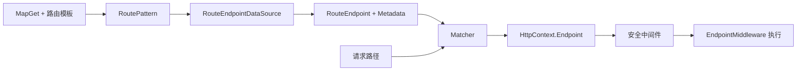

## 深入阅读导航

Endpoint Routing 的关键是分清三个阶段：Map API 登记构建模型；EndpointDataSource 暴露并动态聚合最终 Endpoint；请求到来后 Matcher 选择 Endpoint，安全中间件读取 Metadata，EndpointMiddleware 执行 RequestDelegate。

| 阶段 | 核心问题 | 关键入口 |
| --- | --- | --- |
| 1. 模式语法 | 模板怎样拆成段、字面量和参数？ | `RoutePattern` 部件模型 |
| 2. 参数策略 | 默认值、可选、CatchAll 和 Policy 怎样表达？ | `RoutePatternParameterPart` |
| 3. Endpoint 元数据 | 处理器、DisplayName 和 Metadata 如何组织？ | `EndpointMetadataCollection` |
| 4. RouteEndpoint | Pattern、Order 和 Builder 何时固定？ | `RouteEndpointBuilder.Build` |
| 5. DataSource | Endpoint 集合与变化通知如何抽象？ | `EndpointDataSource` |
| 6. Convention | 普通约定和 Finally 约定怎样应用？ | `IEndpointConventionBuilder` |
| 7. 动态聚合 | 多个 DataSource 如何合并并通知 Matcher？ | `CompositeEndpointDataSource` |
| 8. RouteHandler | 任意 Delegate 如何变成 RequestDelegate？ | `RouteEndpointDataSource` |
| 9. Map API | MapGet 怎样复用 DataSource 并登记路由？ | `EndpointRouteBuilderExtensions` |
| 10. Endpoint 上下文 | Endpoint 如何写入 HttpContext，UseRouting 如何注册？ | `IEndpointFeature` |
| 11. 匹配中间件 | Matcher 何时创建，数据变化怎样响应？ | `EndpointRoutingMiddleware` |
| 12. 执行中间件 | 安全元数据检查后如何执行处理器？ | `EndpointMiddleware` |

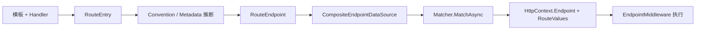

## 核心类型索引

| 类型 | 所在章节 | 说明 |
| --- | --- | --- |
| `RoutePatternPartKind` | 1. 模式语法 | 路由部件种类枚举 |
| `RoutePatternPart` | 1. 模式语法 | 部件抽象基类 |
| `RoutePatternLiteralPart` | 1. 模式语法 | 字面量部件 |
| `RoutePatternSeparatorPart` | 1. 模式语法 | 分隔符部件 |
| `RoutePatternPathSegment` | 1. 模式语法 | 单路径段的部件集合 |
| `RoutePatternParameterKind` | 2. 参数策略 | 参数形态枚举 |
| `RoutePatternParameterPart` | 2. 参数策略 | 参数名、默认值和策略 |
| `RoutePatternParameterPolicyReference` | 2. 参数策略 | 策略文本或对象引用 |
| `RoutePattern` | 2. 参数策略 | 完整路由模式对象 |
| `EndpointMetadataCollection` | 3. Endpoint 元数据 | 有顺序的只读元数据集合 |
| `Endpoint` | 3. Endpoint 元数据 | 处理器、元数据和显示名 |
| `EndpointBuilder` | 3. Endpoint 元数据 | 可变构建模型 |
| `RouteEndpoint` | 4. RouteEndpoint | 增加 Pattern 与 Order |
| `RouteEndpointBuilder` | 4. RouteEndpoint | 构建并补充路由诊断元数据 |
| `EndpointDataSource` | 5. DataSource | Endpoint 与 ChangeToken 抽象 |
| `DefaultEndpointDataSource` | 5. DataSource | 静态 Endpoint 列表 |
| `IEndpointConventionBuilder` | 6. Convention | 普通和最终约定契约 |
| `RoutingEndpointConventionBuilderExtensions` | 6. Convention | DisplayName 与 Metadata 扩展 |
| `DefaultEndpointConventionBuilder` | 6. Convention | 单 Endpoint Builder 适配器 |
| `ModelEndpointDataSource` | 7. 动态聚合 | Builder 模型数据源 |
| `CompositeEndpointDataSource` | 7. 动态聚合 | 多数据源聚合与变化通知 |
| `RouteHandlerBuilder` | 8. RouteHandler | 多 RouteEntry 约定代理 |
| `RouteEndpointDataSource` | 8. RouteHandler | 延迟推断并构建 RouteEndpoint |
| `IEndpointRouteBuilder` | 9. Map API | Services、DataSources 与分支 Builder |
| `DefaultEndpointRouteBuilder` | 9. Map API | 默认注册上下文 |
| `EndpointRouteBuilderExtensions` | 9. Map API | MapGet/MapMethods/Map 实现 |
| `IEndpointFeature` | 10. Endpoint 上下文 | HttpContext Endpoint Feature |
| `EndpointHttpContextExtensions` | 10. Endpoint 上下文 | GetEndpoint/SetEndpoint |
| `EndpointRoutingApplicationBuilderExtensions` | 10. Endpoint 上下文 | UseRouting/UseEndpoints 注册 |
| `EndpointRoutingMiddleware` | 11. 匹配中间件 | Matcher 初始化与匹配执行 |
| `EndpointMiddleware` | 12. 执行中间件 | 安全检查与 RequestDelegate 执行 |
## 1. 路由模式语法：段、字面量与参数部件

### 本组解决什么问题

这一组源码回答“`/orders/{id:int}` 如何被拆成可匹配的数据结构”。RoutePattern 由路径段组成，路径段由 Literal、Separator 和 Parameter 组成，参数再携带默认值、形态和策略引用。

### 关键类型关系图

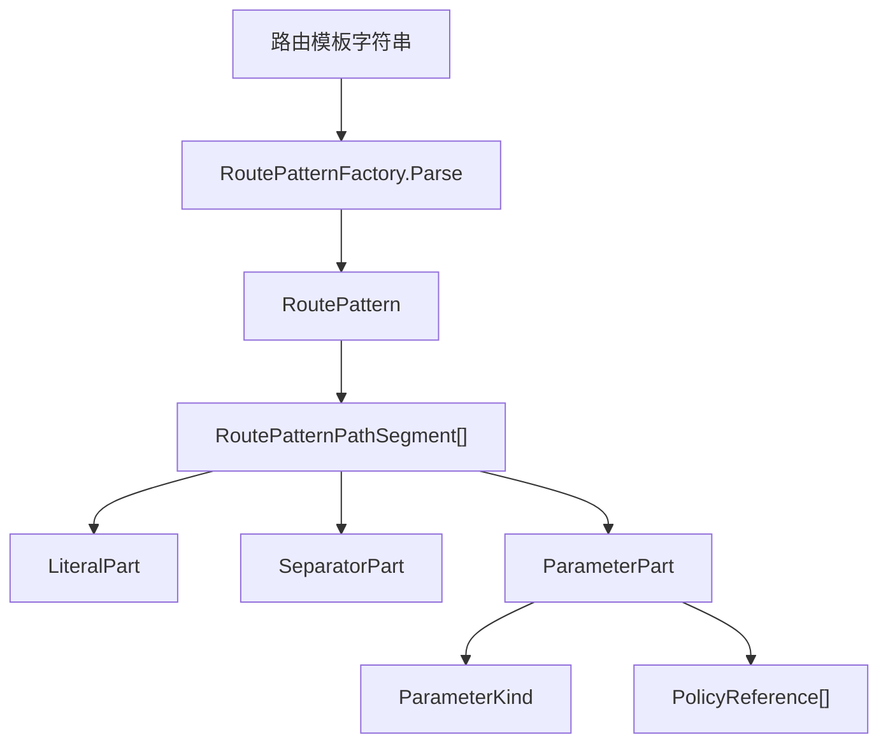

### 核心源码解读

### 模板首先被拆成路径段

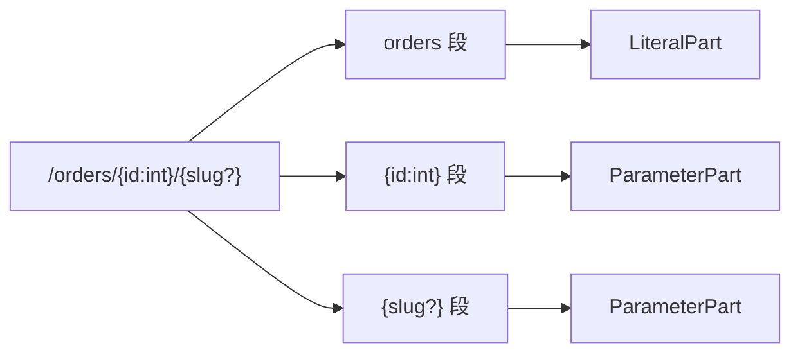

斜杠负责分段；每个段内部还可以包含多个 Part，例如字面量与参数组成复杂段。

### PartKind 让算法避免反射判断

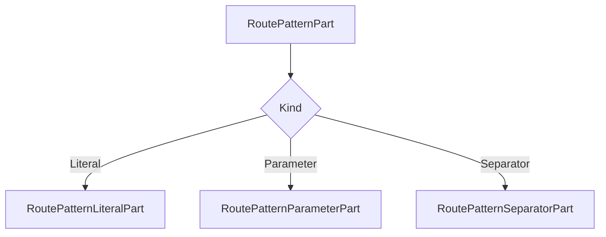

### Literal 与 Separator 的区别

Literal 表示必须匹配的固定文本；Separator 用于复杂段内部的分隔文本，其匹配和可省略行为会受相邻可选参数影响。

### 复杂段不是多个 URL 路径段

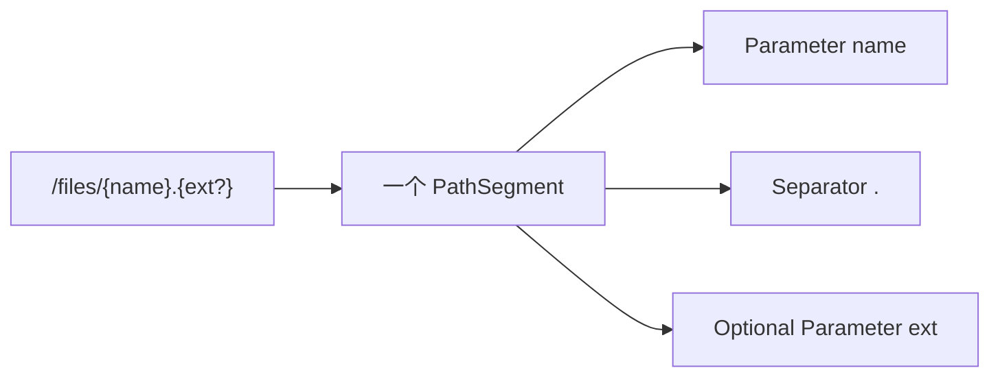

### 语法树在构建期复用

RoutePattern 是不可变描述，Matcher 和链接生成逻辑可以重复读取，无需每请求重新解析模板文本。

### RoutePatternPartKind

**读这组源码时关注什么：** 路由模式的最小组成部分分为哪几类。

#### 整体结构

**这段代码回答什么问题：** 路由模式的最小组成部分分为哪几类。

```C#
// 路由模式组成部分枚举
public enum RoutePatternPartKind
{
    // 静态文本部分
    Literal,
    // 参数部分，以 {参数名} 形式表示
    Parameter,
    // 分隔符部分
    Separator
}
```

**源码解读：**
- 枚举区分 Literal、Parameter 和 Separator。
- RoutePatternPart 的派生类型与这三种 Kind 一一对应。

**读完要记住：**
- 它描述语法节点种类。
- 具体内容保存在对应派生类型中。

### RoutePatternPart

**读这组源码时关注什么：** 所有路由模式组成部分共享什么状态。

#### 整体结构

**这段代码回答什么问题：** 所有路由模式组成部分共享什么状态。

```C#
// 表示路由模式组成部分的抽象类
// 每种组成部分枚举对应一个子类
public abstract class RoutePatternPart
{
    private protected RoutePatternPart(RoutePatternPartKind partKind)
    {
        PartKind = partKind;
    }

    public RoutePatternPartKind PartKind { get; }
 
    public bool IsLiteral => PartKind == RoutePatternPartKind.Literal;
 
    public bool IsParameter => PartKind == RoutePatternPartKind.Parameter;
 
    public bool IsSeparator => PartKind == RoutePatternPartKind.Separator;
}
```

**源码解读：**
- 抽象基类保存 PartKind。
- IsLiteral、IsParameter 和 IsSeparator 提供便捷判断。

**读完要记住：**
- 它是路径段内部元素的统一抽象。
- 实例只能由具体组成部分类型创建。

### RoutePatternLiteralPart

**读这组源码时关注什么：** 静态路径文本如何表示。

#### 整体结构

**这段代码回答什么问题：** 静态路径文本如何表示。

```C#
// 表示路由模式中的静态文本部分
public sealed class RoutePatternLiteralPart : RoutePatternPart
{
    internal RoutePatternLiteralPart(string content)
        : base(RoutePatternPartKind.Literal)
    {
        Debug.Assert(!string.IsNullOrEmpty(content));
        Content = content;
    }
    
    // 静态文本内容
    public string Content { get; }
}
```

**源码解读：**
- 类型继承 RoutePatternPart 并保存非空 Content。
- 构造时固定 Kind 为 Literal。

**读完要记住：**
- Literal 必须与请求路径文本匹配。
- 它不包含参数值或策略。

### RoutePatternSeparatorPart

**读这组源码时关注什么：** 复杂路径段中的分隔文本如何表示。

#### 整体结构

**这段代码回答什么问题：** 复杂路径段中的分隔文本如何表示。

```C#
// 表示路由模式中的分隔符部分
public sealed class RoutePatternSeparatorPart : RoutePatternPart
{
    internal RoutePatternSeparatorPart(string content)
        : base(RoutePatternPartKind.Separator)
    {
        Debug.Assert(!string.IsNullOrEmpty(content));
 
        Content = content;
    }
 
    // 分隔符
    public string Content { get; }
}
```

**源码解读：**
- 类型保存分隔符 Content 并标记为 Separator。
- 它可与 Literal 和 Parameter 共同组成一个路径段。

**读完要记住：**
- Separator 属于段内结构。
- 路径段之间的斜杠不依赖该对象表示。

## 2. 参数策略：默认值、可选、CatchAll 与 Policy

参数部件不仅保存名称，还保存参数形态、默认值、参数策略和编码行为。Matcher 后续根据这些描述构造候选筛选逻辑。

### 三种参数形态

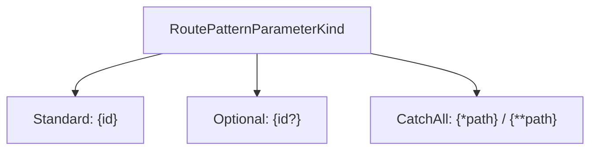

标准参数要求段存在；可选参数允许缺失；CatchAll 可以捕获剩余路径。

### 参数属性组合

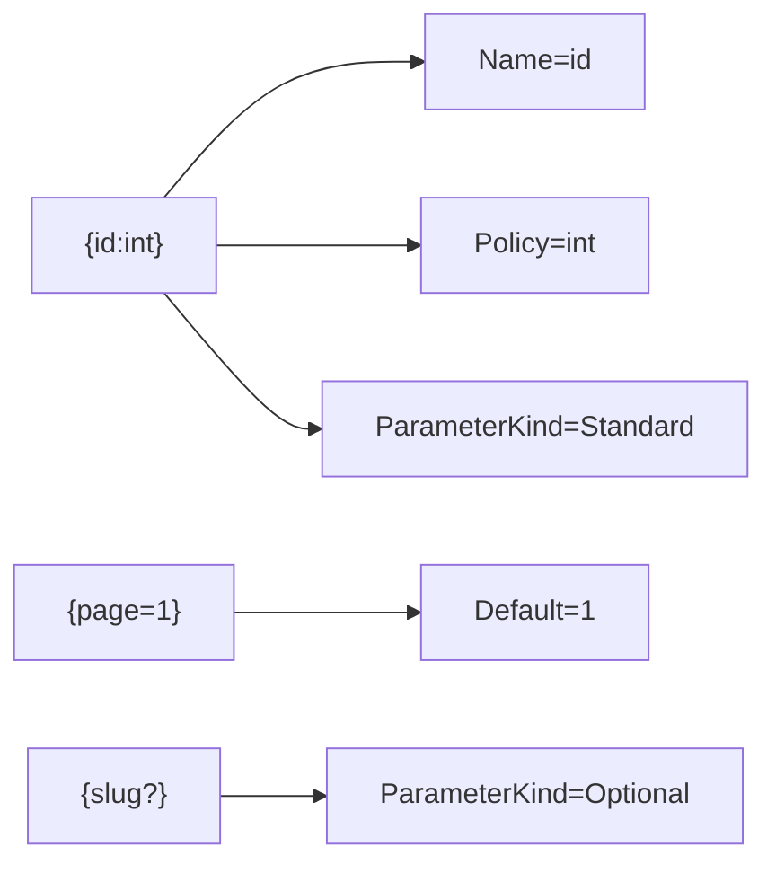

默认值、可选参数和约束是独立维度；具体组合是否合法由解析器校验，模型负责保存规范化结果。

### PolicyReference 可以是文本或已解析策略

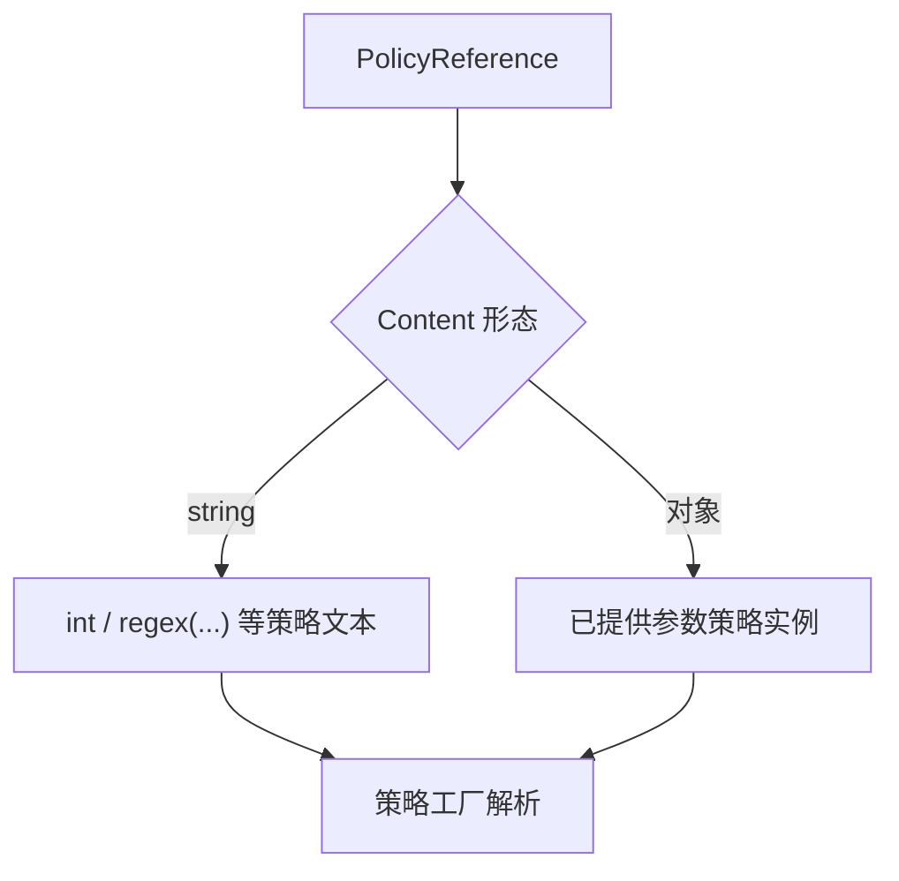

### CatchAll 的星号数量影响编码语义

单星号通常把捕获值按路径段编码；双星号允许保留路径分隔符语义。模型通过 EncodeSlashes 等状态区分。

### RoutePattern 汇总跨段索引

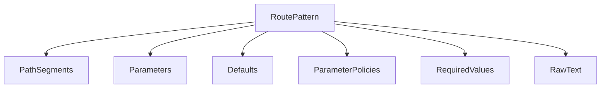

RequiredValues 与普通默认值不同：它们描述该模式成立所要求的路由值，常用于控制器等更高层路由模型。

### RoutePatternParameterKind

**读这组源码时关注什么：** 路由参数有哪些形态。

#### 整体结构

**这段代码回答什么问题：** 路由参数有哪些形态。

```C#
// 路由模式参数形式枚举
public enum RoutePatternParameterKind
{
    // 标准形式
    // 比如 {parameter}
    Standard,
    // 可选形式
    // 比如 {parameter?}
    Optional,
    // 捕获所有剩余路径形式
    // 比如 {*parameter} 或 {**parameter}
    // 其中 {*parameter} 这种形式会对 "/" 分隔符进行编码（编码为 "%2"），而 {**parameter} 则不会
    // 注意：这种路由模式参数只能作为最后一个参数出现
    CatchAll
}
```

**源码解读：**
- 枚举区分标准、可选和捕获全部。
- CatchAll 只能位于模板末端，并区分是否编码斜杠。

**读完要记住：**
- 参数形态影响匹配和链接生成。
- 可选参数与默认值是不同概念。

### RoutePatternParameterPart

**读这组源码时关注什么：** 一个参数节点需要保存哪些匹配信息。

#### 整体结构

**这段代码回答什么问题：** 一个参数节点需要保存哪些匹配信息。

```C#
// 表示路由模式中的参数部分
public sealed class RoutePatternParameterPart : RoutePatternPart
{
    internal RoutePatternParameterPart(
        string parameterName,
        object? @default,
        RoutePatternParameterKind parameterKind,
        RoutePatternParameterPolicyReference[] parameterPolicies)
        : this(parameterName, @default, parameterKind, parameterPolicies, encodeSlashes: true)
    {
    }
 
    internal RoutePatternParameterPart(
        string parameterName,
        object? @default,
        RoutePatternParameterKind parameterKind,
        RoutePatternParameterPolicyReference[] parameterPolicies,
        bool encodeSlashes)
        : base(RoutePatternPartKind.Parameter)
    {
        Name = parameterName;
        Default = @default;
        ParameterKind = parameterKind;
        ParameterPolicies = parameterPolicies;
        EncodeSlashes = encodeSlashes;
    }
 
    // 针对当前参数的策略集合
    // 每个参数可以应用多个策略（约束）
    public IReadOnlyList<RoutePatternParameterPolicyReference> ParameterPolicies { get; }
 
    // 是否对 "/" 分隔符进行编码
    public bool EncodeSlashes { get; }
 
    // 参数的默认值
    public object? Default { get; }
 
    // 是否捕获所有
    public bool IsCatchAll => ParameterKind == RoutePatternParameterKind.CatchAll;
 
    // 是否可选
    public bool IsOptional => ParameterKind == RoutePatternParameterKind.Optional;
 
    // 参数形式
    public RoutePatternParameterKind ParameterKind { get; }
 
    // 参数名
    public string Name { get; }
}
```

**源码解读：**
- 对象保存名称、默认值、参数形态、策略集合与 EncodeSlashes。
- IsOptional 和 IsCatchAll 从 ParameterKind 派生。

**读完要记住：**
- 参数策略仍是引用，稍后由策略系统解析执行。
- 捕获全部参数的斜杠编码行为由 EncodeSlashes 决定。

### RoutePatternParameterPolicyReference

**读这组源码时关注什么：** 参数约束如何在解析结果中表示。

#### 整体结构

**这段代码回答什么问题：** 参数约束如何在解析结果中表示。

```C#
// 路由模式参数策略引用
// 本质是对 IParameterPolicy 的封装
public sealed class RoutePatternParameterPolicyReference
{
    internal RoutePatternParameterPolicyReference(string content)
    {
        Content = content;
    }
 
    internal RoutePatternParameterPolicyReference(IParameterPolicy parameterPolicy)
    {
        ParameterPolicy = parameterPolicy;
    }
 
    // 参数策略的原始字符串内容
    public string? Content { get; }
 
    // 实际的参数策略执行对象
    // IParameterPolicy 是一个空的标记接口
    public IParameterPolicy? ParameterPolicy { get; }
}
```

**源码解读：**
- 对象可以保存原始策略字符串或已创建的 IParameterPolicy。
- 它把模板文本和运行时策略统一为同一引用类型。

**读完要记住：**
- 引用本身不执行匹配。
- 实际约束由策略工厂和 Matcher 使用。

### RoutePatternPathSegment

**读这组源码时关注什么：** 斜杠之间的一个路径段如何建模。

#### 整体结构

**这段代码回答什么问题：** 斜杠之间的一个路径段如何建模。

```C#
// 表示路由模板中的路径段
// 由一个或多个路由模式组成部分构成
public sealed class RoutePatternPathSegment
{
    internal RoutePatternPathSegment(IReadOnlyList<RoutePatternPart> parts)
    {
        Parts = parts;
    }
 
    // 如果路径段只包含一个路由模式组成部分则返回 true
    public bool IsSimple => Parts.Count == 1;
 
    // 路径段中的所有路由模式组成部分
    public IReadOnlyList<RoutePatternPart> Parts { get; }
}
```

**源码解读：**
- 路径段由一个或多个 RoutePatternPart 组成。
- IsSimple 表示段内只有一个组成部分。

**读完要记住：**
- 复杂段可混合文本、参数和分隔符。
- 段列表共同构成完整 RoutePattern。

### RotePattern

**读这组源码时关注什么：** 字符串路由模板解析后得到怎样的完整模型。

#### 整体结构

**这段代码回答什么问题：** 字符串路由模板解析后得到怎样的完整模型。

```C#
// 表示从路由模板转换得到的路由模式
// 每个字符串形式的路由模板最终会使用 RoutePatternFactory.Parse 静态方法解析成一个 RoutePattern
public sealed class RoutePattern
{
    private const string SeparatorString = "/";
 
    internal RoutePattern(
        string? rawText,
        IReadOnlyDictionary<string, object?> defaults,
        IReadOnlyDictionary<string, IReadOnlyList<RoutePatternParameterPolicyReference>> parameterPolicies,
        IReadOnlyDictionary<string, object?> requiredValues,
        IReadOnlyList<RoutePatternParameterPart> parameters,
        IReadOnlyList<RoutePatternPathSegment> pathSegments)
    {
        Debug.Assert(defaults != null);
        Debug.Assert(parameterPolicies != null);
        Debug.Assert(parameters != null);
        Debug.Assert(requiredValues != null);
        Debug.Assert(pathSegments != null);
 
        RawText = rawText;
        Defaults = defaults;
        ParameterPolicies = parameterPolicies;
        RequiredValues = requiredValues;
        Parameters = parameters;
        PathSegments = pathSegments;
 
        // 计算得到两个方向的路由权重
        // 1. 入站路由（使用路由模式匹配 URL）
        // 2. 出站路由（使用路由模式生成 URL）
        // 模式匹配的规则：
        // 入站路由权重越低，优先级越高
        // 出站路由权重越高，优先级越高
        // 入站路由权重的计算规则：
        // 1. 静态文本部分权重为 1
        // 2. 参数部分权重为 3
        // 3. 带路由约束的参数部分权重为 2
        // 比如：
        // literal/{parameter1}/{parameter2:int} 这个路由模板的入站权重为 1.32
        // 出站路由权重的计算规则：
        // 1. 静态文本部分权重为 5
        // 2. 参数部分权重为 3
        // 3. 带路由约束的参数部分权重为 4
        InboundPrecedence = RoutePrecedence.ComputeInbound(this);
        OutboundPrecedence = RoutePrecedence.ComputeOutbound(this);
    }
 
    // 路由模板提供的参数默认值字典
    public IReadOnlyDictionary<string, object?> Defaults { get; }
 
    // 每个参数对应的多个策略（约束）字典
    public IReadOnlyDictionary<string, IReadOnlyList<RoutePatternParameterPolicyReference>> ParameterPolicies { get; }
 
    // 通过路由模式匹配货生成 URL 时必须存在的键值对字典
    public IReadOnlyDictionary<string, object?> RequiredValues { get; }
    
    // 入站路由权重
    public decimal InboundPrecedence { get; }
 
    // 出站路由权重
    public decimal OutboundPrecedence { get; }
    
    // 路由模板原始值
    public string? RawText { get; }
    
    // 路由模板中所有的路由模式参数部分
    public IReadOnlyList<RoutePatternParameterPart> Parameters { get; }
    
    // 路由模板的所有路径段
    public IReadOnlyList<RoutePatternPathSegment> PathSegments { get; }

    // 获取指定名称的路由模式参数部分
    public RoutePatternParameterPart? GetParameter(string name)
    {
        ArgumentNullException.ThrowIfNull(name);
 
        var parameters = Parameters;
        var parametersCount = parameters.Count;
        for (var i = 0; i < parametersCount; i++)
        {
            var parameter = parameters[i];
            // 不区分大小写比较参数名
            if (string.Equals(parameter.Name, name, StringComparison.OrdinalIgnoreCase))
            {
                return parameter;
            }
        }
 
        return null;
    }
}
```

**源码解读：**
- 源码中的 RoutePattern 保存 RawText、默认值、策略、必需值、参数与路径段。
- 辅助方法可按名称查找参数。

**读完要记住：**
- 原索引名 RotePattern 是拼写保留，实际类型是 RoutePattern。
- 它是 Endpoint 匹配与生成的核心输入。

### 最小例子

```csharp
RoutePattern pattern = RoutePatternFactory.Parse("/orders/{id:int}/{slug?}");

foreach (RoutePatternParameterPart parameter in pattern.Parameters)
{
    Console.WriteLine($"{parameter.Name}: {parameter.ParameterKind}");
}
```

### 回顾要点

- RoutePattern 是解析后的完整路由模型。
- 路径段可由一个或多个 Part 组成。
- 参数策略先以引用保存，匹配阶段再解析执行。

## 3. Endpoint 元数据：处理器、显示名与行为声明

### 本组解决什么问题

这一组源码回答“路由匹配最终得到的 Endpoint 保存什么”。Endpoint 聚合处理器和元数据；RouteEndpoint 再增加 RoutePattern 与 Order；Builder 在约定应用完成后创建不可变运行时对象。

### 关键类型关系图

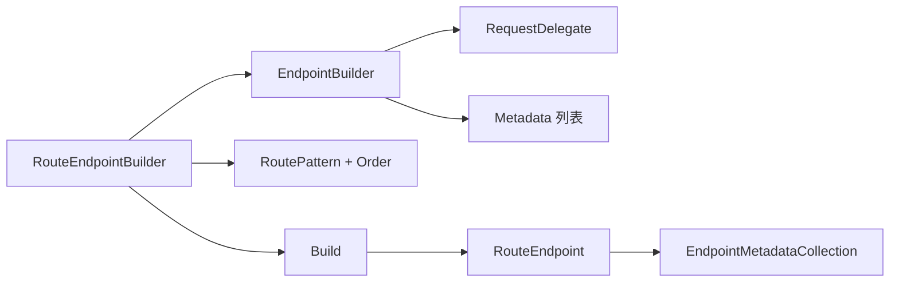

### 核心源码解读

### Endpoint 是处理器与行为声明的容器

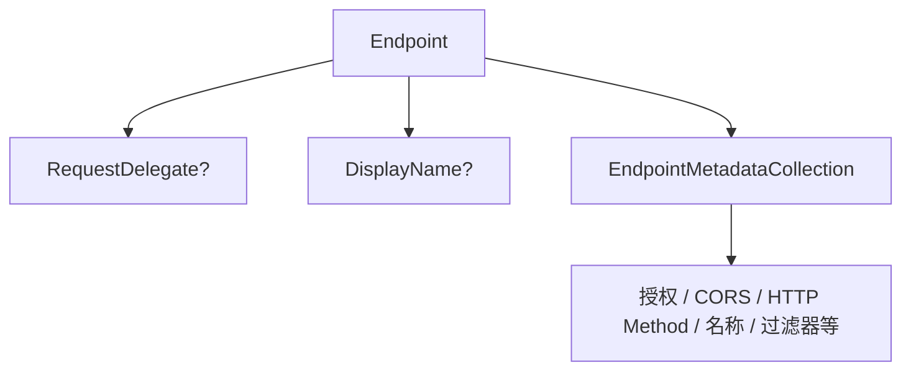

路由匹配只选择 Endpoint；后续中间件和执行器通过 Metadata 决定行为。

### 元数据顺序具有覆盖语义

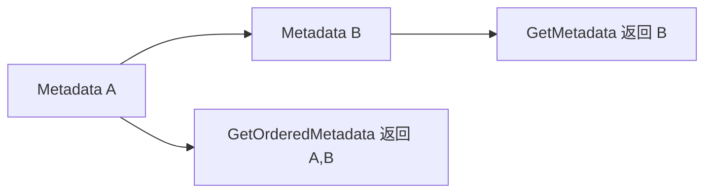

Convention 后加入的同类型元数据通常覆盖早期默认值，因此顺序不能随意去重或排序。

### 类型查询结果会缓存

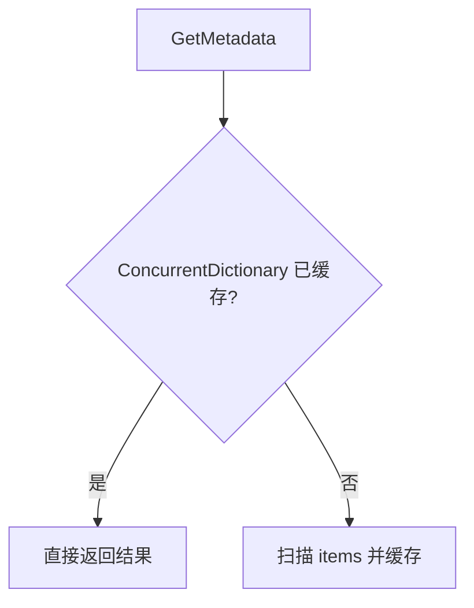

Endpoint 创建后元数据集合只读，使类型查询缓存稳定可靠。

### EndpointBuilder 是可变阶段

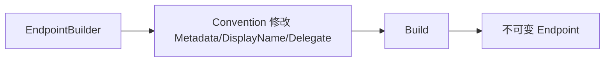

### RequestDelegate 可以为空

基础 Endpoint 允许没有处理器，用于只携带元数据或由其他组件处理的场景；RouteEndpointBuilder 则要求最终 RequestDelegate 存在。

### EndpointMetadataCollection

**读这组源码时关注什么：** 终结点元数据如何只读保存并按类型高效查询。

#### 整体结构

**这段代码回答什么问题：** 终结点元数据如何只读保存并按类型高效查询。

```C#
// 终结点元数据集合
// 这是一个只读集合，只能在创建时初始化
// 所有元数据都是保存在通过构造函数传入的初始化数组中
// 在读取元数据时，内部会从元数据数组中收集相同类型（一般使用接口类型）的元数据，然后缓存（避免重复收集）后返回
public sealed class EndpointMetadataCollection : IReadOnlyList<object>
{
    public static readonly EndpointMetadataCollection Empty = new EndpointMetadataCollection(Array.Empty<object>());
 
    private readonly object[] _items;
    private readonly ConcurrentDictionary<Type, object[]> _cache;

    public EndpointMetadataCollection(IEnumerable<object> items)
    {
        ArgumentNullException.ThrowIfNull(items);
 
        _items = items.ToArray();
        _cache = new ConcurrentDictionary<Type, object[]>();
    }
 
    public EndpointMetadataCollection(params object[] items)
        : this((IEnumerable<object>)items)
    {
    }
 
    public object this[int index] => _items[index];
 
    public int Count => _items.Length;

    // 返回对应类型的元数据（相同类型中的最后一个）
    // 如果对应类型的元数据不存在则返回该类型的默认值
    public T? GetMetadata<T>() where T : class
    {
        // 尝试从缓存中获取
        if (_cache.TryGetValue(typeof(T), out var obj))
        {
            var result = (T[])obj;
            var length = result.Length;
            return length > 0 ? result[length - 1] : default;
        }

        // 如果没有缓存则需要创建后再返回
        return GetMetadataSlow<T>();
    }
    
    // 收集对应类型的元数据并缓存
    // 再返回对应类型的元数据（相同类型中的最后一个）
    private T? GetMetadataSlow<T>() where T : class
    {
        var result = GetOrderedMetadataSlow<T>();
        var length = result.Length;
        return length > 0 ? result[length - 1] : default;
    }
    
    // 返回对应类型的所有元数据
    // 顺序是按元数据在初始化集合中的先后顺序
    public IReadOnlyList<T> GetOrderedMetadata<T>() where T : class
    {
        if (_cache.TryGetValue(typeof(T), out var result))
        {
            return (T[])result;
        }
 
        return GetOrderedMetadataSlow<T>();
    }
 
    // 遍历所有元数据，将相同类型的元数据收集起来并缓存
    private T[] GetOrderedMetadataSlow<T>() where T : class
    {
        List<T>? matches = null;
 
        var items = _items;
        for (var i = 0; i < items.Length; i++)
        {
            if (items[i] is T item)
            {
                matches ??= new List<T>();
                matches.Add(item);
            }
        }
 
        var results = matches == null ? Array.Empty<T>() : matches.ToArray();
        _cache.TryAdd(typeof(T), results);
        return results;
    }
 
    // 必须存在对应类型的元数据，否则抛出异常
    public T GetRequiredMetadata<T>() where T : class
    {
        var metadata = GetMetadata<T>();
        return metadata ?? throw new InvalidOperationException($"Metadata '{typeof(T)}' is not found.");
    }
 
    public Enumerator GetEnumerator() => new Enumerator(this);
 
    IEnumerator<object> IEnumerable<object>.GetEnumerator() => GetEnumerator();
 
    IEnumerator IEnumerable.GetEnumerator() => GetEnumerator();
 
    public struct Enumerator : IEnumerator<object>
    {
#pragma warning disable IDE0044
        private object[] _items;
#pragma warning restore IDE0044
        private int _index;
        private object? _current;
 
        internal Enumerator(EndpointMetadataCollection collection)
        {
            _items = collection._items;
            _index = 0;
            _current = null;
        }
 
        public object Current => _current!;
 
        public void Dispose()
        {
        }
 
        public bool MoveNext()
        {
            if (_index < _items.Length)
            {
                _current = _items[_index++];
                return true;
            }
 
            _current = null;
            return false;
        }

        public void Reset()
        {
            _index = 0;
            _current = null;
        }
    }
}
```

**源码解读：**
- 构造时把元数据复制到数组。
- 按类型查询结果缓存在 ConcurrentDictionary，同类型 GetMetadata 返回最后一项。

**读完要记住：**
- 元数据顺序具有覆盖语义。
- 集合在 Endpoint 创建后不可修改。

### Endpoint

**读这组源码时关注什么：** 所有终结点共享哪些运行时成员。

#### 整体结构

**这段代码回答什么问题：** 所有终结点共享哪些运行时成员。

```C#
// 表示终结点
// 它由两个核心成员组成
// 一个是请求的终结点处理器，另一个是终结点元数据集合
public class Endpoint
{
    public Endpoint(
        RequestDelegate? requestDelegate,
        EndpointMetadataCollection? metadata,
        string? displayName)
    {
        RequestDelegate = requestDelegate;
        Metadata = metadata ?? EndpointMetadataCollection.Empty;
        // 指定终结点的显示名称
        DisplayName = displayName;
    }
 
    public string? DisplayName { get; }
 
    public EndpointMetadataCollection Metadata { get; }
 
    public RequestDelegate? RequestDelegate { get; }
 
    public override string? ToString() => DisplayName ?? base.ToString();
}
```

**源码解读：**
- Endpoint 聚合 RequestDelegate、Metadata 和 DisplayName。
- RequestDelegate 可为空，具体执行由 EndpointMiddleware 判断。

**读完要记住：**
- Endpoint 是路由结果与执行器的统一载体。
- 框架行为大量由 Metadata 驱动。

### EndpointBuilder

**读这组源码时关注什么：** 终结点创建阶段允许收集哪些可变信息。

#### 整体结构

**这段代码回答什么问题：** 终结点创建阶段允许收集哪些可变信息。

```C#
// 终结点建造者的抽象表示
// 子类通过重写 Build 方法完成具体终结点的创建
public abstract class EndpointBuilder
{
    private List<Func<EndpointFilterFactoryContext, EndpointFilterDelegate, EndpointFilterDelegate>>? _filterFactories;
 
    public IList<Func<EndpointFilterFactoryContext, EndpointFilterDelegate, EndpointFilterDelegate>> FilterFactories => _filterFactories ??= new();
 
    // 收集用于创建终结点处理器
    public RequestDelegate? RequestDelegate { get; set; }
 
    // 收集用于创建终结点的显示名称
    public string? DisplayName { get; set; }
    
    // 收集用于创建终结点的元数据
    // 在创建终结点时用于创建终结点元数据集合的初始集合
    public IList<object> Metadata { get; } = new List<object>();
 
    // 返回表示根容器的 IServiceProvider
    // 默认返回 EmptyServiceProvider.Instance
    public IServiceProvider ApplicationServices { get; init; } = EmptyServiceProvider.Instance;
 
    // 构建终结点
    public abstract Endpoint Build();
 
    // 这个 EmptyServiceProvider 是一个对所有服务返回 null 的 IServiceProvider 的封装
    private sealed class EmptyServiceProvider : IServiceProvider
    {
        public static EmptyServiceProvider Instance { get; } = new EmptyServiceProvider();
        public object? GetService(Type serviceType) => null;
    }
}
```

**源码解读：**
- Builder 保存 RequestDelegate、显示名、元数据、过滤器工厂和应用服务。
- 派生类型实现 Build 生成不可变 Endpoint。

**读完要记住：**
- 约定在 Build 前修改 Builder。
- 运行时消费的是 Endpoint 而非 Builder。

## 4. RouteEndpoint：Pattern、Order 与 Builder 固化

RouteEndpoint 在基础 Endpoint 上增加 RoutePattern 和 Order。Matcher 使用 Pattern 产生候选，Order 参与候选优先顺序。

### RouteEndpoint 的匹配身份

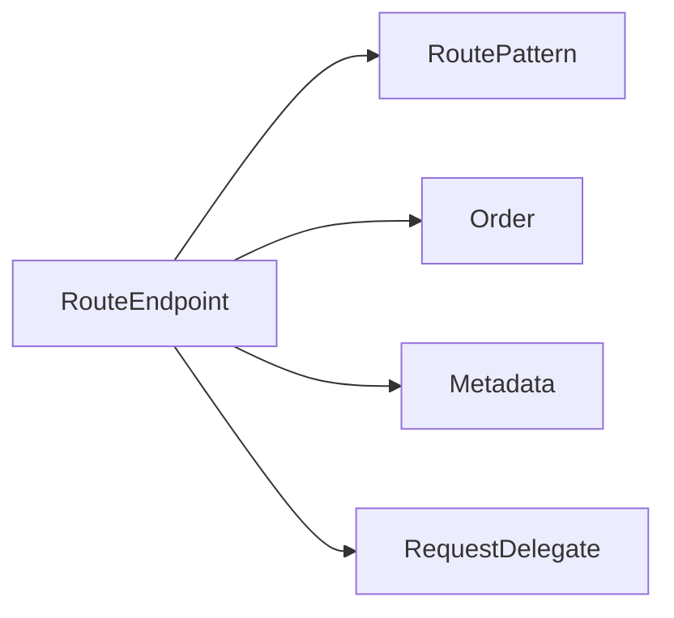

### Order 越小通常越优先

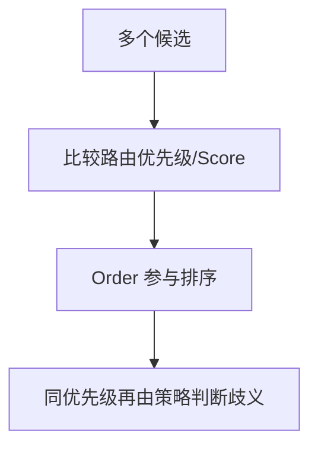

Order 不是唯一规则；模板具体度、HTTP 方法和其他 MatcherPolicy 也会参与候选筛选。

### Build 前后边界

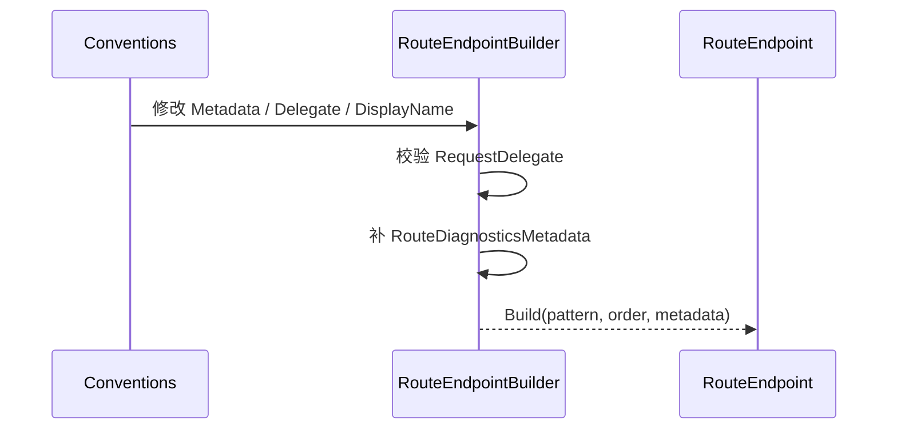

### CORS 与 HTTP Method 元数据协调

Builder 检测 CORS 元数据和 IHttpMethodMetadata，必要时允许 CORS 预检请求，使 OPTIONS 请求能进入正确策略链。

### 运行时不应修改 Builder

Matcher 持有最终 Endpoint。动态更新应由 DataSource 发布新 Endpoint 集合和 ChangeToken，而不是修改已发布对象。

### RouteEndpoint

**读这组源码时关注什么：** 路由终结点比普通 Endpoint 多出哪些信息。

#### 整体结构

**这段代码回答什么问题：** 路由终结点比普通 Endpoint 多出哪些信息。

```C#
// 表示路由系统终结点，继承 Endpoint
// 核心是在原有 Endpoint 基础上增加路由模式属性和注册顺序属性
public sealed class RouteEndpoint : Endpoint
{
    public RouteEndpoint(
        RequestDelegate requestDelegate,
        RoutePattern routePattern,
        int order,
        EndpointMetadataCollection? metadata,
        string? displayName)
        : base(requestDelegate, metadata, displayName)
    {
        ArgumentNullException.ThrowIfNull(requestDelegate);
        ArgumentNullException.ThrowIfNull(routePattern);
 
        RoutePattern = routePattern;
        Order = order;
    }
 
    // 注册顺序
    public int Order { get; }
 
    // 路由模式
    // 用于在 EndpointRoutingMiddleware 中间件做终结点匹配时使用
    public RoutePattern RoutePattern { get; }
}
```

**源码解读：**
- 类型增加 RoutePattern 和 Order。
- 匹配器使用路由模式，候选排序使用 Order。

**读完要记住：**
- RequestDelegate 在构造时必须存在。
- 它是 EndpointRoutingMiddleware 的主要匹配目标。

### RouteEndpointBuilder

**读这组源码时关注什么：** RouteEndpoint 如何从可变构建状态生成。

#### 整体结构

**这段代码回答什么问题：** RouteEndpoint 如何从可变构建状态生成。

```C#
// 表示路由系统终结点建造者，继承 EndpointBuilder
public sealed class RouteEndpointBuilder : EndpointBuilder
{
    // 收集用于创建路由系统终结点的路由模式
    public RoutePattern RoutePattern { get; set; }
 
    // 收集用于创建路由系统终结点的注册顺序
    public int Order { get; set; }
 
    public RouteEndpointBuilder(
       RequestDelegate? requestDelegate,
       RoutePattern routePattern,
       int order)
    {
        ArgumentNullException.ThrowIfNull(routePattern);
 
        RequestDelegate = requestDelegate;
        RoutePattern = routePattern;
        Order = order;
    }
 
    // 构建终结点
    public override Endpoint Build()
    {
        // 必须存在终结点处理器
        if (RequestDelegate is null)
        {
            throw new InvalidOperationException($"{nameof(RequestDelegate)} must be specified to construct a {nameof(RouteEndpoint)}.");
        }

        // 创建路由系统终结点
        return new RouteEndpoint(
            RequestDelegate,
            RoutePattern,
            Order,
            CreateMetadataCollection(Metadata, RoutePattern),
            DisplayName);
    }
 
    // 创建终结点元数据集合
    private static EndpointMetadataCollection CreateMetadataCollection(IList<object> metadata, RoutePattern routePattern)
    {
        var hasRouteDiagnosticsMetadata = false;
 
        if (metadata.Count > 0)
        {
            var hasCorsMetadata = false;
            IHttpMethodMetadata? httpMethodMetadata = null;

            for (var i = 0; i < metadata.Count; i++)
            {
                // 查找 IHttpMethodMetadata 元数据
                if (metadata[i] is IHttpMethodMetadata methodMetadata)
                {
                    httpMethodMetadata = methodMetadata;
                }

                // 查找 ICorsMetadata 元数据
                if (!hasCorsMetadata && metadata[i] is ICorsMetadata)
                {
                    hasCorsMetadata = true;
                }

                // 查找 IRouteDiagnosticsMetadata 元数据
                if (!hasRouteDiagnosticsMetadata && metadata[i] is IRouteDiagnosticsMetadata)
                {
                    hasRouteDiagnosticsMetadata = true;
                }
            }
 
            // ICorsMetadata 元数据和 IHttpMethodMetadata 元数据都存在并且 IHttpMethodMetadata 元数据的 AcceptCorsPreflight 属性为 false，则更新为 true
            if (hasCorsMetadata && httpMethodMetadata is not null && !httpMethodMetadata.AcceptCorsPreflight)
            {
                // 允许跨域预检请求
                httpMethodMetadata.AcceptCorsPreflight = true;
            }
        }
        
        // 如果不存在针对路由的诊断日志元数据，则创建一个 RouteDiagnosticsMetadata 作为元数据
        if (!hasRouteDiagnosticsMetadata)
        {
            metadata.Add(new RouteDiagnosticsMetadata(routePattern.DebuggerToString()));
        }
 
        return new EndpointMetadataCollection(metadata);
    }
 
    private sealed class RouteDiagnosticsMetadata : IRouteDiagnosticsMetadata
    {
        public string Route { get; }
 
        public RouteDiagnosticsMetadata(string route)
        {
            Route = route;
        }
 
        public override string ToString()
        {
            return DebuggerHelpers.GetDebugText(nameof(Route), Route);
        }
    }
}
```

**源码解读：**
- Build 校验 RequestDelegate 后创建 RouteEndpoint。
- 同时补充路由诊断元数据，并协调 CORS 预检元数据。

**读完要记住：**
- RoutePattern 和 Order 在构建阶段固定。
- MetadataCollection 在此转换为只读集合。

### 最小例子

```csharp
var builder = new RouteEndpointBuilder(
    context => context.Response.WriteAsync("order"),
    RoutePatternFactory.Parse("/orders/{id:int}"),
    order: 0);

builder.DisplayName = "Get order";
builder.Metadata.Add(new HttpMethodMetadata(new[] { "GET" }));
Endpoint endpoint = builder.Build();
```

### 回顾要点

- EndpointMetadataCollection 是只读且按类型缓存查询结果。
- 同类型元数据 GetMetadata 返回最后一项。
- RouteEndpoint 的 RoutePattern 和 Order 用于匹配及候选排序。

## 5. EndpointDataSource：终结点集合与变化通知

### 本组解决什么问题

这一组源码回答“Map 调用为何不立即创建最终 Endpoint”。DataSource 保存构建模型，Convention 延迟修改 EndpointBuilder；首次读取 Endpoints 时才完成元数据推断、委托生成和 RouteEndpoint 构建。

### 关键类型关系图

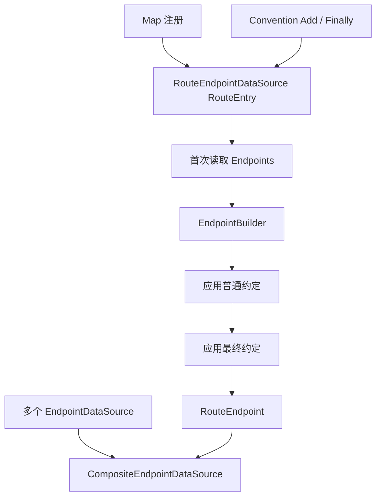

### 核心源码解读

### DataSource 同时提供快照和失效信号

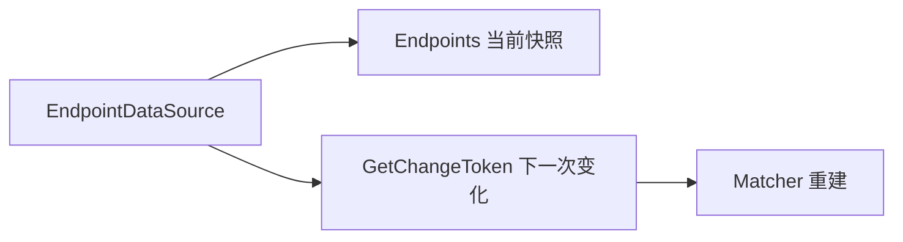

ChangeToken 表示数据源可能变化，消费者收到后重新读取 Endpoints，而不是从 Token 获取差异集合。

### 静态数据源

```mermaid
flowchart TD
    A["DefaultEndpointDataSource"] --> B["构造时固定 IReadOnlyList"]
    A --> C["NullChangeToken.Singleton"]
```

### Endpoints 属性可能触发延迟构建

接口只承诺返回列表，不承诺是简单字段。ModelEndpointDataSource 和 RouteEndpointDataSource 会在访问时从构建模型生成 Endpoint。

### Matcher 应观察数据源而不是缓存一次列表

```mermaid
sequenceDiagram
    participant M as Matcher 包装器
    participant D as EndpointDataSource
    M->>D: 读取 Endpoints 构建内部 Matcher
    M->>D: 订阅 GetChangeToken
    D-->>M: 变化通知
    M->>D: 重新读取并重建
```

### EndpointDataSource

**读这组源码时关注什么：** 路由系统如何抽象终结点集合及其变化。

#### 整体结构

**这段代码回答什么问题：** 路由系统如何抽象终结点集合及其变化。

```C#
// 终结点数据源的抽象表示
// 主要功能：
// 1. 保存终结点集合
// 2. 监控终结点集合的变化
public abstract class EndpointDataSource
{
    // 用来监测终结点集合变化的令牌
    public abstract IChangeToken GetChangeToken();
 
    // 终结点集合
    public abstract IReadOnlyList<Endpoint> Endpoints { get; }
}
```

**源码解读：**
- 抽象类暴露 Endpoints 和 GetChangeToken。
- Matcher 可以监听数据源变化并重建。

**读完要记住：**
- 数据源是终结点发现边界。
- 不同框架可提供独立实现。

### DefaultEndpointDataSource

**读这组源码时关注什么：** 固定终结点集合的最小数据源如何实现。

#### 整体结构

**这段代码回答什么问题：** 固定终结点集合的最小数据源如何实现。

```C#
// 终结点数据源的默认实现
// 只是简单保存初始化时提供的终结点集合
public sealed class DefaultEndpointDataSource : EndpointDataSource
{
    private readonly IReadOnlyList<Endpoint> _endpoints;
 
    public DefaultEndpointDataSource(params Endpoint[] endpoints)
    {
        ArgumentNullException.ThrowIfNull(endpoints);
 
        _endpoints = (Endpoint[])endpoints.Clone();
    }
 
    public DefaultEndpointDataSource(IEnumerable<Endpoint> endpoints)
    {
        ArgumentNullException.ThrowIfNull(endpoints);
 
        _endpoints = new List<Endpoint>(endpoints);
    }
 
    // 返回不具有监测数据源变化能力的 IChangeToken
    public override IChangeToken GetChangeToken() => NullChangeToken.Singleton;
 
    // 终结点集合
    public override IReadOnlyList<Endpoint> Endpoints => _endpoints;
}
```

**源码解读：**
- 构造时复制或收集 Endpoint。
- GetChangeToken 返回永不变化的 NullChangeToken。

**读完要记住：**
- 适合静态终结点集合。
- 它不支持约定或延迟构建。

## 6. Convention：普通约定、最终约定与链式元数据

Convention 延迟修改 EndpointBuilder，让 MapGet 返回后仍可追加名称、显示名、授权和自定义元数据，而不需要立刻构建 Endpoint。

### Add 与 Finally 的阶段

```mermaid
flowchart LR
    A["普通 Conventions"] --> B["元数据推断 / Handler 创建"]
    B --> C["Finally Conventions"]
    C --> D["EndpointBuilder.Build"]
```

Finally 适合必须看到普通约定最终结果的框架级修正。

### 链式 API 只登记 Action

```mermaid
flowchart LR
    A["WithDisplayName"] --> D["builder.Add(Action<EndpointBuilder>)"]
    B["WithMetadata"] --> D
    C["RequireAuthorization 等"] --> D
    D --> E["DataSource 构建 Endpoint 时执行"]
```

### DefaultEndpointConventionBuilder 包装单个 Builder

```mermaid
flowchart TD
    A["EndpointBuilder"] --> B["DefaultEndpointConventionBuilder"]
    B --> C["Add 收集约定"]
    B --> D["Build 时依次执行并创建 Endpoint"]
```

### RouteHandlerBuilder 可以代表多个 RouteEntry

例如一个高层映射可能生成多个 Endpoint；RouteHandlerBuilder 会把后续 Add/Finally 转发给所有内部 ConventionBuilder。

### 元数据添加顺序就是覆盖顺序

后执行的 Convention 把元数据追加到列表末尾，`GetMetadata<T>` 因而看到最后添加项。

### IEndpointConventionBuilder

**读这组源码时关注什么：** Map API 返回的 Builder 如何继续配置终结点。

#### 整体结构

**这段代码回答什么问题：** Map API 返回的 Builder 如何继续配置终结点。

```C#
// 终结点建造者的约定配置接口
public interface IEndpointConventionBuilder
{
    // 用来添加针对终结点建造者的配置
    void Add(Action<EndpointBuilder> convention);
 
    // 用来添加针对中间点建造者的终结配置
    // 实现类可以不需要实现这个方法
    void Finally(Action<EndpointBuilder> finallyConvention) => throw new NotImplementedException();
}
```

**源码解读：**
- Add 收集普通约定，Finally 收集最终约定。
- 约定接收 EndpointBuilder 并在 Build 前修改它。

**读完要记住：**
- 该接口让注册 API 支持链式元数据配置。
- 最终约定应在普通约定后执行。

### RoutingEndpointConventionBuilderExtensions

**读这组源码时关注什么：** WithDisplayName 和 WithMetadata 如何落到 EndpointBuilder。

#### 整体结构

**这段代码回答什么问题：** WithDisplayName 和 WithMetadata 如何落到 EndpointBuilder。

```C#
// 提供针对 IEndpointConventionBuilder 的扩展方法
// 用来收集针对终结点建造者的约定配置
public static class RoutingEndpointConventionBuilderExtensions
{
    // 配置终结点建造者的显示名称
    public static TBuilder WithDisplayName<TBuilder>(this TBuilder builder, string displayName) where TBuilder : IEndpointConventionBuilder
    {
        ArgumentNullException.ThrowIfNull(builder);
 
        builder.Add(b =>
        {
            b.DisplayName = displayName;
        });
 
        return builder;
    }
 
    // 使用 Func<EndpointBuilder, string> 委托配置终结点建造者的显示名称
    public static TBuilder WithDisplayName<TBuilder>(this TBuilder builder, Func<EndpointBuilder, string> func) where TBuilder : IEndpointConventionBuilder
    {
        ArgumentNullException.ThrowIfNull(builder);
        ArgumentNullException.ThrowIfNull(func);
 
        builder.Add(b =>
        {
            b.DisplayName = func(b);
        });
 
        return builder;
    }
    
    // 使用元数据集合配置终结点建造者的元数据初始化集合
    public static TBuilder WithMetadata<TBuilder>(this TBuilder builder, params object[] items) where TBuilder : IEndpointConventionBuilder
    {
        ArgumentNullException.ThrowIfNull(builder);
        ArgumentNullException.ThrowIfNull(items);
 
        builder.Add(b =>
        {
            foreach (var item in items)
            {
                b.Metadata.Add(item);
            }
        });
 
        return builder;
    }
}
```

**源码解读：**
- 扩展方法通过 IEndpointConventionBuilder.Add 注册 Action。
- 真正修改发生在数据源构建 Endpoint 时。

**读完要记住：**
- 链式调用只收集约定。
- 同类型元数据的后添加项通常具有更高读取优先级。

### DefaultEndpointConventionBuilder

**读这组源码时关注什么：** 简单 EndpointBuilder 如何应用约定并构建。

#### 整体结构

**这段代码回答什么问题：** 简单 EndpointBuilder 如何应用约定并构建。

```C#
// 与 ModelEndpointDataSource 配套的 IEndpointConventionBuilder 实现
public class DefaultEndpointConventionBuilder : IEndpointConventionBuilder
{
    // 用来收集终结点建造者配置的列表
    private readonly List<Action<EndpointBuilder>> _conventions
    // 被配置的终结点建造者
    internal EndpointBuilder EndpointBuilder { get; }

    public DefaultEndpointConventionBuilder(EndpointBuilder endpointBuilder)
    {
        EndpointBuilder = endpointBuilder;
        _conventions = new List<Action<EndpointBuilder>>();
    }

    // 实现 IEndpointConventionBuilder
    public void Add(Action<EndpointBuilder> convention)
    {
        ArgumentNullException.ThrowIfNull(convention);

        _conventions.Add(convention);
    }

    // 构建终结点
    // 先利用约定配置配置终结点建造者
    // 再利用终结点建造者创建终结点
    public Endpoint Build()
    {
        // 遍历所有约定配置
        foreach (var convention in _conventions)
        {
            // 配置终结点建造者
            convention(EndpointBuilder);
        }

        return EndpointBuilder.Build();
    }
}
```

**源码解读：**
- 对象保存 EndpointBuilder 与约定列表。
- Build 按注册顺序执行约定后调用 EndpointBuilder.Build。

**读完要记住：**
- 该实现配合 ModelEndpointDataSource 使用。
- 构建前仍可继续追加约定。

## 7. 动态聚合：Model 与 Composite DataSource

ModelEndpointDataSource 保存 Builder 模型；CompositeEndpointDataSource 聚合多个子数据源、缓存合并结果并把多个 ChangeToken 汇聚成一个变化信号。

### Model 数据源的延迟构建

```mermaid
flowchart LR
    A["Add EndpointConventionBuilder"] --> B["模型列表"]
    C["读取 Endpoints"] --> D["Select builder.Build()"]
    B --> D
    D --> E["Endpoint[]"]
```

这版实现每次访问都生成数组，不等同于首次后永久缓存。

### Composite 首次访问合并

```mermaid
flowchart TD
    A["Composite.Endpoints"] --> B{"已初始化?"}
    B -->|否| C["加锁读取所有子 DataSource.Endpoints"]
    C --> D["缓存合并数组"]
    B -->|是| D
```

### 多个 Token 汇聚

```mermaid
sequenceDiagram
    participant C as CompositeDataSource
    participant D1 as DataSource #1
    participant D2 as DataSource #2
    participant M as Matcher
    C->>D1: OnChange(GetChangeToken)
    C->>D2: OnChange(GetChangeToken)
    D2-->>C: 变化
    C->>C: 重建合并 Endpoints + 交换 Token
    C-->>M: Composite Token 触发
```

### Matcher 只依赖一个复合视图

```mermaid
flowchart LR
    A["Controllers DataSource"] --> C["Composite"]
    B["Minimal API DataSource"] --> C
    D["其他框架 DataSource"] --> C
    C --> E["DataSourceDependentMatcher"]
```

### 变化通知不是并发修改 Endpoint

Composite 在锁内替换快照，Matcher 后续重建内部结构；正在处理请求的旧 Matcher 可以继续使用旧的不可变 Endpoint 对象。

### ModelEndpointDataSource

**读这组源码时关注什么：** 一组 EndpointBuilder 如何延迟转换为 Endpoint。

#### 整体结构

**这段代码回答什么问题：** 一组 EndpointBuilder 如何延迟转换为 Endpoint。

```C#
// 与 DefaultEndpointConventionBuilder 配套的 EndpointDataSource 子类
public class ModelEndpointDataSource : EndpointDataSource
{
    // 用来收集 DefaultEndpointConventionBuilder 的列表
    private List<DefaultEndpointConventionBuilder> _endpointConventionBuilders;

    public ModelEndpointDataSource()
    {
        _endpointConventionBuilders = new List<DefaultEndpointConventionBuilder>();
    }

    // 添加终结点建造者，并为每个终结点建造者创建一个 DefaultEndpointConventionBuilder
    public IEndpointConventionBuilder AddEndpointBuilder(EndpointBuilder endpointBuilder)
    {
        ArgumentNullException.ThrowIfNull(endpointBuilder);

        var builder = new DefaultEndpointConventionBuilder(endpointBuilder);
        _endpointConventionBuilders.Add(builder);
        return builder;
    }

    // 返回不具有监测数据源变化能力的 IChangeToken
    public override IChangeToken GetChangeToken() => NullChangeToken.Singleton;

    // 利用每个 DefaultEndpointConventionBuilder 创建终结点
    // 注意：只有在首次访问 Endpoints 属性时才会创建终结点
    public override IReadOnlyList<Endpoint> Endpoints => _endpointConventionBuilders.Select(b => b.Build()).ToArray();
}
```

**源码解读：**
- 数据源保存 DefaultEndpointConventionBuilder 列表。
- 首次或每次访问 Endpoints 时通过 Builder.Build 生成数组。

**读完要记住：**
- AddEndpointBuilder 返回可继续配置的 ConventionBuilder。
- 该简单实现使用 NullChangeToken。

### CompositeEndpointDataSource

**读这组源码时关注什么：** 多个 EndpointDataSource 如何合并并统一发出变化通知。

#### 整体结构

**这段代码回答什么问题：** 多个 EndpointDataSource 如何合并并统一发出变化通知。

```C#
// 表示混合的 EndpointDataSource 实现，用于聚合多个不同的 EndpointDataSource
// 在创建 EndpointRoutingMiddleware 中间件时会将 IEndpointRouteBuilder 中注册的所有 EndpointDataSource 转移到 CompositeEndpointDataSource 中
public sealed class CompositeEndpointDataSource : EndpointDataSource, IDisposable
{
    // 用于保存多个不同的 EndpointDataSource
    private readonly ICollection<EndpointDataSource> _dataSources;
 
    private List<Endpoint>? _endpoints;
    private IChangeToken? _consumerChangeToken;
    private CancellationTokenSource? _cts;
    private List<IDisposable>? _changeTokenRegistrations;
    private bool _disposed;

    public CompositeEndpointDataSource(IEnumerable<EndpointDataSource> endpointDataSources)
    {
        _dataSources = new List<EndpointDataSource>();
 
        foreach (var dataSource in endpointDataSources)
        {
            _dataSources.Add(dataSource);
        }
    }

    public IEnumerable<EndpointDataSource> DataSources => _dataSources;

    // 返回终结点集合
    public override IReadOnlyList<Endpoint> Endpoints
    {
        get
        {
            EnsureEndpointsInitialized();
            return _endpoints;
        }
    }

    // 确保终结点集合已经初始化完成
    // 一般终结点的创建是在首次访问 EndpointDataSource.Endpoints 属性时完成
    private void EnsureEndpointsInitialized()
    {
        // 已经创建直接返回
        if (_endpoints is not null)
        {
            return;
        }
 
        lock (_lock)
        {
            // 已经创建直接返回
            if (_endpoints is not null)
            {
                return;
            }
 
            EnsureChangeTokenInitialized();

            CreateEndpointsUnsynchronized();
        }
    }

    // 创建终结点集合
    // 合并所有 EndpointDataSource 中的 Endpoints 
    private void CreateEndpointsUnsynchronized()
    {
        var endpoints = new List<Endpoint>();
 
        foreach (var dataSource in _dataSources)
        {
            endpoints.AddRange(dataSource.Endpoints);
        }
 
        _endpoints = endpoints;
    }

    // 返回 IChangeToken
    public override IChangeToken GetChangeToken()
    {
        EnsureChangeTokenInitialized();
        return _consumerChangeToken;
    }

    // 确保 IChangeToken 已经创建
    private void EnsureChangeTokenInitialized()
    {
        // 已经创建直接返回
        if (_consumerChangeToken is not null)
        {
            return;
        }
 
        lock (_lock)
        {
            // 已经创建直接返回
            if (_consumerChangeToken is not null)
            {
                return;
            }
 
            CreateChangeTokenUnsynchronized(collectionChanged: true);
        }
    }

    // 创建新的 IChangeToken
    // 内部会对每个 EndpointDataSource.GetChangeToken 方法返回的 IChangeToken 注册回调
    // 并对外提供 CancellationChangeToken 这个 IChangeToken 提供回调注册
    private void CreateChangeTokenUnsynchronized(bool collectionChanged)
    {
        var cts = new CancellationTokenSource();
 
        if (collectionChanged)
        {
            _changeTokenRegistrations = new();
            foreach (var dataSource in _dataSources)
            {
                _changeTokenRegistrations.Add(ChangeToken.OnChange(
                    dataSource.GetChangeToken,
                    () => HandleChange(collectionChanged: false)));
            }
        }
 
        _cts = cts;
        _consumerChangeToken = new CancellationChangeToken(cts.Token);
    }

    // 当有 EndPointDataSource 发生改变时的处理回调
    private void HandleChange(bool collectionChanged)
    {
        CancellationTokenSource? oldTokenSource = null;
        List<IDisposable>? oldChangeTokenRegistrations = null;
 
        lock (_lock)
        {
            if (_disposed)
            {
                return;
            }
 
            oldTokenSource = _cts;
            oldChangeTokenRegistrations = _changeTokenRegistrations;
 
            if (oldTokenSource is not null)
            {
                // 创建新的 IChangeToken
                CreateChangeTokenUnsynchronized(collectionChanged);
            }
 
            if (_endpoints is not null)
            {
                // 重新从其他 EndpointDataSource 得到新的 Endpoints 集合
                CreateEndpointsUnsynchronized();
            }
        }
 
        // 如果在 CreateChangeTokenUnsynchronized 方法中重新注册了 HandleChange 回调，则需要释放旧的回调注册
        if (collectionChanged && oldChangeTokenRegistrations is not null)
        {
            foreach (var registration in oldChangeTokenRegistrations)
            {
                registration.Dispose();
            }
        }
 
        // 触发回调，通知改变
        oldTokenSource?.Cancel();
    }
}
```

**源码解读：**
- 对象聚合子数据源并延迟创建合并后的 Endpoints。
- 为各子 ChangeToken 注册回调，变化后清缓存并触发自己的 Token。

**读完要记住：**
- Matcher 只需观察一个复合数据源。
- Dispose 会取消所有变更订阅。

## 8. RouteHandler：委托推断、约定与延迟 Endpoint 构建

RouteEndpointDataSource 先保存 RouteEntry。读取 Endpoints 时才推断 Handler 元数据、执行 Convention、调用 RequestDelegateFactory 并构建 RouteEndpoint。

### Map 阶段只登记 RouteEntry

```mermaid
flowchart LR
    A["Pattern"] --> D["RouteEntry"]
    B["Handler Delegate"] --> D
    C["HTTP Methods / Order / Fallback"] --> D
    D --> E["_routeEntries 列表"]
```

### 任意 Delegate 的构建流水线

```mermaid
sequenceDiagram
    participant D as RouteEndpointDataSource
    participant R as RequestDelegateFactory
    participant C as Conventions
    participant B as RouteEndpointBuilder
    D->>R: InferMetadata(method, options)
    R-->>B: 参数/返回值元数据
    D->>C: 执行普通约定
    D->>R: Create(handler,...)
    R-->>B: RequestDelegate
    D->>C: 执行 Finally 约定
    B-->>D: Build RouteEndpoint
```

### RequestDelegate 与任意 Delegate 路径不同

| Handler 形态 | 参数绑定 | 元数据推断 | 最终转换 |
| --- | --- | --- | --- |
| `RequestDelegate` | 调用方自己处理 HttpContext | 较少 | 可直接使用 |
| 任意 Delegate | RequestDelegateFactory 绑定参数 | 根据签名和特性推断 | 生成 RequestDelegate |

### 参数来源推断

```mermaid
flowchart TB
    A["Handler 参数"] --> B["Route / Query / Header / Form / Body"]
    A --> C["Services"]
    A --> D["HttpContext 及框架类型"]
    E["FromXxx 特性"] --> F["覆盖或明确绑定来源"]
```

### 约定可以替换 RequestDelegate

DataSource 在 Convention 前保存重定向占位委托，并比较 Builder.RequestDelegate 引用；若 Convention 显式替换处理器，最终优先保留该替换。

### Order 按登记顺序生成

RouteEntry 的顺序会转成 RouteEndpoint.Order，参与候选优先级。Fallback 映射通常使用更低优先级的 Order 和 FallbackMetadata。

### RouteHandlerBuilder

**读这组源码时关注什么：** Minimal API 注册结果如何同时承载普通和最终约定。

#### 整体结构

**这段代码回答什么问题：** Minimal API 注册结果如何同时承载普通和最终约定。

```C#
// 与 RouteEndpointDataSource 配套的 IEndpointConventionBuilder 实现
public sealed class RouteHandlerBuilder : IEndpointConventionBuilder
{
    private readonly IEnumerable<IEndpointConventionBuilder>? _endpointConventionBuilders;
    private readonly ICollection<Action<EndpointBuilder>>? _conventions;
    private readonly ICollection<Action<EndpointBuilder>>? _finallyConventions;
 
    internal RouteHandlerBuilder(ICollection<Action<EndpointBuilder>> conventions, ICollection<Action<EndpointBuilder>> finallyConventions)
    {
        _conventions = conventions;
        _finallyConventions = finallyConventions;
    }
 
    public RouteHandlerBuilder(IEnumerable<IEndpointConventionBuilder> endpointConventionBuilders)
    {
        _endpointConventionBuilders = endpointConventionBuilders;
    }
 
    // 添加针对终结点建造者的配置
    public void Add(Action<EndpointBuilder> convention)
    {
        // 配置集合不为 null 则优先直接保存到当前配置集合中
        if (_conventions is not null)
        {
            _conventions.Add(convention);
        }
        else
        {
            // 否则将配置添加到所有的 IEndpointConventionBuilder 中
            foreach (var endpointConventionBuilder in _endpointConventionBuilders!)
            {
                endpointConventionBuilder.Add(convention);
            }
        }
    }
 
    // 添加针对终结点建造者的终结配置
    public void Finally(Action<EndpointBuilder> finalConvention)
    {
        // 终结配置集合不为 null 则优先直接保存到当前终结配置集合中
        if (_finallyConventions is not null)
        {
            _finallyConventions.Add(finalConvention);
        }
        else
        {
            //否则将配置添加到所有的 IEndpointConventionBuilder 中
            foreach (var endpointConventionBuilder in _endpointConventionBuilders!)
            {
                endpointConventionBuilder.Finally(finalConvention);
            }
        }
    }
}
```

**源码解读：**
- Builder 包装多个 IEndpointConventionBuilder。
- Add 和 Finally 会转发到所有内部 Builder。

**读完要记住：**
- 它让 MapGet 等 API 支持统一链式配置。
- 自身不创建 Endpoint。

### RouteEndpointDataSource

**读这组源码时关注什么：** RequestDelegate 与任意 Delegate 如何延迟构建成 RouteEndpoint。

#### 整体结构

**这段代码回答什么问题：** RequestDelegate 与任意 Delegate 如何延迟构建成 RouteEndpoint。

```C#
// 与 RouteHandlerBuilder 配套的 EndpointDataSource 子类
internal sealed class RouteEndpointDataSource : EndpointDataSource
{
    private readonly List<RouteEntry> _routeEntries = new();

    public RouteEndpointDataSource(IServiceProvider applicationServices, bool throwOnBadRequest)
    {
        _applicationServices = applicationServices;
        _throwOnBadRequest = throwOnBadRequest;
    }

    // 利用路由模板、RequestDelegate、Http 方法集合创建 RouteEntry
    public RouteHandlerBuilder AddRequestDelegate(
        RoutePattern pattern,
        RequestDelegate requestDelegate,
        IEnumerable<string>? httpMethods,
        Func<Delegate, RequestDelegateFactoryOptions, RequestDelegateMetadataResult?, RequestDelegateResult> createHandlerRequestDelegateFunc)
    {
        // 创建空的针对终结点建造者的配置集合，用于初始化 RouteHandlerBuilder
        var conventions = new ThrowOnAddAfterEndpointBuiltConventionCollection();
        var finallyConventions = new ThrowOnAddAfterEndpointBuiltConventionCollection();
 
        _routeEntries.Add(new()
        {
            RoutePattern = pattern,
            RouteHandler = requestDelegate,
            HttpMethods = httpMethods,
            RouteAttributes = RouteAttributes.None,
            Conventions = conventions,
            FinallyConventions = finallyConventions,
            InferMetadataFunc = null,
            CreateHandlerRequestDelegateFunc = createHandlerRequestDelegateFunc
        });

        // 利用配置集合创建 RouteHandlerBuilder 并返回
        // 对外提供 IEndpointConventionBuilder 接口收集配置
        return new RouteHandlerBuilder(conventions, finallyConventions);
    }

    // 路由系统支持任意委托类型作为终结点处理器，但最终会被封装为标准的 RequestDelegate 形式
    // 内部涉及到两个核心功能：
    // 1. 对任意委托类型原型方法的参数绑定
    // 2. 对任意委托类型原型方法的返回值处理
    //    在处理返回值时，无论返回值是何种类型，最终都会被转换为 ValueTask<IResult> 然后再调用 IResult.ExecuteAsync 方法完成最终的结果处理和响应
    // 参数绑定规则：
    // 1. HttpContext 类型绑定为当前 HttpContext 上下文
    // 2. HttpRequest 类型绑定为当前 HttpContext 上下文的 Request 属性
    // 3. HttpResponse 类型绑定为当前 HttpContext 上下文的 Response 属性
    // 4. ClaimsPrincipal 类型绑定为当前 HttpContext 上下文的 User 属性
    // 5. CancellationToken 类型绑定为当前 HttpContext 上下文的 RequestAborted 属性
    // 6. 基元类型优先绑定同名（忽略大小写）的路由参数值
    //    也可以通过为参数显式绑定 FromRouteAttribute（实现 IFromRouteMetadata） 特性的方式指定绑定源
    //    这属于默认绑定策略
    //    可以通过 HttpContext.GetRouteData().Values 获取到路由参数键值对字典
    // 7. 如果路由参数中没有匹配到，则绑定同名（忽略大小写）的查询字符串值
    //    也可以通过为参数显式绑定 FromQueryAttribute（实现 IFromQueryMetadata） 特性的方式指定绑定源
    //    这属于默认绑定策略
    //    注意：
    //    默认利用查询字符串作为绑定源有个前提，就是路由系统终结点的路由模板中不存在同名（忽略大小写）的路由模式参数部分
    //    如果存在则优先使用路由参数值绑定，这时只能通过显式绑定 FromQueryAttribute 特性的方式指定绑定源
    // 8. IFormFileCollection 或 IFormFile 类型，则绑定为当前请求的表单文件集合或表单文件
    //    也可以通过为参数显式绑定 FromFormAttribute（实现 IFromFormMetadata） 特性的方式指定绑定源
    //    这属于默认绑定策略
    // 9. 可以通过为参数显式绑定 FromHeaderAttribute（实现 IFromHeaderMetadata） 特性的方式指定绑定源
    //    这不属于默认绑定策略
    // 10. 可以通过为参数显式绑定 FromServicesAttribute（实现 IFromServicesMetadata） 特性的方式
    //     根据参数类型使用表示每个请求表示 IServiceProvider 范围容器绑定参数
    //     这不属于默认绑定策略
    // 11. 复杂类型会使用请求的主体内容（Json 字符串）反序列化为对应类型的实例
    //     也可以通过为参数显式绑定 FromBodyAttribute（实现 IFromBodyMetadata） 特性的方式指定绑定源
    //     这属于默认绑定策略
    // 返回值处理规则：
    // 采用类似如下代码转换为 ValueTask<IResult>
    // public ValueTask<IResult> ConvertAsync(object? result)
    // {
    //     if (result == null)
    //     {
    //         // EmptyHttpResult.ExecuteAsync 方法的实现只是简单的返回 Task.CompletedTask
    //         return ValueTask.FromResult<IResult>(EmptyHttpResult.Instance);
    //     }
    //
    //     if (result is Task<IResult> taskOfResult)
    //     {
    //         return new ValueTask(taskOfResult);
    //     }
    //
    //     if (result is ValueTask<IResult> valueTaskOfResult)
    //     {
    //         return valueTaskOfResult;
    //     }
    //
    //     if (result is IResult result)
    //     {
    //         return ValueTask.FromResult(result);
    //     }
    //     
    //     // 由于 Task<T> 继承 Task，所以此处不能使用 is 操作符
    //     if (result.GetType() == typeof(Task))
    //     {
    //         return Convert((Task)result);
    //     }
    //
    //     if (result.GetType().IsGenericType && result.GetType().GetGenericTypeDefinition() == typeof(Task<>))
    //     {
    //         // 注意：
    //         // 此处的泛型类型参数 T 可能是值类型也可能是引用类型等任意类型
    //         // 先将 object 转换为 Task<T>
    //         // 再调用 ConvertFromTask<T> 方法返回 ValueTask<IResult>
    //         // 以上操作可以使用表达式树方式生成动态代码完成
    //     }
    // 
    //     if (result.GetType().IsGenericType && result.GetType().GetGenericTypeDefinition() == typeof(ValueTask<>))
    //     {
    //         // 注意：
    //         // 此处的泛型类型参数 T 可能是值类型也可能是引用类型等任意类型
    //         // 先将 object 转换为 ValueTask<T>
    //         // 再调用 ConvertFromValueTask<T> 方法返回 ValueTask<IResult>
    //         // 以上操作可以使用表达式树方式生成动态代码完成
    //     }
    //
    //     return ValueTask.FromResult<IResult>(new ObjectResult(result));
    //
    //     private static async ValueTask<IResult> Convert(Task task)
    //     {
    //         await task;
    //         return EmptyHttpResult.Instance;
    //     }
    //
    //     public static async ValueTask<IResult> ConvertFromTask<T>(Task<T> task)
    //     {
    //         T result = await task;
    //         return result is IResult ? result : new ObjectResult(result);
    //     }
    //
    //     public static async ValueTask<IResult> ConvertFromValueTask<T>(ValueTask<T> valueTask)
    //     {
    //         T result = valueTask.IsCompleted ? valueTask.Result : await valueTask;
    //         return result is IResult ? result : new ObjectResult(result);
    //     }
    //     
    //     public class ObjectResult : IResult
    //     {
    //         public ObjectResult(object? value)
    //         {
    //             Value = value;                
    //         }
    //
    //         public object? Value { get; }
    //
    //         public Task ExecuteAsync(HttpContext httpContext)
    //         {  
    //             // 如果是 Value 是 string 类型
    //             // 则将原始字符串直接作为响应主体，并将 Content-Type 设置为 text/plain
    //             // 其他类型都会使用 Json 序列化处理后再将字符串作为响应主体，并将 Content-Type 设置为 application/json
    //         }
    //     {
    // }

    // 利用路由模板、任意委托类型表示的终结点处理器、Http 方法集合创建 RouteEntry
    // 使用任意委托类型作为终结点处理器时，最终都会被封装为标准的 RequestDelegate 调用此方法
    public RouteHandlerBuilder AddRouteHandler(
        RoutePattern pattern,
        Delegate routeHandler,
        IEnumerable<string>? httpMethods,
        bool isFallback,
        Func<MethodInfo, RequestDelegateFactoryOptions?, RequestDelegateMetadataResult>? inferMetadataFunc,
        Func<Delegate, RequestDelegateFactoryOptions, RequestDelegateMetadataResult?, RequestDelegateResult> createHandlerRequestDelegateFunc)
    {
        // 创建空的针对终结点建造者的配置集合，用于初始化 RouteHandlerBuilder
        var conventions = new ThrowOnAddAfterEndpointBuiltConventionCollection();
        var finallyConventions = new ThrowOnAddAfterEndpointBuiltConventionCollection();
 
        var routeAttributes = RouteAttributes.RouteHandler;
        if (isFallback)
        {
            routeAttributes |= RouteAttributes.Fallback;
        }
 
        _routeEntries.Add(new()
        {
            RoutePattern = pattern,
            RouteHandler = routeHandler,
            HttpMethods = httpMethods,
            RouteAttributes = routeAttributes,
            Conventions = conventions,
            FinallyConventions = finallyConventions,
            InferMetadataFunc = inferMetadataFunc,
            CreateHandlerRequestDelegateFunc = createHandlerRequestDelegateFunc
        });

        // 利用配置集合创建 RouteHandlerBuilder 并返回
        // 对外提供 IEndpointConventionBuilder 接口收集配置
        return new RouteHandlerBuilder(conventions, finallyConventions);
    }

    // 返回不具有监测功能的 IChangeToken
    public override IChangeToken GetChangeToken() => NullChangeToken.Singleton;

    // 创建并返回终结点集合
    // 此处返回类型不是 IReadOnlyList<Endpoint> 是利用了泛型接口的协变
    public override IReadOnlyList<RouteEndpoint> Endpoints
    {
        get
        {
            var endpoints = new RouteEndpoint[_routeEntries.Count];
            for (int i = 0; i < _routeEntries.Count; i++)
            {
                // 创建路由系统终结点
                endpoints[i] = (RouteEndpoint)CreateRouteEndpointBuilder(_routeEntries[i]).Build();
            }
            return endpoints;
        }
    }

    // 创建路由系统终结点建造者
    private RouteEndpointBuilder CreateRouteEndpointBuilder(
        RouteEntry entry, RoutePattern? groupPrefix = null, IReadOnlyList<Action<EndpointBuilder>>? groupConventions = null, IReadOnlyList<Action<EndpointBuilder>>? groupFinallyConventions = null)
    {
        // 合并分组路由模式
        var pattern = RoutePatternFactory.Combine(groupPrefix, entry.RoutePattern);
        var handler = entry.RouteHandler;
        // 确定是否使用了任意委托类型作为终结点处理器
        var isRouteHandler = (entry.RouteAttributes & RouteAttributes.RouteHandler) == RouteAttributes.RouteHandler;
        var isFallback = (entry.RouteAttributes & RouteAttributes.Fallback) == RouteAttributes.Fallback;
 
        var order = isFallback ? int.MaxValue : 0;
        // 使用路由模板原始字符串作为路由模式显示名称
        var displayName = pattern.DebuggerToString();

        // 如果使用任意委托类型作为终结点处理器，则在显示名称中添加这个委托的原型方法名称
        if (isRouteHandler && TypeHelper.TryGetNonCompilerGeneratedMethodName(handler.Method, out var methodName))
        {
            displayName = $"{displayName} => {methodName}";
        }

        // 如果 Http 方法集合不为 null
        // 则显示名称尝试添加 "HTTP: {方法谓词}" 作为前缀
        // 如果存在多个 Http 方法，则使用 "," 分隔符拼接显示
        if (entry.HttpMethods is not null)
        {
            displayName = $"HTTP: {string.Join(", ", entry.HttpMethods)} {displayName}";
        }
 
        if (isFallback)
        {
            displayName = $"Fallback {displayName}";
        }
 
        // 如果终结点处理器是 RequestDelegate 类型，则直接使用
        RequestDelegate? factoryCreatedRequestDelegate = isRouteHandler ? null : (RequestDelegate)entry.RouteHandler;

        // 包装一个新的 RequestDelegate 用于延迟调用最终的终结点处理器
        RequestDelegate redirectRequestDelegate = context =>
        {
            if (factoryCreatedRequestDelegate is null)
            {
                throw new InvalidOperationException(Resources.RouteEndpointDataSource_RequestDelegateCannotBeCalledBeforeBuild);
            }
 
            return factoryCreatedRequestDelegate(context);
        };
 
        // 利用终结点处理器、路由模式、序号创建路由系统终结点建造者
        RouteEndpointBuilder builder = new(redirectRequestDelegate, pattern, order)
        {
            DisplayName = displayName,
            ApplicationServices = _applicationServices,
        };
 
        if (isFallback)
        {
            builder.Metadata.Add(FallbackMetadata.Instance);
        }
        
        // 使用任意委托类型作为终结点处理器时将委托原型方法的 MethodInfo 添加到终结点建造者的元数据集合中
        if (isRouteHandler)
        {
            builder.Metadata.Add(handler.Method);
        }

        // 使用 HttpMethodMetadata 将 Http 方法集合添加到终结点建造者的元数据集合中
        if (entry.HttpMethods is not null)
        {
            builder.Metadata.Add(new HttpMethodMetadata(entry.HttpMethods));
        }
 
        if (groupConventions is not null)
        {
            foreach (var groupConvention in groupConventions)
            {
                groupConvention(builder);
            }
        }
 
        RequestDelegateFactoryOptions? rdfOptions = null;
        RequestDelegateMetadataResult? rdfMetadataResult = null;
 
        // 如果使用任意委托类型作为终结点处理器
        // 则创建 RequestDelegateFactoryOptions 和 RequestDelegateMetadataResult
        if (isRouteHandler)
        {
            Debug.Assert(entry.InferMetadataFunc != null, "A func to infer metadata must be provided for route handlers.");
 
            rdfOptions = CreateRdfOptions(entry, pattern, builder);
            rdfMetadataResult = entry.InferMetadataFunc(entry.RouteHandler.Method, rdfOptions);
        }
 
        // 尝试从终结点处理器委托的原型方法上获取自定义特性，并添加到终结点元数据集合中
        var attributes = handler.Method.GetCustomAttributes();
        if (attributes is not null)
        {
            foreach (var attribute in attributes)
            {
                builder.Metadata.Add(attribute);
            }
        }
 
        // 此时停止 RouteHandlerBuilder 收集针对终结点建造者的配置
        entry.Conventions.IsReadOnly = true;
        // 利用 RouteHandlerBuilder 收集到的 Action<EndpointBuilder> 配置终结点建造者
        foreach (var entrySpecificConvention in entry.Conventions)
        {
            entrySpecificConvention(builder);
        }
 
        // 约定配置可能修改终结点建造者保存的 RequestDelegate，所以需要做引用检查确保没有修改
        var conventionOverriddenRequestDelegate = ReferenceEquals(builder.RequestDelegate, redirectRequestDelegate) ? null : builder.RequestDelegate;
 
        if (isRouteHandler || builder.FilterFactories.Count > 0)
        {
            rdfOptions ??= CreateRdfOptions(entry, pattern, builder);
 
            // 利用 RequestDelegateFactory 将任意委托类型的终结点处理器转换为标准的 RequestDelegate 形式
            factoryCreatedRequestDelegate = entry.CreateHandlerRequestDelegateFunc(entry.RouteHandler, rdfOptions, rdfMetadataResult).RequestDelegate;
        }
 
        Debug.Assert(factoryCreatedRequestDelegate is not null);
 
        // 更新终结点建造者保存的 RequestDelegate
        builder.RequestDelegate = conventionOverriddenRequestDelegate ?? factoryCreatedRequestDelegate;
 
        entry.FinallyConventions.IsReadOnly = true;
        foreach (var entryFinallyConvention in entry.FinallyConventions)
        {
            entryFinallyConvention(builder);
        }
 
        if (groupFinallyConventions is not null)
        {
            foreach (var groupFinallyConvention in groupFinallyConventions)
            {
                groupFinallyConvention(builder);
            }
        }
 
        return builder;
    }

    // 终结点建造者约定配置集合
    private sealed class ThrowOnAddAfterEndpointBuiltConventionCollection : List<Action<EndpointBuilder>>, ICollection<Action<EndpointBuilder>>
    {
        public bool IsReadOnly { get; set; }
 
        void ICollection<Action<EndpointBuilder>>.Add(Action<EndpointBuilder> convention)
        {
            if (IsReadOnly)
            {
                throw new InvalidOperationException(Resources.RouteEndpointDataSource_ConventionsCannotBeModifiedAfterBuild);
            }
 
            Add(convention);
        }
    }
}
```

**源码解读：**
- 数据源保存 RouteEntry、普通约定和最终约定。
- 访问 Endpoints 时执行元数据推断、RequestDelegateFactory、约定并构建 RouteEndpoint。

**读完要记住：**
- 任意委托路径负责参数绑定和 Endpoint Filter。
- 注册顺序生成 Order 并影响候选排序。

### 最小例子

```csharp
RouteHandlerBuilder builder = endpoints.MapGet("/orders/{id:int}",
    (int id) => Results.Ok(new { id }));

builder
    .WithDisplayName("Get order")
    .WithMetadata(new TagsAttribute("Orders"));
```

### 回顾要点

- Convention 修改的是 EndpointBuilder，不是已建成的 Endpoint。
- RouteEndpointDataSource 延迟执行参数绑定和元数据推断。
- CompositeEndpointDataSource 聚合终结点并统一传播变化通知。

## 9. Endpoint 注册：从 MapGet 到 RouteEndpointDataSource

### 本组解决什么问题

这一组源码回答“MapGet、MapPost 和 MapMethods 最终把数据放到哪里”。IEndpointRouteBuilder 持有 DataSources；扩展方法复用 RouteEndpointDataSource，将模板、HTTP 谓词和处理器登记为延迟构建项。

### 关键类型关系图

```mermaid
flowchart LR
    A["MapGet / MapPost / MapMethods"] --> B["RoutePatternFactory.Parse"]
    B --> C["RouteEndpointDataSource"]
    D["RequestDelegate"] --> C
    E["任意 Delegate"] --> F["RequestDelegateFactory"]
    F --> C
    C --> G["IEndpointRouteBuilder.DataSources"]
```

### 核心源码解读

### IEndpointRouteBuilder 是注册上下文

```mermaid
flowchart TB
    A["IEndpointRouteBuilder"] --> B["ServiceProvider"]
    A --> C["ICollection<EndpointDataSource>"]
    A --> D["CreateApplicationBuilder"]
```

它不是运行时 Matcher，也不保存当前请求。

### MapGet 的调用收敛

```mermaid
flowchart LR
    A["MapGet(pattern, handler)"] --> B["MapMethods(GET)"]
    B --> C["RoutePatternFactory.Parse"]
    C --> D["GetOrAddRouteEndpointDataSource"]
    D --> E["AddRequestDelegate / AddRouteHandler"]
```

### 一个 RouteEndpointDataSource 被复用

扩展方法先扫描 DataSources 中的 RouteEndpointDataSource；存在则复用，不存在才创建并加入，避免每次 Map 调用产生独立数据源。

### HTTP Method 是 Metadata

```mermaid
flowchart LR
    A["MapMethods GET,POST"] --> B["HttpMethodMetadata"]
    B --> C["RouteEndpoint.Metadata"]
    C --> D["HttpMethodMatcherPolicy 筛选候选"]
```

模板匹配和方法匹配是不同层次，方法不写入 RoutePattern。

### Map 返回 ConventionBuilder

```csharp
endpoints.MapGet("/orders/{id:int}", (int id) => Results.Ok(id))
    .WithName("GetOrder")
    .WithDisplayName("Get order")
    .WithMetadata(new TagsAttribute("Orders"));
```

链式调用仍只修改构建模型，最终 Endpoint 在 DataSource 读取时形成。

### IEndpointRouteBuilder

**读这组源码时关注什么：** Endpoint 注册阶段需要哪些共享对象。

#### 整体结构

**这段代码回答什么问题：** Endpoint 注册阶段需要哪些共享对象。

```C#
// 终结点路由建造者接口
// IEndpointRouteBuilder 的核心功能就是用来注册 EndpointDataSource
public interface IEndpointRouteBuilder
{
    // 创建新的 IApplicationBuilder
    // 有些终结点的处理可能涉及一个复杂的过程，需要由多个 RequestDelegate 协作完成
    // 这时候就可以利用 IApplicationBuilder 注册中间件的方式构建一个请求处理管道
    IApplicationBuilder CreateApplicationBuilder();
    
    // 表示根容器的 IServiceProvider
    IServiceProvider ServiceProvider { get; }
    
    // 注册的所有 EndpointDataSource 集合
    ICollection<EndpointDataSource> DataSources { get; }
}
```

**源码解读：**
- 接口暴露 ServiceProvider、DataSources 和 CreateApplicationBuilder。
- Map 扩展向 DataSources 加入或复用具体数据源。

**读完要记住：**
- 它是终结点注册容器。
- ApplicationBuilder 用于构建分支管道。

### DefaultEndpointRouteBuilder

**读这组源码时关注什么：** 默认 EndpointRouteBuilder 如何连接 ApplicationBuilder 与数据源集合。

#### 整体结构

**这段代码回答什么问题：** 默认 EndpointRouteBuilder 如何连接 ApplicationBuilder 与数据源集合。

```C#
// IEndpointRouteBuilder 的默认实现
// 在 IHost/IHostBuilder 编程模型中作为 IEndpointRouteBuilder 的实现
// 而在 Minimal API 编程模型中则使用 WebApplication 作为 IEndpointRouteBuilder 的实现
internal sealed class DefaultEndpointRouteBuilder : IEndpointRouteBuilder
{
    public DefaultEndpointRouteBuilder(IApplicationBuilder applicationBuilder)
    {
        ApplicationBuilder = applicationBuilder ?? throw new ArgumentNullException(nameof(applicationBuilder));
        DataSources = new List<EndpointDataSource>();
    }
 
    public IApplicationBuilder ApplicationBuilder { get; }
 
    public IApplicationBuilder CreateApplicationBuilder() => ApplicationBuilder.New();
 
    public ICollection<EndpointDataSource> DataSources { get; }
 
    public IServiceProvider ServiceProvider => ApplicationBuilder.ApplicationServices;
}
```

**源码解读：**
- 实现保存当前 IApplicationBuilder、服务提供者和 DataSources 列表。
- CreateApplicationBuilder 调用 ApplicationBuilder.New。

**读完要记住：**
- DataSources 随 UseEndpoints 配置不断增加。
- 同一实例由路由中间件扩展共享。

### EndpointRouteBuilderExtensions

**读这组源码时关注什么：** MapGet、MapMethods 和 Map 如何注册终结点。

#### 整体结构

**这段代码回答什么问题：** MapGet、MapMethods 和 Map 如何注册终结点。

```C#
// 提供用来注册路由系统终结点的扩展方法
public static class EndpointRouteBuilderExtensions
{
    // 相关 Http 方法谓词
    private static readonly string[] GetVerb = new[] { HttpMethods.Get };
    private static readonly string[] PostVerb = new[] { HttpMethods.Post };
    private static readonly string[] PutVerb = new[] { HttpMethods.Put };
    private static readonly string[] DeleteVerb = new[] { HttpMethods.Delete };
    private static readonly string[] PatchVerb = new[] { HttpMethods.Patch };

    // 创建 RouteEndpointDataSource 并将其注册到 IEndpointRouteBuilder 中
    internal static RouteEndpointDataSource GetOrAddRouteEndpointDataSource(this IEndpointRouteBuilder endpoints)
    {
        RouteEndpointDataSource? routeEndpointDataSource = null;
 
        // 检查 IEndpointRouteBuilder 中是否已经注册了 RouteEndpointDataSource
        foreach (var dataSource in endpoints.DataSources)
        {
            if (dataSource is RouteEndpointDataSource foundDataSource)
            {
                routeEndpointDataSource = foundDataSource;
                break;
            }
        }

        // 如果 IEndpointRouteBuilder 中没有注册 RouteEndpointDataSource
        if (routeEndpointDataSource is null)
        {
            // 在利用任意委托作为终结点处理器时需要做参数绑定
            // 使用 RouteHandlerOptions 选项决定是否在参数绑定失败时响应 400 状态码
            var routeHandlerOptions = endpoints.ServiceProvider?.GetService<IOptions<RouteHandlerOptions>>();
            var throwOnBadRequest = routeHandlerOptions?.Value.ThrowOnBadRequest ?? false;
 
            routeEndpointDataSource = new RouteEndpointDataSource(endpoints.ServiceProvider ?? EmptyServiceProvider.Instance, throwOnBadRequest);
            // 将创建的 RouteEndpointDataSource 注册到 IEndpointRouteBuilder 中
            endpoints.DataSources.Add(routeEndpointDataSource);
        }
 
        return routeEndpointDataSource;
    }

    // 利用 RequestDelegate 类型作为终结点处理器注册路由系统终结点的扩展方法
    // 注意：
    // 返回值类型都是 RouteHandlerBuilder（IEndpointConventionBuilder），用于添加针对 EndpointBuilder 的约定配置
    public static IEndpointConventionBuilder MapGet(
        this IEndpointRouteBuilder endpoints,
        string pattern,
        RequestDelegate requestDelegate)
    {
        return MapMethods(endpoints, pattern, GetVerb, requestDelegate);
    }
 
    public static IEndpointConventionBuilder MapPost(
        this IEndpointRouteBuilder endpoints,
        string pattern,
        RequestDelegate requestDelegate)
    {
        return MapMethods(endpoints, pattern, PostVerb, requestDelegate);
    }
 
    public static IEndpointConventionBuilder MapPut(
        this IEndpointRouteBuilder endpoints,
        string pattern,
        RequestDelegate requestDelegate)
    {
        return MapMethods(endpoints, pattern, PutVerb, requestDelegate);
    }
 
    public static IEndpointConventionBuilder MapDelete(
        this IEndpointRouteBuilder endpoints,
        string pattern,
        RequestDelegate requestDelegate)
    {
        return MapMethods(endpoints, pattern, DeleteVerb, requestDelegate);
    }
 
    public static IEndpointConventionBuilder MapPatch(
        this IEndpointRouteBuilder endpoints,
        string pattern,
        RequestDelegate requestDelegate)
    {
        return MapMethods(endpoints, pattern, PatchVerb, requestDelegate);
    }

    // 利用路由模板、终结点处理器、Http 方法谓词集合注册路由系统终结点
    public static IEndpointConventionBuilder MapMethods(
       this IEndpointRouteBuilder endpoints,
       string pattern,
       IEnumerable<string> httpMethods,
       RequestDelegate requestDelegate)
    {
        ArgumentNullException.ThrowIfNull(httpMethods);

        // 需要利用 RoutePatternFactory 先将路由模板解析为 RoutePattern
        return endpoints.Map(RoutePatternFactory.Parse(pattern), requestDelegate, httpMethods);
    }

    public static IEndpointConventionBuilder Map(
        this IEndpointRouteBuilder endpoints,
        string pattern,
        RequestDelegate requestDelegate)
    {
        // 需要利用 RoutePatternFactory 先将路由模板解析为 RoutePattern
        return Map(endpoints, RoutePatternFactory.Parse(pattern), requestDelegate);
    }
 
    public static IEndpointConventionBuilder Map(
        this IEndpointRouteBuilder endpoints,
        RoutePattern pattern,
        RequestDelegate requestDelegate)
    {
        // Http 方法谓词集合为 null 表示任意 Http 方法
        return Map(endpoints, pattern, requestDelegate, httpMethods: null);
    }
    
    // 这个方法只接收使用 RequestDelegate 类型作为终结点处理器
    private static IEndpointConventionBuilder Map(
        this IEndpointRouteBuilder endpoints,
        RoutePattern pattern,
        RequestDelegate requestDelegate,
        IEnumerable<string>? httpMethods)
    {
        ArgumentNullException.ThrowIfNull(endpoints);
        ArgumentNullException.ThrowIfNull(pattern);
        ArgumentNullException.ThrowIfNull(requestDelegate);

        // 利用 RouteEndpointDataSource 注册路由系统终结点构建时需要的路由模式、终结点处理器、Http 方法谓词集合
        return endpoints
            .GetOrAddRouteEndpointDataSource()
            // 只能使用 RequestDelegate 类型作为终结点处理器
            .AddRequestDelegate(pattern, requestDelegate, httpMethods, CreateHandlerRequestDelegate);
    }

    // 利用任意委托类型作为终结点处理器注册路由系统终结点的扩展方法
    // 注意：
    // 返回值类型都是 RouteHandlerBuilder（IEndpointConventionBuilder），用于添加针对 EndpointBuilder 的约定配置
    public static RouteHandlerBuilder MapGet(
        this IEndpointRouteBuilder endpoints,
        string pattern,
        Delegate handler)
    {
        return MapMethods(endpoints, pattern, GetVerb, handler);
    }
 
    public static RouteHandlerBuilder MapPost(
        this IEndpointRouteBuilder endpoints,
        string pattern,
        Delegate handler)
    {
        return MapMethods(endpoints, pattern, PostVerb, handler);
    }
 
    public static RouteHandlerBuilder MapPut(
        this IEndpointRouteBuilder endpoints,
        string pattern,
        Delegate handler)
    {
        return MapMethods(endpoints, pattern, PutVerb, handler);
    }
 
    public static RouteHandlerBuilder MapDelete(
        this IEndpointRouteBuilder endpoints,
        string pattern,
        Delegate handler)
    {
        return MapMethods(endpoints, pattern, DeleteVerb, handler);
    }
 
    public static RouteHandlerBuilder MapPatch(
        this IEndpointRouteBuilder endpoints,
        string pattern,
        Delegate handler)
    {
        return MapMethods(endpoints, pattern, PatchVerb, handler);
    }

    public static RouteHandlerBuilder MapMethods(
       this IEndpointRouteBuilder endpoints,
       string pattern,
       IEnumerable<string> httpMethods,
       Delegate handler)
    {
        ArgumentNullException.ThrowIfNull(httpMethods);
        return endpoints.Map(RoutePatternFactory.Parse(pattern), handler, httpMethods, isFallback: false);
    }

    public static RouteHandlerBuilder Map(
        this IEndpointRouteBuilder endpoints,
        string pattern,
        Delegate handler)
    {
        return Map(endpoints, RoutePatternFactory.Parse(pattern), handler);
    }
 
    public static RouteHandlerBuilder Map(
        this IEndpointRouteBuilder endpoints,
        RoutePattern pattern,
        Delegate handler)
    {
        return Map(endpoints, pattern, handler, httpMethods: null, isFallback: false);
    }

    // 这个方法可以使用任意委托类型作为终结点处理器
    private static RouteHandlerBuilder Map(
        this IEndpointRouteBuilder endpoints,
        RoutePattern pattern,
        Delegate handler,
        IEnumerable<string>? httpMethods,
        bool isFallback)
    {
        ArgumentNullException.ThrowIfNull(endpoints);
        ArgumentNullException.ThrowIfNull(pattern);
        ArgumentNullException.ThrowIfNull(handler);
 
        return endpoints
            .GetOrAddRouteEndpointDataSource()
            // 可以使用任意委托类型作为终结点处理器
            // 最终会利用 RequestDelegateFactory 将任意委托转换为 RequestDelegate 类型的终结点处理器
            .AddRouteHandler(pattern, handler, httpMethods, isFallback, RequestDelegateFactory.InferMetadata, RequestDelegateFactory.Create);
    }
}
```

**源码解读：**
- 扩展方法查找或创建 RouteEndpointDataSource。
- 路由模板先解析为 RoutePattern，RequestDelegate 或任意 Delegate 再登记为 RouteEntry。

**读完要记住：**
- 任意 Delegate 通过 RequestDelegateFactory 转换。
- 返回 ConventionBuilder 供后续添加元数据和约定。

### 最小例子

```csharp
endpoints.MapGet("/orders/{id:int}", (int id) => Results.Ok(id))
    .WithName("GetOrder")
    .WithDisplayName("Get order by id");
```

### 回顾要点

- IEndpointRouteBuilder 是 EndpointDataSource 的注册容器。
- RequestDelegate 可直接登记，任意 Delegate 需要 RequestDelegateFactory。
- Map 返回的 Builder 用于继续追加元数据和约定。

## 10. Endpoint 上下文：UseRouting、Feature 与 UseEndpoints

### 本组解决什么问题

这一组源码回答“为何 Endpoint Routing 分为两个中间件”。EndpointRoutingMiddleware 选择 Endpoint 并写入 HttpContext；中间的授权、CORS 等组件读取元数据；EndpointMiddleware 最后校验并执行 RequestDelegate。

### 关键类型关系图

```mermaid
flowchart LR
    A["请求"] --> B["UseRouting / EndpointRoutingMiddleware"]
    B --> C["Matcher.MatchAsync"]
    C --> D["HttpContext.SetEndpoint"]
    D --> E["Authorization / CORS / Antiforgery"]
    E --> F["UseEndpoints / EndpointMiddleware"]
    F --> G["Endpoint.RequestDelegate"]
```

### 核心源码解读

### Endpoint 和 RouteValues 写入请求 Feature

```mermaid
flowchart LR
    A["Matcher.MatchAsync"] --> B["IEndpointFeature.Endpoint"]
    A --> C["IRouteValuesFeature.RouteValues"]
    B --> D["HttpContext.GetEndpoint"]
    C --> E["HttpContext.Request.RouteValues"]
```

### SetEndpoint(null) 清除选择结果

```mermaid
flowchart TD
    A["SetEndpoint(endpoint)"] --> B["创建/更新 IEndpointFeature"]
    C["SetEndpoint(null)"] --> D["清除 Feature 中 Endpoint"]
```

重写路径并重新路由的组件必须同时考虑旧 Endpoint 和 RouteValues 状态。

### UseRouting 与 UseEndpoints 的职责

```mermaid
flowchart LR
    A["UseRouting"] --> B["EndpointRoutingMiddleware：匹配"]
    B --> C["Authorization / CORS / Antiforgery"]
    C --> D["UseEndpoints"]
    D --> E["EndpointMiddleware：执行"]
```

### UseEndpoints 同时完成注册与管道插入

```mermaid
sequenceDiagram
    participant App as ApplicationBuilder
    participant ERB as EndpointRouteBuilder
    participant O as RouteOptions
    App->>ERB: configure(endpoints) 执行 Map 调用
    ERB->>O: 汇总 DataSources
    App->>App: UseMiddleware<EndpointMiddleware>
```

### 每个分支需要自己的 UseRouting 标记

ApplicationBuilder.New 创建分支属性视图。UseEndpoints 会检查当前分支是否已经调用 UseRouting，避免把另一个分支的 Matcher 误认为本分支已配置。

### IEndpointFeature

**读这组源码时关注什么：** 匹配结果如何存入 HttpContext.Features。

#### 整体结构

**这段代码回答什么问题：** 匹配结果如何存入 HttpContext.Features。

```C#
// 终结点特性接口
public interface IEndpointFeature
{
    Endpoint? Endpoint { get; set; }
}
```

**源码解读：**
- 接口只暴露可读写 Endpoint。
- EndpointRoutingMiddleware 写入，后续中间件读取。

**读完要记住：**
- Feature 允许替换或清除匹配结果。
- 它是匹配和执行阶段之间的桥梁。

### EndpointHttpContextExtensions

**读这组源码时关注什么：** 应用代码如何便捷读写当前 Endpoint。

#### 整体结构

**这段代码回答什么问题：** 应用代码如何便捷读写当前 Endpoint。

```C#
// 提供针对 HttpContext 的扩展方法
public static class EndpointHttpContextExtensions
{
    // 从 HttpContext.Features 特性集合中得到 IEndpointFeature 特性并获取终结点
    public static Endpoint? GetEndpoint(this HttpContext context)
    {
        ArgumentNullException.ThrowIfNull(context);
 
        return context.Features.Get<IEndpointFeature>()?.Endpoint;
    }
 
    // 向 HttpContext.Features 特性集合中添加包含终结点的 IEndpointFeature 特性
    public static void SetEndpoint(this HttpContext context, Endpoint? endpoint)
    {
        ArgumentNullException.ThrowIfNull(context);
 
        var feature = context.Features.Get<IEndpointFeature>();
 
        if (endpoint != null)
        {
            if (feature == null)
            {
                feature = new EndpointFeature();
                context.Features.Set(feature);
            }
 
            feature.Endpoint = endpoint;
        }
        else
        {
            if (feature == null)
            {
                return;
            }
 
            feature.Endpoint = null;
        }
    }
    
    // IEndpointFeature 默认实现
    private sealed class EndpointFeature : IEndpointFeature
    {
        public Endpoint? Endpoint { get; set; }
    }
}
```

**源码解读：**
- GetEndpoint 从 IEndpointFeature 读取。
- SetEndpoint 创建或更新 Feature，传 null 时清除。

**读完要记住：**
- 扩展方法隐藏 FeatureCollection 细节。
- 安全、授权和 EndpointMiddleware 都通过该入口读取。

### EndpointRoutingApplicationBuilderExtensions

**读这组源码时关注什么：** UseRouting 与 UseEndpoints 分别向管道加入什么。

#### 整体结构

**这段代码回答什么问题：** UseRouting 与 UseEndpoints 分别向管道加入什么。

```C#
// 提供用来注册 EndpointRoutingMiddleware 和 EndpointMiddleware 中间件的扩展方法
public static class EndpointRoutingApplicationBuilderExtensions
{
    private const string GlobalEndpointRouteBuilderKey = "__GlobalEndpointRouteBuilder";
    private const string EndpointRouteBuilder = "__EndpointRouteBuilder";
    private const string UseRoutingKey = "__UseRouting";

    // 注册 EndpointRoutingMiddleware 中间件
    public static IApplicationBuilder UseRouting(this IApplicationBuilder builder)
    {
        ArgumentNullException.ThrowIfNull(builder);

        // 确保 EndpointRoutingMiddleware 中间件所需的路由相关服务已经注册
        // 即已经调用过 IServiceCollection.AddRouting 扩展方法
        VerifyRoutingServicesAreRegistered(builder);
 
        IEndpointRouteBuilder endpointRouteBuilder;
        // 尝试以 "__GlobalEndpointRouteBuilder" 为 Key 从 IApplicationBuilder 的共享字典中得到表示全局的 IEndpointRouteBuilder
        // 在使用 Minimal API 编程模型时 WebApplication 就是这个全局的 IEndpointRouteBuilder
        if (builder.Properties.TryGetValue(GlobalEndpointRouteBuilderKey, out var obj))
        {
            endpointRouteBuilder = (IEndpointRouteBuilder)obj!;
            // 将全局的 WebApplication 以 "__EndpointRouteBuilder" 为 Key 添加到 IApplicationBuilder 的共享字典中，标记已经调用过 IApplicationBuilder.UseRouting 扩展方法
            builder.Properties[EndpointRouteBuilder] = endpointRouteBuilder;
        }
        else
        {
            // 如果使用的是 IHost/IHostBuilder 编程模型则创建一个 DefaultEndpointRouteBuilder 作为 IEndpointRouteBuilder
            endpointRouteBuilder = new DefaultEndpointRouteBuilder(builder);
            // 将 DefaultEndpointRouteBuilder 以 "__EndpointRouteBuilder" 为 Key 添加到 IApplicationBuilder 的共享字典中，标记已经调用过 IApplicationBuilder.UseRouting 扩展方法
            builder.Properties[EndpointRouteBuilder] = endpointRouteBuilder;
        }
 
        // 将 UseRouting 方法以 "__UseRouting" 为 Key 添加到 IApplicationBuilder 的共享字典中
        builder.Properties.TryAdd(UseRoutingKey, (object)UseRouting);

        // 注册 EndpointRoutingMiddleware 中间件
        // 并将得到的 IEndpointRouteBuilder 作为外部参数传递给 EndpointRoutingMiddleware 中间件构造函数
        return builder.UseMiddleware<EndpointRoutingMiddleware>(endpointRouteBuilder);
    }

    // 注册 EndpointMiddleware 中间件
    // 使用 Action<IEndpointRouteBuilder> 配置收集 EndpointDataSource
    public static IApplicationBuilder UseEndpoints(this IApplicationBuilder builder, Action<IEndpointRouteBuilder> configure)
    {
        ArgumentNullException.ThrowIfNull(builder);
        ArgumentNullException.ThrowIfNull(configure);
    
        // 确保 EndpointRoutingMiddleware 中间件所需的路由相关服务已经注册
        // 即已经调用过 IServiceCollection.AddRouting 扩展方法
        VerifyRoutingServicesAreRegistered(builder);
 
        // 尝试以 "__EndpointRouteBuilder" 为 Key 从 IApplicationBuilder 的共享字典中得到 IEndpointRouteBuilder
        // 目的是确保 EndpointRoutingMiddleware 中间件已经注册
        VerifyEndpointRoutingMiddlewareIsRegistered(builder, out var endpointRouteBuilder);
 
        // 利用 IEndpointRouteBuilder 执行 Action<IEndpointRouteBuilder> 配置收集 EndpointDataSource
        configure(endpointRouteBuilder);
 
        // 利用表示根容器的 IServiceProvider 得到 RouteOptions 选项
        // 并将所有 IEndpointRouteBuilder 注册的 EndpointDataSource 添加到 RouteOptions.EndpointDataSources 中
        var routeOptions = builder.ApplicationServices.GetRequiredService<IOptions<RouteOptions>>();
        foreach (var dataSource in endpointRouteBuilder.DataSources)
        {
            if (!routeOptions.Value.EndpointDataSources.Contains(dataSource))
            {
                routeOptions.Value.EndpointDataSources.Add(dataSource);
            }
        }

        // 注册 EndpointMiddleware 中间件
        return builder.UseMiddleware<EndpointMiddleware>();
    }

    // 利用表示根容器的 IServiceProvider 尝试得到 RoutingMarkerService 类型的服务
    // 如果存在表明已经调用过 IServiceCollection.AddRouting 扩展方法完成路由系统相关的服务注册
    private static void VerifyRoutingServicesAreRegistered(IApplicationBuilder app)
    {
        if (app.ApplicationServices.GetService(typeof(RoutingMarkerService)) == null)
        {
            throw new InvalidOperationException(Resources.FormatUnableToFindServices(
                nameof(IServiceCollection),
                nameof(RoutingServiceCollectionExtensions.AddRouting),
                "ConfigureServices(...)"));
        }
    }
    
    // 尝试以 "__EndpointRouteBuilder" 为 Key 从 IApplicationBuilder 的共享字典中得到 IEndpointRouteBuilder
    // 如果存在表明已经完成 EndpointRoutingMiddleware 中间件的注册
    private static void VerifyEndpointRoutingMiddlewareIsRegistered(IApplicationBuilder app, out IEndpointRouteBuilder endpointRouteBuilder)
    {
        if (!app.Properties.TryGetValue(EndpointRouteBuilder, out var obj))
        {
            var message =
                $"{nameof(EndpointRoutingMiddleware)} matches endpoints setup by {nameof(EndpointMiddleware)} and so must be added to the request " +
                $"execution pipeline before {nameof(EndpointMiddleware)}. " +
                $"Please add {nameof(EndpointRoutingMiddleware)} by calling '{nameof(IApplicationBuilder)}.{nameof(UseRouting)}' inside the call " +
                $"to 'Configure(...)' in the application startup code.";
            throw new InvalidOperationException(message);
        }
 
        endpointRouteBuilder = (IEndpointRouteBuilder)obj!;
 
        // IHost/IHostBuilder 编程模型下不能存在多个 IApplicationBuilder 实例
        if (endpointRouteBuilder is DefaultEndpointRouteBuilder defaultRouteBuilder && !object.ReferenceEquals(app, defaultRouteBuilder.ApplicationBuilder))
        {
            var message =
                $"The {nameof(EndpointRoutingMiddleware)} and {nameof(EndpointMiddleware)} must be added to the same {nameof(IApplicationBuilder)} instance. " +
                $"To use Endpoint Routing with 'Map(...)', make sure to call '{nameof(IApplicationBuilder)}.{nameof(UseRouting)}' before " +
                $"'{nameof(IApplicationBuilder)}.{nameof(UseEndpoints)}' for each branch of the middleware pipeline.";
            throw new InvalidOperationException(message);
        }
    }
}
```

**源码解读：**
- UseRouting 创建或复用 IEndpointRouteBuilder 并注册 EndpointRoutingMiddleware。
- UseEndpoints 执行终结点注册委托、汇总 DataSources 并注册 EndpointMiddleware。

**读完要记住：**
- 两者之间允许插入依赖 Endpoint 元数据的中间件。
- 顺序标记用于检测错误配置。

## 11. EndpointRoutingMiddleware：Matcher 初始化、动态数据源与短路

该中间件负责选择 Endpoint，不负责常规 Endpoint RequestDelegate 执行。Matcher 首次请求延迟创建，并通过依赖 DataSource 的包装器响应后续 Endpoint 变化。

### 已有 Endpoint 时跳过匹配

```mermaid
flowchart TD
    A["Invoke(HttpContext)"] --> B{"context.GetEndpoint() 已存在?"}
    B -->|是| C["直接调用 next"]
    B -->|否| D["初始化/获取 Matcher"]
    D --> E["MatchAsync"]
```

这允许更早的组件预先设置 Endpoint。

### 首次请求初始化 Matcher

```mermaid
sequenceDiagram
    participant R1 as Request #1
    participant R2 as Request #2
    participant M as EndpointRoutingMiddleware
    participant F as MatcherFactory
    R1->>M: InitializeAsync
    M->>F: CreateMatcher(CompositeDataSource)
    R2->>M: 复用同一 initialization Task
    F-->>M: Matcher
    M-->>R1: MatchAsync
    M-->>R2: MatchAsync
```

TaskCompletionSource 与缓存 Task 避免并发首请求重复构建 Matcher。

### 数据变化由依赖包装器处理

```mermaid
flowchart LR
    A["Composite DataSource Token"] --> B["DataSourceDependentMatcher"]
    B --> C["重建内部 DFA Matcher"]
    C --> D["后续请求使用新 Endpoint 集合"]
```

### MatchAsync 的输出

Matcher 会设置 Endpoint 和 RouteValues；中间件随后记录匹配诊断，并把请求交给位于 UseRouting 之后的组件。

### ShortCircuitMetadata 的特殊路径

```mermaid
flowchart TD
    A["匹配 Endpoint"] --> B{"存在 ShortCircuitMetadata?"}
    B -->|否| C["调用 next"]
    B -->|是| D["检查短路约束并直接执行/设置状态码"]
```

短路 Endpoint 可以绕过后续常规管道，因此框架会限制与安全元数据的不安全组合。

### EndpointRoutingMiddleware

**读这组源码时关注什么：** 请求路径如何匹配为 Endpoint 并继续管道。

#### 整体结构

**这段代码回答什么问题：** 请求路径如何匹配为 Endpoint 并继续管道。

```C#
// EndpointRoutingMiddleware 中间件
internal sealed partial class EndpointRoutingMiddleware
{
    private const string DiagnosticsEndpointMatchedKey = "Microsoft.AspNetCore.Routing.EndpointMatched";
 
    private readonly MatcherFactory _matcherFactory;
    private readonly ILogger _logger;
    private readonly EndpointDataSource _endpointDataSource;
    private readonly DiagnosticListener _diagnosticListener;
    private readonly RoutingMetrics _metrics;
    private readonly RequestDelegate _next;
    private readonly RouteOptions _routeOptions;
    private Task<Matcher>? _initializationTask;

    public EndpointRoutingMiddleware(
        MatcherFactory matcherFactory,
        ILogger<EndpointRoutingMiddleware> logger,
        IEndpointRouteBuilder endpointRouteBuilder,
        EndpointDataSource rootCompositeEndpointDataSource,
        DiagnosticListener diagnosticListener,
        IOptions<RouteOptions> routeOptions,
        RoutingMetrics metrics,
        RequestDelegate next)
    {
        ArgumentNullException.ThrowIfNull(endpointRouteBuilder);
 
        // 注入的 MatcherFactory 服务的实现类型是 DfaMatcherFactory
        _matcherFactory = matcherFactory ?? throw new ArgumentNullException(nameof(matcherFactory));
        _logger = logger ?? throw new ArgumentNullException(nameof(logger));
        _diagnosticListener = diagnosticListener ?? throw new ArgumentNullException(nameof(diagnosticListener));
        _metrics = metrics;
        _next = next ?? throw new ArgumentNullException(nameof(next));
        _routeOptions = routeOptions.Value;
 
        _ = rootCompositeEndpointDataSource;
        // 将 IEndpointRouteBuilder 中注册的所有 EndpointDataSource 转移到 CompositeEndpointDataSource 中
        _endpointDataSource = new CompositeEndpointDataSource(endpointRouteBuilder.DataSources);
    }

    public Task Invoke(HttpContext httpContext)
    {
        // 从 HttpContext.Features 特性集合中尝试得到 Endpoint
        var endpoint = httpContext.GetEndpoint();
        // 如果存在 Endpoint 特性，说明已经有中间件匹配到了对应的 Endpoint，则跳过匹配交由后续中间件处理
        // 这种情况是可能发送的，比如重复注册了 EndpointRoutingMiddleware 中间件
        if (endpoint != null)
        {
            Log.MatchSkipped(_logger, endpoint);
            return _next(httpContext);
        }

        // 创建 Matcher
        var matcherTask = InitializeAsync();
        if (!matcherTask.IsCompletedSuccessfully)
        {
            // 创建 Matcher 的过程如果没有同步完成时使用异步非阻塞方式处理
            return AwaitMatcher(this, httpContext, matcherTask);
        }
 
        // 使用 Matcher 匹配找到对应的 Endpoint
        // 最后将 Endpoint 利用 IEndpointFeature 封装后添加到 HttpContext.Features 特性集合中
        var matchTask = matcherTask.Result.MatchAsync(httpContext);
        if (!matchTask.IsCompletedSuccessfully)
        {
            // 匹配的过程如果没有同步完成时使用异步非阻塞方式处理
            return AwaitMatch(this, httpContext, matchTask);
        }
        
        // 同步完成 Matcher 创建并匹配 Endpoint 工作后交由后续中间件处理
        return SetRoutingAndContinue(httpContext);
 
        static async Task AwaitMatcher(EndpointRoutingMiddleware middleware, HttpContext httpContext, Task<Matcher> matcherTask)
        {
            var matcher = await matcherTask;
            await matcher.MatchAsync(httpContext);
            await middleware.SetRoutingAndContinue(httpContext);
        }
 
        static async Task AwaitMatch(EndpointRoutingMiddleware middleware, HttpContext httpContext, Task matchTask)
        {
            await matchTask;
            await middleware.SetRoutingAndContinue(httpContext);
        }
    }

    // 利用 MatcherFactory 创建 Matcher 并缓存在 Task<Matcher> 中避免重复创建
    private Task<Matcher> InitializeAsync()
    {
        var initializationTask = _initializationTask;
        if (initializationTask != null)
        {
            return initializationTask;
        }
 
        return InitializeCoreAsync();
    }
 
    // 实际创建 Matcher
    private Task<Matcher> InitializeCoreAsync()
    {
        var initialization = new TaskCompletionSource<Matcher>(TaskCreationOptions.RunContinuationsAsynchronously);
        // 创建过程需要保证线程安全
        // 即只有一个线程处理创建任务
        var initializationTask = Interlocked.CompareExchange(ref _initializationTask, initialization.Task, null);
        if (initializationTask != null)
        {
            return initializationTask;
        }
 
        try
        {
            // DfaMatcherFactory 会先创建一个 DataSourceDependentMatcher 
            // 这个 Matcher 只是一个包装器，用于保存 CompositeEndpointDataSource
            // 最终再由 DataSourceDependentMatcher 创建 DfaMatcher
            // 注意：
            // 不直接创建 DfaMatcher 的目的是需要利用 CompositeEndpointDataSource 监控所有 EndPointDataSource 的变化
            // 并在任意 EndPointDataSource 发生变化时重新利用 CompositeEndpointDataSource 创建终结点集合
            var matcher = _matcherFactory.CreateMatcher(_endpointDataSource);
 
            _initializationTask = Task.FromResult(matcher);
 
            initialization.SetResult(matcher);
            return initialization.Task;
        }
        catch (Exception ex)
        {
            _initializationTask = null;
 
            initialization.SetException(ex);
            return initialization.Task;
        }
    }

    // 完成一些日志记录工作，并交由后续中间件处理
    private Task SetRoutingAndContinue(HttpContext httpContext)
    {
        var endpoint = httpContext.GetEndpoint();
        if (endpoint == null)
        {
            // 没有匹配到 Endpoint 时的日志记录
            Log.MatchFailure(_logger);
            _metrics.MatchFailure();
        }
        else
        {
            if (_diagnosticListener.IsEnabled() && _diagnosticListener.IsEnabled(DiagnosticsEndpointMatchedKey))
            {
                Write(_diagnosticListener, httpContext);
            }
 
            if (_logger.IsEnabled(LogLevel.Debug) || _metrics.MatchSuccessCounterEnabled)
            {
                var isFallback = endpoint.Metadata.GetMetadata<FallbackMetadata>() is not null;
 
                Log.MatchSuccess(_logger, endpoint);
 
                if (isFallback)
                {
                    Log.FallbackMatch(_logger, endpoint);
                }
 
                var route = endpoint.Metadata.GetMetadata<IRouteDiagnosticsMetadata>()?.Route ?? "(missing)";
                _metrics.MatchSuccess(route, isFallback);
            }
 
            SetMaxRequestBodySize(httpContext);
 
            var shortCircuitMetadata = endpoint.Metadata.GetMetadata<ShortCircuitMetadata>();
            if (shortCircuitMetadata is not null)
            {
                return ExecuteShortCircuit(shortCircuitMetadata, endpoint, httpContext);
            }
        }
 
        // 交由后续中间件处理
        return _next(httpContext);
 
        [UnconditionalSuppressMessage("ReflectionAnalysis", "IL2026:UnrecognizedReflectionPattern",
            Justification = "The values being passed into Write are being consumed by the application already.")]
        static void Write(DiagnosticListener diagnosticListener, HttpContext httpContext)
        {
            diagnosticListener.Write(DiagnosticsEndpointMatchedKey, httpContext);
        }
    }
}
```

**源码解读：**
- 中间件延迟创建 Matcher，并让 Matcher.MatchAsync 写入 Endpoint 与 RouteValues。
- 匹配后记录诊断、应用请求大小或短路元数据，再调用 next。

**读完要记住：**
- 首次请求承担 Matcher 初始化。
- 数据源变化由依赖数据源的 Matcher 包装器处理。

## 12. EndpointMiddleware：安全元数据门卫与处理器执行

EndpointMiddleware 读取 UseRouting 选中的 Endpoint，先确认需要的授权、CORS、防伪中间件已经运行，再执行 RequestDelegate。没有 Endpoint 或没有处理器时继续 next。

### 执行决策树

```mermaid
flowchart TD
    A["context.GetEndpoint()"] --> B{"Endpoint 存在?"}
    B -->|否| C["调用 next"]
    B -->|是| D["检查未处理安全 Metadata"]
    D --> E{"RequestDelegate 存在?"}
    E -->|否| C
    E -->|是| F["执行 Endpoint.RequestDelegate"]
```

### 安全中间件位置为何固定

```mermaid
flowchart LR
    A["UseRouting 设置 Endpoint"] --> B["UseAuthorization 读取 IAuthorizeData"]
    B --> C["UseCors 读取 ICorsMetadata"]
    C --> D["UseAntiforgery 读取元数据"]
    D --> E["UseEndpoints 执行"]
```

放在 UseRouting 前拿不到 Endpoint；放在 UseEndpoints 后通常已经执行完处理器。

### 未处理元数据检查可以被显式抑制

RouteOptions.SuppressCheckForUnhandledSecurityMetadata 允许关闭诊断，但不会自动提供安全行为。通常不应通过关闭检查来掩盖错误的中间件顺序。

### 同步完成快速路径

```mermaid
flowchart TD
    A["调用 endpoint.RequestDelegate"] --> B{"Task 已同步完成?"}
    B -->|是| C["直接返回 CompletedTask"]
    B -->|否| D["异步 AwaitRequestTask 记录完成"]
```

### Endpoint 执行后不会再调用 next

存在 RequestDelegate 时 EndpointMiddleware 终止常规管道；只有无 Endpoint 或无处理器才继续后续组件。

### 整条请求路径

```mermaid
sequenceDiagram
    participant R as EndpointRoutingMiddleware
    participant S as Security Middleware
    participant E as EndpointMiddleware
    participant H as Handler
    R->>R: Matcher.MatchAsync
    R->>S: next(context)
    S->>S: 读取并处理 Metadata
    S->>E: next(context)
    E->>H: Endpoint.RequestDelegate(context)
    H-->>E: Task 完成
```

### EndpointMiddleware

**读这组源码时关注什么：** 匹配到 Endpoint 后如何执行 RequestDelegate。

#### 整体结构

**这段代码回答什么问题：** 匹配到 Endpoint 后如何执行 RequestDelegate。

```C#
// EndpointMiddleware 中间件
internal sealed partial class EndpointMiddleware
{
    internal const string AuthorizationMiddlewareInvokedKey = "__AuthorizationMiddlewareWithEndpointInvoked";
    internal const string CorsMiddlewareInvokedKey = "__CorsMiddlewareWithEndpointInvoked";
    internal const string AntiforgeryMiddlewareWithEndpointInvokedKey = "__AntiforgeryMiddlewareWithEndpointInvoked";
 
    private readonly ILogger _logger;
    private readonly RequestDelegate _next;
    private readonly RouteOptions _routeOptions;
 
    public EndpointMiddleware(
        ILogger<EndpointMiddleware> logger,
        RequestDelegate next,
        IOptions<RouteOptions> routeOptions)
    {
        _logger = logger ?? throw new ArgumentNullException(nameof(logger));
        _next = next ?? throw new ArgumentNullException(nameof(next));
        _routeOptions = routeOptions?.Value ?? throw new ArgumentNullException(nameof(routeOptions));
    }
 
    public Task Invoke(HttpContext httpContext)
    {
        // 从 HttpContext.Features 特性集合中尝试得到 IEndpointFeature 特性中的 Endpoint
        var endpoint = httpContext.GetEndpoint();
        // 存在 Endpoint 则不会再交由管道中的后续中间件处理
        if (endpoint is not null)
        {
            // 判断 RouteOptints 选项中的 SuppressCheckForUnhandledSecurityMetadata 属性
            // 决定是否需要检查 Endpoint.Metadata 表示的 EndpointMetadataCollection 中相关元数据是否存在以及对应的中间件是否被调用
            if (!_routeOptions.SuppressCheckForUnhandledSecurityMetadata)
            {
                // 检查 AuthorizationMiddleware 中间件是否被调用
                if (endpoint.Metadata.GetMetadata<IAuthorizeData>() is not null &&
                    !httpContext.Items.ContainsKey(AuthorizationMiddlewareInvokedKey))
                {
                    ThrowMissingAuthMiddlewareException(endpoint);
                }

                // 检查 CorsMiddleware 中间件是否被调用
                if (endpoint.Metadata.GetMetadata<ICorsMetadata>() is not null &&
                    !httpContext.Items.ContainsKey(CorsMiddlewareInvokedKey))
                {
                    ThrowMissingCorsMiddlewareException(endpoint);
                }
 
                // 检查 AntiforgeryMiddleware 中间件是否被调用
                if (endpoint.Metadata.GetMetadata<IAntiforgeryMetadata>() is { RequiresValidation: true } &&
                    !httpContext.Items.ContainsKey(AntiforgeryMiddlewareWithEndpointInvokedKey))
                {
                    ThrowMissingAntiforgeryMiddlewareException(endpoint);
                }
            }

            // 使用 Endpoint.RequestDelegate 表示的请求处理器完成终结点处理
            if (endpoint.RequestDelegate is not null)
            {
                if (!_logger.IsEnabled(LogLevel.Information))
                {
                    return endpoint.RequestDelegate(httpContext);
                }
 
                Log.ExecutingEndpoint(_logger, endpoint);
 
                try
                {
                    var requestTask = endpoint.RequestDelegate(httpContext);
                    if (!requestTask.IsCompletedSuccessfully)
                    {
                        // 如果终结点处理器没有同步完成则使用异步非阻塞方式处理
                        return AwaitRequestTask(endpoint, requestTask, _logger);
                    }
                }
                catch
                {
                    Log.ExecutedEndpoint(_logger, endpoint);
                    throw;
                }
 
                Log.ExecutedEndpoint(_logger, endpoint);
                return Task.CompletedTask;
            }
        }

        // 没有找到 Endpoint 情况下会继续交由管道中的后续中间件处理
        return _next(httpContext);
 
        static async Task AwaitRequestTask(Endpoint endpoint, Task requestTask, ILogger logger)
        {
            try
            {
                await requestTask;
            }
            finally
            {
                Log.ExecutedEndpoint(logger, endpoint);
            }
        }
    }
 
    private static void ThrowMissingAuthMiddlewareException(Endpoint endpoint)
    {
        throw new InvalidOperationException($"Endpoint {endpoint.DisplayName} contains authorization metadata, " +
            "but a middleware was not found that supports authorization." +
            Environment.NewLine +
            "Configure your application startup by adding app.UseAuthorization() in the application startup code. If there are calls to app.UseRouting() and app.UseEndpoints(...), the call to app.UseAuthorization() must go between them.");
    }
 
    private static void ThrowMissingCorsMiddlewareException(Endpoint endpoint)
    {
        throw new InvalidOperationException($"Endpoint {endpoint.DisplayName} contains CORS metadata, " +
            "but a middleware was not found that supports CORS." +
            Environment.NewLine +
            "Configure your application startup by adding app.UseCors() in the application startup code. If there are calls to app.UseRouting() and app.UseEndpoints(...), the call to app.UseCors() must go between them.");
    }
 
    private static void ThrowMissingAntiforgeryMiddlewareException(Endpoint endpoint)
    {
        throw new InvalidOperationException($"Endpoint {endpoint.DisplayName} contains anti-forgery metadata, " +
            "but a middleware was not found that supports anti-forgery." +
            Environment.NewLine +
            "Configure your application startup by adding app.UseAntiforgery() in the application startup code. If there are calls to app.UseRouting() and app.UseEndpoints(...), the call to app.UseAntiforgery() must go between them. " +
            "Calls to app.UseAntiforgery() must be placed after calls to app.UseAuthentication() and app.UseAuthorization().");
    }
 
    private static partial class Log
    {
        [LoggerMessage(0, LogLevel.Information, "Executing endpoint '{EndpointName}'", EventName = "ExecutingEndpoint")]
        public static partial void ExecutingEndpoint(ILogger logger, Endpoint endpointName);
 
        [LoggerMessage(1, LogLevel.Information, "Executed endpoint '{EndpointName}'", EventName = "ExecutedEndpoint")]
        public static partial void ExecutedEndpoint(ILogger logger, Endpoint endpointName);
    }
}
```

**源码解读：**
- 中间件读取当前 Endpoint，检查授权、CORS 和防伪元数据是否有对应中间件处理。
- 存在 RequestDelegate 时直接执行并短路，否则调用 next。

**读完要记住：**
- 安全中间件必须位于 UseRouting 与 UseEndpoints 之间。
- 执行前后会记录 Endpoint 日志。

### 最小例子

```csharp
app.UseRouting();
app.UseAuthentication();
app.UseAuthorization();

app.UseEndpoints(endpoints =>
{
    endpoints.MapGet("/orders/{id:int}", (int id) => Results.Ok(id));
});
```

### 回顾要点

- UseRouting 只匹配并设置 Endpoint。
- 依赖 Endpoint 元数据的安全中间件应放在匹配和执行之间。
- UseEndpoints 注册 Endpoint，并由 EndpointMiddleware 执行处理器。

## 复习顺序建议

1. 先读 RoutePattern 及其 Part 类型，建立模板解析后的数据结构。
2. 再读 Endpoint、RouteEndpoint 与 Builder，理解处理器和元数据何时固定。
3. 接着读 RouteEndpointDataSource，梳理 Map 注册、约定和延迟构建。
4. 然后读 CompositeEndpointDataSource 与 EndpointRoutingMiddleware，理解 Matcher 如何响应数据变化。
5. 最后对照 EndpointMiddleware，确认安全中间件的位置和 Endpoint 执行边界。

## 容易混淆的点

- 原笔记索引中的 `RotePattern` 对应源码类型 `RoutePattern`。
- Map 调用主要登记构建模型，最终 Endpoint 通常在读取 DataSource.Endpoints 时创建。
- Endpoint Metadata 顺序有意义，`GetMetadata<T>` 返回同类型的最后一项。
- UseRouting 负责匹配，UseEndpoints 负责执行，两者不是一个中间件。
- 授权、CORS 和防伪中间件必须位于 UseRouting 与 UseEndpoints 之间才能消费 Endpoint 元数据。
- EndpointRoutingMiddleware 找不到 Endpoint 时继续执行后续管道，最终可能由管道末端返回 404。
