# 选项源码解读版

> 这份笔记基于原始 `选项.md` 重组，仍然以源码批注为主体。新增内容只负责把相关类型放到同一条运行链路中，并在源码前后补充阅读焦点、最小例子和 Mermaid 图解。

## 阅读主线

Options 模式可以按“DI 注册配置动作 → OptionsFactory 创建并加工实例 → Manager/Monitor 按名称缓存 → ChangeToken 驱逐缓存 → 工厂重新创建”来读。`IOptions<T>`、`IOptionsSnapshot<T>`、`IOptionsMonitor<T>` 的差异，本质上由生命周期、缓存边界和变化通知共同决定。

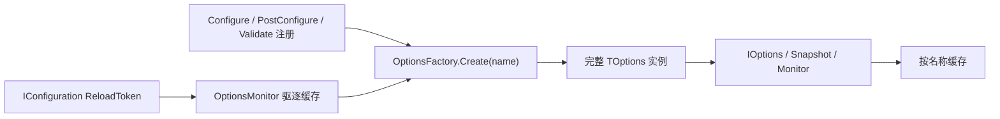

## 深入阅读导航

Options 模式不是简单的“把配置绑定成对象”。它由消费接口、按名称缓存、创建流水线、动作筛选、DI 注册和变更通知共同组成。下面按一次选项从注册到热更新的生命周期拆成 12 个阶段。

| 阶段 | 核心问题 | 关键入口 |
| --- | --- | --- |
| 1. 消费契约 | `IOptions`、Snapshot、Monitor 分别保证什么？ | `Value` / `Get` / `CurrentValue` |
| 2. Manager | 默认值与作用域快照由谁缓存？ | `UnnamedOptionsManager` / `OptionsManager` |
| 3. Monitor | 变化怎样驱逐缓存、重建并通知？ | `OptionsMonitor.InvokeChanged` |
| 4. 缓存 | 并发下如何保证同名实例只创建一次？ | `OptionsCache.GetOrAdd` |
| 5. Factory | Configure、PostConfigure、Validate 的固定顺序是什么？ | `OptionsFactory.Create` |
| 6. 名称语义 | `null`、空字符串和具体名称分别代表什么？ | `Options.DefaultName` |
| 7. 动作适配 | 委托如何变成标准配置与验证服务？ | `ConfigureNamedOptions` 等 |
| 8. 后续动作 | 后配置、验证及其依赖怎样适配？ | PostConfigure / Validate 适配器 |
| 9. DI 注册 | 五个核心开放泛型映射是什么生命周期？ | `AddOptions` |
| 10. Builder | 链式 API 实际向容器添加了什么？ | `OptionsBuilder<TOptions>` |
| 11. 配置绑定 | IConfiguration 如何在 Factory 阶段绑定？ | `NamedConfigureFromConfigurationOptions` |
| 12. 热更新 | 配置变化如何最终产生新选项实例？ | `ConfigurationChangeTokenSource` |

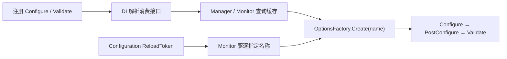

## 核心类型索引

| 类型 | 所在章节 | 说明 |
| --- | --- | --- |
| `IOptions<>` | 1. 消费契约 | 默认选项消费接口 |
| `IOptionsSnapshot<>` | 1. 消费契约 | 作用域快照接口 |
| `IOptionsMonitor<>` | 1. 消费契约 | 单例监控接口 |
| `UnnamedOptionsManager<>` | 2. Manager | 默认选项延迟缓存 |
| `OptionsManager<>` | 2. Manager | Snapshot 的作用域内命名缓存 |
| `OptionsMonitor<>` | 3. Monitor | 热更新、共享缓存与回调实现 |
| `OptionsMonitorExtensions` | 3. Monitor | 忽略名称的回调重载 |
| `IOptionsMonitorCache<>` | 4. 缓存 | Monitor 缓存抽象 |
| `OptionsCache<>` | 4. 缓存 | 并发命名缓存实现 |
| `IOptionsFactory<>` | 5. Factory | 统一创建入口 |
| `OptionsFactory<>` | 5. Factory | 创建、配置、后配置与验证流水线 |
| `IConfigureOptions<>` | 6. 名称语义 | 默认选项配置契约 |
| `IConfigureNamedOptions<>` | 6. 名称语义 | 命名配置契约 |
| `IPostConfigureOptions<>` | 6. 名称语义 | 后配置契约 |
| `IValidateOptions<>` | 6. 名称语义 | 验证契约 |
| `ConfigureOptions<>` | 7. 动作适配 | 默认名称 Action 适配器 |
| `ConfigureNamedOptions<>` | 7. 动作适配 | 命名 Action 适配器 |
| `PostConfigureOptions<>` | 8. 后续动作 | 后配置 Action 适配器 |
| `ValidateOptions<>` | 8. 后续动作 | 布尔验证适配器 |
| 多依赖动作适配器 | 8. 后续动作 | 最多五个依赖的配置、后配置与验证包装 |
| `OptionsServiceCollectionExtensions` | 9. DI 注册 | 核心服务与动作注册扩展 |
| `OptionsBuilder<>` | 10. Builder | 按名称组织链式注册 |
| `ConfigureFromConfigurationOptions<>` | 11. 配置绑定 | 默认名称配置绑定适配器 |
| `NamedConfigureFromConfigurationOptions<>` | 11. 配置绑定 | 命名配置绑定适配器 |
| `OptionsConfigurationServiceCollectionExtensions` | 11. 配置绑定 | 同时注册绑定与变更源 |
| `IOptionsChangeTokenSource<>` | 11. 配置绑定 | 选项变更源契约 |
| `ConfigurationChangeTokenSource<>` | 11. 配置绑定 | IConfiguration Token 适配器 |
## 1. 消费契约：IOptions、Snapshot 与 Monitor

### 本组解决什么问题

这一组源码回答“应用如何消费选项，以及三种接口为何表现不同”。差异不只在 API，还来自 DI 生命周期、缓存所有权和是否订阅变更源。

### 关键类型关系图

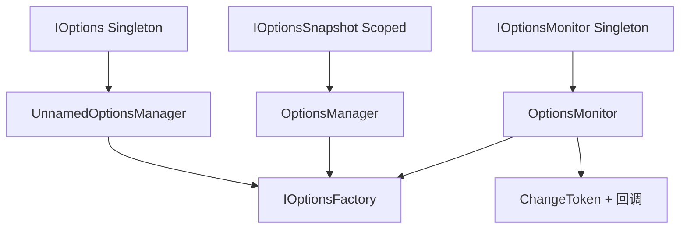

### 核心源码解读

### 三个接口解决的是三个时间模型

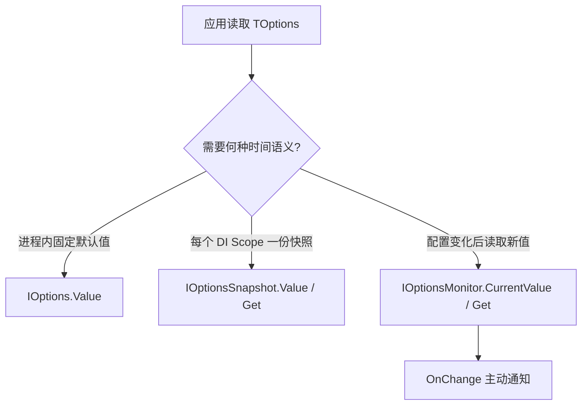

| 接口 | 默认 DI 生命周期 | 命名选项 | 自动响应变化 | 缓存边界 |
| --- | --- | --- | --- | --- |
| `IOptions<T>` | Singleton | 仅暴露默认值 | 否 | 整个 Manager 生命周期 |
| `IOptionsSnapshot<T>` | Scoped | 支持 `Get(name)` | 下一 Scope 可见 | 当前 Scope |
| `IOptionsMonitor<T>` | Singleton | 支持 `Get(name)` | 是 | 全局缓存，按名称失效 |

### “读取时机”比接口名称更重要

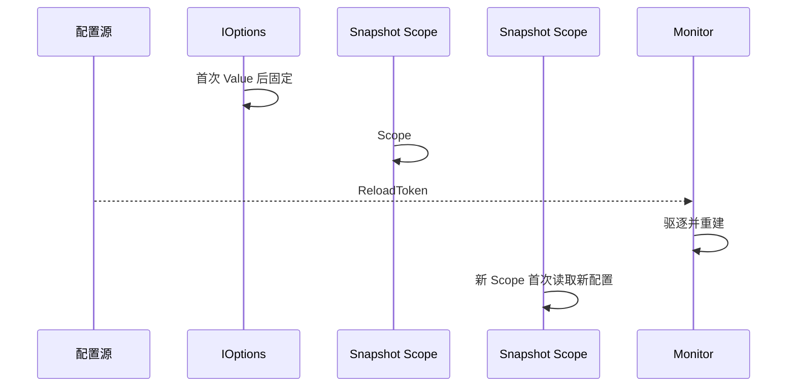

Snapshot 不是“每次访问都重新读取”，Monitor 也不是“每次访问都重新绑定”。二者都依赖缓存，区别在于缓存何时自然结束或被主动驱逐。

### 选择接口的决策顺序

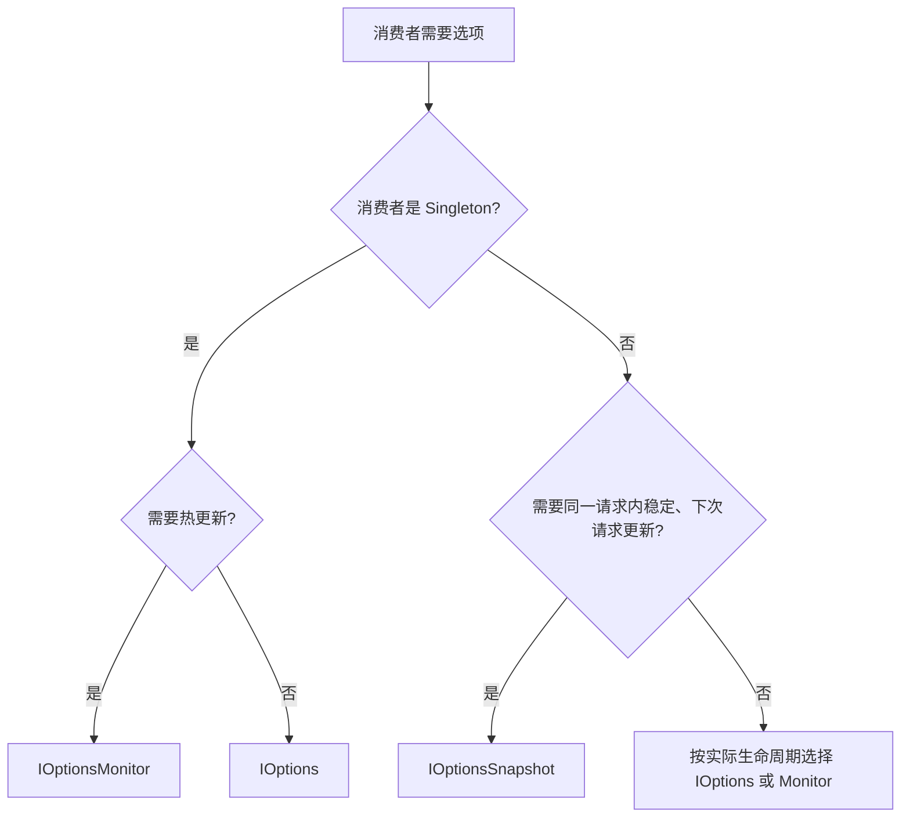

Scoped 服务不能直接解决 Singleton 的动态配置问题；Singleton 通常应使用 Monitor，而不是捕获某个 Snapshot。

### Value 与 Get 的关系

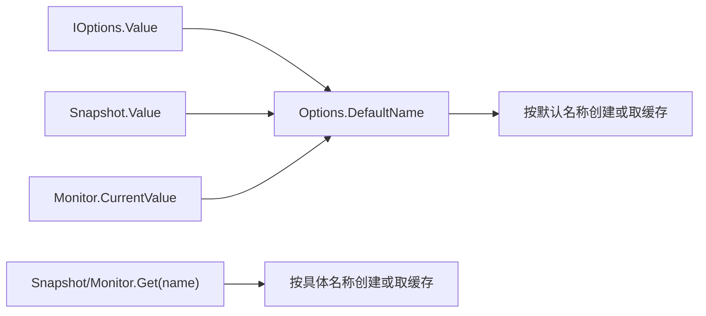

### IOptions<>

**读这组源码时关注什么：** 最简单的选项消费接口只承诺什么。

#### 整体结构

**这段代码回答什么问题：** 最简单的选项消费接口只承诺什么。

```C#
// 选项管理者的抽象表示
// 在注册服务时，IOptions<> 的服务注册生命周期为 Singlton
// 默认实现类型 UnnamedOptionsManager<>
public interface IOptions<out TOptions> where TOptions : class
{
    // 得到选项实例
    // 使用未具名（空字符串命名）的配置来配置选项
    TOptions Value { get; }
}
```

**源码解读：**
- `Value` 只返回默认名称对应的选项实例。
- 默认实现与 DI 注册共同决定它通常在应用生命周期内复用同一实例。

**读完要记住：**
- `IOptions<T>` 只消费默认名称。
- 它不提供命名读取或变化通知。

### IOptionsSnapshot<>

**读这组源码时关注什么：** 快照接口如何在默认值之外支持命名选项。

#### 整体结构

**这段代码回答什么问题：** 快照接口如何在默认值之外支持命名选项。

```C#
// 选项快照管理者的抽象表示
// 在注册服务时，IOptionsSnapshot<> 的服务注册生命周期为 Scoped
// 默认实现类型 OptionsManager<>
public interface IOptionsSnapshot<out TOptions> : IOptions<TOptions> where TOptions : class
{
    // 得到选项实例
    // 使用命名的选项配置
    TOptions Get(string? name);
}
```

**源码解读：**
- 接口继承 `IOptions<T>`，并增加按名称读取的 `Get`。
- Scoped 生命周期使同一请求范围内相同名称复用实例，不同范围重新创建。

**读完要记住：**
- Snapshot 的“快照”边界来自 Scoped 生命周期。
- 它适合请求内稳定、请求间可更新的场景。

### IOptionsMonitor<>

**读这组源码时关注什么：** 监控接口如何同时提供当前值、命名值和变化回调。

#### 整体结构

**这段代码回答什么问题：** 监控接口如何同时提供当前值、命名值和变化回调。

```C#
// 选项监控管理者的抽象表示
// 在注册服务时，IOptionsMonitor<> 的服务注册生命周期为 Singlton
// 用来监控选项的数据源变动情况，并在发生变动后更新选项实例并发出回调通知
// 默认实现类型 OptionsMonitor<>
public interface IOptionsMonitor<out TOptions>
{
    // 得到选项实例
    // 使用未具名（空字符串命名）的选项配置
    TOptions CurrentValue { get; }

    // 得到选项实例
    // 使用命名的选项配置
    TOptions Get(string? name);
    
    // 注册回调，用来监控选项的数据源变动情况
    IDisposable? OnChange(Action<TOptions, string?> listener);
}
```

**源码解读：**
- `CurrentValue` 对应默认名称，`Get` 支持命名选项。
- `OnChange` 让消费者观察配置源变化后新建的选项实例。

**读完要记住：**
- Monitor 是 Singleton，但缓存项可以被变更通知驱逐。
- 回调得到的是重建后的选项及其名称。

## 2. Manager：默认值与作用域快照的缓存边界

消费接口本身只定义表面 API，真正决定实例何时创建、保存多久的是 Manager。`IOptions<T>` 和 Snapshot 使用不同 Manager，也拥有不同缓存所有权。

### UnnamedOptionsManager 只缓存一个默认实例

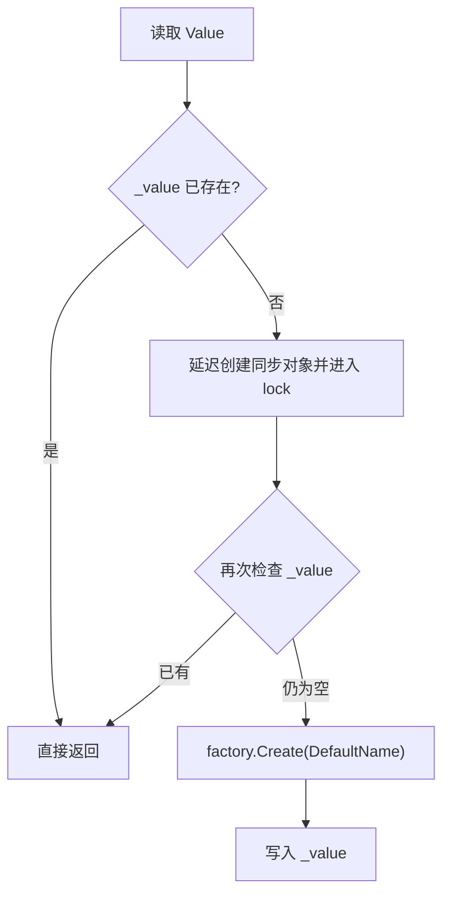

锁只保护第一次初始化。后续读取走 volatile 字段的快速路径，不会访问共享 `IOptionsMonitorCache<T>`，因此配置变化也没有对应的驱逐入口。

### OptionsManager 的缓存属于当前 Scope

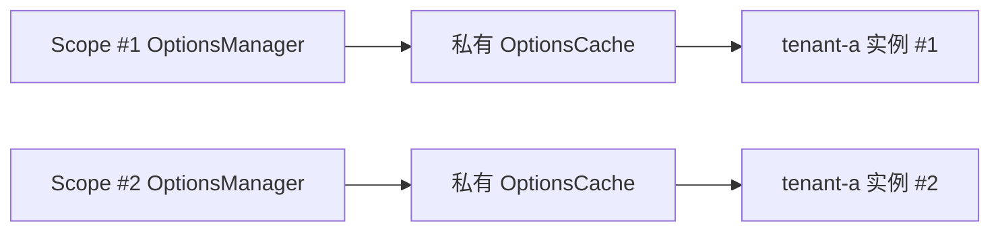

Snapshot 的“快照”不是复制 IConfiguration，而是在当前 Manager 内按名称延迟创建并缓存选项对象。新 Scope 会创建新 Manager 和新私有缓存。

### 同一 Scope 内不同名称彼此独立

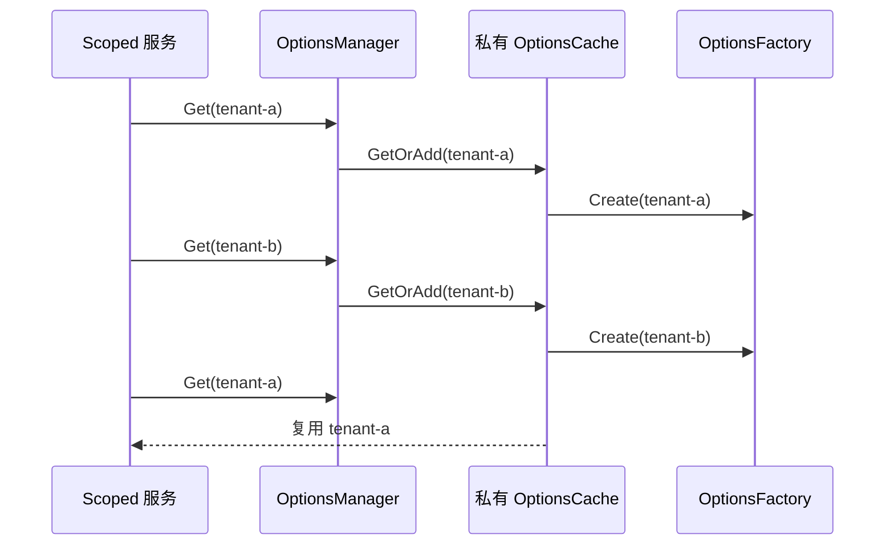

### 配置变化对三种已创建实例的影响

| 已创建对象 | 变化发生后当前引用 | 下一次获取 |
| --- | --- | --- |
| `IOptions<T>.Value` | 不变 | 仍返回同一对象 |
| 当前 Scope 的 Snapshot | 不变 | 同 Scope 仍命中私有缓存 |
| 新 Scope 的 Snapshot | 尚未创建 | 使用变化后的配置创建 |
| Monitor 旧引用 | 引用本身不变 | `Get` 返回重建后的新引用 |

Options 不会就地修改旧对象。热更新产生的是新实例，已经保存到业务字段中的旧引用不会自动变身。

### UnnamedOptionsManager<>

**读这组源码时关注什么：** IOptions<T> 如何线程安全地延迟创建默认选项。

#### 整体结构

**这段代码回答什么问题：** IOptions<T> 如何线程安全地延迟创建默认选项。

```C#
// IOptions<> 的默认实现
internal sealed class UnnamedOptionsManager<TOptions> : IOptions<TOptions> where TOptions : class
{
    // 选项配置工厂
    private readonly IOptionsFactory<TOptions> _factory;
    // 同步锁
    // 属于共享变量，需要使用 volitile
    private volatile object? _syncObj;
    // 作为选项实例的缓存
    // 由于存在多个线程并发获取选项实例的可能
    // 属于共享变量，需要使用 volitile
    private volatile TOptions? _value;

    // 通过依赖注入的方式注入选项配置工厂
    public UnnamedOptionsManager(IOptionsFactory<TOptions> factory) => _factory = factory;

    // 通过属性得到选项实例
    public TOptions Value
    {
        get
        {
            // 如果选项实例已经创建，则直接返回
            // 通过 is 模式匹配判断是否为 null
            if (_value is TOptions value)
            {
                return value;
            }

            // 使用 CAS 原子操作保证选项实例只被创建一次
            lock (_syncObj ?? Interlocked.CompareExchange(ref _syncObj, new object(), null) ?? _syncObj)
            {
                // 使用未具名的配置来配置选项
                return _value ??= _factory.Create(Options.DefaultName);
            }
        }
    }
}
```

**源码解读：**
- 首次访问 `Value` 时调用工厂创建默认名称选项。
- 双重检查配合锁和 volatile 字段，使实例只初始化一次。

**读完要记住：**
- 该管理器只处理 `Options.DefaultName`。
- 创建后的值不会因配置变化自动替换。

### OptionsManager<>

**读这组源码时关注什么：** IOptionsSnapshot<T> 如何按名称保存当前作用域的快照。

#### 整体结构

**这段代码回答什么问题：** IOptionsSnapshot<T> 如何按名称保存当前作用域的快照。

```C#
// IOptionsSnapshot<> 默认实现
public class OptionsManager<TOptions> :
        IOptions<TOptions>,
        IOptionsSnapshot<TOptions>
        where TOptions : class
{
    // 选项配置工厂
    private readonly IOptionsFactory<TOptions> _factory;
    // 选项实例缓存
    // 这是一个私有缓存，不通过依赖注入框架创建
    // 基于快照的选项获取，一般都是通过传递命名的方式调用 IOptionsSnapshot<>.Get 方法得到选项实例
    // 所以需要针对不同命名缓存对应的选项实例
    private readonly OptionsCache<TOptions> _cache = new OptionsCache<TOptions>();

    // 通过依赖注入的方式注入选项配置工厂
    public OptionsManager(IOptionsFactory<TOptions> factory)
    {
        _factory = factory;
    }

    // 实现 IOptions<>.Value
    // 获取选项实例
    // 调用 Get 方法使用未具名（空字符串命名）的方式得到选项实例
    public TOptions Value => Get(Options.DefaultName);

    // 传递命名的方式调用 Get 方法
    public virtual TOptions Get(string? name)
    {
        // 如果 name 为 null，则使用未具名（空字符串命名）方式
        name ??= Options.DefaultName;

        // 尝试从缓存中查找对应名称的选项实例，如果未找到，则通过选项配置工厂创建
        // 缓存内部使用了 ConcurrentDictionary<,> 并发集合来解决可能发生的并发情况
        if (!_cache.TryGetValue(name, out TOptions? options))
        {
            IOptionsFactory<TOptions> localFactory = _factory;
            string localName = name;
            options = _cache.GetOrAdd(name, () => localFactory.Create(localName));
        }

        return options;
    }
}
```

**源码解读：**
- 实例内部持有私有 `OptionsCache<T>`。
- `Get` 按名称查找或调用工厂创建，因此同一 Manager 中同名值稳定。

**读完要记住：**
- 每个 Scoped Manager 都有独立缓存。
- 不同名称对应不同缓存项。

## 3. Monitor：订阅、失效、重建与回调

Monitor 把共享缓存、Factory 和多个 `IOptionsChangeTokenSource<T>` 串在一起。它的热更新动作不是修改现有实例，而是移除指定名称后重新运行完整 Factory 流水线。

### 构造期间为每个变更源建立持续订阅

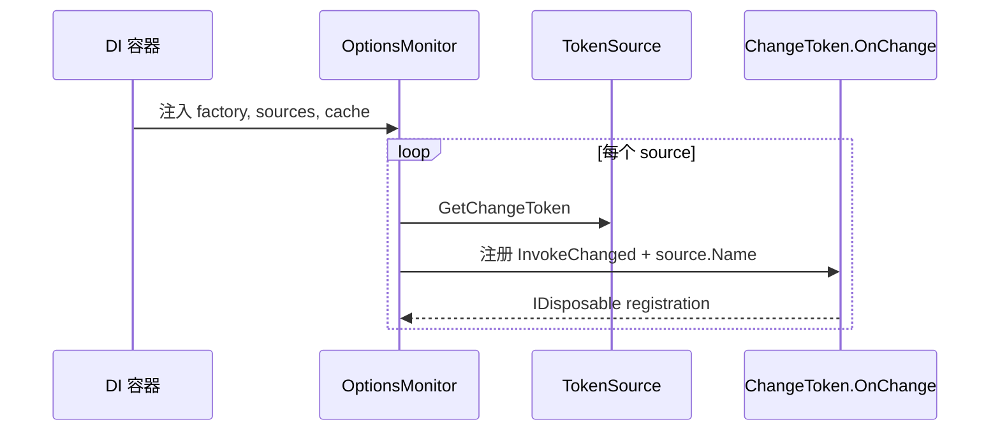

同一个选项类型可以注册多个变更源；Monitor 保存所有注册对象，并在自身 Dispose 时停止继续监听。

### 一次变化的核心顺序

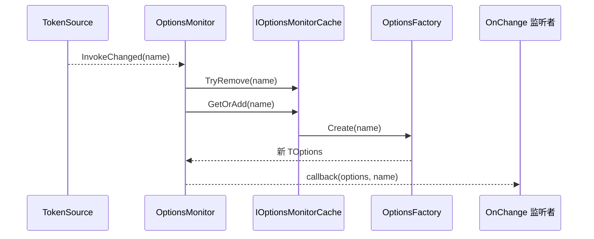

“先移除、再 Get”确保回调拿到新实例，也确保 Factory 中的 Configure、PostConfigure 和 Validate 全部重新执行。

### 变化按名称失效，不是清空所有缓存

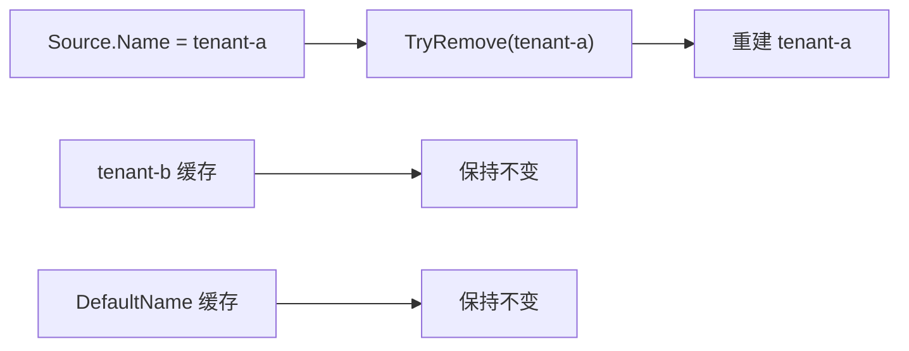

失效粒度由 TokenSource 的 `Name` 决定。多个名称绑定到同一个 IConfiguration 时，通常会分别注册 TokenSource，并各自触发对应名称的失效。

### 监听注册与 Monitor 生命周期是两类释放

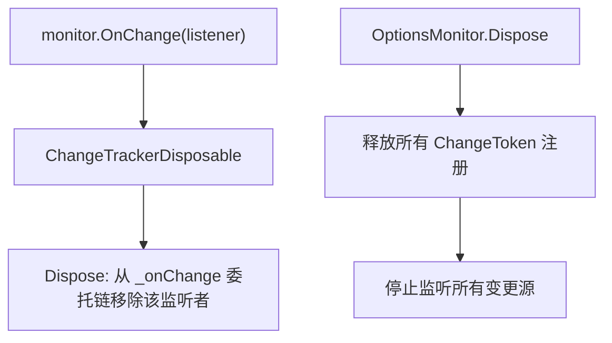

释放某个 `OnChange` 返回值只取消该业务回调；释放 Monitor 才会取消底层 TokenSource 订阅。

### 重建失败时不会发出成功回调

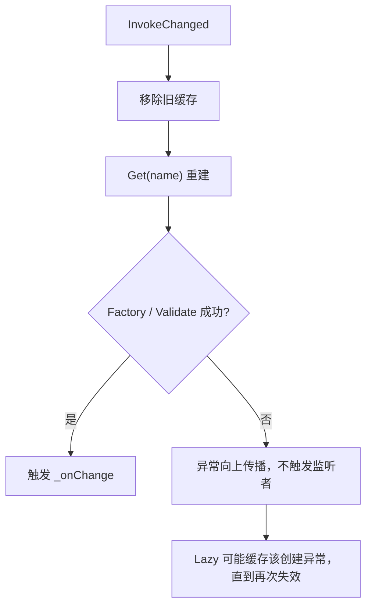

热更新并不绕过验证。新配置无效时，监听者不会收到一个未验证对象；默认 `Lazy<T>` 的异常缓存语义也意味着后续读取可能继续失败，直到下一次 `TryRemove`。

### OptionsMonitor<>

**读这组源码时关注什么：** 配置变化如何驱逐缓存、重建实例并通知监听者。

#### 整体结构

**这段代码回答什么问题：** 配置变化如何驱逐缓存、重建实例并通知监听者。

```C#
// IOptionsMonitor<> 的默认实现
public class OptionsMonitor<TOptions> :
        IOptionsMonitor<TOptions>,
        IDisposable
        where TOptions : class
{
    // 缓存选项实例（通过依赖注入方式传入）
    // 基于选项监控的选项获取，一般都是通过传递命名的方式调用 IOptionsMonitor<>.Get 方法得到选项实例
    // 所以需要针对不同命名缓存对应的选项实例
    private readonly IOptionsMonitorCache<TOptions> _cache;
    // 选项配置工厂
    private readonly IOptionsFactory<TOptions> _factory;
    // ChangeTokenRegistration<> 对象集合
    // 每个 IOptionsChangeTokenSource<> 通过调用 IConfiguration.GetReloadToken 方法返回 IChangeToken 用于注册回调
    private readonly List<IDisposable> _registrations = new List<IDisposable>();
    // 提供外部注册监听配置源改变，并在发生改变时触发的回调
    internal event Action<TOptions, string>? _onChange;

    // 通过依赖注入的方式注入选项配置工厂、选项变动令牌源、选项缓存
    public OptionsMonitor(IOptionsFactory<TOptions> factory, IEnumerable<IOptionsChangeTokenSource<TOptions>> sources, IOptionsMonitorCache<TOptions> cache)
    {
        _factory = factory;
        _cache = cache;

        void RegisterSource(IOptionsChangeTokenSource<TOptions> source)
        {
            // 利用命名作为回调的状态参数
            IDisposable registration = ChangeToken.OnChange(
                      source.GetChangeToken,
                      InvokeChanged,
                      source.Name);

            _registrations.Add(registration);
        }

        // 依赖注入方式解析 IEnumerable<> 服务类型时内部最终会分配一个数组对象
        // 如果是数组可以直接循环，避免分配一个迭代器对象
        if (sources is IOptionsChangeTokenSource<TOptions>[] sourcesArray)
        {
            foreach (IOptionsChangeTokenSource<TOptions> source in sourcesArray)
            {
                RegisterSource(source);
            }
        }
        else
        {
            foreach (IOptionsChangeTokenSource<TOptions> source in sources)
            {
                RegisterSource(source);
            }
        }
    }

    // 用于注册配置源发生变动时候的回调
    private void InvokeChanged(string? name)
    {
        name ??= Options.DefaultName;
        // 尝试移除旧的选项
        _cache.TryRemove(name);
        // 得到新的选项
        TOptions options = Get(name);
        _onChange?.Invoke(options, name);
    }

    // 获取选项实例
    // 本质是传递未具名（空字符串命名）的方式调用 Get 方法
    public TOptions CurrentValue
    {
        get => Get(Options.DefaultName);
    }

    // 使用具名的方式调用 Get 方法
    public virtual TOptions Get(string? name)
    {
        // 如果不是 OptionsCache<> 类型
        // 不兼容 .NETStandard 2.1 的目标框架会使用闭包方式使用 localName 和 localFactory
        if (_cache is not OptionsCache<TOptions> optionsCache)
        {
            string localName = name ?? Options.DefaultName;
            IOptionsFactory<TOptions> localFactory = _factory;
            return _cache.GetOrAdd(localName, () => localFactory.Create(localName));
        }

        // 兼容 .NETStandard 2.1 的目标框架都会执行此分支
        return optionsCache.GetOrAdd(name, static (name, factory) => factory.Create(name), _factory);
    }

    // 通过委托链注册多个回调，监听配置源改变
    // 使用 ChangeTrackerDisposable 对 Action<TOptions, string> 封装后返回 IDisposable
    // 便于外部通过调用 Dispose 方法从委托链中取消回调注册
    public IDisposable OnChange(Action<TOptions, string> listener)
    {
        var disposable = new ChangeTrackerDisposable(this, listener);
        _onChange += disposable.OnChange;
        return disposable;
    }

    // 取消注册所有针对配置源发生改变的监听回调
    public void Dispose()
    {
        foreach (IDisposable registration in _registrations)
        {
            registration.Dispose();
        }

        _registrations.Clear();
    }

    // 用于包装 Action<TOptions, string> 提供取消注册回调
    internal sealed class ChangeTrackerDisposable : IDisposable
    {
        private readonly Action<TOptions, string> _listener;
        private readonly OptionsMonitor<TOptions> _monitor;

        public ChangeTrackerDisposable(OptionsMonitor<TOptions> monitor, Action<TOptions, string> listener)
        {
            _listener = listener;
            _monitor = monitor;
        }

        public void OnChange(TOptions options, string name) => _listener.Invoke(options, name);

        public void Dispose() => _monitor._onChange -= OnChange;
    }
}
```

**源码解读：**
- 构造函数为每个 TokenSource 注册持续变更回调。
- `InvokeChanged` 删除指定名称缓存，再调用 `Get` 重建并触发事件。

**读完要记住：**
- Monitor 的缓存来自 DI 注入，通常是 Singleton `OptionsCache<T>`。
- 先驱逐再重建，保证回调收到新实例。

### OptionsMonitorExtensions

**读这组源码时关注什么：** 如何注册忽略选项名称的简化回调。

#### 整体结构

**这段代码回答什么问题：** 如何注册忽略选项名称的简化回调。

```C#
// 提供针对 IOptionsMonitor<> 的扩展方法
// 用于注册回调
public static class OptionsMonitorExtensions
{
    // 回调忽略 name 参数
    public static IDisposable? OnChange<TOptions>(
        this IOptionsMonitor<TOptions> monitor,
        Action<TOptions> listener)
            => monitor.OnChange((o, _) => listener(o));
}
```

**源码解读：**
- 扩展方法把 `Action<TOptions>` 包装成接口要求的双参数回调。
- 真正的订阅和释放仍由 `IOptionsMonitor.OnChange` 完成。

**读完要记住：**
- 这是 API 适配层，不改变监控语义。
- 返回的 IDisposable 用于取消监听。

### 最小例子

```csharp
public sealed class Worker
{
    public Worker(
        IOptions<AppOptions> singletonOptions,
        IOptionsSnapshot<AppOptions> scopedSnapshot,
        IOptionsMonitor<AppOptions> monitor)
    {
        AppOptions defaultValue = singletonOptions.Value;
        AppOptions namedSnapshot = scopedSnapshot.Get("tenant-a");
        AppOptions currentValue = monitor.CurrentValue;
    }
}
```

### 回顾要点

- IOptions 只提供默认名称，并在默认实现中长期缓存。
- IOptionsSnapshot 的 Manager 和私有缓存均为 Scoped。
- IOptionsMonitor 通过共享缓存与 ChangeToken 支持命名选项热更新。

## 4. 命名缓存：并发复用与精准失效

### 本组解决什么问题

这一组源码回答“并发请求同一名称时如何只创建一个实例，以及配置变化时如何让指定名称失效”。默认实现使用 ConcurrentDictionary 与 Lazy，把线程安全和延迟创建结合起来。

### 关键类型关系图

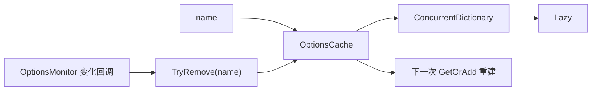

### 核心源码解读

### 缓存需要同时解决键并发与实例并发

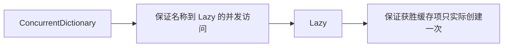

仅使用 ConcurrentDictionary 仍可能让竞争线程各自先执行昂贵的 Factory，再由一个结果胜出。把 Factory 放入 `Lazy<T>` 后，只有最终缓存中的 Lazy 被求值。

### 名称归一化与比较规则

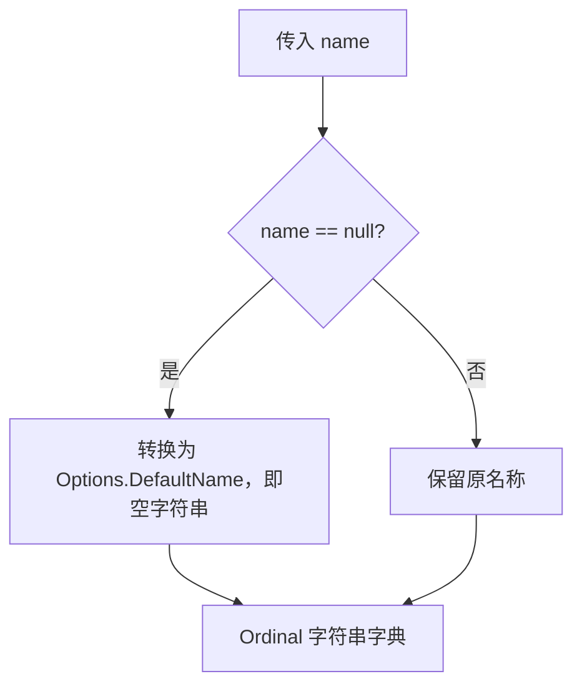

默认缓存使用 `StringComparer.Ordinal`，所以 `tenant-a` 与 `Tenant-A` 是两个不同缓存项。名称规范应在注册边界统一，而不是依赖缓存忽略大小写。

### 四个公开操作的边界

| 操作 | 已存在时 | 不存在时 | 是否运行 Factory |
| --- | --- | --- | --- |
| `GetOrAdd` | 返回缓存值 | 创建并加入 | 是 |
| `TryAdd` | 返回 false | 加入给定实例 | 否 |
| `TryRemove` | 删除并返回 true | 返回 false | 否 |
| `Clear` | 清空全部名称 | 无变化 | 否 |

### 精准失效与全量清空

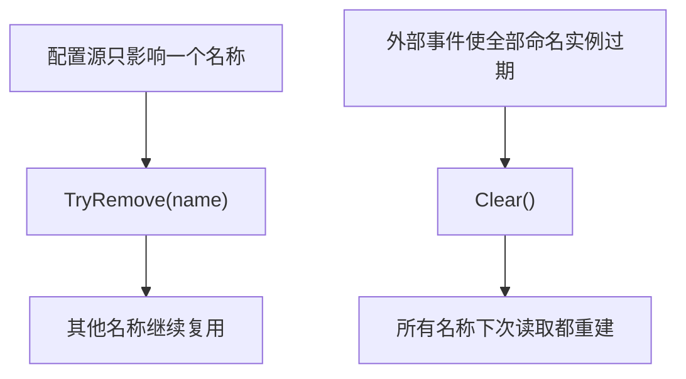

Monitor 内置路径使用 `TryRemove`。自定义缓存管理逻辑只有在确实无法确定受影响名称时才应调用 `Clear`。

### Lazy 会缓存成功值，也会缓存创建异常

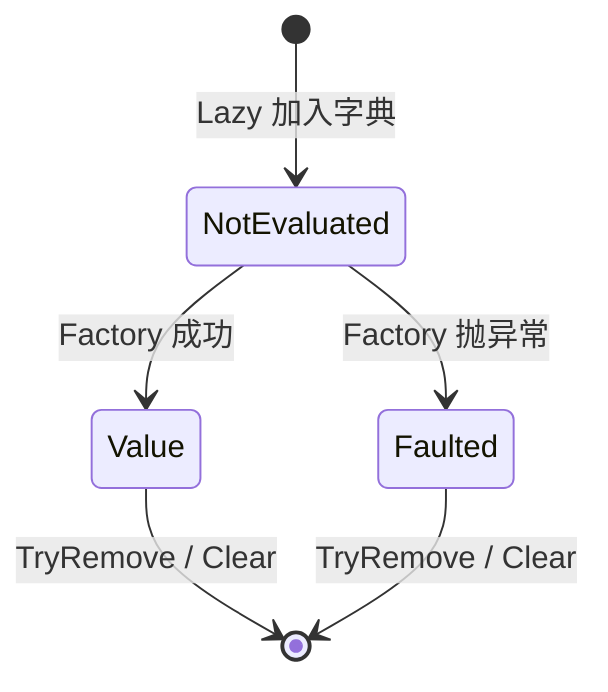

### IOptionsMonitorCache<>

**读这组源码时关注什么：** 监控器需要缓存暴露哪些最小操作。

#### 整体结构

**这段代码回答什么问题：** 监控器需要缓存暴露哪些最小操作。

```C#
// 选项缓存的抽象表示
public interface IOptionsMonitorCache<TOptions>
       where TOptions : class
{
    TOptions GetOrAdd(string? name, Func<TOptions> createOptions);

    bool TryAdd(string? name, TOptions options);

    bool TryRemove(string? name);

    void Clear();
}
```

**源码解读：**
- 接口支持按名称读取或创建、添加、删除和清空。
- `TryRemove` 是热更新时使单个命名选项失效的关键。

**读完要记住：**
- 缓存键是选项名称。
- 接口允许替换默认缓存实现。

### OptionsCache<>

**读这组源码时关注什么：** 默认缓存如何保证并发下每个名称只创建一次。

#### 整体结构

**这段代码回答什么问题：** 默认缓存如何保证并发下每个名称只创建一次。

```C#
// IOptionsMonitorCache<> 的默认实现
public class OptionsCache<TOptions> :
        IOptionsMonitorCache<TOptions>
        where TOptions : class
{
    private readonly ConcurrentDictionary<string, Lazy<TOptions>> _cache = new ConcurrentDictionary<string, Lazy<TOptions>>(concurrencyLevel: 1, capacity: 31, StringComparer.Ordinal);

    public void Clear() => _cache.Clear();

    public virtual TOptions GetOrAdd(string? name, Func<TOptions> createOptions)
    {
        ThrowHelper.ThrowIfNull(createOptions);

        name ??= Options.DefaultName;
        Lazy<TOptions> value;

#if NET || NETSTANDARD2_1
        value = _cache.GetOrAdd(name, static (name, createOptions) => new Lazy<TOptions>(createOptions), createOptions);
#else
        if (!_cache.TryGetValue(name, out value))
        {
            // 传递工厂委托创建 Lazy
            value = _cache.GetOrAdd(name, new Lazy<TOptions>(createOptions));
        }
#endif

        return value.Value;
    }

    internal TOptions GetOrAdd<TArg>(string? name, Func<string, TArg, TOptions> createOptions, TArg factoryArgument)
    {
#if NET || NETSTANDARD2_1
        if (GetType() != typeof(OptionsCache<TOptions>))
#endif
        {
            // 不兼容 .NETStandard 2.1 的目标框架
            // 使用闭包方式使用 localName、localCreateOptions、localFactoryArgument
            string? localName = name;
            Func<string, TArg, TOptions> localCreateOptions = createOptions;
            TArg localFactoryArgument = factoryArgument;
            return GetOrAdd(name, () => localCreateOptions(localName ?? Options.DefaultName, localFactoryArgument));
        }

#if NET || NETSTANDARD2_1
        // 兼容 .NETStandard 2.1 的目标框架
        return _cache
            .GetOrAdd(
                name ?? Options.DefaultName,
                static (name, arg) => 
                    new Lazy<TOptions>(arg.createOptions(name, arg.factoryArgument)), 
                (createOptions, factoryArgument))
            .Value;
#endif
    }

    internal bool TryGetValue(string? name, [MaybeNullWhen(false)] out TOptions options)
    {
        if (_cache.TryGetValue(name ?? Options.DefaultName, out Lazy<TOptions>? lazy))
        {
            options = lazy.Value;
            return true;
        }

        options = default;
        return false;
    }

    public virtual bool TryAdd(string? name, TOptions options)
    {
        ThrowHelper.ThrowIfNull(options);

        return _cache.TryAdd(name ?? Options.DefaultName, new Lazy<TOptions>(
#if !(NET || NETSTANDARD2_1)
                () =>
#endif
            options));
    }

    public virtual bool TryRemove(string? name) =>
        _cache.TryRemove(name ?? Options.DefaultName, out _);
}
```

**源码解读：**
- `ConcurrentDictionary<string, Lazy<TOptions>>` 同时解决字典并发和延迟创建。
- null 名称统一归一化为 `Options.DefaultName`。

**读完要记住：**
- Lazy 避免竞态中的重复实例被实际求值。
- Monitor 与 Snapshot 都复用其缓存语义，但缓存所有权不同。

### 最小例子

```csharp
IOptionsMonitorCache<AppOptions> cache = serviceProvider
    .GetRequiredService<IOptionsMonitorCache<AppOptions>>();

cache.TryRemove("tenant-a");
cache.Clear();
```

### 回顾要点

- 缓存键是归一化后的选项名称。
- ConcurrentDictionary 保护缓存结构，Lazy 保护实际实例创建。
- Monitor 热更新通过 TryRemove 使单个名称失效。

## 5. 创建流水线：Configure、PostConfigure、Validate

### 本组解决什么问题

这一组源码回答“一个完整选项实例怎样被创建出来”。Manager 和 Monitor 都把创建委托给 IOptionsFactory；默认工厂固定执行实例化、预配置、后配置和验证四步。

### 关键类型关系图

```mermaid
flowchart LR
    A["Create(name)"] --> B["CreateInstance"]
    B --> C["IConfigureOptions"]
    C --> D["IPostConfigureOptions"]
    D --> E["IValidateOptions"]
    E --> F{"验证结果"}
    F -->|成功或跳过| G["返回 TOptions"]
    F -->|失败| H["OptionsValidationException"]
```

### 核心源码解读

### Factory 是所有消费模型的共同汇合点

```mermaid
flowchart LR
    A["UnnamedOptionsManager"] --> F["IOptionsFactory.Create"]
    B["OptionsManager"] --> F
    C["OptionsMonitor"] --> F
    F --> D["完整且已验证的 TOptions"]
```

消费模型只决定缓存策略，不复制创建逻辑。替换 `IOptionsFactory<T>` 会同时影响三种消费接口。

### 固定四阶段流水线

```mermaid
sequenceDiagram
    participant Caller as Manager / Monitor
    participant Factory as OptionsFactory
    participant Configure as Configure 列表
    participant Post as PostConfigure 列表
    participant Validate as Validate 列表
    Caller->>Factory: Create(name)
    Factory->>Factory: Activator.CreateInstance<TOptions>()
    Factory->>Configure: 按注册顺序执行并筛选名称
    Factory->>Post: 按注册顺序执行并筛选名称
    Factory->>Validate: 执行全部验证并收集失败
    Factory-->>Caller: 返回或抛 OptionsValidationException
```

### Configure 的两类分派规则

```mermaid
flowchart TD
    A["遍历 IConfigureOptions"] --> B{"实现 IConfigureNamedOptions?"}
    B -->|是| C["调用 Configure(name, options)"]
    B -->|否| D{"name == DefaultName?"}
    D -->|是| E["调用 Configure(options)"]
    D -->|否| F["跳过普通 Configure"]
```

普通 `IConfigureOptions<T>` 只能参与默认名称；命名适配器自己决定具体名称、默认名称或全部名称是否匹配。

### 验证失败先汇总再抛出

```mermaid
flowchart LR
    A["Validator #1 Fail(A)"] --> D["failures 列表"]
    B["Validator #2 Skip"] --> D
    C["Validator #3 Fail(B,C)"] --> D
    D --> E{"存在失败?"}
    E -->|是| F["OptionsValidationException: A,B,C"]
    E -->|否| G["返回 options"]
```

Factory 不会在第一个失败处提前停止，因此一个创建请求可以一次报告多个验证问题。

### 默认实例化约束

这版 `CreateInstance` 使用 `Activator.CreateInstance<TOptions>()`，目标类型需要可创建的无参构造函数。Options 模式不是对象工厂替代品；复杂构造过程应放在服务工厂中，Options 保持为可绑定的数据对象。

### IOptionsFactory<>

**读这组源码时关注什么：** 管理器与监控器依赖怎样的统一创建入口。

#### 整体结构

**这段代码回答什么问题：** 管理器与监控器依赖怎样的统一创建入口。

```C#
// 选项工厂的抽象表示
public interface IOptionsFactory<TOptions>
        where TOptions : class
{
    // 根据传递的命名参数创建选项实例
    TOptions Create(string name);
}
```

**源码解读：**
- 接口只按名称创建完整选项实例。
- 配置、后配置和验证细节被封装在默认工厂内部。

**读完要记住：**
- 消费者无需了解选项构造流水线。
- 名称是整条流水线的筛选条件。

### OptionsFactory<>

**读这组源码时关注什么：** 一个选项实例按什么顺序创建和加工。

#### 整体结构

**这段代码回答什么问题：** 一个选项实例按什么顺序创建和加工。

```C#
// 选项工厂的默认实现
public class OptionsFactory<TOptions> :
        IOptionsFactory<TOptions>
        where TOptions : class
{
    // 选项配置数组
    // 可以理解为预配置
    private readonly IConfigureOptions<TOptions>[] _setups;
    // 选项后配置数组
    // 可以理解为预配置后的进一步配置
    private readonly IPostConfigureOptions<TOptions>[] _postConfigures;
    // 选项验证配置数组
    // 可以理解为配置后用于选项验证处理
    private readonly IValidateOptions<TOptions>[] _validations;

    // 不使用选项验证配置
    public OptionsFactory(
        IEnumerable<IConfigureOptions<TOptions>> setups, IEnumerable<IPostConfigureOptions<TOptions>> postConfigures) 
        : this(setups, postConfigures, validations: Array.Empty<IValidateOptions<TOptions>>())
    { }

    // 此构造函数会被依赖注入框架选为最优构造函数
    public OptionsFactory(IEnumerable<IConfigureOptions<TOptions>> setups, IEnumerable<IPostConfigureOptions<TOptions>> postConfigures, IEnumerable<IValidateOptions<TOptions>> validations)
    {
        // 尝试转换为数组类型
        _setups = setups as IConfigureOptions<TOptions>[] ?? new List<IConfigureOptions<TOptions>>(setups).ToArray();
        _postConfigures = postConfigures as IPostConfigureOptions<TOptions>[] ?? new List<IPostConfigureOptions<TOptions>>(postConfigures).ToArray();
        _validations = validations as IValidateOptions<TOptions>[] ?? new List<IValidateOptions<TOptions>>(validations).ToArray();
    }

    // 根据命名创建选项实例
    public TOptions Create(string name)
    {
        TOptions options = CreateInstance(name);
        // 遍历所有选项配置
        foreach (IConfigureOptions<TOptions> setup in _setups)
        {
            if (setup is IConfigureNamedOptions<TOptions> namedSetup)
            {
                // 如果是命名选项配置，使用命名参数配置选项
                namedSetup.Configure(name, options);
            }
            else if (name == Options.DefaultName)
            {
                // 如果命名参数是空字符串，才能使用未具名（空字符串命名）的配置
                setup.Configure(options);
            }
        }
        // 遍历所有选项后配置
        foreach (IPostConfigureOptions<TOptions> post in _postConfigures)
        {
            post.PostConfigure(name, options);
        }
        
        // 如果存在选项验证配置
        if (_validations.Length > 0)
        {
            var failures = new List<string>();
            foreach (IValidateOptions<TOptions> validate in _validations)
            {
                ValidateOptionsResult result = validate.Validate(name, options);
                // 收集验证过程中失败的结果
                if (result is not null && result.Failed)
                {
                    // 追加失败信息
                    failures.AddRange(result.Failures);
                }
            }
            // 如果存在验证失败情况，则抛出异常
            if (failures.Count > 0)
            {
                throw new OptionsValidationException(name, typeof(TOptions), failures);
            }
        }

        return options;
    }

    // 反射方式创建实例
    // 此处 TOptions 泛型类型必须存在无参构造函数
    protected virtual TOptions CreateInstance(string name)
    {
        return Activator.CreateInstance<TOptions>();
    }
}
```

**源码解读：**
- 先反射创建实例，再执行 Configure、PostConfigure，最后 Validate。
- 命名 Configure 按名称筛选，普通 Configure 只用于默认名称；验证失败汇总后抛异常。

**读完要记住：**
- 固定顺序是 Configure → PostConfigure → Validate。
- 工厂每次 Create 都生成完整且已验证的实例。

### 最小例子

```csharp
services.AddOptions<AppOptions>()
    .Configure(options => options.Name = "configured")
    .PostConfigure(options => options.Name = options.Name.Trim())
    .Validate(options => options.Name.Length > 0, "Name is required");
```

### 回顾要点

- 所有消费模型最终都依赖 IOptionsFactory.Create。
- 默认顺序固定为 Configure → PostConfigure → Validate。
- 所有验证失败信息汇总后由 OptionsValidationException 抛出。

## 6. 名称语义与动作契约

### 本组解决什么问题

这一组源码展开创建流水线中的三类动作。命名实现用 Name 决定是否应用；带依赖版本把额外服务保存进动作对象，但不改变 Configure、PostConfigure、Validate 的阶段顺序。

### 关键类型关系图

```mermaid
flowchart TD
    A["OptionsFactory.Create(name)"] --> B{"动作 Name"}
    B -->|null| C["所有名称"]
    B -->|空字符串| D["默认名称"]
    B -->|具体字符串| E["匹配的命名选项"]
    C --> F["执行委托"]
    D --> F
    E --> F
    G["DI 依赖 TDep1..TDep5"] --> F
```

### 核心源码解读

### 先统一三个名称值的含义

| 名称值 | 含义 | 典型来源 |
| --- | --- | --- |
| `Options.DefaultName` | 空字符串，只代表默认选项 | `Configure<T>(action)`、`Value` |
| 具体字符串 | 一个独立命名选项 | `AddOptions<T>("tenant-a")` |
| `null` | 动作适配器中表示匹配全部名称 | `ConfigureAll` / `PostConfigureAll` |

```mermaid
flowchart LR
    A["null"] --> B["动作筛选：全部名称"]
    C["空字符串"] --> D["缓存键：默认名称"]
    E["tenant-a"] --> F["缓存键：具名实例"]
```

不要把“未提供名称”一概理解成 null。公共缓存入口会把 null 归一化为空字符串，但动作适配器保存的 null 是刻意表达“全部名称”。

### 名称筛选真值表

| 动作保存的 Name | 创建默认名称 `""` | 创建 `tenant-a` | 创建 `tenant-b` |
| --- | --- | --- | --- |
| `null` | 执行 | 执行 | 执行 |
| `""` | 执行 | 跳过 | 跳过 |
| `"tenant-a"` | 跳过 | 执行 | 跳过 |

### Configure、PostConfigure、Validate 使用同一筛选模型

```mermaid
flowchart TD
    A["动作接收 createName"] --> B{"Action.Name == null?"}
    B -->|是| C["执行：适用于全部名称"]
    B -->|否| D{"createName == Action.Name?"}
    D -->|是| E["执行"]
    D -->|否| F["跳过"]
```

差别不在名称匹配，而在执行阶段和返回约定：Configure 修改对象，PostConfigure 在所有 Configure 后修正对象，Validate 返回 Success、Fail 或 Skip。

### 注册顺序会成为执行顺序

```mermaid
flowchart LR
    A["Configure #1 设置默认值"] --> B["Configure #2 覆盖字段"]
    B --> C["PostConfigure 归一化"]
    C --> D["Validate 检查最终结果"]
```

同阶段服务由 DI 以注册顺序组成 `IEnumerable<T>`，Factory 再依次执行。依赖“最后注册覆盖前面”的行为时，应在代码中保持注册顺序清晰。

### IConfigureOptions<>

**读这组源码时关注什么：** 未具名预配置的最小契约是什么。

#### 整体结构

**这段代码回答什么问题：** 未具名预配置的最小契约是什么。

```C#
// 选项预配置的抽象表示
public interface IConfigureOptions<in TOptions> where TOptions : class
{
    // 配置选项
    void Configure(TOptions options);
}
```

**源码解读：**
- `Configure(TOptions)` 接收待修改的选项实例。
- 默认工厂只在创建默认名称选项时调用非命名配置。

**读完要记住：**
- 该接口表示创建后的第一阶段加工。
- 需要命名能力时使用 IConfigureNamedOptions。

### IConfigureNamedOptions<>

**读这组源码时关注什么：** 预配置如何按名称选择性应用。

#### 整体结构

**这段代码回答什么问题：** 预配置如何按名称选择性应用。

```C#
// 选项预配置（命名）的抽象表示
public interface IConfigureNamedOptions<in TOptions> : IConfigureOptions<TOptions> where TOptions : class
{
    // 配置选项
    // 需要传递命名参数
    // 实现类型内部一般会用 Name 属性来匹配参数，决定是否应用配置
    void Configure(string? name, TOptions options);
}
```

**源码解读：**
- 接口增加带 name 的 Configure，同时继承未命名接口。
- 实现通常用自身 Name 与创建参数匹配。

**读完要记住：**
- Name 为 null 常表示对所有名称生效。
- 空字符串表示默认名称，不等同于 null。

### IPostConfigureOptions<>

**读这组源码时关注什么：** 后配置阶段如何接收选项名称。

#### 整体结构

**这段代码回答什么问题：** 后配置阶段如何接收选项名称。

```C#
// 选项后配置（命名）的抽象表示
public interface IPostConfigureOptions<in TOptions> where TOptions : class
{
    // 配置选项
    // 需要传递命名参数
    void PostConfigure(string? name, TOptions options);
}
```

**源码解读：**
- `PostConfigure` 在全部 Configure 完成后执行。
- 它适合补默认值、归一化或依赖最终配置结果的调整。

**读完要记住：**
- 后配置同样可以按名称筛选。
- 后配置之后才进入验证阶段。

### IValidateOptions<>

**读这组源码时关注什么：** 验证阶段如何表达成功、失败和跳过。

#### 整体结构

**这段代码回答什么问题：** 验证阶段如何表达成功、失败和跳过。

```C#
// 选项验证配置（命名）的抽象表示
public interface IValidateOptions<TOptions> where TOptions : class
{
    // 验证选项
    // 需要传递命名的方式
    ValidateOptionsResult Validate(string? name, TOptions options);
}
```

**源码解读：**
- `Validate` 返回 `ValidateOptionsResult`。
- 命名不匹配时实现可以返回 Skip，失败时提供错误信息。

**读完要记住：**
- 验证不会修改选项。
- 多个验证器的失败会由工厂统一汇总。

## 7. 动作适配器：把委托转换成标准服务

接口定义 Factory 能调用什么，具体适配器则保存 Name、Action 和失败消息。它们本身不创建选项，只在 Factory 提供实例时执行。

### ConfigureOptions 与 ConfigureNamedOptions 的关系

```mermaid
flowchart LR
    A["Action<TOptions>"] --> B["ConfigureOptions<T>"]
    B --> C["IConfigureOptions<T>"]
    D["Name + Action<TOptions>"] --> E["ConfigureNamedOptions<T>"]
    E --> F["IConfigureNamedOptions<T>"]
    F --> C
```

`ConfigureNamedOptions<T>` 同时实现命名接口和基础配置接口，后者会委托到默认名称路径。

### 后配置不是第二种优先级，而是独立阶段

```mermaid
flowchart TD
    A["所有 Configure 完成"] --> B["PostConfigureOptions 匹配名称"]
    B --> C["修正、补齐或归一化最终值"]
    C --> D["进入 Validate"]
```

适合放在 PostConfigure 的逻辑包括拼接派生值、对多个 Configure 来源的结果做归一化；不应在这里绕过后续验证。

### ValidateOptionsResult 是三态结果

```mermaid
stateDiagram-v2
    [*] --> Skip: 名称不匹配
    [*] --> Success: 名称匹配且委托返回 true
    [*] --> Fail: 名称匹配且委托返回 false
    Fail --> [*]: 失败消息进入汇总
```

`Skip` 不是验证成功，而是该验证器不适用于当前名称。Factory 只收集 `Failed` 的结果。

### 适配器对象通常是无状态执行描述

```mermaid
flowchart LR
    A["注册阶段创建适配器"] --> B["保存 Name / Action"]
    B --> C["每次 Factory.Create"]
    C --> D["对新的 options 实例执行同一描述"]
```

闭包捕获的对象会随适配器生命周期长期存在。注册 Singleton 动作时不要无意捕获短生命周期服务。

### ConfigureOptions<>

**读这组源码时关注什么：** 普通 Action<TOptions> 如何适配为配置服务。

#### 整体结构

**这段代码回答什么问题：** 普通 Action<TOptions> 如何适配为配置服务。

```C#
// IConfigureOptions<> 的默认实现
public class ConfigureOptions<TOptions> : IConfigureOptions<TOptions> where TOptions : class
{
    // 传递配置委托
    public ConfigureOptions(Action<TOptions>? action)
    {
        Action = action;
    }

    public Action<TOptions>? Action { get; }

    // 配置选项
    // 只有使用空字符串作为参数时才会调用此方法
    public virtual void Configure(TOptions options)
    {
        ThrowHelper.ThrowIfNull(options);

        Action?.Invoke(options);
    }
}
```

**源码解读：**
- 实现保存并调用配置委托。
- 它不处理名称，因此只在默认名称创建路径应用。

**读完要记住：**
- 这是 IConfigureOptions 的委托适配器。
- null Action 不会执行任何配置。

### ConfigureNamedOptions<>

**读这组源码时关注什么：** 单参数命名配置如何判断是否执行。

#### 整体结构

**这段代码回答什么问题：** 单参数命名配置如何判断是否执行。

```C#
// IConfigureNamedOptions<> 的默认实现
public class ConfigureNamedOptions<TOptions> : IConfigureNamedOptions<TOptions> where TOptions : class
{
    // 传递实际的配置委托和命名
    public ConfigureNamedOptions(string? name, Action<TOptions>? action)
    {
        Name = name;
        Action = action;
    }

    public string? Name { get; }

    public Action<TOptions>? Action { get; }

    // 配置选项
    public virtual void Configure(string? name, TOptions options)
    {
        ThrowHelper.ThrowIfNull(options);

        // 确定是否应用配置
        // 未具名（空字符串命名）的配置属于全局默认配置
        // 其他情况下只有传递的命名参数与 Name 属性相同，才会应用配置
        if (Name == null || name == Name)
        {
            Action?.Invoke(options);
        }
    }

    // 配置选项
    // 传递空字符串作为参数应用配置
    public void Configure(TOptions options) => Configure(Options.DefaultName, options);
}
```

**源码解读：**
- Name 为 null 或与目标名称相等时调用 Action。
- 无参 Configure 委托到默认名称路径。

**读完要记住：**
- null 名称表示全局配置。
- 默认名称是空字符串而不是 null。

## 8. 后配置、验证与依赖适配

基础 Configure 适配器解决“怎样修改对象”；后续实现继续解决后配置、三态验证，以及动作依赖其他 DI 服务时如何封装。源码展示五依赖版本，其他参数数量版本遵循相同模式。

### ConfigureNamedOptions<,,,,,>

**读这组源码时关注什么：** 依赖其他服务的命名配置如何封装。

#### 整体结构

**这段代码回答什么问题：** 依赖其他服务的命名配置如何封装。

```C#
// IConfigureNamedOptions<> 的实现
// 可以依赖额外的参数用于配置选项，实现方式与 ConfigureNamedOptions<> 相似
// 根据依赖的参数数量不同，有多个重载版本
public class ConfigureNamedOptions<TOptions, TDep1, TDep2, TDep3, TDep4, TDep5> : IConfigureNamedOptions<TOptions>
    where TOptions : class
    where TDep1 : class
    where TDep2 : class
    where TDep3 : class
    where TDep4 : class
    where TDep5 : class
{
    public ConfigureNamedOptions(
        string? name, 
        TDep1 dependency1, 
        TDep2 dependency2, 
        TDep3 dependency3, 
        TDep4 dependency4, 
        TDep5 dependency5, 
        Action<TOptions, TDep1, TDep2, TDep3, TDep4, TDep5>? action)
    {
        Name = name;
        Action = action;
        Dependency1 = dependency1;
        Dependency2 = dependency2;
        Dependency3 = dependency3;
        Dependency4 = dependency4;
        Dependency5 = dependency5;
    }

    public string? Name { get; }

    public Action<TOptions, TDep1, TDep2, TDep3, TDep4, TDep5>? Action { get; }

    public TDep1 Dependency1 { get; }

    public TDep2 Dependency2 { get; }

    public TDep3 Dependency3 { get; }

    public TDep4 Dependency4 { get; }

    public TDep5 Dependency5 { get; }

    public virtual void Configure(string? name, TOptions options)
    {
        ThrowHelper.ThrowIfNull(options);

        if (Name == null || name == Name)
        {
            Action?.Invoke(options, Dependency1, Dependency2, Dependency3, Dependency4, Dependency5);
        }
    }

    public void Configure(TOptions options) => Configure(Options.DefaultName, options);
}
```

**源码解读：**
- 对象保存最多五个依赖和配置委托。
- 匹配名称后把选项与依赖一起传给 Action。

**读完要记住：**
- 额外依赖由 OptionsBuilder 注册的工厂从 DI 解析。
- 不同依赖数量由同类泛型重载覆盖。

### PostConfigureOptions<>

**读这组源码时关注什么：** 单参数后配置如何按名称应用。

#### 整体结构

**这段代码回答什么问题：** 单参数后配置如何按名称应用。

```C#
// IPostConfigureOptions<> 的默认实现
// 实现方式与 ConfigureNamedOptions<> 相似
public class PostConfigureOptions<TOptions> : IPostConfigureOptions<TOptions> where TOptions : class
{
    public PostConfigureOptions(string? name, Action<TOptions>? action)
    {
        Name = name;
        Action = action;
    }

    public string? Name { get; }

    public Action<TOptions>? Action { get; }

    public virtual void PostConfigure(string? name, TOptions options)
    {
        ThrowHelper.ThrowIfNull(options);

        // 确定是否应用配置
        // 未具名（空字符串命名）的配置属于全局默认配置
        // 其他情况下只有传递的命名参数与 Name 属性相同，才会应用配置
        if (Name == null || name == Name)
        {
            Action?.Invoke(options);
        }
    }
}
```

**源码解读：**
- 实现保存 Name 与 Action，在名称匹配时执行。
- 其匹配规则与 ConfigureNamedOptions 一致。

**读完要记住：**
- 它在所有预配置之后执行。
- null 名称可作为全局后配置。

### PostConfigureOptions<,,,,,>

**读这组源码时关注什么：** 依赖其他服务的后配置如何封装。

#### 整体结构

**这段代码回答什么问题：** 依赖其他服务的后配置如何封装。

```C#
// IPostConfigureOptions<> 的实现
// 可以依赖额外的参数用于配置选项，实现方式与 ConfigureNamedOptions<> 相似
// 根据依赖的参数数量不同，有多个重载版本
// 实现方式与 PostConfigureOptions<> 相似
public class PostConfigureOptions<TOptions, TDep1, TDep2, TDep3, TDep4, TDep5> : IPostConfigureOptions<TOptions>
    where TOptions : class
    where TDep1 : class
    where TDep2 : class
    where TDep3 : class
    where TDep4 : class
    where TDep5 : class
{
    public PostConfigureOptions(
        string? name, 
        TDep1 dependency1, 
        TDep2 dependency2, 
        TDep3 dependency3, 
        TDep4 dependency4, 
        TDep5 dependency5, 
        Action<TOptions, TDep1, TDep2, TDep3, TDep4, TDep5>? action)
    {
        Name = name;
        Action = action;
        Dependency1 = dependency1;
        Dependency2 = dependency2;
        Dependency3 = dependency3;
        Dependency4 = dependency4;
        Dependency5 = dependency5;
    }

    public string? Name { get; }

    public Action<TOptions, TDep1, TDep2, TDep3, TDep4, TDep5>? Action { get; }

    public TDep1 Dependency1 { get; }

    public TDep2 Dependency2 { get; }

    public TDep3 Dependency3 { get; }

    public TDep4 Dependency4 { get; }

    public TDep5 Dependency5 { get; }

    public virtual void PostConfigure(string? name, TOptions options)
    {
        ThrowHelper.ThrowIfNull(options);

        if (Name == null || name == Name)
        {
            Action?.Invoke(options, Dependency1, Dependency2, Dependency3, Dependency4, Dependency5);
        }
    }
    
    public void PostConfigure(TOptions options) => PostConfigure(Options.DefaultName, options);
}
```

**源码解读：**
- 对象保存依赖并在名称匹配后调用多参数 Action。
- 注册时通常使用 Transient 工厂解析这些依赖。

**读完要记住：**
- 依赖版本不改变 PostConfigure 阶段顺序。
- 同样支持最多五个额外依赖的重载族。

### ValidateOptions<>

**读这组源码时关注什么：** 布尔验证委托如何转换为标准结果。

#### 整体结构

**这段代码回答什么问题：** 布尔验证委托如何转换为标准结果。

```C#
// IValidateOptions<> 的默认实现
public class ValidateOptions<TOptions> : IValidateOptions<TOptions> where TOptions : class
{
    public ValidateOptions(string? name, Func<TOptions, bool> validation, string failureMessage)
    {
        ThrowHelper.ThrowIfNull(validation);

        Name = name;
        Validation = validation;
        FailureMessage = failureMessage;
    }

    public string? Name { get; }

    public Func<TOptions, bool> Validation { get; }

    public string FailureMessage { get; }

    // 验证选项
    public ValidateOptionsResult Validate(string? name, TOptions options)
    {
        // 确定是否应用验证
        // 未具名（空字符串命名）的配置属于全局默认配置
        // 其他情况下只有传递的命名参数与 Name 属性相同，才会应用验证
        if (Name == null || name == Name)
        {
            if (Validation.Invoke(options))
            {
                // 验证成功，则返回 ValidateOptionsResult.Success
                return ValidateOptionsResult.Success;
            }
            // 验证失败，则返回 ValidateOptionsResult.Fail
            // 并使用 FailureMessage 作为失败信息
            return ValidateOptionsResult.Fail(FailureMessage);
        }

        // 如果配置没有匹配到，则返回 ValidateOptionsResult.Skip
        return ValidateOptionsResult.Skip;
    }
}
```

**源码解读：**
- 名称匹配时执行验证，返回 Success 或带消息的 Fail。
- 名称不匹配返回 Skip。

**读完要记住：**
- FailureMessage 最终进入 OptionsValidationException。
- null 名称表示验证所有命名实例。

### ValidateOptions<,,,,,>

**读这组源码时关注什么：** 依赖其他服务的验证如何执行。

#### 整体结构

**这段代码回答什么问题：** 依赖其他服务的验证如何执行。

```C#
// IValidateOptions<> 的实现
// 可以依赖额外的参数用于配置选项，实现方式与 ConfigureNamedOptions<> 相似
// 根据依赖的参数数量不同，有多个重载版本
// 实现方式与 ValidateOptions<> 相似
public class ValidateOptions<TOptions, TDep1, TDep2, TDep3, TDep4, TDep5> : IValidateOptions<TOptions> where TOptions : class
{
    public ValidateOptions(
        string? name, 
        TDep1 dependency1, 
        TDep2 dependency2, 
        TDep3 dependency3, 
        TDep4 dependency4, 
        TDep5 dependency5, 
        Func<TOptions, TDep1, TDep2, TDep3, TDep4, TDep5, bool> validation, string failureMessage)
    {
        ThrowHelper.ThrowIfNull(validation);

        Name = name;
        Validation = validation;
        FailureMessage = failureMessage;
        Dependency1 = dependency1;
        Dependency2 = dependency2;
        Dependency3 = dependency3;
        Dependency4 = dependency4;
        Dependency5 = dependency5;
    }

    public string? Name { get; }

    public Func<TOptions, TDep1, TDep2, TDep3, TDep4, TDep5, bool> Validation { get; }

    public string FailureMessage { get; }

    public TDep1 Dependency1 { get; }

    public TDep2 Dependency2 { get; }

    public TDep3 Dependency3 { get; }

    public TDep4 Dependency4 { get; }

    public TDep5 Dependency5 { get; }

    public ValidateOptionsResult Validate(string? name, TOptions options)
    {
        if (Name == null || name == Name)
        {
            if (Validation.Invoke(options, Dependency1, Dependency2, Dependency3, Dependency4, Dependency5))
            {
                return ValidateOptionsResult.Success;
            }
            return ValidateOptionsResult.Fail(FailureMessage);
        }

        return ValidateOptionsResult.Skip;
    }
}
```

**源码解读：**
- 验证对象保存依赖和多参数 Func。
- 名称匹配后把选项与依赖一并交给验证委托。

**读完要记住：**
- 额外依赖通过 DI 工厂解析。
- 返回结果语义与单参数验证一致。

### 最小例子

```csharp
services.ConfigureAll<AppOptions>(options => options.Enabled = true);
services.Configure<AppOptions>("tenant-a", options => options.Name = "A");
services.PostConfigure<AppOptions>("tenant-a", options => options.Name = options.Name.Trim());
```

### 回顾要点

- Name 为 null 表示全部名称；空字符串表示默认名称。
- 带依赖重载由 DI 创建动作对象并注入额外服务。
- 命名筛选发生在动作对象内部。

### 依赖生命周期与自定义动作注册

`OptionsBuilder` 的多依赖重载把 DI 解析出的服务保存到动作适配器，再由 Factory 调用。

### 从注册委托到运行时动作对象

```mermaid
sequenceDiagram
    participant App as 注册代码
    participant DI as IServiceProvider
    participant Adapter as 多依赖适配器
    participant Factory as OptionsFactory
    App->>DI: 注册 Transient IConfigureOptions<T> 工厂
    DI->>DI: 解析 TDep1...TDep5
    DI->>Adapter: new(Name, dependencies, action)
    Factory->>Adapter: Configure(name, options)
    Adapter->>Adapter: 名称匹配后调用 action
```

### 无依赖与有依赖重载的生命周期不同

| 注册形态 | 适配器注册方式 | 原因 |
| --- | --- | --- |
| 只传 Action | Singleton 实例 | 无需从 DI 解析额外服务 |
| Action + 依赖 | Transient 工厂 | 每次解析时需要取得依赖 |
| 自定义配置类型 | Transient 类型映射 | 由容器构造实现类 |
| 自定义配置实例 | Singleton 实例 | 所有接口复用同一对象 |

### Singleton Monitor 对依赖生命周期有约束

```mermaid
flowchart TD
    A["IOptionsMonitor<T> 是 Singleton"] --> B["解析 OptionsFactory 与动作列表"]
    B --> C{"动作依赖 Scoped 服务?"}
    C -->|是| D["可能形成 captive dependency 或在 ValidateScopes 下失败"]
    C -->|否| E["Singleton/Transient 无作用域依赖更稳妥"]
```

若同一选项会被 Monitor 消费，不要让配置或验证动作依赖请求级 Scoped 服务。需要请求上下文参与计算时，那通常已经不是全局 Options 的职责。

### ConfigureOptions 自动发现实现的动作接口

```mermaid
flowchart LR
    A["ConfigureOptions<MySetup>()"] --> B["扫描 MySetup 实现接口"]
    B --> C["IConfigureOptions<A>"]
    B --> D["IPostConfigureOptions<A>"]
    B --> E["IValidateOptions<B>"]
    C --> F["分别注册服务映射"]
    D --> F
    E --> F
```

一个实现类可以同时为多个选项类型或多个阶段提供动作。若没有实现任何受支持接口，扩展方法会立即抛异常，避免静默注册无效类型。

### 依赖只是动作输入，不进入 TOptions

```mermaid
flowchart LR
    A["TDep 服务"] --> B["配置委托"]
    C["新 TOptions"] --> B
    B --> D["修改 TOptions 属性"]
    A -.不会保存为框架元数据.-> D
```

## 9. DI 注册：开放泛型映射与生命周期

### 本组解决什么问题

这一组源码回答“Options 基础设施如何注册，以及链式 API 最终添加了哪些服务”。AddOptions 建立核心开放泛型映射，OptionsBuilder 围绕一个名称注册配置、后配置和验证动作。

### 关键类型关系图

```mermaid
flowchart TD
    A["services.AddOptions"] --> B["IOptions<T> -> UnnamedOptionsManager<T>"]
    A --> C["IOptionsSnapshot<T> -> OptionsManager<T>"]
    A --> D["IOptionsMonitor<T> -> OptionsMonitor<T>"]
    A --> E["IOptionsFactory<T> -> OptionsFactory<T>"]
    A --> F["IOptionsMonitorCache<T> -> OptionsCache<T>"]
    G["AddOptions<T>(name)"] --> H["OptionsBuilder<T>"]
    H --> I["注册 Configure / PostConfigure / Validate"]
```

### 核心源码解读

### 五个核心开放泛型映射

```mermaid
flowchart TB
    A["AddOptions()"] --> B["IOptions<T> → UnnamedOptionsManager<T> / Singleton"]
    A --> C["IOptionsSnapshot<T> → OptionsManager<T> / Scoped"]
    A --> D["IOptionsMonitor<T> → OptionsMonitor<T> / Singleton"]
    A --> E["IOptionsFactory<T> → OptionsFactory<T> / Transient"]
    A --> F["IOptionsMonitorCache<T> → OptionsCache<T> / Singleton"]
```

开放泛型使任意 `TOptions` 在被请求时都能按同一规则闭合，不需要为每个选项类型重复注册基础设施。

### 运行时依赖图

```mermaid
flowchart LR
    I["IOptions<T>"] --> U["UnnamedOptionsManager<T>"]
    S["IOptionsSnapshot<T>"] --> OM["OptionsManager<T>"]
    M["IOptionsMonitor<T>"] --> MON["OptionsMonitor<T>"]
    U --> F["IOptionsFactory<T>"]
    OM --> F
    MON --> F
    MON --> C["IOptionsMonitorCache<T>"]
    MON --> TS["IEnumerable<TokenSource<T>>"]
```

### TryAdd 让基础设施注册可重复调用

```mermaid
flowchart TD
    A["多个库分别调用 AddOptions"] --> B["TryAdd 核心映射"]
    B --> C{"服务类型已存在?"}
    C -->|是| D["保留已有映射"]
    C -->|否| E["加入默认映射"]
```

动作注册使用 `AddSingleton` 或 `AddTransient`，允许累积多个 Configure/Validate；核心基础设施使用 TryAdd，避免重复覆盖。

### 生命周期组合的意图

Factory 虽然注册为 Transient，但实例创建结果由各 Manager/Monitor 的缓存控制。服务生命周期描述的是协调对象本身，不等价于 `TOptions` 每次注入都重新创建。

### OptionsServiceCollectionExtensions

**读这组源码时关注什么：** Options 核心服务和配置动作如何注册到 DI。

#### 整体结构

**这段代码回答什么问题：** Options 核心服务和配置动作如何注册到 DI。

```C#
// 注册 Options 模式相关服务的扩展方法
public static class OptionsServiceCollectionExtensions
{
    // 注册 Options 模式相关的核心类型
    // IOptions<> 服务注册的实现类型为 UnnamedOptionsManager<>，生命周期为 Singleton
    // IOptionsSnapshot<> 服务注册的实现类型为 OptionsManager<>，生命周期为 Scoped
    // IOptionsMonitor<> 服务注册的实现类型为 OptionsMonitor<>，生命周期为 Singleton
    // IOptionsFactory<> 服务注册的实现类型为 OptionsFactory<>，生命周期为 Transient（目的是随上面三个服务的生命周期）
    // IOptionsMonitorCache<> 服务注册的实现类型为 OptionsCache<>，生命周期为 Singleton
    // 由于都是使用 TryAdd 方法注册服务，所以 AddOptions 方法可以重复调用
    public static IServiceCollection AddOptions(this IServiceCollection services)
    {
        ThrowHelper.ThrowIfNull(services);

        services.TryAdd(ServiceDescriptor.Singleton(typeof(IOptions<>), typeof(UnnamedOptionsManager<>)));
        services.TryAdd(ServiceDescriptor.Scoped(typeof(IOptionsSnapshot<>), typeof(OptionsManager<>)));
        services.TryAdd(ServiceDescriptor.Singleton(typeof(IOptionsMonitor<>), typeof(OptionsMonitor<>)));
        services.TryAdd(ServiceDescriptor.Transient(typeof(IOptionsFactory<>), typeof(OptionsFactory<>)));
        services.TryAdd(ServiceDescriptor.Singleton(typeof(IOptionsMonitorCache<>), typeof(OptionsCache<>)))
        return services;
    }

    // 使用未具名（空字符串命名）方式注册预配置
    // ConfigureNamedOptions<>.Name 属性为空字符串
    public static IServiceCollection Configure<TOptions>(this IServiceCollection services, Action<TOptions> configureOptions) where TOptions : class
        => services.Configure(Options.DefaultName, configureOptions);

    // 使用命名方式注册预配置
    public static IServiceCollection Configure<TOptions>(this IServiceCollection services, string? name, Action<TOptions> configureOptions)
        where TOptions : class
    {
        ThrowHelper.ThrowIfNull(services);
        ThrowHelper.ThrowIfNull(configureOptions);

        services.AddOptions();
        // 由于注册服务的实现方式使用的是实例，所以只能注册为 Singleton 生命周期
        services.AddSingleton<IConfigureOptions<TOptions>>(new ConfigureNamedOptions<TOptions>(name, configureOptions));
        return services;
    }

    // 作为通用全局配置
    // ConfigureNamedOptions<>.Name 属性为 null
    public static IServiceCollection ConfigureAll<TOptions>(this IServiceCollection services, Action<TOptions> configureOptions) where TOptions : class
        => services.Configure(name: null, configureOptions: configureOptions);

    // 使用未具名（空字符串命名）方式注册后配置
    // PostConfigureOptions<>.Name 属性为空字符串
    public static IServiceCollection PostConfigure<TOptions>(this IServiceCollection services, Action<TOptions> configureOptions) where TOptions : class
        => services.PostConfigure(Options.Options.DefaultName, configureOptions);

    // 使用命名方式注册后配置
    public static IServiceCollection PostConfigure<TOptions>(this IServiceCollection services, string? name, Action<TOptions> configureOptions)
        where TOptions : class
    {
        ThrowHelper.ThrowIfNull(services);
        ThrowHelper.ThrowIfNull(configureOptions);

        services.AddOptions();
        services.AddSingleton<IPostConfigureOptions<TOptions>>(new PostConfigureOptions<TOptions>(name, configureOptions));
        return services;
    }

    // 作为通用全局后配置
    // PostConfigureOptions<>.Name 属性为 null
    public static IServiceCollection PostConfigureAll<TOptions>(this IServiceCollection services, Action<TOptions> configureOptions) where TOptions : class
        => services.PostConfigure(name: null, configureOptions: configureOptions);

    // 注册自定义选项配置实现类型
    // 泛型参数为选项配置实际类型（非选项类型）
    public static IServiceCollection ConfigureOptions<TConfigureOptions>(
        this IServiceCollection services)
        where TConfigureOptions : class
            => services.ConfigureOptions(typeof(TConfigureOptions));

    // 注册自定义选项配置实现类型
    // 类型参数为选项配置实际类型（非选项类型）
    public static IServiceCollection ConfigureOptions(
        this IServiceCollection services,
        Type configureType)
    {
        services.AddOptions();

        bool added = false;
        // 检查选项配置实际类型是否实现了以下接口
        // 1. IConfigureOptions<>
        // 2. IPostConfigureOptions<>
        // 3. IValidateOptions<>
        foreach (Type serviceType in FindConfigurationServices(configureType))
        {
            // 注册为 Transient 生命周期
            services.AddTransient(serviceType, configureType);
            added = true;
        }

        if (!added)
        {
            ThrowNoConfigServices(configureType);
        }

        return services;
    }

    // 注册自定义选项配置实例
    public static IServiceCollection ConfigureOptions(this IServiceCollection services, object configureInstance)
    {
        services.AddOptions();
        Type configureType = configureInstance.GetType();

        bool added = false;
        foreach (Type serviceType in FindConfigurationServices(configureType))
        {
            services.AddSingleton(serviceType, configureInstance);
            added = true;
        }

        if (!added)
        {
            ThrowNoConfigServices(configureType);
        }

        return services;
    }

    // 查找选项配置实际类型是否实现以下接口
    // 1. IConfigureOptions<>
    // 2. IPostConfigureOptions<>
    // 3. IValidateOptions<>
    private static IEnumerable<Type> FindConfigurationServices(Type type)
    {
        foreach (Type t in GetInterfacesOnType(type))
        {
            if (t.IsGenericType)
            {
                Type gtd = t.GetGenericTypeDefinition();
                if (gtd == typeof(IConfigureOptions<>) ||
                    gtd == typeof(IPostConfigureOptions<>) ||
                    gtd == typeof(IValidateOptions<>))
                {
                    yield return t;
                }
            }
        }

        static Type[] GetInterfacesOnType(Type t)
            => t.GetInterfaces();
    }

    // 这个方法的作用是在调用 ConfigureOptions 方法时
    // 可能开发者会与 Configure 前缀的方法混淆，传入 Action<> 配置委托
    private static void ThrowNoConfigServices(Type type) =>
        throw new InvalidOperationException(
            type.IsGenericType && type.GetGenericTypeDefinition() == typeof(Action<>) ?
                SR.Error_NoConfigurationServicesAndAction :
                SR.Error_NoConfigurationServices);

    // 创建 OptionsBuilder<>
    public static OptionsBuilder<TOptions> AddOptions<TOptions>(this IServiceCollection services) where TOptions : class
        => services.AddOptions<TOptions>(Options.Options.DefaultName);

    // 创建 OptionsBuilder<>
    public static OptionsBuilder<TOptions> AddOptions<TOptions>(this IServiceCollection services, string? name)
        where TOptions : class
    {
        ThrowHelper.ThrowIfNull(services);

        services.AddOptions();
        return new OptionsBuilder<TOptions>(services, name);
    }
}
```

**源码解读：**
- `AddOptions` 用 TryAdd 注册 Manager、Monitor、Factory 和 Cache 的开放泛型映射。
- Configure、PostConfigure、ConfigureOptions 再注册对应动作服务。

**读完要记住：**
- 不同消费接口的生命周期在这里被固定。
- 重复调用 AddOptions 不会重复注册核心服务。

## 10. OptionsBuilder：链式 API 如何落成服务描述

Builder 只保存 `Services` 与归一化后的 `Name`。每次链式调用都向容器添加一个动作服务，并返回同一个 Builder 继续注册。

### Builder 不是运行时对象工厂

```mermaid
flowchart LR
    A["AddOptions<T>(name)"] --> B["OptionsBuilder<T>"]
    B --> C["Configure"]
    B --> D["PostConfigure"]
    B --> E["Validate"]
    C --> F["IServiceCollection 中的动作描述"]
    D --> F
    E --> F
    F --> G["运行时 OptionsFactory 执行"]
```

### Name 在 Builder 创建时固定

```mermaid
flowchart TD
    A["传入 name"] --> B{"null?"}
    B -->|是| C["保存 Options.DefaultName"]
    B -->|否| D["保存原字符串"]
    C --> E["后续所有链式动作使用同一 Name"]
    D --> E
```

要为两个名称注册不同动作，应创建两个 Builder；单个 Builder 的链式调用不会中途切换名称。

### 每种链式调用注册什么

| Builder 调用 | 注册服务 | 常见生命周期 |
| --- | --- | --- |
| `Configure(action)` | `IConfigureOptions<T>` | Singleton 实例 |
| `Configure<TDep...>` | `IConfigureOptions<T>` | Transient 工厂 |
| `PostConfigure(action)` | `IPostConfigureOptions<T>` | Singleton 实例 |
| `Validate(predicate)` | `IValidateOptions<T>` | Singleton 实例 |
| 带依赖 Validate | `IValidateOptions<T>` | Transient 工厂 |

### Services 属性是返回普通 DI 注册的出口

```csharp
services.AddOptions<AppOptions>("tenant-a")
    .Configure(options => options.Name = "A")
    .Validate(options => options.Name.Length > 0)
    .Services
    .AddSingleton<IAppClient, AppClient>();
```

这只是链式语法便利，不会让 `IAppClient` 变成 Options 创建流水线的一部分。

### OptionsBuilder<>

**读这组源码时关注什么：** 如何围绕同一选项名称组织链式注册。

#### 整体结构

**这段代码回答什么问题：** 如何围绕同一选项名称组织链式注册。

```C#
// 选项配置建造者
// 主要提供用于注册选项配置的相关方法，避免定义过多的扩展方法
public class OptionsBuilder<TOptions> where TOptions : class
{
    private const string DefaultValidationFailureMessage = "A validation error has occurred.";

    // 选项配置名称
    public string Name { get; }

    // 服务注册集合
    // 属性在这里有两个作用
    // 1. 用于在内部注册选项配置
    // 2. 可以通过此属性返回 IServiceCollection 继续使用链式语法进行服务注册
    public IServiceCollection Services { get; }

    public OptionsBuilder(IServiceCollection services, string? name)
    {
        ThrowHelper.ThrowIfNull(services);
        Services = services;
        Name = name ?? Options.DefaultName;
    }

    // 注册配置
    public virtual OptionsBuilder<TOptions> Configure(Action<TOptions> configureOptions)
    {
        ThrowHelper.ThrowIfNull(configureOptions);

        Services.AddSingleton<IConfigureOptions<TOptions>>(new ConfigureNamedOptions<TOptions>(Name, configureOptions));
        return this;
    }

    // 注册预配置
    // 重载支持最多 5 个额外的依赖服务
    public virtual OptionsBuilder<TOptions> Configure<TDep1, TDep2, TDep3, TDep4, TDep5>(
        Action<TOptions, TDep1, TDep2, TDep3, TDep4, TDep5> configureOptions)
            where TDep1 : class
            where TDep2 : class
            where TDep3 : class
            where TDep4 : class
            where TDep5 : class
    {
        ThrowHelper.ThrowIfNull(configureOptions);

        Services.AddTransient<IConfigureOptions<TOptions>>(
            sp => new ConfigureNamedOptions<TOptions, TDep1, TDep2, TDep3, TDep4, TDep5>(
                Name,
                sp.GetRequiredService<TDep1>(),
                sp.GetRequiredService<TDep2>(),
                sp.GetRequiredService<TDep3>(),
                sp.GetRequiredService<TDep4>(),
                sp.GetRequiredService<TDep5>(),
                configureOptions));
        return this;
    }

    // 注册后配置
    public virtual OptionsBuilder<TOptions> PostConfigure(Action<TOptions> configureOptions)
    {
        ThrowHelper.ThrowIfNull(configureOptions);

        Services.AddSingleton<IPostConfigureOptions<TOptions>>(new PostConfigureOptions<TOptions>(Name, configureOptions));
        return this;
    }

    // 注册后配置
    // 重载支持最多 5 个额外的依赖服务
    public virtual OptionsBuilder<TOptions> PostConfigure<TDep1, TDep2, TDep3, TDep4, TDep5>(
        Action<TOptions, TDep1, TDep2, TDep3, TDep4, TDep5> configureOptions)
            where TDep1 : class
            where TDep2 : class
            where TDep3 : class
            where TDep4 : class
            where TDep5 : class
    {
        ThrowHelper.ThrowIfNull(configureOptions);

        Services.AddTransient<IPostConfigureOptions<TOptions>>(
            sp => new PostConfigureOptions<TOptions, TDep1, TDep2, TDep3, TDep4, TDep5>(
                Name,
                sp.GetRequiredService<TDep1>(),
                sp.GetRequiredService<TDep2>(),
                sp.GetRequiredService<TDep3>(),
                sp.GetRequiredService<TDep4>(),
                sp.GetRequiredService<TDep5>(),
                configureOptions));
        return this;
    }

    // 注册验证配置
    public virtual OptionsBuilder<TOptions> Validate(Func<TOptions, bool> validation)
        => Validate(validation: validation, failureMessage: DefaultValidationFailureMessage);

    // 注册验证配置
    public virtual OptionsBuilder<TOptions> Validate(Func<TOptions, bool> validation, string failureMessage)
    {
        ThrowHelper.ThrowIfNull(validation);

        Services.AddSingleton<IValidateOptions<TOptions>>(new ValidateOptions<TOptions>(Name, validation, failureMessage));
        return this;
    }

    // 注册选项验证
    public virtual OptionsBuilder<TOptions> Validate<TDep1, TDep2, TDep3, TDep4, TDep5>(
        Func<TOptions, TDep1, TDep2, TDep3, TDep4, TDep5, bool> validation)
            where TDep1 : notnull
            where TDep2 : notnull
            where TDep3 : notnull
            where TDep4 : notnull
            where TDep5 : notnull
        => Validate(validation: validation, failureMessage: DefaultValidationFailureMessage);

    // 注册选项验证
    // 重载支持最多 5 个额外的依赖服务
    public virtual OptionsBuilder<TOptions> Validate<TDep1, TDep2, TDep3, TDep4, TDep5>(
        Func<TOptions, TDep1, TDep2, TDep3, TDep4, TDep5, bool> validation, string failureMessage)
            where TDep1 : notnull
            where TDep2 : notnull
            where TDep3 : notnull
            where TDep4 : notnull
            where TDep5 : notnull
    {
        ThrowHelper.ThrowIfNull(validation);

        Services.AddTransient<IValidateOptions<TOptions>>(sp =>
            new ValidateOptions<TOptions, TDep1, TDep2, TDep3, TDep4, TDep5>(Name,
                sp.GetRequiredService<TDep1>(),
                sp.GetRequiredService<TDep2>(),
                sp.GetRequiredService<TDep3>(),
                sp.GetRequiredService<TDep4>(),
                sp.GetRequiredService<TDep5>(),
                validation,
                failureMessage));
        return this;
    }
}
```

**源码解读：**
- Builder 保存 Services 与归一化后的 Name。
- Configure、PostConfigure、Validate 注册相应服务，并支持从 DI 解析最多五个依赖。

**读完要记住：**
- Builder 本身不创建选项实例。
- 所有动作最终仍由 OptionsFactory 按顺序执行。

### 最小例子

```csharp
services.AddOptions<AppOptions>("tenant-a")
    .Configure(options => options.Name = "A")
    .PostConfigure(options => options.Name = options.Name.Trim())
    .Validate(options => options.Name.Length > 0);
```

### 回顾要点

- AddOptions 使用 TryAdd，因此可重复调用。
- 三种消费接口的 Singleton、Scoped、Singleton 生命周期在注册阶段确定。
- OptionsBuilder 只注册动作，实例创建仍由 OptionsFactory 完成。

## 11. 配置绑定：从 IConfiguration 到 Configure 动作

### 本组解决什么问题

这一组源码回答“把 IConfiguration 绑定为选项时为什么既要配置动作，又要 ChangeTokenSource”。配置动作负责每次创建时绑定当前值，TokenSource 负责在配置变化时通知 Monitor 驱逐旧缓存。

### 关键类型关系图

```mermaid
flowchart TD
    A["IConfiguration"] --> B["NamedConfigureFromConfigurationOptions"]
    B --> C["OptionsFactory 创建时 Bind"]
    A --> D["ConfigurationChangeTokenSource"]
    D --> E["OptionsMonitor 变化回调"]
    E --> F["TryRemove(name)"]
    F --> G["Get(name) 重新创建"]
    G --> C
```

### 核心源码解读

### 配置绑定发生在 Create，而不是注册时

```mermaid
sequenceDiagram
    participant Startup as 注册阶段
    participant DI as DI 容器
    participant Factory as OptionsFactory
    participant Binder as ConfigurationBinder
    Startup->>DI: 注册 NamedConfigureFromConfigurationOptions
    Note over Startup,DI: 此时不创建 TOptions
    DI->>Factory: 消费者首次请求选项
    Factory->>Binder: Configure 阶段 Bind(config, options)
    Binder-->>Factory: 填充新实例
```

因此绑定异常、格式转换异常通常在选项首次创建时暴露，而不是 `services.Configure` 调用时暴露。

### 绑定适配器仍遵守名称筛选

```mermaid
flowchart LR
    A["Name + IConfiguration + BinderOptions"] --> B["NamedConfigureFromConfigurationOptions"]
    B --> C{"Factory.Create(name) 匹配?"}
    C -->|是| D["config.Bind(options)"]
    C -->|否| E["跳过"]
```

同一个配置 Section 可以绑定多个名称，也可以为每个名称传入不同 Section。名称只决定动作是否执行，不改变 Binder 的路径规则。

### BinderOptions 只影响对象绑定

```mermaid
flowchart TD
    A["configureBinder"] --> B["NamedConfigureFromConfigurationOptions"]
    B --> C["ConfigurationBinder.Bind"]
    C --> D["非公共属性 / 未知键策略"]
    E["Options Factory Validate"] --> F["业务语义验证"]
```

BinderOptions 解决结构绑定策略，`IValidateOptions<T>` 解决业务有效性；两者不能互相替代。

### 配置注册必须同时考虑两条链

```mermaid
flowchart LR
    A["services.Configure<T>(name, config)"] --> B["IConfigureOptions<T>"]
    A --> C["IOptionsChangeTokenSource<T>"]
    B --> D["重建时重新 Bind"]
    C --> E["变化时驱逐缓存"]
    E --> D
```

只有绑定动作时，首次创建正确但 Monitor 不知道何时失效；只有 TokenSource 时，Monitor 会重建，但新实例没有配置绑定动作。

### IOptionsChangeTokenSource<>

**读这组源码时关注什么：** OptionsMonitor 依赖怎样的变更来源抽象。

#### 整体结构

**这段代码回答什么问题：** OptionsMonitor 依赖怎样的变更来源抽象。

```C#
// 选项改变令牌源的抽象表示
public interface IOptionsChangeTokenSource<out TOptions>
{
    IChangeToken GetChangeToken();

    string? Name { get; }
}
```

**源码解读：**
- 接口同时提供 ChangeToken 和受影响的选项名称。
- Monitor 可以为同一 TOptions 订阅多个来源。

**读完要记住：**
- Name 决定变化时删除哪个缓存项。
- Token 负责通知，不负责创建选项。

### ConfigurationChangeTokenSource<>

**读这组源码时关注什么：** IConfiguration 的 ReloadToken 如何适配为 Options 变更源。

#### 整体结构

**这段代码回答什么问题：** IConfiguration 的 ReloadToken 如何适配为 Options 变更源。

```C#
// IOptionsChangeTokenSource<> 的默认实现
public class ConfigurationChangeTokenSource<TOptions> : IOptionsChangeTokenSource<TOptions>
{
    private IConfiguration _config;

    // 使用未具名（空字符串命名）方式
    public ConfigurationChangeTokenSource(IConfiguration config) 
        : this(Options.DefaultName, config)
    {
    }

    // 使用命名方式
    public ConfigurationChangeTokenSource(string? name, IConfiguration config)
    {
        ThrowHelper.ThrowIfNull(config);

        _config = config;
        Name = name ?? Options.DefaultName;
    }

    public string Name { get; }

    // 本质是调用 IConfiguration.GetReloadToken 方法得到 IChangeToken
    public IChangeToken GetChangeToken()
    {
        return _config.GetReloadToken();
    }
}
```

**源码解读：**
- 对象保存 IConfiguration 与选项名称。
- `GetChangeToken` 直接返回配置对象的 ReloadToken。

**读完要记住：**
- 它把配置系统变化桥接到 OptionsMonitor。
- 默认构造函数关联默认名称。

### ConfigureFromConfigurationOptions<>

**读这组源码时关注什么：** 默认名称选项如何通过 IConfiguration 绑定。

#### 整体结构

**这段代码回答什么问题：** 默认名称选项如何通过 IConfiguration 绑定。

```C#
// 基于 IConfiguration 的选项配置
// 使用未具名（空字符串命名）方式
public class ConfigureFromConfigurationOptions<TOptions> : ConfigureOptions<TOptions>
    where TOptions : class
{
    public ConfigureFromConfigurationOptions(IConfiguration config)
        : base(options => ConfigurationBinder.Bind(config, options))
    {
        ThrowHelper.ThrowIfNull(config);
    }
}
```

**源码解读：**
- 类型继承 ConfigureOptions，并把 Bind 包装为配置 Action。
- 工厂执行该 Action 时把配置树绑定到新建选项实例。

**读完要记住：**
- 这是未具名配置绑定适配器。
- 绑定发生在 OptionsFactory 的 Configure 阶段。

### NamedConfigureFromConfigurationOptions<>

**读这组源码时关注什么：** 命名选项如何通过 IConfiguration 与 BinderOptions 绑定。

#### 整体结构

**这段代码回答什么问题：** 命名选项如何通过 IConfiguration 与 BinderOptions 绑定。

```C#
// 基于 IConfiguration 的选项配置
// 使用命名方式
public class NamedConfigureFromConfigurationOptions<TOptions> : ConfigureNamedOptions<TOptions>
        where TOptions : class
{
    public NamedConfigureFromConfigurationOptions(string? name, IConfiguration config)
        : this(name, config, _ => { })
    { }

    public NamedConfigureFromConfigurationOptions(string? name, IConfiguration config, Action<BinderOptions>? configureBinder)
        : base(name, options => config.Bind(options, configureBinder))
    {
        ThrowHelper.ThrowIfNull(config);
    }
}
```

**源码解读：**
- 类型继承 ConfigureNamedOptions，并包装 config.Bind。
- 名称筛选由基类完成，绑定选项由传入委托配置。

**读完要记住：**
- 它支持指定名称和 BinderOptions。
- 绑定只负责配置，热更新还需要 TokenSource。

### OptionsConfigurationServiceCollectionExtensions

**读这组源码时关注什么：** services.Configure(configuration) 为什么同时注册两个服务。

#### 整体结构

**这段代码回答什么问题：** services.Configure(configuration) 为什么同时注册两个服务。

```C#
// 提供基于 IConfiguration 的选项配置注册扩展方法
public static class OptionsConfigurationServiceCollectionExtensions
{
    // 注册基于 IConfiguration 的选项配置
    // 使用未具名（空字符串命名）方式
    public static IServiceCollection Configure<TOptions>(this IServiceCollection services, IConfiguration config) where TOptions : class
        => services.Configure<TOptions>(Options.Options.DefaultName, config);

    // 注册基于 IConfiguration 的选项配置
    // 使用命名方式
    public static IServiceCollection Configure<TOptions>(
        this IServiceCollection services, 
        string? name, 
        IConfiguration config) where TOptions : class
        => services.Configure<TOptions>(name, config, _ => { });

    // 注册基于 IConfiguration 的选项配置
    // 使用未具名（空字符串命名）方式，并提供 Action<BinderOptions> 配置
    public static IServiceCollection Configure<TOptions>(
        this IServiceCollection services, 
        IConfiguration config, 
        Action<BinderOptions>? configureBinder) where TOptions : class
        => services.Configure<TOptions>(Options.Options.DefaultName, config, configureBinder);

    // 注册基于 IConfiguration 的选项配置
    public static IServiceCollection Configure<TOptions>(
        this IServiceCollection services, 
        string? name, 
        IConfiguration config, 
        Action<BinderOptions>? configureBinder) where TOptions : class
    {
        ThrowHelper.ThrowIfNull(services);
        ThrowHelper.ThrowIfNull(config);

        services.AddOptions();
        services.AddSingleton<IOptionsChangeTokenSource<TOptions>>(new ConfigurationChangeTokenSource<TOptions>(name, config));
        return services.AddSingleton<IConfigureOptions<TOptions>>(
            new NamedConfigureFromConfigurationOptions<TOptions>(name, config, configureBinder));
    }
}
```

**源码解读：**
- 扩展方法注册 ConfigurationChangeTokenSource 和 NamedConfigureFromConfigurationOptions。
- 前者通知缓存失效，后者负责重建时重新绑定。

**读完要记住：**
- 配置绑定与变化通知是两条配合的链路。
- 只注册配置动作而没有 TokenSource 就不会触发 Monitor 热更新。

## 12. 配置热更新：从 ReloadToken 到新选项实例

这一章把配置系统与 Options 系统连接起来。`ConfigurationChangeTokenSource<T>` 不解析配置，它只把 IConfiguration 的一次性 ReloadToken 和受影响名称交给 Monitor。

### 端到端热更新时序

```mermaid
sequenceDiagram
    participant File as 文件 Provider
    participant Config as IConfigurationRoot
    participant Source as ConfigurationChangeTokenSource
    participant Monitor as OptionsMonitor
    participant Cache as OptionsCache
    participant Factory as OptionsFactory
    participant Bind as 配置绑定动作
    participant App as OnChange 监听者
    File-->>Config: Provider ReloadToken
    Config-->>Source: Root ReloadToken 触发
    Source-->>Monitor: InvokeChanged(name)
    Monitor->>Cache: TryRemove(name)
    Monitor->>Factory: Get(name) → Create(name)
    Factory->>Bind: config.Bind(new options)
    Factory->>Factory: PostConfigure + Validate
    Factory-->>Monitor: 新实例
    Monitor-->>App: OnChange(newOptions, name)
```

### TokenSource 的职责非常窄

```mermaid
flowchart TB
    A["ConfigurationChangeTokenSource"] --> B["保存 IConfiguration"]
    A --> C["保存 Name"]
    A --> D["GetChangeToken 转发"]
    A -.不负责.-> E["Bind"]
    A -.不负责.-> F["缓存"]
    A -.不负责.-> G["验证"]
```

窄职责让其他变化来源也能接入 Monitor，例如自定义文件、远程配置或业务事件，只需实现相同 TokenSource 接口。

### Section Token 的通知粒度可能比路径更宽

`ConfigurationSection.GetReloadToken()` 通常转发 Root Token。即使只绑定某个 Section，Root 中其他来源或路径变化也可能触发该 TokenSource，随后重建对应名称。正确性优先于精确差异检测。

```mermaid
flowchart LR
    A["Root 任意 Provider 变化"] --> B["Section.GetReloadToken 触发"]
    B --> C["指定 Options 名称失效"]
    C --> D["重新 Bind 当前 Section"]
```

### 三种消费接口在 Reload 后的可见性

```mermaid
flowchart TB
    A["配置 Reload"] --> B["IOptions 已缓存值：不变"]
    A --> C["当前 Snapshot Scope：不变"]
    A --> D["新 Snapshot Scope：读取新值"]
    A --> E["Monitor：驱逐并重建"]
    E --> F["CurrentValue / Get 返回新引用"]
```

### 订阅代码必须管理 IDisposable

```csharp
public sealed class Worker : IDisposable
{
    private readonly IDisposable _subscription;
    private AppOptions _current;

    public Worker(IOptionsMonitor<AppOptions> monitor)
    {
        _current = monitor.CurrentValue;
        _subscription = monitor.OnChange(options => _current = options)
            ?? throw new InvalidOperationException("Unable to register options listener.");
    }

    public void Dispose() => _subscription.Dispose();
}
```

业务对象若比订阅生命周期短，必须释放回调注册，避免 Monitor 的委托链继续引用已经无用的对象。

### 热更新排错顺序

```mermaid
flowchart TD
    A["配置变化后 Options 未更新"] --> B{"IConfiguration ReloadToken 是否触发?"}
    B -->|否| C["检查 Provider 的 reloadOnChange / Watch"]
    B -->|是| D{"是否注册 TokenSource?"}
    D -->|否| E["检查 services.Configure(config) 注册路径"]
    D -->|是| F{"缓存名称是否一致?"}
    F -->|否| G["检查 DefaultName/null/具体名称"]
    F -->|是| H{"Factory 重建是否抛异常?"}
    H -->|是| I["检查 Bind、PostConfigure、Validate"]
    H -->|否| J["检查监听 IDisposable 与旧引用缓存"]
```

### 命名配置热更新示例

```csharp
services.Configure<AppOptions>(
    "tenant-a",
    configuration.GetSection("Tenants:tenant-a"));

services.AddOptions<AppOptions>("tenant-a")
    .Validate(options => !string.IsNullOrWhiteSpace(options.Name));

var monitor = serviceProvider.GetRequiredService<IOptionsMonitor<AppOptions>>();
using IDisposable subscription = monitor.OnChange((options, name) =>
{
    Console.WriteLine($"{name}: {options.Name}");
});

AppOptions current = monitor.Get("tenant-a");
```

`services.Configure(name, configuration)` 同时建立本章分析的两条注册链：配置动作负责绑定，TokenSource 负责失效通知。

### 最小例子

```csharp
services.Configure<AppOptions>(
    "tenant-a",
    configuration.GetSection("Tenants:tenant-a"));

IOptionsMonitor<AppOptions> monitor = serviceProvider
    .GetRequiredService<IOptionsMonitor<AppOptions>>();
AppOptions current = monitor.Get("tenant-a");
```

### 回顾要点

- 配置动作负责 Bind，TokenSource 负责通知变化。
- Monitor 收到变化后先删除对应名称缓存，再通过工厂重新绑定。
- 命名配置的名称必须在配置动作、TokenSource 和消费端保持一致。

## 复习顺序建议

1. 先对比 `IOptions<T>`、`IOptionsSnapshot<T>`、`IOptionsMonitor<T>` 的生命周期和缓存边界。
2. 再读 `OptionsFactory<T>`，记住 Configure、PostConfigure、Validate 的固定顺序。
3. 接着读命名动作实现，区分 null、空字符串和具体名称。
4. 然后读 `AddOptions` 与 `OptionsBuilder<T>`，把 API 调用还原成 DI 注册。
5. 最后读配置接入链路，理解 Bind 和 ChangeToken 为什么缺一不可。

## 容易混淆的点

- `IOptions<T>` 是 Singleton 消费入口，但 `IOptionsFactory<T>` 注册为 Transient；二者生命周期职责不同。
- `IOptionsSnapshot<T>` 的更新来自新 Scope 创建的新 Manager，不是当前 Scope 中实例自动变化。
- `IOptionsMonitor<T>` 自身是 Singleton，但配置变化后会删除缓存项并创建新的 `TOptions`。
- 名称为 null 表示适用于所有名称；`Options.DefaultName` 是空字符串，只表示默认选项。
- `Configure`、`PostConfigure`、`Validate` 是三个有序阶段，不是等价的注册 API。
- IConfiguration 绑定负责生成值，ChangeTokenSource 负责让 Monitor 知道何时重建。
