# 配置源码解读版

> 这份笔记基于原始 `配置.md` 重组，仍然以源码批注为主体。新增内容只负责把相关类型放到同一条运行链路中，并在源码前后补充阅读焦点、最小例子和 Mermaid 图解。

## 阅读主线

配置系统可以按“注册配置源 → 构建 Provider → 加载扁平键值 → Root 按优先级聚合 → Section 投影配置树 → Binder 生成对象图”来读。变更通知贯穿 Provider 与 Root，使文件或外部来源变化后可以持续向消费者传播。

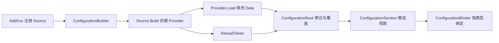

## 深入阅读导航

这份笔记不再按“配置来源种类”粗分，而是沿一次配置值从注册到绑定的完整生命周期拆成 12 个阶段。第一次阅读建议顺序读；排查问题时可以直接按“我现在处于哪一层”跳转。

| 阶段 | 核心问题 | 关键入口 |
| --- | --- | --- |
| 1. 构建契约 | Builder、Source、Provider 为什么要分三层？ | `ConfigurationBuilder.Build` |
| 2. Provider 基类 | 扁平字典如何表现树，子键如何计算？ | `ConfigurationProvider.GetChildKeys` |
| 3. 变更通知 | 一次性 Token 如何变成持续监听？ | `ChangeToken.OnChange` |
| 4. 内存配置 | 最小配置源如何贯通完整管线？ | `AddInMemoryCollection` |
| 5. 文件源 | 路径、FileProvider、格式扩展如何组装？ | `FileConfigurationSource.EnsureDefaults` |
| 6. 文件加载 | 首次加载、监视、重载和异常如何协作？ | `FileConfigurationProvider.Load` |
| 7. 外部来源 | 命令行、环境变量、链式配置如何归一化？ | `AddCommandLine` / `AddEnvironmentVariables` |
| 8. 配置树 | Root 与 Section 分别代表什么？ | `IConfiguration.GetSection` |
| 9. Root 聚合 | 覆盖优先级、写入、Reload 和子节合并如何实现？ | `ConfigurationRoot` |
| 10. Binder 入口 | `Get`、`Bind`、`GetValue` 如何收敛？ | `ConfigurationBinder.BindInstance` |
| 11. 绑定状态 | 选项和 `BindingPoint` 为什么是递归绑定的关键？ | `BinderOptions` / `BindingPoint` |
| 12. 对象图递归 | 标量、数组、集合、字典、复杂对象如何分派？ | `TryConvertValue` / `BindProperties` |


## 核心类型索引

| 类型 | 所在章节 | 说明 |
| --- | --- | --- |
| `IConfigurationBuilder` | 1. 构建契约 | Builder 接口 |
| `IConfigurationSource` | 1. 构建契约 | 配置源接口 |
| `IConfigurationProvider` | 1. 构建契约 | Provider 运行时接口 |
| `ConfigurationBuilder` | 1. 构建契约 | 默认 Builder 实现 |
| `ConfigurationProvider` | 2. Provider 基类 | 基于扁平字典的 Provider 基类 |
| `IChangeToken` | 3. 变更通知 | 一次性变化通知接口 |
| `ConfigurationReloadToken` | 3. 变更通知 | 配置专用 Token 实现 |
| `ChangeToken` | 3. 变更通知 | 持续监听包装入口 |
| `ChangeTokenRegistration<>` | 3. 变更通知 | 自动重新订阅的内部注册对象 |
| `MemoryConfigurationSource` | 4. 内存配置 | 内存 Source |
| `MemoryConfigurationBuilderExtensions` | 4. 内存配置 | `AddInMemoryCollection` API |
| `MemoryConfigurationProvider` | 4. 内存配置 | 内存 Provider |
| `FileConfigurationSource` | 5. 文件源 | 文件 Source 基类 |
| `JsonConfigurationSource` | 5. 文件源 | JSON Source |
| `XmlConfigurationSource` | 5. 文件源 | XML Source |
| `IniConfigurationSource` | 5. 文件源 | INI Source |
| `FileConfigurationExtensions` | 5. 文件源 | 文件公共 Builder 扩展 |
| `IFileProvider` | 5. 文件源 | 文件系统抽象 |
| `JsonConfigurationExtensions` | 5. 文件源 | JSON 注册 API |
| `XmlConfigurationExtensions` | 5. 文件源 | XML 注册 API |
| `IniConfigurationExtensions` | 5. 文件源 | INI 注册 API |
| `ConfigurationExtensions` | 5. 文件源 | 通用 Source 注册扩展 |
| `FileConfigurationProvider` | 6. 文件加载 | 文件 Provider 基类 |
| `CommandLineConfigurationSource` | 7. 外部来源 | 命令行 Source |
| `CommandLineConfigurationExtensions` | 7. 外部来源 | 命令行注册 API |
| `EnvironmentVariablesConfigurationSource` | 7. 外部来源 | 环境变量 Source |
| `EnvironmentVariablesExtensions` | 7. 外部来源 | 环境变量注册 API |
| `ChainedConfigurationSource` | 7. 外部来源 | 链式 Source |
| `ChainedConfigurationProvider` | 7. 外部来源 | 链式 Provider |
| `ChainedBuilderExtensions` | 7. 外部来源 | `AddConfiguration` API |
| `IConfiguration` | 8. 配置树 | 配置树公共接口 |
| `IConfigurationRoot` | 8. 配置树 | 配置根接口 |
| `IConfigurationSection` | 8. 配置树 | 配置节接口 |
| `ConfigurationRoot` | 9. Root 聚合 | Provider 聚合实现 |
| `ConfigurationSection` | 9. Root 聚合 | 路径视图实现 |
| `InternalConfigurationRootExtensions` | 9. Root 聚合 | 子节聚合逻辑 |
| `ConfigurationBinder` | 10. Binder 入口 | 绑定入口和递归算法 |
| `BinderOptions` | 11. 绑定状态 | 绑定行为选项 |
| `BindingPoint` | 11. 绑定状态 | 递归绑定内部状态 |
<a id="review-chapter-1"></a>

## 1. 构建契约：Builder、Source 与 Provider

### 本组解决什么问题

这一组源码回答“配置系统在构建期保存什么，以及不同配置源如何转换成统一 Provider”。核心分工是：Builder 收集 Source，Source 创建 Provider，Provider 提供统一的键值访问和加载能力。

### 关键类型关系图

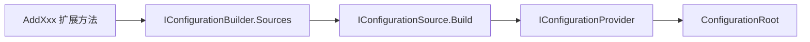

### 核心源码解读

### 三层模型不是重复抽象

`Builder`、`Source`、`Provider` 分别属于构建上下文、配置描述和运行时访问三个阶段。把它们混成一个类型，会让“注册参数”和“已经加载的数据”共享生命周期，也无法让同一个 Source 根据 Builder 上下文选择不同文件系统或其他依赖。

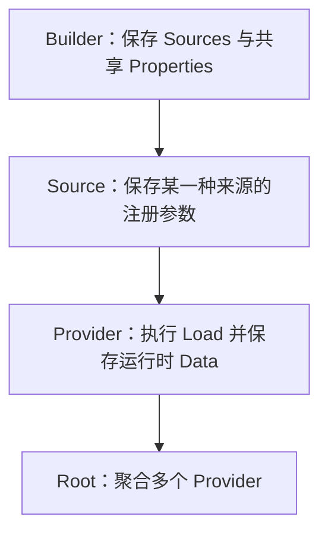

| 层次 | 主要持有内容 | 典型生命周期 | 是否直接提供配置值 |
| --- | --- | --- | --- |
| Builder | Source 列表、共享属性 | 构建期间 | 否 |
| Source | 路径、前缀、可选性等参数 | 注册到 Build | 否 |
| Provider | 已加载键值、ReloadToken | Root 生命周期 | 是 |

### 一次 Build 的真实调用顺序

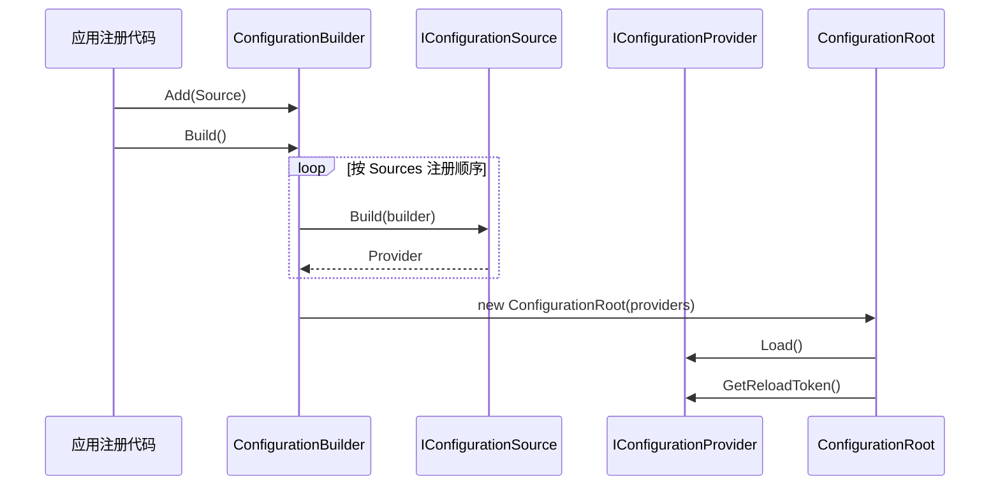

这里有两个不同的顺序需要同时记住：创建和加载 Provider 按注册顺序进行；读取同一个键时则从最后一个 Provider 向前查找，因此后注册来源覆盖先注册来源。

### Builder.Properties 是跨 Source 的构建上下文

`Properties` 不是配置数据。它让多个 Source 在 Build 时共享基础路径、`IFileProvider` 等基础设施，而不会污染最终配置树。


### IConfigurationBuilder

**读这组源码时关注什么：** 配置构建阶段保存了哪些状态，以及 Build 的产物是什么。

#### 整体结构

**这段代码回答什么问题：** 配置构建阶段保存了哪些状态，以及 Build 的产物是什么。

```C#
// 配置建造者的抽象表示
public interface IConfigurationBuilder
{
    IDictionary<string, object> Properties { get; }
 
    IList<IConfigurationSource> Sources { get; }
    
    IConfigurationBuilder Add(IConfigurationSource source);
    
    IConfigurationRoot Build();
}
```

**源码解读：**
- `Properties` 是配置源共享的构建上下文，`Sources` 保持配置源的注册顺序。
- `Add` 和 `Build` 定义了构建流程的两个动作。

**读完要记住：**
- Builder 保存配置源，最终产出 `IConfigurationRoot`。
- 配置源顺序会继续影响配置值优先级。

### IConfigurationSource

**读这组源码时关注什么：** 配置源为什么不直接负责读取配置值。

#### 整体结构

**这段代码回答什么问题：** 配置源为什么不直接负责读取配置值。

```C#
// 不同配置源的抽象表示
public interface IConfigurationSource
{
    // 每个配置源最终会构建出对应的 IConfigurationProvider 配置字典提供者
    IConfigurationProvider Build(IConfigurationBuilder builder);
}
```

**源码解读：**
- Source 保存“如何创建 Provider”的配置和参数。
- 真正的加载、查询能力由 `Build` 返回的 Provider 提供。

**读完要记住：**
- Source 属于构建期，Provider 属于运行期。
- 同一种 Source 可以根据 Builder 上下文创建不同 Provider。

### IConfigurationProvider

**读这组源码时关注什么：** 所有配置提供者必须向配置根暴露哪些统一能力。

#### 整体结构

**这段代码回答什么问题：** 所有配置提供者必须向配置根暴露哪些统一能力。

```C#
// 配置字典提供者的抽象表示
public interface IConfigurationProvider
{
    // 尝试从配置字典得到值
    bool TryGet(string key, out string? value);
 
    // 设置配置字典的值
    void Set(string key, string? value);
 
    // 得到改变令牌
    IChangeToken GetReloadToken();
    
    // 加载解析对应的配置源并转换为配置字典
    void Load();
    
    // 从配置字典中提取出所有的子 key（不包含 parentPath）
    IEnumerable<string> GetChildKeys(IEnumerable<string> earlierKeys, string? parentPath);
}
```

**源码解读：**
- `TryGet`、`Set` 和 `GetChildKeys` 负责字典访问与树形投影。
- `Load` 与 `GetReloadToken` 负责初次加载和后续变更通知。

**读完要记住：**
- Provider 是配置源与配置树之间的适配层。
- 配置根只依赖这个接口，不关心 JSON、环境变量等具体来源。

### ConfigurationBuilder

**读这组源码时关注什么：** 多个 Source 如何被依次转换为 Provider。

#### 整体结构

**这段代码回答什么问题：** 多个 Source 如何被依次转换为 Provider。

```C#
// IConfigurationBuilder 的默认实现
public class ConfigurationBuilder : IConfigurationBuilder
{
    // 收集的不同配置源集合
    public IList<IConfigurationSource> Sources { get; } = new List<IConfigurationSource>();

    // 在使用 IConfigurationSource 配置源构建 IConfigurationProvider 配置提供者时
    // 可以利用这组共享数据
    public IDictionary<string, object> Properties { get; } = new Dictionary<string, object>();

    // 添加配置源
    public IConfigurationBuilder Add(IConfigurationSource source)
    {
        ThrowHelper.ThrowIfNull(source);

        Sources.Add(source);
        return this;
    }

    // 根据不同的 IConfigurationSource 配置源创建对应的 IConfigurationProvider 配置提供者
    // 最终使用配置提供者集合创建 IConfigurationRoot 配置根
    public IConfigurationRoot Build()
    {
        var providers = new List<IConfigurationProvider>();
        foreach (IConfigurationSource source in Sources)
        {
            IConfigurationProvider provider = source.Build(this);
            providers.Add(provider);
        }
        return new ConfigurationRoot(providers);
    }
}
```

**源码解读：**
- `Add` 只追加配置源，不提前加载数据。
- `Build` 按注册顺序调用每个 Source 的 `Build`，再创建 `ConfigurationRoot`。

**读完要记住：**
- Builder 阶段保留顺序但不处理优先级。
- Provider 的加载发生在 `ConfigurationRoot` 构造期间。

## 2. Provider 基类：扁平字典如何表现配置树

`ConfigurationProvider` 是理解整个配置系统的数据结构入口。上层看到的是节和子节，Provider 内部看到的始终是以冒号分隔的字符串键和值。

### 扁平键值与树形视图是一体两面

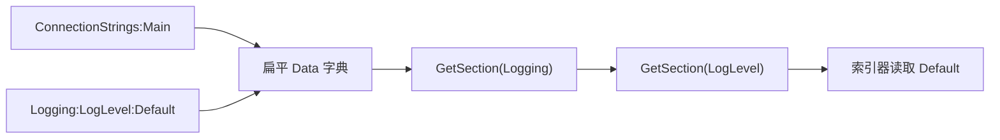

例如下面三项数据并没有真正创建节点对象；Section 只保存 `Path`，每次读取仍然回到 Root 和 Provider：

```text
App:Name = Demo
App:Features:Cache = true
App:Features:RetryCount = 3
```

### 读取、写入与默认实现边界

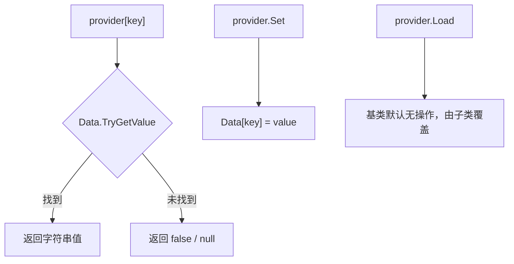

基类负责统一的数据容器、大小写不敏感键比较和 ReloadToken；具体来源只需要解决“怎样把外部数据解析成 Data”。

### GetChildKeys 只提取下一段

假设父路径是 `Logging`，Provider 中有 `Logging:LogLevel:Default` 和 `Logging:Console:FormatterName`。算法去掉父路径后，只截取第一个分隔符前的片段，得到 `LogLevel` 与 `Console`，而不是一次返回所有后代路径。

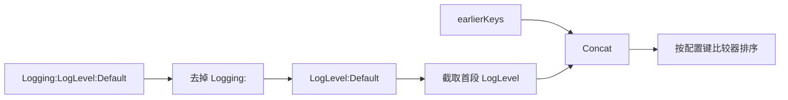

`earlierKeys` 让 Root 可以逐个 Provider 累积候选子键。最终去重发生在 Root 的聚合扩展中，而不是单个 Provider 内。

### ReloadToken 必须先替换再触发

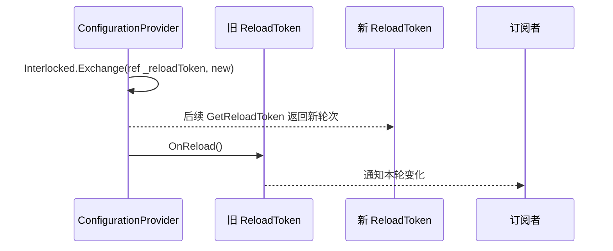

先交换 Token 再触发旧 Token，可以让回调内立即重新订阅时拿到下一轮 Token，避免重新订阅到已经失效的对象。

### ConfigurationProvider

**读这组源码时关注什么：** 默认 Provider 如何用扁平字典表达配置树。

#### 整体结构

**这段代码回答什么问题：** 默认 Provider 如何用扁平字典表达配置树。

```C#
// 配置提供者的抽象表示
public abstract class ConfigurationProvider : IConfigurationProvider
{
    // 配置改变令牌
    private ConfigurationReloadToken _reloadToken = new ConfigurationReloadToken();

    protected ConfigurationProvider()
    {
        // 初始化配置字典（配置键忽略大小写）
        Data = new Dictionary<string, string?>(StringComparer.OrdinalIgnoreCase);
    }

    // 配置字典
    // 配置键是以 “:” 分隔的从根节点出发到叶配置节点的路径化字符串
    protected IDictionary<string, string?> Data { get; set; }

    // 尝试通过配置键获取配置值
    public virtual bool TryGet(string key, out string? value)
        => Data.TryGetValue(key, out value);

    // 设置配置键对应的值
    public virtual void Set(string key, string? value)
        => Data[key] = value;

    // 加载配置源并转换为配置字典
    // 由具体实现类型重写
    public virtual void Load() { }
    
    // 得到父路径下的所有子配置键
    // earlierKeys 参数保存是通过累加器从前面 IConfigurationProvider 中收集到的配置键
    public virtual IEnumerable<string> GetChildKeys(
        IEnumerable<string> earlierKeys,
        string? parentPath)
    {
        var results = new List<string>();

        if (parentPath is null)
        {
            // 从根节点开始找
            foreach (KeyValuePair<string, string?> kv in Data)
            {
                // 查找起始位置为 0 到第一个 “:” 的索引位置
                results.Add(Segment(kv.Key, 0));
            }
        }
        else
        {
            Debug.Assert(ConfigurationPath.KeyDelimiter == ":");

            foreach (KeyValuePair<string, string?> kv in Data)
            {
                // 配置键长度必须大于父路径长度
                // 配置键以父路径开头（忽略大小写）
                // 配置键字符串在以父路径为长度的索引位置的字符必须是 “:”
                if (kv.Key.Length > parentPath.Length &&
                    kv.Key.StartsWith(parentPath, StringComparison.OrdinalIgnoreCase) &&
                    kv.Key[parentPath.Length] == ':')
                {
                    // 查找起始位置为父路径长度 + 1
                    results.Add(Segment(kv.Key, parentPath.Length + 1));
                }
            }
        }

        // 将先收集的子配置键添加到末尾
        results.AddRange(earlierKeys);

        // 使用分段比较策略排序
        // 配置键按 “:” 分隔符拆分成多个段，逐段进行比较
        // 1. 数字段 < 字符串段: 纯数字段始终排在字符串段之前
        // 2. 数字段内部: 按数值大小排序 (0 < 1 < 2 < 10 < 100)
        // 3. 字符串段内部: 大小写不敏感的字典序排序
        // 4. 层级优先: 先比较第一级，相同则比较第二级，以此类推
        results.Sort(ConfigurationKeyComparer.Comparison);

        return results;
    }

    // 得到子配置键
    private static string Segment(string key, int prefixLength)
    {
        // 得到前缀长度以后的第一个 “:” 索引位置（忽略大小写）
        int indexOf = key.IndexOf(ConfigurationPath.KeyDelimiter, prefixLength, StringComparison.OrdinalIgnoreCase);
        // 如果是末端，则截取到末尾
        // 否则截取从前缀长度到之后的第一个 “:” 索引位置
        return indexOf < 0 ? key.Substring(prefixLength) : key.Substring(prefixLength, indexOf - prefixLength);
    }

    // 获取配置改变令牌
    // 供外部调用注册回调，监听改变
    public IChangeToken GetReloadToken()
    {
        return _reloadToken;
    }

    // 回调方法，用于监听配置源的修改变动
    // 如果是文件配置源，则会将 OnReload 方法注册到 IFileProvider.Watch 方法返回的 IChangeToken 上
    protected void OnReload()
    {
        // 创建并交换新的 ConfigurationReloadToken
        ConfigurationReloadToken previousToken = Interlocked.Exchange(ref _reloadToken, new ConfigurationReloadToken());
        // 使用旧的 ConfigurationReloadToken 调用 OnReload 方法触发回调
        previousToken.OnReload();
    }

    // 返回实际的 IConfigurationProvider 配置提供者类型的简短名称
    // 从 Object 继承的 ToString 方法实际返回的是类型的完整名称（本质是通过实例的类型对象指针所指向的 MethodTable 得到的）
    public override string ToString() => $"{GetType().Name}";
}
```

**源码解读：**
- `Data` 使用忽略大小写的键，完整路径以冒号分隔。
- `GetChildKeys` 从扁平路径提取下一段并与前序结果合并排序。

**读完要记住：**
- 配置树在存储层本质上是路径到字符串的字典。
- 具体 Provider 通常只需实现加载逻辑并填充 `Data`。

### 最小例子

```csharp
IConfigurationRoot configuration = new ConfigurationBuilder()
    .AddInMemoryCollection(new Dictionary<string, string?>
    {
        ["App:Name"] = "SourceCodeLearningNotes"
    })
    .Build();

string? name = configuration["App:Name"];
```

### 回顾要点

- Builder 收集的是 Source，不是最终配置值。
- Source 属于构建期；Provider 属于加载和查询期。
- 配置树在 Provider 内通常保存为“路径 -> 字符串”的扁平字典。

<a id="review-chapter-3"></a>

## 3. 变更通知：从一次性 Token 到持续监听

### 本组解决什么问题

这一组源码回答“配置变化如何从 Provider 传播到长期订阅者”。`IChangeToken` 表示一次变化周期，`ConfigurationReloadToken` 负责触发，`ChangeToken.OnChange` 则在每次触发后自动订阅下一枚 Token。

### 关键类型关系图

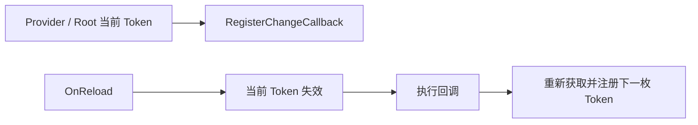

### 核心源码解读

### 一次性 Token 的状态机

`IChangeToken` 表示“一次变化”，不是一个永久事件源。配置发生变化后，本轮 Token 进入已变化状态；下一轮变化必须由生产者提供新 Token。

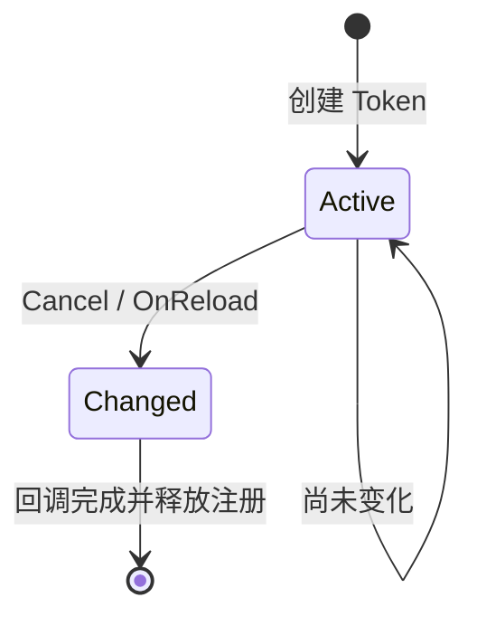

### OnChange 把一次性通知包装成持续订阅

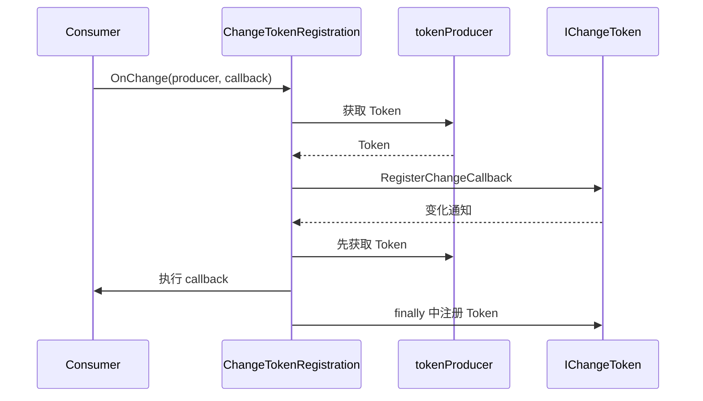

这里要区分“取得”和“注册”：代理回调先取得下一枚 Token，再执行用户逻辑，最后在 `finally` 中注册下一轮回调。即使用户回调抛异常，重新注册步骤仍会执行。

### ActiveChangeCallbacks 决定监听策略

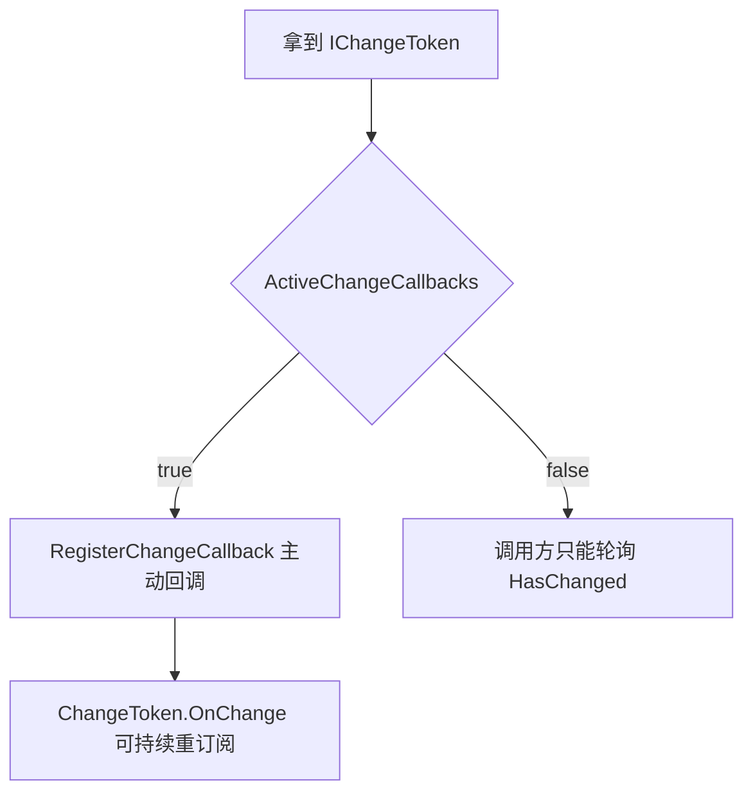

配置系统自己的 `ConfigurationReloadToken` 支持主动回调；文件提供者返回的 Token 是否主动回调，则取决于底层 `IFileProvider`。

### 订阅者必须释放注册

`ChangeToken.OnChange` 返回 `IDisposable`。Root 会保存每个 Provider 对应的注册，并在 Root 释放时逐一 Dispose，避免回调长期引用 Root。

### IChangeToken

**读这组源码时关注什么：** 一次性变更通知的最小抽象是什么。

#### 整体结构

**这段代码回答什么问题：** 一次性变更通知的最小抽象是什么。

```C#
// 改变令牌的抽象表示
public interface IChangeToken
{
    bool HasChanged { get; }
 
    bool ActiveChangeCallbacks { get; }
 
    IDisposable RegisterChangeCallback(Action<object?> callback, object? state);
}
```

**源码解读：**
- `HasChanged` 表示当前令牌是否已经失效。
- `RegisterChangeCallback` 注册回调，`ActiveChangeCallbacks` 表示是否主动触发。

**读完要记住：**
- ChangeToken 表示一次变更周期，不是永久事件对象。
- 持续监听需要在令牌失效后重新取得新令牌。

### ConfigurationReloadToken

**读这组源码时关注什么：** 配置系统如何实现可替换的一次性变更令牌。

#### 整体结构

**这段代码回答什么问题：** 配置系统如何实现可替换的一次性变更令牌。

```C#
// 配置改变令牌
public class ConfigurationReloadToken : IChangeToken
{
    // 取消令牌源
    private CancellationTokenSource _cts = new CancellationTokenSource();

    // 允许触发回调
    public bool ActiveChangeCallbacks => true;

    // 取消已被触发
    public bool HasChanged => _cts.IsCancellationRequested;

    // 注册配置改变后的回调
    // 使用 CancellationToken.Register 方法注册
    public IDisposable RegisterChangeCallback(Action<object?> callback, object? state) => _cts.Token.Register(callback, state);

    // 触发注册的回调 
    public void OnReload() => _cts.Cancel();
}
```

**源码解读：**
- 内部 `CancellationTokenSource` 承载回调注册和触发。
- `OnReload` 取消令牌，使本轮所有观察者收到通知。

**读完要记住：**
- 一个实例只对应一轮 reload。
- 配置根或 Provider 触发后必须换成新的 Token。

### ChangeToken

**读这组源码时关注什么：** 如何把一次性 IChangeToken 包装成持续监听。

#### 整体结构

**这段代码回答什么问题：** 如何把一次性 IChangeToken 包装成持续监听。

```C#
// 用于注册 IChangeToken.RegisterChangeCallback 回调的工具类
public static class ChangeToken
{
    // 根据 changeTokenProducer 得到 IChangeToken
    // 使用 changeTokenConsumer 注册 IChangeToken.RegisterChangeCallback 回调
    public static IDisposable OnChange(Func<IChangeToken?> changeTokenProducer, Action changeTokenConsumer)
    {
        if (changeTokenProducer is null)
        {
            ThrowHelper.ThrowArgumentNullException(ExceptionArgument.changeTokenProducer);
        }
        if (changeTokenConsumer is null)
        {
            ThrowHelper.ThrowArgumentNullException(ExceptionArgument.changeTokenConsumer);
        }

        // Action<TState> 参数类型是 Action<Action>
        // TState 泛型参数类型是 Action
        return new ChangeTokenRegistration<Action>(changeTokenProducer, callback => callback(), changeTokenConsumer);
    }

    // 根据 changeTokenProducer 得到 IChangeToken
    // 使用 changeTokenConsumer 注册 IChangeToken.RegisterChangeCallback 回调
    public static IDisposable OnChange<TState>(Func<IChangeToken?> changeTokenProducer, Action<TState> changeTokenConsumer, TState state)
    {
        if (changeTokenProducer is null)
        {
            ThrowHelper.ThrowArgumentNullException(ExceptionArgument.changeTokenProducer);
        }
        if (changeTokenConsumer is null)
        {
            ThrowHelper.ThrowArgumentNullException(ExceptionArgument.changeTokenConsumer);
        }

        return new ChangeTokenRegistration<TState>(changeTokenProducer, changeTokenConsumer, state);
    }

    // 内部类
    // 属于代理注册类，用于实际注册 IChangeToken.RegisterChangeCallback 回调
    // 可以通过调用 IDisposable.Dispose 方法取消注册
    private sealed class ChangeTokenRegistration<TState> : IDisposable
    {
        private readonly Func<IChangeToken?> _changeTokenProducer;
        private readonly Action<TState> _changeTokenConsumer;
        private readonly TState _state;
        private IDisposable? _disposable;

        public ChangeTokenRegistration(Func<IChangeToken?> changeTokenProducer, Action<TState> changeTokenConsumer, TState state)
        {
            _changeTokenProducer = changeTokenProducer;
            _changeTokenConsumer = changeTokenConsumer;
            _state = state;

            // 使用生产者委托得到 IChangeToken
            IChangeToken? token = changeTokenProducer();

            // 使用 IChangeToken.RegisterChangeCallback 注册代理回调
            RegisterChangeTokenCallback(token);
        }

        // 代理回调方法
        private void OnChangeTokenFired()
        {
            // 使用生产者委托得到新的 IChangeToken
            IChangeToken? token = _changeTokenProducer();

            try
            {
                // 使用消费者委托触发实际的回调方法
                _changeTokenConsumer(_state);
            }
            finally
            {
                // 使用新的 IChangeToken.RegisterChangeCallback 注册回调
                RegisterChangeTokenCallback(token);
            }
        }

        // 使用 OnChangeTokenFired 方法注册 IChangeToken.RegisterChangeCallback 回调
        private void RegisterChangeTokenCallback(IChangeToken? token)
        {
            if (token is null)
            {
                return;
            }

            IDisposable registraton = token.RegisterChangeCallback(s => ((ChangeTokenRegistration<TState>?)s)!.OnChangeTokenFired(), this);
            if (token.HasChanged && token.ActiveChangeCallbacks)
            {
                registraton?.Dispose();
                return;
            }
            SetDisposable(registraton);
        }
    }
}
```

**源码解读：**
- `OnChange` 先取得当前 Token 并注册回调。
- 回调触发后会重新调用生产者，注册下一枚 Token。

**读完要记住：**
- 持续监听依赖“触发后重新订阅”。
- 返回的 `IDisposable` 控制整个监听生命周期。

### 最小例子

```csharp
IDisposable subscription = ChangeToken.OnChange(
    configuration.GetReloadToken,
    () => Console.WriteLine("Configuration changed"));
```

### 回顾要点

- ReloadToken 是一次性的，持续监听必须重新订阅。
- `ChangeToken.OnChange` 封装了“触发后再注册”的循环。
- 释放订阅可以停止后续回调。

<a id="review-chapter-4"></a>

## 4. 内存配置：贯通全链路的最小实现

### 本组解决什么问题

内存配置是理解扩展点的最短路径：扩展方法注册 Source，Source 构建 Provider，Provider.Load 把初始键值对填入基类 Data。它没有文件 I/O，却完整走过配置构建管线。

### 关键类型关系图

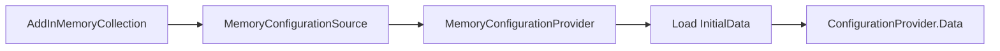

### 核心源码解读

### 为什么先读内存 Provider

内存配置没有文件系统、解析器和异步监听干扰，是观察 Source → Provider → Root 最短路径的最佳样本。

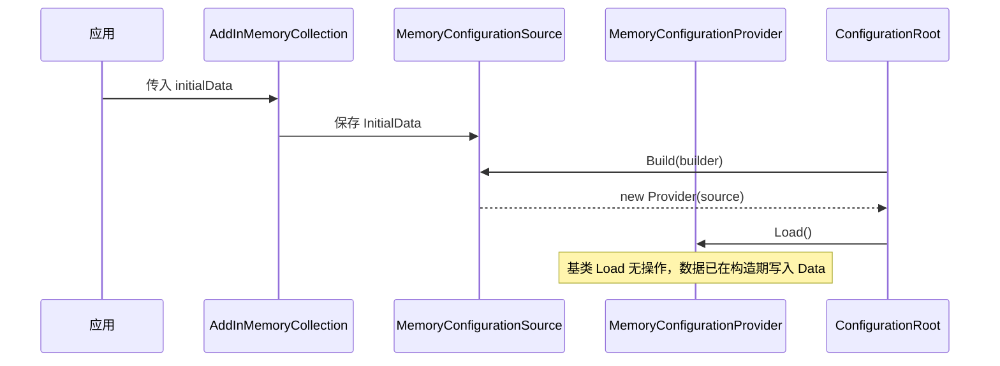

### 初始数据与运行时数据的所有权


Provider 构造时枚举初始数据并写入自己的字典。之后修改原始集合不等价于修改配置；需要通过配置索引器写入，或构造新的 Root。

### 最小管线同时展示覆盖规则

```csharp
var configuration = new ConfigurationBuilder()
    .AddInMemoryCollection(new Dictionary<string, string?>
    {
        ["Feature:Enabled"] = "false",
        ["Feature:Name"] = "base"
    })
    .AddInMemoryCollection(new Dictionary<string, string?>
    {
        ["Feature:Enabled"] = "true"
    })
    .Build();

Console.WriteLine(configuration["Feature:Enabled"]); // true
Console.WriteLine(configuration["Feature:Name"]);    // base
```

第二个 Provider 只覆盖自己拥有的键，不会把第一个 Provider 的整个 `Feature` 子树清空。

### MemoryConfigurationSource

**读这组源码时关注什么：** 内存键值对如何进入统一配置管线。

#### 整体结构

**这段代码回答什么问题：** 内存键值对如何进入统一配置管线。

```C#
// 内存配置源
public class MemoryConfigurationSource : IConfigurationSource
{
    // 原始配置源
    // 最终这个原始配置源会在 MemoryConfigurationProvider 的构造函数中完成配置数据到配置字典的转移
    // 所以 MemoryConfigurationProvider 不需要重写 Load 方法
    public IEnumerable<KeyValuePair<string, string?>>? InitialData { get; set; }
    
    // 构建对应的 IConfigurationProvider 配置提供者
    public IConfigurationProvider Build(IConfigurationBuilder builder)
    {
        return new MemoryConfigurationProvider(this);
    }
}
```

**源码解读：**
- Source 保存可选的初始数据。
- `Build` 创建对应的 `MemoryConfigurationProvider`。

**读完要记住：**
- 内存配置仍遵循 Source 到 Provider 模型。
- 初始数据是在 Provider 加载时复制到配置字典。

### MemoryConfigurationBuilderExtensions

**读这组源码时关注什么：** AddInMemoryCollection 最终向 Builder 注册了什么。

#### 整体结构

**这段代码回答什么问题：** AddInMemoryCollection 最终向 Builder 注册了什么。

```C#
// 添加内存配置源的扩展方法
public static class MemoryConfigurationBuilderExtensions
{
    // 添加一个空配置源
    public static IConfigurationBuilder AddInMemoryCollection(this IConfigurationBuilder configurationBuilder)
    {
        ThrowHelper.ThrowIfNull(configurationBuilder);

        // 收集配置源
        configurationBuilder.Add(new MemoryConfigurationSource());
        return configurationBuilder;
    }

    // 添加 initialData 承载的配置源
    public static IConfigurationBuilder AddInMemoryCollection(
        this IConfigurationBuilder configurationBuilder,
        IEnumerable<KeyValuePair<string, string?>>? initialData)
    {
        ThrowHelper.ThrowIfNull(configurationBuilder);

        // 收集配置源
        configurationBuilder.Add(new MemoryConfigurationSource { InitialData = initialData });
        return configurationBuilder;
    }
}
```

**源码解读：**
- 扩展方法创建并添加 `MemoryConfigurationSource`。
- 重载只负责是否给 Source 填充初始数据。

**读完要记住：**
- AddXxx 扩展方法主要是 Source 的便捷工厂。
- 调用扩展方法时还没有构建配置根。

### MemoryConfigurationProvider

**读这组源码时关注什么：** 内存 Source 的初始数据何时进入 Data。

#### 整体结构

**这段代码回答什么问题：** 内存 Source 的初始数据何时进入 Data。

```C#
// 使用 MemoryConfigurationSource 构建的内存配置提供者
public class MemoryConfigurationProvider : ConfigurationProvider, IEnumerable<KeyValuePair<string, string?>>
{
    private readonly MemoryConfigurationSource _source;

    public MemoryConfigurationProvider(MemoryConfigurationSource source)
    {
        ThrowHelper.ThrowIfNull(source);

        _source = source;

        if (_source.InitialData != null)
        {
            // 将原始 InitialData 配置数据转移到配置字典
            foreach (KeyValuePair<string, string?> pair in _source.InitialData)
            {
                Data.Add(pair.Key, pair.Value);
            }
        }
    }

    // 添加配置
    public void Add(string key, string? value)
    {
        Data.Add(key, value);
    }

    // 实现 IEnumerable<KeyValuePair<string, string?>>
    public IEnumerator<KeyValuePair<string, string?>> GetEnumerator()
    {
        return Data.GetEnumerator();
    }

    // 实现 IEnumerable
    IEnumerator IEnumerable.GetEnumerator()
    {
        return GetEnumerator();
    }
}
```

**源码解读：**
- Provider 持有 Source，并在 `Load` 中遍历初始数据。
- 继承基类后直接复用查询、设置和子键枚举能力。

**读完要记住：**
- Provider 才是配置数据的运行时持有者。
- 没有初始数据时会得到一个空的可写配置字典。

### 最小例子

```csharp
var initialData = new Dictionary<string, string?>
{
    ["FeatureFlags:NewParser"] = "true"
};

IConfiguration configuration = new ConfigurationBuilder()
    .AddInMemoryCollection(initialData)
    .Build();
```

### 回顾要点

- AddInMemoryCollection 注册 Source，不立即复制数据。
- Provider.Load 才把 InitialData 写入 Data。
- 内存 Provider 直接复用 ConfigurationProvider 的全部查询能力。

<a id="review-chapter-5"></a>

## 5. 文件配置源：路径、抽象与格式扩展

### 本组解决什么问题

这一组源码回答“JSON、XML、INI 为什么能共享同一套文件定位、异常处理和自动重载机制”。`FileConfigurationSource` 保存公共参数，`FileConfigurationProvider` 处理文件生命周期，具体格式 Provider 只需解析流。

### 关键类型关系图

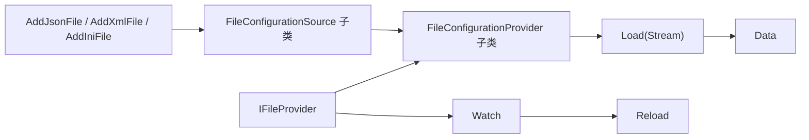

### 核心源码解读

### 文件配置先解决“在哪里”，再解决“怎么解析”


格式 Source 与格式 Provider 只处理语法差异；路径解析、文件监视、重载延迟、异常策略由文件配置公共基类统一处理。

### EnsureDefaults 补齐构建期默认值

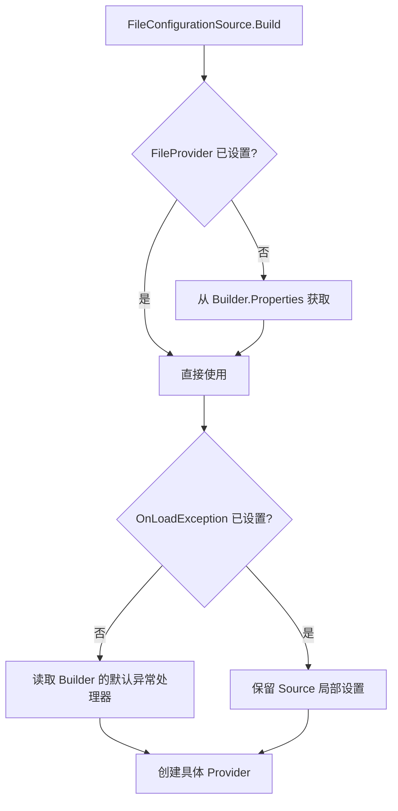

这说明 Builder 上的文件设置是默认值，单个 Source 上的显式设置拥有更高优先级。

### 绝对路径与相对路径的决策

```mermaid
flowchart TD
    A["输入 path"] --> B{"Source.FileProvider 存在?"}
    B -->|是| C["由该 Provider 解释 path"]
    B -->|否| D{"path 是绝对路径?"}
    D -->|否| E["使用 Builder 默认 FileProvider"]
    D -->|是| F["拆出目录创建 PhysicalFileProvider"]
    F --> G["Path 改为文件名"]
    E --> H["Provider.GetFileInfo(Path)"]
    C --> H
    G --> H
```

不要把 `Path` 理解成始终相对于进程当前目录。它最终由选中的 `IFileProvider` 解释，基础路径通常在 Builder 上设置。

### Optional 与 ReloadOnChange 解决不同问题

| 选项 | 控制的行为 | 不控制的行为 |
| --- | --- | --- |
| `Optional` | 文件不存在时是否允许继续 | 文件内容解析失败 |
| `ReloadOnChange` | 是否调用 `Watch` 建立后续监听 | 是否执行首次 Load |
| `ReloadDelay` | 文件变化后等待多久再加载 | 文件监视器本身的实现 |
| `OnLoadException` | 加载异常是否忽略 | 配置键覆盖规则 |

### JSON、XML、INI 复用同一文件生命周期

```mermaid
flowchart TB
    A["FileConfigurationSource"] --> J["JsonConfigurationSource"]
    A --> X["XmlConfigurationSource"]
    A --> I["IniConfigurationSource"]
    B["FileConfigurationProvider"] --> JP["JsonConfigurationProvider"]
    B --> XP["XmlConfigurationProvider"]
    B --> IP["IniConfigurationProvider"]
    JP --> S["各自实现 Load(Stream)"]
    XP --> S
    IP --> S
```

因此排查“文件没被监视、路径不对、异常被忽略”时先看公共文件基类；只有“同一内容解析出的键不对”才进入具体格式 Provider。

### FileConfigurationSource

**读这组源码时关注什么：** 文件类配置源共享哪些文件定位和重载参数。

#### 整体结构

**这段代码回答什么问题：** 文件类配置源共享哪些文件定位和重载参数。

```C#
// 抽象文件配置源
// 常用实现类型：
// 1. XmlConfigurationSource
// 2. JsonConfigurationSource
// 3. IniConfigurationSource
// 实现类型重写 Build 方法，并在内部调用 EnsureDefaults 方法来确保创建 IFileProvider
// 最后创建对应的 IConfigurationProvider
public abstract class FileConfigurationSource : IConfigurationSource
{
    // IFileProvider 文件提供者
    public IFileProvider? FileProvider { get; set; }

    // 包含相对路径的文件名（包含后缀名）
    public string? Path { get; set; }

    // 文件是否必须存在
    public bool Optional { get; set; }

    // 是否需要监控文件修改变动
    public bool ReloadOnChange { get; set; }

    // 文件修改变动后的延迟触发（等待文件的 Flush 过程，写入磁盘可能有一定延迟）
    // 默认 250 毫秒
    public int ReloadDelay { get; set; } = 250;

    // 在构建对应的 IConfigurationProvider 过程中
    // 调用 FileConfigurationProvider.Load 方法读取文件内容并加载配置字典的过程可能发生错误
    // 可以用来注册回调，执行异常处理
    public Action<FileLoadExceptionContext>? OnLoadException { get; set; }

    // 抽象方法
    // 由子类重写，构建对应的 IConfigurationProvider
    public abstract IConfigurationProvider Build(IConfigurationBuilder builder);

    // 确保 IFileProvider 被创建，一般在子类重写的 Build 方法中调用
    // 在创建 FileConfigurationSource 具体实现类的时候，会调用 ResolveFileProvider 方法创建对应的 IFileProvider
    // 如果没有成功创建，则会调用 FileConfigurationExtensions.GetFileProvider 扩展方法，创建默认的 IFileProvider
    public void EnsureDefaults(IConfigurationBuilder builder)
    {
        FileProvider ??= builder.GetFileProvider();
        OnLoadException ??= builder.GetFileLoadExceptionHandler();
    }

    // 根据绝对路径创建 IFileProvider
    // 如果是相对路径，则会通过调用 EnsureDefaults 方法创建默认的 IFileProvider
    public void ResolveFileProvider()
    {
        // 如果 IFileProvider 未创建，并且是绝对路径
        if (FileProvider == null &&
            !string.IsNullOrEmpty(Path) &&
            System.IO.Path.IsPathRooted(Path))
        {
            // 得到目录路径，返回路径中最后一个 “\” 之前的内容作为目录路径
            string? directory = System.IO.Path.GetDirectoryName(Path);
            // 不管文件或目录，返回路径中最后的 “\” 后面的内容作为文件名（包含后缀名）
            string? pathToFile = System.IO.Path.GetFileName(Path);
            // 如果目录路径不存在
            while (!string.IsNullOrEmpty(directory) && !Directory.Exists(directory))
            {
                // 通过 GetFileName 方法得到的文件名作为目录名 + 原来的文件名（包含后缀名）的相对路径
                pathToFile = System.IO.Path.Combine(System.IO.Path.GetFileName(directory), pathToFile);
                // 得到上一层目录路径
                directory = System.IO.Path.GetDirectoryName(directory);
            }
            if (Directory.Exists(directory))
            {
                // 使用目录路径创建 PhysicalFileProvider
                FileProvider = new PhysicalFileProvider(directory);
                // 最终用于调用 IFileProvider.GetFileInfo 方法的 subPath
                Path = pathToFile;
            }
        }
    }
}
```

**源码解读：**
- Source 保存路径、FileProvider、Optional、ReloadOnChange 与延迟时间。
- `EnsureDefaults` 从 Builder 上下文补齐默认文件提供者和异常处理器。

**读完要记住：**
- JSON、XML、INI Source 都复用这组文件语义。
- `ResolveFileProvider` 可把绝对路径拆成目录 Provider 与相对路径。

### FileConfigurationExtensions

**读这组源码时关注什么：** 文件配置的公共 Builder 上下文如何设置和读取。

#### 整体结构

**这段代码回答什么问题：** 文件配置的公共 Builder 上下文如何设置和读取。

```C#
// 设置 IConfigurationBuilder 中 Properties 共享数据的扩展方法
public static class FileConfigurationExtensions
{
    private static string FileProviderKey = "FileProvider";
    private static string FileLoadExceptionHandlerKey = "FileLoadExceptionHandler";

    // 设置外部 IFileProvider 
    // 并作为 IConfigurationBuilder.Properties 的共享数据
    // 避免创建过多的 IFileProvider 实例
    public static IConfigurationBuilder SetFileProvider(this IConfigurationBuilder builder, IFileProvider fileProvider)
    {
        ThrowHelper.ThrowIfNull(builder);
        ThrowHelper.ThrowIfNull(fileProvider);

        builder.Properties[FileProviderKey] = fileProvider;
        return builder;
    }

    // 得到 IFileProvider
    // 优先从 IConfigurationBuilder.Properties 的共享数据中获取 IFileProvider
    // 如果共享数据中没有，则使用应用程序根目录创建 IFileProvider
    // 注意每次都会创建新的 PhysicalFileProvider，并且不会存入共享数据
    public static IFileProvider GetFileProvider(this IConfigurationBuilder builder)
    {
        ThrowHelper.ThrowIfNull(builder);

        if (builder.Properties.TryGetValue(FileProviderKey, out object? provider))
        {
            return (IFileProvider)provider;
        }

        return new PhysicalFileProvider(AppContext.BaseDirectory ?? string.Empty);
    }

    // 使用 basePath 创建 IFileProvider
    // 并且会将 IFileProvider 保存到 IConfigurationBuilder.Properties 的共享数据中
    // 避免创建过多的 IFileProvider 实例
    public static IConfigurationBuilder SetBasePath(this IConfigurationBuilder builder, string basePath)
    {
        ThrowHelper.ThrowIfNull(builder);
        ThrowHelper.ThrowIfNull(basePath);

        return builder.SetFileProvider(new PhysicalFileProvider(basePath));
    }

    // 设置异常处理程序
    // 并保存到 IConfigurationBuilder.Properties 的共享数据中
    public static IConfigurationBuilder SetFileLoadExceptionHandler(this IConfigurationBuilder builder, Action<FileLoadExceptionContext> handler)
    {
        ThrowHelper.ThrowIfNull(builder);

        builder.Properties[FileLoadExceptionHandlerKey] = handler;
        return builder;
    }

    // 尝试从 IConfigurationBuilder.Properties 的共享数据中返回异常处理程序
    public static Action<FileLoadExceptionContext>? GetFileLoadExceptionHandler(this IConfigurationBuilder builder)
    {
        ThrowHelper.ThrowIfNull(builder);

        if (builder.Properties.TryGetValue(FileLoadExceptionHandlerKey, out object? handler))
        {
            return handler as Action<FileLoadExceptionContext>;
        }
        return null;
    }
}
```

**源码解读：**
- 扩展方法把 `IFileProvider` 和异常处理器放入 `Properties`。
- `SetBasePath` 通过物理文件提供者确定相对路径基准。

**读完要记住：**
- Builder.Properties 是不同文件 Source 共享默认值的通道。
- 这些方法设置构建上下文，不会直接读取文件。

### IFileProvider

**读这组源码时关注什么：** 配置系统依赖怎样的文件系统抽象。

#### 整体结构

**这段代码回答什么问题：** 配置系统依赖怎样的文件系统抽象。

```C#
// 文件提供者的抽象表示
public interface IFileProvider
{
    // 得到子路径下对应的文件
    IFileInfo GetFileInfo(string subpath);
 
    // 得到子路径下的目录内容
    IDirectoryContents GetDirectoryContents(string subpath);

    // 利用过滤规则监控文件改变
    IChangeToken Watch(string filter);
}
```

**源码解读：**
- 接口统一文件信息、目录枚举和变化监听。
- 文件配置因此可以使用物理文件、嵌入资源或自定义来源。

**读完要记住：**
- 文件 Provider 与配置 Provider 是两层不同抽象。
- `Watch` 返回的 ChangeToken 驱动自动重载。

### JsonConfigurationExtensions

**读这组源码时关注什么：** AddJsonFile 如何收敛到 FileConfigurationSource 配置。

#### 整体结构

**这段代码回答什么问题：** AddJsonFile 如何收敛到 FileConfigurationSource 配置。

```C#
// 添加 Json 文件配置源的扩展方法
public static class JsonConfigurationExtensions
{
    public static IConfigurationBuilder AddJsonFile(this IConfigurationBuilder builder, IFileProvider? provider, string path, bool optional, bool reloadOnChange)
    {
        ThrowHelper.ThrowIfNull(builder);
 
        if (string.IsNullOrEmpty(path))
        {
            throw new ArgumentException(SR.Error_InvalidFilePath, nameof(path));
        }
 
        return builder.AddJsonFile(s =>
        {
            s.FileProvider = provider;
            s.Path = path;
            s.Optional = optional;
            s.ReloadOnChange = reloadOnChange;
            s.ResolveFileProvider();
        });
    }

    // 不启用文件变动监控并且文件路径必须存在对应的文件（非可选）
    public static IConfigurationBuilder AddJsonFile(this IConfigurationBuilder builder, string path)
    {
        return AddJsonFile(builder, provider: null, path: path, optional: false, reloadOnChange: false);
    }

    // 不启用文件监控
    public static IConfigurationBuilder AddJsonFile(this IConfigurationBuilder builder, string path, bool optional)
    {
        return AddJsonFile(builder, provider: null, path: path, optional: optional, reloadOnChange: false);
    }

    public static IConfigurationBuilder AddJsonFile(this IConfigurationBuilder builder, string path, bool optional, bool reloadOnChange)
    {
        return AddJsonFile(builder, provider: null, path: path, optional: optional, reloadOnChange: reloadOnChange);
    }

    public static IConfigurationBuilder AddJsonFile(this IConfigurationBuilder builder, Action<JsonConfigurationSource>? configureSource)
        => builder.Add(configureSource);

    public static IConfigurationBuilder AddJsonStream(this IConfigurationBuilder builder, Stream stream)
    {
        ThrowHelper.ThrowIfNull(builder);

        return builder.Add<JsonStreamConfigurationSource>(s => s.Stream = stream);
    }
}
```

**源码解读：**
- 不同重载最终调用 `AddJsonFile` 的完整参数版本。
- 委托负责设置 Path、Optional 和 ReloadOnChange。

**读完要记住：**
- 扩展方法只组织参数并注册 Source。
- JSON 解析发生在后续 Provider.Load 中。

### XmlConfigurationExtensions

**读这组源码时关注什么：** XML 配置如何接入统一文件配置管线。

#### 整体结构

**这段代码回答什么问题：** XML 配置如何接入统一文件配置管线。

```C#
// 添加 Xml 文件配置源的扩展方法
public static class XmlConfigurationExtensions
{
    // 实现同 JsonConfigurationExtensions 类似
}
```

**源码解读：**
- 扩展方法注册 `XmlConfigurationSource`。
- 其公共参数语义与 JSON 文件配置保持一致。

**读完要记住：**
- 格式差异封装在具体 Source 和 Provider 中。
- Builder 层 API 维持一致的 Optional 与 ReloadOnChange 体验。

### IniConfigurationExtensions

**读这组源码时关注什么：** INI 配置如何接入统一文件配置管线。

#### 整体结构

**这段代码回答什么问题：** INI 配置如何接入统一文件配置管线。

```C#
// 添加 Ini 文件配置源的扩展方法
public static class IniConfigurationExtensions
{
    // 实现同 JsonConfigurationExtensions 类似
}
```

**源码解读：**
- 扩展方法注册 `IniConfigurationSource`。
- 其公共参数语义与其他文件配置保持一致。

**读完要记住：**
- 格式扩展不需要改变 ConfigurationRoot。
- 新的文件格式通常只需新增 Source、Provider 和 AddXxx 扩展。

### ConfigurationExtensions

**读这组源码时关注什么：** Builder.Add 如何配置任意 IConfigurationSource。

#### 整体结构

**这段代码回答什么问题：** Builder.Add 如何配置任意 IConfigurationSource。

```C#
// 配置相关的扩展方法
public static class ConfigurationExtensions
{
    // 根据配置委托配置不同的 IConfigurationSource
    public static IConfigurationBuilder Add<TSource>(this IConfigurationBuilder builder, Action<TSource>? configureSource) 
        where TSource : IConfigurationSource, new()
    {
        var source = new TSource();
        configureSource?.Invoke(source);
        return builder.Add(source);
    }

    // 得到 ConnectionStrings 配置节下 key 为 name 的子配置节的值
    public static string? GetConnectionString(this IConfiguration configuration, string name)
    {
        return configuration?.GetSection("ConnectionStrings")[name];
    }

    // 判断配置节是否真实存在
    public static bool Exists(this IConfigurationSection? section)
    {
        if (section == null)
        {
            return false;
        }
        // 是叶配置节或存在子配置节的情况返回 true
        return section.Value != null || section.GetChildren().Any();
    }

    // 得到必须的配置节
    public static IConfigurationSection GetRequiredSection(this IConfiguration configuration, string key)
    {
        ThrowHelper.ThrowIfNull(configuration);
 
        IConfigurationSection section = configuration.GetSection(key);
        // 使用 Exists 方法判断配置节是否存在
        if (section.Exists())
        {
            return section;
        }

        // 不存在，则抛出异常
        throw new InvalidOperationException(SR.Format(SR.InvalidSectionName, key));
    }

    // 枚举所有配置节
    // 根据 makePathsRelative 参数：
    // 1. 如果是 true，则从当前配置节之后枚举所有路径对应的配置节（使用相对路径）
    // 2. 如果是 false，则从当前配置节（包含当前配置节）枚举所有路径对应的配置节（使用绝对路径）
    public static IEnumerable<KeyValuePair<string, string?>> AsEnumerable(this IConfiguration configuration, bool makePathsRelative);
}
```

**源码解读：**
- 泛型扩展方法创建 Source、执行配置委托并追加到 Builder。
- 约束 `new()` 让扩展方法统一实例化 Source。

**读完要记住：**
- 具体 AddJsonFile 等 API 可以复用这个注册骨架。
- 配置委托发生在 Source 加入 Builder 之前。

<a id="review-chapter-6"></a>

## 6. 文件加载与重载：从 Watch 到新一轮 Token

`FileConfigurationProvider` 把 `IFileProvider` 的变化信号转换成配置系统的 ReloadToken。它还负责首次加载与重载之间不同的错误语义。

### 完整文件生命周期

```mermaid
sequenceDiagram
    participant Builder as ConfigurationBuilder
    participant FP as FileConfigurationProvider
    participant FS as IFileProvider
    participant Parser as 格式 Load(Stream)
    Builder->>FP: Source.Build 创建 Provider
    FP->>FS: Watch(path)
    Note over FP,FS: 构造期先建立变化监听
    Builder->>FP: Root 构造期间调用 Load()
    FP->>FS: GetFileInfo(path)
    FS-->>FP: IFileInfo
    FP->>Parser: Load(stream)
    FS-->>FP: 文件变化 Token
    FS-->>FP: 回调触发
    FP->>FP: 等待 ReloadDelay
    FP->>Parser: Load(stream)
    FP->>FP: OnReload()
```

### 不存在、空文件与解析异常的分支

```mermaid
flowchart TD
    A["Load(reload)"] --> B{"文件存在?"}
    B -->|否| C{"Optional 或 reload?"}
    C -->|是| D["Data = 空字典"]
    C -->|否| E["抛 FileNotFoundException"]
    B -->|是| F{"文件长度为 0?"}
    F -->|是| G["调用 Load 空流"]
    F -->|否| H["打开只读流并解析"]
    G --> I{"发生异常?"}
    H --> I
    I -->|否| J["加载完成"]
    I -->|是| K["交给 OnLoadException"]
    K --> L{"Ignore?"}
    L -->|是| M["保留流程"]
    L -->|否| N["重新抛出"]
```

重载时文件短暂不存在会被当作空数据处理，这是为了容忍编辑器常见的“写临时文件再替换”过程；首次加载非 Optional 文件不存在则直接失败。

### ReloadDelay 是防抖窗口

```mermaid
flowchart LR
    A["文件系统发出变化"] --> B["等待 ReloadDelay"]
    B --> C["读取较稳定的新内容"]
    C --> D["解析并替换 Data"]
    D --> E["OnReload 通知 Root"]
```

它不是轮询周期，也不保证文件已完全稳定，只是降低文件写入分多步完成时读到半成品的概率。

### 为什么完成本轮处理后才 OnReload

```mermaid
flowchart TD
    A["变化回调"] --> B["Load(reload: true)"]
    B --> C{"是否发生异常?"}
    C -->|否| D["OnReload"]
    C -->|是| E["交给 OnLoadException"]
    E --> F{"Ignore?"}
    F -->|是| D
    F -->|否| G["重新抛出，不执行 OnReload"]
```

消费者收到 ReloadToken 时应该能读取到这一轮处理后的状态。正常解析完成或异常被策略明确忽略后都会触发 `OnReload`；异常继续抛出时则不会发布变化。

### 文件流所有权

公共 Provider 打开并释放流，具体 JSON/XML/INI Provider 只在 `Load(Stream)` 调用期间读取。解析器不应保存该 Stream 供稍后使用。

### FileConfigurationProvider

**读这组源码时关注什么：** 文件 Provider 如何完成读取、解析和自动重载。

#### 整体结构

**这段代码回答什么问题：** 文件 Provider 如何完成读取、解析和自动重载。

```C#
// 文件配置提供者的抽象表示
// 实现类型：
// 1. XmlConfigurationProvider
// 2. JsonConfigurationProvider
// 3. IniConfigurationProvider
public abstract class FileConfigurationProvider : ConfigurationProvider, IDisposable
{
    // 可以通过调用 IDisposable.Dispose 方法取消注册配置改变回调
    private readonly IDisposable? _changeTokenRegistration;

    public FileConfigurationProvider(FileConfigurationSource source)
    {
        ThrowHelper.ThrowIfNull(source);
 
        Source = source;

        // 启用监听配置源改变并且存在 IFileProvider
        if (Source.ReloadOnChange && Source.FileProvider != null)
        {
            // 使用 ChangeToken.OnChange 方法注册回调，监听改变
            _changeTokenRegistration = ChangeToken.OnChange(
                () => Source.FileProvider.Watch(Source.Path!),
                () =>
                {
                    // 回调触发后阻塞线程一段时间
                    // 等待文件 Flush 过程中可能有一定延迟
                    Thread.Sleep(Source.ReloadDelay);
                    // 重新加载配置源
                    Load(reload: true);
                });
        }
    }

    // 对应的文件配置源
    public FileConfigurationSource Source { get; }

    private void Load(bool reload)
    {
        // 得到代表文件信息的 IFileInfo
        IFileInfo? file = Source.FileProvider?.GetFileInfo(Source.Path ?? string.Empty);
        // 文件不存在
        if (file == null || !file.Exists)
        {
            if (Source.Optional || reload)
            {
                // 如果配置源可选或重新加载，则初始化一个空的配置字典
                Data = new Dictionary<string, string?>(StringComparer.OrdinalIgnoreCase);
            }
            else
            {
                // 抛出异常
                var error = new StringBuilder(SR.Format(SR.Error_FileNotFound, Source.Path));
                if (!string.IsNullOrEmpty(file?.PhysicalPath))
                {
                    error.Append(SR.Format(SR.Error_ExpectedPhysicalPath, file.PhysicalPath));
                }
                // 使用 FileConfigurationSource.OnLoadException 注册的异常处理程序处理异常
                HandleException(ExceptionDispatchInfo.Capture(new FileNotFoundException(error.ToString())));
            }
        }
        else
        {
            static Stream OpenRead(IFileInfo fileInfo)
            {
                // 物理文件路径存在
                if (fileInfo.PhysicalPath != null)
                {
                    // 根据物理文件的绝对路径创建文件读取流
                    return new FileStream(
                        fileInfo.PhysicalPath,
                        FileMode.Open,
                        FileAccess.Read,
                        FileShare.ReadWrite,
                        bufferSize: 1,
                        FileOptions.SequentialScan);
                }

                // 通过 IFileInfo.CreateReadStream 创建文件读取流
                // 这个方法实际返回的是启用了异步 IO 的 FileStream
                // 但是这个 Load 方法是一个同步方法
                // 上面优先创建 FileStream 是为了避免不必要的异步状态机开销和额外堆分配
                return fileInfo.CreateReadStream();
            }

            using Stream stream = OpenRead(file);
            try
            {
                // 从流中读取加载配置源文件内容
                Load(stream);
            }
            catch (Exception ex)
            {
                if (reload)
                {
                    // 如果是重新加载，则初始化配置字典
                    Data = new Dictionary<string, string?>(StringComparer.OrdinalIgnoreCase);
                }
                var exception = new InvalidDataException(SR.Format(SR.Error_FailedToLoad, file.PhysicalPath), ex);
                // 使用 FileConfigurationSource.OnLoadException 注册的异常处理程序处理异常
                HandleException(ExceptionDispatchInfo.Capture(exception));
            }
        }
        
        // 调用父类的 OnReload 方法激活回调
        OnReload();
    }

    // ConfigurationRoot 就是通过调用这个方法初始化每个文件配置提供者的配置字典
    public override void Load()
    {
        Load(reload: false);
    }
    
    // 根据文件流将将文件内容转换为配置字典
    // 实现类型主要就是重写这个方法，完成实际的文件配置到配置字典的转换
    public abstract void Load(Stream stream);

    // 实现 IDisposable
    public void Dispose() => Dispose(true);

    // 取消注册配置改变回调
    protected virtual void Dispose(bool disposing)
    {
        _changeTokenRegistration?.Dispose();
    }
}
```

**源码解读：**
- 构造时根据 `ReloadOnChange` 监听文件变化，并用延迟避免文件尚未写完。
- `Load` 处理文件不存在、读取失败和异常回调，再交给格式 Provider 解析流。

**读完要记住：**
- 基类负责文件生命周期，子类只负责格式解析。
- Optional 只放宽“文件不存在”，不会吞掉所有解析错误。

### 最小例子

```csharp
IConfigurationRoot configuration = new ConfigurationBuilder()
    .SetBasePath(AppContext.BaseDirectory)
    .AddJsonFile("appsettings.json", optional: false, reloadOnChange: true)
    .AddJsonFile("appsettings.Local.json", optional: true, reloadOnChange: true)
    .Build();
```

### 回顾要点

- 文件路径与默认行为保存在 Source，实际读取发生在 Provider。
- FileConfigurationProvider 统一处理缺失文件、异常和 Watch。
- JSON、XML、INI 的主要差异集中在流解析。

## 7. 外部来源：命令行、环境变量与链式配置

### 本组解决什么问题

这一组源码展示非文件配置源如何接入统一模型。命令行和环境变量 Source 传递解析参数；链式配置则把已有 `IConfiguration` 适配成 Provider，并保留其树形读取与变更通知。

### 关键类型关系图

```mermaid
flowchart LR
    A["命令行参数"] --> D["对应 Source"]
    B["环境变量"] --> D
    C["已有 IConfiguration"] --> D
    D --> E["对应 Provider"]
    E --> F["ConfigurationRoot"]
```

### 核心源码解读

### 三类外部来源最终都投影成扁平键值

```mermaid
flowchart LR
    A["--urls=http://localhost"] --> D["urls = http://localhost"]
    B["APP__CACHE__ENABLED=true"] --> E["Cache:Enabled = true"]
    C["已有 IConfiguration"] --> F["Chained Provider 转发读取"]
    D --> G["ConfigurationRoot"]
    E --> G
    F --> G
```

命令行和环境变量会在各自 Provider 中完成语法归一化；Root 只处理统一的配置键，不理解 `--`、`=`、前缀或双下划线。

### 命令行映射的两条路径

```mermaid
flowchart TD
    A["命令行参数"] --> B{"长格式 --key?"}
    B -->|是| C["直接解析 key/value"]
    B -->|否| D{"SwitchMappings 中存在?"}
    D -->|是| E["映射成规范配置键"]
    D -->|否| F["按 Provider 规则报错或忽略"]
    C --> G["写入 Data"]
    E --> G
```

短开关映射是 API 边界的一部分，适合把 `-p` 映射为 `position`；不要让业务代码在读取配置后再次解释命令行语法。

### 环境变量前缀是筛选与去前缀

```mermaid
flowchart LR
    A["MYAPP_Logging__Level"] --> B{"匹配 MYAPP_ 前缀"}
    B -->|是| C["移除前缀"]
    C --> D["Logging:Level"]
    B -->|否| E["不进入该 Provider"]
```

前缀用于隔离应用变量；双下划线用于跨平台表达配置路径分隔符。两者是不同转换步骤。

### Chained Provider 是转发器，不是数据副本

```mermaid
sequenceDiagram
    participant Root2 as 新 ConfigurationRoot
    participant Chain as ChainedConfigurationProvider
    participant Root1 as 已有 IConfiguration
    Root2->>Chain: TryGet(key)
    Chain->>Root1: configuration[key]
    Root1-->>Chain: value
    Chain-->>Root2: value
    Root1-->>Chain: ReloadToken 变化
    Chain-->>Root2: 转发变化
```

`ShouldDisposeConfiguration` 决定链式 Provider 释放时是否拥有外部 IConfiguration。默认所有权必须明确，否则可能提前释放共享配置根，或让独占配置无法释放。

### 外部来源的常见优先级布局

```csharp
var configuration = new ConfigurationBuilder()
    .AddJsonFile("appsettings.json", optional: false)
    .AddEnvironmentVariables(prefix: "MYAPP_")
    .AddCommandLine(args)
    .Build();
```

在这个顺序中，命令行覆盖环境变量，环境变量覆盖文件，适合部署时逐级覆写默认值。

### CommandLineConfigurationSource

**读这组源码时关注什么：** 命令行参数和切换映射如何传给 Provider。

#### 整体结构

**这段代码回答什么问题：** 命令行参数和切换映射如何传给 Provider。

```C#
// 命令行配置源
// 单参数形式（一段）：
// 1. {name}={value}
// 2. {prefix}{name}={value}
// 双参数形式（两段）：
// 1. {prefix}{name} {value}
// 前缀支持：
// 1. --
// 2. -
// 3. /
public class CommandLineConfigurationSource : IConfigurationSource
{
    // 命令行缩写与全名的映射配置（缩写忽略大小写）
    // 缩写只能使用 “-” 或 “--” 作为前缀
    // 如果使用 “-” 前缀，映射配置中必须存在相应配置，否则抛出 FormatException
    public IDictionary<string, string>? SwitchMappings { get; set; }

    // 命令行参数
    public IEnumerable<string> Args { get; set; } = Array.Empty<string>();
 
    // 构建对应的 IConfigurationProvider
    public IConfigurationProvider Build(IConfigurationBuilder builder)
    {
        return new CommandLineConfigurationProvider(Args, SwitchMappings);
    }
}
```

**源码解读：**
- Source 保存 Args 与 SwitchMappings。
- `Build` 创建命令行 Provider。

**读完要记住：**
- 命令行配置仍然先注册 Source。
- 参数解析规则由对应 Provider 封装。

### CommandLineConfigurationExtensions

**读这组源码时关注什么：** AddCommandLine 如何注册参数来源。

#### 整体结构

**这段代码回答什么问题：** AddCommandLine 如何注册参数来源。

```C#
// 添加命令行配置源的扩展方法
public static class CommandLineConfigurationExtensions
{
    public static IConfigurationBuilder AddCommandLine(this IConfigurationBuilder configurationBuilder, string[] args)
    {
        return configurationBuilder.AddCommandLine(args, switchMappings: null);
    }

    public static IConfigurationBuilder AddCommandLine(
        this IConfigurationBuilder configurationBuilder,
        string[] args,
        IDictionary<string, string>? switchMappings)
    {
        configurationBuilder.Add(new CommandLineConfigurationSource { Args = args, SwitchMappings = switchMappings });
        return configurationBuilder;
    }

    public static IConfigurationBuilder AddCommandLine(this IConfigurationBuilder builder, Action<CommandLineConfigurationSource>? configureSource)
        => builder.Add(configureSource);
    }
```

**源码解读：**
- 扩展方法创建 `CommandLineConfigurationSource` 并传入参数和映射。
- 重载提供无映射和有映射两种入口。

**读完要记住：**
- 切换映射属于 Source 构建参数。
- 注册顺序决定命令行是否覆盖此前来源。

### EnvironmentVariablesConfigurationSource

**读这组源码时关注什么：** 环境变量前缀如何进入 Provider。

#### 整体结构

**这段代码回答什么问题：** 环境变量前缀如何进入 Provider。

```C#
// 环境变量配置源
// 来源：
// 1. 当前系统 HKEY_LOCAL_MACHINE\SYSTEM\ControlSet001\Control\Session Manager\Environment
// 2. 当前用户 HKEY_CURRENT_USER\Environment
// 3. 当前进程 launchSettings.json
public class EnvironmentVariablesConfigurationSource : IConfigurationSource
{
    // 环境变量前缀
    public string? Prefix { get; set; }
 
    public IConfigurationProvider Build(IConfigurationBuilder builder)
    {
        return new EnvironmentVariablesConfigurationProvider(Prefix);
    }
}
```

**源码解读：**
- Source 只保存可选 Prefix。
- `Build` 用 Prefix 创建环境变量 Provider。

**读完要记住：**
- 前缀筛选属于数据源参数。
- 环境变量到配置路径的转换由 Provider 完成。

### EnvironmentVariablesExtensions

**读这组源码时关注什么：** AddEnvironmentVariables 如何注册全部或指定前缀的变量。

#### 整体结构

**这段代码回答什么问题：** AddEnvironmentVariables 如何注册全部或指定前缀的变量。

```C#
// 添加环境变量配置源的扩展方法
public static class EnvironmentVariablesExtensions
{
    public static IConfigurationBuilder AddEnvironmentVariables(this IConfigurationBuilder configurationBuilder)
    {
        configurationBuilder.Add(new EnvironmentVariablesConfigurationSource());
        return configurationBuilder;
    }
 
    public static IConfigurationBuilder AddEnvironmentVariables(
        this IConfigurationBuilder configurationBuilder,
        string? prefix)
    {
        configurationBuilder.Add(new EnvironmentVariablesConfigurationSource { Prefix = prefix });
        return configurationBuilder;
    }
 
    public static IConfigurationBuilder AddEnvironmentVariables(this IConfigurationBuilder builder, Action<EnvironmentVariablesConfigurationSource>? configureSource)
        => builder.Add(configureSource);
}
```

**源码解读：**
- 扩展方法追加 `EnvironmentVariablesConfigurationSource`。
- 委托重载允许继续配置 Source。

**读完要记住：**
- 扩展方法自身不枚举进程环境。
- 通常把环境变量放在文件配置之后以覆盖文件值。

### ChainedConfigurationSource

**读这组源码时关注什么：** 如何把一个已有 IConfiguration 当作新的配置源。

#### 整体结构

**这段代码回答什么问题：** 如何把一个已有 IConfiguration 当作新的配置源。

```C#
// 外部链接配置源
public class ChainedConfigurationSource : IConfigurationSource
{
    // 使用外部 IConfiguration 作为配置源
    public IConfiguration? Configuration { get; set; }
    
    // 外部的 IConfiguration 的释放是否随 ChainedConfigurationProvider 一起
    public bool ShouldDisposeConfiguration { get; set; }
 
    public IConfigurationProvider Build(IConfigurationBuilder builder)
        => new ChainedConfigurationProvider(this);
}
```

**源码解读：**
- Source 保存外部 Configuration 和释放策略。
- `Build` 创建 `ChainedConfigurationProvider`。

**读完要记住：**
- 链式配置复用现有配置树，不复制特定格式。
- 释放所有权由 `ShouldDisposeConfiguration` 明确控制。

### ChainedConfigurationProvider

**读这组源码时关注什么：** 链式 Provider 如何把读写和变更通知转发给外部配置。

#### 整体结构

**这段代码回答什么问题：** 链式 Provider 如何把读写和变更通知转发给外部配置。

```C#
// 链接配置提供者
public class ChainedConfigurationProvider : IConfigurationProvider, IDisposable
{
    private readonly IConfiguration _config;
    private readonly bool _shouldDisposeConfig;

    public ChainedConfigurationProvider(ChainedConfigurationSource source)
    {
        ThrowHelper.ThrowIfNull(source);

        // 外部 IConfiguration 不存在，则抛出异常
        _config = source.Configuration ?? throw new ArgumentException(SR.Format(SR.InvalidNullArgument, "source.Configuration"), nameof(source));
        _shouldDisposeConfig = source.ShouldDisposeConfiguration;
    }

    // 返回 IConfiguration
    public IConfiguration Configuration => _config;

    // 内部实际返回从 IConfiguration 得到配置值
    public bool TryGet(string key, out string? value)
    {
        value = _config[key];
        return !string.IsNullOrEmpty(value);
    }

    // 内部实际是对 IConfiguration 设置值
    public void Set(string key, string? value) => _config[key] = value;

    // 内部实际是调用 IConfiguration 的 GetReloadToken 方法
    public IChangeToken GetReloadToken() => _config.GetReloadToken();

    // 空实现
    // 无需创建配置字典
    public void Load() { }

    // 得到所有子配置键
    public IEnumerable<string> GetChildKeys(
        IEnumerable<string> earlierKeys,
        string? parentPath)
    {
        // 根据 parentPath 路径得到配置节
        IConfiguration section = parentPath == null ? _config : _config.GetSection(parentPath);
        var keys = new List<string>();
        // 循环所有子配置节
        foreach (IConfigurationSection child in section.GetChildren())
        {
            // 添加将子配置节的配置键
            keys.Add(child.Key);
        }
        // 将 earlierKeys 添加到末尾
        keys.AddRange(earlierKeys);
        // 使用分段比较策略排序
        // 配置键按 “:” 分隔符拆分成多个段，逐段进行比较
        // 1. 数字段 < 字符串段: 纯数字段始终排在字符串段之前
        // 2. 数字段内部: 按数值大小排序 (0 < 1 < 2 < 10 < 100)
        // 3. 字符串段内部: 大小写不敏感的字典序排序
        // 4. 层级优先: 先比较第一级，相同则比较第二级，以此类推
        keys.Sort(ConfigurationKeyComparer.Comparison);
        return keys;
    }

    // 释放
    public void Dispose()
    {
        // IConfiguration 是否随 ChainedConfigurationProvider 一起执行释放
        if (_shouldDisposeConfig)
        {
            (_config as IDisposable)?.Dispose();
        }
    }
}
```

**源码解读：**
- 索引读取、设置、子键与 ReloadToken 都委托给内部 Configuration。
- `GetChildKeys` 将外部配置节键与前序键合并排序。

**读完要记住：**
- 链式 Provider 是适配器，不重新解析数据。
- 它保留外部配置的动态更新能力。

### ChainedBuilderExtensions

**读这组源码时关注什么：** AddConfiguration 如何把现有配置接入 Builder。

#### 整体结构

**这段代码回答什么问题：** AddConfiguration 如何把现有配置接入 Builder。

```C#
// 使用外部 IConfiguration 作为配置源注册 IConfigurationSource 的扩展方法
public static class ChainedBuilderExtensions
{
    public static IConfigurationBuilder AddConfiguration(this IConfigurationBuilder configurationBuilder, IConfiguration config)
        => AddConfiguration(configurationBuilder, config, shouldDisposeConfiguration: false);
    
    public static IConfigurationBuilder AddConfiguration(
        this IConfigurationBuilder configurationBuilder, IConfiguration config, bool shouldDisposeConfiguration)
    {
        ThrowHelper.ThrowIfNull(configurationBuilder);
        ThrowHelper.ThrowIfNull(config);

        configurationBuilder.Add(new ChainedConfigurationSource
        {
            Configuration = config,
            ShouldDisposeConfiguration = shouldDisposeConfiguration,
        });
        return configurationBuilder;
    }
}
```

**源码解读：**
- 扩展方法创建并注册 `ChainedConfigurationSource`。
- 调用者可指定新配置根释放时是否连带释放外部配置。

**读完要记住：**
- 链接现有配置比复制键值更能保留 reload 语义。
- 默认不取得外部配置的释放所有权。

### 最小例子

```csharp
IConfigurationRoot configuration = new ConfigurationBuilder()
    .AddJsonFile("appsettings.json", optional: true)
    .AddEnvironmentVariables(prefix: "MYAPP_")
    .AddCommandLine(args)
    .Build();
```

### 回顾要点

- 不同来源最终都变成 IConfigurationProvider。
- 后注册的来源在读取同名键时优先。
- ChainedConfigurationProvider 直接转发到已有配置，不需要复制数据。

<a id="review-chapter-8"></a>

## 8. 配置树接口：Root 与 Section 的职责边界

### 本组解决什么问题

这一组源码回答“消费者看到的配置树怎样由多个 Provider 合成”。`ConfigurationRoot` 负责优先级、重载和变更传播，`ConfigurationSection` 只是 Root 上某条路径的轻量视图。

### 关键类型关系图

```mermaid
flowchart TD
    A["ConfigurationRoot"] --> B["Provider 1"]
    A --> C["Provider 2"]
    A --> D["Provider N"]
    E["ConfigurationSection: A:B"] --> A
    F["读取 A:B"] --> G["从后向前 TryGet"]
    A --> G
```

### 核心源码解读

### IConfiguration 是路径视图，不是对象模型

```mermaid
flowchart TB
    R["IConfigurationRoot Path = 空"] --> A["Section Path = App"]
    A --> B["Section Path = App:Features"]
    B --> C["Section Path = App:Features:Cache"]
    C --> V["Value 从 Root 按完整 Path 读取"]
```

Section 不缓存子树，也不拥有独立 Provider。它只保存 Root 和完整路径，并把索引器、Value、Children、ReloadToken 转发回 Root。

### Root、Section 与值的区别

| 概念 | 表示内容 | 典型 API |
| --- | --- | --- |
| Root | 多个 Provider 的统一入口 | `Providers`、`Reload` |
| Section | Root 上某条路径的轻量视图 | `Key`、`Path`、`Value` |
| Value | 某个完整路径对应的字符串或 null | 索引器、`Section.Value` |

一个 Section 可以同时有 Value 和 Children；配置树并不强制“叶节点才有值”。

### 路径拼接始终相对当前视图

```mermaid
flowchart LR
    A["root.GetSection(App)"] --> B["Path = App"]
    B --> C["section.GetSection(Name)"]
    C --> D["Path = App:Name"]
    B --> E["section[Name]"]
    E --> F["Root[App:Name]"]
```

因此在深层 Section 上使用索引器时，传入的是相对键；具体实现通过 `ConfigurationPath.Combine` 生成完整路径。

### GetSection 不以“存在性”为前提

`GetSection("Missing")` 仍返回一个 Section 对象，只是 `Value` 为 null 且没有 Children。存在性检查需要结合值或子节点判断，不能用 Section 是否为 null 判断。

### IConfiguration

**读这组源码时关注什么：** 配置树对消费者暴露的最小访问模型是什么。

#### 整体结构

**这段代码回答什么问题：** 配置树对消费者暴露的最小访问模型是什么。

```C#
// 配置节的抽象表示
// 逻辑上配置体现为一颗由不同配置节组成的配置树
// 每个叶配置节保存了配置值
public interface IConfiguration
{
    // 通过配置节路径得到对应的值
    // 如果不是叶配置节路径，则返回 null
    string? this[string key] { get; set; }
    
    // 通过给定的配置节键得到配置节
    // 无论配置节是否存在最终都会得到 IConfigurationSection
    IConfigurationSection GetSection(string key);

    // 得到当前配置节下所有的子配置节
    IEnumerable<IConfigurationSection> GetChildren();

    // 得到配置改变令牌
    IChangeToken GetReloadToken();
}
```

**源码解读：**
- 索引器处理路径值，`GetSection` 和 `GetChildren` 提供树形导航。
- `GetReloadToken` 让消费者观察整个配置的变化。

**读完要记住：**
- 逻辑上是树，底层通常是扁平路径字典。
- `GetSection` 即使路径不存在也会返回 Section 对象。

### IConfigurationRoot

**读这组源码时关注什么：** 配置根比普通配置节多出哪些能力。

#### 整体结构

**这段代码回答什么问题：** 配置根比普通配置节多出哪些能力。

```C#
// 配置根的抽象表示
public interface IConfigurationRoot : IConfiguration
{
    // 重新加载
    // 内部实际遍历调用 IConfigurationProvider.Load 方法重新加载配置字典
    void Reload();

    // 保存了所有的配置提供者
    IEnumerable<IConfigurationProvider> Providers { get; }
}
```

**源码解读：**
- `Providers` 暴露组成配置的全部 Provider。
- `Reload` 主动要求所有 Provider 重新加载。

**读完要记住：**
- Root 是 Provider 聚合器和配置树入口。
- 普通 Section 的读写最终都回到 Root。

### IConfigurationSection

**读这组源码时关注什么：** 一个配置节如何同时表达位置和值。

#### 整体结构

**这段代码回答什么问题：** 一个配置节如何同时表达位置和值。

```C#
// 非根配置节的抽象表示
public interface IConfigurationSection : IConfiguration
{
    // 配置节名称
    string Key { get; }

    // 配置节路径
    string Path { get; }
    
    // 如果是叶配置节，则返回配置字典中以 Path 为键所对应的值
    string? Value { get; set; }
}
```

**源码解读：**
- `Key` 是末段名称，`Path` 是完整路径，`Value` 是该路径的叶值。
- 接口继续继承 `IConfiguration`，所以 Section 也能向下导航。

**读完要记住：**
- Section 是指向 Root 某条路径的轻量视图。
- 非叶节点的 Value 通常为 null，但仍可有子节。

<a id="review-chapter-9"></a>

## 9. Root 聚合：覆盖、写入、重载与子节合并

Root 是 Provider 列表之上的协调器。它不复制各 Provider 的 Data，而是在每次访问时按规则查询，从而保留来源优先级和动态重载能力。

### 读取从后向前，写入广播全部 Provider

```mermaid
flowchart TD
    A["root[key] get"] --> B["从最后一个 Provider 开始 TryGet"]
    B --> C{"找到?"}
    C -->|是| D["立即返回"]
    C -->|否| E["继续向前"]
    F["root[key] set"] --> G["对每个 Provider 调用 Set"]
```

写入不是只修改当前获胜 Provider。广播能让后续读取仍由优先级决定，但也意味着某些只读或特殊 Provider 可能不适合通过 Root 索引器写入。

### 覆盖是按键，不是按 Section

```mermaid
flowchart LR
    A["Provider 1: App:Name, App:Color"] --> R["Root"]
    B["Provider 2: App:Name"] --> R
    R --> N["App:Name 来自 Provider 2"]
    R --> C["App:Color 仍来自 Provider 1"]
```

后注册 Provider 不会替换整个 `App` 子树，只覆盖它实际提供的完整键。

### Provider 变化汇聚成 Root 变化

```mermaid
sequenceDiagram
    participant P as 任一 Provider
    participant Root as ConfigurationRoot
    participant Old as Root 旧 Token
    participant New as Root 新 Token
    participant App as 应用订阅者
    P-->>Root: Provider ReloadToken 触发
    Root->>Root: 交换为 New Token
    Root->>Old: OnReload()
    Old-->>App: 整体配置发生变化
```

应用通常只订阅 Root，不需要知道具体是哪个 Provider 变化。代价是通知粒度是“配置可能变化”，订阅者需要重新读取关心的键。

### Root.Reload 与自动文件重载不是同一入口

```mermaid
flowchart TB
    A["调用 root.Reload()"] --> B["依次 provider.Load()"]
    B --> C["Root RaiseChanged 一次"]
    D["文件 Watch 触发"] --> E["对应 FileProvider 自己 Load"]
    E --> F["Provider Token 触发"]
    F --> G["Root RaiseChanged"]
```

手动 `Reload` 会重新加载所有 Provider；自动文件重载只由发生变化的文件 Provider 发起，然后通过 Token 汇聚到 Root。

### 子节聚合是多 Provider 归并

```mermaid
flowchart LR
    A["Provider 1.GetChildKeys"] --> D["累积候选键"]
    B["Provider 2.GetChildKeys"] --> D
    C["Provider N.GetChildKeys"] --> D
    D --> E["Distinct 忽略大小写"]
    E --> F["为每个 key 创建 Section"]
```

Provider 的优先级决定值来自哪里，但 `GetChildren` 需要并集，因为低优先级来源中未被覆盖的子键仍然可见。

### 一个覆盖与子节并集示例

```csharp
var configuration = new ConfigurationBuilder()
    .AddInMemoryCollection(new Dictionary<string, string?>
    {
        ["Database:Host"] = "db.internal",
        ["Database:Port"] = "5432"
    })
    .AddInMemoryCollection(new Dictionary<string, string?>
    {
        ["Database:Host"] = "localhost"
    })
    .Build();

var database = configuration.GetSection("Database");
Console.WriteLine(database["Host"]); // localhost
Console.WriteLine(database["Port"]); // 5432
```

### ConfigurationRoot

**读这组源码时关注什么：** 多个 Provider 如何合并成一个可读写、可重载的配置视图。

#### 整体结构

**这段代码回答什么问题：** 多个 Provider 如何合并成一个可读写、可重载的配置视图。

```C#
// IConfigurationRoot 的默认实现
public class ConfigurationRoot : IConfigurationRoot, IDisposable
{
    // 配置提供者集合
    private readonly IList<IConfigurationProvider> _providers;
    // 利用每个配置提供者得到的 IChangeToken 并注册 IChangeToken.RegisterChangeCallback 回调
    // 得到 ChangeTokenRegistration 集合
    private readonly IList<IDisposable> _changeTokenRegistrations;
    // 对外提供 IChangeToken 注册 IChangeToken.RegisterChangeCallback 回调
    private ConfigurationReloadToken _changeToken = new ConfigurationReloadToken();

    public ConfigurationRoot(IList<IConfigurationProvider> providers)
    {
        ThrowHelper.ThrowIfNull(providers);
 
        _providers = providers;
        _changeTokenRegistrations = new List<IDisposable>(providers.Count);
        foreach (IConfigurationProvider p in providers)
        {
            // 将每个配置提供者对应的配置源加载并转换为配置字典
            p.Load();
            // 利用每个配置提供者得到的 IChangeToken 并注册 IChangeToken.RegisterChangeCallback 回调
            // 得到 ChangeTokenRegistration 集合
            _changeTokenRegistrations.Add(ChangeToken.OnChange(p.GetReloadToken, RaiseChanged));
        }
    }

    // 返回配置提供者集合
    public IEnumerable<IConfigurationProvider> Providers => _providers;

    // 实现索引器
    // 通过配置节路径从每个配置提供者的配置字典中尝试得到或设置对应的值
    public string? this[string key]
    {
        get => GetConfiguration(_providers, key);
        set => SetConfiguration(_providers, key, value);
    }

    // 通过配置键从配置提供者的配置字典中得到对应的配置值
    internal static string? GetConfiguration(IList<IConfigurationProvider> providers, string key)
    {
        // 从后往前遍历配置提供者
        // 寻找对应配置键的配置值
        for (int i = providers.Count - 1; i >= 0; i--)
        {
            IConfigurationProvider provider = providers[i];
 
            if (provider.TryGet(key, out string? value))
            {
                // 只要找到就直接返回
                return value;
            }
        }
 
        // 如果没有找到，则返回 null
        return null;
    }
    
    // 通过配置键和配置值更新所有配置提供者的配置字典
    internal static void SetConfiguration(IList<IConfigurationProvider> providers, string key, string? value)
    {
        if (providers.Count == 0)
        {
            throw new InvalidOperationException(SR.Error_NoSources);
        }

        // 遍历所有配置提供者
        foreach (IConfigurationProvider provider in providers)
        {
            // 更新配置提供者的配置字典
            provider.Set(key, value);
        }
    }

    // 得到根节点下的子配置节集合
    public IEnumerable<IConfigurationSection> GetChildren() => this.GetChildrenImplementation(null);

    // 返回 IChangeToken 对外提供注册 IChangeToken.RegisterChangeCallback 回调
    public IChangeToken GetReloadToken() => _changeToken;

    // 得到指定路径的配置节
    // 可能返回路径不存在的配置节
    // 注意：
    // 此处的 key 是从根节点出发的绝对路径
    public IConfigurationSection GetSection(string key)
        => new ConfigurationSection(this, key);

    // 可用用来重新加载配置源并转换为配置字典
    // 用于手动触发重新加载配置源
    public void Reload()
    {
        foreach (IConfigurationProvider provider in _providers)
        {
            provider.Load();
        }
        // 激活回调
        RaiseChanged();
    }

    // 用来注册每个配置提供者的 IChangeToken.RegisterChangeCallback 回调方法
    private void RaiseChanged()
    {
        // 比较并交换返回原来的 ConfigurationReloadToken，并创建新的 ConfigurationReloadToken
        ConfigurationReloadToken previousToken = Interlocked.Exchange(ref _changeToken, new ConfigurationReloadToken());
        // 使用原来的 ConfigurationReloadToken 触发注册的 IChangeToken.RegisterChangeCallback 回调
        previousToken.OnReload();
    }

    // 释放
    public void Dispose()
    {
        // 取消每个回调注册
        foreach (IDisposable registration in _changeTokenRegistrations)
        {
            registration.Dispose();
        }
 
        // 释放每个配置提供者
        foreach (IConfigurationProvider provider in _providers)
        {
            (provider as IDisposable)?.Dispose();
        }
    }
}
```

**源码解读：**
- 读取从后向前查找，因此后注册 Provider 优先。
- 写入会广播给全部 Provider；构造时加载并订阅每个 Provider 的 ReloadToken。

**读完要记住：**
- 覆盖发生在读取阶段，不是预先合并出一份总字典。
- 任一 Provider 变化都会使 Root 更换并触发自己的 ReloadToken。

### ConfigurationSection

**读这组源码时关注什么：** Section 的所有操作如何定位到 Root 的完整路径。

#### 整体结构

**这段代码回答什么问题：** Section 的所有操作如何定位到 Root 的完整路径。

```C#
// IConfigurationSection 的默认实现
public class ConfigurationSection : IConfigurationSection
{
    // 配置根
    private readonly IConfigurationRoot _root;
    // 配置节路径
    private readonly string _path;
    // 配置键（配置节路径最后一段）
    private string? _key;

    public ConfigurationSection(IConfigurationRoot root, string path)
    {
        ThrowHelper.ThrowIfNull(root);
        ThrowHelper.ThrowIfNull(path);
 
        _root = root;
        _path = path;
    }
    
    // 返回配置节路径
    public string Path => _path;
    
    // 返回配置键（配置节路径最后一段）
    public string Key =>
        _key ??= ConfigurationPath.GetSectionKey(_path);
    
    // 返回配置路径对应的配置值
    // 内部实际是调用配置根实现的索引器
    // 注意：
    // 如果配置路径不存在或不是叶配置节点则返回 null
    public string? Value
    {
        get
        {
            return _root[Path];
        }
        set
        {
            _root[Path] = value;
        }
    }
    
    // 实现索引器
    // 内部实际是调用配置根实现的索引器
    // 得到从当前路径出发的配置节路径为 [当前配置节路径]:[参数 key] 对应的配置值
    public string? this[string key]
    {
        get
        {
            return _root[ConfigurationPath.Combine(Path, key)];
        }
        set
        {
            _root[ConfigurationPath.Combine(Path, key)] = value;
        }
    }
    
    // 得到从当前路径出发的配置节路径为 [当前配置节路径]:[参数 key] 对应的配置节
    public IConfigurationSection GetSection(string key) => _root.GetSection(ConfigurationPath.Combine(Path, key));

    // 得到当前路径下的所有子配置节
    public IEnumerable<IConfigurationSection> GetChildren() => _root.GetChildrenImplementation(Path);

    // 返回 IChangeToken
    // 本质是返回根配置节的 IChangeToken
    public IChangeToken GetReloadToken() => _root.GetReloadToken();
}
```

**源码解读：**
- 实例只保存 Root 与 Path，Key 按需从 Path 计算。
- 索引器、子节、子节点和 ReloadToken 都转发给 Root。

**读完要记住：**
- Section 不持有独立配置副本。
- 相对访问通过 `ConfigurationPath.Combine` 转为绝对路径。

### InternalConfigurationRootExtensions

**读这组源码时关注什么：** GetChildren 如何聚合多个 Provider 的子键。

#### 整体结构

**这段代码回答什么问题：** GetChildren 如何聚合多个 Provider 的子键。

```C#
// 提供针对 IConfigurationRoot 的扩展方法
internal static class InternalConfigurationRootExtensions
{
    // 根据父配置节路径，得到所有子配置节
    internal static IEnumerable<IConfigurationSection> GetChildrenImplementation(this IConfigurationRoot root, string? path)
    {
        using ReferenceCountedProviders? reference = (root as ConfigurationManager)?.GetProvidersReference();
                // 得到所有配置提供者
        IEnumerable<IConfigurationProvider> providers = reference?.Providers ?? root.Providers;

        // 通过累加器得到父配置节路径下所有子配置节的配置键并去重
        // 最终得到父配置节下的所有子配置节
        IEnumerable<IConfigurationSection> children = providers
            .Aggregate(Enumerable.Empty<string>(),
                (seed, source) => source.GetChildKeys(seed, path))
            .Distinct(StringComparer.OrdinalIgnoreCase)
            .Select(key => root.GetSection(path == null ? key : ConfigurationPath.Combine(path, key)));

        if (reference is null)
        {
            return children;
        }
        else
        {
            return children.ToList();
        }
    }
}
```

**源码解读：**
- 对 Provider 依次调用 `GetChildKeys`，随后忽略大小写去重。
- 每个子键再包装为指向 Root 的 `ConfigurationSection`。

**读完要记住：**
- 子节点同样是多个 Provider 的联合视图。
- Provider 顺序和键排序共同决定枚举结果。

### 最小例子

```csharp
IConfigurationSection database = configuration.GetSection("Database");
string? host = database["Host"];

foreach (IConfigurationSection child in database.GetChildren())
{
    Console.WriteLine($"{child.Path} = {child.Value}");
}
```

### 回顾要点

- Root 读取时从后向前查 Provider，因此后注册者覆盖前注册者。
- Section 只保存 Root 与 Path，所有操作最终委托回 Root。
- GetChildren 合并并去重所有 Provider 提供的下一层键。

<a id="review-chapter-10"></a>

## 10. Binder 入口：公开 API 如何收敛到递归内核

### 本组解决什么问题

这一组源码回答“配置路径和字符串值如何绑定成强类型对象”。公开 API 最终进入 `BindInstance`，再根据目标类型选择值转换、数组、集合、字典或对象属性递归。

### 关键类型关系图

```mermaid
flowchart TD
    A["Get / Bind / GetValue"] --> B["BindInstance"]
    B --> C{"目标形态"}
    C --> D["叶值: TryConvertValue"]
    C --> E["数组 / Set / Dictionary"]
    C --> F["对象: CreateInstance"]
    F --> G["BindProperties"]
    G --> B
```

### 核心源码解读

### 三个公开入口的差异

| API | 目标对象从哪里来 | 适合场景 | 关键限制 |
| --- | --- | --- | --- |
| `Get<T>` / `Get(Type)` | Binder 创建新实例 | 从配置生成完整对象 | 需要可构造类型 |
| `Bind(instance)` | 调用方提供已有实例 | 增量填充或保留默认值 | 根实例不能为 null |
| `GetValue<T>` | 直接转换当前路径字符串 | 标量读取 | 不递归绑定子节 |

```mermaid
flowchart LR
    A["Get<T>"] --> D["BindInstance"]
    B["Bind(existing)"] --> D
    C["GetValue<T>"] --> E["ConvertValue"]
    D --> F["对象图"]
    E --> G["单个标量"]
```

### BindInstance 的高层决策树

```mermaid
flowchart TD
    A["BindInstance(type, point, config)"] --> B{"当前 Section 有字符串值且可转换?"}
    B -->|是| C["SetValue(convertedValue)"]
    B -->|否| D{"存在子节点?"}
    D -->|否| E["保持原值/默认值"]
    D -->|是| F{"数组或数组兼容接口?"}
    F -->|是| G["BindArray"]
    F -->|否| H{"Set / Dictionary 接口?"}
    H -->|是| I["创建或复制具体集合"]
    H -->|否| J["创建复杂对象"]
    J --> K{"ICollection<T>?"}
    K -->|是| L["BindCollection"]
    K -->|否| M["BindProperties"]
```

这里的优先顺序解释了一个重要行为：只要当前路径有可转换的字符串值，Binder 会把它当标量处理，不会继续把同一路径的子节点绑定到该值上。

### 递归绑定读取的是 Section，不直接读取 Provider

```mermaid
flowchart LR
    A["ConfigurationBinder"] --> B["IConfiguration / Section"]
    B --> C["GetChildren / Value"]
    C --> D["ConfigurationRoot"]
    D --> E["Provider 优先级与聚合"]
```

Binder 因而天然继承 Root 的覆盖和子节并集规则。它不需要知道值来自 JSON、环境变量还是命令行。

### ConfigurationBinder

**读这组源码时关注什么：** 字符串配置树如何递归转换为对象图。

#### 整体结构

**这段代码回答什么问题：** 字符串配置树如何递归转换为对象图。

```C#
// 配置绑定
// 提供针对 IConfiguration 的扩展方法
public static class ConfigurationBinder
{
    // 根据配置节创建对应类型的对象并绑定配置值
    public static T? Get<T>(this IConfiguration configuration)
        => configuration.Get<T>(_ => { });
    public static T? Get<T>(this IConfiguration configuration, Action<BinderOptions>? configureOptions)
    {
        ThrowHelper.ThrowIfNull(configuration);
 
        object? result = configuration.Get(typeof(T), configureOptions);
        if (result == null)
        {
            return default(T);
        }
        return (T)result;
    }
    public static object Get(this IConfiguration configuration, Type type)
        => configuration.Get(type, _ => { });
    public static object Get(this IConfiguration configuration, Type type, Action<BinderOptions>? configureOptions)
    {
        ThrowHelper.ThrowIfNull(configuration);
 
        var options = new BinderOptions();
        configureOptions?.Invoke(options);
        var bindingPoint = new BindingPoint();
        BindInstance(type, bindingPoint, config: configuration, options: options);
        return bindingPoint.Value;
    }

    // 根据配置节对已存在的对象绑定配置值
    public static void Bind(this IConfiguration configuration, string key, object? instance)
        => configuration.GetSection(key).Bind(instance);
    public static void Bind(this IConfiguration configuration, object? instance)
        => configuration.Bind(instance, _ => { });
    public static void Bind(this IConfiguration configuration, object? instance, Action<BinderOptions>? configureOptions)
    {
        ThrowHelper.ThrowIfNull(configuration);
 
        if (instance != null)
        {
            var options = new BinderOptions();
            configureOptions?.Invoke(options);
            // 设置绑定点只读
            var bindingPoint = new BindingPoint(instance, isReadOnly: true);
            BindInstance(instance.GetType(), bindingPoint, configuration, options);
        }
    }

    // 根据配置节得到强类型的配置值
    // 本质是将字符串配置值根据类型转换对应的强类型值
    public static T? GetValue<T>(this IConfiguration configuration, string key)
    {
        return GetValue(configuration, key, default(T));
    }
    public static T? GetValue<T>(this IConfiguration configuration, string key, T defaultValue)
    {
        return (T?)GetValue(configuration, typeof(T), key, defaultValue);
    }
    public static object? GetValue(this IConfiguration configuration, Type type, string key)
    {
        return GetValue(configuration, type, key, defaultValue: null);
    }
    public static object? GetValue(this IConfiguration configuration, Type type, string key, object? defaultValue)
    {
        IConfigurationSection section = configuration.GetSection(key);
        string? value = section.Value;
        if (value != null)
        {
            // 尝试从字符串转换为 type 表示的目标类型
            return ConvertValue(type, value, section.Path);
        }
        return defaultValue;
    }

    // 将配置绑定到实例属性上
    private static void BindInstance(Type type, BindingPoint bindingPoint, IConfiguration config, BinderOptions options)
    {
        // 如果 type 表示的目标类型实现 IConfigurationSection
        // 则填充 BindingPoint 直接返回
        if (type == typeof(IConfigurationSection))
        {
            // 对绑定点设置新的值
            bindingPoint.TrySetValue(config);
            return;
        }

        var section = config as IConfigurationSection;
        string? configValue = section?.Value;
        // 如果是叶配置节并且可以从字符串转换为目标类型的值
        if (configValue != null && TryConvertValue(type, configValue, section?.Path, out object? convertedValue, out Exception? error))
        {
            if (error != null)
            {
                throw error;
            }

            // 使用绑定点设置新的值
            bindingPoint.TrySetValue(convertedValue);
            return;
        }

        // 如果是非叶配置节并且存在子配置节
        if (config != null && config.GetChildren().Any())
        {
            // 如果目标类型是数组类型或数组实现的接口类型
            // 数组实现的接口类型包括：
            // 1. IEnumerable<>
            // 2. IReadOnlyCollection<>
            // 3. IReadOnlyList<>
            if (type.IsArray || IsArrayCompatibleInterface(type))
            {
                // 绑定点非只读
                if (!bindingPoint.IsReadOnly)
                {
                    // 创建数组并作为数组绑定
                    // 如果绑定点的值是 null，则创建一个空数组
                    bindingPoint.SetValue(BindArray(type, (IEnumerable?)bindingPoint.Value, config, options));
                }
                return;
            }
            
            // 如果目标类型是 ISet<> 或 IReadOnlySet<> 接口类型
            if (TypeIsASetInterface(type))
            {
                // 绑定点非只读
                if (!bindingPoint.IsReadOnly)
                {
                    // 作为 HashSet 集合绑定（表示无序且不可重复的集合）
                    object? newValue = BindSet(type, (IEnumerable?)bindingPoint.Value, config, options);
                    if (newValue != null)
                    {
                        bindingPoint.SetValue(newValue);
                    }
                }
                return;
            }

            // 如果目标类型是 IDictionary<,> 或 IReadOnlyDictionary<,> 接口类型
            if (TypeIsADictionaryInterface(type))
            {
                // 绑定点非只读
                if (!bindingPoint.IsReadOnly)
                {
                    // 作为 Dictionary<,> 字典绑定
                    object? newValue = BindDictionaryInterface(bindingPoint.Value, type, config, options);
                    if (newValue != null)
                    {
                        bindingPoint.SetValue(newValue);
                    }
                }
                return;
            }

            // 目标类型不满足以上条件，并且绑定点的值是 null
            if (bindingPoint.Value is null)
            {
                if (bindingPoint.IsReadOnly)
                {
                    return;
                }

                // 创建实例并设置绑定点的值
                bindingPoint.SetValue(CreateInstance(type, config, options));
            }

            // 此时绑定点的值 BindingPoint.Value 一定不为 null

            // 目标类型是实现 IDictionary<,> 的接口类型
            Type? dictionaryInterface = FindOpenGenericInterface(typeof(IDictionary<,>), type);

            if (dictionaryInterface != null)
            {
                // 使用 IDictionary<,> 读取配置绑定字典
                BindConcreteDictionary(bindingPoint.Value!, dictionaryInterface, config, options);
            }
            else
            {
                // 目标类型是实现 ICollection<,> 的接口类型
                Type? collectionInterface = FindOpenGenericInterface(typeof(ICollection<>), type);
                if (collectionInterface != null)
                {
                    // 使用 ICollection<> 读取配置绑定集合
                    BindCollection(bindingPoint.Value!, collectionInterface, config, options);
                }
                else
                {
                    // 读取配置绑定实例中的属性
                    BindProperties(bindingPoint.Value!, config, options);
                }
            }
        }
    }

    // 绑定数组
    private static Array BindArray(Type type, IEnumerable? source, IConfiguration config, BinderOptions options)
    {
        Type elementType;
        if (type.IsArray)
        {
            // 数组类型并且数组的秩大于 1（非一维数组），则抛出异常
            if (type.GetArrayRank() > 1)
            {
                throw new InvalidOperationException(SR.Format(SR.Error_UnsupportedMultidimensionalArray, type));
            }
            // 得到数组的元素类型
            elementType = type.GetElementType()!;
        }
        else
        {
            // 如果是数组实现的接口类型
            // 得到泛型实参类型
            elementType = type.GetGenericArguments()[0];
        }

        IList list = new List<object?>();

        // 如果是通过调用 Bind 相关方法的话，则绑定点可能已存在集合
        if (source != null)
        {
            // 转移到新的集合中
            foreach (object? item in source)
            {
                list.Add(item);
            }
        }

        // 遍历所有子配置节
        foreach (IConfigurationSection section in config.GetChildren())
        {
            var itemBindingPoint = new BindingPoint();
            try
            {
                // 根据每个子配置节调用 BindInstance 方法
                BindInstance(
                    type: elementType,
                    bindingPoint: itemBindingPoint,
                    config: section,
                    options: options);
                // 将得到的绑定实例添加到集合末尾
                // 如果没有绑定成功则跳过
                if (itemBindingPoint.HasNewValue)
                {
                    list.Add(itemBindingPoint.Value);
                }
            }
            catch
            {
            }
        }

        // 创建新的数组并从列表拷贝元素
        Array result = Array.CreateInstance(elementType, list.Count);
        list.CopyTo(result, 0);
        return result;
    }

    // 绑定 HashSet 集合
    // 仅支持配置值是字符串或枚举值的配置节
    private static object? BindSet(Type type, IEnumerable? source, IConfiguration config, BinderOptions options)
    {
        Type elementType = type.GetGenericArguments()[0];
        
        // 得到泛型类型实参
        Type keyType = type.GenericTypeArguments[0];

        bool keyTypeIsEnum = keyType.IsEnum;

        // 仅支持泛型类型实参为 string 或枚举类型作为 key
        // HashSet 集合内部是调用 GetHashCode 方法得到散列值来确定位置的
        if (keyType != typeof(string) && !keyTypeIsEnum)
        {
            return null;
        }

        // 创建 HashSet<> 泛型类型
        Type genericType = typeof(HashSet<>).MakeGenericType(keyType);
        object instance = Activator.CreateInstance(genericType)!;

        MethodInfo addMethod = genericType.GetMethod("Add", DeclaredOnlyLookup)!;

        // 创建调用反射时的参数数组
        object?[] arguments = new object?[1];

        // 如果是通过调用 Bind 相关方法的话，则绑定点可能已存在集合
        if (source != null)
        {
            // 转移到新的 HashSet 集合中
            foreach (object? item in source)
            {
                arguments[0] = item;
                // 通过反射方式调用 Add 方法
                addMethod.Invoke(instance, arguments);
            }
        }

        // 遍历所有子配置节
        foreach (IConfigurationSection section in config.GetChildren())
        {
            var itemBindingPoint = new BindingPoint();
            try
            {
                // 根据每个子配置节调用 BindInstance 方法
                BindInstance(
                    type: elementType,
                    bindingPoint: itemBindingPoint,
                    config: section,
                    options: options);
                // 将得到的绑定实例放入 HashSet
                // 如果没有绑定成功则跳过
                if (itemBindingPoint.HasNewValue)
                {
                    arguments[0] = itemBindingPoint.Value;

                    addMethod.Invoke(instance, arguments);
                }
            }
            catch
            {
            }
        }
        
        return instance;
    }

    // 绑定 Dictionary<,> 字典
    private static object? BindDictionaryInterface(object? source, Type dictionaryType, IConfiguration config, BinderOptions options)
    {
        // 得到表示 Key 的泛型类型实参
        Type keyType = dictionaryType.GenericTypeArguments[0];
        // 得到表示 Value 的泛型类型实参
        Type valueType = dictionaryType.GenericTypeArguments[1];
        bool keyTypeIsEnum = keyType.IsEnum;

        // 仅支持泛型类型实参为 string 或枚举类型作为 key
        if (keyType != typeof(string) && !keyTypeIsEnum)
        {
            return null;
        }

        Type genericType = typeof(Dictionary<,>).MakeGenericType(keyType, valueType);
        MethodInfo addMethod = genericType.GetMethod("Add", DeclaredOnlyLookup)!;

        Type kvpType = typeof(KeyValuePair<,>).MakeGenericType(keyType, valueType);
        PropertyInfo keyMethod = kvpType.GetProperty("Key", DeclaredOnlyLookup)!;
        PropertyInfo valueMethod = kvpType.GetProperty("Value", DeclaredOnlyLookup)!;

        // 创建 Dictionary<,> 泛型类型
        object dictionary = Activator.CreateInstance(genericType)!;

        // 如果是通过调用 Bind 相关方法的话，则绑定点可能已存在字典
        var orig = source as IEnumerable;

        // 创建调用反射时的参数数组
        object?[] arguments = new object?[2];

        if (orig != null)
        {
            // 转移到新的 Dictionary 字典中
            foreach (object? item in orig)
            {
                object? k = keyMethod.GetMethod!.Invoke(item, null);
                object? v = valueMethod.GetMethod!.Invoke(item, null);
                arguments[0] = k;
                arguments[1] = v;
                addMethod.Invoke(dictionary, arguments);
            }
        }

        // 读取配置绑定字典
        BindConcreteDictionary(dictionary, dictionaryType, config, options);

        return dictionary;
    }

    // 读取配置绑定 Dictionary<,> 字典
    private static void BindConcreteDictionary(object? dictionary, Type dictionaryType, IConfiguration config, BinderOptions options)
    {
        // 得到表示 Key 的泛型类型实参
        Type keyType = dictionaryType.GenericTypeArguments[0];
        // 得到表示 Value 的泛型类型实参
        Type valueType = dictionaryType.GenericTypeArguments[1];
        bool keyTypeIsEnum = keyType.IsEnum;

        // 仅支持泛型类型实参为 string 或枚举类型作为 key
        if (keyType != typeof(string) && !keyTypeIsEnum)
        {
            return;
        }

        Type genericType = typeof(Dictionary<,>).MakeGenericType(keyType, valueType);

        MethodInfo tryGetValue = dictionaryType.GetMethod("TryGetValue")!;
        // 得到索引器属性
        PropertyInfo setter = genericType.GetProperty("Item", DeclaredOnlyLookup)!;
        // 遍历所有子配置节
        foreach (IConfigurationSection child in config.GetChildren())
        {
            try
            {
                // 使用配置节填充字典的键
                object key = keyTypeIsEnum ? Enum.Parse(keyType, child.Key) : child.Key;
                // 创建绑定点的初始值提供者
                // 使用绑定提供者因为如果是通过调用 Bind 相关方法的话
                // 可能字典键的值已经存在，可以作为无法从配置节中解析值时的初始值
                var valueBindingPoint = new BindingPoint(
                    initialValueProvider: () =>
                    {
                        // 调用 TryGetValue 方法，第二个参数是 out 输出参数，使用 null 初始化
                        object?[] tryGetValueArgs = { key, null };
                        // 从输出参数得到字典值
                        return (bool)tryGetValue.Invoke(dictionary, tryGetValueArgs)! ? tryGetValueArgs[1] : null;
                    },
                    isReadOnly: false);
                BindInstance(
                    type: valueType,
                    bindingPoint: valueBindingPoint,
                    config: child,
                    options: options);
                if (valueBindingPoint.HasNewValue)
                {
                    // 通过使用索引器反射设置字典值
                    setter.SetValue(dictionary, valueBindingPoint.Value, new object[] { key });
                }
            }
            catch
            {
            }
        }
    }

    // 绑定实现 ICollection<> 接口的集合
    private static void BindCollection(object collection, Type collectionType, IConfiguration config, BinderOptions options)
    {
        // 得到 ICollection<> 的泛型类型实参
        Type itemType = collectionType.GenericTypeArguments[0];
        MethodInfo? addMethod = collectionType.GetMethod("Add", DeclaredOnlyLookup);

        foreach (IConfigurationSection section in config.GetChildren())
        {
            try
            {
                BindingPoint itemBindingPoint = new();
                BindInstance(
                    type: itemType,
                    bindingPoint: itemBindingPoint,
                    config: section,
                    options: options);
                if (itemBindingPoint.HasNewValue)
                {
                    // 通过反射添加集合元素
                    addMethod?.Invoke(collection, new[] { itemBindingPoint.Value });
                }
            }
            catch
            {
            }
        }
    }

    // 绑定属性
    private static void BindProperties(object instance, IConfiguration configuration, BinderOptions options)
    {
        List<PropertyInfo> modelProperties = GetAllProperties(instance.GetType());

        // 如果 BinderOptions.ErrorOnUnknownConfiguration 属性值为 true
        // 则需要在绑定属性前检查所有配置节的 Key 是否都可以找到对应的同名属性（忽略大小写）
        // 如果存在未知配置，则抛出异常
        if (options.ErrorOnUnknownConfiguration)
        {
            HashSet<string> propertyNames = new(modelProperties.Select(mp => mp.Name),
                StringComparer.OrdinalIgnoreCase);

            IEnumerable<IConfigurationSection> configurationSections = configuration.GetChildren();
            List<string> missingPropertyNames = configurationSections
                .Where(cs => !propertyNames.Contains(cs.Key))
                .Select(mp => $"'{mp.Key}'")
                .ToList();

            // 存在子配置节的 Key 无法找到对应的同名属性（忽略大小写），则抛出异常
            if (missingPropertyNames.Count > 0)
            {
                throw new InvalidOperationException(SR.Format(SR.Error_MissingConfig,
                    nameof(options.ErrorOnUnknownConfiguration), nameof(BinderOptions), instance.GetType(),
                    string.Join(", ", missingPropertyNames)));
            }
        }

        foreach (PropertyInfo property in modelProperties)
        {
            BindProperty(property, instance, configuration, options);
        }
    }

    // 通过反射方式绑定属性值
    private static void BindProperty(PropertyInfo property, object instance, IConfiguration config, BinderOptions options)
    {
        // 不支持以下属性：
        // 1. 只写属性（即使绑定上了也没有意义）
        // 2. 非公共属性（BinderOptions.BindNonPublicProperties 属性值为 false）
        // 3. 索引器（有参属性）
        if (property.GetMethod == null ||
            (!options.BindNonPublicProperties && !property.GetMethod.IsPublic) ||
            property.GetMethod.GetParameters().Length > 0)
        {
            return;
        }

        // 绑定提供者使用当前属性值作为无法从配置节中解析值时的初始值
        var propertyBindingPoint = new BindingPoint(
            initialValueProvider: () => property.GetValue(instance),
            isReadOnly: property.SetMethod is null || (!property.SetMethod.IsPublic && !options.BindNonPublicProperties));

        // 使用属性名创建子配置节并调用 BindInstance 方法
        BindInstance(
            property.PropertyType,
            propertyBindingPoint,
            config.GetSection(GetPropertyName(property)),
            options);

        if (propertyBindingPoint.HasNewValue)
        {
            // 通过反射绑定属性值
            property.SetValue(instance, propertyBindingPoint.Value);
        }
    }
}
```

**源码解读：**
- 公开的 Get、Bind、GetValue 最终收敛到 `BindInstance`。
- 绑定器依次处理叶值转换、数组、集合、字典、对象创建和属性递归。

**读完要记住：**
- Get 创建新对象，Bind 修改已有对象。
- 绑定依赖反射和字符串转换，不改变 IConfiguration 的存储模型。

<a id="review-chapter-11"></a>

## 11. 绑定选项与 BindingPoint：递归过程中的可写状态

Binder 不只是“反射后赋值”。递归过程中必须同时携带当前值、延迟 getter、只读状态和是否已经生成新值，`BindingPoint` 正是这组状态的封装。

### 两个选项影响不同阶段

```mermaid
flowchart TD
    A["BinderOptions"] --> B["BindNonPublicProperties"]
    A --> C["ErrorOnUnknownConfiguration"]
    B --> D["筛选属性及 setter 可写性"]
    C --> E["绑定前比较配置子键与属性名"]
```

| 选项 | 默认值 | 开启后的影响 |
| --- | --- | --- |
| `BindNonPublicProperties` | false | 允许处理符合条件的非公共属性访问器 |
| `ErrorOnUnknownConfiguration` | false | 配置出现目标类型没有的属性名时抛异常 |

严格未知键检查适合发现拼写错误，但配置 Section 同时承载其他组件的键时不应直接开启。

### BindingPoint 的三种初始形态

```mermaid
stateDiagram-v2
    [*] --> Empty: Get<T> 尚无实例
    [*] --> Existing: Bind(existing) 已有值
    [*] --> Deferred: 属性通过 getter 延迟读取
    Empty --> NewValue: Binder 创建或转换
    Existing --> Existing: 原地绑定集合/对象
    Deferred --> Existing: 首次访问 Value
    Existing --> NewValue: 数组等需要替换实例
```

### 延迟 getter 避免无意义读取

属性绑定先把 getter 包装为委托；只有递归路径确实需要原值时才调用。这样既减少反射访问，也避免在无配置子节时触发属性 getter 的副作用。

```mermaid
flowchart LR
    A["创建 BindingPoint(initialValueProvider)"] --> B{"递归需要 Value?"}
    B -->|否| C["不调用 getter"]
    B -->|是| D["调用一次并缓存"]
    D --> E["后续复用缓存值"]
```

### IsReadOnly 与 HasNewValue 是两道不同的门

`IsReadOnly` 表示递归结果不能替换当前引用；`HasNewValue` 表示这次递归确实生成了需要写回的新值。已有可变集合即使属性没有 setter，也可能原地添加元素，因此“属性只读”不等于“所有绑定都无效”。

```mermaid
flowchart TD
    A["递归完成"] --> B{"HasNewValue?"}
    B -->|否| C["无需写回属性"]
    B -->|是| D{"IsReadOnly?"}
    D -->|否| E["调用 setter"]
    D -->|是| F["不能替换引用"]
```

### BinderOptions

**读这组源码时关注什么：** 调用者可以控制哪些绑定边界。

#### 整体结构

**这段代码回答什么问题：** 调用者可以控制哪些绑定边界。

```C#
// 绑定选项
public class BinderOptions
{
    // 是否绑定非公开属性
    public bool BindNonPublicProperties { get; set; }
    
    // 在绑定属性时，如果配置节的 Key 找不到对应的同名属性时（忽略大小写），是否抛出异常
    public bool ErrorOnUnknownConfiguration { get; set; }
}
```

**源码解读：**
- `BindNonPublicProperties` 决定是否处理非公共属性。
- `ErrorOnUnknownConfiguration` 决定未知配置键是否失败。

**读完要记住：**
- 选项只影响本次绑定调用。
- 严格模式适合尽早发现配置拼写和模型漂移。

### BindingPoint

**读这组源码时关注什么：** 递归绑定过程中如何统一处理初始值、延迟取值和只读状态。

#### 整体结构

**这段代码回答什么问题：** 递归绑定过程中如何统一处理初始值、延迟取值和只读状态。

```C#
// 绑定上下文
// 用来在绑定配置时存储解析出的配置值
internal sealed class BindingPoint
{
    // 初始值提供者
    private readonly Func<object?>? _initialValueProvider;
    // 初始值
    private object? _initialValue;
    // 外部设置值
    private object? _setValue;
    // 已通过从外部设置值
    private bool _valueSet;

    public BindingPoint(object? initialValue = null, bool isReadOnly = false)
    {
        _initialValue = initialValue;
        IsReadOnly = isReadOnly;
    }

    public BindingPoint(Func<object?> initialValueProvider, bool isReadOnly)
    {
        _initialValueProvider = initialValueProvider;
        IsReadOnly = isReadOnly;
    }

    // 是否只读
    public bool IsReadOnly { get; }

    // 是否由外部设置过新值
    public bool HasNewValue
    {
        get
        {
            if (IsReadOnly)
            {
                return false;
            }

            if (_valueSet)
            {
                return true;
            }

            // 可变值类型（自定义的结构）返回 true
            // 原始值类型都属于不可变值类型（初始化结构后不能修改）
            return _initialValue?.GetType() is { } initialValueType
                && initialValueType.IsValueType
                && !initialValueType.IsPrimitive;
        }
    }

    // 按优先顺序从外部设置新值、初始值、初始值提供者得到配置值
    public object? Value => _valueSet ? _setValue : _initialValue ??= _initialValueProvider?.Invoke();

    // 从外部设置值
    public void SetValue(object? newValue)
    {
        Debug.Assert(!IsReadOnly);
        Debug.Assert(!_valueSet);
        _setValue = newValue;
        _valueSet = true;
    }

    // 尝试从外部设置值
    public void TrySetValue(object? newValue)
    {
        if (!IsReadOnly)
        {
            SetValue(newValue);
        }
    }
}
```

**源码解读：**
- BindingPoint 记录初始值提供者、外部新值与只读标记。
- `HasNewValue` 和 `Value` 帮助递归层判断是否应回写属性或集合项。

**读完要记住：**
- 它是绑定器内部的数据传递对象。
- 延迟初始值避免不必要地读取已有属性值。

<a id="review-chapter-12"></a>

## 12. 对象图递归：转换、构造、集合与错误边界

这一章把 `ConfigurationBinder` 超长源码按运行分支重新展开。读源码时可先在本章找到目标类型对应的路径，再回到 `BindInstance` 定位分支。

### 标量转换路径

```mermaid
flowchart TD
    A["Section.Value 字符串"] --> B{"目标是 object?"}
    B -->|是| C["保留字符串"]
    B -->|否| D{"目标是 Nullable<T>?"}
    D -->|是| E["空字符串可转 null；否则按 T 转换"]
    D -->|否| F{"目标是 byte[]?"}
    F -->|是| G["Base64 解码"]
    F -->|否| H["TypeDescriptor Converter"]
    H --> I{"转换异常?"}
    I -->|是| J["包装为配置路径相关异常"]
    I -->|否| K["SetValue"]
```

所有配置值最初都是字符串。日期、枚举、数字等通常通过对应 `TypeConverter` 按不变区域性转换；路径会被附加到异常中，便于定位错误键。

### 复杂对象何时创建

```mermaid
flowchart TD
    A["有子节点且当前 Value 为 null"] --> B{"目标类型可实例化?"}
    B -->|接口/抽象类型| C["仅特定集合接口有替代实现"]
    B -->|具体类型| D{"存在可用构造函数?"}
    D -->|无| E["抛出无法创建实例"]
    D -->|有| F["Activator.CreateInstance"]
    F --> G["BindCollection 或 BindProperties"]
```

对象创建失败不是“静默跳过”的场景。若希望保留构造参数或工厂逻辑，应先创建实例再调用 `Bind`，而不是依赖 `Get<T>`。

### 属性绑定的筛选与写回

```mermaid
flowchart TD
    A["枚举目标类型属性"] --> B{"有 getter?"}
    B -->|否| X["跳过"]
    B -->|是| C{"索引器?"}
    C -->|是| X
    C -->|否| D{"允许非公共 getter?"}
    D -->|否| X
    D -->|是| E["按属性名 GetSection"]
    E --> F["递归 BindInstance"]
    F --> G{"产生新值且 setter 可用?"}
    G -->|是| H["property.SetValue"]
    G -->|否| I["保留原引用或原值"]
```

属性名匹配忽略大小写。只读属性若返回已初始化的可变集合，集合仍可能被原地填充；只读标量或需要替换的数组则无法写回。

### 数组与列表为什么走不同路径

```mermaid
flowchart LR
    A["配置子节序列"] --> B["逐项递归绑定元素"]
    B --> C["临时 List<object?>"]
    C --> D["创建固定长度 Array"]
    D --> E["复制旧元素与新元素"]
    F["ICollection<T> 实例"] --> G["逐项 Add"]
```

数组长度固定，所以 Binder 必须创建新数组并写回 `BindingPoint`；可变集合可以直接调用 `Add`，通常不需要替换属性引用。

### Set 与 Dictionary 的接口适配

```mermaid
flowchart TD
    A["目标是 ISet<T>/IReadOnlySet<T>"] --> B["创建 HashSet<T>"]
    C["目标是 IDictionary<TKey,TValue>/IReadOnlyDictionary"] --> D["创建 Dictionary<TKey,TValue>"]
    D --> E{"键类型受支持?"}
    E -->|string / enum| F["把子节 Key 转为 TKey"]
    E -->|不支持| G["不进入字典绑定分支"]
    F --> H["递归绑定 TValue"]
```

在这版源码中，Set 元素以及字典键只支持字符串或枚举。字典的每个子节名称就是键，子节内容绑定为值；复杂对象仍可以作为字典值。

### 集合元素失败的容错边界

```mermaid
flowchart TD
    A["遍历子 Section"] --> B["绑定一个元素"]
    B --> C{"发生异常?"}
    C -->|否| D["Add 到集合"]
    C -->|是| E["空 catch 跳过该元素"]
    D --> G["下一个子 Section"]
    E --> G
```

阅读 `BindCollection`、`BindConcreteDictionary` 与 `BindArray` 中的 `try/catch` 时，要区分“某个元素无法绑定”和“目标类型整体无法创建”。这版实现会用空 `catch` 跳过单个失败元素；发生在循环外的目标类型创建错误仍会向上抛出。

### 一个覆盖多种目标形态的配置

```csharp
var data = new Dictionary<string, string?>
{
    ["Worker:Name"] = "sync",
    ["Worker:RetryCount"] = "3",
    ["Worker:Tags:0"] = "batch",
    ["Worker:Tags:1"] = "critical",
    ["Worker:Endpoints:primary:Url"] = "https://api.example.com",
    ["Worker:Endpoints:primary:TimeoutSeconds"] = "10"
};

var configuration = new ConfigurationBuilder()
    .AddInMemoryCollection(data)
    .Build();

WorkerOptions options = configuration.GetSection("Worker").Get<WorkerOptions>()!;

public sealed class WorkerOptions
{
    public string Name { get; set; } = string.Empty;
    public int RetryCount { get; set; }
    public List<string> Tags { get; set; } = new();
    public Dictionary<string, EndpointOptions> Endpoints { get; set; } = new();
}

public sealed class EndpointOptions
{
    public string Url { get; set; } = string.Empty;
    public int TimeoutSeconds { get; set; }
}
```

### 用严格模式发现配置拼写错误

```csharp
var options = new WorkerOptions();
configuration.GetSection("Worker").Bind(options, binderOptions =>
{
    binderOptions.ErrorOnUnknownConfiguration = true;
});
```

严格模式适合由单一 Options 类型独占的 Section。若该 Section 还包含其他消费者的键，先拆分 Section 边界比关闭错误信息更可靠。

### Binder 排错顺序

```mermaid
flowchart TD
    A["目标属性没有得到值"] --> B{"Section.Value 是否存在?"}
    B -->|是| C["检查 TypeConverter / 格式"]
    B -->|否| D{"GetChildren 是否有数据?"}
    D -->|否| E["检查路径、前缀、Provider 覆盖"]
    D -->|是| F{"目标类型属于哪种分支?"}
    F --> G["数组/集合/字典/复杂对象"]
    G --> H["检查可构造性、setter、只读集合与选项"]
```

### 最小例子

```csharp
public sealed class DatabaseOptions
{
    public string Host { get; set; } = string.Empty;
    public int Port { get; set; }
}

DatabaseOptions? options = configuration
    .GetSection("Database")
    .Get<DatabaseOptions>();
```

### 回顾要点

- Get 创建对象，Bind 尝试更新已有对象。
- BindInstance 是叶值、集合、字典和复杂对象的统一分派点。
- BinderOptions 可以开启非公共属性绑定或未知键严格检查。

## 复习顺序建议

1. 先读[第 1 章：构建契约](#review-chapter-1)，建立 Builder、Source、Provider 的构建期与运行期边界。
2. 再用[第 4 章：内存配置](#review-chapter-4)串起最短主线，确认 Source、Provider、Data、Root 的关系。
3. 接着读[第 5 章：文件配置源](#review-chapter-5)、[第 6 章：文件加载与重载](#review-chapter-6)和[第 3 章：变更通知](#review-chapter-3)，理解自动重载如何跨层传播。
4. 然后读[第 8 章：Root 与 Section](#review-chapter-8)与[第 9 章：Root 聚合](#review-chapter-9)，掌握覆盖优先级和树形投影。
5. 最后读[第 10 章：Binder 入口](#review-chapter-10)、[第 11 章：BindingPoint](#review-chapter-11)与[第 12 章：对象图递归](#review-chapter-12)，把配置树与强类型对象图连接起来。

## 容易混淆的点

- `IConfigurationSource` 不是数据查询对象；它只在构建时创建 `IConfigurationProvider`。
- `IFileProvider` 抽象文件系统，`IConfigurationProvider` 抽象配置键值，两者职责不同。
- 后注册 Provider 的值优先，是 `ConfigurationRoot` 读取时从后向前查找造成的。
- `ConfigurationSection` 不是独立配置副本，只是 Root 上某个 Path 的视图。
- ReloadToken 是一次性的；`ChangeToken.OnChange` 通过每次回调后重新注册来提供持续监听。
- `Get<T>` 会创建对象，`Bind` 会尽量复用并更新已有对象。
